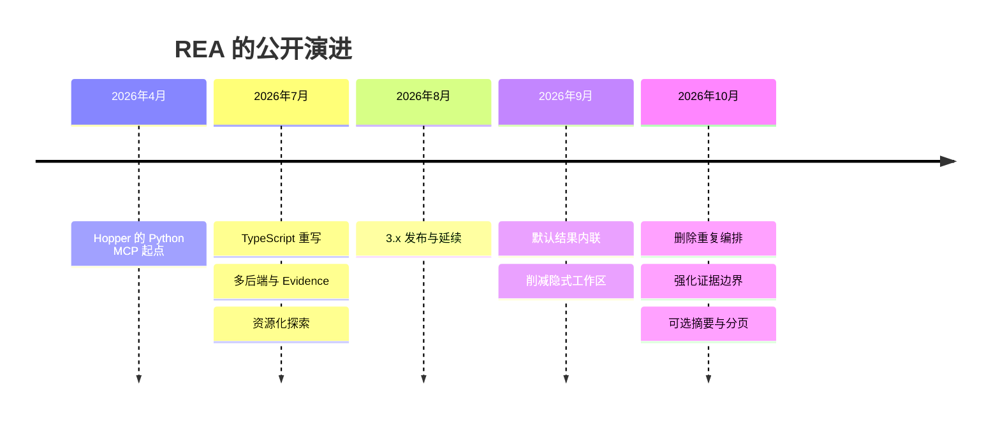
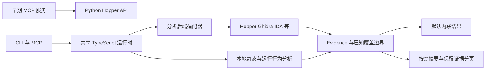
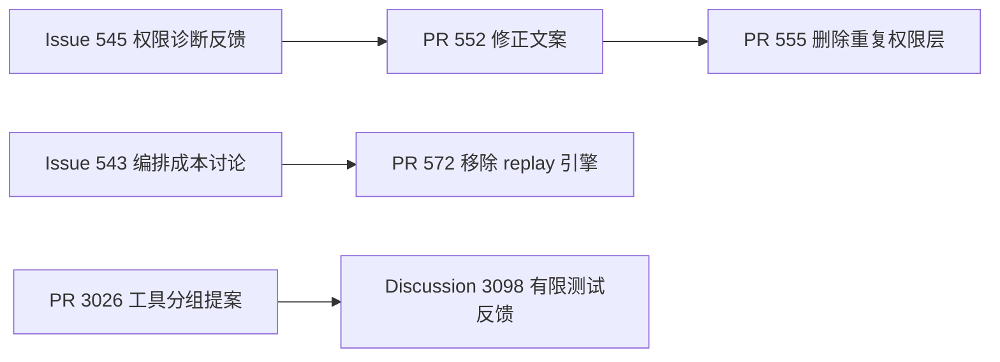

# REA 开发编年史｜从 Hopper 桥接，到证据驱动的逆向工作流

> 整理日期 2026-10-14，时区 Asia/Shanghai。独立研究，非官方路线图。
> 固定 Git 快照 `eab789aed74acd6ef7c15d509e0f3de350be2733`，索引 3,124 条提交、36 个公开 release、1,304 个 issue、2,142 个 PR。
> 核心结论：REA 的演进既包括扩大分析对象，也包括不断调整 agent 如何取得、理解和复用证据。功能扩张之后，项目开始主动削减编排负担，再为大结果增加可选的摘要与分页。

## §0 项目是什么

REA 是一个本地逆向分析工具层，通过 MCP 和 CLI 把 Hopper、Ghidra、IDA 等原生分析后端，以及 JavaScript、应用包和运行行为分析交给 agent 调用。它的公开历史始于 2026 年 4 月，密集开发从 7 月展开。本文按一个年份、多个阶段组织，不将缺少公开提交的月份写成停更或秘密研发。

[原始仓库](https://github.com/morluto/rea) · [固定快照 README](https://github.com/morluto/rea/blob/eab789aed74acd6ef7c15d509e0f3de350be2733/README.md)

| 指标 | 数值与口径 |
| --- | --- |
| 提交范围 | 2026-04-14 至 2026-10-14 |
| 提交总数 | 3,124，含 369 条 merge；非 merge 为 2,755 |
| 作者署名 | 226 个不同 author name，包含机器人及可能的同人异名 |
| 作者身份口径 | 233 个姓名/邮箱组合、226 个不同邮箱；均不等于自然人数 |
| 公开 release / 本地 tag | 36 / 36 |
| Issue / PR | 1,304 / 2,142，独立 API 采集快照 |
| 最新公开发布 | 6.5.0，2026-10-14T20:32:45+08:00 |

### 年度与月度提交量

```text
2026  ████████████████████████████████  3124

2026-04  █  1
2026-05  ·  0
2026-06  ·  0
2026-07  █████████  697
2026-08  █  21
2026-09  █  100
2026-10  ███████████████████████████████  2305
```

按上海时区的作者日期统计。7–10月的数量变化描述公开记录密度，不是效率或质量评分。



## §1 人物图鉴

下表按 Git 作者署名原样分组，角色是根据仓库贡献作出的研究归纳。别名不强行合并，不推断真实身份、国籍、年龄或雇佣关系。计数包含 merge，并非代码行数。

| 署名 | 提交 | 活跃期 | 角色定位 |
| --- | ---: | --- | --- |
| morluto | 1564 | 2026-04-14 — 2026-10-14 | 核心开发与架构演进 |
| Kaoru0822 | 397 | 2026-10-05 — 2026-10-14 | 仓库贡献者，按署名计数 |
| N0zoM1z0 | 280 | 2026-07-13 — 2026-10-14 | 仓库贡献者，按署名计数 |
| Ysopwnable | 221 | 2026-10-07 — 2026-10-14 | 仓库贡献者，按署名计数 |
| Rudy Mizrahi Celekli | 81 | 2026-10-05 — 2026-10-13 | 仓库贡献者，按署名计数 |
| github-actions[bot] | 42 | 2026-07-12 — 2026-10-14 | 发布自动化 |
| Iwakurakaoru0822 | 32 | 2026-10-07 — 2026-10-07 | 仓库贡献者，按署名计数 |
| ysopwnable | 22 | 2026-10-07 — 2026-10-07 | 仓库贡献者，按署名计数 |
| Saim Shafique | 11 | 2026-10-08 — 2026-10-14 | 仓库贡献者，按署名计数 |
| Dery Ferdika | 10 | 2026-10-06 — 2026-10-13 | 仓库贡献者，按署名计数 |
| You Wish | 10 | 2026-10-09 — 2026-10-12 | 仓库贡献者，按署名计数 |
| 吴佳浩Alben | 10 | 2026-10-13 — 2026-10-14 | 仓库贡献者，按署名计数 |

morluto 署名的 1,564 次提交占全部提交约 50.1%。这说明核心维护者仍承担大量工作；名称与邮箱存在别名，不能据此精确还原团队规模。

## §2 2026 年｜从桥接工具到证据工作流

### 2026 / 04 先把 Hopper 的门打开

**一句话：起点是一个有明确依赖和任务范围的 Python 增强层。**

4 月 14 日的第一个提交叫 betterBinaryMCP。它依赖 Hopper 自带的 MCP server，转发已有操作，并增加 Swift、Objective-C 与函数关系工具。用户仍要先打开并分析二进制；它解决的是让 agent 接触已有逆向能力的问题。

这里的时代背景是 MCP 已把模型和外部工具之间的连接标准化。Anthropic 在 2024 年 11 月公开协议；REA 选择从已有分析器入手，把逆向工程中的可操作信息送给 agent。这是技术环境的联系，不是对作者动机的推断。

5 月和 6 月没有进入该主线快照的提交。公开记录只能支持这个观察，不能据此推断作者停工，也不能补写隐藏开发史。

- [`729d3e9`](https://github.com/morluto/rea/commit/729d3e927cbcf17224e6b988eebcfae0d215c876) **Initial commit: betterBinaryMCP - Enhanced MCP server for Hopper Disassembler**（morluto，作者日期 2026-04-14）——作为本阶段论述的代码锚点，变更含义见上文。

本章关键词：Hopper · Python · MCP · 明确依赖

### 2026 / 07 · 12—16日 重写之后，项目开始拥有自己的运行时

**一句话：改名、共享运行时与 Evidence，让 REA 有了超出单一分析器的结构。**

7 月 12 日的重写将主服务迁到 TypeScript，把 Python 留在 Hopper 内部作为桥接。启动、通信、会话和配置开始由 REA 自己管理。CLI 与 MCP 共享 runtime，同一个分析动作由命令行和模型调用时可以走同一套实现。

Evidence v2 随后给结果补上来源、对象身份、置信与限制。持久化快照使一次观测可以被引用和比较。本文的判断是，项目从这时开始把“分析结果如何作为证据使用”放到与工具调用同等重要的位置。

多后端带来的难题也很具体：同一文件可能交给 Hopper 或 Ghidra，不同版本和 profile 产生的结果不能悄悄混在一起。provider registry 固定目标与后端的绑定；Ghidra 先有会话壳，再补 inventory、反编译与函数分析。

同一阶段，浏览器观察、Electron、JavaScript 应用图和 .NET 静态检查相继展开。共同点是把不同层次的观测接入相同的证据表示，而非承诺把任意程序完整还原成源代码。

- [`fbce15f`](https://github.com/morluto/rea/commit/fbce15f990e6810418f4bc09e364228f0fe31c0a) **Remove legacy Python MCP implementation**（morluto，作者日期 2026-07-12）——作为本阶段论述的代码锚点，变更含义见上文。
- [`d8a2b70`](https://github.com/morluto/rea/commit/d8a2b705651b2de54ee2f17581a6b9f5ba8139b1) **Add in-process Python bridge for Hopper API**（morluto，作者日期 2026-07-12）——作为本阶段论述的代码锚点，变更含义见上文。
- [`26e1294`](https://github.com/morluto/rea/commit/26e1294686ae398f1676b33b95864de31f73c5a2) **Update README for TypeScript rewrite and add AGENTS.md**（morluto，作者日期 2026-07-12）——作为本阶段论述的代码锚点，变更含义见上文。
- [`97541d8`](https://github.com/morluto/rea/commit/97541d8dad96e640ffd9ce5f0587dee0b5fbf6c1) **refactor(cli): share runtime between CLI and MCP**（morluto，作者日期 2026-07-12）——作为本阶段论述的代码锚点，变更含义见上文。
- [`3d70812`](https://github.com/morluto/rea/commit/3d70812c373ca7ef9a41146555605455515998dd) **feat(identity): rename package and CLI to REA**（morluto，作者日期 2026-07-12）——作为本阶段论述的代码锚点，变更含义见上文。
- [`b73558a`](https://github.com/morluto/rea/commit/b73558a7c9cdc8e5da8a129dfd7d10a4239d9f3e) **Rename npm package to rea-agents**（morluto，作者日期 2026-07-12）——作为本阶段论述的代码锚点，变更含义见上文。
- [`cc8681a`](https://github.com/morluto/rea/commit/cc8681a856dacb296f835112d0a27133d4c05ad1) **feat: add evidence-backed process investigations**（morluto，作者日期 2026-07-12）——作为本阶段论述的代码锚点，变更含义见上文。
- [`c439b9e`](https://github.com/morluto/rea/commit/c439b9e7787f3947eced0126a9c7b4d091584363) **feat(analysis): add provider-neutral persistent snapshots**（morluto，作者日期 2026-07-14）——作为本阶段论述的代码锚点，变更含义见上文。
- [`941d710`](https://github.com/morluto/rea/commit/941d7101dd3c8b7cdd790724c55ff00a90f42270) **feat(session): add explicit provider registry and target binding**（N0zoM1z0，作者日期 2026-07-15）——作为本阶段论述的代码锚点，变更含义见上文。
- [`f0e625d`](https://github.com/morluto/rea/commit/f0e625d7ee5a3f79158514aa93f89fca81a2da6a) **feat(ghidra): add private headless provider session**（N0zoM1z0，作者日期 2026-07-16）——作为本阶段论述的代码锚点，变更含义见上文。
- [`b1c07dd`](https://github.com/morluto/rea/commit/b1c07dd9c6fe8c4dd109fefe67f4b16fdd1115d1) **feat(ghidra): implement read-only inventory operations**（N0zoM1z0，作者日期 2026-07-16）——作为本阶段论述的代码锚点，变更含义见上文。
- [`d8321de`](https://github.com/morluto/rea/commit/d8321defd77c57df424b2635a4a70d38fe9a1fae) **feat(ghidra): add function analysis and conformance**（N0zoM1z0，作者日期 2026-07-16）——作为本阶段论述的代码锚点，变更含义见上文。

本章关键词：TypeScript · 共享运行时 · Evidence · 多后端

### 2026 / 07 · 中下旬 试着把一整条调查流程装进去

**一句话：重建验收、跨层关系与资源化交付相继进入框架，也留下后续收缩的起点。**

应用图把模块、入口、IPC 和原生边界放进同一张关系网；obligation ledger 又为重建任务引入实施、验证、矛盾、阻塞和未知等状态。REA 的职责开始从取证扩展到重建验收。

到 7 月 30 日，工具响应开始指向 MCP resources，让完整 Evidence 保存为可读资源，响应本身只保留紧凑引用。这条路线减少了单次输出，却要求调用方继续读取资源；3.0 将其作为破坏性接口变化发布。

这一时期尤其需要区分设计与落地。2.7.0 的部分 provider 标题，对应 diff 主要是 schema/helper 和测试；Android 真正的 headless JADX 适配到 10 月才接通。不能把历史功能标题累加成当时可用的平台能力。

- [`2ca5672`](https://github.com/morluto/rea/commit/2ca56724e4be7429372904ad26fe97fa5943bcf4) **feat(domain): add versioned JavaScript Application Graph**（N0zoM1z0，作者日期 2026-07-16）——作为本阶段论述的代码锚点，变更含义见上文。
- [`aa46abf`](https://github.com/morluto/rea/commit/aa46abfe1b59ecab160029c88b0c925ff68d6033) **feat(artifact): reconstruct JavaScript application structure**（N0zoM1z0，作者日期 2026-07-16）——作为本阶段论述的代码锚点，变更含义见上文。
- [`3fa2304`](https://github.com/morluto/rea/commit/3fa2304bc70beb96cf30feb51bb6d7ac4fb7a2b0) **feat(electron): map static process and IPC boundaries**（N0zoM1z0，作者日期 2026-07-16）——作为本阶段论述的代码锚点，变更含义见上文。
- [`8c67dbd`](https://github.com/morluto/rea/commit/8c67dbd49e74b2f304a03845a8a55e6a433cc915) **feat(electron): reconcile static artifacts with passive runtime**（N0zoM1z0，作者日期 2026-07-16）——作为本阶段论述的代码锚点，变更含义见上文。
- [`778b995`](https://github.com/morluto/rea/commit/778b995bbfd4b4bb28ace9bf0f7428e50cd1be50) **feat(application): add cross-layer graph workflows**（N0zoM1z0，作者日期 2026-07-16）——作为本阶段论述的代码锚点，变更含义见上文。
- [`9d48ca7`](https://github.com/morluto/rea/commit/9d48ca788cacabb5bc329e9cc0467784359c5d6d) **feat(reconstruction): add obligation ledgers**（morluto，作者日期 2026-07-24）——作为本阶段论述的代码锚点，变更含义见上文。
- [`38ff741`](https://github.com/morluto/rea/commit/38ff7418efc3299150f3a8a1eab65e8314ef7aa3) **feat(reconstruction): evaluate end-to-end readiness**（morluto，作者日期 2026-07-24）——作为本阶段论述的代码锚点，变更含义见上文。
- [`1712e6d`](https://github.com/morluto/rea/commit/1712e6d821965ce5edc3880fe4ebab2e3cc02fd4) **feat!: make evidence bundles canonical MCP resources**（morluto，作者日期 2026-07-30）——作为本阶段论述的代码锚点，变更含义见上文。
- [`2a45d8d`](https://github.com/morluto/rea/commit/2a45d8de7d52d0a234672d03c7dae794859f8ced) **docs: document resource snapshot workflow**（morluto，作者日期 2026-07-30）——作为本阶段论述的代码锚点，变更含义见上文。

本章关键词：应用图 · 重建验收 · MCP resources · 接口成本

### 2026 / 08 主动观察进入 Electron

**一句话：公开提交降到 21 条，已有能力的生命周期与验证边界变得更突出。**

8 月 5 日的 #464 加入基于 Playwright 的主动 Electron 场景。此前被动 CDP 观察已经存在，这次补上点击、等待、窗口事件和 IPC 形状记录。主动启动应用与旁观既有进程是两种不同能力。

文档同时明确：普通宿主权限下启动不是隔离沙箱，IPC 形状不等于完整参数值，局部捕获也不能冒充全量。类型状态、生命周期与测试重构说明项目开始处理能力扩张带来的约束。

3.0.0 与 3.1.0 的 GitHub release 实际发布时间分别落在上海时间 8 月 3 日与 8 月 10 日；它们和 CHANGELOG 条目日期不完全相同。本文对发布时间使用 API 的 publishedAt，对开发动作使用提交时间。

- [`8f229ed`](https://github.com/morluto/rea/commit/8f229ede70c0a4e224c1cf71d61487e17b779d6a) **feat(electron): add autonomous Electron runtime analysis (#464)**（morluto，作者日期 2026-08-05）——作为本阶段论述的代码锚点，变更含义见上文。
- [`d65730c`](https://github.com/morluto/rea/commit/d65730c4c24ab6183426516d4564e6c25294b35d) **refactor(domain): encode comparison and lifecycle states exactly (#473)**（morluto，作者日期 2026-08-11）——作为本阶段论述的代码锚点，变更含义见上文。
- [`b8a9da0`](https://github.com/morluto/rea/commit/b8a9da0c0f9f0b2b022a350d2c7c671d1fa3f886) **refactor(mcp): make analysis states unrepresentable (#468)**（morluto，作者日期 2026-08-10）——作为本阶段论述的代码锚点，变更含义见上文。

本章关键词：主动场景 · Electron · 生命周期 · 验证范围

### 2026 / 09 → 10.05 路线转弯，开始主动做减法

**一句话：完整结果重新内联，重复授权与自研 replay 编排陆续退出。**

9 月 29 日起，工具输出删去资源跳转提示和投影选项，完整结果直接回到响应中。持久化版本调查与 readiness 工具也被移除。与 7 月的资源优先设计对照，这是一次明确修正。

10 月 5 日，#555 去掉 grant、scope ceiling 等额外输入；#572 又移除自研 replay engine、有限状态机和 prepare/execute 流程。新的分工由 agent 使用普通命令、脚本和 fixture server 组织实验，REA 提供可调用的观察、检查与比较工具。

研究判断：项目开始把框架维护成本视为路线的一部分。删掉功能也能是进展，前提是保留证据质量和真实边界。权限诊断 issue 与编排成本设计议题能直接解释这次转弯，详见社区回声。

- [`0d96275`](https://github.com/morluto/rea/commit/0d96275b6887b72519d2bc54f72012db6a8e482c) **refactor: return complete tool results inline**（morluto，作者日期 2026-09-29）——作为本阶段论述的代码锚点，变更含义见上文。
- [`81996df`](https://github.com/morluto/rea/commit/81996df7a59ae6efb0f7be6687af89e66c64cdcb) **refactor: remove cross-version investigation workflow**（morluto，作者日期 2026-09-29）——作为本阶段论述的代码锚点，变更含义见上文。
- [`7acac61`](https://github.com/morluto/rea/commit/7acac615ca2b8e3f4edd65fd8a08b237f85b5ac7) **refactor(contracts): simplify workflows and drop readiness tool**（morluto，作者日期 2026-09-29）——作为本阶段论述的代码锚点，变更含义见上文。
- [`b5e9891`](https://github.com/morluto/rea/commit/b5e98915c60968213141f33839e0c5c4b34df4db) **fix(tools)!: simplify direct invocation and harden boundary contracts (#555)**（morluto，作者日期 2026-10-05）——作为本阶段论述的代码锚点，变更含义见上文。
- [`e07b816`](https://github.com/morluto/rea/commit/e07b81649e96668e5ce166cfc6db3b59a7777697) **refactor!: simplify runtime tools and remove replay engines (#572)**（morluto，作者日期 2026-10-05）——作为本阶段论述的代码锚点，变更含义见上文。

本章关键词：直接调用 · 内联输出 · 职责收缩 · Agent组合

### 2026 / 10 · 截至14日 扩张继续，证据交付变得更精细

**一句话：新增分析对象与改进证据契约同时发生，10 月贡献了快照中约 73.8% 的提交。**

10 月的 2,305 次提交占本次快照约 73.8%。JADX、IDA、Wakaru、固件、WASM、录制网络包和离线数据库相继接入。已有成熟工具承担具体分析，REA 处理选择、调用、结果与证据语义。

6.2 附近将成功结果直接统一为 canonical Evidence，减少重复 wrapper；目标身份、profile、部分结果和 cleanup 失败都需要保留可解释的记录。这些改动针对的是“结果是否能被正确理解”，并非单纯增加工具数量。

完整输出仍会遇到模型上下文限制。10 月出现 retained analysis views，并为部分工具增加可选 summary 和分页。关键区别是原始分析仍然保留，缩小输出不会悄悄缩小分析覆盖；读完一页也不等于分析已经完整。

截至本次采集，6.5.0 已公开发布。未来路线应参考固定快照的 roadmap：更深的 native 验证、静态与运行时连接、托管代码比较，以及进程和协议覆盖。新增后端须有具体工作流缺口和真实工具链验证，这些是公开优先事项，尚无统一完成日期。

- [`904d03e`](https://github.com/morluto/rea/commit/904d03e987a6c498561b314a266202dee84b13ab) **feat(android): integrate static APK analysis with headless JADX (#738)**（N0zoM1z0，作者日期 2026-10-06）——作为本阶段论述的代码锚点，变更含义见上文。
- [`5a7c769`](https://github.com/morluto/rea/commit/5a7c769692c21efc4cc0e5ebf06a9f2534dc75ed) **feat(firmware): integrate Binwalk and Unblob analysis**（N0zoM1z0，作者日期 2026-10-06）——作为本阶段论述的代码锚点，变更含义见上文。
- [`8238232`](https://github.com/morluto/rea/commit/82382324855a3a4ed51d2cdc3b2b455c9e8419e2) **feat(ida): add read-only GUI and headless MCP providers (#754)**（N0zoM1z0，作者日期 2026-10-07）——作为本阶段论述的代码锚点，变更含义见上文。
- [`166dcd2`](https://github.com/morluto/rea/commit/166dcd21d06f687a9c480a6a6d36beb3b4954dd0) **feat(javascript): recover readable modules with Wakaru (#848)**（N0zoM1z0，作者日期 2026-10-07）——作为本阶段论述的代码锚点，变更含义见上文。
- [`e0fd820`](https://github.com/morluto/rea/commit/e0fd8207a1fb738bcc34f204b55c4fa154f5f02d) **feat(application): wire Android and Apple inventory graph tools (#852)**（morluto，作者日期 2026-10-07）——作为本阶段论述的代码锚点，变更含义见上文。
- [`63bf914`](https://github.com/morluto/rea/commit/63bf91405cf97b114a84f337fb1272d98a267999) **refactor!: enforce canonical evidence and provider boundaries**（morluto，作者日期 2026-10-09）——作为本阶段论述的代码锚点，变更含义见上文。
- [`27a9cea`](https://github.com/morluto/rea/commit/27a9ceade7232c1c9a24dc7d454ae060948183a1) **fix!: restore caching, preserve failures, and verify fixture claims (#1211)**（YouWish，作者日期 2026-10-09）——作为本阶段论述的代码锚点，变更含义见上文。
- [`db675f1`](https://github.com/morluto/rea/commit/db675f1d52acda62b6f57b5a8773532f49b259e7) **feat(mcp): select views of retained analysis results (#1180)**（Matt Van Horn，作者日期 2026-10-09）——作为本阶段论述的代码锚点，变更含义见上文。
- [`58fb372`](https://github.com/morluto/rea/commit/58fb372071e56da9c5df0e37593ee3f0da6b64bc) **feat(analysis): add opt-in retained inventory and WASM views (#2122)**（Ysopwnable，作者日期 2026-10-12）——作为本阶段论述的代码锚点，变更含义见上文。
- [`82cfcee`](https://github.com/morluto/rea/commit/82cfcee19f18b0eeae9a330ba04e0411cdf85225) **feat(managed): add retained metadata overview and pages (#2413)**（Ysopwnable，作者日期 2026-10-13）——作为本阶段论述的代码锚点，变更含义见上文。
- [`f254f5a`](https://github.com/morluto/rea/commit/f254f5ac2b804b353a711264bb178f43fdf07867) **feat(android): add opt-in package summaries and retained manifest views**（Ysopwnable，作者日期 2026-10-13）——作为本阶段论述的代码锚点，变更含义见上文。
- [`ffaf2c1`](https://github.com/morluto/rea/commit/ffaf2c12f1793c7c451e66dc09c3074544a4c086) **feat(wasm): inspect local artifacts with WABT (#1533)**（Thang Luu，作者日期 2026-10-11）——作为本阶段论述的代码锚点，变更含义见上文。
- [`f611d8c`](https://github.com/morluto/rea/commit/f611d8ce722cd36345e9ff83b9669ef2e7fe57a9) **feat(captures): inspect recorded packets with bounded TShark delivery (#2318)**（Ysopwnable，作者日期 2026-10-13）——作为本阶段论述的代码锚点，变更含义见上文。
- [`91b8f58`](https://github.com/morluto/rea/commit/91b8f587cd495c509946e69076525eb19dc1ca65) **feat(signals): decode recordings with bounded sigrok output (#2339)**（Ysopwnable，作者日期 2026-10-13）——作为本阶段论述的代码锚点，变更含义见上文。
- [`aeee507`](https://github.com/morluto/rea/commit/aeee5074d124414239b6dd440dc79c26bcbd58a4) **feat(sqlite): inspect offline snapshots with selective evidence (#2271)**（Ysopwnable，作者日期 2026-10-13）——作为本阶段论述的代码锚点，变更含义见上文。

本章关键词：多引擎 · Evidence契约 · 按需摘要 · 覆盖边界

### 关键里程碑逐条索引

#### 2026-04-14 · 起点是 Hopper 的增强层

betterBinaryMCP 用 Python 包装 Hopper 官方 MCP，聚焦 Swift、Objective-C 和函数关系。

首提交的 README 列出31个转发操作和8个增强工具；server.py 使用 FastMCP 与 HopperMCPSubprocessClient，调用 Hopper 自带的 HopperMCPServer。用户需要先让 Hopper 打开并分析二进制。这里尚没有独立的多引擎分析平台。

- [`729d3e9`](https://github.com/morluto/rea/commit/729d3e927cbcf17224e6b988eebcfae0d215c876) **Initial commit: betterBinaryMCP - Enhanced MCP server for Hopper Disassembler**（morluto）——betterBinaryMCP 用 Python 包装 Hopper 官方 MCP，聚焦 Swift、Objective-C 和函数关系。
- [相关一手来源](https://github.com/morluto/rea/commit/729d3e927cbcf17224e6b988eebcfae0d215c876)

#### 2026-07-12 · 重写运行时，并改名 REA

TypeScript 成为主服务，仓库自己的 Python 桥接进入 Hopper；CLI 与 MCP 共用运行时。

fbce15f 删除旧 Python 服务，d8a2b70 新增在 Hopper 内执行的桥接脚本，26e1294 的 README 明确新链路为 MCP→TypeScript→Unix socket→owned Python bridge→Hopper。97541d8 抽出共享 runtime，3d70812 把包与命令改为 REA；b73558a 最终把 npm 包名定为 rea-agents。变化涉及启动、通信和生命周期，不只是换语言与名称。

- [`fbce15f`](https://github.com/morluto/rea/commit/fbce15f990e6810418f4bc09e364228f0fe31c0a) **Remove legacy Python MCP implementation**（morluto）——TypeScript 成为主服务，仓库自己的 Python 桥接进入 Hopper；CLI 与 MCP 共用运行时。
- [`d8a2b70`](https://github.com/morluto/rea/commit/d8a2b705651b2de54ee2f17581a6b9f5ba8139b1) **Add in-process Python bridge for Hopper API**（morluto）——TypeScript 成为主服务，仓库自己的 Python 桥接进入 Hopper；CLI 与 MCP 共用运行时。
- [`26e1294`](https://github.com/morluto/rea/commit/26e1294686ae398f1676b33b95864de31f73c5a2) **Update README for TypeScript rewrite and add AGENTS.md**（morluto）——TypeScript 成为主服务，仓库自己的 Python 桥接进入 Hopper；CLI 与 MCP 共用运行时。
- [`97541d8`](https://github.com/morluto/rea/commit/97541d8dad96e640ffd9ce5f0587dee0b5fbf6c1) **refactor(cli): share runtime between CLI and MCP**（morluto）——TypeScript 成为主服务，仓库自己的 Python 桥接进入 Hopper；CLI 与 MCP 共用运行时。
- [`3d70812`](https://github.com/morluto/rea/commit/3d70812c373ca7ef9a41146555605455515998dd) **feat(identity): rename package and CLI to REA**（morluto）——TypeScript 成为主服务，仓库自己的 Python 桥接进入 Hopper；CLI 与 MCP 共用运行时。
- [`b73558a`](https://github.com/morluto/rea/commit/b73558a7c9cdc8e5da8a129dfd7d10a4239d9f3e) **Rename npm package to rea-agents**（morluto）——TypeScript 成为主服务，仓库自己的 Python 桥接进入 Hopper；CLI 与 MCP 共用运行时。
- [相关一手来源](https://github.com/morluto/rea/commit/fbce15f990e6810418f4bc09e364228f0fe31c0a)
- [相关一手来源](https://github.com/morluto/rea/commit/d8a2b705651b2de54ee2f17581a6b9f5ba8139b1)
- [相关一手来源](https://github.com/morluto/rea/commit/26e1294686ae398f1676b33b95864de31f73c5a2)
- [相关一手来源](https://github.com/morluto/rea/commit/97541d8dad96e640ffd9ce5f0587dee0b5fbf6c1)
- [相关一手来源](https://github.com/morluto/rea/commit/3d70812c373ca7ef9a41146555605455515998dd)
- [相关一手来源](https://github.com/morluto/rea/commit/b73558a7c9cdc8e5da8a129dfd7d10a4239d9f3e)

#### 2026-07-12 · 把分析输出变成可引用的证据

Evidence v2 加入来源、内容身份、观测与推断区别，随后支持持久化快照。

cc8681a 的 evidence.ts 从 Hopper 固定记录改为 provider-neutral Evidence，包含 subject、provider、confidence、authority、limitations、locations、evidence_links，并用规范化 JSON 的 SHA-256 生成语义身份。c439b9e 在7月14日加入可保存的 provider-neutral snapshots。分析判断：后续跨引擎、跨层比较开始共享一套事实记录语言。

- [`cc8681a`](https://github.com/morluto/rea/commit/cc8681a856dacb296f835112d0a27133d4c05ad1) **feat: add evidence-backed process investigations**（morluto）——Evidence v2 加入来源、内容身份、观测与推断区别，随后支持持久化快照。
- [`c439b9e`](https://github.com/morluto/rea/commit/c439b9e7787f3947eced0126a9c7b4d091584363) **feat(analysis): add provider-neutral persistent snapshots**（morluto）——Evidence v2 加入来源、内容身份、观测与推断区别，随后支持持久化快照。
- [相关一手来源](https://github.com/morluto/rea/commit/cc8681a856dacb296f835112d0a27133d4c05ad1)
- [相关一手来源](https://github.com/morluto/rea/commit/c439b9e7787f3947eced0126a9c7b4d091584363)

#### 2026-07-14 · 视野越过本机二进制

被动网站观察与 Electron 工作流把浏览器、网络和应用层纳入同一工具集。

2c1ceab 新增 CdpBrowserProvider、页面事件/文档/存储采集、BrowserObservationService 与 CLI/MCP 注册；be76f80 扩展 Electron CDP 观察、source map、截图比较和捕获差异。这里的观察边界与后来主动场景不同，不能把被动捕获写成已经能自动驱动整款应用。

- [`2c1ceab`](https://github.com/morluto/rea/commit/2c1ceabbf1f117daafe166e1134b47737b38e1f6) **feat: add passive website reverse engineering**（N0zoM1z0）——被动网站观察与 Electron 工作流把浏览器、网络和应用层纳入同一工具集。
- [`be76f80`](https://github.com/morluto/rea/commit/be76f8090b5195680cdf73a8c21f65e6516efc92) **feat: add web and Electron reverse-engineering workflows**（N0zoM1z0）——被动网站观察与 Electron 工作流把浏览器、网络和应用层纳入同一工具集。
- [相关一手来源](https://github.com/morluto/rea/commit/2c1ceabbf1f117daafe166e1134b47737b38e1f6)
- [相关一手来源](https://github.com/morluto/rea/commit/be76f8090b5195680cdf73a8c21f65e6516efc92)

#### 2026-07-16 · Ghidra 接入之前，先解决谁来分析

显式 provider registry 与 target binding 让 Hopper、Ghidra 的重叠能力有确定选择。

7月15日的941d710在 ADR 中记录真实问题：同一目标可能由不同分析器、版本和配置产生不同结果，旧 CompositeProvider 不能让数组顺序偷偷决定引擎。注册表建立不随请求漂移的 target/provider/profile 绑定。7月16日 f0e625d 先添加私有 headless 会话，其 capabilities 当时为空；b1c07dd 与 d8321de 随后加入只读 inventory、反编译和函数分析，才形成可用分析路径。

- [`941d710`](https://github.com/morluto/rea/commit/941d7101dd3c8b7cdd790724c55ff00a90f42270) **feat(session): add explicit provider registry and target binding**（N0zoM1z0）——显式 provider registry 与 target binding 让 Hopper、Ghidra 的重叠能力有确定选择。
- [`f0e625d`](https://github.com/morluto/rea/commit/f0e625d7ee5a3f79158514aa93f89fca81a2da6a) **feat(ghidra): add private headless provider session**（N0zoM1z0）——显式 provider registry 与 target binding 让 Hopper、Ghidra 的重叠能力有确定选择。
- [`b1c07dd`](https://github.com/morluto/rea/commit/b1c07dd9c6fe8c4dd109fefe67f4b16fdd1115d1) **feat(ghidra): implement read-only inventory operations**（N0zoM1z0）——显式 provider registry 与 target binding 让 Hopper、Ghidra 的重叠能力有确定选择。
- [`d8321de`](https://github.com/morluto/rea/commit/d8321defd77c57df424b2635a4a70d38fe9a1fae) **feat(ghidra): add function analysis and conformance**（N0zoM1z0）——显式 provider registry 与 target binding 让 Hopper、Ghidra 的重叠能力有确定选择。
- [相关一手来源](https://github.com/morluto/rea/commit/941d7101dd3c8b7cdd790724c55ff00a90f42270)
- [相关一手来源](https://github.com/morluto/rea/commit/f0e625d7ee5a3f79158514aa93f89fca81a2da6a)
- [相关一手来源](https://github.com/morluto/rea/commit/b1c07dd9c6fe8c4dd109fefe67f4b16fdd1115d1)
- [相关一手来源](https://github.com/morluto/rea/commit/d8321defd77c57df424b2635a4a70d38fe9a1fae)

#### 2026-07-16 · 从函数清单走向应用关系图

JavaScript Application Graph 将入口、模块、IPC 和静态/运行时证据放在一起。

2ca5672 建立带语义内容身份的节点与边；aa46abf 对目录和 ASAR 进行不执行代码的 AST 静态恢复，并明确当时只是应用服务，还没有独立 CLI/MCP 命令。3fa2304 加入 Electron 进程与 IPC 边界，8c67dbd 做静态产物与被动运行时的核对，778b995 随后提供跨层工作流。静态语法只支持推断，不能直接证明运行时执行。

- [`2ca5672`](https://github.com/morluto/rea/commit/2ca56724e4be7429372904ad26fe97fa5943bcf4) **feat(domain): add versioned JavaScript Application Graph**（N0zoM1z0）——JavaScript Application Graph 将入口、模块、IPC 和静态/运行时证据放在一起。
- [`aa46abf`](https://github.com/morluto/rea/commit/aa46abfe1b59ecab160029c88b0c925ff68d6033) **feat(artifact): reconstruct JavaScript application structure**（N0zoM1z0）——JavaScript Application Graph 将入口、模块、IPC 和静态/运行时证据放在一起。
- [`3fa2304`](https://github.com/morluto/rea/commit/3fa2304bc70beb96cf30feb51bb6d7ac4fb7a2b0) **feat(electron): map static process and IPC boundaries**（N0zoM1z0）——JavaScript Application Graph 将入口、模块、IPC 和静态/运行时证据放在一起。
- [`8c67dbd`](https://github.com/morluto/rea/commit/8c67dbd49e74b2f304a03845a8a55e6a433cc915) **feat(electron): reconcile static artifacts with passive runtime**（N0zoM1z0）——JavaScript Application Graph 将入口、模块、IPC 和静态/运行时证据放在一起。
- [`778b995`](https://github.com/morluto/rea/commit/778b995bbfd4b4bb28ace9bf0f7428e50cd1be50) **feat(application): add cross-layer graph workflows**（N0zoM1z0）——JavaScript Application Graph 将入口、模块、IPC 和静态/运行时证据放在一起。
- [相关一手来源](https://github.com/morluto/rea/commit/2ca56724e4be7429372904ad26fe97fa5943bcf4)
- [相关一手来源](https://github.com/morluto/rea/commit/aa46abfe1b59ecab160029c88b0c925ff68d6033)
- [相关一手来源](https://github.com/morluto/rea/commit/3fa2304bc70beb96cf30feb51bb6d7ac4fb7a2b0)
- [相关一手来源](https://github.com/morluto/rea/commit/8c67dbd49e74b2f304a03845a8a55e6a433cc915)
- [相关一手来源](https://github.com/morluto/rea/commit/778b995bbfd4b4bb28ace9bf0f7428e50cd1be50)

#### 2026-07-16 · .NET 接入相同的证据语义

PE/CLI 检查、成员与 CIL、P/Invoke 比较逐步接入应用图。

c251c38 最先仅提供只读 PE/CLI triage；98cad37、55794d6、466b1bb 后续补齐成员检查、比较和 native boundary 声明。77178bb 将 assembly/type/method/field/PInvoke 等静态事实投影进应用图。d36af5d 让 reconstruction 输入必须有 Evidence。这里可证实的是静态检查、证据匹配和显式导入，不能等同于自动恢复原始源码或完整托管运行时执行。

- [`c251c38`](https://github.com/morluto/rea/commit/c251c38aa2ead24e4aaeb95678a10dddaa212dc4) **feat(dotnet): add managed artifact triage**（N0zoM1z0）——PE/CLI 检查、成员与 CIL、P/Invoke 比较逐步接入应用图。
- [`98cad37`](https://github.com/morluto/rea/commit/98cad3788d05ae31d86bb448d6fa8e5ebb1c742c) **feat(dotnet): add managed member inspection**（N0zoM1z0）——PE/CLI 检查、成员与 CIL、P/Invoke 比较逐步接入应用图。
- [`55794d6`](https://github.com/morluto/rea/commit/55794d6083d6746fa2c7ad08a5f548c05272b1ae) **feat(dotnet): add managed member comparison**（N0zoM1z0）——PE/CLI 检查、成员与 CIL、P/Invoke 比较逐步接入应用图。
- [`466b1bb`](https://github.com/morluto/rea/commit/466b1bbebee8c9266708de885b5e5405d23d0b7c) **feat(dotnet): add managed native boundary inspection**（N0zoM1z0）——PE/CLI 检查、成员与 CIL、P/Invoke 比较逐步接入应用图。
- [`77178bb`](https://github.com/morluto/rea/commit/77178bba543ed40b5cb29d301ad930e698a1968c) **feat(managed): project static evidence into application graph**（N0zoM1z0）——PE/CLI 检查、成员与 CIL、P/Invoke 比较逐步接入应用图。
- [`d36af5d`](https://github.com/morluto/rea/commit/d36af5d0f708637f514f356521242b2b1066c8ed) **feat(mcp)!: require Evidence for managed reconstruction**（morluto）——PE/CLI 检查、成员与 CIL、P/Invoke 比较逐步接入应用图。
- [相关一手来源](https://github.com/morluto/rea/commit/c251c38aa2ead24e4aaeb95678a10dddaa212dc4)
- [相关一手来源](https://github.com/morluto/rea/commit/98cad3788d05ae31d86bb448d6fa8e5ebb1c742c)
- [相关一手来源](https://github.com/morluto/rea/commit/55794d6083d6746fa2c7ad08a5f548c05272b1ae)
- [相关一手来源](https://github.com/morluto/rea/commit/466b1bbebee8c9266708de885b5e5405d23d0b7c)
- [相关一手来源](https://github.com/morluto/rea/commit/77178bba543ed40b5cb29d301ad930e698a1968c)
- [相关一手来源](https://github.com/morluto/rea/commit/d36af5d0f708637f514f356521242b2b1066c8ed)

#### 2026-07-24 · “重建完成”也需要证据

obligation ledger 把重建任务拆为可验证的责任、案例和状态。

9d48ca7 新增 obligation ledger 的领域 schema、评估服务与 MCP 注册；其状态区分 unowned、implemented、verified、contradicted、blocked 和 unknown，案例包括正例、反例、畸形输入、取消和 teardown。38ff741 加入 end-to-end readiness 评估。分析判断：这时项目尝试把观察、重建与验收一并纳入框架；其中 readiness 工具后来被移除，不能累加成当前功能清单。

- [`9d48ca7`](https://github.com/morluto/rea/commit/9d48ca788cacabb5bc329e9cc0467784359c5d6d) **feat(reconstruction): add obligation ledgers**（morluto）——obligation ledger 把重建任务拆为可验证的责任、案例和状态。
- [`38ff741`](https://github.com/morluto/rea/commit/38ff7418efc3299150f3a8a1eab65e8314ef7aa3) **feat(reconstruction): evaluate end-to-end readiness**（morluto）——obligation ledger 把重建任务拆为可验证的责任、案例和状态。
- [`7acac61`](https://github.com/morluto/rea/commit/7acac615ca2b8e3f4edd65fd8a08b237f85b5ac7) **refactor(contracts): simplify workflows and drop readiness tool**（morluto）——obligation ledger 把重建任务拆为可验证的责任、案例和状态。
- [相关一手来源](https://github.com/morluto/rea/commit/9d48ca788cacabb5bc329e9cc0467784359c5d6d)
- [相关一手来源](https://github.com/morluto/rea/commit/38ff7418efc3299150f3a8a1eab65e8314ef7aa3)
- [相关一手来源](https://github.com/morluto/rea/commit/7acac615ca2b8e3f4edd65fd8a08b237f85b5ac7)

#### 2026-07-30 · 一次把证据交给 MCP resources

7月底的接口实验用资源快照保存完整细节，工具响应提供紧凑引用。

1712e6d 的作者日期为7月29日17:36 UTC，上海时间7月30日01:36。其 diff 为工具响应加入资源链接与 resources/read 提示，export_evidence_bundle 必须写到指定文件；这构成3.0的破坏性变更。它解决的是证据交付和持久化问题，但也增加调用端获取完整结果的步骤。后续9月改变此设计，说明这是一条被检验并修正的路线。

- [`1712e6d`](https://github.com/morluto/rea/commit/1712e6d821965ce5edc3880fe4ebab2e3cc02fd4) **feat!: make evidence bundles canonical MCP resources**（morluto）——7月底的接口实验用资源快照保存完整细节，工具响应提供紧凑引用。
- [`2a45d8d`](https://github.com/morluto/rea/commit/2a45d8de7d52d0a234672d03c7dae794859f8ced) **docs: document resource snapshot workflow**（morluto）——7月底的接口实验用资源快照保存完整细节，工具响应提供紧凑引用。
- [相关一手来源](https://github.com/morluto/rea/commit/1712e6d821965ce5edc3880fe4ebab2e3cc02fd4)
- [相关一手来源](https://github.com/morluto/rea/commit/2a45d8de7d52d0a234672d03c7dae794859f8ced)

#### 2026-08-05 · Electron 从被动观察走到主动场景

Playwright Electron 场景加入点击、等待、窗口事件与 IPC 形状记录。

8f229ed（#464）加入主动启动和生命周期管理。同期文档明确主动权限独立于被动 CDP，运行在普通宿主权限下，并不是 sandbox；IPC 记录通道和参数形状而非参数值，部分捕获必须保留 coverage 缺口。8月另外出现类型状态、生命周期与测试边界的重构，反映能力扩张之后的收束。

- [`8f229ed`](https://github.com/morluto/rea/commit/8f229ede70c0a4e224c1cf71d61487e17b779d6a) **feat(electron): add autonomous Electron runtime analysis (#464)**（morluto）——Playwright Electron 场景加入点击、等待、窗口事件与 IPC 形状记录。
- [`d65730c`](https://github.com/morluto/rea/commit/d65730c4c24ab6183426516d4564e6c25294b35d) **refactor(domain): encode comparison and lifecycle states exactly (#473)**（morluto）——Playwright Electron 场景加入点击、等待、窗口事件与 IPC 形状记录。
- [`b8a9da0`](https://github.com/morluto/rea/commit/b8a9da0c0f9f0b2b022a350d2c7c671d1fa3f886) **refactor(mcp): make analysis states unrepresentable (#468)**（morluto）——Playwright Electron 场景加入点击、等待、窗口事件与 IPC 形状记录。
- [相关一手来源](https://github.com/morluto/rea/commit/8f229ede70c0a4e224c1cf71d61487e17b779d6a)
- [相关一手来源](https://github.com/morluto/rea/commit/d65730c4c24ab6183426516d4564e6c25294b35d)
- [相关一手来源](https://github.com/morluto/rea/commit/b8a9da0c0f9f0b2b022a350d2c7c671d1fa3f886)

#### 2026-09-29 · 主动删除框架负担

9月底到10月5日，REA 把完整结果直接交给调用者，并退役部分自研编排。

0d96275 从 toolResult 中删除资源跳转提示和投影选项，改回 inline 完整结果；81996df 删除 persistent investigate-versions workflow，7acac615 移除 readiness 工具。10月5日 b5e9891 删除 grant、scope ceiling、approval 等重复输入，e07b816 移除 replay engine、Node characterization、finite replay-machine、managed runtime planning，明确让 agent 用普通命令、脚本和 fixture server 组合实验。分析判断：路线由“预先规定整条调查流程”转向“提供有证据的原语”。

- [`0d96275`](https://github.com/morluto/rea/commit/0d96275b6887b72519d2bc54f72012db6a8e482c) **refactor: return complete tool results inline**（morluto）——9月底到10月5日，REA 把完整结果直接交给调用者，并退役部分自研编排。
- [`81996df`](https://github.com/morluto/rea/commit/81996df7a59ae6efb0f7be6687af89e66c64cdcb) **refactor: remove cross-version investigation workflow**（morluto）——9月底到10月5日，REA 把完整结果直接交给调用者，并退役部分自研编排。
- [`7acac61`](https://github.com/morluto/rea/commit/7acac615ca2b8e3f4edd65fd8a08b237f85b5ac7) **refactor(contracts): simplify workflows and drop readiness tool**（morluto）——9月底到10月5日，REA 把完整结果直接交给调用者，并退役部分自研编排。
- [`b5e9891`](https://github.com/morluto/rea/commit/b5e98915c60968213141f33839e0c5c4b34df4db) **fix(tools)!: simplify direct invocation and harden boundary contracts (#555)**（morluto）——9月底到10月5日，REA 把完整结果直接交给调用者，并退役部分自研编排。
- [`e07b816`](https://github.com/morluto/rea/commit/e07b81649e96668e5ce166cfc6db3b59a7777697) **refactor!: simplify runtime tools and remove replay engines (#572)**（morluto）——9月底到10月5日，REA 把完整结果直接交给调用者，并退役部分自研编排。
- [相关一手来源](https://github.com/morluto/rea/commit/0d96275b6887b72519d2bc54f72012db6a8e482c)
- [相关一手来源](https://github.com/morluto/rea/commit/81996df7a59ae6efb0f7be6687af89e66c64cdcb)
- [相关一手来源](https://github.com/morluto/rea/commit/7acac615ca2b8e3f4edd65fd8a08b237f85b5ac7)
- [相关一手来源](https://github.com/morluto/rea/commit/b5e98915c60968213141f33839e0c5c4b34df4db)
- [相关一手来源](https://github.com/morluto/rea/commit/e07b81649e96668e5ce166cfc6db3b59a7777697)

#### 2026-10-07 · 多引擎扩张进入实际适配层

JADX、固件工具、IDA 和 JavaScript 恢复加入；主线扩展到更多现成工具。

10月6日904d03e（#738）新增实际 headless JADX 适配与 Android CLI/MCP；5a7c769 集成 Binwalk/Unblob。10月7日8238232（#754）把已有 ida-pro-mcp 接入只读 GUI 与 headless 模式，166dcd2（#848）引入 Wakaru，e0fd820（#852）接通 Android/Apple graph。各适配器记录目标身份、引擎版本、真实验证范围和不支持部分，不能把“接入”解释为所有平台功能平齐。

- [`904d03e`](https://github.com/morluto/rea/commit/904d03e987a6c498561b314a266202dee84b13ab) **feat(android): integrate static APK analysis with headless JADX (#738)**（N0zoM1z0）——JADX、固件工具、IDA 和 JavaScript 恢复加入；主线扩展到更多现成工具。
- [`5a7c769`](https://github.com/morluto/rea/commit/5a7c769692c21efc4cc0e5ebf06a9f2534dc75ed) **feat(firmware): integrate Binwalk and Unblob analysis**（N0zoM1z0）——JADX、固件工具、IDA 和 JavaScript 恢复加入；主线扩展到更多现成工具。
- [`8238232`](https://github.com/morluto/rea/commit/82382324855a3a4ed51d2cdc3b2b455c9e8419e2) **feat(ida): add read-only GUI and headless MCP providers (#754)**（N0zoM1z0）——JADX、固件工具、IDA 和 JavaScript 恢复加入；主线扩展到更多现成工具。
- [`166dcd2`](https://github.com/morluto/rea/commit/166dcd21d06f687a9c480a6a6d36beb3b4954dd0) **feat(javascript): recover readable modules with Wakaru (#848)**（N0zoM1z0）——JADX、固件工具、IDA 和 JavaScript 恢复加入；主线扩展到更多现成工具。
- [`e0fd820`](https://github.com/morluto/rea/commit/e0fd8207a1fb738bcc34f204b55c4fa154f5f02d) **feat(application): wire Android and Apple inventory graph tools (#852)**（morluto）——JADX、固件工具、IDA 和 JavaScript 恢复加入；主线扩展到更多现成工具。
- [相关一手来源](https://github.com/morluto/rea/commit/904d03e987a6c498561b314a266202dee84b13ab)
- [相关一手来源](https://github.com/morluto/rea/commit/5a7c769692c21efc4cc0e5ebf06a9f2534dc75ed)
- [相关一手来源](https://github.com/morluto/rea/commit/82382324855a3a4ed51d2cdc3b2b455c9e8419e2)
- [相关一手来源](https://github.com/morluto/rea/commit/166dcd21d06f687a9c480a6a6d36beb3b4954dd0)
- [相关一手来源](https://github.com/morluto/rea/commit/e0fd8207a1fb738bcc34f204b55c4fa154f5f02d)

#### 2026-10-09 · 证据本体取代重复的结果包装

6.2 附近的接口重构让成功响应直接返回 canonical Evidence，并加强身份与清理边界。

63bf914 的 ToolResultDelivery.toEvidenceToolResult 直接交付 evidence，移除旧 result/evidence wrapper，配置在服务器创建时固定。迁移要求 analysis_profile 显式可空、快照绑定完整 profile、对象内容身份与出现位置角色分开；cleanup 失败也必须保留已完成观测。分析判断：扩张后的主要难题已转向如何避免调用端把不完整结果当完整，把不同目标或配置的观测混在一起。

- [`63bf914`](https://github.com/morluto/rea/commit/63bf91405cf97b114a84f337fb1272d98a267999) **refactor!: enforce canonical evidence and provider boundaries**（morluto）——6.2 附近的接口重构让成功响应直接返回 canonical Evidence，并加强身份与清理边界。
- [`27a9cea`](https://github.com/morluto/rea/commit/27a9ceade7232c1c9a24dc7d454ae060948183a1) **fix!: restore caching, preserve failures, and verify fixture claims (#1211)**（YouWish）——6.2 附近的接口重构让成功响应直接返回 canonical Evidence，并加强身份与清理边界。
- [相关一手来源](https://github.com/morluto/rea/commit/63bf91405cf97b114a84f337fb1272d98a267999)
- [相关一手来源](https://github.com/morluto/rea/commit/27a9ceade7232c1c9a24dc7d454ae060948183a1)

#### 2026-10-12 · 完整证据与有限上下文之间重新取平衡

保留完整分析作为源，再按需返回 summary 和分页视图，避免重复运行分析。

10月9日db675f1（#1180）添加 retained analysis views；10月12日58fb372（#2122）把 opt-in summary 扩至 inventory/WASM，随后82cfcee扩至 managed metadata。默认完整输出仍保留，summary 只是交付选择，不传给分析引擎；原始 Evidence 及其 coverage 保持不变，视图通过 parent evidence_id 可追溯。分页结束并不意味着原始分析完整。相较7月底，这次将分析覆盖范围与结果交付体量明确拆开。

- [`db675f1`](https://github.com/morluto/rea/commit/db675f1d52acda62b6f57b5a8773532f49b259e7) **feat(mcp): select views of retained analysis results (#1180)**（Matt Van Horn）——保留完整分析作为源，再按需返回 summary 和分页视图，避免重复运行分析。
- [`58fb372`](https://github.com/morluto/rea/commit/58fb372071e56da9c5df0e37593ee3f0da6b64bc) **feat(analysis): add opt-in retained inventory and WASM views (#2122)**（Ysopwnable）——保留完整分析作为源，再按需返回 summary 和分页视图，避免重复运行分析。
- [`82cfcee`](https://github.com/morluto/rea/commit/82cfcee19f18b0eeae9a330ba04e0411cdf85225) **feat(managed): add retained metadata overview and pages (#2413)**（Ysopwnable）——保留完整分析作为源，再按需返回 summary 和分页视图，避免重复运行分析。
- [`f254f5a`](https://github.com/morluto/rea/commit/f254f5ac2b804b353a711264bb178f43fdf07867) **feat(android): add opt-in package summaries and retained manifest views**（Ysopwnable）——保留完整分析作为源，再按需返回 summary 和分页视图，避免重复运行分析。
- [相关一手来源](https://github.com/morluto/rea/commit/db675f1d52acda62b6f57b5a8773532f49b259e7)
- [相关一手来源](https://github.com/morluto/rea/commit/58fb372071e56da9c5df0e37593ee3f0da6b64bc)
- [相关一手来源](https://github.com/morluto/rea/commit/82cfcee19f18b0eeae9a330ba04e0411cdf85225)
- [相关一手来源](https://github.com/morluto/rea/commit/f254f5ac2b804b353a711264bb178f43fdf07867)

#### 2026-10-13 · “Anything”继续扩宽，但每条路径都有边界

WABT、TShark、sigrok 与 SQLite 离线分析继续扩展对象类型。

10月11日ffaf2c1加入 WABT 本地 WASM inspection；10月13日f611d8c、91b8f58和aeee507分别加入已录制网络包、已录制信号与离线 SQLite。6.5 changelog 明示宿主、版本与未验证范围，例如 sigrok 是 Linux 录制文件解码而非硬件采样，SQLite 需要有 DatabaseSync.limits 的指定 Node 版本。分析判断：截至采样点的发展方向是广覆盖与严格声明同时推进，不能把项目名理解为无条件的能力承诺。

- [`ffaf2c1`](https://github.com/morluto/rea/commit/ffaf2c12f1793c7c451e66dc09c3074544a4c086) **feat(wasm): inspect local artifacts with WABT (#1533)**（Thang Luu）——WABT、TShark、sigrok 与 SQLite 离线分析继续扩展对象类型。
- [`f611d8c`](https://github.com/morluto/rea/commit/f611d8ce722cd36345e9ff83b9669ef2e7fe57a9) **feat(captures): inspect recorded packets with bounded TShark delivery (#2318)**（Ysopwnable）——WABT、TShark、sigrok 与 SQLite 离线分析继续扩展对象类型。
- [`91b8f58`](https://github.com/morluto/rea/commit/91b8f587cd495c509946e69076525eb19dc1ca65) **feat(signals): decode recordings with bounded sigrok output (#2339)**（Ysopwnable）——WABT、TShark、sigrok 与 SQLite 离线分析继续扩展对象类型。
- [`aeee507`](https://github.com/morluto/rea/commit/aeee5074d124414239b6dd440dc79c26bcbd58a4) **feat(sqlite): inspect offline snapshots with selective evidence (#2271)**（Ysopwnable）——WABT、TShark、sigrok 与 SQLite 离线分析继续扩展对象类型。
- [相关一手来源](https://github.com/morluto/rea/commit/ffaf2c12f1793c7c451e66dc09c3074544a4c086)
- [相关一手来源](https://github.com/morluto/rea/commit/f611d8ce722cd36345e9ff83b9669ef2e7fe57a9)
- [相关一手来源](https://github.com/morluto/rea/commit/91b8f587cd495c509946e69076525eb19dc1ca65)
- [相关一手来源](https://github.com/morluto/rea/commit/aeee5074d124414239b6dd440dc79c26bcbd58a4)

### 架构变化图



图中后两条交付路径表示截至快照的默认交付与部分工具的可选读取方式，不表示所有工具均支持摘要。具体组件及限制见固定快照文档与上文关键 diff。

## §10 尾声｜发展路线带来的启示

### 01 · 真正持续的主线，是证据

研究判断：后端和输出方式多次改变，但目标身份、来源、已知限制和比较依据持续被强化。REA 的差异逐渐转向让 agent 能够判断“看到了什么、没有看到什么”。

### 02 · 扩大能力，也要减少调用负担

从资源优先到完整内联，再到可选保留视图，项目不断重新分配分析端与调用端的工作。接口的价值取决于 agent 是否容易正确使用，而不仅是目录有多长。

### 03 · 版本和标题，都要回到实现核查

数据模型、适配器接线和真实引擎验证属于不同阶段。早期 Android 标题与后续 JADX 落地的间隔提醒我们，路线分析必须读代码，不能把计划和 release 标题直接当能力。

### 04 · 贡献在扩大，身份统计仍要克制

morluto 署名贡献 1,564 次提交，约占 50.1%。其他署名和公开讨论参与者带来新的后端、缺陷报告与使用场景。姓名别名和 merge 会影响计数，因此本文不将 226 个署名解释为 226 位自然人。

### 05 · 下一段路，重点可能是深度与可用性

研究判断：公开 roadmap 的真实工具验证、跨层证据，以及社区提出的工具分组，共同指向更可靠的分析和更低的上下文成本。这是截至快照的方向研判，不是官方交付承诺；#3026 仍未合并。

## §11 社区回声

本节与 Git 主线分别记录。论坛评论是参与者意见，不能替代测试；公开 tracker 是讨论材料，不能把尚未合并的 proposal 写成已交付能力。

### 反馈改变的，往往不止一个错误提示

10 月 5 日，whft 在 #545 报告浏览器场景的权限诊断会误导用户。维护者确认问题，先修正文案，随后 #555 直接移除重复 grant/ceiling 机制。这个反馈最终进入了产品职责的调整，而非停留在报错文字。

[Issue #545 → PR #555](https://github.com/morluto/rea/issues/545)

### 维护者公开追问：这套编排值得保留吗

#543 将 replay sandbox 在时间、随机数、模块语义和投影上的保真成本摆上台面。同日 #572 移除自研 replay 引擎，把实验组合交还给 agent。旧 tracker #48 现行正文也注明早期 pipeline 已退役。

[设计议题 #543 → PR #572](https://github.com/morluto/rea/issues/543)

### 一次热帖，把讨论带出工具目录

10 月 10 日，Hacker News 的 REA 主题在采集时有 803 分、337 条评论。讨论涉及 TH04 示例质量、旧软件保存，以及自动化对逆向爱好者社区的影响。这些是社区观点和关注度，不能替代技术基准。

[Hacker News 原始讨论](https://news.ycombinator.com/item?id=50028275)

### 工具越多，小模型越需要有所选择

10 月 14 日的 Discussion #3098 报告，在未合并 PR #3026 的旧版本上配合 10 个工具白名单，一个上下文窗口为 32K 的本地模型完成了简单 C 程序分析，三次成功。这是自述的小样本，反映 schema 体积带来的现实成本；不代表正式版本已具备同等能力。

[Discussion #3098 · 提案尚未合并](https://github.com/morluto/rea/discussions/3098)



前三个实现 PR 已合并；#3026 在采集时仍为 open。连线表示公开讨论和代码的对应关系，不推定每一条评论都是变更的唯一原因。

## 附录 A｜PR 时间线

完整 2,142 条记录见 [pull-requests.json](./pull-requests.json)。下表按 PR 编号记录实际 mergedAt；未合并项仅记录创建日期，不混入已交付能力。★ 为正文讨论的主要事件。

| PR | 创建日期 | 合并日期 | 状态 | 标题 |
| --- | --- | --- | --- | --- |
| [#1](https://github.com/morluto/rea/pull/1) | 2026-07-12 | 2026-07-12 | closed | Add dynamic binary sessions and guided onboarding |
| [#2](https://github.com/morluto/rea/pull/2) | 2026-07-12 | 2026-07-12 | closed | Release REA as one CLI with MCP mode |
| [#3](https://github.com/morluto/rea/pull/3) | 2026-07-12 | 2026-07-12 | closed | [codex] Publish REA as reaa |
| [#4](https://github.com/morluto/rea/pull/4) | 2026-07-12 | 2026-07-12 | closed | [codex] Publish REA under the morluto scope |
| [#9](https://github.com/morluto/rea/pull/9) | 2026-07-12 | 2026-07-12 | closed | Fix launch readiness automation |
| [#10](https://github.com/morluto/rea/pull/10) | 2026-07-12 | 2026-07-12 | closed | chore(main): release rea 0.2.0 |
| [#11](https://github.com/morluto/rea/pull/11) | 2026-07-12 | 2026-07-12 | closed | Ignore generated release changelog |
| [#12](https://github.com/morluto/rea/pull/12) | 2026-07-12 | 2026-07-12 | closed | [codex] Resolve open quality and logging issues |
| [#13](https://github.com/morluto/rea/pull/13) | 2026-07-12 | 2026-07-12 | closed | docs: redesign and localize README |
| [#14](https://github.com/morluto/rea/pull/14) | 2026-07-12 | 2026-07-12 | closed | chore(main): release rea 0.2.1 |
| [#15](https://github.com/morluto/rea/pull/15) | 2026-07-12 | 2026-07-12 | closed | [codex] Simplify REA onboarding and app targeting |
| [#46](https://github.com/morluto/rea/pull/46) | 2026-07-12 | 2026-07-12 | closed | Evolve REA into an evidence-backed analysis platform |
| [#47](https://github.com/morluto/rea/pull/47) | 2026-07-12 | — | closed | chore(main): release rea 0.3.0 |
| [#74](https://github.com/morluto/rea/pull/74) | 2026-07-12 | 2026-07-12 | closed | Add Evidence v2 and deterministic process investigations |
| [#75](https://github.com/morluto/rea/pull/75) | 2026-07-12 | 2026-07-12 | closed | [codex] Rename npm package to rea-agents |
| [#76](https://github.com/morluto/rea/pull/76) | 2026-07-12 | 2026-07-12 | closed | chore(main): release rea-agents 0.3.0 |
| [#78](https://github.com/morluto/rea/pull/78) | 2026-07-13 | 2026-07-13 | closed | Fix CLI analyze routing to enhanced workflow |
| [#79](https://github.com/morluto/rea/pull/79) | 2026-07-13 | 2026-07-13 | closed | Add evidence-backed investigation workflows |
| [#80](https://github.com/morluto/rea/pull/80) | 2026-07-13 | 2026-07-13 | closed | Document the expanded analysis surface |
| [#81](https://github.com/morluto/rea/pull/81) | 2026-07-13 | 2026-07-13 | closed | ci: enforce conventional pull request titles |
| [#82](https://github.com/morluto/rea/pull/82) | 2026-07-13 | 2026-07-13 | closed | chore(main): release rea-agents 0.4.0 |
| [#83](https://github.com/morluto/rea/pull/83) | 2026-07-13 | 2026-07-13 | closed | docs: simplify REA onboarding |
| [#84](https://github.com/morluto/rea/pull/84) | 2026-07-13 | 2026-07-13 | closed | feat: add cross-platform installation lifecycle |
| [#85](https://github.com/morluto/rea/pull/85) | 2026-07-13 | 2026-07-13 | closed | feat(analysis): harden agent workflows and evidence boundaries |
| [#86](https://github.com/morluto/rea/pull/86) | 2026-07-13 | 2026-07-13 | closed | chore(main): release rea-agents 0.5.0 |
| [#87](https://github.com/morluto/rea/pull/87) | 2026-07-13 | 2026-07-13 | closed | fix(contracts)!: return structured workflow failures |
| [#88](https://github.com/morluto/rea/pull/88) | 2026-07-13 | 2026-07-13 | closed | chore(main): release rea-agents 1.0.0 |
| [#89](https://github.com/morluto/rea/pull/89) | 2026-07-13 | 2026-07-13 | closed | feat(cli): add self-upgrade command |
| [#90](https://github.com/morluto/rea/pull/90) | 2026-07-13 | 2026-07-13 | closed | feat(setup): make installation explicit and safe |
| [#91](https://github.com/morluto/rea/pull/91) | 2026-07-13 | 2026-07-13 | closed | chore(main): release rea-agents 1.1.0 |
| [#92](https://github.com/morluto/rea/pull/92) | 2026-07-13 | 2026-07-13 | closed | fix: preserve requested evidence paths on macOS |
| [#93](https://github.com/morluto/rea/pull/93) | 2026-07-13 | 2026-07-13 | closed | feat(process): add deterministic capture v3 |
| [#94](https://github.com/morluto/rea/pull/94) | 2026-07-13 | 2026-07-13 | closed | chore(main): release rea-agents 1.2.0 |
| [#95](https://github.com/morluto/rea/pull/95) | 2026-07-13 | 2026-07-13 | closed | feat!: add evidence-safe process capture v4 and native DMG traversal |
| [#103](https://github.com/morluto/rea/pull/103) | 2026-07-13 | 2026-07-14 | closed | feat: add persistent cross-version investigation workspaces |
| [#104](https://github.com/morluto/rea/pull/104) | 2026-07-13 | 2026-07-14 | closed | feat: add guided MCP workflow prompts |
| [#105](https://github.com/morluto/rea/pull/105) | 2026-07-13 | 2026-07-14 | closed | fix(bridge): bound regex search work |
| [#106](https://github.com/morluto/rea/pull/106) | 2026-07-14 | 2026-07-14 | closed | chore(main): release rea-agents 1.3.0 |
| [#107](https://github.com/morluto/rea/pull/107) | 2026-07-14 | 2026-07-14 | closed | fix(errors): return actionable caller-safe failures |
| [#109](https://github.com/morluto/rea/pull/109) | 2026-07-14 | 2026-07-14 | closed | feat(analysis): persist snapshots and close Hopper reliably |
| [#110](https://github.com/morluto/rea/pull/110) | 2026-07-14 | 2026-07-14 | closed | fix(linux): start Hopper demo sessions headlessly |
| [#116](https://github.com/morluto/rea/pull/116) | 2026-07-14 | 2026-07-14 | closed | fix(hopper): complete owned Linux shutdown |
| [#118](https://github.com/morluto/rea/pull/118) | 2026-07-14 | 2026-07-14 | closed | chore(main): release rea-agents 1.4.0 |
| [#119](https://github.com/morluto/rea/pull/119) | 2026-07-14 | 2026-07-14 | closed | fix(errors): preserve artifact integrity details |
| [#121](https://github.com/morluto/rea/pull/121) | 2026-07-14 | 2026-07-14 | closed | fix(cli): return nonzero status for operation failures |
| [#122](https://github.com/morluto/rea/pull/122) | 2026-07-14 | 2026-07-14 | closed | fix(cli): return nonzero status for operation failures |
| [#123](https://github.com/morluto/rea/pull/123) | 2026-07-14 | 2026-07-14 | closed | feat(identity): derive MCP surface metadata |
| [#124](https://github.com/morluto/rea/pull/124) | 2026-07-14 | 2026-07-14 | closed | feat(core): add typed policy and integrity contracts |
| [#125](https://github.com/morluto/rea/pull/125) | 2026-07-14 | 2026-07-14 | closed | feat(mcp): expose progress, resources, and availability |
| [#126](https://github.com/morluto/rea/pull/126) | 2026-07-14 | 2026-07-14 | closed | feat(mcp): land policy, resources, and typed contracts |
| [#127](https://github.com/morluto/rea/pull/127) | 2026-07-14 | 2026-07-14 | closed | docs: add Hopper screenshot to README |
| [#128](https://github.com/morluto/rea/pull/128) | 2026-07-14 | 2026-07-14 | closed | chore(main): release rea-agents 1.5.0 |
| [#129](https://github.com/morluto/rea/pull/129) | 2026-07-14 | 2026-07-14 | closed | feat: add passive website reverse engineering |
| [#181](https://github.com/morluto/rea/pull/181) | 2026-07-14 | — | closed | feat(cli): add unknown command registry support |
| [#203](https://github.com/morluto/rea/pull/203) | 2026-07-14 | 2026-07-14 | closed | fix: resolve triaged correctness issues |
| [#204](https://github.com/morluto/rea/pull/204) | 2026-07-14 | 2026-07-14 | closed | fix: harden PTY events and configured roots |
| [#205](https://github.com/morluto/rea/pull/205) | 2026-07-14 | 2026-07-14 | closed | fix(permission): defer cache write grants |
| [#206](https://github.com/morluto/rea/pull/206) | 2026-07-14 | 2026-07-14 | closed | fix: resolve validation and artifact edge cases |
| [#207](https://github.com/morluto/rea/pull/207) | 2026-07-14 | 2026-07-14 | closed | fix(native): harden command capture edge cases |
| [#208](https://github.com/morluto/rea/pull/208) | 2026-07-14 | 2026-07-15 | closed | chore(main): release rea-agents 1.6.0 |
| [#209](https://github.com/morluto/rea/pull/209) | 2026-07-14 | 2026-07-14 | closed | feat: add web and Electron reverse-engineering workflows |
| [#210](https://github.com/morluto/rea/pull/210) | 2026-07-14 | 2026-07-14 | closed | fix: preserve setup diagnostics and clean Knip config |
| [#211](https://github.com/morluto/rea/pull/211) | 2026-07-14 | 2026-07-14 | closed | perf(application): scan version artifacts in parallel |
| [#212](https://github.com/morluto/rea/pull/212) | 2026-07-15 | 2026-07-15 | closed | fix(setup): omit aligned skill from plan |
| [#213](https://github.com/morluto/rea/pull/213) | 2026-07-15 | 2026-07-15 | closed | fix(hopper): select verified Linux demo mode explicitly |
| [#214](https://github.com/morluto/rea/pull/214) | 2026-07-15 | 2026-07-15 | closed | fix(cli): confirm project grant revocation |
| [#215](https://github.com/morluto/rea/pull/215) | 2026-07-15 | 2026-07-15 | closed | fix(setup): configure every detected client |
| [#216](https://github.com/morluto/rea/pull/216) | 2026-07-15 | 2026-07-15 | closed | fix(runtime): unregister shutdown handlers |
| [#217](https://github.com/morluto/rea/pull/217) | 2026-07-15 | 2026-07-15 | closed | fix(reference): preserve distinct parse failures |
| [#218](https://github.com/morluto/rea/pull/218) | 2026-07-15 | 2026-07-15 | closed | fix(browser): support page-scoped CDP transports |
| [#219](https://github.com/morluto/rea/pull/219) | 2026-07-15 | — | closed | fix(process): restrict cleanup to captured group leaders |
| [#220](https://github.com/morluto/rea/pull/220) | 2026-07-15 | 2026-07-15 | closed | fix(cli): restrict production MCP dispatch |
| [#221](https://github.com/morluto/rea/pull/221) | 2026-07-15 | 2026-07-15 | closed | fix(session): reopen replaced targets |
| [#222](https://github.com/morluto/rea/pull/222) | 2026-07-15 | 2026-07-15 | closed | fix(evidence): enforce the combined record limit |
| [#223](https://github.com/morluto/rea/pull/223) | 2026-07-15 | 2026-07-15 | closed | fix(doctor): honor explicit Hopper launcher |
| [#224](https://github.com/morluto/rea/pull/224) | 2026-07-15 | 2026-07-15 | closed | fix(upgrade): prevent version downgrades |
| [#225](https://github.com/morluto/rea/pull/225) | 2026-07-15 | 2026-07-15 | closed | fix(setup): preserve client config symlinks |
| [#226](https://github.com/morluto/rea/pull/226) | 2026-07-15 | 2026-07-15 | closed | fix(session): isolate availability observers |
| [#227](https://github.com/morluto/rea/pull/227) | 2026-07-15 | 2026-07-15 | closed | fix(hopper): cancel startup before closing |
| [#228](https://github.com/morluto/rea/pull/228) | 2026-07-15 | 2026-07-15 | closed | fix(application): add explicit investigation replay |
| [#229](https://github.com/morluto/rea/pull/229) | 2026-07-15 | 2026-07-15 | closed | fix(runtime): apply permission reloads atomically |
| [#230](https://github.com/morluto/rea/pull/230) | 2026-07-15 | 2026-07-15 | closed | fix(process): gate sampling on initialized PTY roots |
| [#231](https://github.com/morluto/rea/pull/231) | 2026-07-15 | 2026-07-15 | closed | fix(tooling): isolate concurrent repository checks |
| [#232](https://github.com/morluto/rea/pull/232) | 2026-07-15 | 2026-07-15 | closed | fix(process): stabilize and speed up the test suite |
| [#233](https://github.com/morluto/rea/pull/233) | 2026-07-15 | 2026-07-15 | closed | fix(process): settle exited zombie groups |
| [#234](https://github.com/morluto/rea/pull/234) | 2026-07-15 | 2026-07-15 | closed | fix: rollup batch of fixes |
| [#235](https://github.com/morluto/rea/pull/235) | 2026-07-15 | 2026-07-15 | closed | fix: address setup, upgrade, and process test regressions |
| [#236](https://github.com/morluto/rea/pull/236) | 2026-07-15 | 2026-07-16 | closed | chore(main): release rea-agents 1.7.0 |
| [#237](https://github.com/morluto/rea/pull/237) | 2026-07-15 | 2026-07-15 | closed | docs: reconcile product documentation with shipped behavior |
| [#238](https://github.com/morluto/rea/pull/238) | 2026-07-15 | 2026-07-15 | closed | build: add canonical product catalog and docs drift checks |
| [#239](https://github.com/morluto/rea/pull/239) | 2026-07-15 | 2026-07-15 | closed | docs(architecture): define provider selection and analysis profiles |
| [#240](https://github.com/morluto/rea/pull/240) | 2026-07-15 | 2026-07-15 | closed | refactor(domain): remove provider-specific target and snapshot state |
| [#241](https://github.com/morluto/rea/pull/241) | 2026-07-15 | 2026-07-15 | closed | feat(session): add explicit provider registry and target binding |
| [#242](https://github.com/morluto/rea/pull/242) | 2026-07-15 | 2026-07-15 | closed | refactor(process): extract reusable provider lifecycle primitives |
| [#244](https://github.com/morluto/rea/pull/244) | 2026-07-15 | 2026-07-15 | closed | fix(cli): make clean source checkouts start reliably |
| [#245](https://github.com/morluto/rea/pull/245) | 2026-07-16 | 2026-07-16 | closed | feat(ghidra): add private headless provider session |
| [#246](https://github.com/morluto/rea/pull/246) | 2026-07-16 | 2026-07-16 | closed | feat(ghidra): implement read-only inventory operations |
| [#247](https://github.com/morluto/rea/pull/247) | 2026-07-16 | 2026-07-16 | closed | feat(ghidra): add function analysis and conformance |
| [#248](https://github.com/morluto/rea/pull/248) | 2026-07-16 | 2026-07-16 | closed | feat(domain): add versioned JavaScript Application Graph |
| [#249](https://github.com/morluto/rea/pull/249) | 2026-07-16 | 2026-07-16 | closed | feat(artifact): reconstruct JavaScript application structure |
| [#250](https://github.com/morluto/rea/pull/250) | 2026-07-16 | 2026-07-16 | closed | docs: refresh product catalog for 1.7.0 release |
| [#251](https://github.com/morluto/rea/pull/251) | 2026-07-16 | 2026-07-16 | closed | docs: refresh generated artifacts for 1.7.0 |
| [#252](https://github.com/morluto/rea/pull/252) | 2026-07-16 | 2026-07-16 | closed | feat(electron): map static process and IPC boundaries |
| [#253](https://github.com/morluto/rea/pull/253) | 2026-07-16 | 2026-07-16 | closed | chore(main): release rea-agents 2.0.0 |
| [#255](https://github.com/morluto/rea/pull/255) | 2026-07-16 | 2026-07-16 | closed | feat(electron): reconcile static artifacts with passive runtime |
| [#256](https://github.com/morluto/rea/pull/256) | 2026-07-16 | 2026-07-16 | closed | feat(application): add cross-layer graph workflows |
| [#257](https://github.com/morluto/rea/pull/257) | 2026-07-16 | 2026-07-16 | closed | docs(security): define controlled replay authority |
| [#258](https://github.com/morluto/rea/pull/258) | 2026-07-16 | 2026-07-16 | closed | feat(application): add isolated JavaScript replay |
| [#259](https://github.com/morluto/rea/pull/259) | 2026-07-16 | 2026-07-16 | closed | docs(analysis): define managed-code evidence boundary |
| [#260](https://github.com/morluto/rea/pull/260) | 2026-07-16 | 2026-07-16 | closed | feat(dotnet): add managed artifact triage |
| [#263](https://github.com/morluto/rea/pull/263) | 2026-07-16 | 2026-07-16 | closed | feat(dotnet): add managed member inspection |
| [#269](https://github.com/morluto/rea/pull/269) | 2026-07-16 | 2026-07-16 | closed | feat(dotnet): add managed member comparison |
| [#270](https://github.com/morluto/rea/pull/270) | 2026-07-16 | 2026-07-16 | closed | feat(dotnet): add managed native boundary inspection |
| [#271](https://github.com/morluto/rea/pull/271) | 2026-07-16 | 2026-07-16 | closed | test(dotnet): add managed conformance verifier |
| [#272](https://github.com/morluto/rea/pull/272) | 2026-07-16 | 2026-07-16 | closed | feat(dotnet): add managed runtime correlation planning |
| [#273](https://github.com/morluto/rea/pull/273) | 2026-07-16 | 2026-07-16 | closed | feat(dotnet): import managed reconstructions |
| [#274](https://github.com/morluto/rea/pull/274) | 2026-07-16 | 2026-07-16 | closed | feat(mcp)!: harden contracts and Evidence references |
| [#275](https://github.com/morluto/rea/pull/275) | 2026-07-16 | 2026-07-16 | closed | feat(dotnet): verify managed native boundaries |
| [#276](https://github.com/morluto/rea/pull/276) | 2026-07-16 | 2026-07-16 | closed | test(dotnet): verify managed app manifests |
| [#277](https://github.com/morluto/rea/pull/277) | 2026-07-16 | 2026-07-16 | closed | feat(managed): project static evidence into application graph |
| [#278](https://github.com/morluto/rea/pull/278) | 2026-07-16 | 2026-07-16 | closed | test(dotnet): verify managed app graph manifests |
| [#280](https://github.com/morluto/rea/pull/280) | 2026-07-16 | 2026-07-16 | closed | fix(electron): keep missing unpacked ASAR entries unavailable |
| [#281](https://github.com/morluto/rea/pull/281) | 2026-07-16 | 2026-07-18 | closed | chore(main): release rea-agents 2.1.0 |
| [#282](https://github.com/morluto/rea/pull/282) | 2026-07-16 | 2026-07-16 | closed | feat(dotnet): add BYO ILSpy oracle diagnostics |
| [#283](https://github.com/morluto/rea/pull/283) | 2026-07-16 | 2026-07-16 | closed | fix(dotnet): admit real CLI GUID and fat CIL bodies |
| [#284](https://github.com/morluto/rea/pull/284) | 2026-07-17 | 2026-07-17 | closed | feat(ghidra): add experimental Windows x64 P0 support |
| [#285](https://github.com/morluto/rea/pull/285) | 2026-07-17 | 2026-07-17 | closed | feat: add managed characterization and reconstruction coverage |
| [#286](https://github.com/morluto/rea/pull/286) | 2026-07-17 | 2026-07-17 | closed | test(ci): guard Windows Ghidra workflow isolation |
| [#292](https://github.com/morluto/rea/pull/292) | 2026-07-17 | 2026-07-17 | closed | fix(npm): use latest entry points, remove install scripts, and rename skill |
| [#293](https://github.com/morluto/rea/pull/293) | 2026-07-17 | 2026-07-17 | closed | refactor(skill): keep only the canonical skill identity |
| [#294](https://github.com/morluto/rea/pull/294) | 2026-07-17 | 2026-07-17 | closed | fix(contracts): make agent-facing schemas self-describing |
| [#295](https://github.com/morluto/rea/pull/295) | 2026-07-17 | 2026-07-17 | closed | fix(managed): emit valid x64 conformance PE |
| [#296](https://github.com/morluto/rea/pull/296) | 2026-07-17 | 2026-07-17 | closed | fix(dotnet): correct CLI pointer and byref signatures |
| [#297](https://github.com/morluto/rea/pull/297) | 2026-07-17 | 2026-07-17 | closed | fix(dotnet): downgrade truncated CIL identity and coverage |
| [#298](https://github.com/morluto/rea/pull/298) | 2026-07-17 | 2026-07-17 | closed | fix(managed): preserve page incompleteness in graph and comparison |
| [#299](https://github.com/morluto/rea/pull/299) | 2026-07-17 | 2026-07-17 | closed | fix(electron): resolve package and dirname entrypoints by context |
| [#300](https://github.com/morluto/rea/pull/300) | 2026-07-17 | 2026-07-17 | closed | docs(managed): align normalized CIL claims with shipped v1 semantics |
| [#301](https://github.com/morluto/rea/pull/301) | 2026-07-17 | 2026-07-17 | closed | test: add limit monotonicity and partial-evidence regressions |
| [#302](https://github.com/morluto/rea/pull/302) | 2026-07-17 | 2026-07-17 | closed | feat(javascript): add binding and constant-value semantic IR |
| [#303](https://github.com/morluto/rea/pull/303) | 2026-07-17 | 2026-07-18 | closed | feat(javascript): recover commonjs and esm module relationships |
| [#304](https://github.com/morluto/rea/pull/304) | 2026-07-18 | 2026-07-18 | closed | feat(javascript): add webpack and rspack runtime adapters |
| [#305](https://github.com/morluto/rea/pull/305) | 2026-07-18 | 2026-07-18 | closed | feat: harden authority and runtime conformance boundaries |
| [#306](https://github.com/morluto/rea/pull/306) | 2026-07-18 | 2026-07-18 | closed | feat(cli): improve setup onboarding |
| [#307](https://github.com/morluto/rea/pull/307) | 2026-07-18 | 2026-07-18 | closed | feat(cli): add explicit package-runner setup wizard |
| [#308](https://github.com/morluto/rea/pull/308) | 2026-07-18 | 2026-07-18 | closed | refactor: split oversized analysis workflows |
| [#309](https://github.com/morluto/rea/pull/309) | 2026-07-18 | 2026-07-18 | closed | fix(ci): retry published package verification |
| [#310](https://github.com/morluto/rea/pull/310) | 2026-07-18 | 2026-07-20 | closed | chore(main): release rea-agents 2.2.0 |
| [#311](https://github.com/morluto/rea/pull/311) | 2026-07-20 | — | closed | feat: expand cross-platform investigation workflows |
| [#312](https://github.com/morluto/rea/pull/312) | 2026-07-20 | 2026-07-20 | closed | test: stabilize subprocess-heavy integration suites |
| [#313](https://github.com/morluto/rea/pull/313) | 2026-07-20 | 2026-07-20 | closed | feat: streamline agent integration and MCP routing |
| [#314](https://github.com/morluto/rea/pull/314) | 2026-07-20 | 2026-07-20 | closed | feat(artifacts): project mobile application inventories |
| [#315](https://github.com/morluto/rea/pull/315) | 2026-07-20 | 2026-07-20 | closed | feat(process): compare repeatable paired experiments |
| [#316](https://github.com/morluto/rea/pull/316) | 2026-07-20 | 2026-07-20 | closed | feat(process): add bounded replay state machines |
| [#400](https://github.com/morluto/rea/pull/400) | 2026-07-21 | 2026-07-21 | closed | fix(mcp): preserve investigation input policy |
| [#401](https://github.com/morluto/rea/pull/401) | 2026-07-21 | 2026-07-23 | closed | chore(main): release rea-agents 2.3.0 |
| [#402](https://github.com/morluto/rea/pull/402) | 2026-07-21 | 2026-07-21 | closed | fix(cli): route JavaScript applications from analyze |
| [#407](https://github.com/morluto/rea/pull/407) | 2026-07-22 | 2026-07-22 | closed | feat: complete REA remediation program |
| [#408](https://github.com/morluto/rea/pull/408) | 2026-07-22 | 2026-07-23 | closed | feat(evidence): generate verifier completion ledgers |
| [#409](https://github.com/morluto/rea/pull/409) | 2026-07-22 | 2026-07-22 | closed | feat(process): record provider and verifier run lineage |
| [#410](https://github.com/morluto/rea/pull/410) | 2026-07-22 | 2026-07-22 | closed | fix(process): protect unrelated Hopper during cleanup |
| [#411](https://github.com/morluto/rea/pull/411) | 2026-07-22 | 2026-07-22 | closed | feat(process): run finite-state replay during capture |
| [#412](https://github.com/morluto/rea/pull/412) | 2026-07-22 | 2026-07-22 | closed | build: separate cached local and PR checks |
| [#413](https://github.com/morluto/rea/pull/413) | 2026-07-22 | 2026-07-23 | closed | build: streamline local and CI validation |
| [#414](https://github.com/morluto/rea/pull/414) | 2026-07-23 | 2026-07-23 | closed | ci: remove redundant typecheck, lint, and format compatibility jobs |
| [#415](https://github.com/morluto/rea/pull/415) | 2026-07-23 | 2026-07-23 | closed | fix(cli): retain bundled skill and bias setup wizard toward apply |
| [#416](https://github.com/morluto/rea/pull/416) | 2026-07-23 | 2026-07-23 | closed | ci: shard coverage tests and skip docs-only suites |
| [#417](https://github.com/morluto/rea/pull/417) | 2026-07-23 | 2026-07-23 | closed | build: shorten local validation loops |
| [#418](https://github.com/morluto/rea/pull/418) | 2026-07-23 | 2026-07-23 | closed | feat(process): add direct replay machine runner |
| [#419](https://github.com/morluto/rea/pull/419) | 2026-07-23 | 2026-07-23 | closed | feat(process): compare declared concurrent traces |
| [#420](https://github.com/morluto/rea/pull/420) | 2026-07-23 | 2026-07-23 | closed | feat(javascript): add bounded semantic tracing |
| [#421](https://github.com/morluto/rea/pull/421) | 2026-07-23 | 2026-07-23 | closed | fix(process): normalize resize frame timestamps |
| [#422](https://github.com/morluto/rea/pull/422) | 2026-07-23 | 2026-07-23 | closed | feat(process): add bounded reactive scenario domain |
| [#423](https://github.com/morluto/rea/pull/423) | 2026-07-23 | 2026-07-23 | closed | feat(process): coordinate reactive capture effects |
| [#424](https://github.com/morluto/rea/pull/424) | 2026-07-23 | 2026-07-23 | closed | feat: expand reactive capture and package analysis |
| [#425](https://github.com/morluto/rea/pull/425) | 2026-07-23 | — | closed | chore(main): release rea-agents 2.4.0 |
| [#426](https://github.com/morluto/rea/pull/426) | 2026-07-23 | — | closed | chore(main): release rea-agents 2.4.0 |
| [#427](https://github.com/morluto/rea/pull/427) | 2026-07-23 | 2026-07-23 | closed | chore(main): release rea-agents 2.4.0 |
| [#428](https://github.com/morluto/rea/pull/428) | 2026-07-23 | — | closed | chore(main): release rea-agents 0.4.0 |
| [#429](https://github.com/morluto/rea/pull/429) | 2026-07-23 | 2026-07-23 | closed | fix(hopper): add bounded analysis recovery |
| [#430](https://github.com/morluto/rea/pull/430) | 2026-07-23 | — | closed | chore(main): release rea-agents 0.4.0 |
| [#431](https://github.com/morluto/rea/pull/431) | 2026-07-24 | 2026-07-25 | closed | chore(main): release rea-agents 2.5.0 |
| [#432](https://github.com/morluto/rea/pull/432) | 2026-07-24 | 2026-07-24 | closed | perf(test): speed up local and CI validation |
| [#433](https://github.com/morluto/rea/pull/433) | 2026-07-24 | 2026-07-24 | closed | feat: add runtime reconstruction roadmap workflows |
| [#434](https://github.com/morluto/rea/pull/434) | 2026-07-25 | 2026-07-25 | closed | fix(ci): normalize generated release metadata |
| [#435](https://github.com/morluto/rea/pull/435) | 2026-07-25 | 2026-07-25 | closed | chore(main): release rea-agents 2.5.1 |
| [#436](https://github.com/morluto/rea/pull/436) | 2026-07-25 | 2026-07-25 | closed | perf: eliminate repeated work in analysis hot paths |
| [#437](https://github.com/morluto/rea/pull/437) | 2026-07-25 | 2026-07-25 | closed | feat: complete evidence-backed roadmap workflows |
| [#438](https://github.com/morluto/rea/pull/438) | 2026-07-25 | 2026-07-27 | closed | chore(main): release rea-agents 2.6.0 |
| [#440](https://github.com/morluto/rea/pull/440) | 2026-07-26 | 2026-07-26 | closed | fix(setup): refresh stale local npx bootstrap |
| [#442](https://github.com/morluto/rea/pull/442) | 2026-07-26 | 2026-07-26 | closed | perf(mcp): reduce cold-start work |
| [#443](https://github.com/morluto/rea/pull/443) | 2026-07-27 | 2026-07-27 | closed | fix(catalog): digest provider projections |
| [#444](https://github.com/morluto/rea/pull/444) | 2026-07-27 | 2026-07-28 | closed | chore(main): release rea-agents 2.7.0 |
| [#445](https://github.com/morluto/rea/pull/445) | 2026-07-28 | 2026-07-28 | closed | feat(conformance): add portable conformance export package format |
| [#446](https://github.com/morluto/rea/pull/446) | 2026-07-28 | 2026-07-28 | closed | feat(protocol): add gRPC/Protobuf and JSON-RPC/MessagePack capture |
| [#447](https://github.com/morluto/rea/pull/447) | 2026-07-28 | 2026-07-28 | closed | feat(pe): add broader PE/COFF/PDB static inspection |
| [#448](https://github.com/morluto/rea/pull/448) | 2026-07-28 | 2026-07-28 | closed | feat(protocol): add custom TCP/UDP/IPC/XPC and auth-flow capture |
| [#449](https://github.com/morluto/rea/pull/449) | 2026-07-28 | 2026-07-28 | closed | feat(bytecode): add JVM and Python bytecode providers |
| [#450](https://github.com/morluto/rea/pull/450) | 2026-07-28 | 2026-07-28 | closed | feat(package): add MSIX/MSI/AppX package, resource, and signature analysis |
| [#451](https://github.com/morluto/rea/pull/451) | 2026-07-28 | 2026-07-28 | closed | feat(mobile): add Android APK/AAB/DEX and iOS IPA static investigation providers |
| [#452](https://github.com/morluto/rea/pull/452) | 2026-07-28 | 2026-07-28 | closed | feat(metadata): add deeper ObjC/Swift metadata and database save/licensing |
| [#453](https://github.com/morluto/rea/pull/453) | 2026-07-28 | 2026-07-28 | closed | feat(process): replace procfs sampling with event-backed process-tree capture |
| [#454](https://github.com/morluto/rea/pull/454) | 2026-07-29 | 2026-07-29 | closed | fix(mcp): clarify target routing and caller diagnostics |
| [#455](https://github.com/morluto/rea/pull/455) | 2026-07-29 | 2026-08-03 | closed | chore(main): release rea-agents 3.0.0 |
| [#456](https://github.com/morluto/rea/pull/456) | 2026-07-30 | 2026-07-30 | closed | feat!: make evidence bundles canonical MCP resources |
| [#457](https://github.com/morluto/rea/pull/457) | 2026-07-30 | 2026-07-30 | closed | test: overhaul deterministic suite architecture |
| [#458](https://github.com/morluto/rea/pull/458) | 2026-07-30 | 2026-07-30 | closed | fix(test): retain subprocess coverage and cleanup |
| [#459](https://github.com/morluto/rea/pull/459) | 2026-08-01 | 2026-08-01 | closed | test(package): verify npx upgrade on published releases |
| [#461](https://github.com/morluto/rea/pull/461) | 2026-08-04 | 2026-08-04 | closed | fix: harden evidence lifecycle and MCP contracts |
| [#462](https://github.com/morluto/rea/pull/462) | 2026-08-04 | 2026-08-04 | closed | fix(ci): guard Release Please PR branch parsing |
| [#463](https://github.com/morluto/rea/pull/463) | 2026-08-04 | 2026-08-10 | closed | chore(main): release rea-agents 3.1.0 |
| [#464](https://github.com/morluto/rea/pull/464) | 2026-08-05 | 2026-08-05 | closed | feat(electron): add autonomous Electron runtime analysis |
| [#465](https://github.com/morluto/rea/pull/465) | 2026-08-06 | 2026-08-10 | closed | fix(npm): preserve explicit setup versions |
| [#466](https://github.com/morluto/rea/pull/466) | 2026-08-08 | 2026-08-10 | closed | docs: clarify the agent reverse-engineering promise |
| [#467](https://github.com/morluto/rea/pull/467) | 2026-08-09 | 2026-08-09 | closed | fix: harden structured configuration comparisons |
| [#468](https://github.com/morluto/rea/pull/468) | 2026-08-09 | 2026-08-10 | closed | refactor(mcp): make analysis states unrepresentable |
| [#469](https://github.com/morluto/rea/pull/469) | 2026-08-10 | 2026-08-10 | closed | docs(npm): simplify current setup command |
| [#470](https://github.com/morluto/rea/pull/470) | 2026-08-10 | 2026-08-10 | closed | fix(release): let release PR updates trigger CI |
| [#471](https://github.com/morluto/rea/pull/471) | 2026-08-10 | 2026-08-10 | closed | refactor(test): colocate pure-domain tests and reduce test debt |
| [#472](https://github.com/morluto/rea/pull/472) | 2026-08-10 | 2026-10-04 | closed | chore(main): release rea-agents 3.2.0 |
| [#473](https://github.com/morluto/rea/pull/473) | 2026-08-11 | 2026-08-11 | closed | refactor(domain): encode comparison and lifecycle states exactly |
| [#474](https://github.com/morluto/rea/pull/474) | 2026-08-11 | 2026-08-11 | closed | refactor(test): keep coverage at behavioral boundaries |
| [#477](https://github.com/morluto/rea/pull/477) | 2026-09-08 | 2026-09-08 | closed | fix: consolidate boundary ownership and cleanup failure paths |
| [#485](https://github.com/morluto/rea/pull/485) | 2026-09-29 | 2026-09-29 | closed | docs: add REA tool design guidance |
| [#486](https://github.com/morluto/rea/pull/486) | 2026-09-29 | 2026-09-30 | closed | feat(native): add investigation features |
| [#488](https://github.com/morluto/rea/pull/488) | 2026-09-30 | 2026-09-30 | closed | docs: generalize reverse-engineering workflow |
| [#493](https://github.com/morluto/rea/pull/493) | 2026-10-02 | 2026-10-02 | closed | docs: prioritize reusable analysis primitives |
| [#498](https://github.com/morluto/rea/pull/498) | 2026-10-03 | 2026-10-03 | closed | test: replace implementation lock-in with behavioural assertions |
| [#499](https://github.com/morluto/rea/pull/499) | 2026-10-04 | 2026-10-04 | closed | chore(main): release rea-agents 3.2.1 |
| [#500](https://github.com/morluto/rea/pull/500) | 2026-10-04 | 2026-10-04 | closed | feat(native): add inspection primitives, dispatch traces and approved UI observation |
| [#502](https://github.com/morluto/rea/pull/502) | 2026-10-04 | 2026-10-06 | closed | chore(main): release rea-agents 4.0.0 |
| [#503](https://github.com/morluto/rea/pull/503) | 2026-10-04 | 2026-10-04 | closed | fix: correct native inventories and bridge error classification |
| [#505](https://github.com/morluto/rea/pull/505) | 2026-10-05 | 2026-10-05 | closed | fix(win32): probe .cmd/.bat runtime shims via cmd.exe to avoid spawn EINVAL |
| [#506](https://github.com/morluto/rea/pull/506) | 2026-10-05 | 2026-10-05 | closed | fix(cli): fail commands returning projected analysis errors |
| [#507](https://github.com/morluto/rea/pull/507) | 2026-10-05 | 2026-10-05 | closed | fix(javascript): avoid invented computed destructuring properties |
| [#508](https://github.com/morluto/rea/pull/508) | 2026-10-05 | 2026-10-05 | closed | fix(javascript): retain property reads during updates |
| [#509](https://github.com/morluto/rea/pull/509) | 2026-10-05 | 2026-10-05 | closed | fix(javascript): respect lexical shadowing of require |
| [#510](https://github.com/morluto/rea/pull/510) | 2026-10-05 | 2026-10-05 | closed | fix(javascript): bind named class expressions in their class scope |
| [#511](https://github.com/morluto/rea/pull/511) | 2026-10-05 | 2026-10-05 | closed | fix(javascript): isolate lexical loop bindings |
| [#512](https://github.com/morluto/rea/pull/512) | 2026-10-05 | 2026-10-05 | closed | fix(replay): preserve Date call and explicit constructor semantics |
| [#513](https://github.com/morluto/rea/pull/513) | 2026-10-05 | 2026-10-05 | closed | fix(web): retain uncertainty for incomplete capture inventories |
| [#514](https://github.com/morluto/rea/pull/514) | 2026-10-05 | 2026-10-05 | closed | fix(artifacts): respect XML plist byte-order marks |
| [#515](https://github.com/morluto/rea/pull/515) | 2026-10-05 | 2026-10-05 | closed | fix(replay): link the complete ESM graph before evaluating |
| [#516](https://github.com/morluto/rea/pull/516) | 2026-10-05 | 2026-10-05 | closed | fix(native): retain re-exported Mach-O library dependencies |
| [#517](https://github.com/morluto/rea/pull/517) | 2026-10-05 | 2026-10-05 | closed | fix(browser): release cancelled CDP cleanup without waiting for responses |
| [#518](https://github.com/morluto/rea/pull/518) | 2026-10-05 | 2026-10-05 | closed | fix(browser): resolve redirected source map paths from final URL |
| [#519](https://github.com/morluto/rea/pull/519) | 2026-10-05 | 2026-10-05 | closed | fix(replay): preserve CommonJS object as ESM default export |
| [#520](https://github.com/morluto/rea/pull/520) | 2026-10-05 | 2026-10-05 | closed | fix(native): preserve text-valued load command metadata |
| [#521](https://github.com/morluto/rea/pull/521) | 2026-10-05 | 2026-10-05 | closed | fix(workflows): preserve punctuation in filesystem source paths |
| [#522](https://github.com/morluto/rea/pull/522) | 2026-10-05 | 2026-10-05 | closed | fix(replay): preserve sparse array positions in result projection |
| [#523](https://github.com/morluto/rea/pull/523) | 2026-10-05 | 2026-10-05 | closed | fix(workflows): retain container presence in export shape comparisons |
| [#524](https://github.com/morluto/rea/pull/524) | 2026-10-05 | 2026-10-05 | closed | fix(browser): keep subresource redirects out of page navigation scope |
| [#525](https://github.com/morluto/rea/pull/525) | 2026-10-05 | 2026-10-05 | closed | fix(native): capture Mach-O header metadata alongside load commands |
| [#531](https://github.com/morluto/rea/pull/531) | 2026-10-05 | 2026-10-05 | closed | fix(native): reject trailing text in lipo integers and keep multi-word otool keys |
| [#532](https://github.com/morluto/rea/pull/532) | 2026-10-05 | 2026-10-05 | closed | fix(native): retain lazy dylibs, normalize version-min builds, limit thread entrypoints |
| [#533](https://github.com/morluto/rea/pull/533) | 2026-10-05 | 2026-10-05 | closed | fix(native): normalize otool line endings and strip plist JSON BOM |
| [#534](https://github.com/morluto/rea/pull/534) | 2026-10-05 | 2026-10-05 | closed | fix(native): match compound otool keys exactly and badge unknown thread entrypoints |
| [#535](https://github.com/morluto/rea/pull/535) | 2026-10-05 | 2026-10-05 | closed | fix(mcp): emit valid schemas for empty arrays |
| [#536](https://github.com/morluto/rea/pull/536) | 2026-10-05 | 2026-10-05 | closed | fix(javascript): honor computed keys when naming callables, exports, requests and options |
| [#537](https://github.com/morluto/rea/pull/537) | 2026-10-05 | 2026-10-05 | closed | fix(javascript): classify assignment targets and retain compound-assignment reads |
| [#538](https://github.com/morluto/rea/pull/538) | 2026-10-05 | 2026-10-05 | closed | fix(javascript): correct lexical and dynamic scope analysis |
| [#539](https://github.com/morluto/rea/pull/539) | 2026-10-05 | 2026-10-05 | closed | fix(replay): share one seeded generator and present builtins with real identity |
| [#540](https://github.com/morluto/rea/pull/540) | 2026-10-05 | 2026-10-05 | closed | fix(replay): keep __proto__ own properties and reject symbol-keyed results |
| [#541](https://github.com/morluto/rea/pull/541) | 2026-10-05 | — | closed | fix(replay): pin the replay timezone and map undefined to null |
| [#542](https://github.com/morluto/rea/pull/542) | 2026-10-05 | 2026-10-05 | closed | fix(inspector): preserve lossy Node discovery locations |
| [#546](https://github.com/morluto/rea/pull/546) | 2026-10-05 | 2026-10-05 | closed | fix(browser): ignore duplicate frame navigations and read block-form source map directives |
| [#547](https://github.com/morluto/rea/pull/547) | 2026-10-05 | 2026-10-05 | closed | refactor(domain): own digest and prefixed identifier shapes in one module |
| [#549](https://github.com/morluto/rea/pull/549) | 2026-10-05 | 2026-10-05 | closed | refactor(host): inject platform and environment instead of reading them ambiently |
| [#550](https://github.com/morluto/rea/pull/550) | 2026-10-05 | 2026-10-05 | closed | refactor(domain): consolidate duplicated semantic member and literal helpers |
| [#552](https://github.com/morluto/rea/pull/552) | 2026-10-05 | 2026-10-05 | closed | fix(platform): accept absolute paths for any host and stop blaming the ceiling for a missing grant |
| [#554](https://github.com/morluto/rea/pull/554) | 2026-10-05 | 2026-10-05 | closed | refactor(config): take the environment as an input at every configuration read |
| [★ #555](https://github.com/morluto/rea/pull/555) | 2026-10-05 | 2026-10-05 | closed | fix(tools)!: simplify direct invocation and harden boundary contracts |
| [#556](https://github.com/morluto/rea/pull/556) | 2026-10-05 | 2026-10-05 | closed | feat(ghidra): add DOS MZ analysis and complete function extents |
| [#569](https://github.com/morluto/rea/pull/569) | 2026-10-05 | 2026-10-05 | closed | fix(artifacts): exclude removed paths from unchanged counts |
| [★ #572](https://github.com/morluto/rea/pull/572) | 2026-10-05 | 2026-10-05 | closed | refactor!: simplify runtime tools and remove replay engines |
| [#573](https://github.com/morluto/rea/pull/573) | 2026-10-05 | 2026-10-05 | closed | fix(conformance): preserve own JSON keys during comparison |
| [#574](https://github.com/morluto/rea/pull/574) | 2026-10-05 | 2026-10-05 | closed | fix(artifacts): refresh cached ASAR headers for each inventory |
| [#575](https://github.com/morluto/rea/pull/575) | 2026-10-05 | 2026-10-05 | closed | fix(javascript): prefer package entrypoints over directory indexes |
| [#576](https://github.com/morluto/rea/pull/576) | 2026-10-05 | 2026-10-05 | closed | fix(javascript): preserve literal CommonJS path punctuation |
| [#577](https://github.com/morluto/rea/pull/577) | 2026-10-05 | 2026-10-05 | closed | feat(setup)!: expand agent integrations and verify updates |
| [#578](https://github.com/morluto/rea/pull/578) | 2026-10-05 | 2026-10-05 | closed | fix(artifacts): resolve parents after archive enumeration |
| [#579](https://github.com/morluto/rea/pull/579) | 2026-10-05 | 2026-10-05 | closed | fix(ghidra): recover evidenced switch cases and default targets |
| [#580](https://github.com/morluto/rea/pull/580) | 2026-10-05 | 2026-10-05 | closed | fix(artifacts): retain relative paths in directory identities |
| [#581](https://github.com/morluto/rea/pull/581) | 2026-10-05 | 2026-10-05 | closed | fix(artifacts): preserve archive entry types and host paths |
| [#582](https://github.com/morluto/rea/pull/582) | 2026-10-05 | 2026-10-05 | closed | fix(artifacts): expand nested ASARs on Windows |
| [#583](https://github.com/morluto/rea/pull/583) | 2026-10-05 | 2026-10-05 | closed | fix(artifacts): retain expanded ASAR container parents |
| [#584](https://github.com/morluto/rea/pull/584) | 2026-10-05 | 2026-10-06 | closed | fix(package): separate agent and Hopper setup support |
| [#585](https://github.com/morluto/rea/pull/585) | 2026-10-05 | 2026-10-06 | closed | fix(mcp): return complete inline Evidence records |
| [#586](https://github.com/morluto/rea/pull/586) | 2026-10-06 | 2026-10-06 | closed | fix(native): decode Mach protection bits in their proper positions |
| [#587](https://github.com/morluto/rea/pull/587) | 2026-10-06 | 2026-10-06 | closed | fix(artifacts): break directory child collation ties |
| [#588](https://github.com/morluto/rea/pull/588) | 2026-10-06 | 2026-10-06 | closed | fix(browser): derive source-map imports from syntax nodes |
| [#589](https://github.com/morluto/rea/pull/589) | 2026-10-06 | 2026-10-06 | closed | fix(javascript): respect HTML base URL components |
| [#590](https://github.com/morluto/rea/pull/590) | 2026-10-06 | 2026-10-06 | closed | fix(native): inspect Apple dispatch metadata in FAT64 binaries |
| [#591](https://github.com/morluto/rea/pull/591) | 2026-10-06 | 2026-10-06 | closed | fix(javascript): honor package exports condition order |
| [#593](https://github.com/morluto/rea/pull/593) | 2026-10-06 | 2026-10-06 | closed | fix(comparison): normalize CFG identity by numeric addresses |
| [#594](https://github.com/morluto/rea/pull/594) | 2026-10-06 | 2026-10-06 | closed | fix(artifacts): interrupt ZIP extraction under backpressure |
| [#595](https://github.com/morluto/rea/pull/595) | 2026-10-06 | 2026-10-06 | closed | fix(browser): preserve RGB PNG transparent samples |
| [#596](https://github.com/morluto/rea/pull/596) | 2026-10-06 | 2026-10-06 | closed | fix(comparison): match generated names without swallowing symbol prefixes |
| [#597](https://github.com/morluto/rea/pull/597) | 2026-10-06 | 2026-10-06 | closed | fix!: repair boundary contracts across CLI and MCP |
| [#598](https://github.com/morluto/rea/pull/598) | 2026-10-06 | 2026-10-06 | closed | fix(managed): classify truncated signatures as malformed |
| [#599](https://github.com/morluto/rea/pull/599) | 2026-10-06 | 2026-10-06 | closed | chore(test): separate development feedback from full verification |
| [#600](https://github.com/morluto/rea/pull/600) | 2026-10-06 | 2026-10-06 | closed | fix(browser): capture selected events in popup pages |
| [#601](https://github.com/morluto/rea/pull/601) | 2026-10-06 | 2026-10-06 | closed | fix(native): inspect the selected universal Mach-O architecture |
| [#602](https://github.com/morluto/rea/pull/602) | 2026-10-06 | 2026-10-06 | closed | fix(skill): remove obsolete grants and audit tool effects |
| [#603](https://github.com/morluto/rea/pull/603) | 2026-10-06 | 2026-10-06 | closed | fix(comparison): account for unpaired records after explicit bundle pairing |
| [#604](https://github.com/morluto/rea/pull/604) | 2026-10-06 | 2026-10-06 | closed | fix(comparison): require decoded signatures for structural method matches |
| [#605](https://github.com/morluto/rea/pull/605) | 2026-10-06 | 2026-10-06 | closed | fix(managed): recognize PE Thumb and ARMNT machines |
| [#606](https://github.com/morluto/rea/pull/606) | 2026-10-06 | 2026-10-06 | closed | fix(javascript): preserve Node exports fallback stop reasons |
| [#607](https://github.com/morluto/rea/pull/607) | 2026-10-06 | 2026-10-06 | closed | fix(managed): distinguish metadata handles from member accesses |
| [#608](https://github.com/morluto/rea/pull/608) | 2026-10-06 | 2026-10-06 | closed | fix(native): reject signal-terminated command captures |
| [#609](https://github.com/morluto/rea/pull/609) | 2026-10-06 | 2026-10-06 | closed | fix(test): improve capture reliability and runner cleanup |
| [#610](https://github.com/morluto/rea/pull/610) | 2026-10-06 | — | closed | test(browser): preserve unknown with-scope dependency bindings |
| [#611](https://github.com/morluto/rea/pull/611) | 2026-10-06 | 2026-10-06 | closed | fix(browser): release discarded source-map response bodies |
| [#612](https://github.com/morluto/rea/pull/612) | 2026-10-06 | 2026-10-06 | closed | fix(browser): distinguish duplicate screenshot frame events |
| [#613](https://github.com/morluto/rea/pull/613) | 2026-10-06 | 2026-10-06 | closed | fix(cli): reject invalid UTF-8 JSON file bytes |
| [#614](https://github.com/morluto/rea/pull/614) | 2026-10-06 | 2026-10-06 | closed | fix(browser): capture popup network and report early event gaps |
| [#615](https://github.com/morluto/rea/pull/615) | 2026-10-06 | 2026-10-06 | closed | chore: migrate formatting to Oxfmt |
| [#616](https://github.com/morluto/rea/pull/616) | 2026-10-06 | 2026-10-06 | closed | chore: remove tracked developer dependency symlink |
| [#617](https://github.com/morluto/rea/pull/617) | 2026-10-06 | 2026-10-06 | closed | fix(repo): keep dependency links out of version control |
| [#618](https://github.com/morluto/rea/pull/618) | 2026-10-06 | — | closed | fix(native): decode little-endian fat headers as universal binaries |
| [#619](https://github.com/morluto/rea/pull/619) | 2026-10-06 | — | closed | fix(application): report the real PTY backend probe failure |
| [#620](https://github.com/morluto/rea/pull/620) | 2026-10-06 | — | closed | fix(process): derive provider detach from the configured platform |
| [#622](https://github.com/morluto/rea/pull/622) | 2026-10-06 | 2026-10-06 | closed | chore(main): release rea-agents 4.0.1 |
| [#624](https://github.com/morluto/rea/pull/624) | 2026-10-06 | 2026-10-06 | closed | refactor(domain): consolidate canonical ordering and digest helpers |
| [#625](https://github.com/morluto/rea/pull/625) | 2026-10-06 | 2026-10-06 | closed | chore(config): remove dead eslint, dedupe scripts, cacheable turbo tasks |
| [#626](https://github.com/morluto/rea/pull/626) | 2026-10-06 | 2026-10-06 | closed | docs: fix architecture diagram and pretty-print tool catalog |
| [#627](https://github.com/morluto/rea/pull/627) | 2026-10-06 | 2026-10-06 | closed | test: extract shared fixtures, drop knip carve-outs |
| [#628](https://github.com/morluto/rea/pull/628) | 2026-10-06 | 2026-10-06 | closed | refactor(app): split Setup and ProcessOwnership modules |
| [#629](https://github.com/morluto/rea/pull/629) | 2026-10-06 | 2026-10-06 | closed | refactor(runtime): centralize safe JSON parsing and preserve error causes |
| [#630](https://github.com/morluto/rea/pull/630) | 2026-10-06 | 2026-10-06 | closed | refactor(cli): collapse duplicate CLI layer into src/cli |
| [#632](https://github.com/morluto/rea/pull/632) | 2026-10-06 | 2026-10-06 | closed | refactor(native): extract FAT header format switch in Mach-O slice selection |
| [#633](https://github.com/morluto/rea/pull/633) | 2026-10-06 | 2026-10-06 | closed | chore(deps): upgrade typescript, vitest, and MCP SDK to latest |
| [#634](https://github.com/morluto/rea/pull/634) | 2026-10-06 | 2026-10-06 | closed | refactor(contracts): split tool contracts by family |
| [#635](https://github.com/morluto/rea/pull/635) | 2026-10-06 | 2026-10-07 | closed | chore(main): release rea-agents 4.1.0 |
| [#636](https://github.com/morluto/rea/pull/636) | 2026-10-06 | 2026-10-06 | closed | refactor(domain): split error taxonomy into thematic modules |
| [#637](https://github.com/morluto/rea/pull/637) | 2026-10-06 | 2026-10-06 | closed | refactor(runtime): name all silent catch causes without changing diagnostics |
| [#644](https://github.com/morluto/rea/pull/644) | 2026-10-06 | 2026-10-06 | closed | chore(deps): finish toolchain upgrades and drop dead weight |
| [#645](https://github.com/morluto/rea/pull/645) | 2026-10-06 | 2026-10-06 | closed | feat(setup): support Command Code MCP registration |
| [#646](https://github.com/morluto/rea/pull/646) | 2026-10-06 | 2026-10-06 | closed | fix(javascript): hash graph and evidence JSON incrementally |
| [#647](https://github.com/morluto/rea/pull/647) | 2026-10-06 | 2026-10-06 | closed | fix(ghidra): preserve request and shutdown failure diagnostics |
| [#651](https://github.com/morluto/rea/pull/651) | 2026-10-06 | 2026-10-06 | closed | fix(setup): align Node runtime checks with package engines |
| [#652](https://github.com/morluto/rea/pull/652) | 2026-10-06 | 2026-10-06 | closed | fix(cli): include build step in missing-runtime recovery |
| [#655](https://github.com/morluto/rea/pull/655) | 2026-10-06 | 2026-10-06 | closed | docs: correct CLI examples and documentation checks |
| [#657](https://github.com/morluto/rea/pull/657) | 2026-10-06 | 2026-10-06 | closed | fix(reference): retain dynamic import relationships |
| [#658](https://github.com/morluto/rea/pull/658) | 2026-10-06 | 2026-10-06 | closed | docs(installation): pin manual MCP registration to the release version |
| [#659](https://github.com/morluto/rea/pull/659) | 2026-10-06 | 2026-10-06 | closed | fix(comparison): break function collection collation ties |
| [#662](https://github.com/morluto/rea/pull/662) | 2026-10-06 | 2026-10-06 | closed | test(hopper): synchronize startup cancellation with launcher readiness |
| [#663](https://github.com/morluto/rea/pull/663) | 2026-10-06 | 2026-10-06 | closed | fix(javascript): scope candidate ambiguity to query traversal |
| [#664](https://github.com/morluto/rea/pull/664) | 2026-10-06 | 2026-10-06 | closed | docs: align MCP discovery and skill guidance with the stable catalog |
| [#665](https://github.com/morluto/rea/pull/665) | 2026-10-06 | 2026-10-06 | closed | fix(reference): recognize CMake build manifests |
| [#666](https://github.com/morluto/rea/pull/666) | 2026-10-06 | 2026-10-06 | closed | fix(javascript): preserve primitive addition coercion |
| [#667](https://github.com/morluto/rea/pull/667) | 2026-10-06 | 2026-10-06 | closed | fix(dotnet): preserve leading Unicode content in metadata strings |
| [#668](https://github.com/morluto/rea/pull/668) | 2026-10-06 | — | closed | fix(javascript): preserve array index positions |
| [#669](https://github.com/morluto/rea/pull/669) | 2026-10-06 | 2026-10-06 | closed | fix(native): retain spaced symbols in dyld inventory |
| [#670](https://github.com/morluto/rea/pull/670) | 2026-10-06 | 2026-10-06 | closed | fix(reference): preserve unresolved absolute module specifiers |
| [#671](https://github.com/morluto/rea/pull/671) | 2026-10-06 | — | closed | fix(javascript): respect object property overwrite order |
| [#672](https://github.com/morluto/rea/pull/672) | 2026-10-06 | 2026-10-06 | closed | fix(javascript): read source-map directives only from comments |
| [#673](https://github.com/morluto/rea/pull/673) | 2026-10-06 | — | closed | fix(javascript): keep nonfinite values outside JSON lattice |
| [#675](https://github.com/morluto/rea/pull/675) | 2026-10-06 | — | closed | fix(dotnet): keep non-CIL method implementations unknown |
| [#676](https://github.com/morluto/rea/pull/676) | 2026-10-06 | 2026-10-06 | closed | fix(browser): keep bare module locations unresolved |
| [#677](https://github.com/morluto/rea/pull/677) | 2026-10-06 | 2026-10-06 | closed | fix(reference): read linked worktree commit provenance |
| [#678](https://github.com/morluto/rea/pull/678) | 2026-10-06 | — | closed | fix(javascript): invalidate values on nontrivial binding writes |
| [#679](https://github.com/morluto/rea/pull/679) | 2026-10-06 | — | closed | fix(artifacts): align native DMG mount and detach lifecycle |
| [#680](https://github.com/morluto/rea/pull/680) | 2026-10-06 | — | closed | fix(browser): retain all literal worker import arguments |
| [#681](https://github.com/morluto/rea/pull/681) | 2026-10-06 | — | closed | fix(native): preserve final demangled symbol whitespace |
| [#682](https://github.com/morluto/rea/pull/682) | 2026-10-06 | 2026-10-06 | closed | fix(cli): disable unmanaged skill synchronization |
| [#683](https://github.com/morluto/rea/pull/683) | 2026-10-06 | 2026-10-06 | closed | docs: add the official Trendshift badge to README headers |
| [#685](https://github.com/morluto/rea/pull/685) | 2026-10-06 | — | closed | fix(dotnet): preserve C identifier underscores in native matching |
| [#686](https://github.com/morluto/rea/pull/686) | 2026-10-06 | — | closed | fix(browser): respect metadata key and overwrite semantics |
| [#687](https://github.com/morluto/rea/pull/687) | 2026-10-06 | — | closed | fix(javascript): keep optional parameter input unknown |
| [#688](https://github.com/morluto/rea/pull/688) | 2026-10-06 | — | closed | fix(dotnet): report observed method metadata changes |
| [#689](https://github.com/morluto/rea/pull/689) | 2026-10-06 | — | closed | fix(browser): reject malformed indexed source-map offsets |
| [#690](https://github.com/morluto/rea/pull/690) | 2026-10-06 | — | closed | fix(native): preserve numeric-looking Mach-O identifiers |
| [#691](https://github.com/morluto/rea/pull/691) | 2026-10-06 | 2026-10-06 | closed | fix(javascript): count all source line terminators |
| [#692](https://github.com/morluto/rea/pull/692) | 2026-10-06 | 2026-10-06 | closed | fix(reference): classify test suffixes before extensions |
| [#694](https://github.com/morluto/rea/pull/694) | 2026-10-06 | 2026-10-06 | closed | fix(reference): bound Dockerfile language detection |
| [#695](https://github.com/morluto/rea/pull/695) | 2026-10-06 | 2026-10-06 | closed | fix(reference): retain recovered parser diagnostics |
| [#696](https://github.com/morluto/rea/pull/696) | 2026-10-06 | 2026-10-06 | closed | fix(reference): distinguish computed require member names |
| [#697](https://github.com/morluto/rea/pull/697) | 2026-10-06 | 2026-10-06 | closed | feat(ghidra): verify DOS load images and expose memory evidence |
| [#698](https://github.com/morluto/rea/pull/698) | 2026-10-06 | 2026-10-06 | closed | fix(comparison): retain container-only export shape paths |
| [#699](https://github.com/morluto/rea/pull/699) | 2026-10-06 | 2026-10-06 | closed | feat(ghidra): enable Windows x64 read-only analysis |
| [#700](https://github.com/morluto/rea/pull/700) | 2026-10-06 | 2026-10-06 | closed | fix(comparison): break JSON shape collation ties |
| [#701](https://github.com/morluto/rea/pull/701) | 2026-10-06 | 2026-10-06 | closed | fix(native): inspect mixed-signature Mach-O slices |
| [#702](https://github.com/morluto/rea/pull/702) | 2026-10-06 | 2026-10-06 | closed | feat(ghidra): admit explicit DOS COM analysis |
| [#703](https://github.com/morluto/rea/pull/703) | 2026-10-06 | 2026-10-06 | closed | fix(process): honor disabled PID normalization in samples |
| [#704](https://github.com/morluto/rea/pull/704) | 2026-10-06 | 2026-10-06 | closed | fix(native): select concrete arm64e Mach-O slices |
| [#705](https://github.com/morluto/rea/pull/705) | 2026-10-06 | 2026-10-06 | closed | fix: integrate 14 approved fix PRs (668,671,673,675,678-681,685-690) |
| [#706](https://github.com/morluto/rea/pull/706) | 2026-10-06 | 2026-10-06 | closed | fix(evidence): admit current process provider identity |
| [#707](https://github.com/morluto/rea/pull/707) | 2026-10-06 | 2026-10-06 | closed | fix(browser): classify CSP host sources by their own origin |
| [#708](https://github.com/morluto/rea/pull/708) | 2026-10-06 | 2026-10-06 | closed | fix(reconstruction): accept function comparison source parameters |
| [#709](https://github.com/morluto/rea/pull/709) | 2026-10-06 | 2026-10-06 | closed | feat(ghidra): add atomic function annotation edits |
| [#710](https://github.com/morluto/rea/pull/710) | 2026-10-06 | 2026-10-06 | closed | fix(electron): respect computed option keys and overrides |
| [#711](https://github.com/morluto/rea/pull/711) | 2026-10-06 | 2026-10-06 | closed | docs(hopper): document HopperTargetLease realpath fallback |
| [#712](https://github.com/morluto/rea/pull/712) | 2026-10-06 | 2026-10-06 | closed | fix(javascript): preserve path.resolve reset semantics |
| [#713](https://github.com/morluto/rea/pull/713) | 2026-10-06 | 2026-10-06 | closed | fix(ghidra): refuse ambiguous universal Mach-O imports |
| [#714](https://github.com/morluto/rea/pull/714) | 2026-10-06 | 2026-10-06 | closed | fix(cli): fail when JSON input files cannot be parsed |
| [#715](https://github.com/morluto/rea/pull/715) | 2026-10-06 | 2026-10-06 | closed | fix(trace): match typed seeds against member arrays |
| [#716](https://github.com/morluto/rea/pull/716) | 2026-10-06 | 2026-10-06 | closed | fix(setup): accept leading BOM in JSON client configs |
| [#729](https://github.com/morluto/rea/pull/729) | 2026-10-06 | 2026-10-06 | closed | fix(mcp): retain shutdown failure diagnostics |
| [#730](https://github.com/morluto/rea/pull/730) | 2026-10-06 | — | closed | docs(hopper): validate realpath fallback wording |
| [#731](https://github.com/morluto/rea/pull/731) | 2026-10-06 | 2026-10-06 | closed | fix(javascript): preserve unknown branches in primitive unions |
| [#732](https://github.com/morluto/rea/pull/732) | 2026-10-06 | 2026-10-06 | closed | fix(process): scope comparison unknowns to their evidence |
| [#733](https://github.com/morluto/rea/pull/733) | 2026-10-06 | 2026-10-06 | closed | fix(target): explain the JavaScript directory analysis route |
| [#734](https://github.com/morluto/rea/pull/734) | 2026-10-06 | 2026-10-06 | closed | feat(evidence): accept exact retained application references |
| [#735](https://github.com/morluto/rea/pull/735) | 2026-10-06 | 2026-10-06 | closed | fix(cli): report reference-source import failures |
| [#736](https://github.com/morluto/rea/pull/736) | 2026-10-06 | 2026-10-06 | closed | docs(ghidra): explain first-query deadlines and recovery |
| [★ #738](https://github.com/morluto/rea/pull/738) | 2026-10-06 | 2026-10-06 | closed | feat(android): integrate static APK analysis with headless JADX |
| [#739](https://github.com/morluto/rea/pull/739) | 2026-10-06 | 2026-10-06 | closed | fix(hopper): retain shutdown request diagnostics |
| [#741](https://github.com/morluto/rea/pull/741) | 2026-10-06 | 2026-10-06 | closed | feat(firmware): integrate Binwalk and Unblob analysis |
| [#742](https://github.com/morluto/rea/pull/742) | 2026-10-06 | 2026-10-06 | closed | fix(android): validate explicit Java runtime |
| [#745](https://github.com/morluto/rea/pull/745) | 2026-10-06 | 2026-10-06 | closed | docs: clarify onboarding and align provider guidance |
| [#748](https://github.com/morluto/rea/pull/748) | 2026-10-06 | 2026-10-07 | closed | feat(ghidra): integrate optional NativeAOT metadata recovery |
| [#749](https://github.com/morluto/rea/pull/749) | 2026-10-06 | 2026-10-07 | closed | fix(javascript): expose result schema failures |
| [#750](https://github.com/morluto/rea/pull/750) | 2026-10-07 | 2026-10-07 | closed | docs(browser): add an interaction example that captures the visible result |
| [#751](https://github.com/morluto/rea/pull/751) | 2026-10-07 | 2026-10-07 | closed | fix(firmware): validate configured executables |
| [#752](https://github.com/morluto/rea/pull/752) | 2026-10-07 | 2026-10-07 | closed | fix(javascript): keep mutated object initializer values unknown |
| [#753](https://github.com/morluto/rea/pull/753) | 2026-10-07 | 2026-10-07 | closed | fix(artifacts): make extraction output tree work on Windows |
| [#754](https://github.com/morluto/rea/pull/754) | 2026-10-07 | 2026-10-07 | closed | feat(ida): add read-only GUI and headless MCP providers |
| [#755](https://github.com/morluto/rea/pull/755) | 2026-10-07 | — | closed | fix(reference): resolve emitted extensions to TypeScript source |
| [#756](https://github.com/morluto/rea/pull/756) | 2026-10-07 | 2026-10-07 | closed | fix(semantics): retain trailing rest argument flows |
| [#757](https://github.com/morluto/rea/pull/757) | 2026-10-07 | — | closed | fix(mcp): recognize implicit form elicitation capability |
| [#758](https://github.com/morluto/rea/pull/758) | 2026-10-07 | 2026-10-07 | closed | fix(semantics): preserve direct promise ownership boundaries |
| [#759](https://github.com/morluto/rea/pull/759) | 2026-10-07 | — | closed | fix(ghidra): reject contradictory NativeAOT reports |
| [#761](https://github.com/morluto/rea/pull/761) | 2026-10-07 | 2026-10-07 | closed | fix(mcp): preserve exact guided prompt context |
| [#762](https://github.com/morluto/rea/pull/762) | 2026-10-07 | — | closed | fix(native): preserve thin architectures across echoed filename lines |
| [#763](https://github.com/morluto/rea/pull/763) | 2026-10-07 | 2026-10-07 | closed | fix(browser): fingerprint cookies at the selected page URL |
| [#764](https://github.com/morluto/rea/pull/764) | 2026-10-07 | 2026-10-07 | closed | fix(semantics): preserve empty string property keys |
| [#766](https://github.com/morluto/rea/pull/766) | 2026-10-07 | 2026-10-07 | closed | fix(reference): retain partial imports for unreadable directories |
| [#767](https://github.com/morluto/rea/pull/767) | 2026-10-07 | — | closed | fix(native): preserve app bundle executable filename whitespace |
| [#768](https://github.com/morluto/rea/pull/768) | 2026-10-07 | — | closed | fix(doctor): validate Node-wrapped client policy |
| [#769](https://github.com/morluto/rea/pull/769) | 2026-10-07 | 2026-10-07 | closed | fix(semantics): recognize Node builtin default namespaces |
| [#770](https://github.com/morluto/rea/pull/770) | 2026-10-07 | — | closed | fix(reference): preserve observed entry failure reasons |
| [#771](https://github.com/morluto/rea/pull/771) | 2026-10-07 | — | closed | chore(main): release rea-agents 5.0.0 |
| [#773](https://github.com/morluto/rea/pull/773) | 2026-10-07 | 2026-10-07 | closed | fix(cli): honor the selected native plist path |
| [#775](https://github.com/morluto/rea/pull/775) | 2026-10-07 | — | closed | fix(semantics): isolate parameter expression environments |
| [#776](https://github.com/morluto/rea/pull/776) | 2026-10-07 | 2026-10-07 | closed | fix(semantics): isolate named function expression bindings |
| [#777](https://github.com/morluto/rea/pull/777) | 2026-10-07 | 2026-10-07 | closed | fix(cli): align structured output guard with native flags |
| [#779](https://github.com/morluto/rea/pull/779) | 2026-10-07 | — | closed | fix(artifacts): verify opaque bytes before reusing inventory identities |
| [#780](https://github.com/morluto/rea/pull/780) | 2026-10-07 | — | closed | fix(browser): resolve DOM destinations against document base URL |
| [#782](https://github.com/morluto/rea/pull/782) | 2026-10-07 | — | closed | fix: recover serialized native NIB view hierarchy |
| [#784](https://github.com/morluto/rea/pull/784) | 2026-10-07 | — | closed | Feat/binary ninja mcp |
| [#785](https://github.com/morluto/rea/pull/785) | 2026-10-07 | — | closed | fix(deps): remediate reachable archive-parsing advisories |
| [#789](https://github.com/morluto/rea/pull/789) | 2026-10-07 | — | closed | fix(reference): preserve unsupported import failures |
| [#791](https://github.com/morluto/rea/pull/791) | 2026-10-07 | 2026-10-07 | closed | fix(windows): accept ordinary drive path separators |
| [#792](https://github.com/morluto/rea/pull/792) | 2026-10-07 | — | closed | fix(reference): preserve unsupported import diagnostics |
| [#794](https://github.com/morluto/rea/pull/794) | 2026-10-07 | — | closed | fix(semantics): link wrapped arrow Promise returns |
| [#795](https://github.com/morluto/rea/pull/795) | 2026-10-07 | 2026-10-07 | closed | fix(cli): preserve unsupported historical-source imports |
| [#797](https://github.com/morluto/rea/pull/797) | 2026-10-07 | 2026-10-07 | closed | feat(browser): capture correlated network content and lifecycle evidence |
| [#798](https://github.com/morluto/rea/pull/798) | 2026-10-07 | 2026-10-07 | closed | fix(process): clarify Windows capture support and recovery |
| [#800](https://github.com/morluto/rea/pull/800) | 2026-10-07 | 2026-10-07 | closed | fix(ghidra): select exact packaged bridge scripts |
| [#801](https://github.com/morluto/rea/pull/801) | 2026-10-07 | 2026-10-07 | closed | feat(web): export captured scripts for JavaScript application analysis |
| [#802](https://github.com/morluto/rea/pull/802) | 2026-10-07 | — | closed | fix(reconstruction): preserve unknown graph limitations |
| [#803](https://github.com/morluto/rea/pull/803) | 2026-10-07 | — | closed | fix(native): preserve exact code signing identifiers |
| [#804](https://github.com/morluto/rea/pull/804) | 2026-10-07 | — | closed | fix(native): recognize only whole otool command headers |
| [#805](https://github.com/morluto/rea/pull/805) | 2026-10-07 | 2026-10-07 | closed | fix(browser): preserve Link header value delimiters |
| [#807](https://github.com/morluto/rea/pull/807) | 2026-10-07 | — | closed | fix(native): retain nm-proven literal export names |
| [#808](https://github.com/morluto/rea/pull/808) | 2026-10-07 | 2026-10-07 | closed | fix(browser): distinguish computed call keys from identifiers |
| [#809](https://github.com/morluto/rea/pull/809) | 2026-10-07 | 2026-10-07 | closed | fix: capture IndexedDB object-store record fingerprints |
| [#810](https://github.com/morluto/rea/pull/810) | 2026-10-07 | 2026-10-07 | closed | fix(javascript): project decoded file URL paths |
| [#811](https://github.com/morluto/rea/pull/811) | 2026-10-07 | 2026-10-07 | closed | fix(browser): identify NodeNext TypeScript original source artifacts |
| [#812](https://github.com/morluto/rea/pull/812) | 2026-10-07 | — | closed | fix(native): project Mach-O evidence into container file offsets |
| [#813](https://github.com/morluto/rea/pull/813) | 2026-10-07 | 2026-10-07 | closed | fix(browser): distinguish WebMCP registration frame owners |
| [#814](https://github.com/morluto/rea/pull/814) | 2026-10-07 | — | closed | fix(browser): normalize Referrer-Policy fallback lists |
| [#815](https://github.com/morluto/rea/pull/815) | 2026-10-07 | 2026-10-07 | closed | fix: integrate 24 reviewed browser/native/semantics corrections |
| [#818](https://github.com/morluto/rea/pull/818) | 2026-10-07 | 2026-10-07 | closed | fix: address review nits from batch integration follow-ups |
| [#819](https://github.com/morluto/rea/pull/819) | 2026-10-07 | 2026-10-07 | closed | refactor: add incremental capability migration safeguards |
| [#823](https://github.com/morluto/rea/pull/823) | 2026-10-07 | 2026-10-07 | closed | refactor(domain): consolidate property-key extraction behind semanticStaticPropertyKey |
| [#824](https://github.com/morluto/rea/pull/824) | 2026-10-07 | 2026-10-07 | closed | refactor(domain): converge comparison mechanics on shared vocabulary |
| [#825](https://github.com/morluto/rea/pull/825) | 2026-10-07 | 2026-10-07 | closed | fix(browser): preserve form destinations and satisfies mutation uncertainty |
| [#826](https://github.com/morluto/rea/pull/826) | 2026-10-07 | 2026-10-07 | closed | refactor: share Android and firmware provider factories |
| [#828](https://github.com/morluto/rea/pull/828) | 2026-10-07 | 2026-10-07 | closed | refactor(domain): extract source-map envelope walk and disambiguate stringValue |
| [#830](https://github.com/morluto/rea/pull/830) | 2026-10-07 | 2026-10-07 | closed | refactor(domain): extract artifact path syntax helpers |
| [#833](https://github.com/morluto/rea/pull/833) | 2026-10-07 | 2026-10-07 | closed | refactor(domain): map validation taxonomies and add inventory Result seam |
| [#834](https://github.com/morluto/rea/pull/834) | 2026-10-07 | 2026-10-07 | closed | refactor(browser): align inspector exclusions with canonical vocabulary |
| [#835](https://github.com/morluto/rea/pull/835) | 2026-10-07 | 2026-10-07 | closed | fix(javascript): preserve computed Electron member uncertainty |
| [#836](https://github.com/morluto/rea/pull/836) | 2026-10-07 | 2026-10-07 | closed | fix(javascript): keep exact empty env keys and method names |
| [#837](https://github.com/morluto/rea/pull/837) | 2026-10-07 | 2026-10-07 | closed | docs: note Cloud Agent Node.js toolchain |
| [#838](https://github.com/morluto/rea/pull/838) | 2026-10-07 | 2026-10-07 | closed | fix(mcp): isolate optional observation adapter failures |
| [#839](https://github.com/morluto/rea/pull/839) | 2026-10-07 | 2026-10-07 | closed | fix(javascript): analyze sources containing empty string literals |
| [#840](https://github.com/morluto/rea/pull/840) | 2026-10-07 | 2026-10-07 | closed | fix(ghidra): admit the 12.1 line and the install's JDK range |
| [#841](https://github.com/morluto/rea/pull/841) | 2026-10-07 | 2026-10-07 | closed | fix(native): inspect plists containing data, dates, and non-finite reals |
| [#842](https://github.com/morluto/rea/pull/842) | 2026-10-07 | 2026-10-07 | closed | docs: show task-scoped readiness and provider preference in the quick start |
| [#843](https://github.com/morluto/rea/pull/843) | 2026-10-07 | 2026-10-07 | closed | fix(javascript): keep exact empty values in graph identities |
| [#844](https://github.com/morluto/rea/pull/844) | 2026-10-07 | 2026-10-07 | closed | fix(firmware): accept the verified Binwalk and Unblob release lines |
| [#845](https://github.com/morluto/rea/pull/845) | 2026-10-07 | 2026-10-07 | closed | refactor: compose investigation record ownership |
| [#846](https://github.com/morluto/rea/pull/846) | 2026-10-07 | 2026-10-07 | closed | fix(native): report exact plist integers beyond the JSON number range |
| [#847](https://github.com/morluto/rea/pull/847) | 2026-10-07 | 2026-10-07 | closed | fix(artifacts): report which path constraint failed |
| [#848](https://github.com/morluto/rea/pull/848) | 2026-10-07 | 2026-10-07 | closed | feat(javascript): recover readable modules with Wakaru |
| [#849](https://github.com/morluto/rea/pull/849) | 2026-10-07 | 2026-10-07 | closed | test: eliminate fixture races and prune redundant scaffolding |
| [#850](https://github.com/morluto/rea/pull/850) | 2026-10-07 | 2026-10-07 | closed | docs: add README star history chart |
| [★ #852](https://github.com/morluto/rea/pull/852) | 2026-10-07 | 2026-10-07 | closed | feat(application): wire Android and Apple inventory graph tools |
| [#853](https://github.com/morluto/rea/pull/853) | 2026-10-07 | 2026-10-07 | closed | refactor: declare auxiliary capabilities from source |
| [#854](https://github.com/morluto/rea/pull/854) | 2026-10-07 | 2026-10-07 | closed | fix: preserve native UI failure reasons and dedupe version literals |
| [#855](https://github.com/morluto/rea/pull/855) | 2026-10-07 | 2026-10-07 | closed | refactor(native): split Apple dispatch metadata decode facets |
| [#856](https://github.com/morluto/rea/pull/856) | 2026-10-07 | 2026-10-07 | closed | refactor(ghidra): extract createClient and load-image attestation |
| [#857](https://github.com/morluto/rea/pull/857) | 2026-10-07 | 2026-10-07 | closed | fix(target): decode app Info.plist executables with an XML parser |
| [#858](https://github.com/morluto/rea/pull/858) | 2026-10-07 | 2026-10-07 | closed | refactor(cli): split core analysis command registrar |
| [#859](https://github.com/morluto/rea/pull/859) | 2026-10-07 | 2026-10-07 | closed | refactor(domain): split Interface Builder keyed-archive parse from graph builder |
| [#860](https://github.com/morluto/rea/pull/860) | 2026-10-07 | 2026-10-07 | closed | fix(native): keep integral plist reals beyond the JSON range as reals |
| [#862](https://github.com/morluto/rea/pull/862) | 2026-10-07 | 2026-10-07 | closed | build: verify resolved module boundaries |
| [#863](https://github.com/morluto/rea/pull/863) | 2026-10-07 | 2026-10-07 | closed | fix(deps): remediate smol-toml advisories |
| [#864](https://github.com/morluto/rea/pull/864) | 2026-10-07 | 2026-10-07 | closed | fix(setup): register OpenCode V2 configurations in mcp.servers |
| [#865](https://github.com/morluto/rea/pull/865) | 2026-10-07 | 2026-10-07 | closed | fix(native): keep echoed codesign paths out of signature fields |
| [#866](https://github.com/morluto/rea/pull/866) | 2026-10-07 | 2026-10-07 | closed | fix(setup): read an OpenCode V2 server named type as a table entry |
| [#867](https://github.com/morluto/rea/pull/867) | 2026-10-07 | 2026-10-07 | closed | refactor: colocate investigation record implementation |
| [#868](https://github.com/morluto/rea/pull/868) | 2026-10-07 | 2026-10-07 | closed | fix(native): pass Swift symbols to swift-demangle as operands |
| [#869](https://github.com/morluto/rea/pull/869) | 2026-10-07 | 2026-10-07 | closed | refactor: give Inspector its own capability directory |
| [#870](https://github.com/morluto/rea/pull/870) | 2026-10-07 | 2026-10-07 | closed | fix(artifacts): read keyed archive dictionaries keyed UID as dictionaries |
| [#871](https://github.com/morluto/rea/pull/871) | 2026-10-07 | 2026-10-07 | closed | fix(javascript): read substitution-free templates as exact strings |
| [#872](https://github.com/morluto/rea/pull/872) | 2026-10-07 | 2026-10-07 | closed | fix(javascript): read open() endpoints only from XHR method/URL pairs |
| [#873](https://github.com/morluto/rea/pull/873) | 2026-10-07 | 2026-10-07 | closed | refactor(android): group layered source and verification |
| [#874](https://github.com/morluto/rea/pull/874) | 2026-10-07 | 2026-10-07 | closed | fix(javascript): keep keyed-collection reads out of endpoints |
| [#875](https://github.com/morluto/rea/pull/875) | 2026-10-07 | 2026-10-07 | closed | fix(native): report why a selected plist cannot be inspected |
| [#876](https://github.com/morluto/rea/pull/876) | 2026-10-07 | 2026-10-07 | closed | docs: add DX-Ball reconstruction showcase |
| [#877](https://github.com/morluto/rea/pull/877) | 2026-10-07 | 2026-10-07 | closed | fix(javascript): keep XHR and client endpoints that receiver spellings hid |
| [#878](https://github.com/morluto/rea/pull/878) | 2026-10-07 | 2026-10-07 | closed | refactor(firmware): group layered source and verification |
| [#879](https://github.com/morluto/rea/pull/879) | 2026-10-07 | 2026-10-07 | closed | feat(browser): trace captured website module imports |
| [#880](https://github.com/morluto/rea/pull/880) | 2026-10-07 | 2026-10-07 | closed | fix(native): keep echoed Mach-O paths out of load commands and symbols |
| [#885](https://github.com/morluto/rea/pull/885) | 2026-10-07 | 2026-10-07 | closed | fix(plist): read XML plists containing a __proto__ key |
| [#886](https://github.com/morluto/rea/pull/886) | 2026-10-07 | 2026-10-07 | closed | refactor(binary): group session selection and snapshot ownership |
| [#887](https://github.com/morluto/rea/pull/887) | 2026-10-07 | 2026-10-07 | closed | fix(dotnet): inspect native boundaries of non-managed and malformed PEs |
| [#888](https://github.com/morluto/rea/pull/888) | 2026-10-07 | 2026-10-07 | closed | docs: add concise lawful-use disclaimer |
| [#889](https://github.com/morluto/rea/pull/889) | 2026-10-07 | 2026-10-07 | closed | fix(dotnet): compare members with undecoded signatures by exact identity |
| [#890](https://github.com/morluto/rea/pull/890) | 2026-10-07 | 2026-10-07 | closed | fix(javascript): resolve bare source-map and worker URLs next to the script |
| [#891](https://github.com/morluto/rea/pull/891) | 2026-10-07 | 2026-10-07 | closed | fix(artifacts): accept the bundle subject when extracting an app bundle |
| [#892](https://github.com/morluto/rea/pull/892) | 2026-10-07 | 2026-10-07 | closed | refactor(provider): declare deep capabilities from source |
| [#894](https://github.com/morluto/rea/pull/894) | 2026-10-07 | 2026-10-07 | closed | fix(plist): report omitted __proto__ entries in signatures and Interface Builder |
| [#895](https://github.com/morluto/rea/pull/895) | 2026-10-07 | 2026-10-07 | closed | fix(javascript): keep storage open versions out of XHR endpoints |
| [#896](https://github.com/morluto/rea/pull/896) | 2026-10-07 | 2026-10-07 | closed | refactor(javascript): group application workflows and verification |
| [#897](https://github.com/morluto/rea/pull/897) | 2026-10-07 | 2026-10-07 | closed | feat(browser): trace captured website source-map locations |
| [#898](https://github.com/morluto/rea/pull/898) | 2026-10-07 | 2026-10-07 | closed | ci: verify native arm64 and Intel macOS workflows |
| [#899](https://github.com/morluto/rea/pull/899) | 2026-10-07 | 2026-10-07 | closed | fix(artifacts): decode flat keyed-archive NIBs with data and shared references |
| [#900](https://github.com/morluto/rea/pull/900) | 2026-10-07 | 2026-10-07 | closed | fix(artifacts): read AppKit connectors from flat keyed-archive NIBs |
| [#902](https://github.com/morluto/rea/pull/902) | 2026-10-07 | — | closed | feat(artifacts): let extraction and JavaScript analysis record integrity mismatches |
| [#903](https://github.com/morluto/rea/pull/903) | 2026-10-07 | — | closed | fix(android): allow explicit JADX heap limits |
| [#905](https://github.com/morluto/rea/pull/905) | 2026-10-07 | 2026-10-07 | closed | fix(artifacts): project compiled AppKit actions from the control to its target |
| [#906](https://github.com/morluto/rea/pull/906) | 2026-10-07 | 2026-10-07 | closed | feat(website): introduce REA and the DX-Ball reconstruction |
| [#907](https://github.com/morluto/rea/pull/907) | 2026-10-07 | 2026-10-07 | closed | refactor(javascript): group domain semantics and contracts |
| [#908](https://github.com/morluto/rea/pull/908) | 2026-10-07 | 2026-10-07 | closed | fix(android)!: preserve JVM settings and reuse metadata sessions |
| [#909](https://github.com/morluto/rea/pull/909) | 2026-10-07 | 2026-10-07 | closed | perf(call-path): prune dead ends and enumerate without recursion |
| [#910](https://github.com/morluto/rea/pull/910) | 2026-10-07 | 2026-10-07 | closed | feat(native): open iOS-style and iOS-on-Mac wrapper app bundles |
| [#911](https://github.com/morluto/rea/pull/911) | 2026-10-07 | 2026-10-07 | closed | perf(providers): assemble fragmented responses once per line |
| [#913](https://github.com/morluto/rea/pull/913) | 2026-10-07 | 2026-10-07 | closed | fix(artifacts): project UIKit runtime outlet and event connections |
| [#914](https://github.com/morluto/rea/pull/914) | 2026-10-07 | 2026-10-07 | closed | fix(cli): emit empty structured filter projections |
| [#915](https://github.com/morluto/rea/pull/915) | 2026-10-07 | 2026-10-07 | closed | fix(javascript): handle deep AST traversal and addition without stack overflow |
| [#916](https://github.com/morluto/rea/pull/916) | 2026-10-07 | 2026-10-07 | closed | refactor(artifacts): isolate JavaScript file acquisition |
| [#917](https://github.com/morluto/rea/pull/917) | 2026-10-07 | 2026-10-07 | closed | feat(browser): attribute native execution and listener sources |
| [#918](https://github.com/morluto/rea/pull/918) | 2026-10-07 | 2026-10-07 | closed | perf(dotnet): index declaring-type ranges once per metadata table |
| [#920](https://github.com/morluto/rea/pull/920) | 2026-10-07 | 2026-10-07 | closed | perf(cli): defer unused catalog work during command startup |
| [#921](https://github.com/morluto/rea/pull/921) | 2026-10-07 | 2026-10-07 | closed | fix(artifacts): accept APFS image disks ejected with their container |
| [#922](https://github.com/morluto/rea/pull/922) | 2026-10-07 | 2026-10-07 | closed | feat(apple): project macOS bundle anatomy in application graphs |
| [#923](https://github.com/morluto/rea/pull/923) | 2026-10-07 | — | closed | fix(mcp): strip recursive refs from advertised tool schemas |
| [#924](https://github.com/morluto/rea/pull/924) | 2026-10-07 | 2026-10-07 | closed | fix(browser): preserve evidence through deep AST analysis |
| [#925](https://github.com/morluto/rea/pull/925) | 2026-10-07 | 2026-10-07 | closed | docs(website): add worked guides and keep Pages publishing manual |
| [#926](https://github.com/morluto/rea/pull/926) | 2026-10-07 | 2026-10-07 | closed | refactor(managed): group capability workflows and verification |
| [#927](https://github.com/morluto/rea/pull/927) | 2026-10-07 | 2026-10-08 | closed | feat(artifacts): trace Mach-O dylib resolution in bundles |
| [#928](https://github.com/morluto/rea/pull/928) | 2026-10-07 | 2026-10-07 | closed | fix(process): retain provider output until streams close |
| [#929](https://github.com/morluto/rea/pull/929) | 2026-10-07 | 2026-10-07 | closed | fix(javascript): retain recovered call argument positions |
| [#930](https://github.com/morluto/rea/pull/930) | 2026-10-07 | 2026-10-07 | closed | docs: add website and showcase links to READMEs |
| [#931](https://github.com/morluto/rea/pull/931) | 2026-10-07 | 2026-10-07 | closed | fix(apple): pair bridge hypotheses within one application root |
| [#932](https://github.com/morluto/rea/pull/932) | 2026-10-07 | 2026-10-07 | closed | perf(javascript): analyze member chains without recursive copying |
| [#933](https://github.com/morluto/rea/pull/933) | 2026-10-07 | 2026-10-07 | closed | fix(setup): accept the pinned Hopper RPM launcher |
| [#934](https://github.com/morluto/rea/pull/934) | 2026-10-07 | — | closed | feat(native): report code-signing posture in inspect_signature |
| [#935](https://github.com/morluto/rea/pull/935) | 2026-10-07 | 2026-10-07 | closed | ci: consolidate macOS native baseline checks |
| [#936](https://github.com/morluto/rea/pull/936) | 2026-10-07 | — | closed | feat(artifacts): inventory flat installer packages |
| [#937](https://github.com/morluto/rea/pull/937) | 2026-10-07 | 2026-10-07 | closed | fix(android): bound fragmented JADX MCP frame memory |
| [#938](https://github.com/morluto/rea/pull/938) | 2026-10-07 | 2026-10-08 | closed | fix(dotnet): validate managed metadata and CIL boundaries |
| [#939](https://github.com/morluto/rea/pull/939) | 2026-10-07 | 2026-10-07 | closed | fix(javascript): handle deep static member paths |
| [#940](https://github.com/morluto/rea/pull/940) | 2026-10-07 | 2026-10-07 | closed | perf(setup): reuse initial diagnostics during planning |
| [#941](https://github.com/morluto/rea/pull/941) | 2026-10-07 | 2026-10-07 | closed | perf(evidence): scale imports and dependency graphs |
| [#942](https://github.com/morluto/rea/pull/942) | 2026-10-07 | 2026-10-07 | closed | perf(javascript): index semantic fingerprint relations |
| [#943](https://github.com/morluto/rea/pull/943) | 2026-10-07 | 2026-10-08 | closed | fix(release): extend npm propagation window and improve diagnostics |
| [#944](https://github.com/morluto/rea/pull/944) | 2026-10-07 | 2026-10-07 | closed | fix(native-ui): handle incomplete accessibility child collections |
| [#945](https://github.com/morluto/rea/pull/945) | 2026-10-07 | 2026-10-07 | closed | perf(inspector): bound runtime script location authorization |
| [#946](https://github.com/morluto/rea/pull/946) | 2026-10-07 | 2026-10-08 | closed | fix(contracts): align CLI/MCP boundary contracts |
| [#947](https://github.com/morluto/rea/pull/947) | 2026-10-07 | — | closed | feat(apple): inspect dyld shared caches and resolve system paths |
| [#948](https://github.com/morluto/rea/pull/948) | 2026-10-07 | 2026-10-08 | closed | fix(contracts)!: require absolute local paths for session filesystem inputs |
| [#949](https://github.com/morluto/rea/pull/949) | 2026-10-07 | 2026-10-07 | closed | fix(mcp): advertise reserved process environment key |
| [#950](https://github.com/morluto/rea/pull/950) | 2026-10-07 | 2026-10-07 | closed | fix(ida): share concurrent session cleanup |
| [#951](https://github.com/morluto/rea/pull/951) | 2026-10-07 | 2026-10-07 | closed | fix(artifacts): harden reader lifecycle boundaries |
| [#952](https://github.com/morluto/rea/pull/952) | 2026-10-07 | 2026-10-07 | closed | refactor(apple): group artifact producers and verification |
| [#953](https://github.com/morluto/rea/pull/953) | 2026-10-07 | 2026-10-07 | closed | feat(native): decode chained fixups, binds, ObjC categories and properties |
| [#954](https://github.com/morluto/rea/pull/954) | 2026-10-07 | 2026-10-07 | closed | fix(installer): validate exact semantic versions |
| [#955](https://github.com/morluto/rea/pull/955) | 2026-10-07 | 2026-10-07 | closed | perf(javascript): reduce analysis and source-map work |
| [#956](https://github.com/morluto/rea/pull/956) | 2026-10-07 | 2026-10-07 | closed | fix(process): harden filesystem snapshot identity and cancellation |
| [#957](https://github.com/morluto/rea/pull/957) | 2026-10-07 | 2026-10-07 | closed | fix(windows): remove cancelled snapshot outputs |
| [#961](https://github.com/morluto/rea/pull/961) | 2026-10-07 | 2026-10-07 | closed | docs(website): add Notion case study and improve onboarding |
| [#962](https://github.com/morluto/rea/pull/962) | 2026-10-07 | 2026-10-07 | closed | perf(artifacts): stream ASAR members without full buffering |
| [#963](https://github.com/morluto/rea/pull/963) | 2026-10-07 | 2026-10-07 | closed | fix(linux): improve Hopper reliability and CachyOS support |
| [#964](https://github.com/morluto/rea/pull/964) | 2026-10-07 | 2026-10-08 | closed | feat(native): observe function and Objective-C method calls under LLDB |
| [#965](https://github.com/morluto/rea/pull/965) | 2026-10-07 | 2026-10-07 | closed | refactor(binary): move production composition outside application workflows |
| [#966](https://github.com/morluto/rea/pull/966) | 2026-10-07 | 2026-10-08 | closed | fix(javascript): bound semantic node projection for resource safety |
| [#970](https://github.com/morluto/rea/pull/970) | 2026-10-07 | 2026-10-07 | closed | docs(website): add TH04 bullet-ring case study |
| [#971](https://github.com/morluto/rea/pull/971) | 2026-10-07 | 2026-10-07 | closed | perf(javascript): index Promise return-site ownership |
| [#973](https://github.com/morluto/rea/pull/973) | 2026-10-07 | 2026-10-07 | closed | refactor(native): group analyst semantics workflows and contracts |
| [#974](https://github.com/morluto/rea/pull/974) | 2026-10-07 | 2026-10-09 | closed | feat(ghidra): make the startup deadline configurable |
| [#975](https://github.com/morluto/rea/pull/975) | 2026-10-07 | 2026-10-08 | closed | fix(mcp): reject unknown MCP tool inputs |
| [#976](https://github.com/morluto/rea/pull/976) | 2026-10-07 | 2026-10-07 | closed | fix(apple): traverse keyed archive hierarchy collections |
| [#977](https://github.com/morluto/rea/pull/977) | 2026-10-07 | 2026-10-07 | closed | fix(android): align runtime suffix inference |
| [#978](https://github.com/morluto/rea/pull/978) | 2026-10-07 | 2026-10-07 | closed | fix(firmware): retain multi-file extraction failures |
| [#979](https://github.com/morluto/rea/pull/979) | 2026-10-07 | — | closed | test(linux): validate PR 963 follow-up |
| [#980](https://github.com/morluto/rea/pull/980) | 2026-10-07 | 2026-10-07 | closed | fix(evaluation): canonicalize Unicode argument keys |
| [#981](https://github.com/morluto/rea/pull/981) | 2026-10-07 | 2026-10-07 | closed | fix(cli): preserve output and comparison input validation |
| [#982](https://github.com/morluto/rea/pull/982) | 2026-10-07 | 2026-10-07 | closed | fix(build): validate installed dependencies before cache hits |
| [#983](https://github.com/morluto/rea/pull/983) | 2026-10-07 | 2026-10-07 | closed | perf(reconstruction): index coverage evaluation |
| [#984](https://github.com/morluto/rea/pull/984) | 2026-10-07 | 2026-10-08 | closed | fix(snapshot): replay validated workflow evidence |
| [#986](https://github.com/morluto/rea/pull/986) | 2026-10-07 | 2026-10-08 | closed | fix(browser): preserve authorized redirect hops |
| [#987](https://github.com/morluto/rea/pull/987) | 2026-10-07 | 2026-10-07 | closed | fix(artifacts): preserve reader failure diagnostics |
| [#988](https://github.com/morluto/rea/pull/988) | 2026-10-07 | 2026-10-08 | closed | refactor(process): separate capture implementation from analyst workflows |
| [#989](https://github.com/morluto/rea/pull/989) | 2026-10-07 | 2026-10-07 | closed | docs(website): clarify guides and case studies |
| [#990](https://github.com/morluto/rea/pull/990) | 2026-10-07 | 2026-10-07 | closed | perf(comparison): reuse canonical sort keys |
| [#991](https://github.com/morluto/rea/pull/991) | 2026-10-07 | 2026-10-07 | closed | fix(native)!: preserve incomplete native UI captures |
| [#992](https://github.com/morluto/rea/pull/992) | 2026-10-07 | 2026-10-08 | closed | feat(browser): inspect historical web network captures |
| [#993](https://github.com/morluto/rea/pull/993) | 2026-10-07 | 2026-10-07 | closed | feat(website): add a shared back-to-top link |
| [#994](https://github.com/morluto/rea/pull/994) | 2026-10-07 | 2026-10-08 | closed | perf(domain): batch canonical digest writes with bounded buffer |
| [#995](https://github.com/morluto/rea/pull/995) | 2026-10-07 | 2026-10-08 | closed | fix(mcp): advertise JSON values without recursive schemas |
| [#996](https://github.com/morluto/rea/pull/996) | 2026-10-08 | 2026-10-08 | closed | docs: polish the Japanese README and align it with current facts |
| [#997](https://github.com/morluto/rea/pull/997) | 2026-10-08 | 2026-10-08 | closed | refactor(build): generate MCP tool catalog at build time instead of committing it |
| [#998](https://github.com/morluto/rea/pull/998) | 2026-10-08 | 2026-10-08 | closed | fix(build): clarify generated-file check hint and drop redundant catalog step |
| [#999](https://github.com/morluto/rea/pull/999) | 2026-10-08 | 2026-10-08 | closed | test(process): wait for observable snapshot ctime changes |
| [#1000](https://github.com/morluto/rea/pull/1000) | 2026-10-08 | 2026-10-08 | closed | fix(cli): classify ENOTDIR JSON input failures |
| [#1002](https://github.com/morluto/rea/pull/1002) | 2026-10-08 | 2026-10-08 | closed | fix(ci): generate source catalog before shard tests |
| [#1003](https://github.com/morluto/rea/pull/1003) | 2026-10-08 | 2026-10-08 | closed | fix(release): publish from explicit source checkpoints |
| [#1004](https://github.com/morluto/rea/pull/1004) | 2026-10-08 | 2026-10-08 | closed | fix(contracts)!: require absolute local paths for remaining caller-supplied file inputs |
| [#1005](https://github.com/morluto/rea/pull/1005) | 2026-10-08 | 2026-10-08 | closed | fix(mcp): bound capture comparison input schema depth |
| [#1006](https://github.com/morluto/rea/pull/1006) | 2026-10-08 | 2026-10-08 | closed | fix(release): publish from explicit source checkpoints |
| [#1007](https://github.com/morluto/rea/pull/1007) | 2026-10-08 | 2026-10-08 | closed | chore(release/5.0.0): release rea-agents 5.0.0 |
| [#1008](https://github.com/morluto/rea/pull/1008) | 2026-10-08 | 2026-10-08 | closed | fix(javascript): report application analysis progress on the CLI |
| [#1010](https://github.com/morluto/rea/pull/1010) | 2026-10-08 | — | closed | chore(release): sync 5.0.0 metadata to main |
| [#1011](https://github.com/morluto/rea/pull/1011) | 2026-10-08 | 2026-10-08 | closed | fix(process): preserve partial evidence and verify detached cleanup |
| [#1012](https://github.com/morluto/rea/pull/1012) | 2026-10-08 | 2026-10-08 | closed | fix(release): support default credentials and record 5.0.0 boundary |
| [#1013](https://github.com/morluto/rea/pull/1013) | 2026-10-08 | 2026-10-08 | closed | perf(artifacts): replace quadratic ZIP overlap checks |
| [#1014](https://github.com/morluto/rea/pull/1014) | 2026-10-08 | 2026-10-08 | closed | fix(ci): decouple stdio smoke tests from Linux display probes |
| [#1015](https://github.com/morluto/rea/pull/1015) | 2026-10-08 | — | closed | docs(ghidra): explain Windows P0 rejections for 32-bit x86 PE targets |
| [#1016](https://github.com/morluto/rea/pull/1016) | 2026-10-08 | 2026-10-08 | closed | fix(ci): avoid slow Azure archive for the native cross compiler |
| [#1018](https://github.com/morluto/rea/pull/1018) | 2026-10-08 | — | closed | docs(readme): polish the Simplified Chinese README and sync it with English |
| [#1019](https://github.com/morluto/rea/pull/1019) | 2026-10-08 | — | closed | docs(readme): polish the Japanese README and sync it with English |
| [#1020](https://github.com/morluto/rea/pull/1020) | 2026-10-08 | — | closed | docs(readme): polish the Korean README and sync it with English |
| [#1021](https://github.com/morluto/rea/pull/1021) | 2026-10-08 | — | closed | docs(readme): polish the Arabic README and sync it with English |
| [#1023](https://github.com/morluto/rea/pull/1023) | 2026-10-08 | 2026-10-08 | closed | test(ci): stabilize browser source identity fixture delivery |
| [#1024](https://github.com/morluto/rea/pull/1024) | 2026-10-08 | 2026-10-08 | closed | fix(cli): stream large JavaScript JSON results |
| [#1025](https://github.com/morluto/rea/pull/1025) | 2026-10-08 | 2026-10-08 | closed | test(javascript): cover plain long-line loader identities |
| [#1027](https://github.com/morluto/rea/pull/1027) | 2026-10-08 | 2026-10-08 | closed | fix(windows): allow Java to read retained target snapshots |
| [#1028](https://github.com/morluto/rea/pull/1028) | 2026-10-08 | 2026-10-08 | closed | perf(javascript): cache canonical export comparison sort keys |
| [#1029](https://github.com/morluto/rea/pull/1029) | 2026-10-08 | 2026-10-08 | closed | fix(domain): reject excessive JSON depth with actionable diagnostics |
| [#1030](https://github.com/morluto/rea/pull/1030) | 2026-10-08 | 2026-10-08 | closed | feat(ghidra): support native x86 PE applications on Windows |
| [#1031](https://github.com/morluto/rea/pull/1031) | 2026-10-08 | 2026-10-08 | closed | fix(javascript): resolve module URLs and reject invalid exports targets |
| [#1032](https://github.com/morluto/rea/pull/1032) | 2026-10-08 | 2026-10-08 | closed | refactor(artifacts): move inventory and extraction into provider owners |
| [#1033](https://github.com/morluto/rea/pull/1033) | 2026-10-08 | — | closed | test(mcp): ratchet advertised schemas against client limits |
| [#1034](https://github.com/morluto/rea/pull/1034) | 2026-10-08 | 2026-10-09 | closed | fix(domain): order canonical paths by code point, not UTF-16 unit |
| [#1035](https://github.com/morluto/rea/pull/1035) | 2026-10-08 | 2026-10-08 | closed | fix: select Node legacy package entry fields for import and require |
| [#1037](https://github.com/morluto/rea/pull/1037) | 2026-10-08 | 2026-10-08 | closed | feat(native): inspect offline ELF layout through pwntools |
| [#1042](https://github.com/morluto/rea/pull/1042) | 2026-10-08 | 2026-10-08 | closed | fix(javascript): reconstruct HTML script loads accurately |
| [#1043](https://github.com/morluto/rea/pull/1043) | 2026-10-08 | 2026-10-08 | closed | docs: simplify the English README and organize guides |
| [#1044](https://github.com/morluto/rea/pull/1044) | 2026-10-08 | 2026-10-09 | closed | fix(hopper): diagnose MCP provider failures with stage, state, and request context |
| [#1045](https://github.com/morluto/rea/pull/1045) | 2026-10-08 | 2026-10-08 | closed | fix(javascript): recognize digits in artifact URI schemes |
| [#1046](https://github.com/morluto/rea/pull/1046) | 2026-10-08 | 2026-10-08 | closed | fix(javascript): resolve root package exports arrays |
| [#1047](https://github.com/morluto/rea/pull/1047) | 2026-10-08 | 2026-10-08 | closed | docs: improve Korean wording and particles |
| [#1049](https://github.com/morluto/rea/pull/1049) | 2026-10-08 | 2026-10-08 | closed | fix(domain): preserve prototype-named JSON members through Evidence boundaries |
| [#1051](https://github.com/morluto/rea/pull/1051) | 2026-10-08 | 2026-10-08 | closed | feat(evm): inspect offline bytecode interfaces through EVMole |
| [#1054](https://github.com/morluto/rea/pull/1054) | 2026-10-08 | 2026-10-08 | closed | feat(native): inspect recorded crashes through pwntools and pwndbg |
| [#1055](https://github.com/morluto/rea/pull/1055) | 2026-10-08 | 2026-10-08 | closed | fix(javascript): complete large-ASAR analysis with file-local projection |
| [#1057](https://github.com/morluto/rea/pull/1057) | 2026-10-08 | 2026-10-08 | closed | fix(process): stop failing captures on tokens macOS cannot expose |
| [#1058](https://github.com/morluto/rea/pull/1058) | 2026-10-08 | 2026-10-08 | closed | chore(release/6.0.0): release rea-agents 6.0.0 |
| [#1059](https://github.com/morluto/rea/pull/1059) | 2026-10-08 | 2026-10-08 | closed | perf(mcp): advertise each tool JSON Schema once per target |
| [#1061](https://github.com/morluto/rea/pull/1061) | 2026-10-08 | 2026-10-08 | closed | fix(install): guard empty prefix_args expansion on macOS Bash 3.2 under set -u |
| [#1062](https://github.com/morluto/rea/pull/1062) | 2026-10-08 | 2026-10-08 | closed | fix(mcp): flatten root union input schemas |
| [#1064](https://github.com/morluto/rea/pull/1064) | 2026-10-08 | 2026-10-08 | closed | fix(release): validate frozen checkpoint versions and breaking notes |
| [#1068](https://github.com/morluto/rea/pull/1068) | 2026-10-08 | 2026-10-08 | closed | fix(cli): preserve blank JSON paths for input validation |
| [#1069](https://github.com/morluto/rea/pull/1069) | 2026-10-08 | 2026-10-09 | closed | test(artifacts): verify native directory identity on supported Windows runtimes |
| [#1070](https://github.com/morluto/rea/pull/1070) | 2026-10-08 | 2026-10-08 | closed | fix(artifacts): report keyed-archive selection mistakes as invalid input |
| [#1071](https://github.com/morluto/rea/pull/1071) | 2026-10-08 | 2026-10-08 | closed | fix(apple): report apps without asset catalogs as empty inventories |
| [#1072](https://github.com/morluto/rea/pull/1072) | 2026-10-08 | 2026-10-08 | closed | fix(setup): launch Windows npx registrations through cmd.exe |
| [#1073](https://github.com/morluto/rea/pull/1073) | 2026-10-08 | 2026-10-08 | closed | fix(evidence): name the failed constraint when a bundle is rejected |
| [#1074](https://github.com/morluto/rea/pull/1074) | 2026-10-08 | 2026-10-08 | closed | fix(evidence): report missing evidence files instead of permission advice |
| [#1075](https://github.com/morluto/rea/pull/1075) | 2026-10-08 | 2026-10-08 | closed | fix(metadata): stop schema changes churning generated skill evidence |
| [#1077](https://github.com/morluto/rea/pull/1077) | 2026-10-08 | 2026-10-08 | closed | docs(website): add a CTF showcase and FAQ |
| [#1078](https://github.com/morluto/rea/pull/1078) | 2026-10-08 | 2026-10-08 | closed | fix(browser): normalize selected script manifest roots on Windows |
| [#1079](https://github.com/morluto/rea/pull/1079) | 2026-10-08 | 2026-10-08 | closed | docs: celebrate 20,000 GitHub stars 🎉 |
| [#1080](https://github.com/morluto/rea/pull/1080) | 2026-10-08 | 2026-10-09 | closed | fix(process): name the reason two captures cannot be compared |
| [#1081](https://github.com/morluto/rea/pull/1081) | 2026-10-08 | — | closed | fix(artifacts): bound ZIP entry extraction to the 64 MiB per-entry budget |
| [#1082](https://github.com/morluto/rea/pull/1082) | 2026-10-08 | 2026-10-08 | closed | fix(artifacts): keep cpio checksum evidence and bound xar TOC elements |
| [#1083](https://github.com/morluto/rea/pull/1083) | 2026-10-08 | 2026-10-08 | closed | fix(artifacts): keep integrity policy and extraction claims aligned |
| [#1084](https://github.com/morluto/rea/pull/1084) | 2026-10-08 | 2026-10-08 | closed | fix(native): keep signature failure evidence instead of collapsing it |
| [#1085](https://github.com/morluto/rea/pull/1085) | 2026-10-08 | 2026-10-09 | closed | fix(browser): advertise zero-based units for runtime source coordinates |
| [#1086](https://github.com/morluto/rea/pull/1086) | 2026-10-08 | 2026-10-08 | closed | fix(build): make catalogs and packaged skills generated outputs |
| [#1087](https://github.com/morluto/rea/pull/1087) | 2026-10-08 | 2026-10-09 | closed | fix(javascript): retain NodeNext artifact source facts |
| [#1088](https://github.com/morluto/rea/pull/1088) | 2026-10-08 | 2026-10-08 | closed | fix(mcp): retain complete application results across response limits |
| [#1089](https://github.com/morluto/rea/pull/1089) | 2026-10-08 | 2026-10-08 | closed | fix(workflows): keep caller-input details in workflow input errors |
| [#1090](https://github.com/morluto/rea/pull/1090) | 2026-10-08 | 2026-10-08 | closed | fix(apple): admit only compatible dyld subcache mappings |
| [#1091](https://github.com/morluto/rea/pull/1091) | 2026-10-08 | 2026-10-08 | closed | fix(ci): restore generated shard inputs and cleanup assertions |
| [#1092](https://github.com/morluto/rea/pull/1092) | 2026-10-08 | 2026-10-09 | closed | fix(javascript): preserve HTML carriage return source ranges |
| [#1093](https://github.com/morluto/rea/pull/1093) | 2026-10-08 | 2026-10-09 | closed | fix(javascript): preserve original BOM source coordinates |
| [#1094](https://github.com/morluto/rea/pull/1094) | 2026-10-09 | 2026-10-09 | closed | fix(analysis): bind overview document identity to the active target |
| [#1095](https://github.com/morluto/rea/pull/1095) | 2026-10-09 | 2026-10-09 | closed | fix(apple): decode Interface Builder XML byte encodings |
| [#1096](https://github.com/morluto/rea/pull/1096) | 2026-10-09 | 2026-10-09 | closed | fix(browser): keep initiator callsites out of script coordinate guidance |
| [#1097](https://github.com/morluto/rea/pull/1097) | 2026-10-09 | 2026-10-09 | closed | fix(browser): treat module-import initiator positions as script positions |
| [#1098](https://github.com/morluto/rea/pull/1098) | 2026-10-09 | 2026-10-09 | closed | fix(javascript): honor cancellation before evidence publication |
| [#1099](https://github.com/morluto/rea/pull/1099) | 2026-10-09 | 2026-10-09 | closed | fix(native): bind signature observations to registered target versions |
| [#1100](https://github.com/morluto/rea/pull/1100) | 2026-10-09 | 2026-10-09 | closed | fix(apple): validate dylib candidates and preserve search uncertainty |
| [#1101](https://github.com/morluto/rea/pull/1101) | 2026-10-09 | — | closed | fix: cross-platform correctness, MCP transport ceiling, and Windows boundary stabilization |
| [#1102](https://github.com/morluto/rea/pull/1102) | 2026-10-09 | 2026-10-09 | closed | fix(javascript): parse plain TypeScript artifact dialects |
| [#1103](https://github.com/morluto/rea/pull/1103) | 2026-10-09 | 2026-10-09 | closed | fix(artifacts): retain failed DMG cleanup state and diagnostics |
| [#1104](https://github.com/morluto/rea/pull/1104) | 2026-10-09 | 2026-10-09 | closed | fix(apple): report missing keyed archive hierarchy references |
| [#1105](https://github.com/morluto/rea/pull/1105) | 2026-10-09 | 2026-10-09 | closed | fix(hopper): report launcher failures before bridge timeout |
| [#1106](https://github.com/morluto/rea/pull/1106) | 2026-10-09 | 2026-10-09 | closed | chore(main): release rea-agents 6.1.0 |
| [#1107](https://github.com/morluto/rea/pull/1107) | 2026-10-09 | 2026-10-09 | closed | ci: run signature target binding regressions on native macOS |
| [#1108](https://github.com/morluto/rea/pull/1108) | 2026-10-09 | 2026-10-09 | closed | fix(process): derive executable names from the capture host |
| [#1109](https://github.com/morluto/rea/pull/1109) | 2026-10-09 | 2026-10-09 | closed | fix(browser): compose nested source-map column offsets |
| [#1110](https://github.com/morluto/rea/pull/1110) | 2026-10-09 | 2026-10-09 | closed | fix(apple): classify empty dyld settings by consumer semantics |
| [#1111](https://github.com/morluto/rea/pull/1111) | 2026-10-09 | 2026-10-09 | closed | fix(hopper): verify lease cleanup and repair the macOS test lane |
| [#1112](https://github.com/morluto/rea/pull/1112) | 2026-10-09 | 2026-10-09 | closed | perf(javascript): reuse validated immutable graphs |
| [#1116](https://github.com/morluto/rea/pull/1116) | 2026-10-09 | 2026-10-09 | closed | fix(build): exclude the test-only generated catalog from packages |
| [#1117](https://github.com/morluto/rea/pull/1117) | 2026-10-09 | 2026-10-09 | closed | fix(setup): treat empty client config files as new documents |
| [#1118](https://github.com/morluto/rea/pull/1118) | 2026-10-09 | 2026-10-09 | closed | fix(hopper): preserve owned basic-block endpoint instructions |
| [#1119](https://github.com/morluto/rea/pull/1119) | 2026-10-09 | 2026-10-09 | closed | fix(hopper): enforce caller-supplied request deadlines |
| [#1120](https://github.com/morluto/rea/pull/1120) | 2026-10-09 | 2026-10-09 | closed | test(browser): pin DOM and source-map URL policy classifications |
| [#1121](https://github.com/morluto/rea/pull/1121) | 2026-10-09 | — | closed | docs(zh): restructure README_zh against the post-1043 English baseline |
| [#1122](https://github.com/morluto/rea/pull/1122) | 2026-10-09 | — | closed | feat: harden production readiness boundaries |
| [#1130](https://github.com/morluto/rea/pull/1130) | 2026-10-09 | 2026-10-09 | closed | fix(javascript): omit self-referential import edges with disclosure |
| [#1132](https://github.com/morluto/rea/pull/1132) | 2026-10-09 | — | closed | feat(clients): register Grok Build and Grok Bot during setup |
| [#1133](https://github.com/morluto/rea/pull/1133) | 2026-10-09 | — | closed | fix(update): accept npm 12 release metadata |
| [#1134](https://github.com/morluto/rea/pull/1134) | 2026-10-09 | 2026-10-09 | closed | feat(clients): register Grok Build and Grok Bot during setup |
| [#1135](https://github.com/morluto/rea/pull/1135) | 2026-10-09 | — | closed | fix(artifacts): preserve keyed archive integer precision |
| [#1136](https://github.com/morluto/rea/pull/1136) | 2026-10-09 | — | closed | feat(clients): register Grok Build and Grok Bot during setup |
| [#1138](https://github.com/morluto/rea/pull/1138) | 2026-10-09 | 2026-10-09 | closed | fix(update): accept npm 12 release metadata |
| [#1139](https://github.com/morluto/rea/pull/1139) | 2026-10-09 | 2026-10-09 | closed | fix(process): avoid cold ownership helper deadline exhaustion |
| [#1140](https://github.com/morluto/rea/pull/1140) | 2026-10-09 | — | closed | Docs: add Persian (Farsi) README translation |
| [#1141](https://github.com/morluto/rea/pull/1141) | 2026-10-09 | — | closed | fix(cli): show usage for rea mcp doctor --help |
| [#1143](https://github.com/morluto/rea/pull/1143) | 2026-10-09 | 2026-10-09 | closed | perf(mcp): share repeated output schema definitions |
| [#1144](https://github.com/morluto/rea/pull/1144) | 2026-10-09 | 2026-10-09 | closed | chore(release/6.1.0): release rea-agents 6.1.0 |
| [#1145](https://github.com/morluto/rea/pull/1145) | 2026-10-09 | 2026-10-09 | closed | fix(android): validate engine archive prerequisites |
| [#1147](https://github.com/morluto/rea/pull/1147) | 2026-10-09 | 2026-10-09 | closed | fix(browser): report Windows HAR heap exhaustion |
| [#1148](https://github.com/morluto/rea/pull/1148) | 2026-10-09 | — | closed | Initial commit |
| [#1149](https://github.com/morluto/rea/pull/1149) | 2026-10-09 | 2026-10-09 | closed | fix(evidence): cancel exports before atomic publication |
| [#1150](https://github.com/morluto/rea/pull/1150) | 2026-10-09 | — | closed | fix(security): mark target-derived content as untrusted data |
| [#1151](https://github.com/morluto/rea/pull/1151) | 2026-10-09 | 2026-10-09 | closed | docs: add French README translation |
| [#1152](https://github.com/morluto/rea/pull/1152) | 2026-10-09 | 2026-10-09 | closed | fix(javascript): preserve graphs with async chunk self-references |
| [#1153](https://github.com/morluto/rea/pull/1153) | 2026-10-09 | — | closed | fix(javascript): omit self-referential bundler edges with disclosure |
| [#1154](https://github.com/morluto/rea/pull/1154) | 2026-10-09 | — | closed | chore(main): release rea-agents 6.2.0 |
| [#1155](https://github.com/morluto/rea/pull/1155) | 2026-10-09 | 2026-10-09 | closed | fix(artifacts): recheck failed DMG detaches before reporting cleanup failure |
| [#1156](https://github.com/morluto/rea/pull/1156) | 2026-10-09 | 2026-10-09 | closed | fix(cli): cancel routed JavaScript analysis in rea analyze |
| [#1157](https://github.com/morluto/rea/pull/1157) | 2026-10-09 | 2026-10-09 | closed | fix(javascript): omit self-referential static references with disclosure |
| [#1158](https://github.com/morluto/rea/pull/1158) | 2026-10-09 | 2026-10-09 | closed | fix(hopper): reserve Linux demo application before launch |
| [#1159](https://github.com/morluto/rea/pull/1159) | 2026-10-09 | 2026-10-09 | closed | fix(apple): report unusable dylib-resolution roots as invalid input |
| [#1160](https://github.com/morluto/rea/pull/1160) | 2026-10-09 | 2026-10-09 | closed | feat(javascript): report observed export property presence |
| [#1161](https://github.com/morluto/rea/pull/1161) | 2026-10-09 | 2026-10-09 | closed | fix(artifacts): report wrong target kinds as unsupported targets |
| [#1162](https://github.com/morluto/rea/pull/1162) | 2026-10-09 | 2026-10-09 | closed | perf(mcp): reuse input schemas without losing caller guidance |
| [#1171](https://github.com/morluto/rea/pull/1171) | 2026-10-09 | 2026-10-09 | closed | fix(artifacts): keep cancellation and the caller path in extraction refusals |
| [#1172](https://github.com/morluto/rea/pull/1172) | 2026-10-09 | 2026-10-09 | closed | fix(artifacts): match lipo arm64e variant names to their FAT slices |
| [#1175](https://github.com/morluto/rea/pull/1175) | 2026-10-09 | 2026-10-09 | closed | fix(cli): advertise defaulted inputs as optional in --schema and help |
| [#1176](https://github.com/morluto/rea/pull/1176) | 2026-10-09 | 2026-10-09 | closed | fix(session): require an open target for session-bound native and artifact tools |
| [#1177](https://github.com/morluto/rea/pull/1177) | 2026-10-09 | 2026-10-09 | closed | fix(setup): stop uninstall before removals when a client config is unsafe |
| [#1178](https://github.com/morluto/rea/pull/1178) | 2026-10-09 | 2026-10-09 | closed | fix(setup): keep Codex TOML comments when adding or removing REA |
| [#1179](https://github.com/morluto/rea/pull/1179) | 2026-10-09 | 2026-10-09 | closed | fix(server): report 2025-era client identity and features in binary_session |
| [#1180](https://github.com/morluto/rea/pull/1180) | 2026-10-09 | 2026-10-09 | closed | feat(mcp): select views of retained analysis results |
| [#1181](https://github.com/morluto/rea/pull/1181) | 2026-10-09 | 2026-10-09 | closed | fix(javascript): resolve package exports targets only to the exact file |
| [#1182](https://github.com/morluto/rea/pull/1182) | 2026-10-09 | 2026-10-09 | closed | fix(doctor): find the Homebrew Hopper cask without writing Homebrew caches |
| [#1194](https://github.com/morluto/rea/pull/1194) | 2026-10-09 | 2026-10-09 | closed | fix(process): stop cancelled Swift helper builds before removing their files |
| [#1195](https://github.com/morluto/rea/pull/1195) | 2026-10-09 | 2026-10-09 | closed | fix(ghidra): resolve secondary symbols at function entries |
| [#1196](https://github.com/morluto/rea/pull/1196) | 2026-10-09 | 2026-10-09 | closed | fix(native): refuse truncated executable headers at target admission |
| [#1197](https://github.com/morluto/rea/pull/1197) | 2026-10-09 | 2026-10-09 | closed | fix(domain): report target read-permission denials as access_denied |
| [#1198](https://github.com/morluto/rea/pull/1198) | 2026-10-09 | 2026-10-09 | closed | fix(ghidra): report NativeAOT host and target refusals as unsupported, not failures |
| [#1199](https://github.com/morluto/rea/pull/1199) | 2026-10-09 | 2026-10-09 | closed | fix(config): name the rejected setting and its constraint in configuration errors |
| [#1200](https://github.com/morluto/rea/pull/1200) | 2026-10-09 | 2026-10-09 | closed | fix(ghidra): reject relative installation and Java paths in doctor and setup |
| [#1201](https://github.com/morluto/rea/pull/1201) | 2026-10-09 | 2026-10-09 | closed | fix(ghidra): keep and name a runtime directory that close could not remove |
| [#1202](https://github.com/morluto/rea/pull/1202) | 2026-10-09 | 2026-10-09 | closed | fix(cli): complete cleanup after relayed interrupts |
| [#1203](https://github.com/morluto/rea/pull/1203) | 2026-10-09 | 2026-10-09 | closed | feat(website): add beginner examples and synchronized publishing |
| [#1204](https://github.com/morluto/rea/pull/1204) | 2026-10-09 | 2026-10-09 | closed | fix(setup): preserve initial backups and Codex comments |
| [#1205](https://github.com/morluto/rea/pull/1205) | 2026-10-09 | 2026-10-09 | closed | ci(website): allow explicitly requested Pages-only publication |
| [#1206](https://github.com/morluto/rea/pull/1206) | 2026-10-09 | — | closed | fix(cli): advertise an address, not a symbol name, on the xrefs selector |
| [#1207](https://github.com/morluto/rea/pull/1207) | 2026-10-09 | 2026-10-09 | closed | docs: celebrate 30,000 GitHub stars 🎉 |
| [#1208](https://github.com/morluto/rea/pull/1208) | 2026-10-09 | 2026-10-09 | closed | fix(ghidra): classify modern Swift manglings in swift type analysis |
| [#1209](https://github.com/morluto/rea/pull/1209) | 2026-10-09 | 2026-10-09 | closed | fix(cli): resolve xrefs symbol selectors after address validation |
| [#1210](https://github.com/morluto/rea/pull/1210) | 2026-10-09 | — | closed | fix(cli): show usage for rea mcp doctor --help |
| [#1211](https://github.com/morluto/rea/pull/1211) | 2026-10-09 | 2026-10-09 | closed | fix!: restore caching, preserve failures, and verify fixture claims |
| [#1213](https://github.com/morluto/rea/pull/1213) | 2026-10-09 | 2026-10-09 | closed | feat(website): add homepage navigation and faster reading paths |
| [#1214](https://github.com/morluto/rea/pull/1214) | 2026-10-09 | 2026-10-09 | closed | docs: clarify REA has no affiliated cryptocurrency or token |
| [#1215](https://github.com/morluto/rea/pull/1215) | 2026-10-09 | 2026-10-09 | closed | fix(javascript): match source-map originals that name parent directories |
| [#1216](https://github.com/morluto/rea/pull/1216) | 2026-10-09 | 2026-10-09 | closed | fix(javascript): report located sources with differing digests as modified |
| [#1217](https://github.com/morluto/rea/pull/1217) | 2026-10-09 | 2026-10-09 | closed | docs: keep the 30k milestone in Star History |
| [#1218](https://github.com/morluto/rea/pull/1218) | 2026-10-09 | 2026-10-09 | closed | fix(javascript): allow cancellation during semantic graph commitment |
| [#1220](https://github.com/morluto/rea/pull/1220) | 2026-10-09 | 2026-10-09 | closed | fix: emit v-mode-compatible patterns for tool schemas |
| [#1221](https://github.com/morluto/rea/pull/1221) | 2026-10-09 | 2026-10-09 | closed | fix(process): stop timed-out commands with the caller's stop signal |
| [#1222](https://github.com/morluto/rea/pull/1222) | 2026-10-09 | 2026-10-09 | closed | fix(ghidra): do not run Java from a relative JAVA_HOME in doctor and setup |
| [#1223](https://github.com/morluto/rea/pull/1223) | 2026-10-09 | 2026-10-09 | closed | test(artifacts): read /bin/ls slice layout from its FAT table |
| [#1224](https://github.com/morluto/rea/pull/1224) | 2026-10-09 | 2026-10-09 | closed | fix: name host and tool requirements in optional adapter refusals |
| [#1225](https://github.com/morluto/rea/pull/1225) | 2026-10-09 | 2026-10-09 | closed | fix(process): refuse malformed timeouts for stoppable commands |
| [#1226](https://github.com/morluto/rea/pull/1226) | 2026-10-09 | 2026-10-09 | closed | fix(artifacts): report non-archive keyed-archive selections as unsupported targets |
| [#1227](https://github.com/morluto/rea/pull/1227) | 2026-10-09 | 2026-10-09 | closed | refactor(schemas): share portable identifier and base64 patterns |
| [#1228](https://github.com/morluto/rea/pull/1228) | 2026-10-09 | 2026-10-09 | closed | fix(artifacts): name only host-available workflows for non-archive plists |
| [#1229](https://github.com/morluto/rea/pull/1229) | 2026-10-09 | 2026-10-09 | closed | perf(hopper): resolve string search records once per query |
| [#1230](https://github.com/morluto/rea/pull/1230) | 2026-10-09 | 2026-10-09 | closed | fix(mcp): emit portable Unicode NUL patterns |
| [#1239](https://github.com/morluto/rea/pull/1239) | 2026-10-09 | 2026-10-09 | closed | fix(javascript): classify application input selection failures by cause |
| [#1240](https://github.com/morluto/rea/pull/1240) | 2026-10-09 | 2026-10-09 | closed | fix(browser): classify export-web-scripts capture selection failures by cause |
| [#1256](https://github.com/morluto/rea/pull/1256) | 2026-10-09 | 2026-10-09 | closed | fix(errors): report caller-selected evidence path failures as invalid input |
| [#1258](https://github.com/morluto/rea/pull/1258) | 2026-10-09 | 2026-10-09 | closed | fix(native): name the plist selection that works when Info.plist is missing |
| [#1259](https://github.com/morluto/rea/pull/1259) | 2026-10-09 | 2026-10-09 | closed | fix(cli): list the read failure cause for an unreadable JSON input file |
| [#1260](https://github.com/morluto/rea/pull/1260) | 2026-10-09 | 2026-10-09 | closed | fix(session): retain failed provider cleanup for lifecycle retries |
| [#1263](https://github.com/morluto/rea/pull/1263) | 2026-10-09 | 2026-10-09 | closed | fix(process): preserve numeric output and original PTY evidence |
| [#1264](https://github.com/morluto/rea/pull/1264) | 2026-10-09 | 2026-10-09 | closed | perf(snapshot): avoid redundant result copies and serialization |
| [#1265](https://github.com/morluto/rea/pull/1265) | 2026-10-09 | 2026-10-09 | closed | fix(snapshot): report query workflow and Evidence counts separately |
| [#1266](https://github.com/morluto/rea/pull/1266) | 2026-10-09 | 2026-10-09 | closed | feat(website): add an Android showcase and clearer project prompts |
| [#1268](https://github.com/morluto/rea/pull/1268) | 2026-10-09 | 2026-10-09 | closed | fix(ghidra): preserve decoded return flow evidence |
| [#1270](https://github.com/morluto/rea/pull/1270) | 2026-10-09 | 2026-10-09 | closed | fix(native): distinguish batch selectors from resolved entries |
| [#1271](https://github.com/morluto/rea/pull/1271) | 2026-10-09 | 2026-10-09 | closed | fix(process): await cleanup on CLI and MCP cancellation |
| [#1272](https://github.com/morluto/rea/pull/1272) | 2026-10-09 | 2026-10-09 | closed | docs(website): continue the Calculator example with reconstruction |
| [#1273](https://github.com/morluto/rea/pull/1273) | 2026-10-09 | 2026-10-10 | closed | fix(files): reject nonregular capture and JSON inputs |
| [#1274](https://github.com/morluto/rea/pull/1274) | 2026-10-09 | 2026-10-09 | closed | fix(process): preserve unknown filesystem absence in partial captures |
| [#1275](https://github.com/morluto/rea/pull/1275) | 2026-10-09 | 2026-10-10 | closed | fix(hopper): allow restart after verified owned-provider shutdown |
| [#1276](https://github.com/morluto/rea/pull/1276) | 2026-10-09 | 2026-10-09 | closed | fix(android): support owned JADX stdio on Windows |
| [#1277](https://github.com/morluto/rea/pull/1277) | 2026-10-09 | 2026-10-09 | closed | fix(mcp): deliver tool errors within advertised schema contracts |
| [#1278](https://github.com/morluto/rea/pull/1278) | 2026-10-09 | 2026-10-09 | closed | docs(ghidra): explain supported heap and CPU controls |
| [#1279](https://github.com/morluto/rea/pull/1279) | 2026-10-09 | — | closed | feat: add reverse engineering tool integrations |
| [#1280](https://github.com/morluto/rea/pull/1280) | 2026-10-09 | 2026-10-10 | closed | fix(ghidra): reject a native decompiler built for another host |
| [#1281](https://github.com/morluto/rea/pull/1281) | 2026-10-09 | 2026-10-09 | closed | fix(ci): pass selected environment to Windows Ghidra fixture |
| [#1284](https://github.com/morluto/rea/pull/1284) | 2026-10-09 | 2026-10-09 | closed | fix(process): localize capture truncation diagnostics |
| [#1285](https://github.com/morluto/rea/pull/1285) | 2026-10-09 | 2026-10-10 | closed | fix(hopper): probe interior navigation from multi-byte instructions |
| [#1286](https://github.com/morluto/rea/pull/1286) | 2026-10-09 | 2026-10-09 | closed | fix(electron): resolve effective preload after option overrides |
| [#1287](https://github.com/morluto/rea/pull/1287) | 2026-10-09 | 2026-10-09 | closed | fix(javascript): resolve HTML script URLs after URL whitespace and percent decoding |
| [#1288](https://github.com/morluto/rea/pull/1288) | 2026-10-09 | 2026-10-09 | closed | fix(mcp): measure tool errors against their text-only delivery |
| [#1289](https://github.com/morluto/rea/pull/1289) | 2026-10-09 | 2026-10-09 | closed | fix(ghidra): stop dereferencing the removed error payload in address verification |
| [#1291](https://github.com/morluto/rea/pull/1291) | 2026-10-09 | 2026-10-09 | closed | fix(process): normalize ports that end a sentence |
| [#1292](https://github.com/morluto/rea/pull/1292) | 2026-10-09 | 2026-10-10 | closed | fix(javascript): preserve uncertainty after references escape to calls |
| [#1293](https://github.com/morluto/rea/pull/1293) | 2026-10-09 | 2026-10-09 | closed | fix(process): validate terminal byte totals against retained frames |
| [#1294](https://github.com/morluto/rea/pull/1294) | 2026-10-09 | 2026-10-09 | closed | test(process): check malformed capture choices concurrently |
| [#1295](https://github.com/morluto/rea/pull/1295) | 2026-10-09 | 2026-10-09 | closed | fix(javascript): reject encoded separators joined by HTML URL whitespace |
| [#1296](https://github.com/morluto/rea/pull/1296) | 2026-10-09 | 2026-10-09 | closed | feat(website): add search metadata and automatic sitemap |
| [#1297](https://github.com/morluto/rea/pull/1297) | 2026-10-09 | 2026-10-09 | closed | fix(ghidra): use dot-free private session paths |
| [#1298](https://github.com/morluto/rea/pull/1298) | 2026-10-09 | 2026-10-09 | closed | test(artifacts): pin per-occurrence roles for direct Mach-O roots and shared bytes |
| [#1299](https://github.com/morluto/rea/pull/1299) | 2026-10-09 | 2026-10-09 | closed | fix(mcp): advertise input patterns without look-around |
| [#1300](https://github.com/morluto/rea/pull/1300) | 2026-10-09 | 2026-10-09 | closed | test(apple): verify compiled Mach-O root occurrence facts |
| [#1301](https://github.com/morluto/rea/pull/1301) | 2026-10-09 | 2026-10-09 | closed | feat(setup): register OMP during setup |
| [#1302](https://github.com/morluto/rea/pull/1302) | 2026-10-09 | 2026-10-10 | closed | fix(contracts): advertise NUL as the hex escape strict validators accept |
| [#1303](https://github.com/morluto/rea/pull/1303) | 2026-10-09 | 2026-10-10 | closed | feat(ghidra): support native PE DLLs on Windows |
| [#1304](https://github.com/morluto/rea/pull/1304) | 2026-10-09 | 2026-10-09 | closed | docs: explain 6.2 contract and saved-data migration |
| [#1305](https://github.com/morluto/rea/pull/1305) | 2026-10-09 | 2026-10-10 | closed | chore(release/6.2.0): release rea-agents 6.2.0 |
| [#1306](https://github.com/morluto/rea/pull/1306) | 2026-10-09 | — | closed | fix(apple): recognize legacy simulator Mach-O platforms |
| [#1307](https://github.com/morluto/rea/pull/1307) | 2026-10-09 | — | closed | fix(browser): compare complete frame projections deterministically |
| [#1308](https://github.com/morluto/rea/pull/1308) | 2026-10-09 | — | closed | fix(reference): avoid stack overflow while collecting source dependencies |
| [#1309](https://github.com/morluto/rea/pull/1309) | 2026-10-09 | — | closed | fix(comparison): keep Ghidra generated function names ambiguous |
| [#1310](https://github.com/morluto/rea/pull/1310) | 2026-10-09 | — | closed | fix(update): preserve disabled Grok Build integrations |
| [#1311](https://github.com/morluto/rea/pull/1311) | 2026-10-09 | — | closed | fix(reference): report malformed UTF-8 before import parsing |
| [#1312](https://github.com/morluto/rea/pull/1312) | 2026-10-09 | — | closed | fix(browser): follow only HTTP redirect statuses for source maps |
| [#1313](https://github.com/morluto/rea/pull/1313) | 2026-10-09 | — | closed | fix(symbols): exclude Objective-C bookkeeping from declaration inventories |
| [#1314](https://github.com/morluto/rea/pull/1314) | 2026-10-09 | — | closed | fix(apple): bind keyed archive selection to normalized inventory paths |
| [#1315](https://github.com/morluto/rea/pull/1315) | 2026-10-09 | — | closed | fix(symbols): discover emitted Swift protocol descriptors |
| [#1317](https://github.com/morluto/rea/pull/1317) | 2026-10-10 | 2026-10-10 | closed | test: share the client registration command to restore the jscpd gate |
| [#1319](https://github.com/morluto/rea/pull/1319) | 2026-10-10 | 2026-10-10 | closed | test(artifacts): verify extraction races with real filesystem changes |
| [#1321](https://github.com/morluto/rea/pull/1321) | 2026-10-10 | 2026-10-10 | closed | fix(browser): release attached viewport overrides without resizing the external page |
| [#1322](https://github.com/morluto/rea/pull/1322) | 2026-10-10 | 2026-10-10 | closed | perf(json): encode streamed JSON iteratively |
| [#1323](https://github.com/morluto/rea/pull/1323) | 2026-10-10 | — | closed | fix(javascript): select TypeScript declaration and CTS parser modes |
| [#1324](https://github.com/morluto/rea/pull/1324) | 2026-10-10 | — | closed | fix(javascript): preserve distinct namespace provenance components |
| [#1325](https://github.com/morluto/rea/pull/1325) | 2026-10-10 | 2026-10-10 | closed | fix(native): refuse to list architectures of non-Mach-O targets |
| [#1326](https://github.com/morluto/rea/pull/1326) | 2026-10-10 | — | closed | fix(javascript): avoid positive-zero evidence for signed zero |
| [#1328](https://github.com/morluto/rea/pull/1328) | 2026-10-10 | — | closed | fix(javascript): preserve semantic evidence through satisfies |
| [#1332](https://github.com/morluto/rea/pull/1332) | 2026-10-10 | — | closed | fix(javascript): distinguish prefix-only builtins from packages |
| [#1333](https://github.com/morluto/rea/pull/1333) | 2026-10-10 | — | closed | fix(javascript): reject invalid package exports configurations |
| [#1334](https://github.com/morluto/rea/pull/1334) | 2026-10-10 | 2026-10-10 | closed | docs: celebrate 40,000 GitHub stars 🎉 |
| [#1340](https://github.com/morluto/rea/pull/1340) | 2026-10-10 | 2026-10-10 | closed | chore(release): sync 6.2.0 checkpoint into main |
| [#1341](https://github.com/morluto/rea/pull/1341) | 2026-10-10 | 2026-10-10 | closed | chore(main): release rea-agents 6.3.0 |
| [#1342](https://github.com/morluto/rea/pull/1342) | 2026-10-10 | — | closed | feat(ghidra): admit native x86 and x86-64 PE DLLs on Windows |
| [#1344](https://github.com/morluto/rea/pull/1344) | 2026-10-10 | 2026-10-10 | closed | fix(ci): scope verification and reuse native runners |
| [#1345](https://github.com/morluto/rea/pull/1345) | 2026-10-10 | 2026-10-10 | closed | feat(native): inspect oversized retained function dossiers via bounded views |
| [#1346](https://github.com/morluto/rea/pull/1346) | 2026-10-10 | 2026-10-10 | closed | fix(skill): pin packaged commands to the shipping package version |
| [#1347](https://github.com/morluto/rea/pull/1347) | 2026-10-10 | 2026-10-10 | closed | perf(javascript): index version relationships once per comparison |
| [#1348](https://github.com/morluto/rea/pull/1348) | 2026-10-10 | 2026-10-10 | closed | docs: explain CI scope and native runner reuse |
| [#1349](https://github.com/morluto/rea/pull/1349) | 2026-10-10 | 2026-10-10 | closed | docs: celebrate 50,000 GitHub stars 🎉 |
| [#1350](https://github.com/morluto/rea/pull/1350) | 2026-10-10 | 2026-10-10 | closed | fix(json): preserve runtime limits across JSON file readers |
| [#1351](https://github.com/morluto/rea/pull/1351) | 2026-10-10 | 2026-10-10 | closed | fix(javascript): resolve exported callables through lexical bindings |
| [#1352](https://github.com/morluto/rea/pull/1352) | 2026-10-10 | — | closed | fix(setup): link managed skill into Claude Code skills directory |
| [#1354](https://github.com/morluto/rea/pull/1354) | 2026-10-10 | 2026-10-10 | closed | fix(snapshot): preserve complete investigation revision histories |
| [#1355](https://github.com/morluto/rea/pull/1355) | 2026-10-10 | — | closed | docs: clarify README setup command, mention IDA, and update Node badge |
| [#1356](https://github.com/morluto/rea/pull/1356) | 2026-10-10 | — | closed | feat(sqlite): inspect database snapshots and selected table rows |
| [#1357](https://github.com/morluto/rea/pull/1357) | 2026-10-10 | — | closed | fix(process): handle launcher exit races and retain CommonJS regressions |
| [#1358](https://github.com/morluto/rea/pull/1358) | 2026-10-10 | 2026-10-10 | closed | fix(process): keep unobserved file contents unknown |
| [#1359](https://github.com/morluto/rea/pull/1359) | 2026-10-10 | 2026-10-12 | closed | feat: add Frida instrumentation support |
| [#1360](https://github.com/morluto/rea/pull/1360) | 2026-10-10 | 2026-10-10 | closed | fix(cli): stream JSON inputs beyond the whole-document string limit |
| [#1361](https://github.com/morluto/rea/pull/1361) | 2026-10-10 | 2026-10-10 | closed | fix(javascript): honor module-sync package exports |
| [#1362](https://github.com/morluto/rea/pull/1362) | 2026-10-10 | 2026-10-10 | closed | feat(native): admit bounded MIPS ELF analysis through Ghidra |
| [#1363](https://github.com/morluto/rea/pull/1363) | 2026-10-10 | 2026-10-12 | closed | feat(go): inspect embedded binary build metadata |
| [#1366](https://github.com/morluto/rea/pull/1366) | 2026-10-10 | 2026-10-10 | closed | fix(mcp): preserve JavaScript workflow identity validation |
| [#1368](https://github.com/morluto/rea/pull/1368) | 2026-10-10 | 2026-10-10 | closed | fix(javascript): scan direct returns without recursive stack growth |
| [#1369](https://github.com/morluto/rea/pull/1369) | 2026-10-10 | — | closed | fix(javascript): preserve exact static CommonJS export keys |
| [#1370](https://github.com/morluto/rea/pull/1370) | 2026-10-10 | 2026-10-10 | closed | perf(javascript): validate the version change graph once |
| [#1372](https://github.com/morluto/rea/pull/1372) | 2026-10-10 | 2026-10-10 | closed | fix(javascript): decline source-map UNC references with an unusable host |
| [#1373](https://github.com/morluto/rea/pull/1373) | 2026-10-10 | 2026-10-10 | closed | fix(mcp): advertise object roots for union input schemas |
| [#1374](https://github.com/morluto/rea/pull/1374) | 2026-10-10 | 2026-10-10 | closed | fix(ghidra): verify dense jump tables on an optimized fixture |
| [#1375](https://github.com/morluto/rea/pull/1375) | 2026-10-10 | — | closed | fix(browser): reject damaged PNG chunks before screenshot comparison |
| [#1376](https://github.com/morluto/rea/pull/1376) | 2026-10-10 | 2026-10-10 | closed | feat(setup): add native Pi client support |
| [#1378](https://github.com/morluto/rea/pull/1378) | 2026-10-10 | 2026-10-10 | closed | fix(apple): scope keyed archive traversal to the selection |
| [#1379](https://github.com/morluto/rea/pull/1379) | 2026-10-10 | — | closed | fix(setup): reject nonregular client configuration before reading |
| [#1381](https://github.com/morluto/rea/pull/1381) | 2026-10-10 | 2026-10-10 | closed | chore(release/6.3.0): release rea-agents 6.3.0 |
| [#1382](https://github.com/morluto/rea/pull/1382) | 2026-10-10 | 2026-10-10 | closed | fix(ghidra): keep the cross-format branch callee multi-block |
| [#1383](https://github.com/morluto/rea/pull/1383) | 2026-10-10 | 2026-10-10 | closed | chore(release/6.3.0): release rea-agents 6.3.0 |
| [#1385](https://github.com/morluto/rea/pull/1385) | 2026-10-10 | — | closed | test(javascript): expect provable precision for the short-circuit mutation |
| [#1386](https://github.com/morluto/rea/pull/1386) | 2026-10-10 | 2026-10-10 | closed | fix(javascript): handle oversized inline source maps |
| [#1388](https://github.com/morluto/rea/pull/1388) | 2026-10-10 | — | closed | fix(javascript): avoid regex overflow for large source maps |
| [#1390](https://github.com/morluto/rea/pull/1390) | 2026-10-10 | 2026-10-10 | closed | fix(javascript): bound member-mutation paths through reassignment loops |
| [#1391](https://github.com/morluto/rea/pull/1391) | 2026-10-10 | 2026-10-10 | closed | fix(javascript): recognize Electron APIs through renamed bindings |
| [#1392](https://github.com/morluto/rea/pull/1392) | 2026-10-10 | — | closed | fix(javascript): root application graphs at the application manifest |
| [#1393](https://github.com/morluto/rea/pull/1393) | 2026-10-10 | 2026-10-10 | closed | fix(javascript): stop reading media preload attributes as Electron preloads |
| [#1394](https://github.com/morluto/rea/pull/1394) | 2026-10-10 | 2026-10-11 | closed | test(native): skip the EACCES directory diagnostic as root |
| [#1395](https://github.com/morluto/rea/pull/1395) | 2026-10-10 | 2026-10-10 | closed | fix(cli): stop advertising multi-letter single-dash option aliases |
| [#1396](https://github.com/morluto/rea/pull/1396) | 2026-10-10 | 2026-10-10 | closed | fix(browser): classify selected web trace file failures by cause |
| [#1397](https://github.com/morluto/rea/pull/1397) | 2026-10-10 | 2026-10-10 | closed | fix(cli): accept JSON files for web capture and screenshot comparisons |
| [#1398](https://github.com/morluto/rea/pull/1398) | 2026-10-10 | — | closed | fix(browser): recover masked Chromium frame URLs |
| [#1399](https://github.com/morluto/rea/pull/1399) | 2026-10-10 | 2026-10-11 | closed | chore(main): release rea-agents 6.4.0 |
| [#1400](https://github.com/morluto/rea/pull/1400) | 2026-10-10 | 2026-10-10 | closed | fix(electron): support packaged app.asar pages and rewritten unpacked companions |
| [#1402](https://github.com/morluto/rea/pull/1402) | 2026-10-10 | 2026-10-10 | closed | perf(evidence): stop copying normalized results into raw_result |
| [#1403](https://github.com/morluto/rea/pull/1403) | 2026-10-10 | 2026-10-10 | closed | feat: add Hermes as a supported MCP client |
| [#1404](https://github.com/morluto/rea/pull/1404) | 2026-10-10 | 2026-10-10 | closed | perf(native): record pwntools diagnostics once in their Evidence |
| [#1405](https://github.com/morluto/rea/pull/1405) | 2026-10-10 | 2026-10-10 | closed | perf(hopper): stop repeating Hopper replies as raw_result |
| [#1407](https://github.com/morluto/rea/pull/1407) | 2026-10-10 | 2026-10-10 | closed | fix(javascript)!: stop copying literals into semantic metadata |
| [#1408](https://github.com/morluto/rea/pull/1408) | 2026-10-10 | 2026-10-10 | closed | fix(javascript): retain shorter literal metadata encodings |
| [#1410](https://github.com/morluto/rea/pull/1410) | 2026-10-10 | 2026-10-10 | closed | perf(javascript): aggregate semantic family coverage once |
| [#1411](https://github.com/morluto/rea/pull/1411) | 2026-10-10 | — | closed | fix(browser): resolve authorized scope when Chrome masks frame URLs |
| [#1412](https://github.com/morluto/rea/pull/1412) | 2026-10-10 | — | closed | fix: report oversized JSON input as a runtime string limit |
| [#1413](https://github.com/morluto/rea/pull/1413) | 2026-10-10 | 2026-10-10 | closed | perf(cli): write compact JSON when output is not a terminal |
| [#1414](https://github.com/morluto/rea/pull/1414) | 2026-10-10 | — | closed | test(javascript): preserve member-alias fanout and loop regressions |
| [#1415](https://github.com/morluto/rea/pull/1415) | 2026-10-10 | 2026-10-10 | closed | feat(clients): register Qwen Code during setup |
| [#1417](https://github.com/morluto/rea/pull/1417) | 2026-10-10 | — | closed | fix(install): print the Linux user prefix in the install plan |
| [#1418](https://github.com/morluto/rea/pull/1418) | 2026-10-10 | — | closed | fix(cli): describe native command options accurately in help |
| [#1419](https://github.com/morluto/rea/pull/1419) | 2026-10-10 | 2026-10-10 | closed | fix(ghidra): clear wrong no-return flags before serving a session |
| [#1420](https://github.com/morluto/rea/pull/1420) | 2026-10-10 | 2026-10-10 | closed | docs: correct stale logging, Ghidra host, and example path statements |
| [#1422](https://github.com/morluto/rea/pull/1422) | 2026-10-10 | 2026-10-10 | closed | docs: correct host requirements in the README analysis tables |
| [#1423](https://github.com/morluto/rea/pull/1423) | 2026-10-10 | 2026-10-10 | closed | fix(javascript)!: avoid endpoint payload copies in graph metadata |
| [#1424](https://github.com/morluto/rea/pull/1424) | 2026-10-10 | 2026-10-10 | closed | fix(javascript): unify package resolution and resolve exact exports subpaths |
| [#1425](https://github.com/morluto/rea/pull/1425) | 2026-10-10 | 2026-10-10 | closed | fix(validation): retain unmatched union correction details |
| [#1426](https://github.com/morluto/rea/pull/1426) | 2026-10-10 | 2026-10-10 | closed | fix(hopper): treat a directory launcher path as missing |
| [#1427](https://github.com/morluto/rea/pull/1427) | 2026-10-10 | 2026-10-10 | closed | fix(javascript)!: avoid event payload copies in graph metadata |
| [#1429](https://github.com/morluto/rea/pull/1429) | 2026-10-10 | 2026-10-10 | closed | docs(skill): save CLI application Evidence and read a summary view |
| [#1430](https://github.com/morluto/rea/pull/1430) | 2026-10-10 | 2026-10-10 | closed | perf(native): record macOS command provenance once in its Evidence |
| [#1432](https://github.com/morluto/rea/pull/1432) | 2026-10-10 | — | closed | fix(browser): launch verification Chrome without the desktop keyring |
| [#1433](https://github.com/morluto/rea/pull/1433) | 2026-10-10 | 2026-10-10 | closed | perf(mcp): reuse output validators across catalog refreshes |
| [#1434](https://github.com/morluto/rea/pull/1434) | 2026-10-10 | 2026-10-10 | closed | perf(javascript): index change-graph nodes once per comparison |
| [#1436](https://github.com/morluto/rea/pull/1436) | 2026-10-10 | 2026-10-10 | closed | test(native): verify macOS provenance through real CLI and MCP |
| [#1437](https://github.com/morluto/rea/pull/1437) | 2026-10-10 | 2026-10-10 | closed | fix(javascript): preserve effects through yielded array references |
| [#1438](https://github.com/morluto/rea/pull/1438) | 2026-10-10 | 2026-10-10 | closed | fix(native): preserve compact reference provenance |
| [#1439](https://github.com/morluto/rea/pull/1439) | 2026-10-10 | 2026-10-10 | closed | perf(cli): defer Playwright and isomorphic-git until a command needs them |
| [#1440](https://github.com/morluto/rea/pull/1440) | 2026-10-10 | 2026-10-10 | closed | docs(process): verify independent full-report hashing budgets |
| [#1443](https://github.com/morluto/rea/pull/1443) | 2026-10-10 | 2026-10-10 | closed | test(android): retain incomplete cleanup failure reasons |
| [#1444](https://github.com/morluto/rea/pull/1444) | 2026-10-10 | 2026-10-10 | closed | fix(javascript): stop replaying earlier writes for each object property write |
| [#1445](https://github.com/morluto/rea/pull/1445) | 2026-10-10 | 2026-10-10 | closed | fix(javascript): invalidate references stored through property targets |
| [#1447](https://github.com/morluto/rea/pull/1447) | 2026-10-10 | 2026-10-11 | closed | feat(harmony): project HarmonyOS package inventory evidence |
| [#1448](https://github.com/morluto/rea/pull/1448) | 2026-10-10 | 2026-10-10 | closed | test(javascript): reuse comparison node fixtures |
| [#1450](https://github.com/morluto/rea/pull/1450) | 2026-10-10 | 2026-10-10 | closed | perf(process): stop padding rendered terminal lines to full width |
| [#1452](https://github.com/morluto/rea/pull/1452) | 2026-10-10 | 2026-10-10 | closed | docs(mcp): record real Windows first-query recovery |
| [#1455](https://github.com/morluto/rea/pull/1455) | 2026-10-10 | 2026-10-10 | closed | docs: add Italian (it) README translation |
| [#1456](https://github.com/morluto/rea/pull/1456) | 2026-10-10 | 2026-10-10 | closed | fix(process)!: preserve literal replacement and comparison semantics |
| [#1457](https://github.com/morluto/rea/pull/1457) | 2026-10-10 | 2026-10-10 | closed | perf(javascript): hash each semantic evidence context once |
| [#1458](https://github.com/morluto/rea/pull/1458) | 2026-10-10 | 2026-10-10 | closed | perf(javascript): derive the application graph ID once |
| [#1460](https://github.com/morluto/rea/pull/1460) | 2026-10-10 | 2026-10-10 | closed | perf(apple): stop repeating the archive path in Interface Builder evidence |
| [#1461](https://github.com/morluto/rea/pull/1461) | 2026-10-10 | 2026-10-10 | closed | fix(mcp): validate doctor probe against its discovered output contract |
| [#1463](https://github.com/morluto/rea/pull/1463) | 2026-10-10 | 2026-10-10 | closed | fix(skills): expose authored skill to repository discovery |
| [#1465](https://github.com/morluto/rea/pull/1465) | 2026-10-10 | 2026-10-10 | closed | docs(process): clarify normalized terminal line representation |
| [#1466](https://github.com/morluto/rea/pull/1466) | 2026-10-10 | — | closed | docs(process): clarify normalized terminal row geometry |
| [#1467](https://github.com/morluto/rea/pull/1467) | 2026-10-10 | — | closed | Feat/ghidra existing project |
| [#1468](https://github.com/morluto/rea/pull/1468) | 2026-10-10 | — | closed | fix(javascript): attribute writes through a simple thunk's call result |
| [#1469](https://github.com/morluto/rea/pull/1469) | 2026-10-10 | 2026-10-10 | closed | docs(website): link the Discord community and REA on X |
| [#1471](https://github.com/morluto/rea/pull/1471) | 2026-10-10 | 2026-10-10 | closed | fix(javascript): retain returned-reference mutation uncertainty |
| [#1472](https://github.com/morluto/rea/pull/1472) | 2026-10-10 | — | closed | fix(json): refuse evidence JSON that cannot decode before reading it |
| [#1473](https://github.com/morluto/rea/pull/1473) | 2026-10-10 | 2026-10-10 | closed | perf(artifacts): deliver the inspected artifact graph once |
| [#1474](https://github.com/morluto/rea/pull/1474) | 2026-10-10 | 2026-10-10 | closed | perf(javascript)!: stop repeating the semantic identifier strategy per fact |
| [#1475](https://github.com/morluto/rea/pull/1475) | 2026-10-10 | 2026-10-10 | closed | feat(website): add a Blog and Touhou reconstruction essay |
| [#1476](https://github.com/morluto/rea/pull/1476) | 2026-10-10 | 2026-10-11 | closed | fix(apple): decode binary app Info.plist files without plutil |
| [#1477](https://github.com/morluto/rea/pull/1477) | 2026-10-10 | 2026-10-10 | closed | perf(apple): state each NIB object's class, label, and ID once |
| [#1478](https://github.com/morluto/rea/pull/1478) | 2026-10-10 | — | closed | feat(setup): register the Pi coding agent |
| [#1479](https://github.com/morluto/rea/pull/1479) | 2026-10-10 | 2026-10-10 | closed | perf(mcp): stop advertising placeholder input descriptions |
| [#1480](https://github.com/morluto/rea/pull/1480) | 2026-10-10 | 2026-10-10 | closed | fix(artifacts): keep case-distinct archive names in inventory |
| [#1481](https://github.com/morluto/rea/pull/1481) | 2026-10-10 | 2026-10-10 | closed | fix(ida): canonicalize the headless workspace root before opening |
| [#1482](https://github.com/morluto/rea/pull/1482) | 2026-10-10 | 2026-10-10 | closed | feat(artifacts): inspect PE resource identities and payload ranges |
| [#1483](https://github.com/morluto/rea/pull/1483) | 2026-10-10 | 2026-10-10 | closed | feat(process): report bounded live capture progress |
| [#1492](https://github.com/morluto/rea/pull/1492) | 2026-10-10 | 2026-10-10 | closed | perf(artifacts): stop repeating every artifact path as Evidence locations |
| [#1493](https://github.com/morluto/rea/pull/1493) | 2026-10-10 | 2026-10-10 | closed | perf(artifacts)!: name each edge's child through its occurrence |
| [#1504](https://github.com/morluto/rea/pull/1504) | 2026-10-10 | 2026-10-10 | closed | fix(setup): honor active client configuration and skill roots |
| [#1505](https://github.com/morluto/rea/pull/1505) | 2026-10-10 | 2026-10-10 | closed | fix(artifacts): record each case collision once at its diverging segment |
| [#1506](https://github.com/morluto/rea/pull/1506) | 2026-10-10 | 2026-10-10 | closed | fix(mobile): bound framework conventions to path segments |
| [#1507](https://github.com/morluto/rea/pull/1507) | 2026-10-10 | 2026-10-10 | closed | fix(native): page every retained function dossier collection |
| [#1508](https://github.com/morluto/rea/pull/1508) | 2026-10-10 | — | closed | Add Indonesian translation for README (README_id.md) |
| [#1509](https://github.com/morluto/rea/pull/1509) | 2026-10-10 | 2026-10-10 | closed | fix(browser): accept HAR files that begin with a byte-order mark |
| [#1510](https://github.com/morluto/rea/pull/1510) | 2026-10-10 | 2026-10-10 | closed | fix(json): name a leading byte-order mark in rejected JSON input |
| [#1511](https://github.com/morluto/rea/pull/1511) | 2026-10-10 | 2026-10-10 | closed | test(clients): verify native Qwen Pi and Hermes workflows |
| [#1512](https://github.com/morluto/rea/pull/1512) | 2026-10-10 | 2026-10-10 | closed | docs: align the Indonesian README with the other translations |
| [#1513](https://github.com/morluto/rea/pull/1513) | 2026-10-10 | 2026-10-10 | closed | fix: bind identity and coverage to the producing rule |
| [#1514](https://github.com/morluto/rea/pull/1514) | 2026-10-10 | 2026-10-10 | closed | feat(mcp): compact input schema profile for size-capped providers (kimi-cli/Moonshot) |
| [#1515](https://github.com/morluto/rea/pull/1515) | 2026-10-10 | 2026-10-10 | closed | fix(apple): bound binary plist expansion before decoding keyed archives |
| [#1516](https://github.com/morluto/rea/pull/1516) | 2026-10-10 | 2026-10-10 | closed | fix(browser): keep the first DOM attribute when the name is repeated |
| [#1517](https://github.com/morluto/rea/pull/1517) | 2026-10-10 | 2026-10-10 | closed | fix(javascript): expand an escaped receiver's methods once (#1495) |
| [#1519](https://github.com/morluto/rea/pull/1519) | 2026-10-10 | — | closed | perf(javascript): index returned method analysis |
| [#1520](https://github.com/morluto/rea/pull/1520) | 2026-10-10 | — | closed | perf(javascript): index returned method analysis |
| [#1523](https://github.com/morluto/rea/pull/1523) | 2026-10-10 | 2026-10-10 | closed | docs: list all supported clients in the REA skill |
| [#1524](https://github.com/morluto/rea/pull/1524) | 2026-10-10 | 2026-10-10 | closed | test(clients): verify native DeepSeek Harness integration |
| [#1525](https://github.com/morluto/rea/pull/1525) | 2026-10-10 | 2026-10-10 | closed | fix(javascript): yield during per-file projection and graph construction |
| [#1526](https://github.com/morluto/rea/pull/1526) | 2026-10-10 | 2026-10-10 | closed | test(javascript): verify escaped receivers through CLI and MCP |
| [#1527](https://github.com/morluto/rea/pull/1527) | 2026-10-10 | 2026-10-10 | closed | fix(verification): reuse validators for shared output schema ids |
| [#1528](https://github.com/morluto/rea/pull/1528) | 2026-10-10 | 2026-10-10 | closed | fix(setup): follow and validate Hermes sticky profiles |
| [#1529](https://github.com/morluto/rea/pull/1529) | 2026-10-10 | — | closed | test(javascript): check #1495 growth rate instead of wall time |
| [#1530](https://github.com/morluto/rea/pull/1530) | 2026-10-10 | — | closed | fix(ci): avoid load-sensitive escape regression timing |
| [#1531](https://github.com/morluto/rea/pull/1531) | 2026-10-10 | 2026-10-11 | closed | fix(windows): load native controls in Node-API hosts not named node.exe |
| [#1532](https://github.com/morluto/rea/pull/1532) | 2026-10-10 | 2026-10-10 | closed | docs(website): expand the Touhou essay with oracle lessons |
| [#1533](https://github.com/morluto/rea/pull/1533) | 2026-10-10 | 2026-10-11 | closed | feat(wasm): inspect local artifacts with WABT |
| [#1534](https://github.com/morluto/rea/pull/1534) | 2026-10-10 | 2026-10-10 | closed | fix(ci): synchronize browser fixture events before inspection |
| [#1535](https://github.com/morluto/rea/pull/1535) | 2026-10-10 | 2026-10-10 | closed | fix(reference): join internal symlink targets with the inventory NFC normalizer |
| [#1536](https://github.com/morluto/rea/pull/1536) | 2026-10-10 | 2026-10-10 | closed | feat(jeb): add JEB engine provider over its MCP interface |
| [#1537](https://github.com/morluto/rea/pull/1537) | 2026-10-10 | 2026-10-10 | closed | perf(javascript): index returned object targets |
| [#1539](https://github.com/morluto/rea/pull/1539) | 2026-10-10 | 2026-10-10 | closed | fix(javascript): avoid argument limits when expanding escaped receivers |
| [#1540](https://github.com/morluto/rea/pull/1540) | 2026-10-10 | 2026-10-10 | closed | fix(javascript): accept the Wakaru 1.x release line and verify 1.14.0 |
| [#1541](https://github.com/morluto/rea/pull/1541) | 2026-10-10 | 2026-10-10 | closed | test(clients): verify native Gemini CLI integration |
| [#1542](https://github.com/morluto/rea/pull/1542) | 2026-10-10 | 2026-10-10 | closed | fix(javascript): yield inside semantic analysis and large projection passes |
| [#1543](https://github.com/morluto/rea/pull/1543) | 2026-10-10 | — | closed | fix(verifiers): reuse validators for duplicate tool output schema ids |
| [#1544](https://github.com/morluto/rea/pull/1544) | 2026-10-10 | 2026-10-13 | closed | feat(ida): support optional native IDA Free MCP in attached mode |
| [#1545](https://github.com/morluto/rea/pull/1545) | 2026-10-10 | 2026-10-10 | closed | fix(javascript): yield during the largest AST traversals |
| [#1546](https://github.com/morluto/rea/pull/1546) | 2026-10-10 | 2026-10-10 | closed | test(clients): verify native OpenCode integration |
| [#1547](https://github.com/morluto/rea/pull/1547) | 2026-10-10 | 2026-10-10 | closed | chore(website): simplify maintenance and detect documentation drift |
| [#1549](https://github.com/morluto/rea/pull/1549) | 2026-10-10 | 2026-10-10 | closed | test(clients): verify native Claude Code integration |
| [#1550](https://github.com/morluto/rea/pull/1550) | 2026-10-10 | 2026-10-10 | closed | test(ghidra): preserve Node heap options in adapter verification |
| [#1552](https://github.com/morluto/rea/pull/1552) | 2026-10-10 | 2026-10-10 | closed | feat(adb): complete ADB device support for Android reverse engineering |
| [#1553](https://github.com/morluto/rea/pull/1553) | 2026-10-10 | 2026-10-10 | closed | fix(artifacts): take nested container families from bytes |
| [#1555](https://github.com/morluto/rea/pull/1555) | 2026-10-10 | 2026-10-10 | closed | test(clients): verify native GitHub Copilot CLI integration |
| [#1556](https://github.com/morluto/rea/pull/1556) | 2026-10-10 | 2026-10-10 | closed | feat(apktool): decode Android resource tables through a caller-supplied launcher |
| [#1557](https://github.com/morluto/rea/pull/1557) | 2026-10-10 | 2026-10-10 | closed | fix(javascript): yield during receiver and reference classification |
| [#1559](https://github.com/morluto/rea/pull/1559) | 2026-10-10 | 2026-10-10 | closed | docs: celebrate 60,000 GitHub stars 🎉 |
| [#1560](https://github.com/morluto/rea/pull/1560) | 2026-10-10 | 2026-10-10 | closed | fix(mcp): stop advertising complete Evidence in input examples |
| [#1562](https://github.com/morluto/rea/pull/1562) | 2026-10-10 | 2026-10-10 | closed | fix(setup): reject invalid OMP profiles before fallback writes |
| [#1564](https://github.com/morluto/rea/pull/1564) | 2026-10-10 | 2026-10-12 | closed | feat(clients): register ZCode during setup |
| [#1566](https://github.com/morluto/rea/pull/1566) | 2026-10-10 | — | closed | fix(reference): preserve cancellation at traversal completion |
| [#1567](https://github.com/morluto/rea/pull/1567) | 2026-10-10 | — | closed | fix(process): release terminal resources after observation failure |
| [#1568](https://github.com/morluto/rea/pull/1568) | 2026-10-10 | 2026-10-10 | closed | feat(javascript): return a retained summary view on request |
| [#1569](https://github.com/morluto/rea/pull/1569) | 2026-10-10 | — | closed | fix(javascript): track shared references returned by getters |
| [#1570](https://github.com/morluto/rea/pull/1570) | 2026-10-10 | 2026-10-10 | closed | feat(native): return a retained summary view of binary layouts on request |
| [#1571](https://github.com/morluto/rea/pull/1571) | 2026-10-10 | 2026-10-10 | closed | test(clients): verify native Grok Build workflows |
| [#1572](https://github.com/morluto/rea/pull/1572) | 2026-10-10 | 2026-10-12 | closed | feat(clients): register Qoder CLI during setup |
| [#1573](https://github.com/morluto/rea/pull/1573) | 2026-10-10 | 2026-10-12 | closed | feat(clients): register Trae during setup |
| [#1575](https://github.com/morluto/rea/pull/1575) | 2026-10-10 | — | closed | fix(artifacts): reject Windows alternate stream output paths |
| [#1577](https://github.com/morluto/rea/pull/1577) | 2026-10-10 | 2026-10-11 | closed | fix(javascript): retain runtime scope in bundled module relationships |
| [#1579](https://github.com/morluto/rea/pull/1579) | 2026-10-10 | — | closed | fix(browser): seed storage once per scenario storage area |
| [#1580](https://github.com/morluto/rea/pull/1580) | 2026-10-10 | 2026-10-11 | closed | fix(clients): preserve portable MCP schemas in native workflows |
| [#1582](https://github.com/morluto/rea/pull/1582) | 2026-10-10 | 2026-10-12 | closed | feat(flutter): identify Dart snapshot builds and inspect AOT payloads by pure APK parsing |
| [#1583](https://github.com/morluto/rea/pull/1583) | 2026-10-10 | 2026-10-11 | closed | feat(process): bound a finalization interval before forced capture timeout |
| [#1584](https://github.com/morluto/rea/pull/1584) | 2026-10-10 | 2026-10-11 | closed | test(native): skip the DMG EACCES diagnostic as root |
| [#1588](https://github.com/morluto/rea/pull/1588) | 2026-10-11 | 2026-10-11 | closed | fix(browser): skip Windows Electron signals without verified lineage |
| [#1590](https://github.com/morluto/rea/pull/1590) | 2026-10-11 | 2026-10-11 | closed | fix(browser): keep declared scenario secrets out of redacted evidence |
| [#1592](https://github.com/morluto/rea/pull/1592) | 2026-10-11 | 2026-10-11 | closed | feat(ghidra): recover signed AArch64 relative jump tables |
| [#1593](https://github.com/morluto/rea/pull/1593) | 2026-10-11 | — | closed | fix(plist): report binary plist __proto__ keys that results omit |
| [#1595](https://github.com/morluto/rea/pull/1595) | 2026-10-11 | — | closed | fix(dotnet): map managed RVAs through section virtual size |
| [#1599](https://github.com/morluto/rea/pull/1599) | 2026-10-11 | 2026-10-11 | closed | feat(ghidra): admit bounded PSP ELF through installed Allegrex |
| [#1600](https://github.com/morluto/rea/pull/1600) | 2026-10-11 | — | closed | fix(javascript): preserve exact static CommonJS export keys |
| [#1601](https://github.com/morluto/rea/pull/1601) | 2026-10-11 | 2026-10-11 | closed | perf(javascript): reduce retained semantic analysis allocations |
| [#1602](https://github.com/morluto/rea/pull/1602) | 2026-10-11 | 2026-10-11 | closed | fix(browser): report SVG xlink:href links in dom_urls |
| [#1603](https://github.com/morluto/rea/pull/1603) | 2026-10-11 | — | closed | fix(ci): preserve Git reads and simplify boundary fixtures |
| [#1604](https://github.com/morluto/rea/pull/1604) | 2026-10-11 | 2026-10-11 | closed | fix(browser): fold loopback spellings into one attach admission key |
| [#1607](https://github.com/morluto/rea/pull/1607) | 2026-10-11 | 2026-10-11 | closed | fix(setup): preserve configured MCP server environment |
| [#1610](https://github.com/morluto/rea/pull/1610) | 2026-10-11 | — | closed | fix(javascript): bound module source payload before deep semantic analysis |
| [#1611](https://github.com/morluto/rea/pull/1611) | 2026-10-11 | — | closed | fix(browser): redact escaped scenario artifact secrets |
| [#1612](https://github.com/morluto/rea/pull/1612) | 2026-10-11 | — | closed | fix(browser): redact serialized accessibility secret names |
| [#1613](https://github.com/morluto/rea/pull/1613) | 2026-10-11 | 2026-10-11 | closed | feat(skills)!: improve Codex onboarding and task recovery |
| [#1614](https://github.com/morluto/rea/pull/1614) | 2026-10-11 | — | closed | fix(browser): redact escaped declared secrets from scenario text |
| [#1615](https://github.com/morluto/rea/pull/1615) | 2026-10-11 | 2026-10-11 | closed | fix(javascript): preserve trailing slash in package directory requests |
| [#1616](https://github.com/morluto/rea/pull/1616) | 2026-10-11 | 2026-10-11 | closed | fix(firmware): recover after workspace removal failures |
| [#1617](https://github.com/morluto/rea/pull/1617) | 2026-10-11 | — | closed | test: verify current maintenance boundary behavior |
| [#1618](https://github.com/morluto/rea/pull/1618) | 2026-10-11 | 2026-10-11 | closed | fix(ci): preserve cleanup boundaries and bounded failure assertions |
| [#1621](https://github.com/morluto/rea/pull/1621) | 2026-10-11 | 2026-10-11 | closed | test: remove module and timestamp assumptions from boundary fixtures |
| [#1622](https://github.com/morluto/rea/pull/1622) | 2026-10-11 | 2026-10-11 | closed | perf(evm): avoid repeated cleanup diagnostics |
| [#1623](https://github.com/morluto/rea/pull/1623) | 2026-10-11 | 2026-10-11 | closed | fix(apple): preserve directory requirements in dylib paths |
| [#1624](https://github.com/morluto/rea/pull/1624) | 2026-10-11 | 2026-10-11 | closed | test(clients): verify Copilot compact schema workflows |
| [#1627](https://github.com/morluto/rea/pull/1627) | 2026-10-11 | 2026-10-11 | closed | fix(onboarding): isolate client homes and clarify npm release support |
| [#1628](https://github.com/morluto/rea/pull/1628) | 2026-10-11 | 2026-10-14 | closed | docs(hopper): clarify lease directory recovery guidance |
| [#1629](https://github.com/morluto/rea/pull/1629) | 2026-10-11 | 2026-10-11 | closed | fix(ghidra): admit carved MIPS ELF with incomplete section tables |
| [#1631](https://github.com/morluto/rea/pull/1631) | 2026-10-11 | 2026-10-11 | closed | test(javascript): share semantic graph fixtures |
| [#1635](https://github.com/morluto/rea/pull/1635) | 2026-10-11 | 2026-10-11 | closed | feat(ghidra): admit set_address_name and set_addresses_names |
| [#1637](https://github.com/morluto/rea/pull/1637) | 2026-10-11 | 2026-10-11 | closed | docs(installation): clarify that npm 6.3.0 excludes automatic pi and hermes setup |
| [#1638](https://github.com/morluto/rea/pull/1638) | 2026-10-11 | 2026-10-11 | closed | fix(tests): bind HOME in native client and deepseek verifiers |
| [#1639](https://github.com/morluto/rea/pull/1639) | 2026-10-11 | 2026-10-11 | closed | test(android): preserve reason in JADX cleanup-failure teardown poll |
| [#1640](https://github.com/morluto/rea/pull/1640) | 2026-10-11 | 2026-10-11 | closed | fix(test): preserve Ghidra interior-label controls on Mach-O |
| [#1642](https://github.com/morluto/rea/pull/1642) | 2026-10-11 | — | closed | fix(browser): decode prefixed source-map responses |
| [#1643](https://github.com/morluto/rea/pull/1643) | 2026-10-11 | — | closed | test(hopper): recognize signal-terminated diagnostic fixtures |
| [#1644](https://github.com/morluto/rea/pull/1644) | 2026-10-11 | 2026-10-11 | closed | test(javascript): retain resource ownership in deep-return fixture |
| [#1645](https://github.com/morluto/rea/pull/1645) | 2026-10-11 | — | closed | fix(browser): bound CDP message payloads to the shared protocol budget |
| [#1646](https://github.com/morluto/rea/pull/1646) | 2026-10-11 | 2026-10-11 | closed | fix(tests): verify Qwen skills through an isolated native home |
| [#1647](https://github.com/morluto/rea/pull/1647) | 2026-10-11 | 2026-10-11 | closed | fix(tests): separate Copilot model IDs from wire models |
| [#1648](https://github.com/morluto/rea/pull/1648) | 2026-10-11 | 2026-10-11 | closed | fix(ci): check decoded reference paths and restore formatting |
| [#1651](https://github.com/morluto/rea/pull/1651) | 2026-10-11 | 2026-10-11 | closed | fix(javascript): isolate source analysis and retain bounded partial evidence |
| [#1652](https://github.com/morluto/rea/pull/1652) | 2026-10-11 | — | closed | fix(ghidra): reject occupied compact address names |
| [#1654](https://github.com/morluto/rea/pull/1654) | 2026-10-11 | 2026-10-11 | closed | fix(javascript): preserve cleanup failures during preparation cancellation |
| [#1655](https://github.com/morluto/rea/pull/1655) | 2026-10-11 | 2026-10-11 | closed | fix(browser): support Termux Android scenarios |
| [#1657](https://github.com/morluto/rea/pull/1657) | 2026-10-11 | — | closed | fix(reference): ignore lexically shadowed require lookups |
| [#1660](https://github.com/morluto/rea/pull/1660) | 2026-10-11 | 2026-10-11 | closed | ci: scope provider and native verification by changed inputs |
| [#1661](https://github.com/morluto/rea/pull/1661) | 2026-10-11 | — | closed | fix: reject directory paths for the Wakaru limiter and mitmdump |
| [#1662](https://github.com/morluto/rea/pull/1662) | 2026-10-11 | 2026-10-11 | closed | fix(setup): recognize Omarchy as an Arch-based host |
| [#1663](https://github.com/morluto/rea/pull/1663) | 2026-10-11 | — | closed | fix(ghidra): disclose that string search covers only defined strings |
| [#1664](https://github.com/morluto/rea/pull/1664) | 2026-10-11 | 2026-10-11 | closed | fix(javascript): exclude overwritten Electron API identities |
| [#1666](https://github.com/morluto/rea/pull/1666) | 2026-10-11 | — | closed | fix(ghidra): recover returning import callers |
| [#1667](https://github.com/morluto/rea/pull/1667) | 2026-10-11 | 2026-10-11 | closed | feat(ghidra): configurable import language and analysis seeds |
| [#1668](https://github.com/morluto/rea/pull/1668) | 2026-10-11 | 2026-10-11 | closed | test(ci): stabilize JADX recovery and ignore generated reports |
| [#1669](https://github.com/morluto/rea/pull/1669) | 2026-10-11 | — | closed | feat(mcp): add operator tool selection |
| [#1670](https://github.com/morluto/rea/pull/1670) | 2026-10-11 | 2026-10-11 | closed | feat(javascript): recognize tRPC procedures and GraphQL operations |
| [#1671](https://github.com/morluto/rea/pull/1671) | 2026-10-11 | — | closed | fix(javascript): respect static path helper ownership |
| [#1672](https://github.com/morluto/rea/pull/1672) | 2026-10-11 | — | open | feat(ghidra): surface instruction-backed prototype conflicts |
| [#1673](https://github.com/morluto/rea/pull/1673) | 2026-10-11 | 2026-10-11 | closed | fix(javascript): recover Electron APIs through default imports and optional calls |
| [#1674](https://github.com/morluto/rea/pull/1674) | 2026-10-11 | — | closed | docs(website): add a step-by-step setup guide for first-time users |
| [#1675](https://github.com/morluto/rea/pull/1675) | 2026-10-11 | 2026-10-11 | closed | ci: select semantic tests and fixture lanes for their guarded inputs |
| [#1676](https://github.com/morluto/rea/pull/1676) | 2026-10-11 | — | closed | docs(website): make the analysis guides easier to start |
| [#1677](https://github.com/morluto/rea/pull/1677) | 2026-10-11 | — | closed | fix(native): report missing and non-file PE resource targets as input errors |
| [#1678](https://github.com/morluto/rea/pull/1678) | 2026-10-11 | 2026-10-11 | closed | fix(native): bound PE resource RVAs by section virtual size |
| [#1679](https://github.com/morluto/rea/pull/1679) | 2026-10-11 | — | closed | fix(native): bound NativeAOT PE reads by section virtual size |
| [#1682](https://github.com/morluto/rea/pull/1682) | 2026-10-11 | 2026-10-11 | closed | feat(evidence): discover retained records without full payloads |
| [#1683](https://github.com/morluto/rea/pull/1683) | 2026-10-11 | 2026-10-11 | closed | fix(browser): resolve XLink and SVG prefixes in XHTML dom_urls |
| [#1684](https://github.com/morluto/rea/pull/1684) | 2026-10-11 | 2026-10-11 | closed | docs(website): add beginner help to the Get started page |
| [#1686](https://github.com/morluto/rea/pull/1686) | 2026-10-11 | 2026-10-11 | closed | feat(javascript): recover code-split bundles from multiple inputs |
| [#1687](https://github.com/morluto/rea/pull/1687) | 2026-10-11 | 2026-10-11 | closed | perf(domain): reuse canonical JSON key encodings |
| [#1688](https://github.com/morluto/rea/pull/1688) | 2026-10-11 | 2026-10-11 | closed | docs(website): list the setup guide first on the Guides page |
| [#1689](https://github.com/morluto/rea/pull/1689) | 2026-10-11 | 2026-10-11 | closed | docs(website): add beginner help to the native analysis guide |
| [#1691](https://github.com/morluto/rea/pull/1691) | 2026-10-11 | 2026-10-11 | closed | perf(mcp): keep Playwright and type-only imports off MCP startup |
| [#1692](https://github.com/morluto/rea/pull/1692) | 2026-10-11 | — | closed | fix(windows): keep one separator when a runtime parent is a drive root |
| [#1693](https://github.com/morluto/rea/pull/1693) | 2026-10-11 | 2026-10-14 | closed | chore(main): release rea-agents 6.5.0 |
| [#1694](https://github.com/morluto/rea/pull/1694) | 2026-10-11 | 2026-10-11 | closed | perf(evidence): fuse streamed JSON token handling |
| [#1696](https://github.com/morluto/rea/pull/1696) | 2026-10-11 | — | closed | docs(contributing): explain the first contribution workflow |
| [#1698](https://github.com/morluto/rea/pull/1698) | 2026-10-11 | 2026-10-13 | closed | fix(ghidra): keep JVM warnings out of LaunchSupport output |
| [#1699](https://github.com/morluto/rea/pull/1699) | 2026-10-11 | 2026-10-11 | closed | style(website): kbd, install-node width and nested collapsible indentation |
| [#1700](https://github.com/morluto/rea/pull/1700) | 2026-10-11 | 2026-10-11 | closed | fix(process): observe already-due trailing callbacks before settling the capture journal |
| [#1703](https://github.com/morluto/rea/pull/1703) | 2026-10-11 | 2026-10-11 | closed | fix(native): raise default PE resource entry budget to 16384 |
| [#1704](https://github.com/morluto/rea/pull/1704) | 2026-10-11 | — | open | docs(website): add reproducible starter demos |
| [#1705](https://github.com/morluto/rea/pull/1705) | 2026-10-11 | 2026-10-11 | closed | fix(mcp): express inspect_analysis_view selector constraints in the contract schema |
| [#1706](https://github.com/morluto/rea/pull/1706) | 2026-10-11 | 2026-10-12 | closed | feat(managed): select declaring types in inspect_managed_members |
| [#1707](https://github.com/morluto/rea/pull/1707) | 2026-10-11 | 2026-10-11 | closed | perf(domain): avoid duplicate readiness bundle validation |
| [#1708](https://github.com/morluto/rea/pull/1708) | 2026-10-11 | 2026-10-13 | closed | fix(native): retain failed pwntools process and runtime cleanup |
| [#1709](https://github.com/morluto/rea/pull/1709) | 2026-10-11 | 2026-10-13 | closed | fix(native): honor Mach-O chained pointer locations and library ordinals |
| [#1713](https://github.com/morluto/rea/pull/1713) | 2026-10-11 | 2026-10-11 | closed | fix(native): retain failed command cleanup owners |
| [#1714](https://github.com/morluto/rea/pull/1714) | 2026-10-11 | 2026-10-11 | closed | docs(website): highlight the setup guide on the homepage |
| [#1715](https://github.com/morluto/rea/pull/1715) | 2026-10-11 | 2026-10-11 | closed | feat(native): expose typed incoming references at exact addresses |
| [#1716](https://github.com/morluto/rea/pull/1716) | 2026-10-11 | 2026-10-11 | closed | perf(snapshot): restore large legacy caches within live memory bounds |
| [#1717](https://github.com/morluto/rea/pull/1717) | 2026-10-11 | — | closed | feat(setup): add Maki client support |
| [#1721](https://github.com/morluto/rea/pull/1721) | 2026-10-11 | 2026-10-11 | closed | perf(evidence): reuse authenticated file snapshots during session import |
| [#1722](https://github.com/morluto/rea/pull/1722) | 2026-10-11 | — | closed | fix(mcp): advertise collection-scoped selectors for analysis views |
| [#1726](https://github.com/morluto/rea/pull/1726) | 2026-10-11 | 2026-10-11 | closed | fix(artifacts): preserve emitted ZIP entry identity |
| [#1730](https://github.com/morluto/rea/pull/1730) | 2026-10-11 | 2026-10-11 | closed | fix(bun): report the real runtime and enforce worker memory budgets on Windows |
| [#1731](https://github.com/morluto/rea/pull/1731) | 2026-10-11 | 2026-10-11 | closed | fix(setup): register a stable launcher when run through bunx |
| [#1732](https://github.com/morluto/rea/pull/1732) | 2026-10-11 | — | open | fix(setup): preserve user fields on an existing REA client entry |
| [#1733](https://github.com/morluto/rea/pull/1733) | 2026-10-11 | 2026-10-11 | closed | fix(evidence): normalize unknown revisions and preserve mutation intent |
| [#1734](https://github.com/morluto/rea/pull/1734) | 2026-10-11 | 2026-10-11 | closed | fix(evaluation): authenticate delivered Evidence citations |
| [#1735](https://github.com/morluto/rea/pull/1735) | 2026-10-11 | 2026-10-11 | closed | feat(update): update Bun global installations |
| [#1737](https://github.com/morluto/rea/pull/1737) | 2026-10-11 | — | closed | refactor(website): move UI text out of scripts before translation |
| [#1739](https://github.com/morluto/rea/pull/1739) | 2026-10-11 | 2026-10-11 | closed | test(evidence): cover workflow question whitespace normalization |
| [#1740](https://github.com/morluto/rea/pull/1740) | 2026-10-11 | 2026-10-11 | closed | fix(javascript): report JSON status for imported package manifests |
| [#1742](https://github.com/morluto/rea/pull/1742) | 2026-10-11 | 2026-10-11 | closed | fix(browser): retain effective source-map response urls |
| [#1743](https://github.com/morluto/rea/pull/1743) | 2026-10-11 | 2026-10-11 | closed | fix(managed): distinguish .NET Standard targets from runtimes |
| [#1744](https://github.com/morluto/rea/pull/1744) | 2026-10-11 | — | closed | fix(setup): verify independently selected skill destinations |
| [#1747](https://github.com/morluto/rea/pull/1747) | 2026-10-11 | 2026-10-14 | closed | feat(ghidra): admit 32-bit big-endian PowerPC ELF |
| [#1749](https://github.com/morluto/rea/pull/1749) | 2026-10-11 | 2026-10-13 | closed | fix(mcp): keep advertised inputs within client reference budgets |
| [#1752](https://github.com/morluto/rea/pull/1752) | 2026-10-11 | 2026-10-11 | closed | docs: celebrate 80,000 GitHub stars 🎉 |
| [#1754](https://github.com/morluto/rea/pull/1754) | 2026-10-11 | 2026-10-11 | closed | fix(setup): preserve unrelated Hermes YAML line formatting |
| [#1755](https://github.com/morluto/rea/pull/1755) | 2026-10-11 | 2026-10-11 | closed | fix(mcp): cancel evidence imports before session mutation |
| [#1756](https://github.com/morluto/rea/pull/1756) | 2026-10-11 | 2026-10-11 | closed | fix(process): aggregate incomplete trace-spec diagnostics |
| [#1758](https://github.com/morluto/rea/pull/1758) | 2026-10-11 | 2026-10-11 | closed | docs(i18n): celebrate 80,000 GitHub stars in translated READMEs |
| [#1759](https://github.com/morluto/rea/pull/1759) | 2026-10-11 | 2026-10-11 | closed | fix(javascript): index repeated graph observations before final sorting |
| [#1760](https://github.com/morluto/rea/pull/1760) | 2026-10-11 | 2026-10-11 | closed | fix(process): align capture Evidence provider admission |
| [#1762](https://github.com/morluto/rea/pull/1762) | 2026-10-11 | 2026-10-11 | closed | fix(javascript): honor package exports before sibling files |
| [#1763](https://github.com/morluto/rea/pull/1763) | 2026-10-11 | 2026-10-11 | closed | fix(hopper): let failed one-shot commands exit while retaining a lease |
| [#1764](https://github.com/morluto/rea/pull/1764) | 2026-10-11 | 2026-10-11 | closed | fix(ida): declare GUI navigation for attached legacy analysis |
| [#1767](https://github.com/morluto/rea/pull/1767) | 2026-10-11 | 2026-10-11 | closed | fix(javascript): bound self-alias mutation paths that never prune |
| [#1768](https://github.com/morluto/rea/pull/1768) | 2026-10-11 | 2026-10-11 | closed | fix(managed): charge retained member facts instead of decoding bounds |
| [#1770](https://github.com/morluto/rea/pull/1770) | 2026-10-11 | 2026-10-13 | closed | fix(reference): report sloppy scripts, PHP, C# and enclosing Git facts |
| [#1772](https://github.com/morluto/rea/pull/1772) | 2026-10-11 | 2026-10-13 | closed | fix(apple): preserve slice identity and macOS boundary diagnostics |
| [#1773](https://github.com/morluto/rea/pull/1773) | 2026-10-11 | 2026-10-11 | closed | fix(cli): retry retained browser scenario cleanup |
| [#1776](https://github.com/morluto/rea/pull/1776) | 2026-10-11 | 2026-10-12 | closed | fix(session): verify retained client liveness on open fast path |
| [#1777](https://github.com/morluto/rea/pull/1777) | 2026-10-11 | 2026-10-11 | closed | fix(apktool): run Windows batch launchers through cmd.exe |
| [#1778](https://github.com/morluto/rea/pull/1778) | 2026-10-11 | 2026-10-11 | closed | fix(ida): wait out a transient busy worker health in headless sessions |
| [#1779](https://github.com/morluto/rea/pull/1779) | 2026-10-11 | 2026-10-11 | closed | feat(website): add maintained multilingual editions |
| [#1780](https://github.com/morluto/rea/pull/1780) | 2026-10-11 | 2026-10-11 | closed | fix(cli): await browser scenario cleanup on interrupts |
| [#1784](https://github.com/morluto/rea/pull/1784) | 2026-10-11 | 2026-10-11 | closed | fix(apple): validate build-version tool records within cmdsize |
| [#1785](https://github.com/morluto/rea/pull/1785) | 2026-10-11 | 2026-10-11 | closed | fix(ida): report a procedure IDA cannot resolve as invalid input |
| [#1786](https://github.com/morluto/rea/pull/1786) | 2026-10-11 | — | closed | fix(javascript): keep asterisks in line-comment source-map URLs |
| [#1787](https://github.com/morluto/rea/pull/1787) | 2026-10-11 | — | closed | fix(javascript): percent-decode local URL references once |
| [#1788](https://github.com/morluto/rea/pull/1788) | 2026-10-11 | 2026-10-11 | closed | fix(javascript): preserve and resolve complete source-map URLs |
| [#1789](https://github.com/morluto/rea/pull/1789) | 2026-10-11 | 2026-10-11 | closed | perf(javascript): skip the repeated-prefix scan on first capture visits |
| [#1790](https://github.com/morluto/rea/pull/1790) | 2026-10-11 | 2026-10-11 | closed | chore(scripts): merge duplicate node:fs import in scan-todos |
| [#1792](https://github.com/morluto/rea/pull/1792) | 2026-10-11 | — | closed | fix(mcp): advertise only the collection and selector pairings the server admits |
| [#1795](https://github.com/morluto/rea/pull/1795) | 2026-10-11 | — | closed | chore: register REA for Claude Code sessions in this checkout |
| [#1797](https://github.com/morluto/rea/pull/1797) | 2026-10-11 | — | closed | fix(javascript): keep asterisks inside a sourceMappingURL line comment |
| [#1799](https://github.com/morluto/rea/pull/1799) | 2026-10-11 | 2026-10-11 | closed | fix(javascript): retain unbound CommonJS semantic imports |
| [#1800](https://github.com/morluto/rea/pull/1800) | 2026-10-11 | — | closed | feat(ghidra): disable named auto-analyzers via REA_GHIDRA_DISABLED_ANALYZERS |
| [#1803](https://github.com/morluto/rea/pull/1803) | 2026-10-11 | — | closed | fix(javascript): retain unbound require semantic module links |
| [#1804](https://github.com/morluto/rea/pull/1804) | 2026-10-11 | — | open | feat(setup): register Kimi Code client with compact schema profile |
| [#1806](https://github.com/morluto/rea/pull/1806) | 2026-10-11 | — | closed | feat(setup): support Kimi Code client integrations |
| [#1807](https://github.com/morluto/rea/pull/1807) | 2026-10-11 | 2026-10-11 | closed | fix(build): preserve LF text checkouts on Windows |
| [#1809](https://github.com/morluto/rea/pull/1809) | 2026-10-11 | 2026-10-11 | closed | fix(build): preserve resource controls in strict Turbo tasks |
| [#1810](https://github.com/morluto/rea/pull/1810) | 2026-10-11 | — | open | fix(javascript): recover GraphQL operations from exact template text |
| [#1814](https://github.com/morluto/rea/pull/1814) | 2026-10-11 | 2026-10-11 | closed | perf(mcp): reduce Windows startup module resolution |
| [#1815](https://github.com/morluto/rea/pull/1815) | 2026-10-11 | — | open | feat(javascript): add proof-gated js-redox deobfuscation |
| [#1817](https://github.com/morluto/rea/pull/1817) | 2026-10-11 | 2026-10-11 | closed | fix(hopper): preserve startup failures and recover denied launches |
| [#1818](https://github.com/morluto/rea/pull/1818) | 2026-10-11 | — | closed | fix(javascript): resolve NodeNext emitted extensions to TypeScript sources |
| [#1820](https://github.com/morluto/rea/pull/1820) | 2026-10-11 | — | closed | fix(javascript): resolve NodeNext emitted extensions in application analysis |
| [#1821](https://github.com/morluto/rea/pull/1821) | 2026-10-11 | 2026-10-11 | closed | fix(setup): retain symlinked data roots during uninstall |
| [#1822](https://github.com/morluto/rea/pull/1822) | 2026-10-11 | 2026-10-11 | closed | fix(managed): bound transient CIL by decoded instruction count |
| [#1823](https://github.com/morluto/rea/pull/1823) | 2026-10-11 | 2026-10-11 | closed | fix(artifacts): mark Windows host executables by extension |
| [#1824](https://github.com/morluto/rea/pull/1824) | 2026-10-11 | 2026-10-12 | closed | fix(artifacts): mark Windows launchable files as host executables |
| [#1825](https://github.com/morluto/rea/pull/1825) | 2026-10-11 | — | closed | fix(managed): surface exported (forwarded) types in member inspection |
| [#1826](https://github.com/morluto/rea/pull/1826) | 2026-10-11 | 2026-10-11 | closed | fix(windows): retain failed native inspection ownership |
| [#1827](https://github.com/morluto/rea/pull/1827) | 2026-10-11 | 2026-10-11 | closed | fix(javascript): follow bundler namespace interop for Electron APIs |
| [#1828](https://github.com/morluto/rea/pull/1828) | 2026-10-11 | 2026-10-11 | closed | fix(managed): report ExportedType rows in managed member inspection |
| [#1829](https://github.com/morluto/rea/pull/1829) | 2026-10-11 | 2026-10-11 | closed | perf(browser): parse captured module URLs once per lookup |
| [#1833](https://github.com/morluto/rea/pull/1833) | 2026-10-11 | 2026-10-11 | closed | fix(javascript): preserve namespace re-export relationships |
| [#1834](https://github.com/morluto/rea/pull/1834) | 2026-10-11 | 2026-10-13 | closed | test(web): cover nullable HTTP captures through CDP and CLI |
| [#1835](https://github.com/morluto/rea/pull/1835) | 2026-10-11 | 2026-10-11 | closed | fix(managed): decode generic, array, fnptr, and modifier signatures |
| [#1837](https://github.com/morluto/rea/pull/1837) | 2026-10-11 | — | closed | fix(managed): decode common ECMA-335 member signature element types |
| [#1840](https://github.com/morluto/rea/pull/1840) | 2026-10-11 | — | open | fix(javascript): preserve Vite dependency values and indexes |
| [#1841](https://github.com/morluto/rea/pull/1841) | 2026-10-11 | 2026-10-13 | closed | fix(ida): let one-shot commands exit after retaining cleanup |
| [#1843](https://github.com/morluto/rea/pull/1843) | 2026-10-11 | 2026-10-13 | closed | fix(plist): decode formatted XML dictionary keys |
| [#1845](https://github.com/morluto/rea/pull/1845) | 2026-10-11 | 2026-10-13 | closed | fix(ida): retain private input after ambiguous open |
| [#1854](https://github.com/morluto/rea/pull/1854) | 2026-10-11 | 2026-10-11 | closed | fix(artifacts): count a changed partial-inventory root once |
| [#1857](https://github.com/morluto/rea/pull/1857) | 2026-10-11 | 2026-10-12 | closed | fix(javascript): prove namespace interop before attributing Electron APIs |
| [#1858](https://github.com/morluto/rea/pull/1858) | 2026-10-11 | 2026-10-11 | closed | docs: celebrate 90,000 GitHub stars 🎉 |
| [#1861](https://github.com/morluto/rea/pull/1861) | 2026-10-11 | 2026-10-11 | closed | docs: sync French, Indonesian and Italian READMEs with English |
| [#1862](https://github.com/morluto/rea/pull/1862) | 2026-10-11 | 2026-10-12 | closed | feat(javascript): resolve exact package import aliases |
| [#1863](https://github.com/morluto/rea/pull/1863) | 2026-10-11 | 2026-10-11 | closed | fix(windows): bring the real Windows Ghidra verifiers up to date |
| [#1864](https://github.com/morluto/rea/pull/1864) | 2026-10-11 | — | closed | fix(managed): project ExportedType forwarders in member inspection |
| [#1865](https://github.com/morluto/rea/pull/1865) | 2026-10-11 | 2026-10-11 | closed | fix(artifacts): preserve physical ZIP member identities |
| [#1866](https://github.com/morluto/rea/pull/1866) | 2026-10-11 | 2026-10-11 | closed | fix(hopper): wait for late bridges during cleanup |
| [#1867](https://github.com/morluto/rea/pull/1867) | 2026-10-11 | 2026-10-12 | closed | fix: order remaining outputs independently of host locale |
| [#1868](https://github.com/morluto/rea/pull/1868) | 2026-10-11 | 2026-10-12 | closed | feat(native): admit raw binaries with caller-supplied architecture and entry |
| [#1869](https://github.com/morluto/rea/pull/1869) | 2026-10-11 | 2026-10-11 | closed | fix(errors): stop recommending retries for non-retryable failures |
| [#1870](https://github.com/morluto/rea/pull/1870) | 2026-10-11 | — | closed | docs(installation): document building the macOS Ghidra native decompiler |
| [#1871](https://github.com/morluto/rea/pull/1871) | 2026-10-11 | 2026-10-12 | closed | perf(javascript): skip nested callables during fingerprint traversal |
| [#1872](https://github.com/morluto/rea/pull/1872) | 2026-10-11 | 2026-10-12 | closed | feat(target): explain static WASM inspection after native rejection |
| [#1873](https://github.com/morluto/rea/pull/1873) | 2026-10-11 | 2026-10-11 | closed | fix(evidence): reject NUL bytes in subject and snapshot paths |
| [#1874](https://github.com/morluto/rea/pull/1874) | 2026-10-11 | 2026-10-12 | closed | fix(javascript): trace wrapped Electron IPC paths in large bundles |
| [#1875](https://github.com/morluto/rea/pull/1875) | 2026-10-11 | — | closed | fix(android): recover folded static initializer instructions |
| [#1876](https://github.com/morluto/rea/pull/1876) | 2026-10-11 | 2026-10-11 | closed | fix(android): preserve executable static initializer evidence |
| [#1877](https://github.com/morluto/rea/pull/1877) | 2026-10-11 | 2026-10-11 | closed | fix(ghidra): report progress while startup is pending |
| [#1879](https://github.com/morluto/rea/pull/1879) | 2026-10-11 | 2026-10-12 | closed | fix(firmware): name missing extractor dependencies in partial extraction |
| [#1880](https://github.com/morluto/rea/pull/1880) | 2026-10-11 | — | closed | fix(android): restore real-lane verifier imports |
| [#1884](https://github.com/morluto/rea/pull/1884) | 2026-10-11 | — | closed | fix(javascript): resolve ESM package self references |
| [#1885](https://github.com/morluto/rea/pull/1885) | 2026-10-11 | 2026-10-12 | closed | fix(test): wait for Hopper reconnect listener readiness |
| [#1886](https://github.com/morluto/rea/pull/1886) | 2026-10-11 | 2026-10-12 | closed | fix(managed): resolve member ownership through pointer tables |
| [#1887](https://github.com/morluto/rea/pull/1887) | 2026-10-11 | — | closed | fix(javascript): recover retained prefixed source maps |
| [#1888](https://github.com/morluto/rea/pull/1888) | 2026-10-11 | — | closed | fix(javascript): preserve bare package specifier suffixes |
| [#1889](https://github.com/morluto/rea/pull/1889) | 2026-10-11 | — | closed | fix(artifacts): identify WebAssembly module targets at native admission |
| [#1890](https://github.com/morluto/rea/pull/1890) | 2026-10-11 | 2026-10-12 | closed | fix(android): bound inline search Evidence with retained inventory provenance |
| [#1891](https://github.com/morluto/rea/pull/1891) | 2026-10-12 | 2026-10-12 | closed | feat(mcp): derive an API surface view from retained web network captures |
| [#1892](https://github.com/morluto/rea/pull/1892) | 2026-10-12 | — | closed | fix(firmware): make partial extraction recovery explicit in extraction_gaps |
| [#1893](https://github.com/morluto/rea/pull/1893) | 2026-10-12 | 2026-10-12 | closed | fix(managed): honor metadata ExtraData before table decoding |
| [#1894](https://github.com/morluto/rea/pull/1894) | 2026-10-12 | 2026-10-12 | closed | feat(website): follow the system dark mode and fix small-screen text |
| [#1895](https://github.com/morluto/rea/pull/1895) | 2026-10-12 | — | closed | test(apple): allow cold Swift fixture setup in keyed archive integer tests |
| [#1896](https://github.com/morluto/rea/pull/1896) | 2026-10-12 | — | closed | fix: pass AbortSignal and timeout when stopSignal is provided |
| [#1897](https://github.com/morluto/rea/pull/1897) | 2026-10-12 | 2026-10-12 | closed | fix(managed): bind row budget charges to metadata identities |
| [#1898](https://github.com/morluto/rea/pull/1898) | 2026-10-12 | 2026-10-13 | closed | feat(ghidra): admit recordless legacy MIPS32 ELFs with a pinned 32-bit language |
| [#1899](https://github.com/morluto/rea/pull/1899) | 2026-10-12 | 2026-10-12 | closed | fix(web): reject NUL bytes in web tool local path inputs |
| [#1900](https://github.com/morluto/rea/pull/1900) | 2026-10-12 | 2026-10-12 | closed | test(native): skip the inaccessible-directory diagnostic as root |
| [#1901](https://github.com/morluto/rea/pull/1901) | 2026-10-12 | 2026-10-13 | closed | ci: pin GitHub Actions to full commit SHAs |
| [#1902](https://github.com/morluto/rea/pull/1902) | 2026-10-12 | 2026-10-12 | closed | fix(install): describe automatic setup and guard truncated downloads |
| [#1903](https://github.com/morluto/rea/pull/1903) | 2026-10-12 | — | open | fix(adb): project actionable pm path refusal details |
| [#1904](https://github.com/morluto/rea/pull/1904) | 2026-10-12 | 2026-10-12 | closed | fix(contracts): mark foreign execution and device mutation destructive |
| [#1905](https://github.com/morluto/rea/pull/1905) | 2026-10-12 | 2026-10-12 | closed | perf(javascript): index source-map ignore lists per leaf |
| [#1906](https://github.com/morluto/rea/pull/1906) | 2026-10-12 | 2026-10-12 | closed | fix(ida): preserve non-x86 call edges and workflow uncertainty |
| [#1907](https://github.com/morluto/rea/pull/1907) | 2026-10-12 | 2026-10-12 | closed | fix(process): retain owned command cleanup diagnostics |
| [#1908](https://github.com/morluto/rea/pull/1908) | 2026-10-12 | 2026-10-13 | closed | feat(server): frame analysis-target content as untrusted data |
| [#1910](https://github.com/morluto/rea/pull/1910) | 2026-10-12 | 2026-10-12 | closed | fix(mcp): provide native evidence paging continuation |
| [#1912](https://github.com/morluto/rea/pull/1912) | 2026-10-12 | 2026-10-12 | closed | fix(javascript): follow actual receivers in nested intrinsic calls |
| [#1913](https://github.com/morluto/rea/pull/1913) | 2026-10-12 | 2026-10-12 | closed | feat(ghidra): apply validated analyzer overrides before analysis |
| [#1914](https://github.com/morluto/rea/pull/1914) | 2026-10-12 | — | closed | fix(javascript): preserve intrinsic invocation read identity |
| [#1915](https://github.com/morluto/rea/pull/1915) | 2026-10-12 | 2026-10-12 | closed | fix(javascript): report available parent result budget in coverage limits |
| [#1916](https://github.com/morluto/rea/pull/1916) | 2026-10-12 | 2026-10-12 | closed | fix(javascript): normalize package URLs before array selection |
| [#1917](https://github.com/morluto/rea/pull/1917) | 2026-10-12 | 2026-10-12 | closed | fix(test): audit static Wasm and Harmony tool wording |
| [#1918](https://github.com/morluto/rea/pull/1918) | 2026-10-12 | — | closed | test(contracts): audit static WASM and Harmony wording |
| [#1919](https://github.com/morluto/rea/pull/1919) | 2026-10-12 | — | closed | fix(process): share codec supervision and retain failed cleanup owners |
| [#1920](https://github.com/morluto/rea/pull/1920) | 2026-10-12 | — | closed | fix(javascript): admit deferred semantic graphs after later sources |
| [#1921](https://github.com/morluto/rea/pull/1921) | 2026-10-12 | 2026-10-12 | closed | fix(javascript): preserve graphs within parent capacity |
| [#1922](https://github.com/morluto/rea/pull/1922) | 2026-10-12 | — | open | feat(ghidra): verify and pin the 32-bit ARM (armhf) lane |
| [#1924](https://github.com/morluto/rea/pull/1924) | 2026-10-12 | 2026-10-13 | closed | test(evaluation): grade managed agent fixture facts |
| [#1925](https://github.com/morluto/rea/pull/1925) | 2026-10-12 | 2026-10-12 | closed | fix(contracts): reject OS-invalid local paths in binary and artifact tools |
| [#1926](https://github.com/morluto/rea/pull/1926) | 2026-10-12 | 2026-10-12 | closed | test(clients): verify native Claude Code integration on Windows |
| [#1927](https://github.com/morluto/rea/pull/1927) | 2026-10-12 | 2026-10-12 | closed | fix(hopper): preserve observed process failures across requests |
| [#1929](https://github.com/morluto/rea/pull/1929) | 2026-10-12 | 2026-10-12 | closed | feat(setup): register DeepSeek Harness through setup, doctor and uninstall |
| [#1930](https://github.com/morluto/rea/pull/1930) | 2026-10-12 | 2026-10-14 | closed | docs(website): document Apple Silicon Cairo setup for local preview |
| [#1931](https://github.com/morluto/rea/pull/1931) | 2026-10-12 | 2026-10-12 | closed | perf(ghidra): compile bundle activator with bridge scripts |
| [#1933](https://github.com/morluto/rea/pull/1933) | 2026-10-12 | 2026-10-12 | closed | test(apple): consolidate keyed archive integer verification |
| [#1934](https://github.com/morluto/rea/pull/1934) | 2026-10-12 | 2026-10-12 | closed | fix(javascript): retain completed facts through cancellation |
| [#1936](https://github.com/morluto/rea/pull/1936) | 2026-10-12 | 2026-10-12 | closed | test(clients): verify native Gemini CLI integration on Windows |
| [#1939](https://github.com/morluto/rea/pull/1939) | 2026-10-12 | 2026-10-12 | closed | fix(javascript): preserve package and source-map boundary identity |
| [#1941](https://github.com/morluto/rea/pull/1941) | 2026-10-12 | 2026-10-13 | closed | fix(javascript): bound value evaluation through nested closure aliases |
| [#1942](https://github.com/morluto/rea/pull/1942) | 2026-10-12 | 2026-10-13 | closed | fix(verification): align Linux Hopper setup lane with current contracts |
| [#1943](https://github.com/morluto/rea/pull/1943) | 2026-10-12 | 2026-10-12 | closed | fix(managed): index attribute constructor owners once per layout |
| [#1944](https://github.com/morluto/rea/pull/1944) | 2026-10-12 | 2026-10-12 | closed | feat(javascript): analyze selected application sources |
| [#1946](https://github.com/morluto/rea/pull/1946) | 2026-10-12 | 2026-10-12 | closed | fix(apktool): name host requirements in configuration refusals |
| [#1948](https://github.com/morluto/rea/pull/1948) | 2026-10-12 | — | open | feat(ghidra): add bounded PS-X EXE static analysis |
| [#1949](https://github.com/morluto/rea/pull/1949) | 2026-10-12 | 2026-10-12 | closed | feat(ghidra): admit soft-float MIPS32r2 ELF with integer-register float storage |
| [#1950](https://github.com/morluto/rea/pull/1950) | 2026-10-12 | 2026-10-12 | closed | feat(ghidra): admit relocatable MIPS32r2 ELF objects |
| [#1954](https://github.com/morluto/rea/pull/1954) | 2026-10-12 | 2026-10-12 | closed | fix(adb): share host configuration refusals with apktool |
| [#1955](https://github.com/morluto/rea/pull/1955) | 2026-10-12 | 2026-10-12 | closed | fix(managed): share first-match member list ownership |
| [#1959](https://github.com/morluto/rea/pull/1959) | 2026-10-12 | — | open | feat(process): add owned debugger shutdown lifecycle |
| [#1960](https://github.com/morluto/rea/pull/1960) | 2026-10-12 | — | open | feat(reverse): add local inspection commands |
| [#1961](https://github.com/morluto/rea/pull/1961) | 2026-10-12 | — | open | feat(gdb): add persistent debugger integration |
| [#1962](https://github.com/morluto/rea/pull/1962) | 2026-10-12 | 2026-10-12 | closed | fix(adb): reject unsafe host file names when pulling one device file |
| [#1963](https://github.com/morluto/rea/pull/1963) | 2026-10-12 | 2026-10-12 | closed | fix(wasm): accept unpadded WABT section rows |
| [#1967](https://github.com/morluto/rea/pull/1967) | 2026-10-12 | 2026-10-12 | closed | fix(wasm): preserve debug module names in WABT output |
| [#1969](https://github.com/morluto/rea/pull/1969) | 2026-10-12 | — | closed | fix(artifacts): propose probes from the contents of inspected app bundles |
| [#1971](https://github.com/morluto/rea/pull/1971) | 2026-10-12 | — | open | feat(evaluation): run agent evaluation against Claude Code and Gemini CLI |
| [#1972](https://github.com/morluto/rea/pull/1972) | 2026-10-12 | 2026-10-12 | closed | test(native): replay complete dylib-use provider output |
| [#1974](https://github.com/morluto/rea/pull/1974) | 2026-10-12 | 2026-10-12 | closed | test(ghidra): require pending multi-HI16 coverage in the real MIPS relocatable lane |
| [#1975](https://github.com/morluto/rea/pull/1975) | 2026-10-12 | — | closed | fix(javascript): keep unselected sources out of cancellation failures |
| [#1977](https://github.com/morluto/rea/pull/1977) | 2026-10-12 | — | closed | feat(plugin): make the repository installable as a Claude Code and Codex plugin |
| [#1981](https://github.com/morluto/rea/pull/1981) | 2026-10-12 | 2026-10-12 | closed | fix(wasm): inspect modules whose custom section names contain NUL |
| [#1982](https://github.com/morluto/rea/pull/1982) | 2026-10-12 | 2026-10-12 | closed | fix(native): accept universal binaries with LIB64 x86_64 slices |
| [#1983](https://github.com/morluto/rea/pull/1983) | 2026-10-12 | 2026-10-12 | closed | fix(setup): configure an empty Hermes config.yaml |
| [#1984](https://github.com/morluto/rea/pull/1984) | 2026-10-12 | 2026-10-12 | closed | test(android): verify duplicate class inventory behavior on empty discovery queries |
| [#1985](https://github.com/morluto/rea/pull/1985) | 2026-10-12 | 2026-10-12 | closed | fix(managed): admit ReadyToRun images built for non-Windows hosts |
| [#1986](https://github.com/morluto/rea/pull/1986) | 2026-10-12 | 2026-10-12 | closed | fix(build): resolve rolldown from the npm registry in package-lock.json |
| [#1987](https://github.com/morluto/rea/pull/1987) | 2026-10-12 | 2026-10-12 | closed | fix(targets): remove path advice for format refusals |
| [#1988](https://github.com/morluto/rea/pull/1988) | 2026-10-12 | 2026-10-12 | closed | perf(mcp)!: compact repeated session discovery facts |
| [#1991](https://github.com/morluto/rea/pull/1991) | 2026-10-12 | 2026-10-12 | closed | feat(ghidra): admit verified MIPS16 shared ELF images |
| [#1995](https://github.com/morluto/rea/pull/1995) | 2026-10-12 | 2026-10-12 | closed | fix(native): reject required otool fields truncated before their value |
| [#1996](https://github.com/morluto/rea/pull/1996) | 2026-10-12 | 2026-10-12 | closed | perf(cli): bundle runtime entries to reduce Windows startup I/O |
| [#1997](https://github.com/morluto/rea/pull/1997) | 2026-10-12 | 2026-10-14 | closed | test(http3): add real MITM capture verification lab |
| [#1999](https://github.com/morluto/rea/pull/1999) | 2026-10-12 | 2026-10-12 | closed | fix(process): report the Swift compiler outcome with bounded diagnostics |
| [#2001](https://github.com/morluto/rea/pull/2001) | 2026-10-12 | 2026-10-12 | closed | fix(call-path): preserve relationship coverage from analysis |
| [#2004](https://github.com/morluto/rea/pull/2004) | 2026-10-12 | 2026-10-12 | closed | fix(targets): project invalid raw-binary loads as caller input |
| [#2005](https://github.com/morluto/rea/pull/2005) | 2026-10-12 | — | closed | test(reverse): enforce complete coverage and mutation gate |
| [#2007](https://github.com/morluto/rea/pull/2007) | 2026-10-12 | 2026-10-13 | closed | fix(target): probe WASM before inferred database routing |
| [#2008](https://github.com/morluto/rea/pull/2008) | 2026-10-12 | — | closed | docs: celebrate 100,000 GitHub stars 🎉 |
| [#2010](https://github.com/morluto/rea/pull/2010) | 2026-10-12 | — | closed | fix(ghidra): retain bounded LaunchSupport failure output |
| [#2011](https://github.com/morluto/rea/pull/2011) | 2026-10-12 | 2026-10-12 | closed | fix(ghidra): retain launcher command outcome in launch failure diagnostics |
| [#2013](https://github.com/morluto/rea/pull/2013) | 2026-10-12 | 2026-10-12 | closed | fix(session): attribute selected-provider capabilities to the resolved identity |
| [#2014](https://github.com/morluto/rea/pull/2014) | 2026-10-12 | 2026-10-12 | closed | fix(ghidra): recover stale clients on same-target reopen |
| [#2015](https://github.com/morluto/rea/pull/2015) | 2026-10-12 | — | closed | Update GitHub stars count in README |
| [#2018](https://github.com/morluto/rea/pull/2018) | 2026-10-12 | — | open | feat(javascript): resolve package exports and imports wildcard patterns |
| [#2025](https://github.com/morluto/rea/pull/2025) | 2026-10-12 | — | open | feat(ghidra): admit caller-selected matching dSYM companions |
| [#2026](https://github.com/morluto/rea/pull/2026) | 2026-10-12 | 2026-10-12 | closed | fix(scripts, install): honor test:fast "without build" promise and orient Node.js engine mismatches |
| [#2028](https://github.com/morluto/rea/pull/2028) | 2026-10-12 | — | closed | test(javascript): verify empty package main fallback through CLI and MCP |
| [#2029](https://github.com/morluto/rea/pull/2029) | 2026-10-12 | 2026-10-12 | closed | docs(install): explain Claude Code upfront tool loading on third-party endpoints |
| [#2031](https://github.com/morluto/rea/pull/2031) | 2026-10-12 | 2026-10-12 | closed | test(javascript): consolidate module lookup regressions |
| [#2032](https://github.com/morluto/rea/pull/2032) | 2026-10-12 | — | closed | test(javascript): verify CommonJS extension lookup through CLI and MCP |
| [#2033](https://github.com/morluto/rea/pull/2033) | 2026-10-12 | — | closed | test(sourcemap): verify null embedded content through CLI and MCP |
| [#2034](https://github.com/morluto/rea/pull/2034) | 2026-10-12 | 2026-10-12 | closed | test(sourcemap): consolidate source map regressions |
| [#2036](https://github.com/morluto/rea/pull/2036) | 2026-10-12 | — | closed | fix(process): name CS_RESTRICT environment withholding in ownership diagnostics |
| [#2037](https://github.com/morluto/rea/pull/2037) | 2026-10-12 | 2026-10-12 | closed | docs(cli): add a managed assembly inspection workflow |
| [#2038](https://github.com/morluto/rea/pull/2038) | 2026-10-12 | — | closed | fix(process): share codec supervision and retain failed cleanup owners |
| [#2040](https://github.com/morluto/rea/pull/2040) | 2026-10-12 | 2026-10-13 | closed | fix(native): select one slice when universal Mach-O slices share a CPU type |
| [#2041](https://github.com/morluto/rea/pull/2041) | 2026-10-12 | — | open | fix(javascript): recover CommonJS builtin effects |
| [#2042](https://github.com/morluto/rea/pull/2042) | 2026-10-12 | 2026-10-12 | closed | docs: celebrate 110,000 GitHub stars 🎉 |
| [#2043](https://github.com/morluto/rea/pull/2043) | 2026-10-12 | — | open | docs(readme): add Hinglish translation |
| [#2044](https://github.com/morluto/rea/pull/2044) | 2026-10-12 | — | closed | fix(browser): admit browser-serialized HAR request URLs |
| [#2045](https://github.com/morluto/rea/pull/2045) | 2026-10-12 | — | closed | feat(browser): record observe_web_session traffic as HAR |
| [#2046](https://github.com/morluto/rea/pull/2046) | 2026-10-12 | — | closed | feat(browser): redact declared values in session HAR |
| [#2047](https://github.com/morluto/rea/pull/2047) | 2026-10-12 | — | closed | feat(browser): retain selected bodies and payloads in session HAR |
| [#2048](https://github.com/morluto/rea/pull/2048) | 2026-10-12 | — | closed | feat(browser): include page workers in session HAR |
| [#2049](https://github.com/morluto/rea/pull/2049) | 2026-10-12 | 2026-10-13 | closed | feat(ghidra): decode Swift String literals in function dossiers |
| [#2051](https://github.com/morluto/rea/pull/2051) | 2026-10-12 | — | closed | fix(evidence): report a single record selected as a bundle as invalid input |
| [#2052](https://github.com/morluto/rea/pull/2052) | 2026-10-12 | — | open | docs(skill): pin the package runner and treat target content as untrusted |
| [#2054](https://github.com/morluto/rea/pull/2054) | 2026-10-12 | — | closed | fix(cli): restore import-map option descriptions in trace-web-module-imports help |
| [#2055](https://github.com/morluto/rea/pull/2055) | 2026-10-12 | 2026-10-14 | closed | test(process): preserve terminal deadline expiry regression |
| [#2059](https://github.com/morluto/rea/pull/2059) | 2026-10-12 | 2026-10-14 | closed | fix(artifacts): describe ZIP non-entry coverage accurately |
| [#2060](https://github.com/morluto/rea/pull/2060) | 2026-10-12 | — | open | fix(javascript): preserve TypeScript resolution modes and native type erasure |
| [#2061](https://github.com/morluto/rea/pull/2061) | 2026-10-12 | 2026-10-13 | closed | test(javascript): verify CommonJS file URL boundaries via CLI and MCP |
| [#2062](https://github.com/morluto/rea/pull/2062) | 2026-10-12 | 2026-10-13 | closed | fix(javascript): preserve import-equals declaration and export evidence |
| [#2065](https://github.com/morluto/rea/pull/2065) | 2026-10-12 | 2026-10-13 | closed | fix(native): name numeric Mach-O build-version platforms and tools |
| [#2066](https://github.com/morluto/rea/pull/2066) | 2026-10-12 | — | closed | test(adb): restore fixtures and the quoting regression after listing changes |
| [#2067](https://github.com/morluto/rea/pull/2067) | 2026-10-12 | — | closed | docs(readme): add responsible-use guidance and reframe the introduction |
| [#2068](https://github.com/morluto/rea/pull/2068) | 2026-10-12 | — | open | feat(browser): retain worker source and runtime evidence |
| [#2069](https://github.com/morluto/rea/pull/2069) | 2026-10-12 | 2026-10-12 | closed | fix(artifacts): compare package signatures without ASCII folding |
| [#2070](https://github.com/morluto/rea/pull/2070) | 2026-10-12 | 2026-10-13 | closed | test(apple): skip ibtool-compiled NIB tests when Xcode ibtool is unavailable |
| [#2073](https://github.com/morluto/rea/pull/2073) | 2026-10-12 | 2026-10-13 | closed | fix(setup): separate host support and stop skill checks after drift |
| [#2074](https://github.com/morluto/rea/pull/2074) | 2026-10-12 | 2026-10-12 | closed | fix(browser): isolate script URLs with empty query or fragment |
| [#2075](https://github.com/morluto/rea/pull/2075) | 2026-10-12 | 2026-10-13 | closed | fix(managed): classify ReadyToRun images without ILONLY as modern .NET |
| [#2077](https://github.com/morluto/rea/pull/2077) | 2026-10-12 | 2026-10-13 | closed | fix(javascript): keep CommonJS require file URLs unresolved |
| [#2079](https://github.com/morluto/rea/pull/2079) | 2026-10-12 | 2026-10-13 | closed | feat(ghidra): support raw NMOS 6502 analysis |
| [#2081](https://github.com/morluto/rea/pull/2081) | 2026-10-12 | — | open | fix(javascript): retain TypeScript import-equals module dependencies |
| [#2082](https://github.com/morluto/rea/pull/2082) | 2026-10-12 | 2026-10-12 | closed | docs: clarify responsible use and preserve third-party notices |
| [#2083](https://github.com/morluto/rea/pull/2083) | 2026-10-12 | 2026-10-13 | closed | fix(analysis): expose provider image base |
| [#2084](https://github.com/morluto/rea/pull/2084) | 2026-10-12 | 2026-10-13 | closed | fix(wasm): stop appending WABT remediation to unrelated runtime-root failures |
| [#2085](https://github.com/morluto/rea/pull/2085) | 2026-10-12 | — | closed | feat(javascript): resolve package pattern maps |
| [#2086](https://github.com/morluto/rea/pull/2086) | 2026-10-12 | — | closed | fix(mcp): keep prompt completion from cold-starting deep providers |
| [#2087](https://github.com/morluto/rea/pull/2087) | 2026-10-12 | — | closed | feat(artifacts): inspect classic iNES container regions |
| [#2088](https://github.com/morluto/rea/pull/2088) | 2026-10-12 | — | closed | fix(comparison): qualify exact function text differences |
| [#2089](https://github.com/morluto/rea/pull/2089) | 2026-10-12 | — | closed | fix(go): read build info from unstripped Mach-O binaries |
| [#2091](https://github.com/morluto/rea/pull/2091) | 2026-10-12 | 2026-10-13 | closed | fix: honor empty URL query and fragment markers |
| [#2092](https://github.com/morluto/rea/pull/2092) | 2026-10-12 | — | open | feat(javascript)!: bound semantic graphs by serialized Evidence bytes |
| [#2093](https://github.com/morluto/rea/pull/2093) | 2026-10-12 | — | open | feat(javascript-recovery): add jsbeautify as a caller-supplied recovery engine |
| [#2094](https://github.com/morluto/rea/pull/2094) | 2026-10-12 | — | open | feat(javascript): fold constant values and recover Electron boundaries through wrappers |
| [#2096](https://github.com/morluto/rea/pull/2096) | 2026-10-12 | 2026-10-14 | closed | fix(setup): configure a comment-only Hermes config.yaml |
| [#2097](https://github.com/morluto/rea/pull/2097) | 2026-10-12 | — | open | fix(javascript): admit measured transfer retention in parent result budget |
| [#2098](https://github.com/morluto/rea/pull/2098) | 2026-10-12 | 2026-10-13 | closed | fix(artifacts): compare plist and NIB signatures without ASCII folding |
| [#2099](https://github.com/morluto/rea/pull/2099) | 2026-10-12 | 2026-10-13 | closed | fix(browser): compare PNG IHDR bytes without ASCII folding |
| [#2100](https://github.com/morluto/rea/pull/2100) | 2026-10-12 | 2026-10-13 | closed | fix(targets): compare the Info.plist bplist prefix without ASCII folding |
| [#2101](https://github.com/morluto/rea/pull/2101) | 2026-10-12 | 2026-10-13 | closed | fix(ghidra): resolve file offsets in decompile |
| [#2102](https://github.com/morluto/rea/pull/2102) | 2026-10-12 | 2026-10-12 | closed | fix(wasm): preserve leading BOM in custom section names |
| [#2103](https://github.com/morluto/rea/pull/2103) | 2026-10-12 | 2026-10-13 | closed | test(clients): verify Qwen Code on native Windows |
| [#2104](https://github.com/morluto/rea/pull/2104) | 2026-10-12 | 2026-10-13 | closed | fix(javascript): resolve module-relative Worker URL references |
| [#2106](https://github.com/morluto/rea/pull/2106) | 2026-10-12 | 2026-10-13 | closed | fix(artifacts): preserve NIB field and class identities |
| [#2107](https://github.com/morluto/rea/pull/2107) | 2026-10-12 | 2026-10-13 | closed | fix(native): preserve literal line breaks in signing identifiers |
| [#2108](https://github.com/morluto/rea/pull/2108) | 2026-10-12 | — | open | fix(windows): classify native readiness failures by stage |
| [#2109](https://github.com/morluto/rea/pull/2109) | 2026-10-12 | 2026-10-13 | closed | fix(artifacts): preserve NIB key and class name identity |
| [#2110](https://github.com/morluto/rea/pull/2110) | 2026-10-12 | 2026-10-14 | closed | fix(artifacts): preserve Mach-O load-command string identity |
| [#2112](https://github.com/morluto/rea/pull/2112) | 2026-10-12 | 2026-10-13 | closed | docs(ghidra): verified macOS arm64 native decompiler build recipe |
| [#2113](https://github.com/morluto/rea/pull/2113) | 2026-10-12 | — | closed | test(ci): resolve helper script paths with fileURLToPath on Windows |
| [#2114](https://github.com/morluto/rea/pull/2114) | 2026-10-12 | 2026-10-14 | closed | fix(wasm): preserve original glue source locations |
| [#2116](https://github.com/morluto/rea/pull/2116) | 2026-10-12 | 2026-10-14 | closed | fix(managed): pair members by declared identity before name-free remaps |
| [#2117](https://github.com/morluto/rea/pull/2117) | 2026-10-12 | 2026-10-14 | closed | fix(wasm): report WABT output past its budget as a resource constraint |
| [#2118](https://github.com/morluto/rea/pull/2118) | 2026-10-12 | 2026-10-12 | closed | fix(setup): name each skill directory in the uninstall summary |
| [#2119](https://github.com/morluto/rea/pull/2119) | 2026-10-12 | 2026-10-14 | closed | docs: update Chinese README guides |
| [#2122](https://github.com/morluto/rea/pull/2122) | 2026-10-12 | 2026-10-12 | closed | feat(analysis): add opt-in retained inventory and WASM views |
| [#2124](https://github.com/morluto/rea/pull/2124) | 2026-10-12 | — | open | feat(domain): add opt-in address-normalized function text views |
| [#2125](https://github.com/morluto/rea/pull/2125) | 2026-10-12 | 2026-10-12 | closed | fix(managed): validate CLI type selections with the member contract |
| [#2126](https://github.com/morluto/rea/pull/2126) | 2026-10-12 | — | closed | feat(signals): decode recorded logic signals through sigrok |
| [#2127](https://github.com/morluto/rea/pull/2127) | 2026-10-12 | — | closed | fix(cli): validate inspect-managed-members --type against the provider contract |
| [#2130](https://github.com/morluto/rea/pull/2130) | 2026-10-12 | — | closed | feat(captures): inspect recorded packet fields with TShark |
| [#2131](https://github.com/morluto/rea/pull/2131) | 2026-10-12 | 2026-10-12 | closed | ci: narrow native-host lane selection and reuse build caches |
| [#2133](https://github.com/morluto/rea/pull/2133) | 2026-10-12 | 2026-10-12 | closed | fix(target): recognize binary plists by magic under any extension |
| [#2134](https://github.com/morluto/rea/pull/2134) | 2026-10-12 | — | closed | feat(plugin): add a Cursor plugin that registers the pinned REA server |
| [#2136](https://github.com/morluto/rea/pull/2136) | 2026-10-12 | — | open | feat(packaging): prepare a Windows portable runtime |
| [#2137](https://github.com/morluto/rea/pull/2137) | 2026-10-12 | 2026-10-12 | closed | test(mcp): ready providers before live prompt completion checks |
| [#2140](https://github.com/morluto/rea/pull/2140) | 2026-10-12 | 2026-10-12 | closed | fix(cli): report an invalid REA_LOG_LEVEL as configuration |
| [#2142](https://github.com/morluto/rea/pull/2142) | 2026-10-12 | — | open | docs(i18n): add Bangla (bn) README and website translation |
| [#2144](https://github.com/morluto/rea/pull/2144) | 2026-10-12 | 2026-10-13 | closed | fix(artifacts): bound archive decompression by source size |
| [#2145](https://github.com/morluto/rea/pull/2145) | 2026-10-12 | 2026-10-12 | closed | fix(jeb): confine an invalid REA_JEB_MCP_URL to the JEB tools |
| [#2148](https://github.com/morluto/rea/pull/2148) | 2026-10-12 | — | open | feat(mcp): accept common argument-name aliases for procedure and search tools |
| [#2150](https://github.com/morluto/rea/pull/2150) | 2026-10-12 | — | open | feat(ghidra): open pre-imported projects with -process instead of re-importing |
| [#2151](https://github.com/morluto/rea/pull/2151) | 2026-10-12 | 2026-10-13 | closed | feat(ghidra): admit RISC-V ELF analysis through a pinned generic lane |
| [#2153](https://github.com/morluto/rea/pull/2153) | 2026-10-12 | — | closed | fix(setup): name invalid client configuration fields |
| [#2154](https://github.com/morluto/rea/pull/2154) | 2026-10-12 | 2026-10-12 | closed | fix(setup): name structural problems in client configurations |
| [#2155](https://github.com/morluto/rea/pull/2155) | 2026-10-12 | — | closed | fix: name structural config errors in setup and uninstall |
| [#2157](https://github.com/morluto/rea/pull/2157) | 2026-10-12 | 2026-10-12 | closed | fix(setup): name invalid client config shape errors clearly |
| [#2161](https://github.com/morluto/rea/pull/2161) | 2026-10-12 | 2026-10-12 | closed | fix(apple): preflight XML plist nesting before keyed archive decoding |
| [#2162](https://github.com/morluto/rea/pull/2162) | 2026-10-12 | 2026-10-14 | closed | feat(managed): decode ldstr user strings in member inspection |
| [#2163](https://github.com/morluto/rea/pull/2163) | 2026-10-12 | 2026-10-13 | closed | feat(managed): name the declaring type of call and field targets |
| [#2165](https://github.com/morluto/rea/pull/2165) | 2026-10-12 | 2026-10-13 | closed | docs: move translated READMEs under docs/readme |
| [#2182](https://github.com/morluto/rea/pull/2182) | 2026-10-12 | 2026-10-12 | closed | fix(setup): remove emptied skill directories on uninstall |
| [#2185](https://github.com/morluto/rea/pull/2185) | 2026-10-12 | — | open | fix(setup): show non-interactive setup results in a terminal |
| [#2188](https://github.com/morluto/rea/pull/2188) | 2026-10-12 | 2026-10-14 | closed | docs(installation): limit REA to one project or agent profile |
| [#2189](https://github.com/morluto/rea/pull/2189) | 2026-10-12 | — | closed | fix(setup): honor empty XDG config home for OpenCode |
| [#2192](https://github.com/morluto/rea/pull/2192) | 2026-10-12 | — | closed | fix(managed): report malformed PE layouts as invalid input |
| [#2193](https://github.com/morluto/rea/pull/2193) | 2026-10-12 | 2026-10-12 | closed | feat(wasm): add opt-in first-call summary delivery |
| [#2194](https://github.com/morluto/rea/pull/2194) | 2026-10-12 | 2026-10-12 | closed | fix(managed): report malformed PE layouts as invalid input |
| [#2197](https://github.com/morluto/rea/pull/2197) | 2026-10-12 | 2026-10-13 | closed | fix(cli): label each uninstall skill root by its client |
| [#2199](https://github.com/morluto/rea/pull/2199) | 2026-10-12 | — | open | feat(windows): capture selected native windows |
| [#2200](https://github.com/morluto/rea/pull/2200) | 2026-10-12 | 2026-10-13 | closed | docs(readiness): align required stage identifier and checks with evaluator |
| [#2201](https://github.com/morluto/rea/pull/2201) | 2026-10-12 | 2026-10-12 | closed | fix(ida): thin the selected FAT slice into the private headless input |
| [#2202](https://github.com/morluto/rea/pull/2202) | 2026-10-12 | 2026-10-13 | closed | fix(windows): preserve caller affinity only within one processor group |
| [#2203](https://github.com/morluto/rea/pull/2203) | 2026-10-12 | 2026-10-13 | closed | fix(readiness): deduplicate stage-level missing-evidence findings |
| [#2205](https://github.com/morluto/rea/pull/2205) | 2026-10-12 | 2026-10-12 | closed | fix(mcp): keep shared optional providers open across discarded probes |
| [#2206](https://github.com/morluto/rea/pull/2206) | 2026-10-12 | 2026-10-13 | closed | fix(ghidra): encode Java probe output as UTF-8 |
| [#2207](https://github.com/morluto/rea/pull/2207) | 2026-10-12 | 2026-10-12 | closed | docs: correct drift and reorganize English guides |
| [#2210](https://github.com/morluto/rea/pull/2210) | 2026-10-12 | 2026-10-12 | closed | ci: keep validation fresh and preserve failed-shard reports |
| [#2211](https://github.com/morluto/rea/pull/2211) | 2026-10-12 | 2026-10-12 | closed | fix(frida): reject an unreadable script file before starting a session |
| [#2212](https://github.com/morluto/rea/pull/2212) | 2026-10-12 | 2026-10-13 | closed | fix(adb): count UTF-8 bytes in logcat total_bytes |
| [#2214](https://github.com/morluto/rea/pull/2214) | 2026-10-12 | 2026-10-14 | closed | fix(artifacts): compare inventories using declared coverage |
| [#2215](https://github.com/morluto/rea/pull/2215) | 2026-10-12 | — | closed | fix(frida): validate caller-selected script file before starting a session |
| [#2216](https://github.com/morluto/rea/pull/2216) | 2026-10-12 | 2026-10-13 | closed | test(native): verify real PE and DOS entry views |
| [#2217](https://github.com/morluto/rea/pull/2217) | 2026-10-12 | 2026-10-12 | closed | fix(frida): name the argument each Frida input error rejects |
| [#2219](https://github.com/morluto/rea/pull/2219) | 2026-10-12 | — | closed | fix(android): preserve duplicate JADX class aliases in searches |
| [#2221](https://github.com/morluto/rea/pull/2221) | 2026-10-12 | 2026-10-13 | closed | fix(adb): preserve existing bugreport archives |
| [#2223](https://github.com/morluto/rea/pull/2223) | 2026-10-12 | 2026-10-13 | closed | fix(comparison): recheck historical calls-only changes |
| [#2224](https://github.com/morluto/rea/pull/2224) | 2026-10-12 | 2026-10-12 | closed | docs: preserve the native guide title anchor |
| [#2226](https://github.com/morluto/rea/pull/2226) | 2026-10-12 | 2026-10-13 | closed | test(adb): isolate cross-platform activity launch regressions |
| [#2227](https://github.com/morluto/rea/pull/2227) | 2026-10-12 | — | closed | test(targets): cover bounded executable header readers |
| [#2229](https://github.com/morluto/rea/pull/2229) | 2026-10-12 | 2026-10-12 | closed | docs: define contribution scope and simplify proposal forms |
| [#2230](https://github.com/morluto/rea/pull/2230) | 2026-10-12 | 2026-10-13 | closed | fix(cli): retain browser and Inspector input correction details |
| [#2232](https://github.com/morluto/rea/pull/2232) | 2026-10-12 | 2026-10-13 | closed | fix(process): report single empty settlement observation as unverifiable |
| [#2233](https://github.com/morluto/rea/pull/2233) | 2026-10-12 | — | closed | fix(javascript): recover bundled exposeInIsolatedWorld contextBridge exposures |
| [#2234](https://github.com/morluto/rea/pull/2234) | 2026-10-12 | — | closed | fix(javascript): collect exports through renamed bundler exports parameters |
| [#2235](https://github.com/morluto/rea/pull/2235) | 2026-10-12 | — | closed | fix(docs): readiness stage table names acquire-authority instead of declare-request |
| [#2236](https://github.com/morluto/rea/pull/2236) | 2026-10-12 | — | closed | fix(ida): update native bridge for main and verify with IDA Pro |
| [#2237](https://github.com/morluto/rea/pull/2237) | 2026-10-13 | — | closed | fix(adb): logcat total_bytes counts UTF-8 bytes instead of UTF-16 code units |
| [#2239](https://github.com/morluto/rea/pull/2239) | 2026-10-13 | 2026-10-13 | closed | fix(browser): report mismatched event family selection as unknown in capture comparison |
| [#2240](https://github.com/morluto/rea/pull/2240) | 2026-10-13 | 2026-10-14 | closed | fix(process): expose Darwin swiftc compile deadline via env |
| [#2241](https://github.com/morluto/rea/pull/2241) | 2026-10-13 | 2026-10-13 | closed | fix(managed): decode the CIL no. prefix |
| [#2242](https://github.com/morluto/rea/pull/2242) | 2026-10-13 | 2026-10-13 | closed | ci: summarize static checks and retain complete reports |
| [#2243](https://github.com/morluto/rea/pull/2243) | 2026-10-13 | — | open | docs(readme): add Georgian (ka) translation |
| [#2244](https://github.com/morluto/rea/pull/2244) | 2026-10-13 | — | closed | fix(browser): honor service worker allow policy in attached scenarios |
| [#2245](https://github.com/morluto/rea/pull/2245) | 2026-10-13 | 2026-10-13 | closed | docs: define performance priorities for analysis workflows |
| [#2246](https://github.com/morluto/rea/pull/2246) | 2026-10-13 | — | closed | fix(go): read Mach-O images with unmapped debug segments |
| [#2247](https://github.com/morluto/rea/pull/2247) | 2026-10-13 | — | closed | fix(cli): retain correction details in rejected browser and Inspector inputs |
| [#2248](https://github.com/morluto/rea/pull/2248) | 2026-10-13 | 2026-10-13 | closed | fix(apple): join recognized keys from NIBArchive field maps |
| [#2249](https://github.com/morluto/rea/pull/2249) | 2026-10-13 | — | closed | fix(apple): join NIBArchive nibValues resource keys in asset catalog inspection |
| [#2250](https://github.com/morluto/rea/pull/2250) | 2026-10-13 | 2026-10-13 | closed | fix(website): prioritize getting started across language editions |
| [#2251](https://github.com/morluto/rea/pull/2251) | 2026-10-13 | — | closed | fix(apple): decode UIKit outlets from keyed archives |
| [#2252](https://github.com/morluto/rea/pull/2252) | 2026-10-13 | 2026-10-13 | closed | fix(process): add an opt-in Swift module cache |
| [#2253](https://github.com/morluto/rea/pull/2253) | 2026-10-13 | — | closed | fix(browser): keep mismatched event-family coverage unknown in scenario comparison |
| [#2256](https://github.com/morluto/rea/pull/2256) | 2026-10-13 | — | closed | fix(apple): preserve NIBArchive resource keys in catalog joins |
| [#2260](https://github.com/morluto/rea/pull/2260) | 2026-10-13 | — | closed | feat(process): let callers own the macOS helper module cache |
| [#2261](https://github.com/morluto/rea/pull/2261) | 2026-10-13 | 2026-10-13 | closed | refactor(evm): bind offline analysis through a static descriptor |
| [#2262](https://github.com/morluto/rea/pull/2262) | 2026-10-13 | 2026-10-13 | closed | fix(native): refuse inspect_signature on non-Mach-O targets |
| [#2263](https://github.com/morluto/rea/pull/2263) | 2026-10-13 | — | closed | fix(browser): preserve the declared consequential hint in WebMCP discovery |
| [#2264](https://github.com/morluto/rea/pull/2264) | 2026-10-13 | — | open | feat(ios): add jailbroken runtime debugging lanes |
| [#2265](https://github.com/morluto/rea/pull/2265) | 2026-10-13 | 2026-10-13 | closed | fix(browser): give the DevToolsActivePort wait one deadline owner |
| [#2266](https://github.com/morluto/rea/pull/2266) | 2026-10-13 | — | closed | fix(windows): classify transient native self-test failures as retryable |
| [#2268](https://github.com/morluto/rea/pull/2268) | 2026-10-13 | — | open | docs: add Central Kurdish (Sorani) README translation |
| [#2271](https://github.com/morluto/rea/pull/2271) | 2026-10-13 | 2026-10-13 | closed | feat(sqlite): inspect offline snapshots with selective evidence |
| [#2275](https://github.com/morluto/rea/pull/2275) | 2026-10-13 | 2026-10-13 | closed | fix(ghidra): disclose missing PDB symbol coverage |
| [#2276](https://github.com/morluto/rea/pull/2276) | 2026-10-13 | — | closed | fix(electron): reject non-executable files before Playwright launch |
| [#2277](https://github.com/morluto/rea/pull/2277) | 2026-10-13 | 2026-10-13 | closed | feat(browser): inspect retained aioquic qlog JSON captures |
| [#2278](https://github.com/morluto/rea/pull/2278) | 2026-10-13 | — | closed | ci: pin actions in the existing Node.js build |
| [#2279](https://github.com/morluto/rea/pull/2279) | 2026-10-13 | 2026-10-13 | closed | fix(electron): identify each unresolved scenario path |
| [#2280](https://github.com/morluto/rea/pull/2280) | 2026-10-13 | — | closed | fix(cli): report analysis failures as not-ok in full-output envelopes |
| [#2281](https://github.com/morluto/rea/pull/2281) | 2026-10-13 | 2026-10-13 | closed | fix(native): name the retained pwntools process group in cleanup resources |
| [#2282](https://github.com/morluto/rea/pull/2282) | 2026-10-13 | — | closed | fix(pwntools): report retained process cleanup identities |
| [#2283](https://github.com/morluto/rea/pull/2283) | 2026-10-13 | 2026-10-14 | closed | fix(ghidra): report unapplied PE CodeView PDB limitation |
| [#2284](https://github.com/morluto/rea/pull/2284) | 2026-10-13 | 2026-10-13 | closed | fix: preserve process identities in pwntools cleanup errors |
| [#2286](https://github.com/morluto/rea/pull/2286) | 2026-10-13 | 2026-10-14 | closed | docs(skill): route agent-driven browser actions to scenario capture |
| [#2287](https://github.com/morluto/rea/pull/2287) | 2026-10-13 | 2026-10-13 | closed | docs(browser): clarify attach coverage and Chromium setup |
| [#2291](https://github.com/morluto/rea/pull/2291) | 2026-10-13 | 2026-10-13 | closed | fix(ida): stop the private input of a universal Mach-O at the end of the selected slice |
| [#2292](https://github.com/morluto/rea/pull/2292) | 2026-10-13 | 2026-10-13 | closed | fix(apple): limit already-loaded reuse to rpath dependencies |
| [#2293](https://github.com/morluto/rea/pull/2293) | 2026-10-13 | — | open | fix(cli)!: report failed commands in full-output envelopes |
| [#2294](https://github.com/morluto/rea/pull/2294) | 2026-10-13 | 2026-10-13 | closed | fix(cli): retain correction details across adjacent browser commands |
| [#2295](https://github.com/morluto/rea/pull/2295) | 2026-10-13 | 2026-10-13 | closed | docs(contributing): explain Windows native prerequisites for source checkouts |
| [#2302](https://github.com/morluto/rea/pull/2302) | 2026-10-13 | — | closed | fix(electron): point scenario path errors at the field that failed |
| [#2303](https://github.com/morluto/rea/pull/2303) | 2026-10-13 | 2026-10-13 | closed | fix(evidence): admit bundle imports across session transitions |
| [#2305](https://github.com/morluto/rea/pull/2305) | 2026-10-13 | 2026-10-14 | closed | fix(frida): drain admitted operations and honor queued cancellation |
| [#2306](https://github.com/morluto/rea/pull/2306) | 2026-10-13 | 2026-10-13 | closed | fix(javascript): preserve CommonJS lookup and analysis provenance |
| [#2307](https://github.com/morluto/rea/pull/2307) | 2026-10-13 | 2026-10-13 | closed | fix(ida): report missing tools when a compatibility profile mismatches |
| [#2308](https://github.com/morluto/rea/pull/2308) | 2026-10-13 | 2026-10-13 | closed | feat(evm): add retained interface summary delivery |
| [#2309](https://github.com/morluto/rea/pull/2309) | 2026-10-13 | 2026-10-13 | closed | feat(clients): register Factory Droid during setup |
| [#2310](https://github.com/morluto/rea/pull/2310) | 2026-10-13 | — | closed | docs: note that service data cannot be reverse engineered |
| [#2311](https://github.com/morluto/rea/pull/2311) | 2026-10-13 | 2026-10-14 | closed | fix(process): keep provider deadlines independent of wall-clock changes |
| [#2312](https://github.com/morluto/rea/pull/2312) | 2026-10-13 | 2026-10-13 | closed | test(mcp): fix three MCP boundary suites on native Windows |
| [#2313](https://github.com/morluto/rea/pull/2313) | 2026-10-13 | — | closed | fix(cli): report command failures as ok:false in the full-output envelope |
| [#2314](https://github.com/morluto/rea/pull/2314) | 2026-10-13 | — | open | test(artifacts): exercise ASAR header admission boundaries |
| [#2315](https://github.com/morluto/rea/pull/2315) | 2026-10-13 | 2026-10-13 | closed | fix(cli): reject unterminated output filter slices |
| [#2318](https://github.com/morluto/rea/pull/2318) | 2026-10-13 | 2026-10-13 | closed | feat(captures): inspect recorded packets with bounded TShark delivery |
| [#2320](https://github.com/morluto/rea/pull/2320) | 2026-10-13 | — | closed | fix(test): keep executable paths with spaces intact on Windows |
| [#2321](https://github.com/morluto/rea/pull/2321) | 2026-10-13 | 2026-10-13 | closed | fix(process): release handles and close worker on incomplete cleanup |
| [#2324](https://github.com/morluto/rea/pull/2324) | 2026-10-13 | 2026-10-13 | closed | fix(ida): preserve native coverage and verify returned values |
| [#2327](https://github.com/morluto/rea/pull/2327) | 2026-10-13 | 2026-10-13 | closed | fix(artifacts): distinguish JVM classes from universal Mach-O files |
| [#2329](https://github.com/morluto/rea/pull/2329) | 2026-10-13 | — | closed | fix(inventory): stop labeling JVM class files as universal Mach-O |
| [#2331](https://github.com/morluto/rea/pull/2331) | 2026-10-13 | — | open | feat(diagnostics): report a byte entropy profile for one local file |
| [#2332](https://github.com/morluto/rea/pull/2332) | 2026-10-13 | — | closed | fix(config): treat an empty HOME as unset |
| [#2333](https://github.com/morluto/rea/pull/2333) | 2026-10-13 | 2026-10-13 | closed | fix(cli)!: keep a selected JSON null in --filter-output output |
| [#2334](https://github.com/morluto/rea/pull/2334) | 2026-10-13 | 2026-10-13 | closed | fix(flutter): reject ambiguous ELF mappings and bound note reads |
| [#2336](https://github.com/morluto/rea/pull/2336) | 2026-10-13 | 2026-10-13 | closed | fix(ci): run the Windows native lane with its process boundary fixture |
| [#2337](https://github.com/morluto/rea/pull/2337) | 2026-10-13 | — | closed | fix(artifacts): describe ZIP non-entry coverage accurately |
| [#2339](https://github.com/morluto/rea/pull/2339) | 2026-10-13 | 2026-10-13 | closed | feat(signals): decode recordings with bounded sigrok output |
| [#2340](https://github.com/morluto/rea/pull/2340) | 2026-10-13 | 2026-10-13 | closed | feat(pcap): add bounded capture summaries through CLI and MCP |
| [#2341](https://github.com/morluto/rea/pull/2341) | 2026-10-13 | 2026-10-13 | closed | feat(native): search analyzed memory for masked byte patterns |
| [#2342](https://github.com/morluto/rea/pull/2342) | 2026-10-13 | 2026-10-13 | closed | fix(managed): classify 32-bit-preferred assemblies as platform neutral |
| [#2344](https://github.com/morluto/rea/pull/2344) | 2026-10-13 | 2026-10-13 | closed | fix(adb): keep the device's refusal when a package change exits nonzero |
| [#2345](https://github.com/morluto/rea/pull/2345) | 2026-10-13 | 2026-10-13 | closed | fix(cli): start on Windows when USERPROFILE is empty |
| [#2346](https://github.com/morluto/rea/pull/2346) | 2026-10-13 | 2026-10-14 | closed | feat(browser): attach passive tools to browsers without HTTP discovery |
| [#2347](https://github.com/morluto/rea/pull/2347) | 2026-10-13 | 2026-10-13 | closed | fix(javascript): keep ASAR-named files without an ASAR header opaque |
| [#2348](https://github.com/morluto/rea/pull/2348) | 2026-10-13 | 2026-10-13 | closed | fix(mcp): report references a provider truncated in trace_feature |
| [#2349](https://github.com/morluto/rea/pull/2349) | 2026-10-13 | 2026-10-13 | closed | test(analysis): verify real preset snapshot and cleanup boundaries |
| [#2354](https://github.com/morluto/rea/pull/2354) | 2026-10-13 | 2026-10-13 | closed | fix(adb): report the device state when a push cannot probe the path |
| [#2358](https://github.com/morluto/rea/pull/2358) | 2026-10-13 | — | open | feat(ghidra): select a pre-imported project with -process |
| [#2359](https://github.com/morluto/rea/pull/2359) | 2026-10-13 | 2026-10-13 | closed | fix(adb): count requested permissions that the device marks restricted |
| [#2360](https://github.com/morluto/rea/pull/2360) | 2026-10-13 | 2026-10-13 | closed | fix(ghidra): warn when callee/caller reads stop at a truncated function body |
| [#2361](https://github.com/morluto/rea/pull/2361) | 2026-10-13 | 2026-10-13 | closed | fix(ghidra): bound the Java version probe output |
| [#2362](https://github.com/morluto/rea/pull/2362) | 2026-10-13 | — | open | feat(ghidra): admit plain MIPS32 PIC shared images |
| [#2364](https://github.com/morluto/rea/pull/2364) | 2026-10-13 | 2026-10-14 | closed | fix(native): parse renamed dyld_info re-exports |
| [#2365](https://github.com/morluto/rea/pull/2365) | 2026-10-13 | 2026-10-13 | closed | fix(artifacts): read ASCII control bytes in legacy ZIP names as ASCII |
| [#2366](https://github.com/morluto/rea/pull/2366) | 2026-10-13 | 2026-10-13 | closed | fix(javascript): keep paths after __dirname inside the source directory |
| [#2367](https://github.com/morluto/rea/pull/2367) | 2026-10-13 | — | closed | docs(skill): guide custom archives with user-installed QuickBMS |
| [#2368](https://github.com/morluto/rea/pull/2368) | 2026-10-13 | 2026-10-13 | closed | fix(setup): keep Hermes config numbers as written |
| [#2371](https://github.com/morluto/rea/pull/2371) | 2026-10-13 | 2026-10-13 | closed | fix(call-path): keep caller-only unknown coverage from blocking not_found |
| [#2374](https://github.com/morluto/rea/pull/2374) | 2026-10-13 | 2026-10-13 | closed | feat(ida): resolve containing procedures and report the admitted program as the document |
| [#2384](https://github.com/morluto/rea/pull/2384) | 2026-10-13 | 2026-10-13 | closed | fix(formats): preserve high bits in remaining magic-byte checks |
| [#2386](https://github.com/morluto/rea/pull/2386) | 2026-10-13 | — | closed | feat(skill): inspect PlayStation discs and preserve boot provenance |
| [#2387](https://github.com/morluto/rea/pull/2387) | 2026-10-13 | 2026-10-13 | closed | fix(scripts): pass MCP callTool timeouts as request options |
| [#2398](https://github.com/morluto/rea/pull/2398) | 2026-10-13 | 2026-10-13 | closed | fix(server): mark retained partial-observation errors as target content |
| [#2399](https://github.com/morluto/rea/pull/2399) | 2026-10-13 | 2026-10-14 | closed | feat(electron): inspect packaged Electron fuse state without execution |
| [#2400](https://github.com/morluto/rea/pull/2400) | 2026-10-13 | — | closed | feat(native): retain LLDB source coordinates and verify Pascal call entries |
| [#2402](https://github.com/morluto/rea/pull/2402) | 2026-10-13 | 2026-10-13 | closed | fix(javascript): keep configuration setting reads out of endpoints |
| [#2403](https://github.com/morluto/rea/pull/2403) | 2026-10-13 | — | closed | docs: organize canonical documentation layout (URGENT) |
| [#2404](https://github.com/morluto/rea/pull/2404) | 2026-10-13 | 2026-10-13 | closed | test(evm): verify real worker cancellation and cleanup recovery |
| [#2405](https://github.com/morluto/rea/pull/2405) | 2026-10-13 | — | closed | fix(artifacts): classify JVM class files instead of universal Mach-O for CAFEBABE bytes |
| [#2406](https://github.com/morluto/rea/pull/2406) | 2026-10-13 | — | open | feat(wasm): decode WebAssembly components offline |
| [#2407](https://github.com/morluto/rea/pull/2407) | 2026-10-13 | — | open | feat(website): add Central Kurdish (Sorani) locale |
| [#2409](https://github.com/morluto/rea/pull/2409) | 2026-10-13 | 2026-10-13 | closed | feat(fiddler): inspect native SAZ captures |
| [#2413](https://github.com/morluto/rea/pull/2413) | 2026-10-13 | 2026-10-13 | closed | feat(managed): add retained metadata overview and pages |
| [#2414](https://github.com/morluto/rea/pull/2414) | 2026-10-13 | — | open | feat(setup): support private Claude Code project registrations |
| [#2415](https://github.com/morluto/rea/pull/2415) | 2026-10-13 | — | closed | feat(evm): inspect exact Solidity compiler artifacts |
| [#2416](https://github.com/morluto/rea/pull/2416) | 2026-10-13 | 2026-10-13 | closed | test(perf): distinguish Codex tool context and token accounting |
| [#2418](https://github.com/morluto/rea/pull/2418) | 2026-10-13 | — | open | feat(angr): add angr MCP analysis provider |
| [#2420](https://github.com/morluto/rea/pull/2420) | 2026-10-13 | — | closed | feat(evm): inspect lossless Solidity terminal CBOR metadata |
| [#2421](https://github.com/morluto/rea/pull/2421) | 2026-10-13 | — | closed | test(ghidra): derive ELF probe sizes from fixture bytes |
| [#2422](https://github.com/morluto/rea/pull/2422) | 2026-10-13 | 2026-10-13 | closed | fix(javascript): preserve POSIX runtime path case on Windows |
| [#2423](https://github.com/morluto/rea/pull/2423) | 2026-10-13 | — | closed |    chore: add Claude Code project setup |
| [#2425](https://github.com/morluto/rea/pull/2425) | 2026-10-13 | — | closed | fix(ghidra): disclose unapplied PE PDB symbol coverage |
| [#2426](https://github.com/morluto/rea/pull/2426) | 2026-10-13 | 2026-10-13 | closed | fix(setup): resolve the configuration MSIX Claude Desktop reads |
| [#2427](https://github.com/morluto/rea/pull/2427) | 2026-10-13 | 2026-10-13 | closed | test(evm): verify static descriptor bindings before use |
| [#2429](https://github.com/morluto/rea/pull/2429) | 2026-10-13 | 2026-10-14 | closed | docs: identify official REA installation sources |
| [#2430](https://github.com/morluto/rea/pull/2430) | 2026-10-13 | 2026-10-13 | closed | test(reference): scope cleanup faults to the owned source file |
| [#2431](https://github.com/morluto/rea/pull/2431) | 2026-10-13 | 2026-10-13 | closed | test(perf): observe owned counters at payload completion |
| [#2432](https://github.com/morluto/rea/pull/2432) | 2026-10-13 | 2026-10-13 | closed | feat(website): add a persistent light and dark theme switch |
| [#2433](https://github.com/morluto/rea/pull/2433) | 2026-10-13 | — | open | feat(artifacts): inventory and extract PyInstaller archives |
| [#2434](https://github.com/morluto/rea/pull/2434) | 2026-10-13 | — | closed | fix(apple): preserve leading U+FEFF in load-command strings |
| [#2435](https://github.com/morluto/rea/pull/2435) | 2026-10-13 | — | open | feat(managed): bind Portable PDB sequence points to selected methods |
| [#2436](https://github.com/morluto/rea/pull/2436) | 2026-10-13 | — | closed | fix(pwntools): include retained process group in cleanup resources |
| [#2437](https://github.com/morluto/rea/pull/2437) | 2026-10-13 | 2026-10-13 | closed | fix(managed): preserve negative zero in CIL operands |
| [#2438](https://github.com/morluto/rea/pull/2438) | 2026-10-13 | 2026-10-13 | closed | feat(android): add opt-in package summaries and retained manifest views |
| [#2439](https://github.com/morluto/rea/pull/2439) | 2026-10-13 | 2026-10-13 | closed | feat(android): expose exact DEX descriptors and direct invoke sites |
| [#2440](https://github.com/morluto/rea/pull/2440) | 2026-10-13 | 2026-10-13 | closed | fix(android): clean Windows workspaces after owner termination |
| [#2441](https://github.com/morluto/rea/pull/2441) | 2026-10-13 | 2026-10-13 | closed | fix(browser): release scenario listeners and allow bounded Chrome close |
| [#2445](https://github.com/morluto/rea/pull/2445) | 2026-10-13 | 2026-10-13 | closed | fix(native/windows): share FILE_SHARE_DELETE so owned objects can be marked delete-pending |
| [#2447](https://github.com/morluto/rea/pull/2447) | 2026-10-13 | — | closed | Docs/georgian readme |
| [#2448](https://github.com/morluto/rea/pull/2448) | 2026-10-13 | 2026-10-13 | closed | fix(targets): retain unsupported PE machine in diagnostics |
| [#2449](https://github.com/morluto/rea/pull/2449) | 2026-10-13 | 2026-10-13 | closed | fix(ida): retain bounded stderr on upstream transport failures |
| [#2450](https://github.com/morluto/rea/pull/2450) | 2026-10-13 | 2026-10-13 | closed | fix(comparison): keep unsupported function facets unknown |
| [#2451](https://github.com/morluto/rea/pull/2451) | 2026-10-13 | — | closed | test(agent): grade notes export facts against produced evidence |
| [#2455](https://github.com/morluto/rea/pull/2455) | 2026-10-13 | 2026-10-13 | closed | perf(flutter): add opt-in retained AOT summary and string pages |
| [#2456](https://github.com/morluto/rea/pull/2456) | 2026-10-13 | 2026-10-14 | closed | feat(native): read embedded cargo-auditable Rust dependency lists |
| [#2457](https://github.com/morluto/rea/pull/2457) | 2026-10-13 | — | closed | test(agent): grade notes export facts against produced evidence |
| [#2458](https://github.com/morluto/rea/pull/2458) | 2026-10-13 | 2026-10-13 | closed | fix(go): classify JVM class files instead of universal Mach-O for CAFEBABE bytes |
| [#2461](https://github.com/morluto/rea/pull/2461) | 2026-10-13 | 2026-10-13 | closed | fix(setup): resolve DeepSeek Harness home overrides |
| [#2462](https://github.com/morluto/rea/pull/2462) | 2026-10-13 | 2026-10-13 | closed | docs: celebrate 170,000 GitHub stars 🎉 |
| [#2463](https://github.com/morluto/rea/pull/2463) | 2026-10-13 | — | closed | fix(mcp): accept HarmonyOS package formats in session target output |
| [#2464](https://github.com/morluto/rea/pull/2464) | 2026-10-13 | 2026-10-13 | closed | feat(wasm): compare retained core-module interfaces |
| [#2465](https://github.com/morluto/rea/pull/2465) | 2026-10-13 | — | open | fix(javascript): preserve intrinsic invocation read identity |
| [#2466](https://github.com/morluto/rea/pull/2466) | 2026-10-13 | 2026-10-13 | closed | perf(native): run independent Mach-O slice commands concurrently |
| [#2467](https://github.com/morluto/rea/pull/2467) | 2026-10-13 | 2026-10-13 | closed | fix(windows): preserve transient runtime admission failures |
| [#2468](https://github.com/morluto/rea/pull/2468) | 2026-10-13 | 2026-10-13 | closed | fix(process): preserve nested path identities during normalization |
| [#2469](https://github.com/morluto/rea/pull/2469) | 2026-10-13 | 2026-10-13 | closed | test(mcp): reuse advertised schema in inventory check |
| [#2470](https://github.com/morluto/rea/pull/2470) | 2026-10-13 | 2026-10-13 | closed | fix(ghidra): pre-create the launch-support config directory |
| [#2471](https://github.com/morluto/rea/pull/2471) | 2026-10-13 | 2026-10-13 | closed | fix(process): resolve POSIX backslash basenames through PATH |
| [#2472](https://github.com/morluto/rea/pull/2472) | 2026-10-13 | 2026-10-13 | closed | fix(screenshot): reject invalid PNG header dimensions |
| [#2474](https://github.com/morluto/rea/pull/2474) | 2026-10-13 | 2026-10-13 | closed | fix(config): reject NUL bytes in Hopper loader arguments |
| [#2475](https://github.com/morluto/rea/pull/2475) | 2026-10-13 | 2026-10-13 | closed | fix(javascript): parse explicit CommonJS wrapper syntax |
| [#2477](https://github.com/morluto/rea/pull/2477) | 2026-10-13 | 2026-10-13 | closed | fix(browser): exclude sensitive binary lengths from historical captures |
| [#2478](https://github.com/morluto/rea/pull/2478) | 2026-10-13 | 2026-10-13 | closed | fix: align MCP archive contracts and documentation |
| [#2480](https://github.com/morluto/rea/pull/2480) | 2026-10-13 | 2026-10-13 | closed | fix(browser): distinguish SVG links from HTML XLink attributes |
| [#2481](https://github.com/morluto/rea/pull/2481) | 2026-10-13 | 2026-10-13 | closed | fix(setup): pin Hopper's macOS publisher identity before install |
| [#2482](https://github.com/morluto/rea/pull/2482) | 2026-10-13 | 2026-10-13 | closed | fix(cli): normalize empty Windows profile before imports |
| [#2484](https://github.com/morluto/rea/pull/2484) | 2026-10-13 | 2026-10-13 | closed | fix(apple): report a recognized connector that cannot name its owner |
| [#2485](https://github.com/morluto/rea/pull/2485) | 2026-10-13 | — | closed | feat: add local research intake and mobile evidence tools |
| [#2486](https://github.com/morluto/rea/pull/2486) | 2026-10-13 | 2026-10-13 | closed | fix(pwntools): let callers widen the artifact input bound |
| [#2487](https://github.com/morluto/rea/pull/2487) | 2026-10-13 | 2026-10-13 | closed | feat(signals): discover installed decoders and option help |
| [#2488](https://github.com/morluto/rea/pull/2488) | 2026-10-13 | 2026-10-13 | closed | fix(process): accept a trace identifier the comparison result can represent |
| [#2489](https://github.com/morluto/rea/pull/2489) | 2026-10-13 | 2026-10-13 | closed | test(perf): verify existing SQLite column selection on QGIS data |
| [#2491](https://github.com/morluto/rea/pull/2491) | 2026-10-13 | 2026-10-14 | closed | fix(browser): preserve unknown storage inventory and fingerprint coverage |
| [#2492](https://github.com/morluto/rea/pull/2492) | 2026-10-13 | — | open | feat(setup): support CodeBuddy as a setup client |
| [#2493](https://github.com/morluto/rea/pull/2493) | 2026-10-13 | 2026-10-13 | closed | fix(artifacts): read every ZIP package family extraction is asked to open |
| [#2494](https://github.com/morluto/rea/pull/2494) | 2026-10-13 | 2026-10-13 | closed | fix(domain): preserve retryable capability failures through redaction |
| [#2495](https://github.com/morluto/rea/pull/2495) | 2026-10-13 | 2026-10-14 | closed | fix(gemini): compare consolidated allowlists through one normalizer |
| [#2496](https://github.com/morluto/rea/pull/2496) | 2026-10-13 | 2026-10-13 | closed | feat(captures): discover installed protocol and field definitions |
| [#2497](https://github.com/morluto/rea/pull/2497) | 2026-10-13 | 2026-10-13 | closed | docs(nativeaot): document the verified Windows-host parser route |
| [#2499](https://github.com/morluto/rea/pull/2499) | 2026-10-13 | 2026-10-13 | closed | fix(hopper): stop Linux demo children when the REA owner exits |
| [#2500](https://github.com/morluto/rea/pull/2500) | 2026-10-13 | — | closed | fix(electron): name the failing path in capture_electron_scenario input errors |
| [#2501](https://github.com/morluto/rea/pull/2501) | 2026-10-13 | — | closed | fix(electron): reject non-executable files before Playwright launch |
| [#2502](https://github.com/morluto/rea/pull/2502) | 2026-10-13 | — | closed | fix(cli): report analysis failures as not-ok in full-output envelopes |
| [#2503](https://github.com/morluto/rea/pull/2503) | 2026-10-13 | — | closed | fix(windows): classify transient native self-test failures as retryable |
| [#2504](https://github.com/morluto/rea/pull/2504) | 2026-10-13 | — | closed | fix(browser): honor service worker allow policy in attached scenarios |
| [#2505](https://github.com/morluto/rea/pull/2505) | 2026-10-13 | 2026-10-13 | closed | feat(recorded-crash): decode AArch64 core register notes |
| [#2506](https://github.com/morluto/rea/pull/2506) | 2026-10-13 | 2026-10-13 | closed | fix(native): name the ownership helper prerequisite in command failures |
| [#2507](https://github.com/morluto/rea/pull/2507) | 2026-10-13 | 2026-10-13 | closed | fix(pcap): name the host tool to configure in capability refusals |
| [#2509](https://github.com/morluto/rea/pull/2509) | 2026-10-13 | 2026-10-13 | closed | fix(pcap): order evidence ties by code point instead of host locale |
| [#2510](https://github.com/morluto/rea/pull/2510) | 2026-10-13 | 2026-10-13 | closed | test(pcap): run the missing-path refusal only where captures are admitted |
| [#2511](https://github.com/morluto/rea/pull/2511) | 2026-10-13 | 2026-10-13 | closed | fix(ci): ignore generated website translation staging |
| [#2513](https://github.com/morluto/rea/pull/2513) | 2026-10-13 | — | open | fix(ida): keep binary_overview available without segment enumeration |
| [#2605](https://github.com/morluto/rea/pull/2605) | 2026-10-13 | 2026-10-13 | closed | fix(native): keep lipo path echoes out of FAT records |
| [#2628](https://github.com/morluto/rea/pull/2628) | 2026-10-13 | 2026-10-13 | closed | perf(frida): evict captured messages without copying the whole queue |
| [#2630](https://github.com/morluto/rea/pull/2630) | 2026-10-13 | — | open | feat(cli): expose caller-selected reference-source path exclusions |
| [#2631](https://github.com/morluto/rea/pull/2631) | 2026-10-13 | — | open | feat(ghidra): admit bounded ARM/ARM64 PE targets on Windows P0 |
| [#2632](https://github.com/morluto/rea/pull/2632) | 2026-10-13 | — | closed | fix(setup): report the failing package-manager command and its output |
| [#2633](https://github.com/morluto/rea/pull/2633) | 2026-10-13 | — | closed | test(ghidra): declare the Java minimum in boundary installation fixtures |
| [#2634](https://github.com/morluto/rea/pull/2634) | 2026-10-13 | 2026-10-13 | closed | perf(native): add opt-in Mach-O summary delivery and retained pages |
| [#2635](https://github.com/morluto/rea/pull/2635) | 2026-10-13 | 2026-10-13 | closed | test(javascript): verify Windows path case and load scope |
| [#2636](https://github.com/morluto/rea/pull/2636) | 2026-10-13 | — | open | feat(harness): add a build-free REA bundle and guarded distribution |
| [#2637](https://github.com/morluto/rea/pull/2637) | 2026-10-13 | — | open | fix(browser): compare concurrent scenario network events by their request step, not receipt order |
| [#2638](https://github.com/morluto/rea/pull/2638) | 2026-10-13 | 2026-10-13 | closed | test(hopper): repair Linux demo setup and native verification |
| [#2639](https://github.com/morluto/rea/pull/2639) | 2026-10-13 | — | closed | fix(native): retain partial metadata when a protocol-list slot is unmapped |
| [#2640](https://github.com/morluto/rea/pull/2640) | 2026-10-13 | 2026-10-14 | closed | test(perf): preserve negative small-PCAP workflow measurements |
| [#2642](https://github.com/morluto/rea/pull/2642) | 2026-10-13 | — | open | fix(javascript): report present non-JavaScript require targets as unavailable |
| [#2643](https://github.com/morluto/rea/pull/2643) | 2026-10-13 | 2026-10-13 | closed | fix(process): preserve discovery ownership across cleanup retries |
| [#2644](https://github.com/morluto/rea/pull/2644) | 2026-10-13 | — | open | fix(hopper): distinguish runtime processes from argument text |
| [#2676](https://github.com/morluto/rea/pull/2676) | 2026-10-13 | — | open | fix(native): support configurable REA_PWNTOOLS_MAX_INPUT_BYTES for large artifacts |
| [#2680](https://github.com/morluto/rea/pull/2680) | 2026-10-13 | 2026-10-14 | closed | fix(application): accept alternative document selection in binary_ove… |
| [#2681](https://github.com/morluto/rea/pull/2681) | 2026-10-13 | — | closed | docs: move translated READMEs into docs/readmes |
| [#2682](https://github.com/morluto/rea/pull/2682) | 2026-10-13 | — | closed | fix(snapshot): classify non-object JSON roots as invalid structure |
| [#2683](https://github.com/morluto/rea/pull/2683) | 2026-10-13 | 2026-10-13 | closed | fix(artifacts): report malformed ZIP archives as format failures |
| [#2684](https://github.com/morluto/rea/pull/2684) | 2026-10-13 | — | closed | perf(artifacts): add opt-in Interface Builder summary delivery and pages |
| [#2685](https://github.com/morluto/rea/pull/2685) | 2026-10-13 | 2026-10-13 | closed | fix(snapshot): classify non-object roots as invalid content |
| [#2686](https://github.com/morluto/rea/pull/2686) | 2026-10-13 | 2026-10-13 | closed | fix(setup): treat empty DSH_HOME as unset |
| [#2687](https://github.com/morluto/rea/pull/2687) | 2026-10-13 | 2026-10-13 | closed | fix(cli): reject empty analyze and artifact target paths |
| [#2690](https://github.com/morluto/rea/pull/2690) | 2026-10-13 | 2026-10-13 | closed | perf(artifacts): share sealed inventory and report in inspect_artifact |
| [#2691](https://github.com/morluto/rea/pull/2691) | 2026-10-13 | 2026-10-13 | closed | test: share repeated boundary preambles to restore the jscpd gate |
| [#2692](https://github.com/morluto/rea/pull/2692) | 2026-10-13 | 2026-10-13 | closed | fix(process): honor startup deadlines and add a CI audit skill |
| [#2693](https://github.com/morluto/rea/pull/2693) | 2026-10-13 | — | open | fix(cli): honor the advertised --full-output flag in mcp doctor |
| [#2694](https://github.com/morluto/rea/pull/2694) | 2026-10-13 | — | open | fix(wasm): raise the WABT output budget to 128 MiB |
| [#2695](https://github.com/morluto/rea/pull/2695) | 2026-10-13 | — | open | fix(ida): retain upstream tool error diagnostics |
| [#2696](https://github.com/morluto/rea/pull/2696) | 2026-10-13 | — | open | fix(dotnet): name the instruction when a truncated operand leaves the method body |
| [#2697](https://github.com/morluto/rea/pull/2697) | 2026-10-13 | 2026-10-13 | closed | fix(dotnet): name the instruction when a CIL operand leaves the method body |
| [#2698](https://github.com/morluto/rea/pull/2698) | 2026-10-13 | 2026-10-13 | closed | refactor(process): give the prlimit producer budget one owner |
| [#2699](https://github.com/morluto/rea/pull/2699) | 2026-10-13 | 2026-10-14 | closed | docs(android): link the JADX provider download |
| [#2700](https://github.com/morluto/rea/pull/2700) | 2026-10-13 | — | open | fix(javascript): preserve ESM path intent and artifact confinement |
| [#2701](https://github.com/morluto/rea/pull/2701) | 2026-10-13 | — | open | feat(evidence): preserve artifact observations and support paged handoffs |
| [#2702](https://github.com/morluto/rea/pull/2702) | 2026-10-13 | — | open | fix(javascript): preserve Node package lookup and artifact path identity |
| [#2703](https://github.com/morluto/rea/pull/2703) | 2026-10-13 | — | closed | test(ida): align the multi-slice thinning fixture to its declared slices |
| [#2704](https://github.com/morluto/rea/pull/2704) | 2026-10-13 | 2026-10-14 | closed | fix(dotnet): name the truncated instruction when an operand leaves the method body |
| [#2705](https://github.com/morluto/rea/pull/2705) | 2026-10-13 | 2026-10-14 | closed | fix(electron): reject non-executable paths and contain launch rejections |
| [#2706](https://github.com/morluto/rea/pull/2706) | 2026-10-13 | — | closed | test(ida): declare the alignment each synthetic universal slice offset satisfies |
| [#2707](https://github.com/morluto/rea/pull/2707) | 2026-10-13 | 2026-10-13 | closed | fix(apktool): accept --no-strings CLI option |
| [#2708](https://github.com/morluto/rea/pull/2708) | 2026-10-13 | 2026-10-13 | closed | fix(captures): name the violated HAR schema constraint |
| [#2709](https://github.com/morluto/rea/pull/2709) | 2026-10-13 | — | closed | fix(javascript): keep the exact empty CommonJS export name |
| [#2710](https://github.com/morluto/rea/pull/2710) | 2026-10-13 | 2026-10-13 | closed | fix(application): preserve a cancellation that races a completed provider run |
| [#2712](https://github.com/morluto/rea/pull/2712) | 2026-10-13 | 2026-10-13 | closed | fix(cli): refuse scenario steps on passive native UI observation |
| [#2713](https://github.com/morluto/rea/pull/2713) | 2026-10-13 | 2026-10-13 | closed | refactor(firmware): split verification into staged functions |
| [#2714](https://github.com/morluto/rea/pull/2714) | 2026-10-13 | — | open | fix(javascript): ignore Electron callee names that only share a suffix |
| [#2715](https://github.com/morluto/rea/pull/2715) | 2026-10-13 | 2026-10-13 | closed | perf(evidence): reuse sealed bundle reads in compare and export |
| [#2716](https://github.com/morluto/rea/pull/2716) | 2026-10-13 | 2026-10-14 | closed | fix(reference): report entries beyond the path limit as I/O failures |
| [#2717](https://github.com/morluto/rea/pull/2717) | 2026-10-13 | — | open | feat(java): inspect archives and decompile selected classes |
| [#2718](https://github.com/morluto/rea/pull/2718) | 2026-10-13 | — | closed | fix(artifacts): track present .jsc files as unavailable instead of not-found |
| [#2719](https://github.com/morluto/rea/pull/2719) | 2026-10-13 | — | closed | test(javascript): expect unknown provenance for a shadowing parameter |
| [#2720](https://github.com/morluto/rea/pull/2720) | 2026-10-13 | 2026-10-13 | closed | fix(process): report no remaining time after a provider deadline fires |
| [#2723](https://github.com/morluto/rea/pull/2723) | 2026-10-13 | — | closed | test(javascript): expect a parameter's provenance to stay unknown |
| [#2724](https://github.com/morluto/rea/pull/2724) | 2026-10-13 | 2026-10-13 | closed | fix(artifacts): bound expanded ASAR listing before allocation |
| [#2727](https://github.com/morluto/rea/pull/2727) | 2026-10-13 | 2026-10-13 | closed | fix(flutter): name a missing or non-file APK selection |
| [#2728](https://github.com/morluto/rea/pull/2728) | 2026-10-13 | 2026-10-13 | closed | fix(javascript): preserve asterisks in block source-map URLs |
| [#2730](https://github.com/morluto/rea/pull/2730) | 2026-10-13 | 2026-10-13 | closed | fix(setup): keep a Cordis operation's own fields when uninstall empties it |
| [#2731](https://github.com/morluto/rea/pull/2731) | 2026-10-13 | — | open | fix(go): retain build info in later ELF data segments |
| [#2732](https://github.com/morluto/rea/pull/2732) | 2026-10-13 | 2026-10-13 | closed | docs(website): publish essay on reverse engineering models |
| [#2733](https://github.com/morluto/rea/pull/2733) | 2026-10-13 | 2026-10-13 | closed | fix(apple): derive dyld environment findings from each traced slice |
| [#2736](https://github.com/morluto/rea/pull/2736) | 2026-10-13 | — | open | feat: add FreeBuff agent support for REA setup |
| [#2737](https://github.com/morluto/rea/pull/2737) | 2026-10-13 | 2026-10-13 | closed | fix(javascript): retain distinct chunk registration callback metadata |
| [#2738](https://github.com/morluto/rea/pull/2738) | 2026-10-13 | 2026-10-13 | closed | fix(apktool): read the resource locale grammar from its owner |
| [#2739](https://github.com/morluto/rea/pull/2739) | 2026-10-13 | 2026-10-13 | closed | fix(process): order interaction differences by their dispatch time |
| [#2740](https://github.com/morluto/rea/pull/2740) | 2026-10-13 | — | closed | docs: celebrate 180,000 GitHub stars 🎉 |
| [#2741](https://github.com/morluto/rea/pull/2741) | 2026-10-13 | — | closed | test(ci): admit reusable-workflow jobs in the release preflight check |
| [#2742](https://github.com/morluto/rea/pull/2742) | 2026-10-13 | 2026-10-14 | closed | fix(javascript): preserve Electron runtime entrypoint paths |
| [#2744](https://github.com/morluto/rea/pull/2744) | 2026-10-13 | 2026-10-13 | closed | feat(setup): add Kimi Code client support |
| [#2745](https://github.com/morluto/rea/pull/2745) | 2026-10-13 | 2026-10-13 | closed | fix(javascript): trace nested Electron bridge members |
| [#2747](https://github.com/morluto/rea/pull/2747) | 2026-10-13 | 2026-10-14 | closed | fix(javascript): retain bridge conditions on IPC joins |
| [#2748](https://github.com/morluto/rea/pull/2748) | 2026-10-13 | 2026-10-13 | closed | fix(javascript): keep spread child argv counts unknown |
| [#2749](https://github.com/morluto/rea/pull/2749) | 2026-10-13 | — | closed | fix(javascript): retain child-process options when argv is omitted |
| [#2752](https://github.com/morluto/rea/pull/2752) | 2026-10-13 | — | closed | fix(artifacts): recognize XML property lists by content |
| [#2754](https://github.com/morluto/rea/pull/2754) | 2026-10-13 | 2026-10-13 | closed | fix(session): preserve investigation records after failed target opens |
| [#2755](https://github.com/morluto/rea/pull/2755) | 2026-10-13 | 2026-10-13 | closed | test(apple): keep the same-named slice dyld fixture openable on x64 hosts |
| [#2756](https://github.com/morluto/rea/pull/2756) | 2026-10-13 | 2026-10-13 | closed | fix(javascript): retain configuration reads before member access |
| [#2757](https://github.com/morluto/rea/pull/2757) | 2026-10-13 | 2026-10-13 | closed | fix(native): preserve unresolved calls in untyped route fallback |
| [#2758](https://github.com/morluto/rea/pull/2758) | 2026-10-13 | 2026-10-13 | closed | fix(native): keep bounded trace edges and depth consistent |
| [#2759](https://github.com/morluto/rea/pull/2759) | 2026-10-13 | — | open | fix(apple): detect XML keyed archives by content |
| [#2761](https://github.com/morluto/rea/pull/2761) | 2026-10-13 | 2026-10-14 | closed | fix(javascript): exclude TypeScript this annotations from runtime parameters |
| [#2762](https://github.com/morluto/rea/pull/2762) | 2026-10-13 | 2026-10-13 | closed | fix(browser): treat an unusable cache list as incomplete storage coverage |
| [#2764](https://github.com/morluto/rea/pull/2764) | 2026-10-13 | 2026-10-13 | closed | fix(native): bound captured output carried by native command failures |
| [#2765](https://github.com/morluto/rea/pull/2765) | 2026-10-13 | 2026-10-13 | closed | fix(javascript): preserve container ownership for getter mutations |
| [#2766](https://github.com/morluto/rea/pull/2766) | 2026-10-13 | 2026-10-14 | closed | fix(javascript): ignore erased TypeScript names in native-addon requests |
| [#2767](https://github.com/morluto/rea/pull/2767) | 2026-10-13 | 2026-10-14 | closed | fix(capture): end special-scheme URL authorities at a backslash |
| [#2768](https://github.com/morluto/rea/pull/2768) | 2026-10-13 | 2026-10-14 | closed | feat(cli): summarize committed reference-source inventories |
| [#2769](https://github.com/morluto/rea/pull/2769) | 2026-10-13 | — | open | fix(setup): validate registration overrides with runtime semantics |
| [#2770](https://github.com/morluto/rea/pull/2770) | 2026-10-13 | 2026-10-13 | closed | fix(reference): preserve directory intent when resolving source imports |
| [#2771](https://github.com/morluto/rea/pull/2771) | 2026-10-13 | — | open | fix(ghidra): keep unreported Java bitness unknown |
| [#2772](https://github.com/morluto/rea/pull/2772) | 2026-10-13 | 2026-10-13 | closed | fix(ghidra): read UTF-8 signed language definitions |
| [#2773](https://github.com/morluto/rea/pull/2773) | 2026-10-13 | 2026-10-13 | closed | fix(browser): keep malformed Content-Length declarations unknown |
| [#2774](https://github.com/morluto/rea/pull/2774) | 2026-10-13 | 2026-10-13 | closed | fix(sqlite): attribute unknown column selections to columns |
| [#2775](https://github.com/morluto/rea/pull/2775) | 2026-10-13 | 2026-10-13 | closed | fix(sqlite): classify a missing database path as an invalid value |
| [#2776](https://github.com/morluto/rea/pull/2776) | 2026-10-13 | — | closed | docs: link the README guide table to repository guides |
| [#2777](https://github.com/morluto/rea/pull/2777) | 2026-10-13 | 2026-10-14 | closed | docs(readme): sync Turkish translation with current README |
| [#2778](https://github.com/morluto/rea/pull/2778) | 2026-10-13 | 2026-10-13 | closed | fix(javascript): retain getter receivers through local aliases |
| [#2779](https://github.com/morluto/rea/pull/2779) | 2026-10-13 | 2026-10-14 | closed | docs(installation): document Linux procps prerequisite |
| [#2781](https://github.com/morluto/rea/pull/2781) | 2026-10-13 | 2026-10-13 | closed | fix(javascript): recover child-process options without args |
| [#2783](https://github.com/morluto/rea/pull/2783) | 2026-10-13 | 2026-10-14 | closed | fix(uninstall): remove the REA-owned ZCode fallback registration |
| [#2784](https://github.com/morluto/rea/pull/2784) | 2026-10-13 | — | closed | fix(windows): drain owned-process output without the 25ms idle delay |
| [#2787](https://github.com/morluto/rea/pull/2787) | 2026-10-13 | — | closed | docs: align README guide links with relative documentation paths (#2679) |
| [#2788](https://github.com/morluto/rea/pull/2788) | 2026-10-13 | 2026-10-14 | closed | fix(javascript): keep logical assignment results uncertain for unknown values |
| [#2790](https://github.com/morluto/rea/pull/2790) | 2026-10-13 | 2026-10-13 | closed | feat(evm): inspect lossless Solidity terminal CBOR metadata |
| [#2791](https://github.com/morluto/rea/pull/2791) | 2026-10-13 | — | open | docs: organize canonical documentation layout and verify new pages |
| [#2792](https://github.com/morluto/rea/pull/2792) | 2026-10-13 | 2026-10-14 | closed | fix(ghidra): fail doctor when the JVM os.arch selects an unvalidated decompiler directory |
| [#2793](https://github.com/morluto/rea/pull/2793) | 2026-10-13 | — | closed | fix(process): re-arm the startup deadline timer instead of aborting on early delivery |
| [#2794](https://github.com/morluto/rea/pull/2794) | 2026-10-13 | 2026-10-14 | closed | fix(analysis-view): bound limitations and unknowns per view |
| [#2795](https://github.com/morluto/rea/pull/2795) | 2026-10-13 | 2026-10-14 | closed | fix(hopper): recover from a Spotlight not-found launch |
| [#2796](https://github.com/morluto/rea/pull/2796) | 2026-10-13 | 2026-10-14 | closed | fix(wasm): attribute invalid paths to their selected fields |
| [#2797](https://github.com/morluto/rea/pull/2797) | 2026-10-13 | 2026-10-14 | closed | fix(javascript): preserve empty ESM import names in provenance |
| [#2798](https://github.com/morluto/rea/pull/2798) | 2026-10-13 | 2026-10-13 | closed | fix(reconstruction): reject contradictory function comparison status |
| [#2799](https://github.com/morluto/rea/pull/2799) | 2026-10-13 | 2026-10-14 | closed | fix(reverse): reconcile cleanup ownership and mutation diagnostics |
| [#2800](https://github.com/morluto/rea/pull/2800) | 2026-10-13 | — | open | feat(native): retain LLDB source coordinates and verify Pascal calls |
| [#2801](https://github.com/morluto/rea/pull/2801) | 2026-10-13 | — | open | test(agent): grade Notes export facts and track fixture changes |
| [#2802](https://github.com/morluto/rea/pull/2802) | 2026-10-13 | 2026-10-13 | closed | fix(apktool): resolve Windows PATH launchers before invocation |
| [#2803](https://github.com/morluto/rea/pull/2803) | 2026-10-13 | — | open | fix(javascript): retain unpaired return locations with empty opposite exports |
| [#2804](https://github.com/morluto/rea/pull/2804) | 2026-10-13 | 2026-10-13 | closed | fix(flutter): find snapshot headers that a read chunk boundary splits |
| [#2807](https://github.com/morluto/rea/pull/2807) | 2026-10-13 | 2026-10-13 | closed | fix(sqlite): keep triggers whose declaration spells the table in another case |
| [#2808](https://github.com/morluto/rea/pull/2808) | 2026-10-13 | 2026-10-14 | closed | fix(cli): refuse a JavaScript integrity policy the binary analyze lane cannot honor |
| [#2814](https://github.com/morluto/rea/pull/2814) | 2026-10-13 | 2026-10-13 | closed | fix(ida): retain cleanup facts and let one-shot commands exit |
| [#2815](https://github.com/morluto/rea/pull/2815) | 2026-10-13 | — | open | feat(plugins): ship release-pinned Claude Code and Codex plugins |
| [#2816](https://github.com/morluto/rea/pull/2816) | 2026-10-13 | — | open | feat(artifacts): inspect classic iNES container regions |
| [#2817](https://github.com/morluto/rea/pull/2817) | 2026-10-13 | — | open | test(docs): refresh README link drift mutations |
| [#2818](https://github.com/morluto/rea/pull/2818) | 2026-10-13 | 2026-10-14 | closed | test(signals): verify native decoder discovery coverage |
| [#2819](https://github.com/morluto/rea/pull/2819) | 2026-10-13 | — | open | feat(windows): add REA desktop GUI |
| [#2820](https://github.com/morluto/rea/pull/2820) | 2026-10-13 | 2026-10-14 | closed | fix(docs): update browser capture guide link after move |
| [#2823](https://github.com/morluto/rea/pull/2823) | 2026-10-13 | — | open | fix(browser): extract web bundle routes declared with template literals |
| [#2824](https://github.com/morluto/rea/pull/2824) | 2026-10-13 | — | closed | test(sqlite): fix two SQLite boundary tests on native Windows |
| [#2828](https://github.com/morluto/rea/pull/2828) | 2026-10-13 | — | open | test(ghidra): cover Swift decoder rejection and capacity branches |
| [#2829](https://github.com/morluto/rea/pull/2829) | 2026-10-13 | — | closed | fix(source-maps): retain originals with partial source contents |
| [#2830](https://github.com/morluto/rea/pull/2830) | 2026-10-13 | — | open | fix(javascript): resolve spread and constant kill-signal arguments |
| [#2831](https://github.com/morluto/rea/pull/2831) | 2026-10-13 | 2026-10-13 | closed | fix(source-maps): accept omitted names during browser collection |
| [#2833](https://github.com/morluto/rea/pull/2833) | 2026-10-13 | 2026-10-14 | closed | fix(javascript): exclude HTML URL suffixes from path admission |
| [#2835](https://github.com/morluto/rea/pull/2835) | 2026-10-13 | — | open | fix(apktool): exclude configuration qualifiers from discovered locales |
| [#2836](https://github.com/morluto/rea/pull/2836) | 2026-10-13 | — | open | fix(mcp): refuse unreadable navigation selections before success |
| [#2837](https://github.com/morluto/rea/pull/2837) | 2026-10-13 | — | closed | fix(targets): recognize WebAssembly before inferring a .hop database |
| [#2838](https://github.com/morluto/rea/pull/2838) | 2026-10-13 | 2026-10-13 | closed | fix(apple): exclude AppleDouble sidecars from IPA components |
| [#2839](https://github.com/morluto/rea/pull/2839) | 2026-10-13 | — | open | fix(browser): classify malformed screenshot payloads as protocol errors |
| [#2842](https://github.com/morluto/rea/pull/2842) | 2026-10-13 | 2026-10-14 | closed | fix(browser): read expression-free template literals as module specifiers |
| [#2844](https://github.com/morluto/rea/pull/2844) | 2026-10-13 | 2026-10-13 | closed | fix(ghidra): import HashMap in the bridge script |
| [#2845](https://github.com/morluto/rea/pull/2845) | 2026-10-13 | — | open | test(browser): cover DOM relation whitespace and empty values |
| [#2846](https://github.com/morluto/rea/pull/2846) | 2026-10-13 | — | closed | fix: bound RVA lookup cost and harden shutdown lifecycle |
| [#2847](https://github.com/morluto/rea/pull/2847) | 2026-10-13 | — | closed | docs: add Hindi (हिन्दी) translation of README |
| [#2848](https://github.com/morluto/rea/pull/2848) | 2026-10-13 | 2026-10-13 | closed | fix(mcp): count the error flag in error result budgets |
| [#2849](https://github.com/morluto/rea/pull/2849) | 2026-10-13 | — | closed | fix(test): reject excluded symlink aliases in exact selections |
| [#2850](https://github.com/morluto/rea/pull/2850) | 2026-10-13 | — | open | fix(android): require explicit invoke coverage state |
| [#2851](https://github.com/morluto/rea/pull/2851) | 2026-10-13 | — | open | fix(verify): route OpenAI model fixture requests by pathname |
| [#2853](https://github.com/morluto/rea/pull/2853) | 2026-10-13 | — | closed | fix(ci): restore reconstruction and formatting checks |
| [#2854](https://github.com/morluto/rea/pull/2854) | 2026-10-13 | 2026-10-13 | closed | fix(browser): preserve distinct WebMCP declaration metadata |
| [#2855](https://github.com/morluto/rea/pull/2855) | 2026-10-13 | — | closed | fix(javascript): gate input existence on access, not realpath (#2128) |
| [#2856](https://github.com/morluto/rea/pull/2856) | 2026-10-13 | — | open | fix(browser): retain optional WebMCP declaration sites |
| [#2858](https://github.com/morluto/rea/pull/2858) | 2026-10-13 | 2026-10-13 | closed | fix(browser): preserve script-specific parser uncertainty |
| [#2859](https://github.com/morluto/rea/pull/2859) | 2026-10-13 | — | closed | fix(qlog): mark records incomplete when a declaration hides the event name |
| [#2860](https://github.com/morluto/rea/pull/2860) | 2026-10-13 | 2026-10-14 | closed | fix(qlog): list a hidden stream's records without spreading call arguments |
| [#2861](https://github.com/morluto/rea/pull/2861) | 2026-10-13 | 2026-10-14 | closed | fix(browser): report complete storage key inventory changes |
| [#2862](https://github.com/morluto/rea/pull/2862) | 2026-10-13 | — | open | docs: add Hindi (हिन्दी) translation of README |
| [#2863](https://github.com/morluto/rea/pull/2863) | 2026-10-13 | — | closed | fix(saz): accept U+FFFD in well-formed metadata |
| [#2864](https://github.com/morluto/rea/pull/2864) | 2026-10-13 | — | open | fix(mcp): declare binary session prerequisite process effects |
| [#2865](https://github.com/morluto/rea/pull/2865) | 2026-10-13 | — | closed | fix(ghidra): import HashMap before bridge compilation |
| [#2866](https://github.com/morluto/rea/pull/2866) | 2026-10-13 | — | open | docs: add Greek (Ελληνικά) translation of README |
| [#2867](https://github.com/morluto/rea/pull/2867) | 2026-10-13 | — | open | fix(ghidra): bound language definition reads before allocation |
| [#2868](https://github.com/morluto/rea/pull/2868) | 2026-10-13 | — | open | fix(adb): drop the remaining exclusivity claim from push guidance |
| [#2869](https://github.com/morluto/rea/pull/2869) | 2026-10-13 | — | closed | fix(source-maps): accept short sourcesContent arrays as missing slots |
| [#2870](https://github.com/morluto/rea/pull/2870) | 2026-10-13 | — | open | perf(ghidra): resolve Swift select provenance once per function |
| [#2872](https://github.com/morluto/rea/pull/2872) | 2026-10-13 | — | open | fix(captures): redact normalized HAR numeric values |
| [#2873](https://github.com/morluto/rea/pull/2873) | 2026-10-13 | 2026-10-13 | closed | fix(source-maps): keep sources when sourcesContent length differs |
| [#2874](https://github.com/morluto/rea/pull/2874) | 2026-10-13 | — | closed | fix(pcap): page retained diagnostics without splitting a surrogate pair |
| [#2875](https://github.com/morluto/rea/pull/2875) | 2026-10-13 | — | open | fix(native): handle empty symbol batches in swift-demangle parser |
| [#2876](https://github.com/morluto/rea/pull/2876) | 2026-10-13 | — | open | fix(web-capture): bound the mitmproxy headline facet index |
| [#2877](https://github.com/morluto/rea/pull/2877) | 2026-10-13 | — | open | fix(mcp): keep Gemini-rejected dependency keywords out of input schemas |
| [#2878](https://github.com/morluto/rea/pull/2878) | 2026-10-13 | — | open | fix(browser): preserve explicit URL references and endpoint evidence |
| [#2879](https://github.com/morluto/rea/pull/2879) | 2026-10-13 | — | open | fix(cli): honor SIGINT/SIGTERM in browser and JS-runtime commands |
| [#2880](https://github.com/morluto/rea/pull/2880) | 2026-10-13 | — | open | fix(ida): stop legacy string paging against fake-paginated upstream |
| [#2881](https://github.com/morluto/rea/pull/2881) | 2026-10-13 | — | open | fix(javascript): classify member assignment targets as property writes |
| [#2882](https://github.com/morluto/rea/pull/2882) | 2026-10-13 | 2026-10-14 | closed | fix(cli): keep file URLs out of operator-relative path resolution |
| [#2884](https://github.com/morluto/rea/pull/2884) | 2026-10-13 | — | open | feat(browser): derive API surfaces from retained SAZ captures |
| [#2885](https://github.com/morluto/rea/pull/2885) | 2026-10-13 | — | open | test(browser): preserve page URL during subresource redirects |
| [#2886](https://github.com/morluto/rea/pull/2886) | 2026-10-13 | 2026-10-14 | closed | fix(browser): retain optional source-map requires |
| [#2887](https://github.com/morluto/rea/pull/2887) | 2026-10-13 | — | open | feat(native): decode RT_STRING and RT_VERSION payloads in PE resources |
| [#2888](https://github.com/morluto/rea/pull/2888) | 2026-10-13 | — | open | test(native): assert failed-callee call identities and edge caps |
| [#2889](https://github.com/morluto/rea/pull/2889) | 2026-10-13 | — | closed | fix(native): share value trace node budgets across node roles |
| [#2891](https://github.com/morluto/rea/pull/2891) | 2026-10-13 | — | open | perf(javascript): cut redundant key encoding in semantic member-mutation traversal |
| [#2892](https://github.com/morluto/rea/pull/2892) | 2026-10-13 | — | closed | fix(javascript): honor require bindings in static graphs |
| [#2893](https://github.com/morluto/rea/pull/2893) | 2026-10-14 | — | open | fix(browser): report cancellation after cleanup and source-map abort |
| [#2894](https://github.com/morluto/rea/pull/2894) | 2026-10-14 | — | closed | fix(setup): keep Devin configuration JSON-formatted |
| [#2895](https://github.com/morluto/rea/pull/2895) | 2026-10-14 | 2026-10-14 | closed | fix: repair the static-check failures on the default branch |
| [#2896](https://github.com/morluto/rea/pull/2896) | 2026-10-14 | — | open | fix(reference-source): classify configured multi-segment generated paths |
| [#2897](https://github.com/morluto/rea/pull/2897) | 2026-10-14 | 2026-10-14 | closed | docs: celebrate 200,000 GitHub stars 🎉 |
| [#2899](https://github.com/morluto/rea/pull/2899) | 2026-10-14 | — | closed | fix: restore client configuration and static-check boundaries |
| [#2900](https://github.com/morluto/rea/pull/2900) | 2026-10-14 | — | closed | fix(javascript): recognize comments in GraphQL operation headers |
| [#2901](https://github.com/morluto/rea/pull/2901) | 2026-10-14 | 2026-10-14 | closed | fix(managed): share native verification input diagnostics |
| [#2902](https://github.com/morluto/rea/pull/2902) | 2026-10-14 | 2026-10-14 | closed | test(windows): verify retained inspection ownership after rename |
| [#2904](https://github.com/morluto/rea/pull/2904) | 2026-10-14 | — | open | feat(ghidra)!: preserve paged warnings and require observed comparison coverage |
| [#2905](https://github.com/morluto/rea/pull/2905) | 2026-10-14 | — | open | feat(mcp): keep compact input schemas within ten nesting levels |
| [#2906](https://github.com/morluto/rea/pull/2906) | 2026-10-14 | 2026-10-14 | closed | fix(native): accept declared facts in dispatch name inventory |
| [#2907](https://github.com/morluto/rea/pull/2907) | 2026-10-14 | — | open | fix(reference): reconcile excluded symlink identities |
| [#2910](https://github.com/morluto/rea/pull/2910) | 2026-10-14 | 2026-10-14 | closed | fix: isolate Linux inventory and repair DEX schema regex |
| [#2911](https://github.com/morluto/rea/pull/2911) | 2026-10-14 | — | closed | fix(sqlite): report a selected database held by another process as retryable |
| [#2912](https://github.com/morluto/rea/pull/2912) | 2026-10-14 | 2026-10-14 | closed | fix(managed): retain raw CIL changes in member comparison |
| [#2917](https://github.com/morluto/rea/pull/2917) | 2026-10-14 | 2026-10-14 | closed | test(android): preserve malformed DEX prototype rejection |
| [#2918](https://github.com/morluto/rea/pull/2918) | 2026-10-14 | — | closed | docs: list the procps ps prerequisite for Linux analysis |
| [#2919](https://github.com/morluto/rea/pull/2919) | 2026-10-14 | — | open | fix(mips)!: refuse uninspected GNU ABI attributes |
| [#2921](https://github.com/morluto/rea/pull/2921) | 2026-10-14 | — | closed | fix(javascript): ignore a require call that a local binding shadows |
| [#2922](https://github.com/morluto/rea/pull/2922) | 2026-10-14 | — | open | fix(filesystem): PRoot compatibility for sameRegularFileState |
| [#2923](https://github.com/morluto/rea/pull/2923) | 2026-10-14 | — | open | feat(ghidra): admit bounded m68k ELF analysis through Ghidra |
| [#2928](https://github.com/morluto/rea/pull/2928) | 2026-10-14 | — | open | fix(process): count one unreadable child once during cleanup |
| [#2929](https://github.com/morluto/rea/pull/2929) | 2026-10-14 | — | open | fix(process): attribute a different trace verdict to its failing dimensions |
| [#2931](https://github.com/morluto/rea/pull/2931) | 2026-10-14 | — | open | fix(process): retain withheld-process observations on cleanup failures |
| [#2933](https://github.com/morluto/rea/pull/2933) | 2026-10-14 | — | open | fix(ghidra): preserve PE PDB coverage facts |
| [#2934](https://github.com/morluto/rea/pull/2934) | 2026-10-14 | — | closed | fix(package-verifier): compare client backups to the original snapshot |
| [#2935](https://github.com/morluto/rea/pull/2935) | 2026-10-14 | — | closed | fix(javascript): report skipped inline HTML scripts |
| [#2936](https://github.com/morluto/rea/pull/2936) | 2026-10-14 | 2026-10-14 | closed | fix(package-verifier): reject overview responses without a procedure count |
| [#2938](https://github.com/morluto/rea/pull/2938) | 2026-10-14 | 2026-10-14 | closed | fix(ci): enforce merge verification and unblock superseded runs |
| [#2940](https://github.com/morluto/rea/pull/2940) | 2026-10-14 | — | open | fix(javascript): report inline HTML scripts that analysis skips |
| [#2941](https://github.com/morluto/rea/pull/2941) | 2026-10-14 | 2026-10-14 | closed | perf(javascript): reuse semantic member-mutation lookups |
| [#2943](https://github.com/morluto/rea/pull/2943) | 2026-10-14 | 2026-10-14 | closed | fix(ci): skip portable report merge when shards are skipped |
| [#2945](https://github.com/morluto/rea/pull/2945) | 2026-10-14 | — | open | fix(ghidra): tell callers to reopen after the provider exits |
| [#2946](https://github.com/morluto/rea/pull/2946) | 2026-10-14 | — | open | test(package): require exact client backup bytes |
| [#2947](https://github.com/morluto/rea/pull/2947) | 2026-10-14 | — | open | test(clients): enforce OpenCode setup-plan containment |
| [#2948](https://github.com/morluto/rea/pull/2948) | 2026-10-14 | — | open | fix(javascript): follow Electron through Webpack bootstrap externals |
| [#2949](https://github.com/morluto/rea/pull/2949) | 2026-10-14 | — | open | fix(verify): resolve Hopper dispatcher as a filesystem path |
| [#2952](https://github.com/morluto/rea/pull/2952) | 2026-10-14 | 2026-10-14 | closed | fix(javascript-semantics): keep emitted data out of dispatch listener fields |
| [#2953](https://github.com/morluto/rea/pull/2953) | 2026-10-14 | — | closed | feat(analysis): inventory observed API query parameter names |
| [#2955](https://github.com/morluto/rea/pull/2955) | 2026-10-14 | — | open | test(browser): cover source-map original filename parser modes |
| [#2957](https://github.com/morluto/rea/pull/2957) | 2026-10-14 | — | closed | fix(browser): enforce and release attached service-worker policy |
| [#2959](https://github.com/morluto/rea/pull/2959) | 2026-10-14 | — | open | test(setup): cover byte-exact skill recovery snapshots |
| [#2961](https://github.com/morluto/rea/pull/2961) | 2026-10-14 | — | open | fix(security): bound scenario retention and loopback admission |
| [#2962](https://github.com/morluto/rea/pull/2962) | 2026-10-14 | 2026-10-14 | closed | perf(javascript): defer ambiguity expansion in version comparisons |
| [#2963](https://github.com/morluto/rea/pull/2963) | 2026-10-14 | — | open | fix(javascript): recover route properties declared with template literals (#2805) |
| [#2964](https://github.com/morluto/rea/pull/2964) | 2026-10-14 | 2026-10-14 | closed | test(reconstruction): declare complete comparison fixture facets |
| [#2965](https://github.com/morluto/rea/pull/2965) | 2026-10-14 | — | open | perf(process): reuse capture-local text normalization matchers |
| [#2966](https://github.com/morluto/rea/pull/2966) | 2026-10-14 | — | open | fix(javascript): retain exact primitive computed property keys |
| [#2967](https://github.com/morluto/rea/pull/2967) | 2026-10-14 | — | open | fix(apple): ignore inert XML declarations in plist preflight |
| [#2968](https://github.com/morluto/rea/pull/2968) | 2026-10-14 | — | open | fix(javascript): omit dynamic key names from structural fingerprints |
| [#2969](https://github.com/morluto/rea/pull/2969) | 2026-10-14 | — | open | fix(hopper): support WSLg socket symlinks for private displays |
| [#2970](https://github.com/morluto/rea/pull/2970) | 2026-10-14 | — | open | fix(apple): preflight OpenStep plist value nesting |
| [#2971](https://github.com/morluto/rea/pull/2971) | 2026-10-14 | — | closed | fix(reconstruction): check every selected replay environment |
| [#2972](https://github.com/morluto/rea/pull/2972) | 2026-10-14 | — | closed | fix(ci): fail required gate after current-head cancellation |
| [#2973](https://github.com/morluto/rea/pull/2973) | 2026-10-14 | 2026-10-14 | closed | fix(verify-package): read Hopper installer applicability from its owner |
| [#2976](https://github.com/morluto/rea/pull/2976) | 2026-10-14 | 2026-10-14 | closed | fix(session): reject an unknown configured provider before unbound routing |
| [#2977](https://github.com/morluto/rea/pull/2977) | 2026-10-14 | — | open | feat(ghidra): report computed branches without a recovered jump table |
| [#2978](https://github.com/morluto/rea/pull/2978) | 2026-10-14 | — | open | feat(electron): report custom URL protocol registrations |
| [#2979](https://github.com/morluto/rea/pull/2979) | 2026-10-14 | — | open | fix(install): validate empty version requests and unreported installed versions |
| [#2981](https://github.com/morluto/rea/pull/2981) | 2026-10-14 | — | closed | fix(ghidra): warn when Borland SEH handlers fall outside the function body |
| [#2982](https://github.com/morluto/rea/pull/2982) | 2026-10-14 | 2026-10-14 | closed | feat(analysis-view): report observed query parameter names |
| [#2983](https://github.com/morluto/rea/pull/2983) | 2026-10-14 | — | closed | fix(setup): carry REA_JADX_MCP_JAR into agent registrations |
| [#2985](https://github.com/morluto/rea/pull/2985) | 2026-10-14 | 2026-10-14 | closed | docs(i18n): add Greek translations |
| [#2986](https://github.com/morluto/rea/pull/2986) | 2026-10-14 | — | open | fix(javascript): global augmentation kind and additional web/browser inspections |
| [#2987](https://github.com/morluto/rea/pull/2987) | 2026-10-14 | — | open | feat(jeb): detect JEB endpoint in setup and doctor |
| [#2988](https://github.com/morluto/rea/pull/2988) | 2026-10-14 | — | open | feat(browser): add screenshot bounds and region comparisons |
| [#2989](https://github.com/morluto/rea/pull/2989) | 2026-10-14 | — | closed | fix(graph): skip import edges for lexically shadowed require (#2890) |
| [#2990](https://github.com/morluto/rea/pull/2990) | 2026-10-14 | 2026-10-14 | closed | fix(adb): remove false exclusivity from the push-file description |
| [#2991](https://github.com/morluto/rea/pull/2991) | 2026-10-14 | — | closed | docs(readme): restore the Turkish Rust guide entry |
| [#2992](https://github.com/morluto/rea/pull/2992) | 2026-10-14 | — | open | test(captures): cover retained cleanup lifecycle |
| [#2993](https://github.com/morluto/rea/pull/2993) | 2026-10-14 | — | closed | fix(checks): restore the lint and format baseline on the default branch |
| [#2994](https://github.com/morluto/rea/pull/2994) | 2026-10-14 | — | closed | fix(artifacts): preserve literal POSIX backslash names |
| [#2995](https://github.com/morluto/rea/pull/2995) | 2026-10-14 | — | open | fix(setup): detect existing Hopper install on Linux before reinstalling (#2270) |
| [#2997](https://github.com/morluto/rea/pull/2997) | 2026-10-14 | — | closed | fix(providers): keep failed launches from reporting the version probe output |
| [#2998](https://github.com/morluto/rea/pull/2998) | 2026-10-14 | — | open | fix(adb): read window focus from the displays section on Android 16 |
| [#3000](https://github.com/morluto/rea/pull/3000) | 2026-10-14 | — | open | test(jeb): cover invalid route rejection through MCP |
| [#3001](https://github.com/morluto/rea/pull/3001) | 2026-10-14 | 2026-10-14 | closed | fix(javascript): keep CommonJS percent bytes literal |
| [#3002](https://github.com/morluto/rea/pull/3002) | 2026-10-14 | 2026-10-14 | closed | fix(ghidra): preserve function facet and call coverage |
| [#3003](https://github.com/morluto/rea/pull/3003) | 2026-10-14 | — | open | feat(plugin): add a Cursor plugin that registers the pinned REA server |
| [#3004](https://github.com/morluto/rea/pull/3004) | 2026-10-14 | — | open | feat(adb): prototype UI hierarchy and input workflows |
| [#3007](https://github.com/morluto/rea/pull/3007) | 2026-10-14 | 2026-10-14 | closed | perf(ci): share trusted caches and fail fast on PR test failures |
| [#3011](https://github.com/morluto/rea/pull/3011) | 2026-10-14 | — | open | fix(hopper): release a Spotlight not-found launch from the signed helper |
| [#3013](https://github.com/morluto/rea/pull/3013) | 2026-10-14 | 2026-10-14 | closed | perf(ci): start source feedback early and diagnose stalled runs |
| [#3015](https://github.com/morluto/rea/pull/3015) | 2026-10-14 | — | closed | fix(identity): digest the advertised input schema, examples included |
| [#3018](https://github.com/morluto/rea/pull/3018) | 2026-10-14 | 2026-10-14 | closed | test(analysis-view): order the message-cutoff fixture lexicographically |
| [#3021](https://github.com/morluto/rea/pull/3021) | 2026-10-14 | 2026-10-14 | closed | docs(readme): restore Greek guide and official-source links |
| [#3023](https://github.com/morluto/rea/pull/3023) | 2026-10-14 | — | open | feat(config): persist provider settings in a user config file |
| [#3024](https://github.com/morluto/rea/pull/3024) | 2026-10-14 | — | open | feat(evm): inspect exact Solidity compiler artifacts |
| [#3025](https://github.com/morluto/rea/pull/3025) | 2026-10-14 | — | open | fix(ghidra): declare observed function facets and call coverage |
| [★ #3026](https://github.com/morluto/rea/pull/3026) | 2026-10-14 | — | open | feat(mcp): scope advertised tools by family through REA_MCP_TOOL_FAMILIES |
| [#3028](https://github.com/morluto/rea/pull/3028) | 2026-10-14 | — | open | feat(cli): run ordered tool batches in one provider session |
| [#3029](https://github.com/morluto/rea/pull/3029) | 2026-10-14 | — | open | fix(ghidra): recover registered Borland SEH handler gaps |
| [#3030](https://github.com/morluto/rea/pull/3030) | 2026-10-14 | — | open | Fix/android runtime fallback |
| [#3031](https://github.com/morluto/rea/pull/3031) | 2026-10-14 | — | open | feat(setup): register WorkBuddy as a supported client |
| [#3033](https://github.com/morluto/rea/pull/3033) | 2026-10-14 | — | closed | fix(browser): keep metadata-budget fixture scripts alive across captures |
| [#3035](https://github.com/morluto/rea/pull/3035) | 2026-10-14 | — | open | fix(javascript): stop overflowing the stack on large module factories |
| [#3036](https://github.com/morluto/rea/pull/3036) | 2026-10-14 | — | closed | fix(javascript): keep keyed-store reads out of endpoints |
| [#3037](https://github.com/morluto/rea/pull/3037) | 2026-10-14 | — | open | docs(skill): add optional public-source research guidance |
| [#3039](https://github.com/morluto/rea/pull/3039) | 2026-10-14 | — | closed | fix(javascript): report a worker resource constraint once |
| [#3041](https://github.com/morluto/rea/pull/3041) | 2026-10-14 | 2026-10-14 | closed | feat(setup): add WorkBuddy client support |
| [#3043](https://github.com/morluto/rea/pull/3043) | 2026-10-14 | — | open | Configure the Cursor Cloud Agent environment |
| [#3044](https://github.com/morluto/rea/pull/3044) | 2026-10-14 | 2026-10-14 | closed | fix(javascript): report EventSource and sendBeacon URLs as network endpoints |
| [#3045](https://github.com/morluto/rea/pull/3045) | 2026-10-14 | — | open | fix(evaluation): require explicit REA server identity for routing credit |
| [#3046](https://github.com/morluto/rea/pull/3046) | 2026-10-14 | 2026-10-14 | closed | docs(readme): sync Korean README with the English README |
| [#3048](https://github.com/morluto/rea/pull/3048) | 2026-10-14 | — | open | fix(android): decode guardian readiness across UTF-8 chunks |
| [#3049](https://github.com/morluto/rea/pull/3049) | 2026-10-14 | — | open | test(applications): pass Evidence requests to the CLI through files |
| [#3050](https://github.com/morluto/rea/pull/3050) | 2026-10-14 | — | open | test(applications): import capture fixtures through file URLs |
| [#3059](https://github.com/morluto/rea/pull/3059) | 2026-10-14 | 2026-10-14 | closed | fix(managed): compare member signatures by type name, not metadata row |
| [#3060](https://github.com/morluto/rea/pull/3060) | 2026-10-14 | 2026-10-14 | closed | test(ghidra): preserve address alias restoration failures |
| [#3061](https://github.com/morluto/rea/pull/3061) | 2026-10-14 | 2026-10-14 | closed | perf(managed): add retained member summary and pages |
| [#3062](https://github.com/morluto/rea/pull/3062) | 2026-10-14 | — | open | feat(managed): add retained member summaries and pages |
| [#3063](https://github.com/morluto/rea/pull/3063) | 2026-10-14 | — | closed | fix(javascript-semantic-calls): evaluate computed method keys in the enclosing callable |
| [#3064](https://github.com/morluto/rea/pull/3064) | 2026-10-14 | — | open | fix(verify): select exact managed manifest method facts |
| [#3065](https://github.com/morluto/rea/pull/3065) | 2026-10-14 | — | open | fix(analysis-view): harden shared inline Evidence admission |
| [#3066](https://github.com/morluto/rea/pull/3066) | 2026-10-14 | — | closed | fix(javascript): keep unconditional loop initializers exact |
| [#3071](https://github.com/morluto/rea/pull/3071) | 2026-10-14 | — | open | Build |
| [#3073](https://github.com/morluto/rea/pull/3073) | 2026-10-14 | — | closed | fix(adb): observe daemon startup notices emitted on stderr |
| [#3074](https://github.com/morluto/rea/pull/3074) | 2026-10-14 | — | open | docs: clarify automated agent development setup |
| [#3075](https://github.com/morluto/rea/pull/3075) | 2026-10-14 | — | open | docs(native): distinguish analysis memory from source bytes |
| [#3076](https://github.com/morluto/rea/pull/3076) | 2026-10-14 | — | open | docs(native): explain retained views and decompilation recovery |
| [#3077](https://github.com/morluto/rea/pull/3077) | 2026-10-14 | — | open | fix(session): report adb, apktool, and jeb readiness |
| [#3078](https://github.com/morluto/rea/pull/3078) | 2026-10-14 | — | open | fix(javascript): retain directive literals in semantic function fingerprints |
| [#3079](https://github.com/morluto/rea/pull/3079) | 2026-10-14 | — | open | fix(managed): pair same-named nested types by their enclosing types |
| [#3080](https://github.com/morluto/rea/pull/3080) | 2026-10-14 | 2026-10-14 | closed | fix: restore JavaScript analysis and current regression checks |
| [#3081](https://github.com/morluto/rea/pull/3081) | 2026-10-14 | — | closed | fix(ghidra): discover an installed Ghidra from a launcher on PATH |
| [#3082](https://github.com/morluto/rea/pull/3082) | 2026-10-14 | — | open | fix(browser): preserve passive network inventory uncertainty |
| [#3084](https://github.com/morluto/rea/pull/3084) | 2026-10-14 | — | closed | fix(overview)!: report uninterpretable segment lengths as unknown |
| [#3085](https://github.com/morluto/rea/pull/3085) | 2026-10-14 | — | closed | fix(hopper): probe user Applications launcher on macOS |
| [#3086](https://github.com/morluto/rea/pull/3086) | 2026-10-14 | 2026-10-14 | closed | docs(process): clarify terminal progress message fields |
| [#3087](https://github.com/morluto/rea/pull/3087) | 2026-10-14 | — | closed | fix(pwntools): surface actionable configuration remediation |
| [#3088](https://github.com/morluto/rea/pull/3088) | 2026-10-14 | — | closed | fix(pwntools): report actionable configuration recovery |
| [#3089](https://github.com/morluto/rea/pull/3089) | 2026-10-14 | 2026-10-14 | closed | fix(native): classify every Swift mangling prefix as invalid when undecodable |
| [#3090](https://github.com/morluto/rea/pull/3090) | 2026-10-14 | — | open | feat(providers): enable agent-aware deep provider selection |
| [#3091](https://github.com/morluto/rea/pull/3091) | 2026-10-14 | — | closed | imperative outcome  becomes the squash-merge commit subject and generated changelog entry. |
| [#3092](https://github.com/morluto/rea/pull/3092) | 2026-10-14 | — | closed | fix(hopper): prepare verified thin FAT32 slices for arm64 analysis |
| [#3093](https://github.com/morluto/rea/pull/3093) | 2026-10-14 | — | closed | test(electron): verify preload coverage across the retention boundary |
| [#3094](https://github.com/morluto/rea/pull/3094) | 2026-10-14 | — | open | feat(pe): inspect IMAGE_DEBUG_DIRECTORY without executing the image |
| [#3097](https://github.com/morluto/rea/pull/3097) | 2026-10-14 | — | closed | fix(session): 修复会话恢复后残留的工具不可用状态 |
| [#3099](https://github.com/morluto/rea/pull/3099) | 2026-10-14 | — | closed | fix(frida): attach by PID when process lookup omits target |
| [#3100](https://github.com/morluto/rea/pull/3100) | 2026-10-14 | — | open | feat(setup): register OpenClaw client and skill discovery |
| [#3101](https://github.com/morluto/rea/pull/3101) | 2026-10-14 | — | closed | fix(browser): settle retained cleanup after cancelled opening |
| [#3102](https://github.com/morluto/rea/pull/3102) | 2026-10-14 | — | closed | fix(setup): preserve Hermes YAML string values |
| [#3103](https://github.com/morluto/rea/pull/3103) | 2026-10-14 | — | closed | fix(ghidra): parse and reconcile MIPS GNU ABI attributes |
| [#3104](https://github.com/morluto/rea/pull/3104) | 2026-10-14 | 2026-10-14 | closed | fix(electron): preserve selected fuse inspection paths |
| [#3105](https://github.com/morluto/rea/pull/3105) | 2026-10-14 | — | closed | fix(electron): retain computed literal web preferences |
| [#3106](https://github.com/morluto/rea/pull/3106) | 2026-10-14 | — | closed | docs(release): review compatibility for the current candidate |
| [#3107](https://github.com/morluto/rea/pull/3107) | 2026-10-14 | — | open | docs(cli): clarify handled cancellation exit statuses |
| [#3108](https://github.com/morluto/rea/pull/3108) | 2026-10-14 | 2026-10-14 | closed | fix(setup): refuse linked skill installation directories |
| [#3109](https://github.com/morluto/rea/pull/3109) | 2026-10-14 | — | closed | fix(setup): retain symbolic-link skill destinations across the lifecycle |
| [#3112](https://github.com/morluto/rea/pull/3112) | 2026-10-14 | 2026-10-14 | closed | docs(release): review compatibility for the current candidate |
| [#3113](https://github.com/morluto/rea/pull/3113) | 2026-10-14 | — | open | docs(readme): sync Simplified Chinese README with current English prerequisites |
| [#3117](https://github.com/morluto/rea/pull/3117) | 2026-10-14 | — | closed | fix: stabilize reference tests and patch development qs |
| [#3119](https://github.com/morluto/rea/pull/3119) | 2026-10-14 | 2026-10-14 | closed | fix(ci): check authored documentation code |
| [#3121](https://github.com/morluto/rea/pull/3121) | 2026-10-14 | — | closed | fix(mcp): bound doctor startup stderr retention |
| [#3122](https://github.com/morluto/rea/pull/3122) | 2026-10-14 | — | open | fix(analysis-view): report a malformed parent through the shared view source |
| [#3123](https://github.com/morluto/rea/pull/3123) | 2026-10-14 | — | closed | fix(clients): report the active ZCode fallback registration in status |
| [#3124](https://github.com/morluto/rea/pull/3124) | 2026-10-14 | — | open | docs(skill): flag hidden-window throttling in passive browser observation |
| [#3125](https://github.com/morluto/rea/pull/3125) | 2026-10-14 | — | closed | fix(browser): preserve DOM capture uncertainty and frame ancestry |
| [#3129](https://github.com/morluto/rea/pull/3129) | 2026-10-14 | — | open | feat(ghidra): admit ELF and thin Mach-O targets on Windows |
| [#3138](https://github.com/morluto/rea/pull/3138) | 2026-10-14 | — | closed | fix(native): keep decoding legacy Mach-O binds past a negative skip |
| [#3139](https://github.com/morluto/rea/pull/3139) | 2026-10-14 | — | closed | fix(rust): accept documented cargo-auditable format revisions 0 and 8 |
| [#3140](https://github.com/morluto/rea/pull/3140) | 2026-10-14 | — | open | fix(browser): explain service-worker policy rejections |
| [#3141](https://github.com/morluto/rea/pull/3141) | 2026-10-14 | — | closed | fix(javascript): resolve a growing ambient alias at its own read |
| [#3142](https://github.com/morluto/rea/pull/3142) | 2026-10-14 | — | open | ci(ghidra): compile packaged bridge sources before merge |
| [#3143](https://github.com/morluto/rea/pull/3143) | 2026-10-14 | — | open | fix(browser): explain attached service-worker policy refusals |
| [#3144](https://github.com/morluto/rea/pull/3144) | 2026-10-14 | — | closed | fix(javascript): admit candidate endpoint interpretations at the worker boundary |
| [#3146](https://github.com/morluto/rea/pull/3146) | 2026-10-14 | — | open | fix(javascript): keep uncertain paths and skipped initializers |
| [#3147](https://github.com/morluto/rea/pull/3147) | 2026-10-14 | — | closed | fix(javascript): decode literal file URL paths |
| [#3151](https://github.com/morluto/rea/pull/3151) | 2026-10-14 | — | closed | docs(releasing): make compatibility review version-agnostic |
| [#3156](https://github.com/morluto/rea/pull/3156) | 2026-10-14 | — | closed | fix(apple): mark limited Interface Builder hierarchies incomplete |
| [#3157](https://github.com/morluto/rea/pull/3157) | 2026-10-14 | — | closed | fix(native): share the Swift mangling prefix owner with symbol projections |
| [#3158](https://github.com/morluto/rea/pull/3158) | 2026-10-14 | — | open | test(mcp): add regression coverage for Hopper app-exit session recovery |
| [#3159](https://github.com/morluto/rea/pull/3159) | 2026-10-14 | — | open | fix(captures): admit schema-valid HAR numbers that evidence cannot publish exactly |
| [#3161](https://github.com/morluto/rea/pull/3161) | 2026-10-14 | — | closed | fix(har): retain Playwright bracketed IPv6 address spelling |
| [#3162](https://github.com/morluto/rea/pull/3162) | 2026-10-14 | — | closed | fix(main): safely guard realpathSync resolution during direct entrypoint check |
| [#3163](https://github.com/morluto/rea/pull/3163) | 2026-10-14 | 2026-10-14 | closed | fix(native): derive Mach-O word size and byte order from the selected slice |
| [#3165](https://github.com/morluto/rea/pull/3165) | 2026-10-14 | 2026-10-14 | closed | fix(electron): attach error listener to spawned node process in readiness fixture |
| [#3200](https://github.com/morluto/rea/pull/3200) | 2026-10-14 | 2026-10-14 | closed | perf(native): skip llvm-nm's dyld-info pass when the symbol table names every export |
| [#3224](https://github.com/morluto/rea/pull/3224) | 2026-10-14 | — | closed | fix(reference-source): recognize Kotlin source files |
| [#3225](https://github.com/morluto/rea/pull/3225) | 2026-10-14 | — | open | fix(managed): report InitLocals comparison changes |
| [#3226](https://github.com/morluto/rea/pull/3226) | 2026-10-14 | 2026-10-14 | closed | fix(evm): decode shortest-form empty CBOR text in Solidity metadata |
| [#3227](https://github.com/morluto/rea/pull/3227) | 2026-10-14 | — | closed | fix(ci): track compiler inputs and module scopes |
| [#3228](https://github.com/morluto/rea/pull/3228) | 2026-10-14 | 2026-10-14 | closed | fix(docs): render README source notices as GitHub alerts |
| [#3230](https://github.com/morluto/rea/pull/3230) | 2026-10-14 | — | closed | fix: remediate unhandled I/O, validation, and lifecycle defects |
| [#3231](https://github.com/morluto/rea/pull/3231) | 2026-10-14 | — | closed | fix(cli): advertise the nonnegative outline depth the parser enforces |
| [#3232](https://github.com/morluto/rea/pull/3232) | 2026-10-14 | 2026-10-14 | closed | test(perf): evaluate larger and non-HTTP packet workflows |
| [#3233](https://github.com/morluto/rea/pull/3233) | 2026-10-14 | — | closed | fix(cli): advertise the outline-depth minimum the parser enforces |
| [#3234](https://github.com/morluto/rea/pull/3234) | 2026-10-14 | — | closed | fix(cli): name both recorded-core architectures in the path contract |
| [#3235](https://github.com/morluto/rea/pull/3235) | 2026-10-14 | — | closed | fix(cli): list retained analysis-view parents the service projects |
| [#3236](https://github.com/morluto/rea/pull/3236) | 2026-10-14 | — | closed | fix(browser): report malformed resource inventories as incomplete |
| [#3239](https://github.com/morluto/rea/pull/3239) | 2026-10-14 | — | closed | fix(native): decode the Objective-C ivar word-alignment sentinel |
| [#3240](https://github.com/morluto/rea/pull/3240) | 2026-10-14 | — | closed | fix(native): retain Swift manglings the demangler accepts in type analysis |
| [#3241](https://github.com/morluto/rea/pull/3241) | 2026-10-14 | — | closed | fix(artifacts): decode unflagged ZIP names as the legacy character set |
| [#3242](https://github.com/morluto/rea/pull/3242) | 2026-10-14 | 2026-10-14 | closed | fix(sqlite): keep a retained worker owner after a failed worker exit |
| [#3244](https://github.com/morluto/rea/pull/3244) | 2026-10-14 | — | closed | fix(javascript): honor final RPC object properties |
| [#3245](https://github.com/morluto/rea/pull/3245) | 2026-10-14 | — | closed | fix(artifacts): respect ZIP legacy filename encoding |
| [#3247](https://github.com/morluto/rea/pull/3247) | 2026-10-14 | — | closed | fix(inventory): report duplicate ZIP entry paths instead of aborting inspection |
| [#3248](https://github.com/morluto/rea/pull/3248) | 2026-10-14 | 2026-10-14 | closed | perf(artifacts): overlap bundle magic reads while enumerating dylib roots |
| [#3249](https://github.com/morluto/rea/pull/3249) | 2026-10-14 | — | open | feat(clients): register Antigravity CLI during setup |
| [#3250](https://github.com/morluto/rea/pull/3250) | 2026-10-14 | — | closed | fix(reference): report unsupported non-regular source entries as unknown kind |
| [#3253](https://github.com/morluto/rea/pull/3253) | 2026-10-14 | — | closed | fix(mcp): cover guided prompt objective in catalog digests |
| [#3254](https://github.com/morluto/rea/pull/3254) | 2026-10-14 | — | closed | fix(javascript): resolve ESM relative imports with tabs or newlines |
| [#3257](https://github.com/morluto/rea/pull/3257) | 2026-10-14 | — | closed | test(pcap): expect the producer's final stdout newline |
| [#3258](https://github.com/morluto/rea/pull/3258) | 2026-10-14 | — | open | Improve page template UI: responsive layout, dark mode, reading progress |
| [#3259](https://github.com/morluto/rea/pull/3259) | 2026-10-14 | — | open | fix(rea): explain display-only bundle differences inline |
| [#3260](https://github.com/morluto/rea/pull/3260) | 2026-10-14 | 2026-10-14 | closed | test(domain): keep rejected Evidence payloads inert |
| [#3262](https://github.com/morluto/rea/pull/3262) | 2026-10-14 | — | open | fix(rea): empty source-map selection is included, not unavailable |
| [#3263](https://github.com/morluto/rea/pull/3263) | 2026-10-14 | — | open | test(process): cover cancellation during obstructed root lookup |
| [#3264](https://github.com/morluto/rea/pull/3264) | 2026-10-14 | — | open | test(pcap): align retained cleanup fixture with emitted stdout |
| [#3265](https://github.com/morluto/rea/pull/3265) | 2026-10-14 | — | open | fix(target): classify cancellation during file admission |
| [#3266](https://github.com/morluto/rea/pull/3266) | 2026-10-14 | — | open | test: resolve script paths from file URLs with fileURLToPath on Windows |
| [#3267](https://github.com/morluto/rea/pull/3267) | 2026-10-14 | — | closed | fix(rea): bound oversized SDK validation errors |
| [#3270](https://github.com/morluto/rea/pull/3270) | 2026-10-14 | 2026-10-14 | closed | docs(readme): add the Linux ps prerequisite to the Korean README |
| [#3271](https://github.com/morluto/rea/pull/3271) | 2026-10-14 | — | open | fix(cli): classify malformed adb --extra as invalid input |
| [#3272](https://github.com/morluto/rea/pull/3272) | 2026-10-14 | — | closed | fix(cli): include AArch64 in recorded crash help |
| [#3274](https://github.com/morluto/rea/pull/3274) | 2026-10-14 | 2026-10-14 | closed | feat(website): simplify the reader journey and beginner setup |
| [#3275](https://github.com/morluto/rea/pull/3275) | 2026-10-14 | — | open | test(setup): sweep supported client lifecycle symmetry |
| [#3276](https://github.com/morluto/rea/pull/3276) | 2026-10-14 | 2026-10-14 | closed | fix(website): correct Korean FAQ translations |
| [#3277](https://github.com/morluto/rea/pull/3277) | 2026-10-14 | — | closed | fix(config): reject an unsupported REA_MCP_OUTPUT_SCHEMA_PROFILE before writes |
| [#3278](https://github.com/morluto/rea/pull/3278) | 2026-10-14 | — | open | fix(javascript): report missing ASAR companions as unavailable instead of not-found |
| [#3280](https://github.com/morluto/rea/pull/3280) | 2026-10-14 | 2026-10-14 | closed | fix(website): correct the Korean skip-link label |
| [#3283](https://github.com/morluto/rea/pull/3283) | 2026-10-14 | 2026-10-14 | closed | fix(artifacts): inventory universal slices REA cannot structurally index |
| [#3284](https://github.com/morluto/rea/pull/3284) | 2026-10-14 | — | open | fix(native): exclude synthetic entry references from incoming references |
| [#3285](https://github.com/morluto/rea/pull/3285) | 2026-10-14 | 2026-10-14 | closed | perf(artifacts): run the asset catalog and Interface Builder bundle walks together |
| [#3286](https://github.com/morluto/rea/pull/3286) | 2026-10-14 | 2026-10-14 | closed | docs(contributing): require human ownership and review readiness |
| [#3287](https://github.com/morluto/rea/pull/3287) | 2026-10-14 | 2026-10-14 | closed | docs(contributing): strengthen issue evidence guidance |
| [#3288](https://github.com/morluto/rea/pull/3288) | 2026-10-14 | — | open | fix(ledger): map non-canonical bundle TypeError to AnalysisInputError |
| [#3290](https://github.com/morluto/rea/pull/3290) | 2026-10-14 | — | open | fix(artifacts): classify localized DMG verification failures |
| [#3291](https://github.com/morluto/rea/pull/3291) | 2026-10-14 | — | closed | fix(test): keep capinfos fixture output byte-exact |
| [#3292](https://github.com/morluto/rea/pull/3292) | 2026-10-14 | — | open | fix(mcp): include every retained inventory substep in prompt completion |
| [#3293](https://github.com/morluto/rea/pull/3293) | 2026-10-14 | — | open | feat(analysis-view): select HAR MIME types in capture previews |
| [#3294](https://github.com/morluto/rea/pull/3294) | 2026-10-14 | 2026-10-14 | closed | fix(apple): order projection paths by Unicode code point |
| [#3296](https://github.com/morluto/rea/pull/3296) | 2026-10-14 | — | closed | fix(doctor): resolve unqualified skill identity from installed destinations |
| [#3297](https://github.com/morluto/rea/pull/3297) | 2026-10-14 | — | open | fix(javascript): preserve default export capture timing |
| [#3298](https://github.com/morluto/rea/pull/3298) | 2026-10-14 | — | open | fix(javascript): honor node-ID seed matching options |
| [#3299](https://github.com/morluto/rea/pull/3299) | 2026-10-14 | 2026-10-14 | closed | test(ci): correct Rizin readiness and Hopper launcher fixtures |
| [#3300](https://github.com/morluto/rea/pull/3300) | 2026-10-14 | 2026-10-14 | closed | fix(apple): keep unrooted extensionless Mach-O in IPA executables |
| [#3302](https://github.com/morluto/rea/pull/3302) | 2026-10-14 | 2026-10-14 | closed | ci: validate initial PR readiness declarations |
| [#3304](https://github.com/morluto/rea/pull/3304) | 2026-10-14 | — | closed | test(setup): use verified commands in positive uninstall fixtures |
| [#3305](https://github.com/morluto/rea/pull/3305) | 2026-10-14 | — | open | fix(apple): stop JVM class lookalikes passing as FAT Mach-O |
| [#3317](https://github.com/morluto/rea/pull/3317) | 2026-10-14 | — | open | feat(managed): decode signature-owned custom attribute arguments |
| [#3319](https://github.com/morluto/rea/pull/3319) | 2026-10-14 | — | open | fix(gemini): ignore untrusted workspace settings |
| [#3339](https://github.com/morluto/rea/pull/3339) | 2026-10-14 | — | open | test(javascript): cover missing package-manifest companions staying unknown |
| [#3344](https://github.com/morluto/rea/pull/3344) | 2026-10-14 | — | closed | fix(dotnet): accept legacy small EH sections that omit the header size |
| [#3356](https://github.com/morluto/rea/pull/3356) | 2026-10-14 | — | open | fix(cli): reject spawn arguments in Frida attach mode |
| [#3394](https://github.com/morluto/rea/pull/3394) | 2026-10-14 | — | closed | test(javascript): assert wrapper ownership in the correct source mode |
| [#3399](https://github.com/morluto/rea/pull/3399) | 2026-10-14 | — | open | test(clients): verify unrelated launcher preservation |
| [#3404](https://github.com/morluto/rea/pull/3404) | 2026-10-14 | — | open | feat(artifacts): recognize CFB containers with explicit coverage limits |
| [#3407](https://github.com/morluto/rea/pull/3407) | 2026-10-14 | — | open | refactor(pcap): give TShark selection and version admission one owner |
| [#3409](https://github.com/morluto/rea/pull/3409) | 2026-10-14 | — | open | fix(cli)!: rename the Cutter command JSON option to --command-json |
| [#3410](https://github.com/morluto/rea/pull/3410) | 2026-10-14 | — | closed | test(hopper): preserve the updated platform-specific doctor contract |
| [#3411](https://github.com/morluto/rea/pull/3411) | 2026-10-14 | — | open | docs(skills): add REA repository analysis workflow |
| [#3412](https://github.com/morluto/rea/pull/3412) | 2026-10-14 | — | open | fix(native): correct signature attach guidance |
| [#3416](https://github.com/morluto/rea/pull/3416) | 2026-10-14 | — | open | test(browser): preserve resource uncertainty through MCP |
| [#3417](https://github.com/morluto/rea/pull/3417) | 2026-10-14 | — | open | fix(test): honor Ghidra startup budgets in Windows verification |
| [#3418](https://github.com/morluto/rea/pull/3418) | 2026-10-14 | — | open | fix(process): keep observed symlink targets in filesystem snapshots |
| [#3420](https://github.com/morluto/rea/pull/3420) | 2026-10-14 | — | open | docs(docker): add a container image and guide |
| [#3421](https://github.com/morluto/rea/pull/3421) | 2026-10-14 | — | open | test(ghidra): isolate source admission failure sessions |
| [#3422](https://github.com/morluto/rea/pull/3422) | 2026-10-14 | — | open | fix(hopper): keep automated Linux setup off non-x86_64 hosts |
| [#3424](https://github.com/morluto/rea/pull/3424) | 2026-10-14 | — | open | test(native): retain per-ivar alignment facts in mixed lists |
| [#3425](https://github.com/morluto/rea/pull/3425) | 2026-10-14 | — | open | feat(analysis-view): locate unavailable response facts by record |
| [#3426](https://github.com/morluto/rea/pull/3426) | 2026-10-14 | — | open | fix(plist): preserve complete XML character-data key names |
| [#3427](https://github.com/morluto/rea/pull/3427) | 2026-10-14 | — | open | fix(rea): inspection substeps for completion inventories |
| [#3428](https://github.com/morluto/rea/pull/3428) | 2026-10-14 | — | open | test(perf): measure real sigrok annotation selection workflows |
| [#3429](https://github.com/morluto/rea/pull/3429) | 2026-10-14 | — | open | feat(binary): recognize XEX2 and PowerPC PE basefiles |
| [#3430](https://github.com/morluto/rea/pull/3430) | 2026-10-14 | — | open | fix(native): preserve whitespace in otool load-command strings |
| [#3433](https://github.com/morluto/rea/pull/3433) | 2026-10-14 | — | open | feat(javascript): recover synchronous child-process creation |
| [#3440](https://github.com/morluto/rea/pull/3440) | 2026-10-14 | — | open | fix(security): pin CI actions, protect Hopper xauth and downloads, flag old apktool |
| [#3444](https://github.com/morluto/rea/pull/3444) | 2026-10-14 | — | open | fix(process): bound bridge response framing |
| [#3450](https://github.com/morluto/rea/pull/3450) | 2026-10-14 | — | open | fix(android): name the method that holds an inlined body |
| [#3454](https://github.com/morluto/rea/pull/3454) | 2026-10-14 | — | open | fix(rust): isolate ELF section reads from Go build-info admission |
| [#3455](https://github.com/morluto/rea/pull/3455) | 2026-10-14 | — | open | fix(wasm): preserve local matches for dotted selected paths |
| [#3456](https://github.com/morluto/rea/pull/3456) | 2026-10-14 | — | open | fix(javascript): keep overflowing timer delays unknown |
| [#3457](https://github.com/morluto/rea/pull/3457) | 2026-10-14 | — | open | fix(native): keep export names ending in a carriage return |
| [#3458](https://github.com/morluto/rea/pull/3458) | 2026-10-14 | — | open | fix(adb): verify pushes to long device paths |
| [#3460](https://github.com/morluto/rea/pull/3460) | 2026-10-14 | — | open | fix(mcp): keep analyze_function progress strictly increasing |
| [#3461](https://github.com/morluto/rea/pull/3461) | 2026-10-14 | — | open | fix(ci): look up PR readiness head association in the head repository |
| [#3462](https://github.com/morluto/rea/pull/3462) | 2026-10-14 | — | open | fix(apktool): report the selected APK in decode refusals |
| [#3463](https://github.com/morluto/rea/pull/3463) | 2026-10-14 | — | open | fix(artifact): merge all inspection inventory substeps |
| [#3464](https://github.com/morluto/rea/pull/3464) | 2026-10-14 | — | open | fix(javascript): keep nonfinite timer delays JSON-safe |
| [#3465](https://github.com/morluto/rea/pull/3465) | 2026-10-14 | — | open | docs(installation): list every client that first shipped in 6.5.0 |
| [#3466](https://github.com/morluto/rea/pull/3466) | 2026-10-14 | — | open | fix(electron): block app.moveToApplicationsFolder during capture |
| [#3467](https://github.com/morluto/rea/pull/3467) | 2026-10-14 | — | open | fix(browser): disable WebMCP before releasing discovery sessions |
| [#3468](https://github.com/morluto/rea/pull/3468) | 2026-10-14 | — | open | fix(target): report targets held open by another process as retryable |
| [#3469](https://github.com/morluto/rea/pull/3469) | 2026-10-14 | — | open | fix(opencode): override inherited disabled flags |
| [#3470](https://github.com/morluto/rea/pull/3470) | 2026-10-14 | — | open | fix(browser): shut down the WebMCP domain before detaching CDP targets |
| [#3471](https://github.com/morluto/rea/pull/3471) | 2026-10-14 | — | open | fix(electron): block moveToApplicationsFolder during active capture |
| [#3472](https://github.com/morluto/rea/pull/3472) | 2026-10-14 | — | open | fix(setup): keep the completed Hopper installation when the final open fails |
| [#3475](https://github.com/morluto/rea/pull/3475) | 2026-10-14 | — | open | fix(plist): decode hexadecimal XML integers as Apple's parser does |
| [#3476](https://github.com/morluto/rea/pull/3476) | 2026-10-14 | — | open | chore(main): release rea-agents 6.6.0 |
| [#3477](https://github.com/morluto/rea/pull/3477) | 2026-10-14 | — | open | fix(rust): retain compiler paths in unnamed ELF sections |
| [#3478](https://github.com/morluto/rea/pull/3478) | 2026-10-14 | — | open | fix(test): retain GNU attribute absence in MIPS verifiers |
| [#3479](https://github.com/morluto/rea/pull/3479) | 2026-10-14 | — | open | fix(browser): retain the null console argument in selected console text |
| [#3480](https://github.com/morluto/rea/pull/3480) | 2026-10-14 | — | open | fix(javascript): preserve Electron options with static empty keys |
| [#3481](https://github.com/morluto/rea/pull/3481) | 2026-10-14 | — | closed | fix(application): surface web resource cleanup errors via tagged erro… |
| [#3482](https://github.com/morluto/rea/pull/3482) | 2026-10-14 | — | open | refactor: extract native UI observation timeout constant |
| [#3484](https://github.com/morluto/rea/pull/3484) | 2026-10-14 | — | open | docs(browser): reconcile HTTP discovery wording with browser sockets |
| [#3485](https://github.com/morluto/rea/pull/3485) | 2026-10-14 | — | open | fix(adb)!: keep the exact Android long version code |
| [#3486](https://github.com/morluto/rea/pull/3486) | 2026-10-14 | — | open | fix(setup): default Claude Desktop to compact MCP schemas |
| [#3487](https://github.com/morluto/rea/pull/3487) | 2026-10-14 | — | open | fix(managed): charge admitted member facts once in the final projection |
| [#3491](https://github.com/morluto/rea/pull/3491) | 2026-10-14 | — | open | fix(managed): avoid duplicate projection and cached string budget charging |
| [#3492](https://github.com/morluto/rea/pull/3492) | 2026-10-14 | — | open | fix(application): surface web resource cleanup errors via tagged error algebra |
| [#3493](https://github.com/morluto/rea/pull/3493) | 2026-10-14 | — | open | fix(browser): reserve the initial scenario step id from action inputs |
| [#3495](https://github.com/morluto/rea/pull/3495) | 2026-10-14 | — | open | feat(android): check split APK set consistency from manifest facts |
| [#3496](https://github.com/morluto/rea/pull/3496) | 2026-10-14 | — | open | feat(artifacts): read compiled AndroidManifest.xml attributes |
| [#3497](https://github.com/morluto/rea/pull/3497) | 2026-10-14 | — | open | fix(reference): retain inventories with empty module specifiers |
| [#3498](https://github.com/morluto/rea/pull/3498) | 2026-10-14 | — | open | fix(reference): preserve root permission failures |
| [#3499](https://github.com/morluto/rea/pull/3499) | 2026-10-14 | — | open | fix(native): preserve arm64e variant for otool |
| [#3500](https://github.com/morluto/rea/pull/3500) | 2026-10-14 | — | open | fix(native): inspect arm64e.x1 slices by their exact name |
| [#3502](https://github.com/morluto/rea/pull/3502) | 2026-10-14 | — | open | fix(apple): stop counting single-object NIB connectors as ownerless |

## 附录 B｜Fork 与完整提交档案

本研究分析 morluto/rea 默认分支快照，未将其他 fork 的开发混入主线。没有本地 fork 产品改动清单。下列是固定快照全部可达提交，包含 merge，按作者时间排序。

仅正文里程碑检查了关联 diff；附录保留原始标题用于完整索引，不声称每条提交都经过语义审查。可在网页中按月份、作者、标题或哈希检索。

- `2026-04-14` [`729d3e9`](https://github.com/morluto/rea/commit/729d3e927cbcf17224e6b988eebcfae0d215c876) **Initial commit: betterBinaryMCP - Enhanced MCP server for Hopper Disassembler**（morluto）
- `2026-07-12` [`fbce15f`](https://github.com/morluto/rea/commit/fbce15f990e6810418f4bc09e364228f0fe31c0a) **Remove legacy Python MCP implementation**（morluto）
- `2026-07-12` [`b0301b8`](https://github.com/morluto/rea/commit/b0301b81dd110387da39e1e2f0744b8bdd57b90a) **Add Node.js project tooling and config**（morluto）
- `2026-07-12` [`9960695`](https://github.com/morluto/rea/commit/9960695bc85f4020295518755acfcf8e5f166c4d) **Add domain layer: errors, result, hopper values, symbol analysis**（morluto）
- `2026-07-12` [`8d21406`](https://github.com/morluto/rea/commit/8d21406e37d4cd8847ab06686c04a35bab1c3e68) **Add contracts layer: tool and enhanced input schemas**（morluto）
- `2026-07-12` [`1dd057a`](https://github.com/morluto/rea/commit/1dd057a7c769d7008281b94cd72309d33d884b2a) **Add Hopper transport: protocol, bridge launcher, client**（morluto）
- `2026-07-12` [`d8a2b70`](https://github.com/morluto/rea/commit/d8a2b705651b2de54ee2f17581a6b9f5ba8139b1) **Add in-process Python bridge for Hopper API**（morluto）
- `2026-07-12` [`63b33ab`](https://github.com/morluto/rea/commit/63b33abcf84d24c8810b314ff710ad19afb4812a) **Add application layer: tool port and enhanced tools**（morluto）
- `2026-07-12` [`09bec11`](https://github.com/morluto/rea/commit/09bec111d5079c9605e16df8d9d52cc9b7cf3ac6) **Add MCP server layer: tool result, server, tool registration**（morluto）
- `2026-07-12` [`c047fcb`](https://github.com/morluto/rea/commit/c047fcbd5c3cef1d51d072438c9c5f02942136fa) **Add config and composition root**（morluto）
- `2026-07-12` [`567351c`](https://github.com/morluto/rea/commit/567351c4910edab5bb892ac308d9717e4f5c5a16) **Add Vitest test suite covering contracts, tools, and runtime**（morluto）
- `2026-07-12` [`af3831b`](https://github.com/morluto/rea/commit/af3831bb5b6f46ff27573215a51fe4d8139247c0) **Add real-Hopper verification script**（morluto）
- `2026-07-12` [`26e1294`](https://github.com/morluto/rea/commit/26e1294686ae398f1676b33b95864de31f73c5a2) **Update README for TypeScript rewrite and add AGENTS.md**（morluto）
- `2026-07-12` [`50c30ef`](https://github.com/morluto/rea/commit/50c30ef1dc435550e388e3ccbdce212ce16d1cf8) **Update AGENTS.md with layered architecture and env vars**（morluto）
- `2026-07-12` [`d0d609d`](https://github.com/morluto/rea/commit/d0d609dd2b876569e9ae72cbfff7a8dfb474684a) **Update docs: expand README tools, env vars, and architecture**（morluto）
- `2026-07-12` [`6f2afc2`](https://github.com/morluto/rea/commit/6f2afc2d18b98607faa9cff8214fedd41e04c678) **Add quick start: config generator script and onboarding docs**（morluto）
- `2026-07-12` [`c2c3d98`](https://github.com/morluto/rea/commit/c2c3d989ebb47ad9987bef10e4df47f93a0246cb) **Fix AI writing audit findings and rebuild onboarding flow**（morluto）
- `2026-07-12` [`f32e718`](https://github.com/morluto/rea/commit/f32e718cc741bba4deb0162c1a9b93f127e7741a) **feat(session): add dynamic binary lifecycle**（morluto）
- `2026-07-12` [`8ca3db8`](https://github.com/morluto/rea/commit/8ca3db829f90f99dcaa57bbfc44fb3fe6a6b60c0) **feat(cli): add guided local onboarding**（morluto）
- `2026-07-12` [`ee6d539`](https://github.com/morluto/rea/commit/ee6d539a407493617c1a58816e0329d600495217) **docs: document frictionless binary workflow**（morluto）
- `2026-07-12` [`d9c9025`](https://github.com/morluto/rea/commit/d9c9025ffbb950b85202dab640677ba0233ec012) **Improve Hopper session reliability**（morluto）
- `2026-07-12` [`fcf4e30`](https://github.com/morluto/rea/commit/fcf4e308b22172429084faf4c35dcd975ca8f5b6) **Merge pull request #1 from morluto/morl/binaryimprovement**（morluto）
- `2026-07-12` [`97541d8`](https://github.com/morluto/rea/commit/97541d8dad96e640ffd9ce5f0587dee0b5fbf6c1) **refactor(cli): share runtime between CLI and MCP**（morluto）
- `2026-07-12` [`3d70812`](https://github.com/morluto/rea/commit/3d70812c373ca7ef9a41146555605455515998dd) **feat(identity): rename package and CLI to REA**（morluto）
- `2026-07-12` [`ff321dc`](https://github.com/morluto/rea/commit/ff321dc574cd510e036fe5910fba79058e5c015b) **fix(hopper): launch analysis without stealing focus**（morluto）
- `2026-07-12` [`c6bf279`](https://github.com/morluto/rea/commit/c6bf2799e64092ee85239e8079984743983ee5bc) **chore(package): prepare public npm release**（morluto）
- `2026-07-12` [`2b7ef86`](https://github.com/morluto/rea/commit/2b7ef8610df3cbee5fe0a4600dce5381cce77793) **fix(hopper): make loader selection non-interactive**（morluto）
- `2026-07-12` [`e32906a`](https://github.com/morluto/rea/commit/e32906afb7a76ed568b95ed686e58fdd7ac7219f) **chore(release): harden package artifacts**（morluto）
- `2026-07-12` [`62ede51`](https://github.com/morluto/rea/commit/62ede515b7c7e092714fa936575fd54d282deb93) **docs: record runtime and release constraints**（morluto）
- `2026-07-12` [`a67054f`](https://github.com/morluto/rea/commit/a67054f81500033c0a5b8d87f7f009ed2adda6e3) **fix(setup): preserve consent and startup target kind**（morluto）
- `2026-07-12` [`aee9cb8`](https://github.com/morluto/rea/commit/aee9cb8e4e919d28ae851987f6555cfceee46977) **fix(doctor): require an executable Hopper launcher**（morluto）
- `2026-07-12` [`15e8cf3`](https://github.com/morluto/rea/commit/15e8cf3234bd3b5ee929db84c5c71e9a18441eb6) **fix(boundaries): reject unsafe local inputs**（morluto）
- `2026-07-12` [`66b8d6e`](https://github.com/morluto/rea/commit/66b8d6ea90dabc01162c7d42e37056ea3501939e) **fix(targets): cancel startup and probe PE offsets**（morluto）
- `2026-07-12` [`88f5edc`](https://github.com/morluto/rea/commit/88f5edc2365da92673c184ad0d2a9b218ba22f91) **fix(setup): preserve invalid MCP configuration**（morluto）
- `2026-07-12` [`b2866e4`](https://github.com/morluto/rea/commit/b2866e4706f939ffebf65645f5e3feaf4b4095fd) **fix(setup): persist detected Hopper launcher**（morluto）
- `2026-07-12` [`b167bd7`](https://github.com/morluto/rea/commit/b167bd7e13ad2e4889f721235fd6b6e3d8e3b08c) **fix(verify): tolerate exited Hopper helpers**（morluto）
- `2026-07-12` [`44daad5`](https://github.com/morluto/rea/commit/44daad588edbcaad44be89843cb9ec88a5df01da) **Merge pull request #2 from morluto/morl/binaryimprovement**（morluto）
- `2026-07-12` [`853a547`](https://github.com/morluto/rea/commit/853a54799bea2b66e18d2e51e067c5b07c69c488) **Rename npm package to reaa**（morluto）
- `2026-07-12` [`bcaf8ee`](https://github.com/morluto/rea/commit/bcaf8ee2d4595be59c7831402126aa3acc9876e9) **Merge pull request #3 from morluto/codex/publish-reaa**（morluto）
- `2026-07-12` [`4c8b334`](https://github.com/morluto/rea/commit/4c8b3341c2919dcaadb928097b1aee5e9adb0585) **Publish REA under the morluto scope**（morluto）
- `2026-07-12` [`04d5ceb`](https://github.com/morluto/rea/commit/04d5ceb7a1993ef15b85853edd81ef8baf514655) **Merge pull request #4 from morluto/codex/publish-morluto-rea**（morluto）
- `2026-07-12` [`82a20d2`](https://github.com/morluto/rea/commit/82a20d2dcd06c2dde2c532194adeab0deb6e366b) **Ignore local agent artifacts**（morluto）
- `2026-07-12` [`a6dda89`](https://github.com/morluto/rea/commit/a6dda891616c982b58a43b16613f59821b6db5ab) **Add open source project guidance**（morluto）
- `2026-07-12` [`ff0cbf9`](https://github.com/morluto/rea/commit/ff0cbf9ee20572bfb3db2c3cc566a8206e1e61d9) **Add CI/CD workflows with parallel jobs and release automation**（morluto）
- `2026-07-12` [`8a62075`](https://github.com/morluto/rea/commit/8a62075a8ecc7f24c2744f775d8299a0883623d5) **Replace ESLint with oxlint and add code quality tooling**（morluto）
- `2026-07-12` [`7e961eb`](https://github.com/morluto/rea/commit/7e961eb0eac1c8211ffd7af6efc7589d352c3772) **Add issue templates and pull request template**（morluto）
- `2026-07-12` [`b0e06dc`](https://github.com/morluto/rea/commit/b0e06dc30748ff97494f2213b57c204a578dc95c) **Add TypeDoc configuration, architecture diagram, and generated API docs**（morluto）
- `2026-07-12` [`29a2f5d`](https://github.com/morluto/rea/commit/29a2f5d03272cf3747d1c3b94a2a89a84ca741a4) **Enable test coverage thresholds with retry and verbose timing**（morluto）
- `2026-07-12` [`bb8862c`](https://github.com/morluto/rea/commit/bb8862c6052c3f9c13adb1484a546b230cc80c12) **Add test coverage output and JUnit artifact upload to CI**（morluto）
- `2026-07-12` [`d341f26`](https://github.com/morluto/rea/commit/d341f2645977717bb112369780a6f93cc233e150) **Add integration tests for MCP server lifecycle and config parsing**（morluto）
- `2026-07-12` [`4c92249`](https://github.com/morluto/rea/commit/4c9224990e5a6806316feda22ade656410e9b6bc) **Add test:coverage and test:verbose scripts with vitest coverage provider**（morluto）
- `2026-07-12` [`4dec415`](https://github.com/morluto/rea/commit/4dec415fc8752d60f24e460c242e6cbf552d63de) **Remove dead exports found by knip**（morluto）
- `2026-07-12` [`6e1d9a5`](https://github.com/morluto/rea/commit/6e1d9a53e05b04305ee1a4cb3257eeb8ea48e85f) **Fix launch readiness automation**（morluto）
- `2026-07-12` [`c42a5bf`](https://github.com/morluto/rea/commit/c42a5bf7a7daec0373152b0dd392fe5f79913e5e) **Merge pull request #9 from morluto/codex/fix-launch-readiness**（morluto）
- `2026-07-12` [`b6a8177`](https://github.com/morluto/rea/commit/b6a817750b596046077350ff4c54c16a4e2543ba) **chore(main): release rea 0.2.0**（github-actions[bot]）
- `2026-07-12` [`f25a3c4`](https://github.com/morluto/rea/commit/f25a3c4f8db104d0a52cae1d362b7563ff7f76c4) **Ignore generated release changelog**（morluto）
- `2026-07-12` [`5ed56d6`](https://github.com/morluto/rea/commit/5ed56d63e06b17e3da190a73f7a43cc5b980f98b) **Merge pull request #11 from morluto/codex/ignore-release-changelog**（morluto）
- `2026-07-12` [`defd91b`](https://github.com/morluto/rea/commit/defd91be8204a823199fb6d21748ccbd7349c881) **Merge branch 'main' into release-please--branches--main--components--rea**（morluto）
- `2026-07-12` [`b521e76`](https://github.com/morluto/rea/commit/b521e76125def1ce4b3a378bd47a5535300c866a) **Merge pull request #10 from morluto/release-please--branches--main--components--rea**（morluto）
- `2026-07-12` [`03072e0`](https://github.com/morluto/rea/commit/03072e0ea793a11d22f2daacbed49c0c0456dcd9) **Add structured runtime logging**（morluto）
- `2026-07-12` [`8f035ab`](https://github.com/morluto/rea/commit/8f035abb3a45e8be01416d3a3a0f85bbb14f41b7) **Enforce local and CI quality gates**（morluto）
- `2026-07-12` [`07a3914`](https://github.com/morluto/rea/commit/07a39144aa5061072621c32f1c144843fd4bd88b) **Fix npm 10 lockfile compatibility**（morluto）
- `2026-07-12` [`12a9577`](https://github.com/morluto/rea/commit/12a95777cc27809072c3b2573e5218c5aac33546) **Build before coverage tests**（morluto）
- `2026-07-12` [`d1bb959`](https://github.com/morluto/rea/commit/d1bb959295542c499eb8e276a38fb1fd0b57ce9c) **Merge branch 'main' into codex/resolve-open-issues**（morluto）
- `2026-07-12` [`b72e908`](https://github.com/morluto/rea/commit/b72e9083cdf09995b5d44491d633d1005b1b6ce5) **Merge pull request #12 from morluto/codex/resolve-open-issues**（morluto）
- `2026-07-12` [`910eda6`](https://github.com/morluto/rea/commit/910eda6f323ba1151b0771fe5de6c60a91e3d46d) **docs: redesign and localize README**（morluto）
- `2026-07-12` [`82ff57c`](https://github.com/morluto/rea/commit/82ff57cafa4be8c97d50e55ad475ad28a4555f64) **Merge branch 'main' into codex/readme-redesign**（morluto）
- `2026-07-12` [`051b6db`](https://github.com/morluto/rea/commit/051b6db65687fd14826b6462cd623feb2504f123) **Merge pull request #13 from morluto/codex/readme-redesign**（morluto）
- `2026-07-12` [`4eeefda`](https://github.com/morluto/rea/commit/4eeefdaed68ef5dd70018a57ce133526f4d8f591) **chore(main): release rea 0.2.1**（github-actions[bot]）
- `2026-07-12` [`625265c`](https://github.com/morluto/rea/commit/625265c3f5629f7a8093cf0c22220731f87f3d8c) **Merge pull request #14 from morluto/release-please--branches--main--components--rea**（morluto）
- `2026-07-12` [`fc21c9a`](https://github.com/morluto/rea/commit/fc21c9a2d724965d35f5a987f6a93047a88f9107) **Simplify REA onboarding and app targeting**（morluto）
- `2026-07-12` [`85f178b`](https://github.com/morluto/rea/commit/85f178ba20856845a3ffb313866807a85c0f2a96) **Merge main into onboarding branch**（morluto）
- `2026-07-12` [`7e4ae21`](https://github.com/morluto/rea/commit/7e4ae21d7883f94adf72ee39bd488818f335699a) **Merge pull request #15 from morluto/codex/simplify-readme-onboarding**（morluto）
- `2026-07-12` [`893d2e2`](https://github.com/morluto/rea/commit/893d2e2d0550271297c452b418f80bdf8ae21514) **feat(mcp): add typed bounded analysis tools**（morluto）
- `2026-07-12` [`1f235cb`](https://github.com/morluto/rea/commit/1f235cb52f61c08b65ecb674cac649c34005bc66) **docs: document the 43-tool workflow**（morluto）
- `2026-07-12` [`4f18e26`](https://github.com/morluto/rea/commit/4f18e26ee58f616de788e07639f5b2f91d37ef11) **feat: evolve REA analysis platform**（morluto）
- `2026-07-12` [`d648bcd`](https://github.com/morluto/rea/commit/d648bcd2e41ec0b45bc02a69dee0d7206fc64f8f) **test: add source-built Hopper conformance fixtures**（morluto）
- `2026-07-12` [`167a824`](https://github.com/morluto/rea/commit/167a824f9131a60d07fca3e99301eecc98d5d5e9) **fix: keep execution options internal**（morluto）
- `2026-07-12` [`9f60348`](https://github.com/morluto/rea/commit/9f60348d1b5b2ccaa509679f17886545f8f3a809) **Merge pull request #46 from morluto/morl/reverse_improvements**（morluto）
- `2026-07-12` [`cc8681a`](https://github.com/morluto/rea/commit/cc8681a856dacb296f835112d0a27133d4c05ad1) **feat: add evidence-backed process investigations**（morluto）
- `2026-07-12` [`8f53837`](https://github.com/morluto/rea/commit/8f538373f0e5aeec9158cd77ba4c7c46eb68f98c) **Merge pull request #74 from morluto/morl/evidence-v2-process-fidelity**（morluto）
- `2026-07-12` [`b73558a`](https://github.com/morluto/rea/commit/b73558a7c9cdc8e5da8a129dfd7d10a4239d9f3e) **Rename npm package to rea-agents**（morluto）
- `2026-07-12` [`6074503`](https://github.com/morluto/rea/commit/6074503050c2f9c4b310c9ef09e73529533b8213) **Merge pull request #75 from morluto/morl/rename-npm-package**（morluto）
- `2026-07-12` [`365bd6c`](https://github.com/morluto/rea/commit/365bd6ca2fe950ce8de9ad5de9906f7df309ba84) **chore(main): release rea-agents 0.3.0**（github-actions[bot]）
- `2026-07-12` [`4110a4d`](https://github.com/morluto/rea/commit/4110a4d7175f5a163a2d6c3cb63f839fcaeba0e4) **Merge pull request #76 from morluto/release-please--branches--main--components--rea-agents**（morluto）
- `2026-07-13` [`7bcf8ab`](https://github.com/morluto/rea/commit/7bcf8ab69d1a9c08e4d78cb3a4c53090703b5058) **Route CLI analyze through enhanced tools**（morluto）
- `2026-07-13` [`057279f`](https://github.com/morluto/rea/commit/057279f8209da223e552f2de5497ce93faa86dc3) **Merge pull request #78 from morluto/fix/cli-binary-overview-enhanced**（morluto）
- `2026-07-13` [`4ff4c11`](https://github.com/morluto/rea/commit/4ff4c11a00c4ed32618d51e22dd176a646035a87) **Add evidence-backed investigation workflows**（morluto）
- `2026-07-13` [`567ddc3`](https://github.com/morluto/rea/commit/567ddc3f4d02e283bb62f2e3a52b1232f4be4a66) **Refresh completion metadata**（morluto）
- `2026-07-13` [`77278e5`](https://github.com/morluto/rea/commit/77278e5e56f7f5b68839abe0846cbba373f6d7ed) **Align completion metadata with the canonical skill**（morluto）
- `2026-07-13` [`7a964be`](https://github.com/morluto/rea/commit/7a964bee64cfc1221d2edf7bf20832b359bb35d0) **Refresh canonical skill hash**（morluto）
- `2026-07-13` [`329477e`](https://github.com/morluto/rea/commit/329477e4bc678fbc90acd56b89047be40c5cd15d) **Merge remote-tracking branch 'origin/main' into morl/roadmap-investigation-core**（morluto）
- `2026-07-13` [`babe8b9`](https://github.com/morluto/rea/commit/babe8b9e3be152d1b58bfa899505c35fd67df043) **Refresh metadata after main merge**（morluto）
- `2026-07-13` [`77db2ec`](https://github.com/morluto/rea/commit/77db2ecc1c812a0f814135afceaeb0e99a9053ce) **Document the 68-tool contract**（morluto）
- `2026-07-13` [`fbe8ec1`](https://github.com/morluto/rea/commit/fbe8ec1f13f864c46f75c30cc4c5b41dd754eefe) **Expose historical source import through CLI**（morluto）
- `2026-07-13` [`293cea7`](https://github.com/morluto/rea/commit/293cea772334724275185918fdfb96ec012e2688) **Simplify and harden investigation workflows**（morluto）
- `2026-07-13` [`4045d92`](https://github.com/morluto/rea/commit/4045d9262348da2afb0f713ea2c8e2ea165245a5) **Merge pull request #79 from morluto/morl/roadmap-investigation-core**（morluto）
- `2026-07-13` [`3a21f16`](https://github.com/morluto/rea/commit/3a21f16c1832430765083636511a8c12dbccf2dd) **ci: enforce conventional pull request titles**（morluto）
- `2026-07-13` [`993356b`](https://github.com/morluto/rea/commit/993356b85adc72036ba44cd87b9335e2ec172a32) **test: add package installation end-to-end coverage**（morluto）
- `2026-07-13` [`07a0b98`](https://github.com/morluto/rea/commit/07a0b984f2bdbc4fe1ce18d5db13500aa8f3992f) **Merge pull request #81 from morluto/ci/conventional-release-commits**（morluto）
- `2026-07-13` [`d85b661`](https://github.com/morluto/rea/commit/d85b661be80bd19d477c46ebe0501839c7b63ee7) **docs: simplify REA onboarding**（morluto）
- `2026-07-13` [`f56bdde`](https://github.com/morluto/rea/commit/f56bdde27679e1f05b34d2cf5efbc6e49bd4c2ca) **test: stabilize artifact pagination coverage**（morluto）
- `2026-07-13` [`af97941`](https://github.com/morluto/rea/commit/af9794158db4fd48e8fb8503d1f0e8fad24c8ab3) **Merge branch 'main' into ci/conventional-release-commits**（morluto）
- `2026-07-13` [`e1dfe86`](https://github.com/morluto/rea/commit/e1dfe8613e5a986d5ee64764851f0abcc901398b) **Merge pull request #83 from morluto/ci/conventional-release-commits**（morluto）
- `2026-07-13` [`e651cb6`](https://github.com/morluto/rea/commit/e651cb65db87b6d9df9fb13b66a6e5e76f0965e0) **feat: add cross-platform installation lifecycle**（morluto）
- `2026-07-13` [`4f97f69`](https://github.com/morluto/rea/commit/4f97f699e4d5471557d1ce0ff91e144065d06a61) **ci: verify installed package with Linux Hopper**（morluto）
- `2026-07-13` [`034563a`](https://github.com/morluto/rea/commit/034563a4c015c69e878054d4fd06e0e9fa630e24) **docs: document installation and Linux support**（morluto）
- `2026-07-13` [`a4d356b`](https://github.com/morluto/rea/commit/a4d356b210ae2aab59e19fee7eb0725d5790ddfe) **Merge branch 'main' into ci/conventional-release-commits**（morluto）
- `2026-07-13` [`cc6a955`](https://github.com/morluto/rea/commit/cc6a9557e1fdd8c057902e9c0fcfbba2561cbcd7) **Merge pull request #84 from morluto/ci/conventional-release-commits**（morluto）
- `2026-07-13` [`4485ef9`](https://github.com/morluto/rea/commit/4485ef90bf740efae9bf5e9030add3ef27b4d773) **chore(main): release rea-agents 0.4.0**（github-actions[bot]）
- `2026-07-13` [`151469f`](https://github.com/morluto/rea/commit/151469f093008720b87569e44aad086a594932ff) **Merge pull request #82 from morluto/release-please--branches--main--components--rea-agents**（morluto）
- `2026-07-13` [`f8e8ea3`](https://github.com/morluto/rea/commit/f8e8ea35ff08ce5071acbccab188df808708b71c) **fix(bridge): harden bounded Hopper boundaries**（morluto）
- `2026-07-13` [`898d6b0`](https://github.com/morluto/rea/commit/898d6b0192126030cedd7e5c2cb76f40568cda05) **fix(lifecycle): validate owned Hopper process identity**（morluto）
- `2026-07-13` [`b1912b1`](https://github.com/morluto/rea/commit/b1912b18e1723c594a030b16acf01341f083455b) **feat(cli): align terminal workflows with MCP**（morluto）
- `2026-07-13` [`bce3398`](https://github.com/morluto/rea/commit/bce3398dbe3a3b20952f37573a656aa77b168977) **fix(process): default capture networking to loopback**（morluto）
- `2026-07-13` [`0d36976`](https://github.com/morluto/rea/commit/0d369762770d2d92dd72c7dcb2f2f90a64b206ff) **test(verification): strengthen conformance and real-Hopper checks**（morluto）
- `2026-07-13` [`efc9bd2`](https://github.com/morluto/rea/commit/efc9bd270f58a5aaba15edb07cee135d2c54db83) **docs: document CLI safety and provider evaluation**（morluto）
- `2026-07-13` [`a7b84a9`](https://github.com/morluto/rea/commit/a7b84a9b4b7ea4336c0f327e13b2948a8d94fba9) **test(docs): keep localized claims and tool counts aligned**（morluto）
- `2026-07-13` [`d806480`](https://github.com/morluto/rea/commit/d806480e41bcb623448a258ddffeb75082fe1e1f) **docs: correct pull request tool inventory**（morluto）
- `2026-07-13` [`329fdf6`](https://github.com/morluto/rea/commit/329fdf6fe8f3a2bf9679b13a8ce5cb16cf946129) **refactor(cli): share direct analysis tool types**（morluto）
- `2026-07-13` [`9526389`](https://github.com/morluto/rea/commit/9526389f815f0937fc01198ff3a8a850c6c1c81a) **fix(process): keep network approval fail-closed**（morluto）
- `2026-07-13` [`c630f41`](https://github.com/morluto/rea/commit/c630f410b6a81864bf90211a088c715bfe234722) **fix(cli): preserve function provider provenance**（morluto）
- `2026-07-13` [`7c36f36`](https://github.com/morluto/rea/commit/7c36f3631862e67a0751967c84abc4f423f5475c) **fix(analysis): accept valid final dossier pages**（morluto）
- `2026-07-13` [`883db91`](https://github.com/morluto/rea/commit/883db912da6e38e1078286997cc9048471e03896) **Merge pull request #85 from morluto/codex/rea-low-mid-batch**（morluto）
- `2026-07-13` [`a5edb3a`](https://github.com/morluto/rea/commit/a5edb3a2bcd9d74e0f3a274bd0a6f16921b68ac5) **chore(main): release rea-agents 0.5.0**（github-actions[bot]）
- `2026-07-13` [`cba2666`](https://github.com/morluto/rea/commit/cba26666a2935e76b92434631a31ce46c8a53fca) **Merge pull request #86 from morluto/release-please--branches--main--components--rea-agents**（morluto）
- `2026-07-13` [`4c54ff6`](https://github.com/morluto/rea/commit/4c54ff6bcaac02f39c6620a54ac29690a121f33d) **fix(contracts)!: return structured workflow failures**（morluto）
- `2026-07-13` [`dfd598f`](https://github.com/morluto/rea/commit/dfd598f76505af978f2d11afffb5e1f362d3a769) **fix(native): classify pre-aborted analysis first**（morluto）
- `2026-07-13` [`ac8cc66`](https://github.com/morluto/rea/commit/ac8cc668fb6b9305d2dc9014f7a6006d96b18ba6) **fix(contracts): keep error schema internal**（morluto）
- `2026-07-13` [`0d7d9e0`](https://github.com/morluto/rea/commit/0d7d9e0e3660d414912af87622dc3e42332fca54) **Merge pull request #87 from morluto/codex/rea-low-mid-batch**（morluto）
- `2026-07-13` [`0d77a9f`](https://github.com/morluto/rea/commit/0d77a9f1350056a7d2c43771d579e0461029f5b5) **feat(cli): add self-upgrade command**（morluto）
- `2026-07-13` [`8a24088`](https://github.com/morluto/rea/commit/8a24088c2bffd34050ea6f6f0e103f64a3f67a64) **docs: list upgrade in CLI reference**（morluto）
- `2026-07-13` [`c004220`](https://github.com/morluto/rea/commit/c004220a2699ac60a67a9c7edf1f96cad8a31d3e) **Merge pull request #89 from morluto/feat/cli-upgrade**（morluto）
- `2026-07-13` [`c614fe3`](https://github.com/morluto/rea/commit/c614fe3f40f6b33ed1790d35ae03f7a9a9017483) **chore(main): release rea-agents 1.0.0**（github-actions[bot]）
- `2026-07-13` [`1d1fe7b`](https://github.com/morluto/rea/commit/1d1fe7b21253d6cbcc4f68ef3a8d78473cae2b58) **Merge pull request #88 from morluto/release-please--branches--main--components--rea-agents**（morluto）
- `2026-07-13` [`3793889`](https://github.com/morluto/rea/commit/3793889ce8662ca8e1e92af1bb5c6ee854848467) **feat(setup): make installation explicit and safe**（morluto）
- `2026-07-13` [`1c83263`](https://github.com/morluto/rea/commit/1c83263bbb79aa050d1e560d17da66557afdbad2) **docs: explain the installation workflow**（morluto）
- `2026-07-13` [`5df4ef6`](https://github.com/morluto/rea/commit/5df4ef67a4676f46900aa6022c1af2224efa8761) **docs: define REA contributor priorities**（morluto）
- `2026-07-13` [`0a66cae`](https://github.com/morluto/rea/commit/0a66cae16ef8e2a243bbed502bbb7cdbd12a965f) **docs(api): regenerate TypeDoc reference**（morluto）
- `2026-07-13` [`29d92ca`](https://github.com/morluto/rea/commit/29d92cac5ab23a4e6a5286b0871224abbe705642) **Merge pull request #90 from morluto/codex/installer-redesign**（morluto）
- `2026-07-13` [`3d0ad79`](https://github.com/morluto/rea/commit/3d0ad799c4deb1d3627d8721c31bc76be3f3abd2) **fix: preserve requested evidence paths on macOS**（morluto）
- `2026-07-13` [`0c0e2b8`](https://github.com/morluto/rea/commit/0c0e2b8a1efb3f56672b9c95fda5c5ab5746284b) **Merge pull request #92 from morluto/fix/macos-evidence-paths**（morluto）
- `2026-07-13` [`31b0a2b`](https://github.com/morluto/rea/commit/31b0a2ba995266109809cd8751e869036b10cfd7) **chore(main): release rea-agents 1.1.0**（github-actions[bot]）
- `2026-07-13` [`e933489`](https://github.com/morluto/rea/commit/e933489fb5e4b48f3dc77bc07d06afeebf4ffee7) **Merge pull request #91 from morluto/release-please--branches--main--components--rea-agents**（morluto）
- `2026-07-13` [`a504342`](https://github.com/morluto/rea/commit/a504342d2b7e5ed87620d449f78102282054e063) **fix(artifacts): diagnose unpacked ASAR integrity failures**（morluto）
- `2026-07-13` [`5a361a6`](https://github.com/morluto/rea/commit/5a361a67258e1f89507497eafd5fc487e54d5820) **feat(process): add deterministic capture v3**（morluto）
- `2026-07-13` [`50f4a29`](https://github.com/morluto/rea/commit/50f4a298f44bf56dc78d5717cb23d69db5df4265) **docs: document process capture v3**（morluto）
- `2026-07-13` [`ba15d16`](https://github.com/morluto/rea/commit/ba15d16c5869ef29e85a0e9bacff3ac07edda3a2) **test(process): use deterministic hang fixture**（morluto）
- `2026-07-13` [`841990b`](https://github.com/morluto/rea/commit/841990bde158a996be65feabcef4aa5e18fc3a4b) **docs(process): preserve capture invariants**（morluto）
- `2026-07-13` [`d0e21f9`](https://github.com/morluto/rea/commit/d0e21f923158b7a3de73d06edf57462869022556) **Merge pull request #93 from morluto/codex/process-capture-v3**（morluto）
- `2026-07-13` [`ee4d284`](https://github.com/morluto/rea/commit/ee4d284597a32b4acc4279b74083d9bf4e32d08b) **feat(process): introduce evidence-safe capture v4**（morluto）
- `2026-07-13` [`24d000a`](https://github.com/morluto/rea/commit/24d000a76e3fb98c69d47ab26ac1322a4c87f901) **feat(artifacts): add approved native DMG traversal**（morluto）
- `2026-07-13` [`aca518b`](https://github.com/morluto/rea/commit/aca518bb885825b912567eba95eb64a776a5624c) **docs: document capture v4 and native mounts**（morluto）
- `2026-07-13` [`ac78de0`](https://github.com/morluto/rea/commit/ac78de0a74b09a01efd91d9f88a16fde4f0ed9d9) **fix(process): harden capture validation and cleanup**（morluto）
- `2026-07-13` [`c8d762e`](https://github.com/morluto/rea/commit/c8d762e6ffe0a2e23fb539590d7b1850ef1ce2a7) **refactor(artifacts): simplify inventory traversal**（morluto）
- `2026-07-13` [`07e1b5a`](https://github.com/morluto/rea/commit/07e1b5ac5f6a1724b1064c47ea05f04ccffcb4f3) **refactor(setup): split setup and CLI registration**（morluto）
- `2026-07-13` [`f0a9a3c`](https://github.com/morluto/rea/commit/f0a9a3cd258d60046dcd74feea243956489c60dc) **docs(skill): document capture v4 and DMG mounts**（morluto）
- `2026-07-13` [`19bb231`](https://github.com/morluto/rea/commit/19bb2317d1bd6773e5fa3f61e32cbf3d6d257830) **fix(ci): remove redundant process exports**（morluto）
- `2026-07-13` [`6638fc4`](https://github.com/morluto/rea/commit/6638fc47139d6f9f725cae0acc89be9da9fa208d) **Merge pull request #95 from morluto/codex/process-capture-v4**（morluto）
- `2026-07-13` [`e064d9f`](https://github.com/morluto/rea/commit/e064d9feb7a9334350d4dc6adfa1ee21936e8580) **chore(main): release rea-agents 1.2.0**（github-actions[bot]）
- `2026-07-13` [`9f3639f`](https://github.com/morluto/rea/commit/9f3639f29ff8a35d0b862bfe81c27668d667c14f) **Merge pull request #94 from morluto/release-please--branches--main--components--rea-agents**（morluto）
- `2026-07-13` [`41366ed`](https://github.com/morluto/rea/commit/41366edd566ba17cce81cd0cc3b503065775febc) **feat: add persistent cross-version investigation workspaces**（N0zoM1z0）
- `2026-07-13` [`3be439c`](https://github.com/morluto/rea/commit/3be439cbf3db2c53c766bf93a4e247fdfb8242ae) **feat(errors): add caller-safe typed error projections**（morluto）
- `2026-07-13` [`eb38e4c`](https://github.com/morluto/rea/commit/eb38e4c4024a7d66001b3e69f8309c85492f05c0) **feat(mcp): return structured typed tool results**（morluto）
- `2026-07-13` [`af8c4ef`](https://github.com/morluto/rea/commit/af8c4efb4a415e4bdeae0151a8d29cd71af61916) **fix(cli): render actionable analysis errors**（morluto）
- `2026-07-13` [`0dc7d9a`](https://github.com/morluto/rea/commit/0dc7d9a3c0d7719507d3307d0d9af929899b29d4) **chore: merge main into persistent workspace branch**（N0zoM1z0）
- `2026-07-13` [`24c3adb`](https://github.com/morluto/rea/commit/24c3adb553407fb9ac696e8e7c8d6eea643d14d6) **feat: add guided MCP workflow prompts**（N0zoM1z0）
- `2026-07-13` [`05fb9b1`](https://github.com/morluto/rea/commit/05fb9b17c91b2ed7bfb58c3399499e0fb9e3f73e) **test: strengthen MCP prompt acceptance coverage**（N0zoM1z0）
- `2026-07-13` [`65682ee`](https://github.com/morluto/rea/commit/65682ee65c9f899875be5a785c0ec688bc4eda14) **fix(bridge): bound regex search work**（N0zoM1z0）
- `2026-07-14` [`733a382`](https://github.com/morluto/rea/commit/733a382b3020c4953747d7c6e2caf73883a6274c) **Merge pull request #105 from morluto/fix/bounded-hopper-regex-search**（morluto）
- `2026-07-14` [`77454dc`](https://github.com/morluto/rea/commit/77454dc8f412e8431bbceff1a4c90ee8f636c9c7) **fix(errors): improve recovery guidance**（morluto）
- `2026-07-14` [`12060f6`](https://github.com/morluto/rea/commit/12060f6d8dd3ed61fbd1d07fa604652c6b0a93e2) **fix(copy): use agent terminology**（morluto）
- `2026-07-14` [`a93a198`](https://github.com/morluto/rea/commit/a93a198da77d8b4afa54db01d980fe4fc39f5bca) **Merge branch 'main' into morl/roadmap_implementation**（morluto）
- `2026-07-14` [`fb0da03`](https://github.com/morluto/rea/commit/fb0da031cf6305f5aaec5e9ec8178f08fd664479) **Merge pull request #107 from morluto/morl/roadmap_implementation**（morluto）
- `2026-07-14` [`179870e`](https://github.com/morluto/rea/commit/179870e8256419402464f02c918146865c6fbb93) **fix(hopper): cancel analysis and close documents reliably**（morluto）
- `2026-07-14` [`c439b9e`](https://github.com/morluto/rea/commit/c439b9e7787f3947eced0126a9c7b4d091584363) **feat(analysis): add provider-neutral persistent snapshots**（morluto）
- `2026-07-14` [`2c707ab`](https://github.com/morluto/rea/commit/2c707abb66433f9065733398a0e5ea9af04cfb96) **fix(hopper): return addresses for procedure relationships**（morluto）
- `2026-07-14` [`c6407ef`](https://github.com/morluto/rea/commit/c6407ef3d66d78e7635ec1b082144cd38068f93a) **Merge pull request #109 from morluto/codex/hopper-analysis-snapshots**（morluto）
- `2026-07-14` [`ee785ca`](https://github.com/morluto/rea/commit/ee785ca9a9aab3f2a8abc878486ba6d2781e0049) **Merge remote-tracking branch 'origin/main' into feat/persistent-workspace-investigation-runs**（morluto）
- `2026-07-14` [`a2076b4`](https://github.com/morluto/rea/commit/a2076b47a6b43d9c80396ee4a5954af590d65088) **fix(security): restrict investigation artifact inputs**（morluto）
- `2026-07-14` [`75818d1`](https://github.com/morluto/rea/commit/75818d119e3eb3b8df5acdbd554a2b86b82af23a) **fix(linux): start Hopper demo sessions headlessly**（morluto）
- `2026-07-14` [`c52eb46`](https://github.com/morluto/rea/commit/c52eb4600a275fe080d8ba1f27fd6cef95f85850) **Merge pull request #103 from morluto/feat/persistent-workspace-investigation-runs**（morluto）
- `2026-07-14` [`b394903`](https://github.com/morluto/rea/commit/b394903b884a26ad9bc0c0fdedd75d67dbe30924) **Merge remote-tracking branch 'origin/main' into feat/mcp-prompts-completion**（morluto）
- `2026-07-14` [`08d5b91`](https://github.com/morluto/rea/commit/08d5b913b00a382af6e9e8c847459608e2f2384e) **Merge pull request #104 from morluto/feat/mcp-prompts-completion**（morluto）
- `2026-07-14` [`67504d2`](https://github.com/morluto/rea/commit/67504d2d51151fd9eed76b12c9bae67c70817432) **test(linux): verify setup through CLI and MCP**（morluto）
- `2026-07-14` [`977119f`](https://github.com/morluto/rea/commit/977119f91b4af39ea208a5e63d9445bf366b2eeb) **test(package): preserve unsupported host verification**（morluto）
- `2026-07-14` [`c5728af`](https://github.com/morluto/rea/commit/c5728af0b4574631d056f7ed1eb7785e80d80111) **fix(ci): remove unused setup type export**（morluto）
- `2026-07-14` [`32c5080`](https://github.com/morluto/rea/commit/32c5080a26cae603f02dce9dc5777e98d1e5fc75) **Merge pull request #110 from morluto/fix/linux-hopper-demo**（morluto）
- `2026-07-14` [`9efe27b`](https://github.com/morluto/rea/commit/9efe27bd6cfbeff738d931cc1b0d1ea35c11c007) **chore(main): release rea-agents 1.3.0**（github-actions[bot]）
- `2026-07-14` [`e29652a`](https://github.com/morluto/rea/commit/e29652a2dd4441c9dffab14a4654ca7beb50ef0c) **Merge pull request #106 from morluto/release-please--branches--main--components--rea-agents**（morluto）
- `2026-07-14` [`fb51874`](https://github.com/morluto/rea/commit/fb51874bb9ee1d5144c897e0de4c7e083ba4d390) **fix(hopper): complete owned Linux shutdown (#116)**（morluto）
- `2026-07-14` [`7385220`](https://github.com/morluto/rea/commit/73852202d42743fe5589fd9477f0d0991d87c060) **fix: preserve actionable artifact diagnostics (#119)**（morluto）
- `2026-07-14` [`00c187e`](https://github.com/morluto/rea/commit/00c187e32b3d2add37245a48f21185c2bd4fc22a) **fix(cli): return nonzero status for operation failures (#121)**（morluto）
- `2026-07-14` [`964620a`](https://github.com/morluto/rea/commit/964620a0a108c3c671d982da37b5d4c05c4ef035) **fix(cli): return nonzero status for operation failures (#122)**（morluto）
- `2026-07-14` [`2722722`](https://github.com/morluto/rea/commit/2722722425cb7e7f5954de95ea4641ba2f1ae03b) **feat(identity): derive MCP surface metadata**（morluto）
- `2026-07-14` [`190efca`](https://github.com/morluto/rea/commit/190efcaf1728743a02fb65a35319abdc14ea2227) **feat(core): add typed policy and integrity contracts**（morluto）
- `2026-07-14` [`da59299`](https://github.com/morluto/rea/commit/da59299a8a83241e6912a062cf8d5744993cad9e) **feat(mcp): expose progress resources and availability**（morluto）
- `2026-07-14` [`d092d4c`](https://github.com/morluto/rea/commit/d092d4c97a51882f7cdbc0e3dd167cea309b8adf) **fix(workspace): migrate legacy integrity identities**（morluto）
- `2026-07-14` [`74db3fc`](https://github.com/morluto/rea/commit/74db3fcd4259f3c09fb29cc7762952320b99ae71) **test(identity): defer live MCP integration proof**（morluto）
- `2026-07-14` [`3e60e38`](https://github.com/morluto/rea/commit/3e60e38a147eafa0445e4f9935ede279b4aab688) **fix(ci): keep generated error docs with their owner**（morluto）
- `2026-07-14` [`4149472`](https://github.com/morluto/rea/commit/414947243963fed5f769a124758424dda371dcd7) **fix(mcp): preserve migrated revisions and valid links**（morluto）
- `2026-07-14` [`cf8e5cf`](https://github.com/morluto/rea/commit/cf8e5cf5e61fe00731768107790e715958a96fc8) **fix(ci): preserve stacked integration changes**（morluto）
- `2026-07-14` [`8f79ee7`](https://github.com/morluto/rea/commit/8f79ee771e362f69001a483dcbdb59f4c7b89af0) **Merge pull request #126 from morluto/feat/mcp-contract-roadmap**（morluto）
- `2026-07-14` [`f154ba3`](https://github.com/morluto/rea/commit/f154ba3812a55510d1edbe60383a6ba94be6a78e) **chore(main): release rea-agents 1.4.0**（github-actions[bot]）
- `2026-07-14` [`72a6d63`](https://github.com/morluto/rea/commit/72a6d63b8763a8dcea1d7f3ed0c4e70fce9c0737) **Merge pull request #118 from morluto/release-please--branches--main--components--rea-agents**（morluto）
- `2026-07-14` [`08981a3`](https://github.com/morluto/rea/commit/08981a31b5e9b76e15914c0570244158d491e047) **docs: add Hopper screenshot to README**（morluto）
- `2026-07-14` [`a699fdd`](https://github.com/morluto/rea/commit/a699fdd6a5cc9c9812c7d78fd98b51469488866f) **Merge pull request #127 from morluto/codex/add-readme-hopper-image**（morluto）
- `2026-07-14` [`2c1ceab`](https://github.com/morluto/rea/commit/2c1ceabbf1f117daafe166e1134b47737b38e1f6) **feat: add passive website reverse engineering**（N0zoM1z0）
- `2026-07-14` [`5279d77`](https://github.com/morluto/rea/commit/5279d7755c74df579028ce51b4bc53b089bb2749) **fix(browser): scope CDP events and fail closed**（morluto）
- `2026-07-14` [`7d5621d`](https://github.com/morluto/rea/commit/7d5621dfbc4333f99846cbe52227d3b4f53ee0cd) **test(cli): allow cold-start integration timing**（morluto）
- `2026-07-14` [`8481be9`](https://github.com/morluto/rea/commit/8481be9c9709b13f572fefefcf8508d9e2605386) **fix(browser): drop disallowed redirect evidence**（morluto）
- `2026-07-14` [`dfc06cf`](https://github.com/morluto/rea/commit/dfc06cf0ad4a39719ef74846cb83f05e7b6f6289) **fix(browser): scope workers and binary frame sizes**（morluto）
- `2026-07-14` [`9986971`](https://github.com/morluto/rea/commit/998697155dcc733be73e75bc77c069638942f111) **Merge pull request #129 from morluto/feat/web-reverse-engineering**（morluto）
- `2026-07-14` [`e8ed307`](https://github.com/morluto/rea/commit/e8ed3073ac915e32b5ea630446ed6e14bc788119) **fix: resolve triaged correctness issues**（N0zoM1z0）
- `2026-07-14` [`2575b30`](https://github.com/morluto/rea/commit/2575b30dfcb79c2e26ed16311f780a8723578c6a) **Merge pull request #203 from morluto/agent/fix-triaged-bugs**（morluto）
- `2026-07-14` [`31b40f3`](https://github.com/morluto/rea/commit/31b40f39e4c29a077deebefbe29e90c30e50cd0c) **fix: harden PTY events and configured roots**（N0zoM1z0）
- `2026-07-14` [`ae8b1c5`](https://github.com/morluto/rea/commit/ae8b1c5ca9c2d122d7fc30ebfa25e08d57ca7a51) **Merge pull request #204 from morluto/agent/fix-silent-pty-policy-roots**（morluto）
- `2026-07-14` [`f840e70`](https://github.com/morluto/rea/commit/f840e70749ffadfe34cf8b7e464b54e8ffebd816) **fix(permission): defer cache write grants**（N0zoM1z0）
- `2026-07-14` [`6a3fd5b`](https://github.com/morluto/rea/commit/6a3fd5b4cec7569eebfe8a7ca6a7c0c1e3a7340d) **Merge pull request #205 from morluto/agent/fix-cache-hit-permissions**（N0zoM1z0）
- `2026-07-14` [`ef7f2f9`](https://github.com/morluto/rea/commit/ef7f2f93747f0a4d9f70c9fc2e252456d20843f3) **fix: resolve validation and artifact edge cases**（N0zoM1z0）
- `2026-07-14` [`2468682`](https://github.com/morluto/rea/commit/246868232e4196394fbc6e67cfae4d3ca214fe60) **Merge pull request #206 from morluto/agent/fix-domain-edge-cases**（N0zoM1z0）
- `2026-07-14` [`ae0197d`](https://github.com/morluto/rea/commit/ae0197d160089f990687847de266d751cb869ccc) **chore(main): release rea-agents 1.5.0**（github-actions[bot]）
- `2026-07-14` [`446a1e5`](https://github.com/morluto/rea/commit/446a1e579920014d13f655164cf15430d2f190d7) **Merge pull request #128 from morluto/release-please--branches--main--components--rea-agents**（morluto）
- `2026-07-14` [`d39f98d`](https://github.com/morluto/rea/commit/d39f98d06dd53cdfd427e75e2f45f2c8b8792f50) **fix(native): harden command capture edge cases**（N0zoM1z0）
- `2026-07-14` [`c2e64a4`](https://github.com/morluto/rea/commit/c2e64a42c84bd245f3df4eb8b61039c8594704f8) **Merge pull request #207 from morluto/agent/fix-native-command-edge-cases**（N0zoM1z0）
- `2026-07-14` [`be76f80`](https://github.com/morluto/rea/commit/be76f8090b5195680cdf73a8c21f65e6516efc92) **feat: add web and Electron reverse-engineering workflows**（N0zoM1z0）
- `2026-07-14` [`5231e95`](https://github.com/morluto/rea/commit/5231e95c19d309113a4335fe44a5793e3924219a) **fix(browser): support relative source map URLs**（N0zoM1z0）
- `2026-07-14` [`5a7ccef`](https://github.com/morluto/rea/commit/5a7ccefc68e3d7359bfd9a6262701641da380d37) **fix: preserve setup diagnostics and clean Knip config**（N0zoM1z0）
- `2026-07-14` [`c00739b`](https://github.com/morluto/rea/commit/c00739bb1f1ae3cb6f00464e8fd9f5b5f7dc6b6e) **perf(application): scan version artifacts in parallel**（N0zoM1z0）
- `2026-07-14` [`2d1e021`](https://github.com/morluto/rea/commit/2d1e021782dc903faaa401207dad47278bfb57b2) **Merge pull request #210 from morluto/agent/fix-setup-diagnostics**（N0zoM1z0）
- `2026-07-14` [`528c05e`](https://github.com/morluto/rea/commit/528c05e2faa557e17b6b83ccd7e1b0e779ba892a) **Merge pull request #211 from morluto/agent/parallel-version-scans**（N0zoM1z0）
- `2026-07-15` [`2984fa7`](https://github.com/morluto/rea/commit/2984fa74acfb6f7cbb504677a348e20bff85b806) **fix(setup): omit aligned skill from plan**（N0zoM1z0）
- `2026-07-15` [`bf96192`](https://github.com/morluto/rea/commit/bf9619267b45f2383ebdd648dea05a7d2e3945a6) **fix(browser): support page-scoped CDP transports**（N0zoM1z0）
- `2026-07-15` [`24f9a1f`](https://github.com/morluto/rea/commit/24f9a1ff11e4d1a6361071739fa937d88159fb33) **fix(setup): configure every detected client**（N0zoM1z0）
- `2026-07-15` [`04c5fd6`](https://github.com/morluto/rea/commit/04c5fd63b72e6e497363ecbde5e24088eef639cd) **fix(hopper): select verified Linux demo mode explicitly**（N0zoM1z0）
- `2026-07-15` [`f9e3c23`](https://github.com/morluto/rea/commit/f9e3c23987bdf37be07d6c4602666c6ac90ae0ed) **fix(runtime): unregister shutdown handlers**（N0zoM1z0）
- `2026-07-15` [`7a4cfb4`](https://github.com/morluto/rea/commit/7a4cfb4fbd96df34f5502adbf70f5bfb12bbc56c) **fix(cli): confirm project grant revocation**（N0zoM1z0）
- `2026-07-15` [`543510f`](https://github.com/morluto/rea/commit/543510f62fd257b42e6a7dfc876112dda0e0ea01) **fix(reference): preserve distinct parse failures**（N0zoM1z0）
- `2026-07-15` [`40c6f60`](https://github.com/morluto/rea/commit/40c6f60ac9a4b86f4cbe28a72e7692e1acf761b1) **fix(process): restrict cleanup to captured group leaders**（N0zoM1z0）
- `2026-07-15` [`190e5d3`](https://github.com/morluto/rea/commit/190e5d3282f0f1bc980ad488a7774a500ae3e87d) **fix(cli): restrict production MCP dispatch**（N0zoM1z0）
- `2026-07-15` [`9208592`](https://github.com/morluto/rea/commit/9208592f41ed920c32206c78fcf43c8d7db77f22) **fix(doctor): honor explicit Hopper launcher**（N0zoM1z0）
- `2026-07-15` [`5c55999`](https://github.com/morluto/rea/commit/5c559998e14bcb9be1e589a1266e31296a8f2af8) **fix(session): reopen replaced targets**（N0zoM1z0）
- `2026-07-15` [`0aac8aa`](https://github.com/morluto/rea/commit/0aac8aaba5a5097d99277d7501dae6fdd017f2d0) **fix(browser): preserve operation-aware cancellation errors**（N0zoM1z0）
- `2026-07-15` [`834c70c`](https://github.com/morluto/rea/commit/834c70cf4b9c8dca000c7a20491215d1acc0db89) **fix(evidence): enforce the combined record limit**（N0zoM1z0）
- `2026-07-15` [`3743962`](https://github.com/morluto/rea/commit/37439620710d4c47bf48f1df0b099eab0c115446) **fix(browser): keep page endpoint type internal**（N0zoM1z0）
- `2026-07-15` [`9be24f8`](https://github.com/morluto/rea/commit/9be24f8de14edc04cdd3649e0ea66d53edb72328) **fix(browser): observe direct target disconnects**（N0zoM1z0）
- `2026-07-15` [`1d1d234`](https://github.com/morluto/rea/commit/1d1d234eedd3b73108cd2fb41878680ca107bb7c) **fix(upgrade): prevent version downgrades**（N0zoM1z0）
- `2026-07-15` [`e5a80d4`](https://github.com/morluto/rea/commit/e5a80d4f06cd0d4bf64e6b94b50f7430829c336a) **fix(session): isolate availability observers**（N0zoM1z0）
- `2026-07-15` [`df87544`](https://github.com/morluto/rea/commit/df87544a5dcee13f15aa6e435c2b61fb3b220397) **fix(setup): preserve client config symlinks**（N0zoM1z0）
- `2026-07-15` [`db202c2`](https://github.com/morluto/rea/commit/db202c2b6ac9ce771c401cc558c56ecf6d2e51ee) **test(hopper): cover verified Linux rejection**（N0zoM1z0）
- `2026-07-15` [`57938a8`](https://github.com/morluto/rea/commit/57938a8465add2d6e89dae13e66059bad7f72a45) **fix(process): gate sampling on initialized PTY root**（N0zoM1z0）
- `2026-07-15` [`6cc2fdf`](https://github.com/morluto/rea/commit/6cc2fdf80ce2d0220fe996ddbed2f0378f5397cd) **fix(hopper): cancel startup before closing**（N0zoM1z0）
- `2026-07-15` [`3ae7109`](https://github.com/morluto/rea/commit/3ae7109faa29175e84ef695b296ad4db14097a37) **fix(runtime): apply permission reloads atomically**（N0zoM1z0）
- `2026-07-15` [`a6b5ca4`](https://github.com/morluto/rea/commit/a6b5ca4135ac2cf168470b47e97a05d8b67f3147) **fix(application): add explicit investigation replay**（N0zoM1z0）
- `2026-07-15` [`2223da1`](https://github.com/morluto/rea/commit/2223da19166a3ec485d98a0d005113a9d0358f37) **test: reduce test suite runtime**（N0zoM1z0）
- `2026-07-15` [`ab8c5c1`](https://github.com/morluto/rea/commit/ab8c5c1e13041690e07896f2f2f0dfa2134ad97e) **fix(tooling): isolate concurrent repository checks**（N0zoM1z0）
- `2026-07-15` [`4828326`](https://github.com/morluto/rea/commit/482832607910a6e872bccc27c956eeaf55dd6056) **fix(process): settle exited zombie groups**（N0zoM1z0）
- `2026-07-15` [`614a119`](https://github.com/morluto/rea/commit/614a1197f5b699b61c46d82a24e0564bf0d87829) **fix(process): keep validation detail internal**（N0zoM1z0）
- `2026-07-15` [`1bdb59e`](https://github.com/morluto/rea/commit/1bdb59e201a26b53f5ed8b2eb870941ca4b788f7) **test(runtime): cover idempotent handler cleanup**（N0zoM1z0）
- `2026-07-15` [`c252536`](https://github.com/morluto/rea/commit/c252536494c15f36e69978eaf068eae176e71688) **test(browser): verify page-scoped Chrome transport**（N0zoM1z0）
- `2026-07-15` [`d93257b`](https://github.com/morluto/rea/commit/d93257b50fae81272cbd2da28ba24d03647c2c99) **test(hopper): verify alternate Linux launcher path**（N0zoM1z0）
- `2026-07-15` [`1c32880`](https://github.com/morluto/rea/commit/1c32880e56450b610d766c5a6c1bee6873ee6323) **test(session): reopen replaced target through MCP**（N0zoM1z0）
- `2026-07-15` [`3d5041f`](https://github.com/morluto/rea/commit/3d5041fb2f8964c30f0273615b4f039620eef0bf) **test(reference): cover failure normalization**（N0zoM1z0）
- `2026-07-15` [`3d71737`](https://github.com/morluto/rea/commit/3d71737dc9ba8b449c0d174da90c3f1df54789d2) **test(cli): verify packaged policy revocation**（N0zoM1z0）
- `2026-07-15` [`7e53dd6`](https://github.com/morluto/rea/commit/7e53dd6ad321f9b75dbe458f9e116da7637d740c) **fix(runtime): serialize permission reloads**（N0zoM1z0）
- `2026-07-15` [`6de726f`](https://github.com/morluto/rea/commit/6de726ffddc54ea354e6970f022eaab2f0863586) **test(hopper): retry after cancelled startup**（N0zoM1z0）
- `2026-07-15` [`f46fc7f`](https://github.com/morluto/rea/commit/f46fc7f1f3a265123c69d007c64c928a8974d98f) **test: serialize subprocess-heavy integrations**（N0zoM1z0）
- `2026-07-15` [`6601e0c`](https://github.com/morluto/rea/commit/6601e0cb7e57fe94cf0ae65bf0d04de25a3a7b49) **test(application): verify packaged MCP replay**（N0zoM1z0）
- `2026-07-15` [`74c5121`](https://github.com/morluto/rea/commit/74c512130c5bc25d6c119eda72a86e73fcc9f1ff) **test(browser): harden Chrome startup on CI**（N0zoM1z0）
- `2026-07-15` [`e363f0e`](https://github.com/morluto/rea/commit/e363f0eab8325a9f83568295d4669d70e7d47a2d) **test(browser): route discovery sockets through proxy**（N0zoM1z0）
- `2026-07-15` [`8f73112`](https://github.com/morluto/rea/commit/8f7311285b2ba7a1ed427d61e437dd2665e20d12) **test(setup): cover later clients after failure**（N0zoM1z0）
- `2026-07-15` [`a597639`](https://github.com/morluto/rea/commit/a5976396eb424933232844e161cdab84b452b361) **test(package): cover aligned setup plan**（N0zoM1z0）
- `2026-07-15` [`d1ef7a5`](https://github.com/morluto/rea/commit/d1ef7a54394ff2ed4316ba01cfe0aa4aac313aed) **test(package): cover config symlink lifecycle**（N0zoM1z0）
- `2026-07-15` [`c50e51e`](https://github.com/morluto/rea/commit/c50e51eb6fe5686ad9d680abe0d96b3e4b58dc78) **test(package): preserve unrelated symlink config**（N0zoM1z0）
- `2026-07-15` [`a86da4f`](https://github.com/morluto/rea/commit/a86da4ff3f9279e4ca3fc792e6f18542fee9e0ce) **fix(setup): omit aligned client configurations from plan**（morluto）
- `2026-07-15` [`46e4052`](https://github.com/morluto/rea/commit/46e40520285c2338bd1ffedd16599977c333befb) **Merge pull request #213 from morluto/agent/integration-fixes**（morluto）
- `2026-07-15` [`95a228f`](https://github.com/morluto/rea/commit/95a228ffa73cbe7ce9b5b06b6e371c2954f3afb8) **Merge branch 'main' into agent/process-zombie-settlement**（morluto）
- `2026-07-15` [`072ce5a`](https://github.com/morluto/rea/commit/072ce5aede03a2dab59ce8776a04063218448925) **Merge pull request #233 from morluto/agent/process-zombie-settlement**（morluto）
- `2026-07-15` [`8681d81`](https://github.com/morluto/rea/commit/8681d817f9d06495ba44f5f5dd66d4442cd96eeb) **Merge branch 'main' into codex/test-suite-speed**（morluto）
- `2026-07-15` [`a3b7de9`](https://github.com/morluto/rea/commit/a3b7de9fa5e89808a3c01a5623779709edb7c691) **Merge pull request #232 from morluto/codex/test-suite-speed**（morluto）
- `2026-07-15` [`d92441e`](https://github.com/morluto/rea/commit/d92441e6b7250a7350c298d5c09738bcd62016e3) **Merge branch 'main' into agent/process-sampling-initialization**（morluto）
- `2026-07-15` [`fb17156`](https://github.com/morluto/rea/commit/fb17156499c592b5e18ffae996c55c372e3727d0) **fix(tooling): isolate concurrent repository checks**（morluto）
- `2026-07-15` [`49e843e`](https://github.com/morluto/rea/commit/49e843e8ff2eb87bf1c6174823191cc97ad1ced8) **fix(runtime): apply permission reloads atomically**（morluto）
- `2026-07-15` [`e831a41`](https://github.com/morluto/rea/commit/e831a41375148336d72beadd5d13405047c82e67) **fix(process): gate sampling on initialized PTY roots**（morluto）
- `2026-07-15` [`7112e1e`](https://github.com/morluto/rea/commit/7112e1e6bf33bccd605bf3ee5541b83a522831e5) **fix(application): add explicit investigation replay**（morluto）
- `2026-07-15` [`43766fd`](https://github.com/morluto/rea/commit/43766fda699f5498909af21e386ae4817159e4cf) **fix(session): isolate availability observers**（morluto）
- `2026-07-15` [`f471a63`](https://github.com/morluto/rea/commit/f471a63c87679eff9564553741d9967724c57f0a) **fix(hopper): cancel startup before closing**（morluto）
- `2026-07-15` [`85285f1`](https://github.com/morluto/rea/commit/85285f1563d8d24bb934e1fe227cb91fe36c6dd4) **fix(setup): preserve client config symlinks**（morluto）
- `2026-07-15` [`a204840`](https://github.com/morluto/rea/commit/a2048406302b808e4f897eabd6c00ce64c529c16) **fix(upgrade): prevent version downgrades**（morluto）
- `2026-07-15` [`c69fe2c`](https://github.com/morluto/rea/commit/c69fe2c897b8f567e1607424690e9d59aaefadf1) **fix(doctor): honor explicit Hopper launcher**（morluto）
- `2026-07-15` [`c791802`](https://github.com/morluto/rea/commit/c7918024bc89995f4054bd499fef88a34a3e24d7) **fix(evidence): enforce the combined record limit**（morluto）
- `2026-07-15` [`e98413c`](https://github.com/morluto/rea/commit/e98413c3d5b0adae72ac9f3814f401ad9eec2bb6) **fix(session): reopen replaced targets**（morluto）
- `2026-07-15` [`8bd0e5f`](https://github.com/morluto/rea/commit/8bd0e5f1ea7f36b23f83113ef285c31a36ff315c) **fix(cli): restrict production MCP dispatch**（morluto）
- `2026-07-15` [`c4930f4`](https://github.com/morluto/rea/commit/c4930f4820dbf114da6fa850500f1415d0d6b7a9) **fix(browser): support page-scoped CDP transports**（morluto）
- `2026-07-15` [`71072d8`](https://github.com/morluto/rea/commit/71072d86b161530d523a10e920e5d67ca220a7e9) **fix(runtime): unregister shutdown handlers**（morluto）
- `2026-07-15` [`e02cb2f`](https://github.com/morluto/rea/commit/e02cb2f877e8fd9874245ee6e15f68666afaeb46) **fix(reference): preserve distinct parse failures**（morluto）
- `2026-07-15` [`69744a4`](https://github.com/morluto/rea/commit/69744a421a28bad525fe95697938b99d7ffcf5b6) **fix(setup): configure every detected client**（morluto）
- `2026-07-15` [`6397e54`](https://github.com/morluto/rea/commit/6397e54169a55b4fcab7ad92f42bbd8f8c616810) **fix(cli): confirm project grant revocation**（morluto）
- `2026-07-15` [`d81687f`](https://github.com/morluto/rea/commit/d81687f38393128b0a91ca83deb9b250190fb509) **fix(setup): omit aligned skill from plan**（morluto）
- `2026-07-15` [`0a430c1`](https://github.com/morluto/rea/commit/0a430c12c158cf7f1ef04cdf537d5277c08c6106) **fix(test): adapt mainReload shutdown seam to registerShutdown signature**（morluto）
- `2026-07-15` [`cfa110c`](https://github.com/morluto/rea/commit/cfa110ccb4021d383cc8be1caa17fef923edc183) **fix(verify): reconcile PR-212/215/228 package E2E expectations**（morluto）
- `2026-07-15` [`b348b2c`](https://github.com/morluto/rea/commit/b348b2c98772b3d38b33e6aa4d14ae7dce78a4b9) **Merge pull request #234 from morluto/rollup/batch-fixes**（morluto）
- `2026-07-15` [`557c3be`](https://github.com/morluto/rea/commit/557c3bea0f6433065d842166f0a018e9e008ac58) **chore(main): release rea-agents 1.6.0**（github-actions[bot]）
- `2026-07-15` [`90ba7b0`](https://github.com/morluto/rea/commit/90ba7b03da55d33e9addce4bcc1c5be17a601ff2) **Merge pull request #208 from morluto/release-please--branches--main--components--rea-agents**（morluto）
- `2026-07-15` [`02f12b9`](https://github.com/morluto/rea/commit/02f12b927a17615150d6e1126d1b841c5dca648b) **fix: address setup, upgrade, and process test regressions**（morluto）
- `2026-07-15` [`acaf030`](https://github.com/morluto/rea/commit/acaf03056d6b457d85c6b7744565d6c7d56c424c) **test: keep package setup verification read-only**（morluto）
- `2026-07-15` [`0ca93f9`](https://github.com/morluto/rea/commit/0ca93f9779bc6c576479561c488982963fbb9167) **fix(setup): replace managed Hopper on reinstall**（morluto）
- `2026-07-15` [`960d759`](https://github.com/morluto/rea/commit/960d759cc1979a32ae416c50e6095abfd629fbe7) **Merge pull request #235 from morluto/fix/open-bug-regressions**（morluto）
- `2026-07-15` [`54056a9`](https://github.com/morluto/rea/commit/54056a9782f3f51f8f1b510d8b9c1bf4c3c9f067) **docs: reconcile product documentation with shipped behavior**（N0zoM1z0）
- `2026-07-15` [`addc208`](https://github.com/morluto/rea/commit/addc208f12790e3b0e48697c75e978e08814d303) **Merge pull request #237 from morluto/agent/repair-product-documentation-drift**（N0zoM1z0）
- `2026-07-15` [`beb9ece`](https://github.com/morluto/rea/commit/beb9ece7d1921f4d977d59585da1f34665dbbb8d) **build: add canonical product catalog and docs drift checks**（N0zoM1z0）
- `2026-07-15` [`27e16ca`](https://github.com/morluto/rea/commit/27e16cad710df15fd40033b4556486be8100a99c) **Merge pull request #238 from morluto/agent/add-canonical-product-catalog-docs-drift-checks**（N0zoM1z0）
- `2026-07-15` [`f9f2fbe`](https://github.com/morluto/rea/commit/f9f2fbe2fc04bd202d9fd580fc54c30529809fc0) **docs(architecture): define provider selection and analysis profiles**（N0zoM1z0）
- `2026-07-15` [`75f8696`](https://github.com/morluto/rea/commit/75f8696a57cf25a2a72a2a337d8076214f04ece4) **Merge pull request #239 from morluto/agent/define-provider-selection-analysis-profiles**（N0zoM1z0）
- `2026-07-15` [`21da71e`](https://github.com/morluto/rea/commit/21da71ec6d30a63e497b871d16a69ab02f5b210b) **refactor(domain): remove provider-specific target and snapshot state**（N0zoM1z0）
- `2026-07-15` [`bd3cf96`](https://github.com/morluto/rea/commit/bd3cf964d62bea2571559cfde6bdfe686922255f) **docs(api): refresh profile source anchors**（N0zoM1z0）
- `2026-07-15` [`941d710`](https://github.com/morluto/rea/commit/941d7101dd3c8b7cdd790724c55ff00a90f42270) **feat(session): add explicit provider registry and target binding**（N0zoM1z0）
- `2026-07-15` [`a7621c2`](https://github.com/morluto/rea/commit/a7621c263392a92c63162febf511824c9c788548) **docs(api): refresh provider source anchors**（N0zoM1z0）
- `2026-07-15` [`70e1a0f`](https://github.com/morluto/rea/commit/70e1a0f5326fa1598e4f4e673a4ba1545cef5b65) **refactor(process): extract reusable provider lifecycle primitives**（N0zoM1z0）
- `2026-07-15` [`6ba9765`](https://github.com/morluto/rea/commit/6ba97656ca73e97ae1dbecc15a86a193978298b6) **fix(cli): make clean source checkouts start reliably**（morluto）
- `2026-07-15` [`ed17e76`](https://github.com/morluto/rea/commit/ed17e764733c819a1123372ad64d4122ba0c06e3) **Merge pull request #244 from morluto/fix/source-checkout-startup**（morluto）
- `2026-07-16` [`f0e625d`](https://github.com/morluto/rea/commit/f0e625d7ee5a3f79158514aa93f89fca81a2da6a) **feat(ghidra): add private headless provider session**（N0zoM1z0）
- `2026-07-16` [`b1c07dd`](https://github.com/morluto/rea/commit/b1c07dd9c6fe8c4dd109fefe67f4b16fdd1115d1) **feat(ghidra): implement read-only inventory operations**（N0zoM1z0）
- `2026-07-16` [`a45de27`](https://github.com/morluto/rea/commit/a45de27d9e97b8c7a76b3e6da12b0b4efdfa5dcb) **docs: refresh Ghidra inventory API links**（N0zoM1z0）
- `2026-07-16` [`d8321de`](https://github.com/morluto/rea/commit/d8321defd77c57df424b2635a4a70d38fe9a1fae) **feat(ghidra): add function analysis and conformance**（N0zoM1z0）
- `2026-07-16` [`2ca5672`](https://github.com/morluto/rea/commit/2ca56724e4be7429372904ad26fe97fa5943bcf4) **feat(domain): add versioned JavaScript Application Graph**（N0zoM1z0）
- `2026-07-16` [`da4817a`](https://github.com/morluto/rea/commit/da4817abd10fe2d6b68bf4d393d067ce42ece910) **docs: regenerate JavaScript graph API with Node 24**（N0zoM1z0）
- `2026-07-16` [`aa46abf`](https://github.com/morluto/rea/commit/aa46abfe1b59ecab160029c88b0c925ff68d6033) **feat(artifact): reconstruct JavaScript application structure**（N0zoM1z0）
- `2026-07-16` [`3cc127f`](https://github.com/morluto/rea/commit/3cc127f2afa935b1b3b8b6f9df6d9a7ab0583985) **chore(main): release rea-agents 1.7.0**（github-actions[bot]）
- `2026-07-16` [`4647b32`](https://github.com/morluto/rea/commit/4647b324b8bc7a7a96005fa1c91dd998974b3980) **docs: refresh generated artifacts for 1.7.0**（morluto）
- `2026-07-16` [`0f97e21`](https://github.com/morluto/rea/commit/0f97e21bf77427edb07be1ddac6493a59f9e35d8) **Merge pull request #250 from morluto/fix/pr236-rebased**（morluto）
- `2026-07-16` [`13c79b6`](https://github.com/morluto/rea/commit/13c79b670a4df2bfed80a38f61c245ddee6c8baf) **docs: refresh generated artifacts for 1.7.0**（morluto）
- `2026-07-16` [`3988a86`](https://github.com/morluto/rea/commit/3988a866f1bf0db8e639955feb1d20edd5c29ac7) **Merge pull request #251 from morluto/pr236-docs-fix**（morluto）
- `2026-07-16` [`3fa2304`](https://github.com/morluto/rea/commit/3fa2304bc70beb96cf30feb51bb6d7ac4fb7a2b0) **feat(electron): map static process and IPC boundaries**（N0zoM1z0）
- `2026-07-16` [`8c67dbd`](https://github.com/morluto/rea/commit/8c67dbd49e74b2f304a03845a8a55e6a433cc915) **feat(electron): reconcile static artifacts with passive runtime**（N0zoM1z0）
- `2026-07-16` [`87b2348`](https://github.com/morluto/rea/commit/87b23482e28ed4e43674c4b9a775da4b16cb4636) **docs: refresh runtime reconciliation API**（N0zoM1z0）
- `2026-07-16` [`778b995`](https://github.com/morluto/rea/commit/778b995bbfd4b4bb28ace9bf0f7428e50cd1be50) **feat(application): add cross-layer graph workflows**（N0zoM1z0）
- `2026-07-16` [`4a30820`](https://github.com/morluto/rea/commit/4a30820a93a33f4ebb7b69202890c5c6a114ba0f) **docs: refresh application workflow API links**（N0zoM1z0）
- `2026-07-16` [`461990d`](https://github.com/morluto/rea/commit/461990da3f8e4ec573217432943f04311d577524) **docs(security): define controlled replay authority**（N0zoM1z0）
- `2026-07-16` [`d86231a`](https://github.com/morluto/rea/commit/d86231ad33e750c2a6ef60a33d833ac8db9219be) **feat(application): add isolated JavaScript replay**（N0zoM1z0）
- `2026-07-16` [`a8c1057`](https://github.com/morluto/rea/commit/a8c1057279d529d9f16ab9b093b0f6518915b6fa) **docs: stabilize replay API source links**（N0zoM1z0）
- `2026-07-16` [`3183f47`](https://github.com/morluto/rea/commit/3183f47c0f785bdda52f9db6613932440094c522) **test(replay): use portable seam executables**（N0zoM1z0）
- `2026-07-16` [`80faff3`](https://github.com/morluto/rea/commit/80faff3e5bf8baa65b0b18e03594e86753a76ac6) **docs(analysis): define managed-code evidence boundary**（N0zoM1z0）
- `2026-07-16` [`c251c38`](https://github.com/morluto/rea/commit/c251c38aa2ead24e4aaeb95678a10dddaa212dc4) **feat(dotnet): add managed artifact triage**（N0zoM1z0）
- `2026-07-16` [`98cad37`](https://github.com/morluto/rea/commit/98cad3788d05ae31d86bb448d6fa8e5ebb1c742c) **feat(dotnet): add managed member inspection**（N0zoM1z0）
- `2026-07-16` [`55794d6`](https://github.com/morluto/rea/commit/55794d6083d6746fa2c7ad08a5f548c05272b1ae) **feat(dotnet): add managed member comparison**（N0zoM1z0）
- `2026-07-16` [`466b1bb`](https://github.com/morluto/rea/commit/466b1bbebee8c9266708de885b5e5405d23d0b7c) **feat(dotnet): add managed native boundary inspection**（N0zoM1z0）
- `2026-07-16` [`2b75fcf`](https://github.com/morluto/rea/commit/2b75fcfaac8432b08b2d88cd95492333df2674d4) **test(dotnet): add managed conformance verifier**（N0zoM1z0）
- `2026-07-16` [`ad398a1`](https://github.com/morluto/rea/commit/ad398a17f551f976a5ed45ef1698fe473bc117ea) **chore(deps): detect stale direct dependency installs**（morluto）
- `2026-07-16` [`ee1cd40`](https://github.com/morluto/rea/commit/ee1cd40405405097b9d5f9686cbcc765ab03d96a) **feat(mcp)!: harden contracts and evidence references**（morluto）
- `2026-07-16` [`8de25d0`](https://github.com/morluto/rea/commit/8de25d02302e7a03c1a0c6ab19ccb459758973ca) **test(mcp): cover strict compact wire contracts**（morluto）
- `2026-07-16` [`b2d1f2a`](https://github.com/morluto/rea/commit/b2d1f2affdc7faa0e1c56feefe596eb39dea0612) **feat(setup): verify installed skill catalog identity**（morluto）
- `2026-07-16` [`f23f529`](https://github.com/morluto/rea/commit/f23f52903cb6df4eed6fec0e09f79c82ad9825dc) **fix(test): make host fixtures portable**（morluto）
- `2026-07-16` [`8a1c128`](https://github.com/morluto/rea/commit/8a1c128b67ee41ce054fe984946a5d7bfcc1a3b4) **fix(deps): run freshness check from escaped paths**（morluto）
- `2026-07-16` [`5f66cfd`](https://github.com/morluto/rea/commit/5f66cfd57aeec39bb3337cbbbc2b7c3c8460df54) **feat(dotnet): add managed runtime correlation planning**（N0zoM1z0）
- `2026-07-16` [`d1e7220`](https://github.com/morluto/rea/commit/d1e72207f48609e3214a66c2a248c70a2a1abd6c) **fix(mcp): align runtime unknown argument validation**（morluto）
- `2026-07-16` [`798631a`](https://github.com/morluto/rea/commit/798631ade628464b6b233d240e53b7eea44721a0) **docs: refresh managed runtime api docs**（N0zoM1z0）
- `2026-07-16` [`37c0f39`](https://github.com/morluto/rea/commit/37c0f399544c9424c55e468d6784da61426a458e) **fix(mcp): parse adapter inputs exactly once**（morluto）
- `2026-07-16` [`6e6827c`](https://github.com/morluto/rea/commit/6e6827cd76fc080a959695ab19bfcc34b80c270c) **test(hopper): avoid scheduler-sensitive exit timing**（morluto）
- `2026-07-16` [`c506664`](https://github.com/morluto/rea/commit/c5066647445f3a8be0a9df4ff0f41b7e478f79b5) **feat(dotnet): import managed reconstructions**（N0zoM1z0）
- `2026-07-16` [`cc1e47c`](https://github.com/morluto/rea/commit/cc1e47c615bbbb6d2f7dc24ec1710c39e4b96bf4) **docs(dotnet): refresh managed reconstruction api**（N0zoM1z0）
- `2026-07-16` [`9c4a93d`](https://github.com/morluto/rea/commit/9c4a93d9b1be36155bd9c0a39d8b541ec3986c64) **fix(mcp): integrate managed contracts after rebase**（morluto）
- `2026-07-16` [`412bbaf`](https://github.com/morluto/rea/commit/412bbaf05e0d6fa5add68303c83325628cc2e7da) **fix(mcp): hide managed workflows without a session**（morluto）
- `2026-07-16` [`cab7c4a`](https://github.com/morluto/rea/commit/cab7c4a5212eb5bf2b233c835ac57b5764a4e0f3) **test(mcp): derive sessionless managed inventory**（morluto）
- `2026-07-16` [`f7aa191`](https://github.com/morluto/rea/commit/f7aa19154d9bc24b3ccdb8bde40ee926f06049a1) **refactor(mcp): remove obsolete managed evidence parser**（morluto）
- `2026-07-16` [`fd08025`](https://github.com/morluto/rea/commit/fd08025dcd21cc31fa1e7356c90e76b4863b1af2) **fix(mcp): remove arbitrary schema byte gate**（morluto）
- `2026-07-16` [`d36af5d`](https://github.com/morluto/rea/commit/d36af5d0f708637f514f356521242b2b1066c8ed) **feat(mcp)!: require Evidence for managed reconstruction**（morluto）
- `2026-07-16` [`a807471`](https://github.com/morluto/rea/commit/a807471e4e612e215ef82ebd2d16a1c454d5ad31) **fix(mcp): normalize inferred field descriptions**（morluto）
- `2026-07-16` [`2b06433`](https://github.com/morluto/rea/commit/2b064335ea63db4484d16b35544dd5e8024ecf6d) **docs(api): refresh managed reconstruction contracts**（morluto）
- `2026-07-16` [`8cbc125`](https://github.com/morluto/rea/commit/8cbc125b9393f3cc84a8a1b4e1cb160714c833ad) **feat(dotnet): verify managed native boundaries**（N0zoM1z0）
- `2026-07-16` [`849c052`](https://github.com/morluto/rea/commit/849c05290aced212505c2621f208e89266c3ea96) **docs: refresh managed native verification api**（N0zoM1z0）
- `2026-07-16` [`0f2d013`](https://github.com/morluto/rea/commit/0f2d01300a4bc9fc534114a6913ec8dfcd5fa457) **fix(package): accept expected doctor diagnostics**（morluto）
- `2026-07-16` [`f728295`](https://github.com/morluto/rea/commit/f728295bd00585623b9597cf5702051aefa8ddc9) **fix(mcp): remove schema byte compaction**（morluto）
- `2026-07-16` [`793a948`](https://github.com/morluto/rea/commit/793a948c1b6a61ce3ba2860fe977b19180c6fa9b) **test(dotnet): verify managed app manifests**（N0zoM1z0）
- `2026-07-16` [`0aef572`](https://github.com/morluto/rea/commit/0aef572a260d503ac626ff661731d72d16f523f0) **chore: merge main and resolve MCP contract conflicts**（morluto）
- `2026-07-16` [`1140d56`](https://github.com/morluto/rea/commit/1140d5637b2ab537af8c14ba49e7c4164334495f) **Merge branch 'main' into codex/rea-2-mcp-contract-hardening**（morluto）
- `2026-07-16` [`4df42ab`](https://github.com/morluto/rea/commit/4df42ab6167e9d2e7b07eb93a42127b6fc91ade7) **Merge pull request #274 from morluto/codex/rea-2-mcp-contract-hardening**（morluto）
- `2026-07-16` [`77178bb`](https://github.com/morluto/rea/commit/77178bba543ed40b5cb29d301ad930e698a1968c) **feat(managed): project static evidence into application graph**（N0zoM1z0）
- `2026-07-16` [`6194c1a`](https://github.com/morluto/rea/commit/6194c1a781a97043dbd02f0f6717c17598459abe) **Merge pull request #277 from morluto/agent/managed-application-graph**（N0zoM1z0）
- `2026-07-16` [`a5e5c68`](https://github.com/morluto/rea/commit/a5e5c68d117cdef33a47291ed4f641c9a89045f3) **test(dotnet): verify managed app graph manifests**（N0zoM1z0）
- `2026-07-16` [`5be4051`](https://github.com/morluto/rea/commit/5be405169ef752e34199022e97c5fa4896693472) **Merge pull request #278 from morluto/agent/managed-app-manifest-graph**（N0zoM1z0）
- `2026-07-16` [`25735bf`](https://github.com/morluto/rea/commit/25735bf140419a16963e6ddf167e5652e3ccb5d5) **chore(main): release rea-agents 2.0.0**（github-actions[bot]）
- `2026-07-16` [`423ff4e`](https://github.com/morluto/rea/commit/423ff4eb6da35c936fac3ee8aaaf54bd2dbbbc3c) **chore(release): regenerate product catalog and package metadata for 2.0.0**（morluto）
- `2026-07-16` [`2db64f2`](https://github.com/morluto/rea/commit/2db64f2983600e677bcf0f61dae0b93c8661cb4d) **chore(release): regenerate TypeDoc output for 2.0.0**（morluto）
- `2026-07-16` [`aefdf51`](https://github.com/morluto/rea/commit/aefdf512cd24a34c5a51600298301d05818232b3) **Merge pull request #253 from morluto/release-please--branches--main--components--rea-agents**（morluto）
- `2026-07-16` [`fb6964a`](https://github.com/morluto/rea/commit/fb6964a74ea60751560a6d10366bfdad3dab4535) **fix(electron): keep missing unpacked ASAR entries unavailable**（N0zoM1z0）
- `2026-07-16` [`aa200ce`](https://github.com/morluto/rea/commit/aa200ce8ca5690113a39259e91ab1ae9edc0b436) **feat(dotnet): add BYO ILSpy oracle diagnostics**（N0zoM1z0）
- `2026-07-16` [`735973b`](https://github.com/morluto/rea/commit/735973b08b364d45a8e2a551e17ad96c31b039c9) **fix(dotnet): admit real CLI GUID and fat CIL bodies**（N0zoM1z0）
- `2026-07-17` [`24274fe`](https://github.com/morluto/rea/commit/24274fe6b694c5bf08ae21fd7f4afa1846f67ef2) **feat(target): classify Windows PE admission metadata**（N0zoM1z0）
- `2026-07-17` [`6b1fd16`](https://github.com/morluto/rea/commit/6b1fd166b0a6d37af9d42c38c5fd587fe3989659) **feat(ghidra): define the Windows P0 admission boundary**（N0zoM1z0）
- `2026-07-17` [`86e44be`](https://github.com/morluto/rea/commit/86e44bef08d36cc1b56e44b7b544d5d6d21d141d) **feat(ghidra): inspect Windows headless installations**（N0zoM1z0）
- `2026-07-17` [`be19c3f`](https://github.com/morluto/rea/commit/be19c3fd12da55df84d92c5ec2641fe739df0438) **feat(ghidra): bind imports to admitted target bytes**（N0zoM1z0）
- `2026-07-17` [`629ffc3`](https://github.com/morluto/rea/commit/629ffc3872cdf2f3dabbe053890ac6a4103fdd1c) **feat(ghidra): add authenticated Windows loopback transport**（N0zoM1z0）
- `2026-07-17` [`bc0fb45`](https://github.com/morluto/rea/commit/bc0fb45f16db97d3f79860d850c9f2fe0f6b7b22) **feat(ghidra): launch bounded Windows headless sessions**（N0zoM1z0）
- `2026-07-17` [`0b35510`](https://github.com/morluto/rea/commit/0b3551076d591be04efbb829d3eb1d17bcc828a9) **ci(ghidra): add Windows P0 acceptance and real-engine lanes**（N0zoM1z0）
- `2026-07-17` [`32dda0c`](https://github.com/morluto/rea/commit/32dda0c19eee5ddf91a35d9e21374f9cb111b07d) **feat(doctor): admit the Windows x64 Ghidra boundary**（N0zoM1z0）
- `2026-07-17` [`43418ee`](https://github.com/morluto/rea/commit/43418ee9112358d81d56d78b5cbe1ca37f6099be) **fix(ci): validate packaged Windows CLI commands exactly**（N0zoM1z0）
- `2026-07-17` [`8b5ae41`](https://github.com/morluto/rea/commit/8b5ae417f3a69e679ad69574f13d1d179ebb22c3) **docs(ghidra): define the experimental Windows P0**（N0zoM1z0）
- `2026-07-17` [`4dccbec`](https://github.com/morluto/rea/commit/4dccbecf064b56b0d33c7d8c926772353667c739) **fix(ghidra): validate Windows control characters explicitly**（N0zoM1z0）
- `2026-07-17` [`585f523`](https://github.com/morluto/rea/commit/585f52389107c79cea99ecd26ea87cbcda08d245) **refactor(windows): keep capability outcomes module-private**（N0zoM1z0）
- `2026-07-17` [`0ac418d`](https://github.com/morluto/rea/commit/0ac418dd8be62357f852767a64f0d5b5c78495cc) **fix(ghidra): preserve Windows batch invocation semantics**（N0zoM1z0）
- `2026-07-17` [`5970a71`](https://github.com/morluto/rea/commit/5970a7182481656e30a8ad51e4855d4c8e50eed7) **fix(ghidra): preserve native endpoint diagnostics**（N0zoM1z0）
- `2026-07-17` [`00a3078`](https://github.com/morluto/rea/commit/00a3078148e90a2d45648891f96158378c2561ce) **fix(build): preserve native generated-file line endings**（N0zoM1z0）
- `2026-07-17` [`1943496`](https://github.com/morluto/rea/commit/194349683a19ee8b35c1bd9b124d032e83e6867a) **feat: add managed characterization and coverage closure**（morluto）
- `2026-07-17` [`b15a9ec`](https://github.com/morluto/rea/commit/b15a9ecfef55dec00b92babf92883f6dedaa2209) **fix: satisfy dead-code and generated-doc checks**（morluto）
- `2026-07-17` [`02c913b`](https://github.com/morluto/rea/commit/02c913bcdab5904e1b6ce8a24940b75ddc20c826) **Merge pull request #285 from morluto/feat/runtime-characterization-coverage**（morluto）
- `2026-07-17` [`98540c8`](https://github.com/morluto/rea/commit/98540c8a12722aaa005102518746916018107ccb) **test(ci): guard Windows Ghidra workflow isolation**（morluto）
- `2026-07-17` [`81ed68f`](https://github.com/morluto/rea/commit/81ed68f67d8332b3013131dc6d86a001d1dc55a3) **Merge pull request #286 from morluto/test/windows-ghidra-workflow-guards**（morluto）
- `2026-07-17` [`34252f5`](https://github.com/morluto/rea/commit/34252f55e963fcd63c0fd127dc249ba2c8398082) **fix(npm): use latest entry points without install scripts**（morluto）
- `2026-07-17` [`9356634`](https://github.com/morluto/rea/commit/9356634ccba8d913a376798dae47bb3c4a86c07a) **feat(skill): rename skill to reverse-engineer-anything**（morluto）
- `2026-07-17` [`2d22731`](https://github.com/morluto/rea/commit/2d22731ebb3f81483ec8a561ed8b1cb313b4eac1) **fix(ci): remove retired native rebuild steps**（morluto）
- `2026-07-17` [`4c69e61`](https://github.com/morluto/rea/commit/4c69e6120a2c0a630272e845cda2112724c4be7b) **fix(skill): disclose retired skill cleanup**（morluto）
- `2026-07-17` [`bf85ee6`](https://github.com/morluto/rea/commit/bf85ee62c976dd06fdc47429a9b3c7f3d99b7f3b) **Merge pull request #292 from morluto/fix/npm-entry-points**（morluto）
- `2026-07-17` [`8cf0dd2`](https://github.com/morluto/rea/commit/8cf0dd2bf645d18afe6a9c8493178bdd905c0647) **refactor(skill): remove legacy skill compatibility**（morluto）
- `2026-07-17` [`1341c24`](https://github.com/morluto/rea/commit/1341c244119302ed579d3b5c7e46afb7c8d5dd10) **Merge branch 'main' into fix/npm-entry-points**（morluto）
- `2026-07-17` [`a7c1e87`](https://github.com/morluto/rea/commit/a7c1e87365cec0333bc9431ec5d7418cb7a54be1) **Merge pull request #293 from morluto/fix/npm-entry-points**（morluto）
- `2026-07-17` [`1581e40`](https://github.com/morluto/rea/commit/1581e40fce733c19e11b460b47722e4121e9fd0e) **fix(mcp): clarify advertised schema fields**（morluto）
- `2026-07-17` [`ad17fe7`](https://github.com/morluto/rea/commit/ad17fe7aa71f5cbffcdff3e27b08bc4538e73c7d) **docs: prioritize agent usability in tool design**（morluto）
- `2026-07-17` [`d4be3e7`](https://github.com/morluto/rea/commit/d4be3e7f9a609050303c82aa83d4884bb6daae77) **docs(cli): describe every command input**（morluto）
- `2026-07-17` [`0df11dd`](https://github.com/morluto/rea/commit/0df11dd4d1de4cb1c4fab6562d874e3be285aeec) **Merge pull request #294 from morluto/codex/agent-tool-guidance**（morluto）
- `2026-07-17` [`fb9ff56`](https://github.com/morluto/rea/commit/fb9ff5659dffb6af5185c9465ddac6e86eca7dd2) **fix(dotnet): correct CLI pointer and byref signatures**（N0zoM1z0）
- `2026-07-17` [`c52a822`](https://github.com/morluto/rea/commit/c52a8223c62ab85373eb86a68dbdc626648aa40f) **fix(managed): emit valid x64 conformance PE**（N0zoM1z0）
- `2026-07-17` [`dcd94f1`](https://github.com/morluto/rea/commit/dcd94f1472cbdfd5fff90eb26bbac68f5fb2b06b) **Merge pull request #295 from morluto/agent/fix-managed-conformance-x64-pe**（N0zoM1z0）
- `2026-07-17` [`1387be0`](https://github.com/morluto/rea/commit/1387be08dd398ca8ef92410307fe35faa8936ed5) **Merge pull request #296 from morluto/agent/fix-dotnet-pointer-byref-signatures**（N0zoM1z0）
- `2026-07-17` [`dae6807`](https://github.com/morluto/rea/commit/dae6807c4a4aad7a20c4b9da085e39dcfb58430a) **fix(dotnet): downgrade truncated CIL identity and coverage**（N0zoM1z0）
- `2026-07-17` [`736a4e1`](https://github.com/morluto/rea/commit/736a4e1480fb34df12b00372c697acc327b0046c) **Merge pull request #297 from morluto/agent/fix-dotnet-truncated-cil-identity**（N0zoM1z0）
- `2026-07-17` [`8ee0f04`](https://github.com/morluto/rea/commit/8ee0f04562814e44f77fd8a0f19184c127bcf92e) **fix(managed): preserve page incompleteness in graph and comparison**（N0zoM1z0）
- `2026-07-17` [`e47c00e`](https://github.com/morluto/rea/commit/e47c00ef04b537bd67caff69d27f48a81bdf04e3) **docs: regenerate managed coverage API with Node 24**（N0zoM1z0）
- `2026-07-17` [`a6f02a0`](https://github.com/morluto/rea/commit/a6f02a05a48254e46a6485cedfadda426ab60e21) **Merge pull request #298 from morluto/agent/fix-managed-page-incompleteness**（N0zoM1z0）
- `2026-07-17` [`1ac9a09`](https://github.com/morluto/rea/commit/1ac9a09ce1574b202d98177392628ba468a568df) **fix(electron): resolve package and dirname entrypoints by context**（N0zoM1z0）
- `2026-07-17` [`734a4ef`](https://github.com/morluto/rea/commit/734a4ef04fce7bbff76b3fbf9c3f1250d7ab8963) **docs: refresh Electron path resolution API**（N0zoM1z0）
- `2026-07-17` [`4847fc4`](https://github.com/morluto/rea/commit/4847fc4fc14114cbb15350a23f6db4a2ad7962fe) **Merge pull request #299 from morluto/agent/fix-electron-entrypoint-context**（N0zoM1z0）
- `2026-07-17` [`3f788e9`](https://github.com/morluto/rea/commit/3f788e9065d5ce457ba174c13bc8e4e0b74d5156) **docs(managed): align normalized CIL claims with shipped v1 semantics**（N0zoM1z0）
- `2026-07-17` [`9a92a79`](https://github.com/morluto/rea/commit/9a92a7958cceedafe184b48ca93ab094386401a7) **Merge pull request #300 from morluto/agent/docs-managed-normalized-cil-v1**（N0zoM1z0）
- `2026-07-17` [`4afd970`](https://github.com/morluto/rea/commit/4afd97029c3eebc0c755b0c9dee2fd74217a1305) **test: add limit monotonicity and partial-evidence regressions**（N0zoM1z0）
- `2026-07-17` [`2cce98c`](https://github.com/morluto/rea/commit/2cce98cca29ab8752c34281c4b439a0150308b2c) **Merge pull request #301 from morluto/agent/test-limit-monotonicity**（N0zoM1z0）
- `2026-07-17` [`3d71bb5`](https://github.com/morluto/rea/commit/3d71bb551e3353df23afa5832883e5074fe0f2d0) **feat(javascript): add binding and constant-value semantic IR**（N0zoM1z0）
- `2026-07-17` [`3ea8523`](https://github.com/morluto/rea/commit/3ea852323aa9a0509691105d47f5e5622c24050b) **Merge pull request #302 from morluto/agent/javascript-semantic-ir**（N0zoM1z0）
- `2026-07-17` [`6c41791`](https://github.com/morluto/rea/commit/6c41791519069811d0be0115c450801432f96660) **feat(javascript): recover commonjs and esm module relationships**（N0zoM1z0）
- `2026-07-18` [`9766fc0`](https://github.com/morluto/rea/commit/9766fc04c13a366fa449f60cccabb1c97d68e84d) **Merge pull request #303 from morluto/agent/javascript-module-relationships**（N0zoM1z0）
- `2026-07-18` [`44c7017`](https://github.com/morluto/rea/commit/44c70176b845e2900244151aaadb7a4dc3f8b302) **feat(javascript): add webpack and rspack runtime adapters**（N0zoM1z0）
- `2026-07-18` [`7bccb7c`](https://github.com/morluto/rea/commit/7bccb7c6ae2f48a37e053cfd871309971e81bbc4) **feat(javascript): add webpack and rspack runtime adapters**（N0zoM1z0）
- `2026-07-18` [`37f4ac6`](https://github.com/morluto/rea/commit/37f4ac6d7073693fb4d2290b5aff6bcb6b36cd19) **refactor: simplify doctor and error projections**（morluto）
- `2026-07-18` [`e6cfce3`](https://github.com/morluto/rea/commit/e6cfce3902a8f0c403caa07e2c597e8156aa5498) **feat(permissions): add scoped process capture elicitation**（morluto）
- `2026-07-18` [`da1da3b`](https://github.com/morluto/rea/commit/da1da3bfb83e2fdd2a7a0a84a6a70aa73a4a68d6) **test(hopper): add semantic runtime conformance**（morluto）
- `2026-07-18` [`a1a6b42`](https://github.com/morluto/rea/commit/a1a6b4200ed638b1ea4d186ae1253805032d002a) **feat(windows): define native authority boundary**（morluto）
- `2026-07-18` [`49f1ec1`](https://github.com/morluto/rea/commit/49f1ec14fe4f5b67345ff9dde8af8ef1066fb3c8) **fix: remove unused boundary exports**（morluto）
- `2026-07-18` [`2e5b443`](https://github.com/morluto/rea/commit/2e5b44365fd1ea3c515efd03b56fee0083a20a31) **refactor: simplify authorization boundaries**（morluto）
- `2026-07-18` [`20c88dd`](https://github.com/morluto/rea/commit/20c88dd5676a3081e13bef26cfa38d8a69856842) **refactor(managed): split metadata analysis**（morluto）
- `2026-07-18` [`e2c868c`](https://github.com/morluto/rea/commit/e2c868c4bdd4f83f1e33a50bca0e3d91d4605387) **refactor(domain): split analysis boundaries**（morluto）
- `2026-07-18` [`1a99a60`](https://github.com/morluto/rea/commit/1a99a60a29c231c7a104c5900c2c20a7d10268d5) **refactor(adapters): split oversized provider workflows**（morluto）
- `2026-07-18` [`16002ff`](https://github.com/morluto/rea/commit/16002ff3c216ecd91e9c28bab8de288f3b553e57) **feat(cli): improve setup onboarding**（morluto）
- `2026-07-18` [`4851449`](https://github.com/morluto/rea/commit/4851449f715af122d02e5517b4f6b925962f2a01) **Merge pull request #306 from morluto/codex/improve-cli-onboarding**（morluto）
- `2026-07-18` [`3e61a63`](https://github.com/morluto/rea/commit/3e61a63a104859e1c8ca3bcdc6bad0511d1f1735) **refactor: split oversized analysis workflows**（morluto）
- `2026-07-18` [`c6ee004`](https://github.com/morluto/rea/commit/c6ee0049c4bffe2880ddb8cf5a2a6c4195ae18f6) **refactor(app): split session and CLI workflows**（morluto）
- `2026-07-18` [`2bea405`](https://github.com/morluto/rea/commit/2bea40571d47f8b3454cdb9b467839521d3174b4) **refactor: finish lint cleanup**（morluto）
- `2026-07-18` [`b537ebf`](https://github.com/morluto/rea/commit/b537ebfa3460f782c2aee4996ced2e726f7d6328) **Merge pull request #305 from morluto/codex/issue-audit-milestone**（morluto）
- `2026-07-18` [`db1efef`](https://github.com/morluto/rea/commit/db1efef9d285d1726f56c288593161434b9f322f) **fix: preserve optional unknown filters**（morluto）
- `2026-07-18` [`da48033`](https://github.com/morluto/rea/commit/da48033c191f491f47b9933f65806f0f0a223643) **fix(setup): preserve onboarding after refactor**（morluto）
- `2026-07-18` [`2ea375f`](https://github.com/morluto/rea/commit/2ea375f8ea413aba05baab0d9af3e3401d8b2956) **docs: preserve generated source links**（morluto）
- `2026-07-18` [`2d1f961`](https://github.com/morluto/rea/commit/2d1f9616b76b9e383d0196b820a377573def836d) **refactor(setup): keep planner helpers private**（morluto）
- `2026-07-18` [`1b90e7f`](https://github.com/morluto/rea/commit/1b90e7f992276e4e05644823583f77c27ccac702) **feat(cli): support package-name setup wizard**（morluto）
- `2026-07-18` [`b33ebb1`](https://github.com/morluto/rea/commit/b33ebb1627423a09fa56b628284362118e68ca40) **test(package): align setup preflight contract**（morluto）
- `2026-07-18` [`f5f653b`](https://github.com/morluto/rea/commit/f5f653bd8dba8d441efe13f2404b8677dc6dd8f3) **docs: refresh generated API reference**（morluto）
- `2026-07-18` [`992ec50`](https://github.com/morluto/rea/commit/992ec505b279114dcb13230fcd008db8668578af) **fix(cli): require explicit setup selections**（morluto）
- `2026-07-18` [`40e2f94`](https://github.com/morluto/rea/commit/40e2f943a52cbf957db2ae898c3624e5ac5faec6) **test(cli): cover package-name binary alias**（morluto）
- `2026-07-18` [`d33213a`](https://github.com/morluto/rea/commit/d33213a99c824b5834323c924dac6b7852df5831) **docs: normalize inherited source paths**（morluto）
- `2026-07-18` [`891a11f`](https://github.com/morluto/rea/commit/891a11f315d02628bbf04f290d211e48d1916a1d) **Merge pull request #307 from morluto/codex/package-name-setup-wizard**（morluto）
- `2026-07-18` [`31c52c7`](https://github.com/morluto/rea/commit/31c52c77c7362c7131385a1d09eed7098e0016c5) **merge: integrate package-name setup wizard**（morluto）
- `2026-07-18` [`af2399e`](https://github.com/morluto/rea/commit/af2399eeacbca5f1af344c7d7ef747f3d976bcf7) **Merge pull request #308 from morluto/codex/issue-audit-followup**（morluto）
- `2026-07-18` [`ffab5d2`](https://github.com/morluto/rea/commit/ffab5d270780cc645833dec6cc4821401fc260d3) **chore(main): release rea-agents 2.1.0**（github-actions[bot]）
- `2026-07-18` [`2ea4589`](https://github.com/morluto/rea/commit/2ea45899c17be06628876ddc25dae4229a2797cb) **docs: regenerate 2.1.0 release metadata**（morluto）
- `2026-07-18` [`e564eac`](https://github.com/morluto/rea/commit/e564eac63161685f3e6dedc1be128d321b7ab71a) **Merge pull request #281 from morluto/release-please--branches--main--components--rea-agents**（morluto）
- `2026-07-18` [`c379455`](https://github.com/morluto/rea/commit/c379455da7b32069c861addfbf8d19bb432ddb84) **fix(ci): retry published package verification**（morluto）
- `2026-07-18` [`0810486`](https://github.com/morluto/rea/commit/0810486f636a99b492f26758f6cd0fa65935f5aa) **Merge pull request #309 from morluto/codex/retry-published-package-verification**（morluto）
- `2026-07-20` [`c2e134b`](https://github.com/morluto/rea/commit/c2e134b8e46d780b61faab1021772704380e6a37) **test: isolate slow filesystem and CLI suites**（morluto）
- `2026-07-20` [`8d3587b`](https://github.com/morluto/rea/commit/8d3587bbcac18e90652cc95e5853158a4f9aef18) **test: budget CLI output variant subprocesses**（morluto）
- `2026-07-20` [`bc80359`](https://github.com/morluto/rea/commit/bc8035918b1d6a3eac7fc2307867d4dc2787d3b5) **test: cap workers across all hosts**（morluto）
- `2026-07-20` [`3e3d458`](https://github.com/morluto/rea/commit/3e3d45856ede849371027b62ad1a7b0687798951) **feat: streamline agent integration and MCP routing**（N0zoM1z0）
- `2026-07-20` [`a2089a4`](https://github.com/morluto/rea/commit/a2089a40671b3edae7db98ce37587da87f093d1b) **docs: refresh generated API links**（N0zoM1z0）
- `2026-07-20` [`d7d6bdf`](https://github.com/morluto/rea/commit/d7d6bdf474a1672a9b33888044a38672d28ab0ee) **fix: align session filters and Hopper verification**（N0zoM1z0）
- `2026-07-20` [`b9bead2`](https://github.com/morluto/rea/commit/b9bead2809eca4448ac28f3e2465f8021a109983) **fix(ci): keep tool kind type internal**（N0zoM1z0）
- `2026-07-20` [`02cb20b`](https://github.com/morluto/rea/commit/02cb20b54682bc334077d8e247841e179a26abd7) **Merge pull request #313 from morluto/codex/agent-integration-release-performance**（N0zoM1z0）
- `2026-07-20` [`168100e`](https://github.com/morluto/rea/commit/168100e5326958fc89431a26a1f3cca762516133) **test: inherit root options in Vitest projects**（morluto）
- `2026-07-20` [`d36b385`](https://github.com/morluto/rea/commit/d36b38537821dd2d74d99a9e49eccd569cfaf341) **feat(artifacts): project mobile application inventories**（morluto）
- `2026-07-20` [`0cc9d46`](https://github.com/morluto/rea/commit/0cc9d468c4d6f3036b5888d12173157b487371c3) **fix(artifacts): bound mobile projection candidates**（morluto）
- `2026-07-20` [`560dbda`](https://github.com/morluto/rea/commit/560dbda76d9a07ea9291c00bec8a383456ad0e03) **fix(artifacts): align projection provider targets**（morluto）
- `2026-07-20` [`b0cb28a`](https://github.com/morluto/rea/commit/b0cb28a9bf04f849e792346306bb42ed4fac6b29) **docs: update application projection API**（morluto）
- `2026-07-20` [`9ab7aa3`](https://github.com/morluto/rea/commit/9ab7aa320c2f234e86d16ff8535b11768a0e080e) **feat(process): compare repeatable paired experiments**（morluto）
- `2026-07-20` [`dc0c2e5`](https://github.com/morluto/rea/commit/dc0c2e5ac31387138ec47b027bac6a4cbf007ba0) **feat(process): add bounded replay state machines**（morluto）
- `2026-07-20` [`c6a1a93`](https://github.com/morluto/rea/commit/c6a1a93a9aff1efa06a39aae9911f6c704c350f5) **Merge pull request #314 from morluto/codex/application-inventory-projections**（morluto）
- `2026-07-20` [`a222327`](https://github.com/morluto/rea/commit/a222327f304555104b51370d0955dc6c8ca4d0ce) **docs: update paired process experiment API**（morluto）
- `2026-07-20` [`e9899c0`](https://github.com/morluto/rea/commit/e9899c003b72c2799c67d74bd9553c9a03d083dd) **Merge pull request #315 from morluto/codex/process-paired-experiments**（morluto）
- `2026-07-20` [`2d2cad2`](https://github.com/morluto/rea/commit/2d2cad297e28bcbeabf1920c159da4941b0eba08) **Merge branch 'main' into codex/fix-flaky-integration-tests**（morluto）
- `2026-07-20` [`d74f897`](https://github.com/morluto/rea/commit/d74f89754fe4e5c19a757893a3fe388f2c64372f) **docs: update replay machine API**（morluto）
- `2026-07-20` [`a556e94`](https://github.com/morluto/rea/commit/a556e945096fd9430fc48217a2f4b6dc3d06518c) **Merge pull request #312 from morluto/codex/fix-flaky-integration-tests**（morluto）
- `2026-07-20` [`4ef537d`](https://github.com/morluto/rea/commit/4ef537d44491c3d2ec5b3360a00a97548a80d2cc) **Merge branch 'main' into codex/process-replay-machine**（morluto）
- `2026-07-20` [`fea965b`](https://github.com/morluto/rea/commit/fea965b1b82a858fe423df2ef8fb004524f1934e) **Merge pull request #316 from morluto/codex/process-replay-machine**（morluto）
- `2026-07-20` [`31f4c3b`](https://github.com/morluto/rea/commit/31f4c3bf0d97386db8c90d2dd6fc4486069dedf8) **chore(main): release rea-agents 2.2.0**（github-actions[bot]）
- `2026-07-20` [`909139e`](https://github.com/morluto/rea/commit/909139e4b69538982b7cfc28e3bc67ee3744426b) **docs: refresh 2.2.0 generated metadata**（morluto）
- `2026-07-20` [`49ae23b`](https://github.com/morluto/rea/commit/49ae23bde2281ee7528e8d235fc5e9410efc63e1) **fix(ci): automate release version artifacts**（morluto）
- `2026-07-20` [`73d8c69`](https://github.com/morluto/rea/commit/73d8c696605474cf6a24dd35222b9c53f12b37b8) **Merge pull request #310 from morluto/release-please--branches--main--components--rea-agents**（morluto）
- `2026-07-21` [`f4156d9`](https://github.com/morluto/rea/commit/f4156d9663a1847d5b3bbe29f98036b9c76606b4) **fix(mcp): preserve investigation input policy**（N0zoM1z0）
- `2026-07-21` [`846193c`](https://github.com/morluto/rea/commit/846193c60305242b27f39c69715f332627ba1725) **docs: refresh Node 24 TypeDoc output**（N0zoM1z0）
- `2026-07-21` [`fec5c3c`](https://github.com/morluto/rea/commit/fec5c3ce7fc8899bf312a67da2c39e8615781748) **fix(cli): retain bundled skill and bias setup wizard toward apply**（morluto）
- `2026-07-21` [`5a908a0`](https://github.com/morluto/rea/commit/5a908a03a673fe499421283a9309c52164d14a9d) **Merge pull request #400 from morluto/fix/javascript-mcp-investigation-permission**（N0zoM1z0）
- `2026-07-21` [`74965d9`](https://github.com/morluto/rea/commit/74965d9088cca6e048a62352567b95c63c6621d2) **fix(cli): route JavaScript applications from analyze**（N0zoM1z0）
- `2026-07-21` [`737940c`](https://github.com/morluto/rea/commit/737940c90c7507a1b0ede3e839598c922ca7a81e) **Merge pull request #402 from morluto/fix/cli-javascript-analysis-routing**（N0zoM1z0）
- `2026-07-22` [`f5b3e22`](https://github.com/morluto/rea/commit/f5b3e22e720011fa346ee17acaaa927e3379499f) **feat(evidence): generate verifier completion ledgers**（morluto）
- `2026-07-22` [`513fa29`](https://github.com/morluto/rea/commit/513fa294a49cd5059d4039e1d267e003b0234fad) **feat(process): record provider and verifier run lineage**（morluto）
- `2026-07-22` [`d25e98c`](https://github.com/morluto/rea/commit/d25e98c3f9f16e1758ee2a7b5ea44ed6d9534351) **feat: complete REA remediation program**（N0zoM1z0）
- `2026-07-22` [`e4ee4c9`](https://github.com/morluto/rea/commit/e4ee4c963547f026defe3f5e5e2978c1ab2e6f21) **fix(process): protect unrelated Hopper during cleanup**（morluto）
- `2026-07-22` [`f6095cb`](https://github.com/morluto/rea/commit/f6095cb6ba9db4e69e7bcd64643c59c8ac129a4c) **fix(browser): redact transitional target titles**（N0zoM1z0）
- `2026-07-22` [`bb2e243`](https://github.com/morluto/rea/commit/bb2e2432a5ff4634b4f54eff7834b6da826f725f) **test(browser): stabilize real shape capture**（N0zoM1z0）
- `2026-07-22` [`34c583a`](https://github.com/morluto/rea/commit/34c583a170782b4b28d16a2ec33223922608008d) **feat(process): run finite-state replay during capture**（morluto）
- `2026-07-22` [`02b01d4`](https://github.com/morluto/rea/commit/02b01d4193a78a1180e5dd467a4e85838546fcde) **Merge pull request #409 from morluto/codex/issue-354**（morluto）
- `2026-07-22` [`820af60`](https://github.com/morluto/rea/commit/820af60c25cb342d74a06d733b8eac8be814ef6b) **Merge pull request #411 from morluto/codex/issue-334**（morluto）
- `2026-07-22` [`81539c4`](https://github.com/morluto/rea/commit/81539c47fb5dbebec83e83526685b0f6b85095aa) **Merge pull request #410 from morluto/codex/issue-355**（morluto）
- `2026-07-22` [`f236b95`](https://github.com/morluto/rea/commit/f236b953162a75183b0fc6f470cb452dccb222fc) **build: separate cached local and PR checks**（morluto）
- `2026-07-22` [`9d84cad`](https://github.com/morluto/rea/commit/9d84cad622cca054ee310e149adb793ca051afd8) **Merge pull request #412 from morluto/codex/turbo-checks**（morluto）
- `2026-07-22` [`c08b9a7`](https://github.com/morluto/rea/commit/c08b9a7d6c566e9ca46f1d594a82e4550aec4631) **build: streamline local and CI validation**（morluto）
- `2026-07-23` [`aca1d43`](https://github.com/morluto/rea/commit/aca1d43bb0733f285ce73ba6d708f35b4a97453d) **Merge pull request #413 from morluto/codex/dx-followup**（morluto）
- `2026-07-23` [`76d3cd5`](https://github.com/morluto/rea/commit/76d3cd5d181028669cb7013e29285f58f582829d) **Merge branch 'origin/main' into codex/issue-386**（morluto）
- `2026-07-23` [`9960982`](https://github.com/morluto/rea/commit/99609823ef496245c18c9630dc9ef82fc748ef1a) **fix(knip): ignore ps binary and in-file schema exports**（morluto）
- `2026-07-23` [`c02d33f`](https://github.com/morluto/rea/commit/c02d33f381b42028186dcf76e3fb1976a42488bf) **Merge pull request #408 from morluto/codex/issue-386**（morluto）
- `2026-07-23` [`aeb5cb3`](https://github.com/morluto/rea/commit/aeb5cb3adb0e43c45017cf61d2a95bac200024ae) **ci: remove redundant typecheck, lint, and format compatibility jobs**（morluto）
- `2026-07-23` [`77cac68`](https://github.com/morluto/rea/commit/77cac68ded9823c3fafed0493d73f783cc688403) **Merge branch 'main' into codex/remove-static-proxies**（morluto）
- `2026-07-23` [`eb27f01`](https://github.com/morluto/rea/commit/eb27f01aeef0f531eebeb0342eba6cc507dfa6f4) **Merge pull request #414 from morluto/codex/remove-static-proxies**（morluto）
- `2026-07-23` [`e869137`](https://github.com/morluto/rea/commit/e8691378a07b083277e3b963c5f6d179e12d7626) **docs(cli): clarify setup consent comment**（morluto）
- `2026-07-23` [`5692b3f`](https://github.com/morluto/rea/commit/5692b3f809a6868c7c1e4b6f17ca03ad84557427) **Merge pull request #415 from morluto/fix/setup-wizard-consent**（morluto）
- `2026-07-23` [`fa58082`](https://github.com/morluto/rea/commit/fa58082bf0268b9f9f6c7aac2d6871576e7d5fae) **ci: shard coverage tests and skip docs-only suites**（morluto）
- `2026-07-23` [`c736317`](https://github.com/morluto/rea/commit/c7363178e7c8c1f8db1e69085bcd0826293e3814) **Merge pull request #416 from morluto/codex/ci-test-shards**（morluto）
- `2026-07-23` [`d6f2007`](https://github.com/morluto/rea/commit/d6f2007723df166109804a8038ede440546ec2e1) **build: shorten local validation loops**（morluto）
- `2026-07-23` [`3df9a07`](https://github.com/morluto/rea/commit/3df9a074136faf9c279c9ea936de33f25b6dd447) **feat(process): add direct replay machine runner**（morluto）
- `2026-07-23` [`8bcdb98`](https://github.com/morluto/rea/commit/8bcdb986893becd151c4dbb825f69bb6ced8b52e) **feat(process): record global capture event order**（morluto）
- `2026-07-23` [`a32b988`](https://github.com/morluto/rea/commit/a32b988a35a31d0fbabaa861eddb6e3bbb363943) **refactor(process): extract capture journal recorder**（morluto）
- `2026-07-23` [`75d5a87`](https://github.com/morluto/rea/commit/75d5a8705498bf567a9860eef9eecdf4521c9cc6) **refactor(process): split trace comparison domain logic**（morluto）
- `2026-07-23` [`6d8ecd2`](https://github.com/morluto/rea/commit/6d8ecd2b88ddd4868ee55bef84bf88a542d4616b) **refactor(process): split trace comparison helpers**（morluto）
- `2026-07-23` [`d895e49`](https://github.com/morluto/rea/commit/d895e49145222eb02eb34cd7de93c5212884f5cc) **fix(process): preserve replay event causality**（morluto）
- `2026-07-23` [`d81745c`](https://github.com/morluto/rea/commit/d81745cb95b1564b94bf260d4f737d03b4625849) **feat(process): compare declared concurrent traces**（morluto）
- `2026-07-23` [`b4df565`](https://github.com/morluto/rea/commit/b4df565b779c4f38ebf1c784dad73bf7f3de68eb) **fix(process): bound trace comparison semantics**（morluto）
- `2026-07-23` [`f1cc485`](https://github.com/morluto/rea/commit/f1cc48558122a922365a1b71dbf4fb196b037825) **fix(process): preserve nonconforming differences**（morluto）
- `2026-07-23` [`a26a1c7`](https://github.com/morluto/rea/commit/a26a1c73df019e060a5ca50208e71dad1eb55f1e) **feat(javascript): add local semantic call flow**（morluto）
- `2026-07-23` [`b3939ea`](https://github.com/morluto/rea/commit/b3939ea9ffc79a6f0998af76b0f6c9f166d2963b) **feat(javascript): add bounded semantic relation graph**（morluto）
- `2026-07-23` [`8678b57`](https://github.com/morluto/rea/commit/8678b57b5e03b0fb103803eb0a9e9ebda3124647) **fix(javascript): preserve candidate trace ambiguity**（morluto）
- `2026-07-23` [`508a9cc`](https://github.com/morluto/rea/commit/508a9ccde9c4beef2fa4dbd39093a1030287e967) **feat(javascript): expose bounded semantic tracing**（morluto）
- `2026-07-23` [`77696df`](https://github.com/morluto/rea/commit/77696dff9144fd6c110247711bbff144ec63b19b) **fix(process): normalize resize frame timestamps**（morluto）
- `2026-07-23` [`74d1c7b`](https://github.com/morluto/rea/commit/74d1c7b2748a88341b98bd463be3ad227501c4f4) **Merge pull request #421 from morluto/codex/fix-process-resize-timestamps**（morluto）
- `2026-07-23` [`56c1a66`](https://github.com/morluto/rea/commit/56c1a669d7edb295ecfce1d348ef7c043ee48390) **Merge pull request #420 from morluto/codex/issue-404-integration**（morluto）
- `2026-07-23` [`d34463c`](https://github.com/morluto/rea/commit/d34463c27c9b5d71c9e2e3b33cdaef2eab5b99de) **feat(process): add bounded reactive scenario domain**（morluto）
- `2026-07-23` [`42f3b9c`](https://github.com/morluto/rea/commit/42f3b9c2ec46f48fa680489259fce4841d3ddc0b) **Merge pull request #422 from morluto/codex/issue-330-terminal-process**（morluto）
- `2026-07-23` [`db9a831`](https://github.com/morluto/rea/commit/db9a83190b841c8195da0b3036644831770ba369) **feat(process): coordinate reactive capture effects**（morluto）
- `2026-07-23` [`b874efd`](https://github.com/morluto/rea/commit/b874efd96824e98ac2120b93368e30a921dcf872) **Merge pull request #423 from morluto/codex/issue-330-runtime**（morluto）
- `2026-07-23` [`d4c52b3`](https://github.com/morluto/rea/commit/d4c52b3e301164419bb99b3db309ccf4c9e7d6bc) **chore(main): release rea-agents 2.3.0**（github-actions[bot]）
- `2026-07-23` [`f1694c2`](https://github.com/morluto/rea/commit/f1694c27424f0c88cd971e31720de0f9f31c94bf) **fix: regenerate release product catalog**（morluto）
- `2026-07-23` [`9df3fc4`](https://github.com/morluto/rea/commit/9df3fc4bbc0aa08d03cad1b8c5a4e59a81c778b2) **Merge pull request #401 from morluto/release-please--branches--main--components--rea-agents**（morluto）
- `2026-07-23` [`69761e9`](https://github.com/morluto/rea/commit/69761e95b63ec7617aa161f7a1b4e3c8847a6175) **feat(process): add reactive capture scenarios**（morluto）
- `2026-07-23` [`6e6cce1`](https://github.com/morluto/rea/commit/6e6cce1bf3cbd9c48799bee9969c53d66c42162e) **feat(artifacts): support MSIX and AppX packages**（morluto）
- `2026-07-23` [`b906def`](https://github.com/morluto/rea/commit/b906defbff28885a1d39f78da7c2b7170a7108c6) **fix(capabilities): expose typed availability codes**（morluto）
- `2026-07-23` [`9da1794`](https://github.com/morluto/rea/commit/9da179425e83df9f255597437320c1ab6ff5c5c2) **Merge pull request #424 from morluto/codex/reactive-capture-and-package-formats**（morluto）
- `2026-07-23` [`829d9a0`](https://github.com/morluto/rea/commit/829d9a0933ff4527015495c9f4bf3153763eff61) **chore(main): release rea-agents 2.4.0**（github-actions[bot]）
- `2026-07-23` [`31a3cfa`](https://github.com/morluto/rea/commit/31a3cfa7e9e676fa8f1301071f11be029cef3d3d) **chore: trigger release checks**（morluto）
- `2026-07-23` [`e698c97`](https://github.com/morluto/rea/commit/e698c977ed16df7c88abb0dc55878ecca44e09b6) **ci: trigger release checks**（morluto）
- `2026-07-23` [`c9bd91d`](https://github.com/morluto/rea/commit/c9bd91d7c33c7adf15b296f3d89f53e32ea49679) **ci: remove release check trigger**（morluto）
- `2026-07-23` [`732d606`](https://github.com/morluto/rea/commit/732d606609d220ecc4d6e6812e0bcab70bc1b608) **fix: regenerate release product catalog**（morluto）
- `2026-07-23` [`161377a`](https://github.com/morluto/rea/commit/161377a5059c7850a725a8ac330b80ee5bc844af) **Merge pull request #427 from morluto/release-please--branches--main--components--rea-agents**（morluto）
- `2026-07-23` [`e0bc7fd`](https://github.com/morluto/rea/commit/e0bc7fd973b26448fb2192a2059ab1229bec0817) **fix(hopper): add bounded analysis recovery**（N0zoM1z0）
- `2026-07-23` [`0b70131`](https://github.com/morluto/rea/commit/0b7013134c58085b72177f2954e55534be053ebe) **test(package): stabilize fake Hopper ownership**（N0zoM1z0）
- `2026-07-24` [`42fbbb2`](https://github.com/morluto/rea/commit/42fbbb297b8f40bcfbbfa219a1de098f3d0780ad) **perf(test): speed up local and CI validation**（morluto）
- `2026-07-24` [`13f3372`](https://github.com/morluto/rea/commit/13f3372a8beaa165473bd7ecaccaa2997dcbf2ab) **fix(test): use direct Node launcher on macOS**（morluto）
- `2026-07-24` [`9c3aec8`](https://github.com/morluto/rea/commit/9c3aec81317cd6caf627f13ebb0c6dc0f6735516) **fix(process): normalize macOS launcher identity**（morluto）
- `2026-07-24` [`62ac73c`](https://github.com/morluto/rea/commit/62ac73cdd79bee708d50b17a2dde8c23e0b66f1e) **fix(process): expose launcher identity mismatch**（morluto）
- `2026-07-24` [`1546a8d`](https://github.com/morluto/rea/commit/1546a8db029a56ed705e5246a6bf7020227234ce) **Merge pull request #432 from morluto/codex/test-suite-performance-main**（morluto）
- `2026-07-24` [`205bf15`](https://github.com/morluto/rea/commit/205bf1529bf0679095f817ef2bc82c9e8166a669) **feat(process): support explicit stdin closure**（morluto）
- `2026-07-24` [`8e7709d`](https://github.com/morluto/rea/commit/8e7709d35ae0ab49392418106b67c2eaa9ea82dc) **feat(analysis): add bounded memory and call tracing**（morluto）
- `2026-07-24` [`d997728`](https://github.com/morluto/rea/commit/d9977286f95090b5db3afab78573fa29841f7e90) **feat(artifacts): add provider-neutral inspection**（morluto）
- `2026-07-24` [`1ac3118`](https://github.com/morluto/rea/commit/1ac3118aa29d846c266edd1e8cd504c4707cf4df) **feat(browser): capture controlled Playwright scenarios**（morluto）
- `2026-07-24` [`f27dd74`](https://github.com/morluto/rea/commit/f27dd745b8e398bba544a97374eed9a45aa4b688) **feat(browser): compare scenario and storage evidence**（morluto）
- `2026-07-24` [`8271650`](https://github.com/morluto/rea/commit/82716509451fff1d0b1f91d8e9479b9c7d94ec20) **feat(runtime): add passive V8 Inspector observation**（morluto）
- `2026-07-24` [`697be94`](https://github.com/morluto/rea/commit/697be942e8780f3b94aaa6e9fd37432c0bb31b47) **feat(javascript): compare source with shipped bundles**（morluto）
- `2026-07-24` [`38c883b`](https://github.com/morluto/rea/commit/38c883bbc8a8d059ef21cdd85272e6f31a9ee45c) **feat(javascript): recover runtime semantic effects**（morluto）
- `2026-07-24` [`9d48ca7`](https://github.com/morluto/rea/commit/9d48ca788cacabb5bc329e9cc0467784359c5d6d) **feat(reconstruction): add obligation ledgers**（morluto）
- `2026-07-24` [`38ff741`](https://github.com/morluto/rea/commit/38ff7418efc3299150f3a8a1eab65e8314ef7aa3) **feat(reconstruction): evaluate end-to-end readiness**（morluto）
- `2026-07-24` [`035e114`](https://github.com/morluto/rea/commit/035e1144b0295434c6f3c7295d4b576ef72de396) **feat(server): advertise available tools dynamically**（morluto）
- `2026-07-24` [`f29f683`](https://github.com/morluto/rea/commit/f29f6834230fd0d3850c558c28af8a43746533c5) **docs: document roadmap analysis workflows**（morluto）
- `2026-07-24` [`ec3254a`](https://github.com/morluto/rea/commit/ec3254affa9adcd9c9a64fb363aa3eb7e74cd62a) **chore(metadata): refresh roadmap catalogs**（morluto）
- `2026-07-24` [`9349ff5`](https://github.com/morluto/rea/commit/9349ff5921fbd1bc7ac8b8d1d27bef0f36b76d92) **ci: verify runtime observation and readiness**（morluto）
- `2026-07-24` [`94a2c60`](https://github.com/morluto/rea/commit/94a2c6013da122899f3d9aefbe5a0bf608033076) **refactor(javascript): share semantic call-site lookup**（morluto）
- `2026-07-24` [`fd25a7e`](https://github.com/morluto/rea/commit/fd25a7e15aa2eba0bef01269e5061254b607bfdd) **test(browser): use neutral scenario fixture identifiers**（morluto）
- `2026-07-24` [`ca035a7`](https://github.com/morluto/rea/commit/ca035a75eb6b7d1a79a928cdde572b9cb1df0d54) **refactor(browser): clarify inspector capture identifiers**（morluto）
- `2026-07-24` [`4e8aa98`](https://github.com/morluto/rea/commit/4e8aa98267bb837033bf0ced58afc52d24f42492) **refactor(application): reuse graph evidence resolution**（morluto）
- `2026-07-24` [`c9500d3`](https://github.com/morluto/rea/commit/c9500d32f69e8076255d4206203a41e39bab8dcb) **refactor(javascript): centralize source range comparison**（morluto）
- `2026-07-24` [`00abf45`](https://github.com/morluto/rea/commit/00abf45d2085464fd6090a44f786a53669111177) **refactor(browser): reuse CDP endpoint parsing**（morluto）
- `2026-07-24` [`e79e367`](https://github.com/morluto/rea/commit/e79e36785b51cf8c27a27516280a8f83a9ebd2cc) **refactor(browser): centralize scenario metadata budgeting**（morluto）
- `2026-07-24` [`eeb4349`](https://github.com/morluto/rea/commit/eeb4349f1f130b2bde9b0f89382d36a66553cbf1) **refactor(server): reuse availability policy type**（morluto）
- `2026-07-24` [`7b1e3bd`](https://github.com/morluto/rea/commit/7b1e3bda00e4f9737a8882983b8750345eb7e1e2) **fix(reconstruction): authenticate obligation proof boundaries**（morluto）
- `2026-07-24` [`f0069cb`](https://github.com/morluto/rea/commit/f0069cbee4551e7988cfc4865ccf03dda48dc0dd) **fix(browser): require storage fingerprint approval**（morluto）
- `2026-07-24` [`24b3dc4`](https://github.com/morluto/rea/commit/24b3dc41dff1862405d6926aa618a60d06c737b1) **fix(browser): contain scenario pages and preserve inputs**（morluto）
- `2026-07-24` [`6039b92`](https://github.com/morluto/rea/commit/6039b92be7af50e9f94095b4c6b375293ae38df4) **fix(analysis): report call-edge truncation**（morluto）
- `2026-07-24` [`5a76aaf`](https://github.com/morluto/rea/commit/5a76aaffde3c728f8984e917ff53aa2a628f5941) **fix(javascript): keep digestless bundle matches unknown**（morluto）
- `2026-07-24` [`9f9f9c3`](https://github.com/morluto/rea/commit/9f9f9c39688f9201fbb5dfa2826e576873c2e3d8) **fix(ci): propagate readiness verifier failures**（morluto）
- `2026-07-24` [`83b3368`](https://github.com/morluto/rea/commit/83b3368d8debf95df29095ef53a4112ca666bcb2) **fix(reconstruction): bind proof evidence to claims**（morluto）
- `2026-07-24` [`1bd65f6`](https://github.com/morluto/rea/commit/1bd65f68bc632345b74a62bffe4394c84415a7f2) **fix(browser): close scenario containment gaps**（morluto）
- `2026-07-24` [`9bd2ac5`](https://github.com/morluto/rea/commit/9bd2ac590c00703826283ef11b35a0ba2149bfa1) **fix(runtime): preserve deterministic context identity**（morluto）
- `2026-07-24` [`b9217dc`](https://github.com/morluto/rea/commit/b9217dcd746a842f92c0ae0012b35fb8ab9fa310) **fix(comparison): preserve uncertainty and v1 inputs**（morluto）
- `2026-07-24` [`4f62695`](https://github.com/morluto/rea/commit/4f62695a5cfc9e627387b0a04c1cebe253debbc8) **refactor(reconstruction): isolate ledger coverage**（morluto）
- `2026-07-24` [`f904668`](https://github.com/morluto/rea/commit/f904668fbcba9a7866c6cde21e9628cfa2afe7aa) **docs: refresh generated roadmap metadata**（morluto）
- `2026-07-24` [`449afb1`](https://github.com/morluto/rea/commit/449afb176eb706591c816e0c565034efc083cdc5) **Merge branch 'main' into codex/roadmap-implementation**（morluto）
- `2026-07-24` [`1c9e508`](https://github.com/morluto/rea/commit/1c9e50814e3e3a7797c463e00e06afeb6afd0e20) **fix(ci): repair cross-platform package verification**（morluto）
- `2026-07-24` [`9cdbfd7`](https://github.com/morluto/rea/commit/9cdbfd7dc04dbd0a466fe08db7d97ce4c386ca59) **Merge remote-tracking branch 'origin/codex/roadmap-implementation' into codex/roadmap-implementation**（morluto）
- `2026-07-24` [`095c75d`](https://github.com/morluto/rea/commit/095c75df2349b9da5b8a2222eecd8fec67149f0c) **fix(ci): allow slower real browser startup**（morluto）
- `2026-07-24` [`a0f8b72`](https://github.com/morluto/rea/commit/a0f8b72b7a4c90184390d5412690d3df20da047d) **fix(process): tolerate exit during ownership revalidation**（morluto）
- `2026-07-24` [`1dbb157`](https://github.com/morluto/rea/commit/1dbb15734f484db5f4945bd1d1805d8763bfef0e) **Merge pull request #433 from morluto/codex/roadmap-implementation**（morluto）
- `2026-07-24` [`ea953e6`](https://github.com/morluto/rea/commit/ea953e6984da9abe501e59378e2251480995023d) **chore(main): release rea-agents 2.5.0**（github-actions[bot]）
- `2026-07-25` [`170e929`](https://github.com/morluto/rea/commit/170e92929dba4bfad6b305338b1997d7b3964d16) **fix(ci): regenerate release product catalog**（morluto）
- `2026-07-25` [`6f39173`](https://github.com/morluto/rea/commit/6f3917340b193c5719f56c2d1bc1c3a4de7d16e2) **Merge pull request #431 from morluto/release-please--branches--main--components--rea-agents**（morluto）
- `2026-07-25` [`119954c`](https://github.com/morluto/rea/commit/119954c701533491ccbc4de649592e059f3f5d39) **fix(ci): normalize release pull request metadata**（morluto）
- `2026-07-25` [`d43a461`](https://github.com/morluto/rea/commit/d43a461958c7bef56a61f75d7f7da73b43e7c387) **Merge pull request #434 from morluto/codex/normalize-release-pr-metadata**（morluto）
- `2026-07-25` [`6743644`](https://github.com/morluto/rea/commit/674364443dc12b89fe6444fdfb364f1b53086f90) **perf(server): cache advertised JSON schemas**（morluto）
- `2026-07-25` [`adc4852`](https://github.com/morluto/rea/commit/adc4852f3aea5bd2847ce9efb53fe43ad030dde6) **perf(javascript): reuse parsed source across analyses**（morluto）
- `2026-07-25` [`809dfbf`](https://github.com/morluto/rea/commit/809dfbfe4868478bf62be40e5f9db35d1b52f6be) **perf(evidence): validate ledger mutations incrementally**（morluto）
- `2026-07-25` [`c5e8871`](https://github.com/morluto/rea/commit/c5e8871bda737c52d6b09303f9c95e225bf845f2) **perf(dotnet): reuse authenticated artifact snapshots**（morluto）
- `2026-07-25` [`305e729`](https://github.com/morluto/rea/commit/305e72995bd52caee7ad8b42aae531b8924e7d0d) **perf(browser): lazy-load Playwright sessions**（morluto）
- `2026-07-25` [`fbe442b`](https://github.com/morluto/rea/commit/fbe442b1e2395b93d1bffa2c192ea5ac9a0fab34) **Merge pull request #436 from morluto/codex/performance-hot-paths**（morluto）
- `2026-07-25` [`0190bcb`](https://github.com/morluto/rea/commit/0190bcbef1e0ac4cac2a16b92c0774d64f496708) **chore(main): release rea-agents 2.5.1**（github-actions[bot]）
- `2026-07-25` [`a17c7ef`](https://github.com/morluto/rea/commit/a17c7ef27d4d75cbab2711bd8a334b6a0c07560d) **chore: normalize release product catalog**（github-actions[bot]）
- `2026-07-25` [`7856d46`](https://github.com/morluto/rea/commit/7856d460e9e237c8217a2ed8576ef2f109d84035) **Merge pull request #435 from morluto/release-please--branches--main--components--rea-agents**（morluto）
- `2026-07-25` [`7a43420`](https://github.com/morluto/rea/commit/7a434200297df85c62c02bb103cf870d14f202f7) **feat(hopper): report bridge progress diagnostics**（morluto）
- `2026-07-25` [`9522adf`](https://github.com/morluto/rea/commit/9522adf19ac915247e2c74b18d3ef5cab95befc5) **test(package): prove artifact cleanup and identity**（morluto）
- `2026-07-25` [`5184816`](https://github.com/morluto/rea/commit/5184816199895ceff6a489810e12fba0c2c41eb7) **test(investigation): prove multi-version fixture closure**（morluto）
- `2026-07-25` [`521139d`](https://github.com/morluto/rea/commit/521139d4a57a8ab2e25bb262d2a1fd09fd06be92) **feat(native): inspect API boundaries with evidence**（morluto）
- `2026-07-25` [`4716fa2`](https://github.com/morluto/rea/commit/4716fa2ece954f5e53bdda9d1f33afad57d2e151) **test: add critical provider workflow coverage**（morluto）
- `2026-07-25` [`f2c4edd`](https://github.com/morluto/rea/commit/f2c4edd2bf8948ded9baf53118296928b420b14d) **chore: refresh generated catalog evidence**（morluto）
- `2026-07-25` [`b2f7561`](https://github.com/morluto/rea/commit/b2f7561bdd304ebca458e1e2019d0ae5b723c5da) **Merge branch 'main' into codex/complete-roadmap-workflows**（morluto）
- `2026-07-25` [`40bf55b`](https://github.com/morluto/rea/commit/40bf55b74ca6b2c90b3243a29018cb75879ba081) **test(hopper): remove brittle diagnostic source assertion**（morluto）
- `2026-07-25` [`1a0931b`](https://github.com/morluto/rea/commit/1a0931b630587701d495d1634fbafe3638ad5516) **Merge pull request #437 from morluto/codex/complete-roadmap-workflows**（morluto）
- `2026-07-26` [`90bb161`](https://github.com/morluto/rea/commit/90bb1610f56448846adf85b31d9ae96be12dfb4a) **fix(setup): refresh stale local npx bootstrap**（morluto）
- `2026-07-26` [`6d37efe`](https://github.com/morluto/rea/commit/6d37efe8fa1fb9b09c8eaa3a1ed6b6f63188ae22) **Merge pull request #440 from morluto/fix/npx-setup-shadowing**（morluto）
- `2026-07-26` [`fecddc0`](https://github.com/morluto/rea/commit/fecddc0549a31e99a5ea72cbda84e448b1a961d5) **perf(mcp): reduce cold-start work**（morluto）
- `2026-07-26` [`7157ab0`](https://github.com/morluto/rea/commit/7157ab0b70833cc8237271e8625ccb7965c318c3) **test(mcp): stabilize lazy-loading verification**（morluto）
- `2026-07-26` [`8ec9bb1`](https://github.com/morluto/rea/commit/8ec9bb1bfea8bc57441bec72f3fcfbe93cf5d4f4) **Merge pull request #442 from morluto/fix/mcp-cold-start**（morluto）
- `2026-07-26` [`58c749e`](https://github.com/morluto/rea/commit/58c749e831b629e8c3667ee1ab5fe05334ad611f) **chore(main): release rea-agents 2.6.0**（github-actions[bot]）
- `2026-07-26` [`17c8b4c`](https://github.com/morluto/rea/commit/17c8b4c2f15d6c6646c2907353adfc83b91c9119) **chore: normalize release product catalog**（github-actions[bot]）
- `2026-07-27` [`1caa0d6`](https://github.com/morluto/rea/commit/1caa0d6e5402c83a7281a8cc05946c30de7c0c07) **Merge pull request #438 from morluto/release-please--branches--main--components--rea-agents**（morluto）
- `2026-07-27` [`c4cd033`](https://github.com/morluto/rea/commit/c4cd0330e00eeb8e272abbf6ecc6ce961e72f317) **fix(catalog): digest provider projections**（morluto）
- `2026-07-27` [`ba31518`](https://github.com/morluto/rea/commit/ba3151891e9ce8cee3424600175d9849609f5607) **Merge branch 'main' into codex/provider-catalog-digest**（morluto）
- `2026-07-27` [`645668b`](https://github.com/morluto/rea/commit/645668b70dfdff74582d4ac26cda417947231764) **Merge pull request #443 from morluto/codex/provider-catalog-digest**（morluto）
- `2026-07-28` [`4ee30e4`](https://github.com/morluto/rea/commit/4ee30e4145db9b496158cd980af05e22010856a7) **feat(conformance): add portable conformance export package format**（morluto）
- `2026-07-28` [`3f336fe`](https://github.com/morluto/rea/commit/3f336fefb132971bc6bb37b2b59aa01a5e3be5ca) **feat(protocol): add gRPC/Protobuf and JSON-RPC/MessagePack capture**（morluto）
- `2026-07-28` [`94e6600`](https://github.com/morluto/rea/commit/94e6600faf89436e4e2689fda8050792307b268d) **feat(pe): add broader PE/COFF/PDB static inspection**（morluto）
- `2026-07-28` [`6fa6f9b`](https://github.com/morluto/rea/commit/6fa6f9b6d9595a480a590766dadcfebb8e7111b5) **feat(protocol): add custom TCP/UDP/IPC/XPC and auth-flow capture**（morluto）
- `2026-07-28` [`4e0127d`](https://github.com/morluto/rea/commit/4e0127d620377e5dc7e09444f9db0977e3d47ed1) **feat(bytecode): add JVM and Python bytecode providers**（morluto）
- `2026-07-28` [`6c03f83`](https://github.com/morluto/rea/commit/6c03f83b1bd55095d136aeb3700733383365ecc4) **feat(package): add MSIX/MSI/AppX package, resource, and signature analysis**（morluto）
- `2026-07-28` [`fdeeb27`](https://github.com/morluto/rea/commit/fdeeb27f23041c19b5857fe7873106f0cd9c6244) **feat(mobile): add Android APK/AAB/DEX and iOS IPA static investigation providers**（morluto）
- `2026-07-28` [`d7a0753`](https://github.com/morluto/rea/commit/d7a07535b0fb61ee8f9ae648bb673dda23290653) **feat(metadata): add deeper ObjC/Swift metadata and database save/licensing**（morluto）
- `2026-07-28` [`d5d2e56`](https://github.com/morluto/rea/commit/d5d2e56d0461cb0debba540bc658a9938ac30599) **feat(process): replace procfs sampling with event-backed process-tree capture**（morluto）
- `2026-07-28` [`a5e355a`](https://github.com/morluto/rea/commit/a5e355a3d52b19e89535449cd923c35e56ccc60d) **Merge pull request #453 from morluto/codex/event-process-tree-332**（morluto）
- `2026-07-28` [`4d228b4`](https://github.com/morluto/rea/commit/4d228b4d8c59994a3601f7668353fe919097d1d2) **Merge branch 'main' into codex/objc-swift-metadata-353**（morluto）
- `2026-07-28` [`4602efd`](https://github.com/morluto/rea/commit/4602efd27cbf8701c2dc15542042bc9d9ef76e7f) **Merge pull request #452 from morluto/codex/objc-swift-metadata-353**（morluto）
- `2026-07-28` [`64f64fe`](https://github.com/morluto/rea/commit/64f64fec30082e275d9e0acebcc973561812d7bb) **Merge branch 'main' into codex/pe-coff-inspection-362**（morluto）
- `2026-07-28` [`0ef1b91`](https://github.com/morluto/rea/commit/0ef1b91cf31f6ca53991ee5ca60b4a22f430c01e) **Merge pull request #450 from morluto/codex/msix-msi-appx-363**（morluto）
- `2026-07-28` [`18624df`](https://github.com/morluto/rea/commit/18624df5724a2c4d14a4e8e178660456424b2344) **Merge pull request #451 from morluto/codex/mobile-providers-366**（morluto）
- `2026-07-28` [`1a75f8d`](https://github.com/morluto/rea/commit/1a75f8dc236d8269a5fa07e042471ac79e79d728) **Merge pull request #449 from morluto/codex/jvm-python-bytecode-367**（morluto）
- `2026-07-28` [`1fb22b4`](https://github.com/morluto/rea/commit/1fb22b4c21e3a5581f3928003cc32ddc1cc9530b) **Merge pull request #448 from morluto/codex/custom-protocol-capture-365**（morluto）
- `2026-07-28` [`f942558`](https://github.com/morluto/rea/commit/f9425585736a89165390178f245b0f0f5d6cdacf) **Merge pull request #447 from morluto/codex/pe-coff-inspection-362**（morluto）
- `2026-07-28` [`54153ed`](https://github.com/morluto/rea/commit/54153ed62cb4f55d1efd4794490c2481ab34e212) **Merge pull request #446 from morluto/codex/protocol-capture-364**（morluto）
- `2026-07-28` [`91fb87d`](https://github.com/morluto/rea/commit/91fb87d17e7885439762667c96167af79a2e044e) **Merge pull request #445 from morluto/codex/conformance-package-336**（morluto）
- `2026-07-28` [`8ab4097`](https://github.com/morluto/rea/commit/8ab40974d34fecfcc499a83d3c885adbf278dccc) **chore(main): release rea-agents 2.7.0**（github-actions[bot]）
- `2026-07-28` [`7929bf1`](https://github.com/morluto/rea/commit/7929bf16883e4206d8a3368a23cd402d73fe0dec) **chore: normalize release product catalog**（github-actions[bot]）
- `2026-07-28` [`222ce83`](https://github.com/morluto/rea/commit/222ce83967f6db6dcd7119c59c8bfccc40d98a6a) **Merge pull request #444 from morluto/release-please--branches--main--components--rea-agents**（morluto）
- `2026-07-29` [`969519c`](https://github.com/morluto/rea/commit/969519c00f31b5bc0f23dcffe8867e091461fda6) **fix(mcp): clarify routing and advertise input examples**（morluto）
- `2026-07-29` [`0f96bf3`](https://github.com/morluto/rea/commit/0f96bf365c330a7eb121a173bfa140cc2b652764) **fix(errors): preserve actionable analysis diagnostics**（morluto）
- `2026-07-29` [`281e41f`](https://github.com/morluto/rea/commit/281e41f7660066addcc7a204128fb1f49bf7a674) **fix(verify): follow dynamic Hopper tool availability**（morluto）
- `2026-07-29` [`59d4659`](https://github.com/morluto/rea/commit/59d465971ea86f933e9037fa32ac2787d935d076) **docs: refresh managed completion manifest**（morluto）
- `2026-07-29` [`3e1e8cd`](https://github.com/morluto/rea/commit/3e1e8cd3f829e6d3ac8b3c63d979f9db84dec826) **Merge pull request #454 from morluto/fix/mcp-routing-diagnostics**（morluto）
- `2026-07-30` [`1712e6d`](https://github.com/morluto/rea/commit/1712e6d821965ce5edc3880fe4ebab2e3cc02fd4) **feat!: make evidence bundles canonical MCP resources**（morluto）
- `2026-07-30` [`ba098f2`](https://github.com/morluto/rea/commit/ba098f24e59efbd567ae8438f65e31af0f0b8050) **test(eval): cover navigation and address tool routing**（morluto）
- `2026-07-30` [`2a45d8d`](https://github.com/morluto/rea/commit/2a45d8de7d52d0a234672d03c7dae794859f8ced) **docs: document resource snapshot workflow**（morluto）
- `2026-07-30` [`17d7dbc`](https://github.com/morluto/rea/commit/17d7dbc461cd61d6416acd5ded42b8908f079cfc) **build: upgrade MCP SDK to 2.0.0**（morluto）
- `2026-07-30` [`c824db1`](https://github.com/morluto/rea/commit/c824db1ab7aed2886e9050c1b7fe2136b77e3698) **docs: refresh generated SDK metadata**（morluto）
- `2026-07-30` [`ab4193c`](https://github.com/morluto/rea/commit/ab4193c1f48020ff6baa42cb75e033110ee72b36) **test: derive MCP SDK identity expectations**（morluto）
- `2026-07-30` [`f3b3fb0`](https://github.com/morluto/rea/commit/f3b3fb07ded3d1ad72c0a4f24ca3147ef9722c5d) **fix: address MCP resource review feedback**（morluto）
- `2026-07-30` [`ede91ff`](https://github.com/morluto/rea/commit/ede91ff1f04563001f695ec3869daeb3c826154a) **fix: align aggregate tools with session capabilities**（morluto）
- `2026-07-30` [`7f23486`](https://github.com/morluto/rea/commit/7f2348619a16e631f201b25b294c2fbfdab16ad9) **Merge pull request #456 from morluto/agent/mcp-resource-snapshots-context-tools**（morluto）
- `2026-07-30` [`513d9b1`](https://github.com/morluto/rea/commit/513d9b15558f9174a8e2c0ab00e31cbc05dbaba7) **test: overhaul deterministic suite architecture**（morluto）
- `2026-07-30` [`a8161f0`](https://github.com/morluto/rea/commit/a8161f0e5540f3261a08015dfe56a4254980c064) **refactor: preserve provider-neutral runtime seams**（morluto）
- `2026-07-30` [`3c42403`](https://github.com/morluto/rea/commit/3c42403b78b53e7b5358c2bca9bc156ef2c32efd) **ci: document deterministic suite ownership**（morluto）
- `2026-07-30` [`935721d`](https://github.com/morluto/rea/commit/935721df10d25d23621dbc2be90d334644e0858c) **fix(test): bound boundary worker pressure**（morluto）
- `2026-07-30` [`f47ee1a`](https://github.com/morluto/rea/commit/f47ee1abb4fc8dbd5da3fa13c5870d6580b28bfa) **fix(ci): align Vitest project worker budgets**（morluto）
- `2026-07-30` [`f07acde`](https://github.com/morluto/rea/commit/f07acde513d4c74d027b66e143cf5072246b412b) **fix(ci): stabilize Vitest project routing and shards**（morluto）
- `2026-07-30` [`788f405`](https://github.com/morluto/rea/commit/788f4057aee65dfae441249d2c9789bb996912a7) **fix(ci): make coverage report merging composable**（morluto）
- `2026-07-30` [`8ccdb33`](https://github.com/morluto/rea/commit/8ccdb33dd25922e039140bcd1e3cbf3d5acee837) **test(contracts): cover validation branches**（morluto）
- `2026-07-30` [`92a1c33`](https://github.com/morluto/rea/commit/92a1c33625ff88d81581554687e7708dd3c91e2d) **fix(test): honor boundary ownership and public aliases**（morluto）
- `2026-07-30` [`97f6a0f`](https://github.com/morluto/rea/commit/97f6a0f3fd2ebf8fa884d7f7ba6e1c66ecfe80e0) **fix(ci): allow documented public type aliases**（morluto）
- `2026-07-30` [`f0d8cda`](https://github.com/morluto/rea/commit/f0d8cdafa86bafdc6ad5d8c2d23a97ef583b53d5) **fix(test): stabilize boundary timing**（morluto）
- `2026-07-30` [`48053d1`](https://github.com/morluto/rea/commit/48053d1032324cce6e2fe782ecba43d1b91a1bba) **Merge pull request #457 from morluto/agent/test-suite-architecture-overhaul**（morluto）
- `2026-07-30` [`dae2b9c`](https://github.com/morluto/rea/commit/dae2b9cc4e8753827702ada6e51f2ee01811cfed) **fix(test): retain subprocess coverage and cleanup**（morluto）
- `2026-07-30` [`7f46bb1`](https://github.com/morluto/rea/commit/7f46bb18241bf3815e5e01816277d0cafe8f923b) **Merge pull request #458 from morluto/fix/test-subprocess-coverage**（morluto）
- `2026-08-01` [`1f8ad7b`](https://github.com/morluto/rea/commit/1f8ad7bc68f50d396715116467f19524da7e05e6) **test(package): verify npx upgrade on published releases**（morluto）
- `2026-08-01` [`7b6f7be`](https://github.com/morluto/rea/commit/7b6f7becd257170cebf80f4f9f9c385b0000f074) **Merge pull request #459 from morluto/agent/verify-npx-upgrade-e2e**（morluto）
- `2026-08-01` [`71f03a7`](https://github.com/morluto/rea/commit/71f03a722489fefb630c203d5cbbb5f96341a3e9) **chore(main): release rea-agents 3.0.0**（github-actions[bot]）
- `2026-08-01` [`a83dbb2`](https://github.com/morluto/rea/commit/a83dbb2fb39affb93b3a29c07cae0f170af93418) **chore: normalize release product catalog**（github-actions[bot]）
- `2026-08-03` [`960b4df`](https://github.com/morluto/rea/commit/960b4df056f4c42e28407ed9090baf08391deee6) **Merge pull request #455 from morluto/release-please--branches--main--components--rea-agents**（morluto）
- `2026-08-04` [`6838b6b`](https://github.com/morluto/rea/commit/6838b6bff9ab5c400432caefd8c8737b86c41f07) **fix(ci): guard release PR branch parsing**（morluto）
- `2026-08-04` [`84cc819`](https://github.com/morluto/rea/commit/84cc819284b9ce7ee648850c85d5daf3a33e5a24) **Merge pull request #462 from morluto/agent/fix-release-please-output**（morluto）
- `2026-08-04` [`5155924`](https://github.com/morluto/rea/commit/51559245d2e1c2d7550cfe489716950fe6154bd0) **Merge pull request #461 from morluto/agent/comprehensive-repository-audit**（morluto）
- `2026-08-05` [`8f229ed`](https://github.com/morluto/rea/commit/8f229ede70c0a4e224c1cf71d61487e17b779d6a) **feat(electron): add autonomous Electron runtime analysis (#464)**（morluto）
- `2026-08-09` [`6901edc`](https://github.com/morluto/rea/commit/6901edc05d56063bdbe8be96511b1b21863630b5) **fix: harden structured configuration comparisons (#467)**（morluto）
- `2026-08-10` [`b8a9da0`](https://github.com/morluto/rea/commit/b8a9da0c0f9f0b2b022a350d2c7c671d1fa3f886) **refactor(mcp): make analysis states unrepresentable (#468)**（morluto）
- `2026-08-10` [`ed4a628`](https://github.com/morluto/rea/commit/ed4a62871f7924948e3774ae6cf880514a560ff4) **docs: clarify the agent reverse-engineering promise (#466)**（morluto）
- `2026-08-10` [`1783bf6`](https://github.com/morluto/rea/commit/1783bf6dfdd4ec11e824870ce5b1a2f5a321450e) **fix(npm): preserve explicit setup versions (#465)**（morluto）
- `2026-08-10` [`8b62b1a`](https://github.com/morluto/rea/commit/8b62b1a71586e9409e4dd645f3d4947ef61e59b1) **docs(npm): simplify current setup command (#469)**（morluto）
- `2026-08-10` [`bf04d1a`](https://github.com/morluto/rea/commit/bf04d1aea3f95f3045fbea2527388bf1d3550a39) **fix(release): let release PR updates trigger CI (#470)**（morluto）
- `2026-08-10` [`344b9b6`](https://github.com/morluto/rea/commit/344b9b6dff9e65e9ba7e68067373ed5d24159c1c) **chore(main): release rea-agents 3.1.0 (#463)**（github-actions[bot]）
- `2026-08-10` [`e91c8c3`](https://github.com/morluto/rea/commit/e91c8c39c2acddc4389ed0d01950d1954c472e47) **refactor(test): colocate pure-domain tests and reduce test debt (#471)**（morluto）
- `2026-08-11` [`d65730c`](https://github.com/morluto/rea/commit/d65730c4c24ab6183426516d4564e6c25294b35d) **refactor(domain): encode comparison and lifecycle states exactly (#473)**（morluto）
- `2026-08-11` [`d4dc940`](https://github.com/morluto/rea/commit/d4dc940bd871089ffa1b42d3475798b2f4f9c992) **refactor(test): keep coverage at behavioral boundaries (#474)**（morluto）
- `2026-08-14` [`07888ec`](https://github.com/morluto/rea/commit/07888ec096f69753a1535703fb7b3c3070e786b7) **fix(ci): retain artifacts for delayed reruns**（morluto）
- `2026-08-29` [`c490d85`](https://github.com/morluto/rea/commit/c490d85045de07488e01747db9c9f77d264b2e36) **docs: improve GitHub issue and pull request templates**（morluto）
- `2026-09-08` [`2160d4f`](https://github.com/morluto/rea/commit/2160d4fae581243990e539a9c401d1b8824e1763) **fix: consolidate boundary ownership and cleanup failure paths (#477)**（morluto）
- `2026-09-29` [`0d96275`](https://github.com/morluto/rea/commit/0d96275b6887b72519d2bc54f72012db6a8e482c) **refactor: return complete tool results inline**（morluto）
- `2026-09-29` [`81996df`](https://github.com/morluto/rea/commit/81996df7a59ae6efb0f7be6687af89e66c64cdcb) **refactor: remove cross-version investigation workflow**（morluto）
- `2026-09-29` [`07ff8b3`](https://github.com/morluto/rea/commit/07ff8b30ee497d9f4477a0a9ae97f3f5addbb45a) **refactor(artifact): simplify extraction and inventory results**（morluto）
- `2026-09-29` [`a2a3243`](https://github.com/morluto/rea/commit/a2a3243ea874ee1662c62a83ced63be218e0218e) **refactor: return complete analysis results inline**（morluto）
- `2026-09-29` [`0ae3c08`](https://github.com/morluto/rea/commit/0ae3c0837b387e53686bcd6e8aa03cb29f80458a) **test(contracts): remove duplicate tool inventories**（morluto）
- `2026-09-29` [`593a8e1`](https://github.com/morluto/rea/commit/593a8e12ceac1cfe350493cfe6b0d1360eb85f7c) **fix(runtime): make observed target role optional**（morluto）
- `2026-09-29` [`f580d9d`](https://github.com/morluto/rea/commit/f580d9d07382bc9642bce896d431c827955339e4) **fix(contracts): align byte read schema with provider**（morluto）
- `2026-09-29` [`b3529aa`](https://github.com/morluto/rea/commit/b3529aa327026472798a5f0971dcb325d221ddc6) **test: replace brittle workflow and readme checks**（morluto）
- `2026-09-29` [`9e76054`](https://github.com/morluto/rea/commit/9e7605482acf2de77ad04c5c5e03ac4280a11d7f) **refactor(coverage): evaluate inline without workspaces**（morluto）
- `2026-09-29` [`5457f4a`](https://github.com/morluto/rea/commit/5457f4a2bceccb9c40e19a9986964025f279fc91) **refactor(schema): remove data-only version markers**（morluto）
- `2026-09-29` [`a66e43a`](https://github.com/morluto/rea/commit/a66e43a99dda1604c8250c9eb73aa8ef000371c9) **fix(ghidra): return complete native analysis results**（morluto）
- `2026-09-29` [`0fe96d9`](https://github.com/morluto/rea/commit/0fe96d92dfefbaf28d2abfd5e237f6d0e82eee7b) **refactor(artifacts): consolidate inventory into inspection**（morluto）
- `2026-09-29` [`7acac61`](https://github.com/morluto/rea/commit/7acac615ca2b8e3f4edd65fd8a08b237f85b5ac7) **refactor(contracts): simplify workflows and drop readiness tool**（morluto）
- `2026-09-29` [`f3645aa`](https://github.com/morluto/rea/commit/f3645aa51e55c5207f7b9b1f0156ffaef7aaed42) **fix(cli): remove ignored result limits**（morluto）
- `2026-09-29` [`23e56c5`](https://github.com/morluto/rea/commit/23e56c517c08abcafe3a81919215433458aef27e) **docs: refresh managed conformance manifest**（morluto）
- `2026-09-29` [`dca293a`](https://github.com/morluto/rea/commit/dca293a446fa86767fb4bed6fe734f09b6cfafde) **refactor(evidence): remove session ledger quotas**（morluto）
- `2026-09-29` [`7ba3580`](https://github.com/morluto/rea/commit/7ba3580c860463adcd5edc73b7a80f34b92480cf) **refactor(artifacts): select extraction by logical path**（morluto）
- `2026-09-29` [`bd0e341`](https://github.com/morluto/rea/commit/bd0e34157239613aed7aa9315df0e97d03d8636c) **refactor(tools): remove redundant limits and acknowledgements**（morluto）
- `2026-09-29` [`f55c2b9`](https://github.com/morluto/rea/commit/f55c2b92676e4a7eb06efbc8d9a908a7de62541a) **refactor(mcp): simplify tool inputs and inline results**（morluto）
- `2026-09-29` [`a8c58c6`](https://github.com/morluto/rea/commit/a8c58c6605ac37a8b504167732affc5ce4fc772f) **refactor(analysis): remove caller-selected result caps**（morluto）
- `2026-09-29` [`b3aca52`](https://github.com/morluto/rea/commit/b3aca5289bf973ffb4072253eebe86e0acced347) **refactor(process): remove redundant schema version markers**（morluto）
- `2026-09-29` [`53db3a4`](https://github.com/morluto/rea/commit/53db3a476b2881f498a5d6c87195e783268c1988) **docs: refresh tool catalog and cleanup audit fixtures**（morluto）
- `2026-09-29` [`24e1fa9`](https://github.com/morluto/rea/commit/24e1fa9a76e447cff318da9f48c7adb659a1f8ab) **refactor(workflows): simplify evidence reference inputs**（morluto）
- `2026-09-29` [`bedd55a`](https://github.com/morluto/rea/commit/bedd55a4b4ccc9a0c1441d3836138b323de6d126) **fix(runtime): retain complete reconciled graph content**（morluto）
- `2026-09-29` [`1860d4f`](https://github.com/morluto/rea/commit/1860d4f0e531919ee9b10bec7ad8db43e18a291b) **fix(browser): reject unknown Electron input fields**（morluto）
- `2026-09-29` [`c2a6f4b`](https://github.com/morluto/rea/commit/c2a6f4bc437671c25ba318d21b82818c8e6bf2ce) **refactor(ghidra): remove redundant schema markers**（morluto）
- `2026-09-29` [`bf9cce1`](https://github.com/morluto/rea/commit/bf9cce1aef89a769320d217e82b895b086880e69) **docs: correct inline evidence and Hopper behavior**（morluto）
- `2026-09-29` [`f2bbd59`](https://github.com/morluto/rea/commit/f2bbd5957eccac6164b3f12db87921ffb09bdcf2) **docs: regenerate tool and evidence catalogs**（morluto）
- `2026-09-29` [`33b2099`](https://github.com/morluto/rea/commit/33b20991c455306d66f8687a9f80ea22073d4207) **fix(managed): retain every source location**（morluto）
- `2026-09-29` [`fe342fa`](https://github.com/morluto/rea/commit/fe342faa832ec9b17a6fb1dd85b1cf269b33cf1b) **test: remove obsolete schema version assertions**（morluto）
- `2026-09-29` [`8c24272`](https://github.com/morluto/rea/commit/8c24272ee7e6d30b1493ee7ccd63e45734fe2f95) **refactor(artifacts): remove selectors and traversal quotas**（morluto）
- `2026-09-29` [`7b3c797`](https://github.com/morluto/rea/commit/7b3c7972377c7f77b1328e7d1de3f54835bc1397) **refactor(observation): internalize capture budgets**（morluto）
- `2026-09-29` [`79ea571`](https://github.com/morluto/rea/commit/79ea571512a1f55200eb5520d6c56104dba54e5b) **refactor(runtime): retain complete reconciliation outputs**（morluto）
- `2026-09-29` [`3fd9650`](https://github.com/morluto/rea/commit/3fd96506f223889a2d327cc7c97a95bf48ccb594) **refactor(prompts): make tool workflows optional**（morluto）
- `2026-09-29` [`e1d755f`](https://github.com/morluto/rea/commit/e1d755f7cd574860f59965a6244dbd43f5032f2c) **refactor(process): remove unused paired experiment**（morluto）
- `2026-09-29` [`a6d5b3e`](https://github.com/morluto/rea/commit/a6d5b3ea9d1f53afeda33ef53fe50f42feac2343) **test(artifacts): exercise argument-free extraction preflight**（morluto）
- `2026-09-29` [`2f604a3`](https://github.com/morluto/rea/commit/2f604a3c3ad037a68da4c33a30cb5316983b070f) **docs: regenerate tool and evidence catalogs**（morluto）
- `2026-09-29` [`34d00fd`](https://github.com/morluto/rea/commit/34d00fd323c793278c6ed126308c58e2fc7efd54) **refactor(mcp): simplify workflow and observation scope**（morluto）
- `2026-09-29` [`fa2b6c5`](https://github.com/morluto/rea/commit/fa2b6c5a61adcb75c4c2773ed1c9f7dba83fc1d3) **refactor(observation): retain complete tool results**（morluto）
- `2026-09-29` [`e8c56e0`](https://github.com/morluto/rea/commit/e8c56e0c0aeb114e09636ad1841d8fd73720b5cc) **refactor(electron): retain complete active observations**（morluto）
- `2026-09-29` [`e80fe41`](https://github.com/morluto/rea/commit/e80fe414b13294446f959b382cb240c806cfe000) **refactor(browser): return complete scenario observations**（morluto）
- `2026-09-29` [`c523c38`](https://github.com/morluto/rea/commit/c523c38027f536e8319eb2acc1840274c5bc5986) **refactor(observation): return complete inventories**（morluto）
- `2026-09-29` [`f2dc749`](https://github.com/morluto/rea/commit/f2dc749c862a16d056de53e95914a9a411592583) **refactor(process): remove request count ceilings**（morluto）
- `2026-09-29` [`f8bb113`](https://github.com/morluto/rea/commit/f8bb113c22cf23916a8cd8a5d77734ccaf63fd08) **test(mcp): align workflow assertions with current guidance**（morluto）
- `2026-09-29` [`6221989`](https://github.com/morluto/rea/commit/6221989f892ca1aa0b6bd624edc666d6af9cd2a9) **chore(catalog): refresh generated tool metadata**（morluto）
- `2026-09-29` [`9d1f88c`](https://github.com/morluto/rea/commit/9d1f88cbe8a25f9728e505c56470530b0faa41ce) **chore(catalog): sync metadata with final schemas**（morluto）
- `2026-09-29` [`0e2738f`](https://github.com/morluto/rea/commit/0e2738ffb6aa35bb06fe01d0af864aec968570cf) **refactor(browser): return complete observation evidence**（morluto）
- `2026-09-29` [`20152a9`](https://github.com/morluto/rea/commit/20152a9872dd035714beb5ef5b8898a9b4d1d6c4) **refactor(analysis): remove fixed result quotas**（morluto）
- `2026-09-29` [`abf7c11`](https://github.com/morluto/rea/commit/abf7c1142e759a291d2267fedf15b0dd444a5684) **refactor(process): remove fixed scenario ceilings**（morluto）
- `2026-09-29` [`6740ed5`](https://github.com/morluto/rea/commit/6740ed5215578eaaf33c785d6245649d76a0411c) **refactor(mcp): simplify evidence and workflows**（morluto）
- `2026-09-29` [`7eb1a95`](https://github.com/morluto/rea/commit/7eb1a9500c62b66716878c18ee442c324a715a88) **fix(artifacts): stabilize extraction approval**（morluto）
- `2026-09-29` [`3f547ea`](https://github.com/morluto/rea/commit/3f547eafa4c6f27b8264025c754392161687908e) **test(browser): cover complete screenshot output**（morluto）
- `2026-09-29` [`c34efca`](https://github.com/morluto/rea/commit/c34efca4cd322d4816ab4cd526a7475489edc814) **refactor(files): use caller paths for local evidence files**（morluto）
- `2026-09-29` [`2a6eb41`](https://github.com/morluto/rea/commit/2a6eb41147e496b9e044011fa3b755ef74388c51) **refactor(tools): return complete analysis results inline**（morluto）
- `2026-09-29` [`271b162`](https://github.com/morluto/rea/commit/271b1620e68f3a6bbc69f28aa4c4d18d5c453baf) **docs: describe complete application analysis outputs**（morluto）
- `2026-09-29` [`60cb68a`](https://github.com/morluto/rea/commit/60cb68a276b012964b08c18e9d60af22e64c468f) **refactor(replay): simplify runtime value checks**（morluto）
- `2026-09-29` [`9aec690`](https://github.com/morluto/rea/commit/9aec6908b5c7ad50da6882415700cbe53c3f62ed) **refactor(javascript): remove analysis ceilings**（morluto）
- `2026-09-29` [`4cea84d`](https://github.com/morluto/rea/commit/4cea84d7cbb0508e6c0dde36a2a0542855681f95) **docs(tools): describe uncapped tool behavior accurately**（morluto）
- `2026-09-29` [`5dd3b46`](https://github.com/morluto/rea/commit/5dd3b4655e21222a6598bf8cbc0be90f3cbf5e0f) **refactor(browser): remove arbitrary capture ceilings**（morluto）
- `2026-09-29` [`36aeec9`](https://github.com/morluto/rea/commit/36aeec95863ca28d3e3aa5bec75a45d3824e17f5) **docs: add REA tool design guidance (#485)**（morluto）
- `2026-09-29` [`2f08c7c`](https://github.com/morluto/rea/commit/2f08c7c932d3619a481709935f07da59de3d3b27) **refactor(tools): remove artificial analysis ceilings**（morluto）
- `2026-09-29` [`4ad937c`](https://github.com/morluto/rea/commit/4ad937c6caeec89ded592ea82dec4fa13ea17d8c) **docs(tools): update inline workflow guidance**（morluto）
- `2026-09-29` [`ecf3ed8`](https://github.com/morluto/rea/commit/ecf3ed8bdb9ef7a83e7a2fb23443eced6c3824b0) **refactor(tools): remove remaining arbitrary workflow caps**（morluto）
- `2026-09-29` [`acf33d6`](https://github.com/morluto/rea/commit/acf33d6df272873728aaa7527c5d43fa2a13132b) **test: remove stale limits and handoff expectations**（morluto）
- `2026-09-29` [`3b64c81`](https://github.com/morluto/rea/commit/3b64c813cf8bcd0cdd262d0a3d5950819f320a12) **docs(tools): clarify complete inline results**（morluto）
- `2026-09-29` [`dfad09e`](https://github.com/morluto/rea/commit/dfad09e3b5769b079bf2d07382aee310d682724f) **refactor(managed): derive inspection from PE CLI extents**（morluto）
- `2026-09-29` [`6c68ff5`](https://github.com/morluto/rea/commit/6c68ff565fe1196fd8c7a63598e8bd94098abc3c) **fix(process): capture complete host probe output**（morluto）
- `2026-09-29` [`5f73cb0`](https://github.com/morluto/rea/commit/5f73cb061b6fec532d1cccf5a8bce59855823fa4) **refactor(tools): remove arbitrary workflow ceilings**（morluto）
- `2026-09-29` [`a5797c5`](https://github.com/morluto/rea/commit/a5797c5be634b5e8ea95eeb0ab15d55ac3cb0816) **chore(ghidra): align supported release to 12.1.4**（morluto）
- `2026-09-29` [`4168174`](https://github.com/morluto/rea/commit/41681742ccea83a7956e7bc303da4aa223ed4877) **docs(tools): clarify complete inline workflows**（morluto）
- `2026-09-29` [`56e2bf7`](https://github.com/morluto/rea/commit/56e2bf7696e6ccbc3e4b5baf9249c6d4152f4a43) **test: remove vacuous and duplicate assertions**（morluto）
- `2026-09-29` [`9ddf22e`](https://github.com/morluto/rea/commit/9ddf22e1962803bf06d54b2e577a0c03a3f3ad48) **test(browser): assert strict inputs without legacy fields**（morluto）
- `2026-09-29` [`ea853ce`](https://github.com/morluto/rea/commit/ea853cebde5641dc9c12ef59005de84197463467) **test(conformance): remove fixture generator test option**（morluto）
- `2026-09-29` [`9240bd8`](https://github.com/morluto/rea/commit/9240bd8d166ffee93a90fd55c5de4b58d8ff6ad4) **test(hopper): name regex search assertion accurately**（morluto）
- `2026-09-29` [`d6e545c`](https://github.com/morluto/rea/commit/d6e545cc4832ed47cc98d974aa8e4aa9453afb98) **test: remove Vitest config test exports**（morluto）
- `2026-09-29` [`9bd7e2c`](https://github.com/morluto/rea/commit/9bd7e2cb459d0354ee2c406555de9e427c549086) **test(cli): consolidate duplicate setup journey**（morluto）
- `2026-09-29` [`60c110d`](https://github.com/morluto/rea/commit/60c110d97b1b22c010b8597965b3ad09f4f51480) **test(browser): remove stale input field assertion**（morluto）
- `2026-09-29` [`b783e7f`](https://github.com/morluto/rea/commit/b783e7febef8c22b41817a61a7f8293393ac6425) **test: remove duplicate export schema acceptance**（morluto）
- `2026-09-29` [`3afcd64`](https://github.com/morluto/rea/commit/3afcd641462bbd99ebdc3bf2fc8264e2c3344c09) **test(mcp): consolidate catalog inventory checks**（morluto）
- `2026-09-29` [`1b0ab75`](https://github.com/morluto/rea/commit/1b0ab75a84ccdcf036ccfc019d1890b2d626699a) **refactor(permission): remove unused authorization helpers**（morluto）
- `2026-09-29` [`a3920e2`](https://github.com/morluto/rea/commit/a3920e2abd915eba31b59413710315a85caf1afa) **refactor(evidence): remove obsolete ID resolvers**（morluto）
- `2026-09-29` [`4593c29`](https://github.com/morluto/rea/commit/4593c29b64d3f6c43ddb19228da6231f1055eba4) **refactor(contracts): remove duplicate schema aliases**（morluto）
- `2026-09-29` [`21241d2`](https://github.com/morluto/rea/commit/21241d2323d323f405b3cff4692e01364b6ddbde) **test(mcp): validate defaults at tool boundary**（morluto）
- `2026-09-29` [`4ec2343`](https://github.com/morluto/rea/commit/4ec2343d91925e583b15d5404af2eabaf6ffed0f) **test(replay): remove duplicate schema coverage**（morluto）
- `2026-09-29` [`b5c0b5b`](https://github.com/morluto/rea/commit/b5c0b5b53e2d15dd6da9d4e8b1d3c3c21a16c409) **test(hopper): remove dossier identity assertion**（morluto）
- `2026-09-29` [`c7e207c`](https://github.com/morluto/rea/commit/c7e207c290e376db5c2f210f9ac08fe170ef3ec4) **docs: clarify aggregate context tools**（morluto）
- `2026-09-29` [`aa6eee1`](https://github.com/morluto/rea/commit/aa6eee1a712d1a319bbaed5387aa5f4429755a1f) **refactor(artifacts): remove duplicate inventory wrapper**（morluto）
- `2026-09-29` [`9fca6c0`](https://github.com/morluto/rea/commit/9fca6c0296ac360f9d2c838440b24d2ea79234b5) **refactor(replay): share sandbox probe arguments**（morluto）
- `2026-09-29` [`dcb0362`](https://github.com/morluto/rea/commit/dcb036292e975c81780dbf7a711fd1a565a13a10) **test(cli): remove duplicate browser discovery case**（morluto）
- `2026-09-29` [`4f4cc59`](https://github.com/morluto/rea/commit/4f4cc59873ec704811649aeca8a49e3bcdbdf324) **refactor(domain): share AST property name reader**（morluto）
- `2026-09-29` [`eec75ce`](https://github.com/morluto/rea/commit/eec75ce918cbac576fd217847911793331aa32a0) **refactor(browser): share authorized main-frame polling**（morluto）
- `2026-09-29` [`a6d9e49`](https://github.com/morluto/rea/commit/a6d9e49ab46150c8b757f5bdd5f80d3a8ff52f26) **refactor(browser): share canonical identity digest**（morluto）
- `2026-09-29` [`6ee87fb`](https://github.com/morluto/rea/commit/6ee87fbf2defcb10a17352b36ebeed67c6ce6dc5) **refactor(reference): share graph index projections**（morluto）
- `2026-09-29` [`bb6a58c`](https://github.com/morluto/rea/commit/bb6a58c2a7eec15fb5f224376230398b51d1b952) **refactor(server): use canonical elicitation type**（morluto）
- `2026-09-29` [`f570d40`](https://github.com/morluto/rea/commit/f570d40f50bc8621b32ba4e255660ed1b1398356) **refactor(errors): remove stale workspace failures**（morluto）
- `2026-09-29` [`8097ec4`](https://github.com/morluto/rea/commit/8097ec456a14992b578057438be8a6e89a076cdf) **refactor(server): remove registration alias**（morluto）
- `2026-09-29` [`fa26aff`](https://github.com/morluto/rea/commit/fa26affc868628bc2b286f755aee63d54188fead) **chore(server): remove unused result import**（morluto）
- `2026-09-30` [`ed933d1`](https://github.com/morluto/rea/commit/ed933d18933814e3957a920972ccf91117d4ed87) **feat(native): add investigation features (#486)**（morluto）
- `2026-09-30` [`4ecc7a7`](https://github.com/morluto/rea/commit/4ecc7a72f2d6d78b8d9c59a146e532fe552c40bb) **docs: generalize reverse-engineering workflow (#488)**（morluto）
- `2026-10-02` [`9dd72c4`](https://github.com/morluto/rea/commit/9dd72c4911841671594570677f5ba6e3992d076d) **docs: prioritize reusable analysis primitives (#493)**（morluto）
- `2026-10-03` [`7ee3f23`](https://github.com/morluto/rea/commit/7ee3f236a9f753dfc90d84f95f20598e4e45fd0d) **test: replace implementation lock-in with behavioural assertions (#498)**（morluto）
- `2026-10-04` [`b753946`](https://github.com/morluto/rea/commit/b7539467a69e2abb6c1e8b34c012b9d37ff3b6fe) **chore(main): release rea-agents 3.2.0 (#472)**（github-actions[bot]）
- `2026-10-04` [`726b730`](https://github.com/morluto/rea/commit/726b730b84830b208725df50fa0251ece1fa199f) **fix(release): tolerate npm registry propagation delay**（morluto）
- `2026-10-04` [`b7bc855`](https://github.com/morluto/rea/commit/b7bc8554928c8eca9c29842c77e4021c1e42e054) **test(release): accept guarded npm publishing**（morluto）
- `2026-10-04` [`0356f76`](https://github.com/morluto/rea/commit/0356f7677f57898c5291658d7d4995784533ba6d) **chore(main): release rea-agents 3.2.1 (#499)**（github-actions[bot]）
- `2026-10-04` [`4fbc501`](https://github.com/morluto/rea/commit/4fbc501121e96b33665a76cad2e5c3e8ac2e2c6d) **feat(native): add inspection primitives, dispatch traces and approved UI observation (#500)**（morluto）
- `2026-10-04` [`405732a`](https://github.com/morluto/rea/commit/405732a7f55e3033c29533b18f7d8313dbd28570) **fix: correct native inventories and bridge error classification (#503)**（morluto）
- `2026-10-05` [`9d1c363`](https://github.com/morluto/rea/commit/9d1c3631b8deccb5fb91906130f38e3f24aa254e) **fix(replay): preserve sparse array positions in result projection (#522)**（Rudy Mizrahi Celekli）
- `2026-10-05` [`6a431d8`](https://github.com/morluto/rea/commit/6a431d806a1574a660b96ba49412b24df9e93b50) **fix(javascript): respect lexical shadowing of require (#509)**（Rudy Mizrahi Celekli）
- `2026-10-05` [`31ed005`](https://github.com/morluto/rea/commit/31ed005183c315f1bc72f6e10730a47be73d7f1c) **fix(win32): probe .cmd/.bat runtime shims via cmd.exe to avoid spawn EINVAL (#505)**（Ahmad Kurniawan）
- `2026-10-05` [`a8195ba`](https://github.com/morluto/rea/commit/a8195ba2cc34a37f68d7bb8a8087d73ace40984b) **fix(native): capture Mach-O header metadata alongside load commands (#525)**（Rudy Mizrahi Celekli）
- `2026-10-05` [`9c28f3c`](https://github.com/morluto/rea/commit/9c28f3c4c0840fd7424dc669db1fb9baa1dde5d7) **fix(browser): keep subresource redirects out of page navigation scope (#524)**（Rudy Mizrahi Celekli）
- `2026-10-05` [`d8c18f6`](https://github.com/morluto/rea/commit/d8c18f604f292c95b6b0b185d23517cb6881c5fb) **fix(web): retain uncertainty for incomplete capture inventories (#513)**（Rudy Mizrahi Celekli）
- `2026-10-05` [`488fd5f`](https://github.com/morluto/rea/commit/488fd5f60be3b2900c27a915c73322b9cb5eabb5) **fix(browser): release cancelled CDP cleanup without waiting for responses (#517)**（Rudy Mizrahi Celekli）
- `2026-10-05` [`55f0267`](https://github.com/morluto/rea/commit/55f0267c409cbf096bcdbd07d7604c44bcde3fbe) **fix(javascript): bind named class expressions in their class scope (#510)**（Rudy Mizrahi Celekli）
- `2026-10-05` [`2fd1196`](https://github.com/morluto/rea/commit/2fd11961cfba0c2d211a1aa643cbf05fa4e8c20d) **fix(cli): fail commands returning projected analysis errors (#506)**（Rudy Mizrahi Celekli）
- `2026-10-05` [`80777d9`](https://github.com/morluto/rea/commit/80777d96daf64d0266e5cf3f9aad9338b97be4ff) **fix(javascript): avoid invented computed destructuring properties (#507)**（Rudy Mizrahi Celekli）
- `2026-10-05` [`23c4eba`](https://github.com/morluto/rea/commit/23c4eba5b38b8de4f9547d879f2c3e54f741b1e1) **fix(artifacts): respect XML plist byte-order marks (#514)**（Rudy Mizrahi Celekli）
- `2026-10-05` [`bcfb407`](https://github.com/morluto/rea/commit/bcfb4072f2ff665e93477206e14ce4b0581f97b9) **fix(native): preserve text-valued load command metadata (#520)**（Rudy Mizrahi Celekli）
- `2026-10-05` [`3854458`](https://github.com/morluto/rea/commit/385445804ab45605a47edcb996ebbc026e2f0a43) **fix(workflows): retain container presence in export shape comparisons (#523)**（Rudy Mizrahi Celekli）
- `2026-10-05` [`4a5673e`](https://github.com/morluto/rea/commit/4a5673e1dc6f2213cf94121384cff405e390677a) **fix(native): retain re-exported Mach-O library dependencies (#516)**（Rudy Mizrahi Celekli）
- `2026-10-05` [`056c123`](https://github.com/morluto/rea/commit/056c1237591de3710cb96a51ddd71fa94317b906) **fix(browser): resolve redirected source map paths from final URL (#518)**（Rudy Mizrahi Celekli）
- `2026-10-05` [`5b28a8b`](https://github.com/morluto/rea/commit/5b28a8b331259e026678e681210e9c3c4f48f2fa) **fix(workflows): preserve punctuation in filesystem source paths (#521)**（Rudy Mizrahi Celekli）
- `2026-10-05` [`9975bd2`](https://github.com/morluto/rea/commit/9975bd23cdba7e196ca97c3fcec41a6eee925e57) **fix(replay): preserve Date call and explicit constructor semantics (#512)**（Rudy Mizrahi Celekli）
- `2026-10-05` [`4200a42`](https://github.com/morluto/rea/commit/4200a425d50eab80847edf3baa9ea4c5244e8be8) **fix(replay): link the complete ESM graph before evaluating (#515)**（Rudy Mizrahi Celekli）
- `2026-10-05` [`2df6b51`](https://github.com/morluto/rea/commit/2df6b51ebb87e8d406d6201d8f3158aefefa7cc5) **fix(replay): preserve CommonJS object as ESM default export (#519)**（Rudy Mizrahi Celekli）
- `2026-10-05` [`6b7923c`](https://github.com/morluto/rea/commit/6b7923cdd2a099d1481783f34970a3d1a71a8206) **fix(javascript): retain property reads during updates (#508)**（Rudy Mizrahi Celekli）
- `2026-10-05` [`c30878f`](https://github.com/morluto/rea/commit/c30878f616c4496c6cd1993d677aa019b2412b7e) **fix(javascript): isolate lexical loop bindings (#511)**（Rudy Mizrahi Celekli）
- `2026-10-05` [`9e30d93`](https://github.com/morluto/rea/commit/9e30d93af3d2c0cc1a7536a10e3141f9f2fb499c) **fix(native): reject trailing text in lipo integers and keep multi-word otool keys (#531)**（morluto）
- `2026-10-05` [`0f77ada`](https://github.com/morluto/rea/commit/0f77ada55e6d1d01cb925993d871bf4a94f94bb2) **fix(native): retain lazy dylibs, normalize version-min builds, limit thread entrypoints (#532)**（morluto）
- `2026-10-05` [`3e4d4d9`](https://github.com/morluto/rea/commit/3e4d4d93fdc3eb5fdffda3a8dc8bec43201cdd98) **fix(native): normalize otool line endings and strip plist JSON BOM (#533)**（morluto）
- `2026-10-05` [`4007b20`](https://github.com/morluto/rea/commit/4007b20fc277b4d20b52cae328dea58ae033be63) **fix(mcp): emit valid schemas for empty arrays (#535)**（N0zoM1z0）
- `2026-10-05` [`d40502a`](https://github.com/morluto/rea/commit/d40502aa3b9a8c87fde49e5887547066128f19ba) **fix(native): match compound otool keys exactly and badge unknown thread entrypoints (#534)**（morluto）
- `2026-10-05` [`4c8dc39`](https://github.com/morluto/rea/commit/4c8dc39f439b5283b077c6aa47f262714d7c4bbd) **fix(javascript): honor computed keys when naming callables, exports, requests and options (#536)**（morluto）
- `2026-10-05` [`333d118`](https://github.com/morluto/rea/commit/333d118c0fa65c8c418baaa337270c0ad25cd7cc) **fix(javascript): classify assignment targets and retain compound-assignment reads (#537)**（morluto）
- `2026-10-05` [`5b51fa0`](https://github.com/morluto/rea/commit/5b51fa01e2391cd4b6d5e9ba7b6aa7615de891b1) **fix(replay): share one seeded generator and present builtins with real identity (#539)**（morluto）
- `2026-10-05` [`05bb630`](https://github.com/morluto/rea/commit/05bb630a00aa521229cde53ded9a5345b8bd1a2b) **fix(replay): keep __proto__ own properties and reject symbol-keyed results (#540)**（morluto）
- `2026-10-05` [`84e4361`](https://github.com/morluto/rea/commit/84e4361c0936a4bb30951699fb68970d4d7a2327) **fix(inspector): preserve lossy Node discovery locations (#542)**（N0zoM1z0）
- `2026-10-05` [`828395d`](https://github.com/morluto/rea/commit/828395d510bd4f29525e5a0807a550a2daad885c) **fix(browser): ignore duplicate frame navigations and read block-form source map directives (#546)**（morluto）
- `2026-10-05` [`ea58834`](https://github.com/morluto/rea/commit/ea5883494036ddb30d138fdb381d54b2d9808b49) **refactor(domain): own digest and prefixed identifier shapes in one module (#547)**（morluto）
- `2026-10-05` [`79bf26f`](https://github.com/morluto/rea/commit/79bf26f33f980c20367986080a16d4a9f7952048) **docs: add Discord community links to README**（morluto）
- `2026-10-05` [`69a45e0`](https://github.com/morluto/rea/commit/69a45e0bbc03d87624de866a821b976e4aaca069) **docs: place community invitation below README navigation**（morluto）
- `2026-10-05` [`5b59b87`](https://github.com/morluto/rea/commit/5b59b87726b459cf9887dd4edc176981ef4e6afc) **refactor(host): inject platform and environment instead of reading them ambiently (#549)**（morluto）
- `2026-10-05` [`09830da`](https://github.com/morluto/rea/commit/09830dad053f2b1440e0b1cde63747606684be4b) **refactor(domain): consolidate duplicated semantic member and literal helpers (#550)**（morluto）
- `2026-10-05` [`97822f2`](https://github.com/morluto/rea/commit/97822f233be49a8b582b4c2aa982af3854ca0bb2) **docs: clarify README wording and analysis tool support**（morluto）
- `2026-10-05` [`42e6a8a`](https://github.com/morluto/rea/commit/42e6a8a6f6da4c3aebb10235a27d471dc2590954) **docs: add boundary contract guidance**（morluto）
- `2026-10-05` [`92617f9`](https://github.com/morluto/rea/commit/92617f965720aaa74ec20ad67291adc5e83677a1) **fix(docs): allow README installation wording to vary**（morluto）
- `2026-10-05` [`5b383b2`](https://github.com/morluto/rea/commit/5b383b2ddd4195cb15e412b81853955b38419721) **docs: align translated READMEs and clarify support guides**（morluto）
- `2026-10-05` [`e793e12`](https://github.com/morluto/rea/commit/e793e124a27b8087057f58f39028144ea6f6e173) **fix(platform): accept absolute paths for any host and stop blaming the ceiling for a missing grant (#552)**（morluto）
- `2026-10-05` [`ad86d39`](https://github.com/morluto/rea/commit/ad86d39d2cb4f2d1ce0da08a17d5f7948c0797ec) **docs: move README image above Discord community**（morluto）
- `2026-10-05` [`778e464`](https://github.com/morluto/rea/commit/778e464c206ba75a2f94edaad3c05e8bf63bed10) **docs: place Discord community below setup command**（morluto）
- `2026-10-05` [`53fe7d6`](https://github.com/morluto/rea/commit/53fe7d6d3b3630472124563ccafdad3f4964b4bc) **refactor(config): take the environment as an input at every configuration read (#554)**（morluto）
- `2026-10-05` [`4f099a1`](https://github.com/morluto/rea/commit/4f099a10f819125d52bd8baed9a9018496212eab) **feat(ghidra): add DOS MZ analysis and complete function extents (#556)**（N0zoM1z0）
- `2026-10-05` [`b5e9891`](https://github.com/morluto/rea/commit/b5e98915c60968213141f33839e0c5c4b34df4db) **fix(tools)!: simplify direct invocation and harden boundary contracts (#555)**（morluto）
- `2026-10-05` [`c6d3bdf`](https://github.com/morluto/rea/commit/c6d3bdf597d9cd75a6f7396236e1a47f5ee4288d) **docs: place setup command above README image**（morluto）
- `2026-10-05` [`e07b816`](https://github.com/morluto/rea/commit/e07b81649e96668e5ce166cfc6db3b59a7777697) **refactor!: simplify runtime tools and remove replay engines (#572)**（morluto）
- `2026-10-05` [`eba709e`](https://github.com/morluto/rea/commit/eba709e5c096796b0afe3ce9203659df9eaf0a7d) **docs: align roadmap with direct tool use**（morluto）
- `2026-10-05` [`f5013c5`](https://github.com/morluto/rea/commit/f5013c50ca81795f91fd945fae2fb76f9dbe0f97) **fix(artifacts): refresh cached ASAR headers for each inventory (#574)**（Kaoru0822）
- `2026-10-05` [`3460eda`](https://github.com/morluto/rea/commit/3460eda9ca01ccf41e3b9895f3cbe975c0eaed51) **fix(conformance): preserve own JSON keys during comparison (#573)**（Kaoru0822）
- `2026-10-05` [`52bf709`](https://github.com/morluto/rea/commit/52bf709bcefb17ab07e1f9c47c5fadf5eca9bd4e) **fix(artifacts): exclude removed paths from unchanged counts (#569)**（Kaoru0822）
- `2026-10-05` [`063cd25`](https://github.com/morluto/rea/commit/063cd25a93ee9f16b45635fea196dde0d9309ab9) **fix(javascript): preserve literal CommonJS path punctuation (#576)**（Kaoru0822）
- `2026-10-05` [`bb91abd`](https://github.com/morluto/rea/commit/bb91abd3df52802ec8f9d3d1fb215dce5eb6ea49) **fix(javascript): prefer package entrypoints over directory indexes (#575)**（Kaoru0822）
- `2026-10-05` [`b225b0f`](https://github.com/morluto/rea/commit/b225b0f64bfa86586c17f193d30e278d8124b14e) **fix(ghidra): recover evidenced switch cases and default targets (#579)**（N0zoM1z0）
- `2026-10-05` [`6256b68`](https://github.com/morluto/rea/commit/6256b6866616fa0c3137a77ebd31cf34155a642f) **feat(setup)!: expand agent integrations and verify updates (#577)**（morluto）
- `2026-10-05` [`8eac290`](https://github.com/morluto/rea/commit/8eac290e8d716817526ab7f628e83c75fb33d06b) **fix(artifacts): resolve parents after archive enumeration (#578)**（Kaoru0822）
- `2026-10-05` [`348323d`](https://github.com/morluto/rea/commit/348323dd23360bbac3841a9632ffcd08290566d2) **fix(artifacts): retain relative paths in directory identities (#580)**（Kaoru0822）
- `2026-10-05` [`f73bb0f`](https://github.com/morluto/rea/commit/f73bb0fe116678543a73d13f58eaa3b48133afc5) **test(setup): isolate client fixtures across host platforms**（morluto）
- `2026-10-05` [`28e0f4e`](https://github.com/morluto/rea/commit/28e0f4e9ec09ae35b26920e4c6925f48770bf5ed) **fix(artifacts): preserve archive entry types and host paths (#581)**（morluto）
- `2026-10-05` [`ebb4c45`](https://github.com/morluto/rea/commit/ebb4c45b6892ab60f2c81e05fbb4cb528ffbffc4) **fix(artifacts): expand nested ASARs on Windows (#582)**（morluto）
- `2026-10-05` [`00fa974`](https://github.com/morluto/rea/commit/00fa97422f585db878ffe5d1613c56608916f972) **fix(artifacts): retain expanded ASAR container parents (#583)**（Kaoru0822）
- `2026-10-05` [`6fa6f1f`](https://github.com/morluto/rea/commit/6fa6f1f9b17318220abb2683c327146785dcc5d3) **fix(javascript): correct lexical and dynamic scope analysis (#538)**（morluto）
- `2026-10-06` [`205a977`](https://github.com/morluto/rea/commit/205a9777776476b4f361e38f25d1c75baaccd420) **fix(package): separate agent and Hopper setup support (#584)**（Kaoru0822）
- `2026-10-06` [`ea9c3da`](https://github.com/morluto/rea/commit/ea9c3dab6b2ff4fa943c8ca4fec7ae8b304dbd93) **fix(mcp): return complete inline Evidence records (#585)**（N0zoM1z0）
- `2026-10-06` [`6aba6ae`](https://github.com/morluto/rea/commit/6aba6ae2316fe6299c855a3db52b221fff63c00c) **fix(native): decode Mach protection bits in their proper positions (#586)**（Rudy Mizrahi Celekli）
- `2026-10-06` [`b37e47c`](https://github.com/morluto/rea/commit/b37e47c9f729a66008b1dc8b0a1bb266e79c2776) **fix(artifacts): break directory child collation ties (#587)**（Kaoru0822）
- `2026-10-06` [`f3e6582`](https://github.com/morluto/rea/commit/f3e6582e9ed327c5accb8f9068ea0eb9bac49b1f) **fix(native): inspect Apple dispatch metadata in FAT64 binaries (#590)**（Rudy Mizrahi Celekli）
- `2026-10-06` [`9c25dc4`](https://github.com/morluto/rea/commit/9c25dc4ed2915a81fc83a1d4dc22e7ba814b8dff) **fix!: repair boundary contracts across CLI and MCP (#597)**（morluto）
- `2026-10-06` [`82957c9`](https://github.com/morluto/rea/commit/82957c98bf6997997134145e51884dbf41ed919b) **chore(test): separate development feedback from full verification (#599)**（N0zoM1z0）
- `2026-10-06` [`ffbde92`](https://github.com/morluto/rea/commit/ffbde92f9ab65a868b660abf17ce9d3c4577d125) **fix(javascript): respect HTML base URL components (#589)**（Rudy Mizrahi Celekli）
- `2026-10-06` [`8289595`](https://github.com/morluto/rea/commit/82895959d1494f16bc59909a2575facf3ab19d79) **fix(javascript): honor package exports condition order (#591)**（Rudy Mizrahi Celekli）
- `2026-10-06` [`bae87b4`](https://github.com/morluto/rea/commit/bae87b4ded343b34c4226b5e5d491145db7f85ff) **fix(browser): derive source-map imports from syntax nodes (#588)**（Rudy Mizrahi Celekli）
- `2026-10-06` [`d19686a`](https://github.com/morluto/rea/commit/d19686a2a5122c691f7885997906ecb31dd9827d) **fix(test): improve capture reliability and runner cleanup (#609)**（morluto）
- `2026-10-06` [`2919def`](https://github.com/morluto/rea/commit/2919def828b3c8fc7947989f1de3f4f4ac4cdd36) **fix(skill): remove obsolete grants and audit tool effects**（N0zoM1z0）
- `2026-10-06` [`a3bf4a0`](https://github.com/morluto/rea/commit/a3bf4a0944ce5a52e100470273b91fdd48ebce49) **fix(browser): capture selected events in popup pages (#600)**（Rudy Mizrahi Celekli）
- `2026-10-06` [`50f7e81`](https://github.com/morluto/rea/commit/50f7e81432001239ca8b5de3a9cfe8f5980d2711) **fix(artifacts): interrupt ZIP extraction under backpressure (#594)**（Rudy Mizrahi Celekli）
- `2026-10-06` [`9997152`](https://github.com/morluto/rea/commit/9997152c2d3127162161a2b945f506f0e834be38) **fix(browser): preserve RGB PNG transparent samples (#595)**（Rudy Mizrahi Celekli）
- `2026-10-06` [`d1e5c0e`](https://github.com/morluto/rea/commit/d1e5c0e1fd04d2d5a0d663cbe43787a010e3d783) **fix(comparison): normalize CFG identity by numeric addresses (#593)**（Rudy Mizrahi Celekli）
- `2026-10-06` [`5f3ba3e`](https://github.com/morluto/rea/commit/5f3ba3e6886b6b3186711e025da14875dc3c9684) **fix(comparison): match generated names without swallowing symbol prefixes (#596)**（Rudy Mizrahi Celekli）
- `2026-10-06` [`f557207`](https://github.com/morluto/rea/commit/f557207887ca9336f3d3c5fc02c76c354c1b2945) **fix(browser): capture popup network and report early event gaps (#614)**（N0zoM1z0）
- `2026-10-06` [`5daaa45`](https://github.com/morluto/rea/commit/5daaa453ff324afc9b3fd1f121798ea38b19498a) **chore: migrate formatting to Oxfmt (#615)**（morluto）
- `2026-10-06` [`1b6f054`](https://github.com/morluto/rea/commit/1b6f05470d6fb1903346ef7a25fb5f9d23079cb7) **fix(managed): classify truncated signatures as malformed (#598)**（Rudy Mizrahi Celekli）
- `2026-10-06` [`2b7bb3b`](https://github.com/morluto/rea/commit/2b7bb3bb6a87704c18469768bc82d87e97b5c99c) **fix(native): inspect the selected universal Mach-O architecture (#601)**（Rudy Mizrahi Celekli）
- `2026-10-06` [`12a2e37`](https://github.com/morluto/rea/commit/12a2e3793af63542448124311e17eacbd5235fc0) **fix(comparison): account for unpaired records after explicit bundle pairing (#603)**（Rudy Mizrahi Celekli）
- `2026-10-06` [`4a98c3e`](https://github.com/morluto/rea/commit/4a98c3ea035480561d138d79288974a860c2aa22) **fix(comparison): require decoded signatures for structural method matches (#604)**（Rudy Mizrahi Celekli）
- `2026-10-06` [`0ce529a`](https://github.com/morluto/rea/commit/0ce529af4e0280fcbd4e647d0fcb0a9ca9f3496e) **fix(managed): recognize PE Thumb and ARMNT machines (#605)**（Rudy Mizrahi Celekli）
- `2026-10-06` [`adc07f5`](https://github.com/morluto/rea/commit/adc07f5eaab005f013c88617aa09b6f2b4af4111) **fix(javascript): preserve Node exports fallback stop reasons (#606)**（Rudy Mizrahi Celekli）
- `2026-10-06` [`c73742f`](https://github.com/morluto/rea/commit/c73742f3003ec6c1469f77ecc9ccb093df636b4a) **fix(managed): distinguish metadata handles from member accesses (#607)**（Rudy Mizrahi Celekli）
- `2026-10-06` [`b81d18e`](https://github.com/morluto/rea/commit/b81d18eeee9d93dafcb15e3d723de951509c2612) **fix(native): reject signal-terminated command captures (#608)**（Rudy Mizrahi Celekli）
- `2026-10-06` [`8642055`](https://github.com/morluto/rea/commit/864205570a0a9452f96c11feacd00338d026f17b) **fix(browser): release discarded source-map response bodies (#611)**（Rudy Mizrahi Celekli）
- `2026-10-06` [`1bd641d`](https://github.com/morluto/rea/commit/1bd641d39f58461566e4a3f07fa00f84f34e87ad) **fix(browser): distinguish duplicate screenshot frame events (#612)**（Rudy Mizrahi Celekli）
- `2026-10-06` [`22acb0d`](https://github.com/morluto/rea/commit/22acb0d5d730379fbe49e9e491f446e11425190e) **fix(cli): reject invalid UTF-8 JSON file bytes (#613)**（Rudy Mizrahi Celekli）
- `2026-10-06` [`b3223e3`](https://github.com/morluto/rea/commit/b3223e3f61a23b79152939ef755aca95e7640f09) **fix(repo): keep dependency links out of version control (#617)**（N0zoM1z0）
- `2026-10-06` [`de45f1d`](https://github.com/morluto/rea/commit/de45f1dcb91d09620112b33a93f393d09f587328) **chore: remove tracked developer dependency symlink (#616)**（Rudy Mizrahi Celekli）
- `2026-10-06` [`bede3e3`](https://github.com/morluto/rea/commit/bede3e3c60e53d445209096b360a81eaa0c446cc) **fix(native): decode little-endian fat headers**（morluto）
- `2026-10-06` [`a574b74`](https://github.com/morluto/rea/commit/a574b744b8fe95e906524684f6a3b28cdc656499) **fix(ghidra): avoid nested quotes in Windows Java options**（morluto）
- `2026-10-06` [`3fff74f`](https://github.com/morluto/rea/commit/3fff74fb5bb9725be2456e8c39bc0b98181d0687) **fix(process): align provider detach with configured platform**（morluto）
- `2026-10-06` [`1a93688`](https://github.com/morluto/rea/commit/1a936887b27b9a4c92a243c4ff135bf71a861e60) **chore(main): release rea-agents 4.0.0 (#502)**（github-actions[bot]）
- `2026-10-06` [`2ef02ce`](https://github.com/morluto/rea/commit/2ef02ced1603809f0fc6984612de31dce1801dd8) **fix(release): allow npm propagation time**（morluto）
- `2026-10-06` [`feeb19b`](https://github.com/morluto/rea/commit/feeb19b8b3172b2827b80fde8f09570ce5aeed88) **chore(main): release rea-agents 4.0.1 (#622)**（github-actions[bot]）
- `2026-10-06` [`38b2933`](https://github.com/morluto/rea/commit/38b293329ca06c424a58bb59a28728f19015ce22) **refactor(native): extract FAT header format switch in Mach-O slice selection (#632)**（morluto）
- `2026-10-06` [`ba3869c`](https://github.com/morluto/rea/commit/ba3869c597133b63fdcc0077c558923ae2e17a3f) **refactor(domain): consolidate canonical ordering and digest helpers (#624)**（morluto）
- `2026-10-06` [`9c10a64`](https://github.com/morluto/rea/commit/9c10a64f87af484533e6a8ae18f3a5ce34ce0218) **chore(config): remove dead eslint, dedupe scripts, cacheable turbo tasks (#625)**（morluto）
- `2026-10-06` [`5e7f35c`](https://github.com/morluto/rea/commit/5e7f35c7c3ea8d504421a2623eafd1d73fea08a0) **docs: fix architecture diagram and pretty-print tool catalog (#626)**（morluto）
- `2026-10-06` [`55e5eb0`](https://github.com/morluto/rea/commit/55e5eb090bb3d6cf347d7cc2f8f028b35b7461ba) **test: extract shared fixtures, drop knip carve-outs (#627)**（morluto）
- `2026-10-06` [`3c84080`](https://github.com/morluto/rea/commit/3c84080aab5e5aa6c9fc14bafa07c635b537b64d) **refactor(app): split Setup and ProcessOwnership modules (#628)**（morluto）
- `2026-10-06` [`e7f54b3`](https://github.com/morluto/rea/commit/e7f54b3310b7f45af11c1754e468d4d3804191db) **refactor(runtime): centralize safe JSON parsing and preserve error causes (#629)**（morluto）
- `2026-10-06` [`494d4db`](https://github.com/morluto/rea/commit/494d4db6d9d519f9258a25504cf29b07d61fbb9f) **refactor(cli): collapse duplicate CLI layer into src/cli (#630)**（morluto）
- `2026-10-06` [`dee8853`](https://github.com/morluto/rea/commit/dee8853fdecb4f565a57e1c7310c3e0a1227189f) **chore(deps): upgrade typescript, vitest, and MCP SDK to latest (#633)**（morluto）
- `2026-10-06` [`5295d56`](https://github.com/morluto/rea/commit/5295d56b105074b290e0d881df43cd13e34a2f8b) **refactor(contracts): split tool contracts by family (#634)**（morluto）
- `2026-10-06` [`965d0b3`](https://github.com/morluto/rea/commit/965d0b35f9907d1a4a3ce16553c01f20368b576c) **chore(deps): remove incompatible TypeDoc generator**（morluto）
- `2026-10-06` [`77799e6`](https://github.com/morluto/rea/commit/77799e6c90ce36cd52e45b62c9cba2d46641c4cf) **fix(ci): upload Vitest blob reports from current path**（morluto）
- `2026-10-06` [`735c100`](https://github.com/morluto/rea/commit/735c10059ca161967d71ccf8fa3f62011d2a22ca) **refactor(domain): split error taxonomy into thematic modules (#636)**（morluto）
- `2026-10-06` [`5f27e02`](https://github.com/morluto/rea/commit/5f27e02fae670774667de3618c88ba2ab0e7b661) **refactor(runtime): name all silent catch causes without changing diagnostics (#637)**（morluto）
- `2026-10-06` [`9b392bb`](https://github.com/morluto/rea/commit/9b392bb2f83decda39b4f871a079b411082bcd2f) **chore(deps): finish toolchain upgrades and drop dead weight (#644)**（morluto）
- `2026-10-06` [`9f42495`](https://github.com/morluto/rea/commit/9f42495d11100adc8646de5c8b62762ab9715ae6) **fix(javascript): hash graph and evidence JSON incrementally (#646)**（N0zoM1z0）
- `2026-10-06` [`19f8cdd`](https://github.com/morluto/rea/commit/19f8cddfd6f283188567b8ff1e49b810d79952ee) **fix(ghidra): preserve request and shutdown failure diagnostics (#647)**（N0zoM1z0）
- `2026-10-06` [`ea0b733`](https://github.com/morluto/rea/commit/ea0b733687582d6cc28b42beaf2fc7a48be07b6a) **fix(setup): align Node runtime checks with package engines**（Kaoru0822）
- `2026-10-06` [`ae72abd`](https://github.com/morluto/rea/commit/ae72abd019b25347bfc7593b5dcadc5a2cbc3786) **fix(cli): include build step in missing-runtime recovery**（Kaoru0822）
- `2026-10-06` [`b89de8f`](https://github.com/morluto/rea/commit/b89de8feab389477a468f0b89b8dfa35d7ddc102) **fix(reference): retain dynamic import relationships**（Kaoru0822）
- `2026-10-06` [`fc80ea8`](https://github.com/morluto/rea/commit/fc80ea88dfb7bde43e89db0f341c99d7b53c1a7c) **docs: correct CLI examples and documentation checks (#655)**（N0zoM1z0）
- `2026-10-06` [`3aaf7e2`](https://github.com/morluto/rea/commit/3aaf7e2c54029a456145d6e3287fd9122f3abbe3) **fix(comparison): break function collection collation ties**（Kaoru0822）
- `2026-10-06` [`5802ef8`](https://github.com/morluto/rea/commit/5802ef8746412649bb641332f2fa7e69bb1a86a3) **Merge pull request #651 from kaoru0822-kitauji/fix/node-runtime-engine-alignment**（Kaoru0822）
- `2026-10-06` [`8dd1d84`](https://github.com/morluto/rea/commit/8dd1d8447146b9962ec7ab2f245b0fe47d3ddf44) **docs(installation): pin manual MCP registration to the release version (#658)**（Kaoru0822）
- `2026-10-06` [`88a3c3f`](https://github.com/morluto/rea/commit/88a3c3f8a4bf5cb31f60bca4696431c4e4512b30) **test(hopper): synchronize startup cancellation with launcher readiness (#662)**（N0zoM1z0）
- `2026-10-06` [`f94fc79`](https://github.com/morluto/rea/commit/f94fc7967b2e5604c144d3638515caad6273a0c6) **fix(javascript): scope candidate ambiguity to query traversal**（Kaoru0822）
- `2026-10-06` [`6a37346`](https://github.com/morluto/rea/commit/6a37346acb9829acaab0e2042624e6ea0d03e2a9) **Merge pull request #652 from kaoru0822-kitauji/fix/dispatcher-build-recovery**（Kaoru0822）
- `2026-10-06` [`a5d2986`](https://github.com/morluto/rea/commit/a5d2986b1e517b71a1ed51be433c95e975eafe32) **Merge pull request #657 from kaoru0822-kitauji/fix/reference-dynamic-imports**（Kaoru0822）
- `2026-10-06` [`c3d013b`](https://github.com/morluto/rea/commit/c3d013b2fd5c3a32dfa73ef40dafdaeaf935f37e) **Merge pull request #659 from kaoru0822-kitauji/fix/function-collation-ties**（Kaoru0822）
- `2026-10-06` [`39db9fe`](https://github.com/morluto/rea/commit/39db9fe4245cc8142f57f4feeadaff64cb894e31) **docs: align MCP discovery and skill guidance with the stable catalog (#664)**（N0zoM1z0）
- `2026-10-06` [`6ad62ce`](https://github.com/morluto/rea/commit/6ad62cec6abf182a52cf9844145e147fb6399c8e) **Merge pull request #663 from kaoru0822-kitauji/fix/semantic-candidate-relevance**（Kaoru0822）
- `2026-10-06` [`7f1ae42`](https://github.com/morluto/rea/commit/7f1ae42f71ce85547d317eed5e62fa330d9876bb) **feat(setup): support Command Code MCP registration (#645)**（I Made Ocy Darma Putra）
- `2026-10-06` [`7d4ed59`](https://github.com/morluto/rea/commit/7d4ed59816388409885310f40c12dfdcdd2d9246) **docs: add the official Trendshift badge to README headers**（N0zoM1z0）
- `2026-10-06` [`2c1bf92`](https://github.com/morluto/rea/commit/2c1bf9201040ed3d60f475af9129b7bf85a508fa) **fix(cli): disable unmanaged skill synchronization**（Kaoru0822）
- `2026-10-06` [`433ebda`](https://github.com/morluto/rea/commit/433ebda8b492f388faf6e6cac63ccc6f9c2d8d7e) **Merge pull request #682 from kaoru0822-kitauji/fix/disable-unmanaged-skill-sync**（Kaoru0822）
- `2026-10-06` [`b6c21b1`](https://github.com/morluto/rea/commit/b6c21b1db5d4ff4be0968aa26693916537622a06) **Merge pull request #683 from morluto/docs/research-trendshift-badge**（Kaoru0822）
- `2026-10-06` [`03bc6d3`](https://github.com/morluto/rea/commit/03bc6d36db94e70c709557cb7302d40af9e99e6b) **fix(javascript): count all source line terminators**（Kaoru0822）
- `2026-10-06` [`8b228ae`](https://github.com/morluto/rea/commit/8b228ae7010144b69a243c9682aeb0a1dc4249a3) **fix(reference): classify test suffixes before extensions**（Kaoru0822）
- `2026-10-06` [`e60aa11`](https://github.com/morluto/rea/commit/e60aa1110800e1309b482e7a44ecd1762bade992) **Merge pull request #691 from kaoru0822-kitauji/fix/javascript-line-terminators**（Kaoru0822）
- `2026-10-06` [`53fa559`](https://github.com/morluto/rea/commit/53fa55937f241fc9ef3091eb22314cc370c749b9) **fix(reference): bound Dockerfile language detection**（Kaoru0822）
- `2026-10-06` [`e828acc`](https://github.com/morluto/rea/commit/e828acce0e0bf3808773590cf2dbb0bc8227df7b) **Merge pull request #692 from kaoru0822-kitauji/fix/reference-test-stems**（Kaoru0822）
- `2026-10-06` [`132a3a4`](https://github.com/morluto/rea/commit/132a3a46be648b036ed36372a50d6e32a9e7f2e5) **Merge pull request #694 from kaoru0822-kitauji/fix/dockerfile-language-boundary**（Kaoru0822）
- `2026-10-06` [`ed3a7f0`](https://github.com/morluto/rea/commit/ed3a7f070cf0793e22b9a0bbfd1f2ebe9dabcfd0) **fix(reference): retain recovered parser diagnostics**（Kaoru0822）
- `2026-10-06` [`df6e476`](https://github.com/morluto/rea/commit/df6e476d67b2719c4b998daa3e9ad8a4b157ace2) **fix(reference): distinguish computed require member names**（Kaoru0822）
- `2026-10-06` [`7864d66`](https://github.com/morluto/rea/commit/7864d665e15edec29ade0f3fb7ac374b8579c2c0) **fix(comparison): retain container-only export shape paths**（Kaoru0822）
- `2026-10-06` [`a6a8f67`](https://github.com/morluto/rea/commit/a6a8f67649cab558b0de11601e65425f280c7170) **feat(ghidra): verify DOS load images and expose memory evidence (#697)**（N0zoM1z0）
- `2026-10-06` [`805c338`](https://github.com/morluto/rea/commit/805c338f360184d73ae335a723fca656830d6328) **fix(comparison): break JSON shape collation ties**（Kaoru0822）
- `2026-10-06` [`11d0ef2`](https://github.com/morluto/rea/commit/11d0ef2e09308ac06889865b3fcf356b8ffa647f) **Merge pull request #695 from kaoru0822-kitauji/fix/reference-parser-recovery**（Kaoru0822）
- `2026-10-06` [`ba35b55`](https://github.com/morluto/rea/commit/ba35b5509db60c18dd43e350e0dd4a0b5f229c69) **Merge pull request #696 from kaoru0822-kitauji/fix/reference-computed-require**（Kaoru0822）
- `2026-10-06` [`a55b5bb`](https://github.com/morluto/rea/commit/a55b5bb8ee400ef5565954d57916e8aae7dac760) **Merge pull request #698 from kaoru0822-kitauji/fix/export-container-coverage**（Kaoru0822）
- `2026-10-06` [`217e8cf`](https://github.com/morluto/rea/commit/217e8cf59f49e2f68b394fbcbc87f914dbee97ee) **Merge pull request #700 from kaoru0822-kitauji/fix/json-shape-collation**（Kaoru0822）
- `2026-10-06` [`1a24be5`](https://github.com/morluto/rea/commit/1a24be574d1860931ff8d4c8ec07f3968fff9fd5) **fix(reference): recognize CMake build manifests (#665)**（Kaoru0822）
- `2026-10-06` [`94cc847`](https://github.com/morluto/rea/commit/94cc8475e0e9e24cd2e8345bd36a743a979e3620) **fix(javascript): preserve primitive addition coercion (#666)**（Rudy Mizrahi Celekli）
- `2026-10-06` [`ddea063`](https://github.com/morluto/rea/commit/ddea06360a09508a0ff695ab6e141eff19534619) **fix(dotnet): preserve leading Unicode content in metadata strings (#667)**（Rudy Mizrahi Celekli）
- `2026-10-06` [`fa02df9`](https://github.com/morluto/rea/commit/fa02df9ad3bc3139ef10422dedffac88c4d51d36) **fix(native): retain spaced symbols in dyld inventory (#669)**（Rudy Mizrahi Celekli）
- `2026-10-06` [`c8aed47`](https://github.com/morluto/rea/commit/c8aed4740d52b1eecaa93b3a527e8b3814dc88a4) **fix(reference): preserve unresolved absolute module specifiers (#670)**（Rudy Mizrahi Celekli）
- `2026-10-06` [`7f1fa64`](https://github.com/morluto/rea/commit/7f1fa64019e01a654ad0eb80b47d268a58f04e57) **fix(javascript): read source-map directives only from comments (#672)**（Kaoru0822）
- `2026-10-06` [`8189081`](https://github.com/morluto/rea/commit/8189081511441f0e3909b21b80c21c658ec9a453) **fix(browser): keep bare module locations unresolved (#676)**（Rudy Mizrahi Celekli）
- `2026-10-06` [`d565ecd`](https://github.com/morluto/rea/commit/d565ecdc257514f5d0c5a412081e322fc66d4215) **fix(reference): read linked worktree commit provenance (#677)**（Rudy Mizrahi Celekli）
- `2026-10-06` [`a4e5736`](https://github.com/morluto/rea/commit/a4e57366dd75077bde07f25c7966204cedad929e) **fix(process): honor disabled PID normalization in samples**（Kaoru0822）
- `2026-10-06` [`fd3282a`](https://github.com/morluto/rea/commit/fd3282a87e40417cf3d7d6211743809f9bad2dc8) **fix(native): select concrete arm64e Mach-O slices**（Kaoru0822）
- `2026-10-06` [`5bcb664`](https://github.com/morluto/rea/commit/5bcb6645b561e666b7e07dd8f38d2296fa7cbba8) **feat(ghidra): admit explicit DOS COM analysis (#702)**（N0zoM1z0）
- `2026-10-06` [`cf06115`](https://github.com/morluto/rea/commit/cf061159ab69a746675e48896fa953d6990c05f9) **fix: integrate 14 approved fix PRs (668,671,673,675,678-681,685-690) (#705)**（morluto）
- `2026-10-06` [`d311940`](https://github.com/morluto/rea/commit/d311940f2414fe5cceb750de4464b681bb44ae1e) **fix(evidence): admit current process provider identity**（Kaoru0822）
- `2026-10-06` [`26881da`](https://github.com/morluto/rea/commit/26881da76aa320c8529fcc741df0fc9898d97bdc) **feat(ghidra): enable Windows x64 read-only analysis (#699)**（N0zoM1z0）
- `2026-10-06` [`44b3627`](https://github.com/morluto/rea/commit/44b3627ab0b32c42e545dd2fd095006d249a77f6) **Merge pull request #703 from kaoru0822-kitauji/fix/process-pid-normalization**（Kaoru0822）
- `2026-10-06` [`f04445c`](https://github.com/morluto/rea/commit/f04445c57c597a8312211139b75da706cb0c2a96) **Merge pull request #704 from kaoru0822-kitauji/fix/arm64e-native-inspection**（Kaoru0822）
- `2026-10-06` [`ab5a1c6`](https://github.com/morluto/rea/commit/ab5a1c61b12475c554a5e4d60b48b642b2464bbb) **Merge pull request #706 from kaoru0822-kitauji/fix/process-evidence-provider-identity**（Kaoru0822）
- `2026-10-06` [`7a96391`](https://github.com/morluto/rea/commit/7a96391001780012f704f4ef5cb6597baa590b7d) **fix(reconstruction): accept function comparison source parameters**（Kaoru0822）
- `2026-10-06` [`c3bc38b`](https://github.com/morluto/rea/commit/c3bc38bf6c74d2175a4680530dcadd6cab0e7791) **Merge pull request #708 from kaoru0822-kitauji/fix/function-verification-source-parameters**（Kaoru0822）
- `2026-10-06` [`9bab553`](https://github.com/morluto/rea/commit/9bab55337ab10616be6929afddb08fb19fbb8ab7) **feat(ghidra): add atomic function annotation edits (#709)**（N0zoM1z0）
- `2026-10-06` [`98de338`](https://github.com/morluto/rea/commit/98de3380e3062cb25778263bfea07b215a09b39c) **fix(electron): respect computed option keys and overrides**（Kaoru0822）
- `2026-10-06` [`4177377`](https://github.com/morluto/rea/commit/417737748aa96ba38ced7b0b22dbb972187f2ee0) **fix(javascript): preserve path.resolve reset semantics**（Kaoru0822）
- `2026-10-06` [`af48fe8`](https://github.com/morluto/rea/commit/af48fe879161ee749692751b3e29ba06b63b7409) **Merge pull request #710 from kaoru0822-kitauji/fix/electron-option-property-keys**（Kaoru0822）
- `2026-10-06` [`3201f05`](https://github.com/morluto/rea/commit/3201f0538dc88e54bce00decf689bf9b5603bfd3) **fix(cli): fail when JSON input files cannot be parsed**（Kaoru0822）
- `2026-10-06` [`38ebd54`](https://github.com/morluto/rea/commit/38ebd54776d661ced2e6cc2c5e4b260653a086d9) **fix(trace): match typed seeds against member arrays**（Kaoru0822）
- `2026-10-06` [`fe843ec`](https://github.com/morluto/rea/commit/fe843ec0b101544e22d7599d93b36377d3e3bc34) **fix(setup): accept leading BOM in JSON client configs**（Kaoru0822）
- `2026-10-06` [`fd008cd`](https://github.com/morluto/rea/commit/fd008cd8e0b8277e691efd8e69dc96ac8e188d9e) **fix(mcp): retain shutdown failure diagnostics**（Kaoru0822）
- `2026-10-06` [`9a2f395`](https://github.com/morluto/rea/commit/9a2f3950286a01922be0b07b29c4aefee466ec1e) **fix(javascript): preserve unknown branches in primitive unions**（Kaoru0822）
- `2026-10-06` [`9dd6cef`](https://github.com/morluto/rea/commit/9dd6cef90abf89f9191bce942e31900870231968) **fix(process): scope comparison unknowns to their evidence (#732)**（N0zoM1z0）
- `2026-10-06` [`431e8eb`](https://github.com/morluto/rea/commit/431e8ebfcfba2925904c0deb4888bbd3755b17bf) **fix(cli): report reference-source import failures**（Kaoru0822）
- `2026-10-06` [`8d44b3e`](https://github.com/morluto/rea/commit/8d44b3edd36b528c308e32328552ca386dc43e91) **fix(target): explain the JavaScript directory analysis route (#733)**（N0zoM1z0）
- `2026-10-06` [`e2c23f3`](https://github.com/morluto/rea/commit/e2c23f3640f83c13587603c763dbd7b5ef1bbbb0) **docs(ghidra): explain first-query deadlines and recovery (#736)**（N0zoM1z0）
- `2026-10-06` [`66f3cfa`](https://github.com/morluto/rea/commit/66f3cfa594a86cbf1f21fc6d2eca1a82e236c896) **fix(native): inspect mixed-signature Mach-O slices**（Kaoru0822）
- `2026-10-06` [`6582b24`](https://github.com/morluto/rea/commit/6582b2433a955167e33246ad07de1a40bcb20144) **fix(ghidra): refuse ambiguous universal Mach-O imports**（Kaoru0822）
- `2026-10-06` [`1dccd0d`](https://github.com/morluto/rea/commit/1dccd0dee04abfdc80e8b48e3f05fa39cccf0feb) **Merge pull request #701 from kaoru0822-kitauji/fix/mixed-signature-slices**（Kaoru0822）
- `2026-10-06` [`863ed47`](https://github.com/morluto/rea/commit/863ed47de2e35ef9b734e45e3bb44ea9e9dc8ff6) **Merge pull request #712 from kaoru0822-kitauji/fix/javascript-resolve-path-semantics**（Kaoru0822）
- `2026-10-06` [`b1b687f`](https://github.com/morluto/rea/commit/b1b687fb75325c0275a0cf161843fc5969ba1d47) **Merge pull request #713 from kaoru0822-kitauji/fix/ghidra-universal-macho-refusal**（Kaoru0822）
- `2026-10-06` [`18c1829`](https://github.com/morluto/rea/commit/18c18290d048b78a435f6864dfc778a9fea0af2e) **Merge pull request #714 from kaoru0822-kitauji/fix/cli-json-file-failure-status**（Kaoru0822）
- `2026-10-06` [`65c8797`](https://github.com/morluto/rea/commit/65c879757ea09fabc5fc036d6e3395fd2939995c) **Merge pull request #715 from kaoru0822-kitauji/fix/typed-seed-array-members**（Kaoru0822）
- `2026-10-06` [`a5b970c`](https://github.com/morluto/rea/commit/a5b970c6bf6848145a82de51c001410aa4d50f6f) **Merge pull request #716 from kaoru0822-kitauji/fix/client-configuration-leading-bom**（Kaoru0822）
- `2026-10-06` [`09c249d`](https://github.com/morluto/rea/commit/09c249deb86068503611fc474e76018d5c2a4d0b) **Merge pull request #729 from kaoru0822-kitauji/fix/mcp-shutdown-diagnostics**（Kaoru0822）
- `2026-10-06` [`75a75cb`](https://github.com/morluto/rea/commit/75a75cbb20aa9b2148f9fd0547f613eadda68edd) **Merge pull request #731 from kaoru0822-kitauji/fix/semantic-union-unknown-branches**（Kaoru0822）
- `2026-10-06` [`00eb03d`](https://github.com/morluto/rea/commit/00eb03d0f2247da95dfa7bda0f41a0f366a25dd9) **Merge pull request #735 from kaoru0822-kitauji/fix/reference-import-cli-failure-status**（Kaoru0822）
- `2026-10-06` [`d0f3480`](https://github.com/morluto/rea/commit/d0f3480a3cb9887499c2b188c783dd1c4db09787) **feat(evidence): accept exact retained application references (#734)**（N0zoM1z0）
- `2026-10-06` [`904d03e`](https://github.com/morluto/rea/commit/904d03e987a6c498561b314a266202dee84b13ab) **feat(android): integrate static APK analysis with headless JADX (#738)**（N0zoM1z0）
- `2026-10-06` [`7254871`](https://github.com/morluto/rea/commit/72548712fea972b920834663a5e2ceea4738ce1e) **fix(hopper): retain shutdown request diagnostics**（Kaoru0822）
- `2026-10-06` [`8d7071d`](https://github.com/morluto/rea/commit/8d7071da4c61c5cfb4894be6536405affd90f276) **Merge pull request #739 from kaoru0822-kitauji/fix/hopper-shutdown-request-diagnostics**（Kaoru0822）
- `2026-10-06` [`5a7c769`](https://github.com/morluto/rea/commit/5a7c769692c21efc4cc0e5ebf06a9f2534dc75ed) **feat(firmware): integrate Binwalk and Unblob analysis**（N0zoM1z0）
- `2026-10-06` [`3f6d6dc`](https://github.com/morluto/rea/commit/3f6d6dc756d99ca6e7cdc1737522842fcbaee839) **docs: update Trendshift repository badge**（morluto）
- `2026-10-06` [`7390390`](https://github.com/morluto/rea/commit/739039092f98c67e8e6ccfb1f8445e8f13ac8f15) **fix(android): validate explicit Java runtime (#742)**（Kaoru0822）
- `2026-10-06` [`1d15bcb`](https://github.com/morluto/rea/commit/1d15bcb9ecd7efa487a8fd3f0d9755bd60051722) **fix(browser): classify CSP host sources by their own origin (#707)**（Dery Ferdika）
- `2026-10-06` [`d3f498c`](https://github.com/morluto/rea/commit/d3f498ceec65e4f61f39036ab943ace7ef1b9de5) **docs(hopper): document HopperTargetLease realpath fallback (#711)**（Vinay Prasad）
- `2026-10-06` [`5af1699`](https://github.com/morluto/rea/commit/5af169910391f6b95492865247fabf3c4735a9d6) **docs: clarify onboarding and align provider guidance (#745)**（N0zoM1z0）
- `2026-10-06` [`99263a7`](https://github.com/morluto/rea/commit/99263a720d7106aff059ad7fa43849151a94c963) **fix(javascript): expose result schema failures**（Kaoru0822）
- `2026-10-07` [`6d1f39b`](https://github.com/morluto/rea/commit/6d1f39b250f8a1c6f924b1a6b9d26d56dff4beee) **Merge pull request #749 from kaoru0822-kitauji/fix/javascript-schema-diagnostics**（Kaoru0822）
- `2026-10-07` [`fb679b6`](https://github.com/morluto/rea/commit/fb679b63c27e6c5f137532953cfa24a2ffb1aaf2) **feat(ghidra): integrate optional NativeAOT metadata recovery (#748)**（N0zoM1z0）
- `2026-10-07` [`9a4e6da`](https://github.com/morluto/rea/commit/9a4e6da5a96ed2708a0f628b436dcd7415999327) **fix(firmware): validate configured executables (#751)**（Kaoru0822）
- `2026-10-07` [`91daaa6`](https://github.com/morluto/rea/commit/91daaa68aea3bbee02b837ac64d3ad13127d601e) **docs(browser): add an interaction example that captures the visible result (#750)**（Tufail Akram）
- `2026-10-07` [`c8e66c7`](https://github.com/morluto/rea/commit/c8e66c704a70f5133922aa1bd1a3ba42959093ba) **fix(artifacts): make extraction output tree work on Windows (#753)**（Dery Ferdika）
- `2026-10-07` [`8238232`](https://github.com/morluto/rea/commit/82382324855a3a4ed51d2cdc3b2b455c9e8419e2) **feat(ida): add read-only GUI and headless MCP providers (#754)**（N0zoM1z0）
- `2026-10-07` [`9622b4b`](https://github.com/morluto/rea/commit/9622b4b4cf0b2eb92305afd52fd67e932d57c753) **chore(main): release rea-agents 4.1.0 (#635)**（github-actions[bot]）
- `2026-10-07` [`554e9b1`](https://github.com/morluto/rea/commit/554e9b1612f7799c2bc7177eb1a9b04a0f27d2e9) **docs: move quick start up and mark skill install optional**（morluto）
- `2026-10-07` [`69be514`](https://github.com/morluto/rea/commit/69be514c67c8b2eb8b450355a9782d9237748fda) **docs: update release boundary to npm 4.1.0 with Windows native bundle**（morluto）
- `2026-10-07` [`c945931`](https://github.com/morluto/rea/commit/c945931961cbd488163c6d92ef91336ed506942e) **docs: clarify NativeAOT scope and regenerate conformance ledger**（morluto）
- `2026-10-07` [`ae81f64`](https://github.com/morluto/rea/commit/ae81f64d2ad10e5cdbf8356819351c02480aee7a) **fix(semantics): isolate named function expression bindings (#776)**（Rudy Mizrahi Celekli）
- `2026-10-07` [`cffc548`](https://github.com/morluto/rea/commit/cffc548cd3127c5db811f20db4816039846b3170) **fix(reference): retain partial imports for unreadable directories (#766)**（Rudy Mizrahi Celekli）
- `2026-10-07` [`66c26f2`](https://github.com/morluto/rea/commit/66c26f280b1d494806ee182b52564166760f0ae2) **fix(mcp): preserve exact guided prompt context (#761)**（Rudy Mizrahi Celekli）
- `2026-10-07` [`e1ca412`](https://github.com/morluto/rea/commit/e1ca412757bb01be855a66bf72006e3becd497b6) **fix(semantics): preserve direct promise ownership boundaries (#758)**（Rudy Mizrahi Celekli）
- `2026-10-07` [`4bfd803`](https://github.com/morluto/rea/commit/4bfd8038be0a60c43a452bec15e23799a0b040c0) **fix(semantics): retain trailing rest argument flows (#756)**（Rudy Mizrahi Celekli）
- `2026-10-07` [`00a6ac3`](https://github.com/morluto/rea/commit/00a6ac3de99f432bd6dbb88148a2aab5f8d3d338) **docs: audit and improve localized readmes translations and wording**（morluto）
- `2026-10-07` [`d2aed17`](https://github.com/morluto/rea/commit/d2aed172ab79d98ff4e62c14d8f34cc49c1d17b4) **docs: fix stale IDA roadmap item, mermaid paths, toolchain wording**（morluto）
- `2026-10-07` [`b62931f`](https://github.com/morluto/rea/commit/b62931f8335f58bfe344883a4f149e9eef73d835) **fix(windows): accept ordinary drive path separators (#791)**（N0zoM1z0）
- `2026-10-07` [`911d580`](https://github.com/morluto/rea/commit/911d58063477912042da5e9e573a9e8008956622) **fix(cli): preserve unsupported historical-source imports (#795)**（N0zoM1z0）
- `2026-10-07` [`50787b2`](https://github.com/morluto/rea/commit/50787b2faf1a4bea799d041960ca2b91199ef403) **fix(process): clarify Windows capture support and recovery (#798)**（N0zoM1z0）
- `2026-10-07` [`f9eaf05`](https://github.com/morluto/rea/commit/f9eaf056ef58215094513176a70fabae0740081f) **feat(browser): capture correlated network content and lifecycle evidence (#797)**（N0zoM1z0）
- `2026-10-07` [`894c30e`](https://github.com/morluto/rea/commit/894c30ef02d946f0c8de3ae6c9168d9525d95033) **fix(ghidra): select exact packaged bridge scripts (#800)**（N0zoM1z0）
- `2026-10-07` [`472b72a`](https://github.com/morluto/rea/commit/472b72a53068a8e2ec78fe239d687023482daaa7) **feat(web): export captured scripts for JavaScript application analysis (#801)**（N0zoM1z0）
- `2026-10-07` [`78014e3`](https://github.com/morluto/rea/commit/78014e3d149f762c848581a0aac7e44f75d51225) **fix(browser): fingerprint cookies at the selected page URL (#763)**（Rudy Mizrahi Celekli）
- `2026-10-07` [`21a8bd0`](https://github.com/morluto/rea/commit/21a8bd0ccde2326c8bc022714a88a438d8b89dde) **fix: capture IndexedDB object-store record fingerprints (#809)**（Rudy Mizrahi Celekli）
- `2026-10-07` [`02beb74`](https://github.com/morluto/rea/commit/02beb745358f02bdaabed4bb523c5e3527a9841e) **fix(browser): distinguish computed call keys from identifiers (#808)**（Rudy Mizrahi Celekli）
- `2026-10-07` [`b3b44d8`](https://github.com/morluto/rea/commit/b3b44d8a2d8b2aa70a8ed8b9cddf365865fcc53f) **fix(browser): distinguish WebMCP registration frame owners (#813)**（Rudy Mizrahi Celekli）
- `2026-10-07` [`e84ad86`](https://github.com/morluto/rea/commit/e84ad86a7578fb46568663aca6fe6a6f3986cc8d) **fix(browser): identify NodeNext TypeScript original source artifacts (#811)**（Rudy Mizrahi Celekli）
- `2026-10-07` [`dd36405`](https://github.com/morluto/rea/commit/dd3640548fe3d1e8b92784a63fac55d757dcc1f0) **fix(browser): preserve Link header value delimiters (#805)**（Rudy Mizrahi Celekli）
- `2026-10-07` [`630bdaf`](https://github.com/morluto/rea/commit/630bdafcacc621105f6a43ed68a6e51651aca629) **fix(semantics): preserve empty string property keys (#764)**（Rudy Mizrahi Celekli）
- `2026-10-07` [`24a0bf9`](https://github.com/morluto/rea/commit/24a0bf9a618604e2fa30817d673ce911c7842819) **fix(semantics): recognize Node builtin default namespaces (#769)**（Rudy Mizrahi Celekli）
- `2026-10-07` [`2572e1e`](https://github.com/morluto/rea/commit/2572e1eb2f853a4cebfc8303d9e293e1d106d608) **fix(javascript): project decoded file URL paths (#810)**（Rudy Mizrahi Celekli）
- `2026-10-07` [`3af3811`](https://github.com/morluto/rea/commit/3af3811ab0a212b6aab6185628d47ecad37958fc) **fix: integrate 24 reviewed browser/native/semantics corrections (#815)**（morluto）
- `2026-10-07` [`5a0e0ba`](https://github.com/morluto/rea/commit/5a0e0ba3b81ea0ec336addb07da98ec7bc0a35d3) **fix: address review nits from batch integration follow-ups (#818)**（morluto）
- `2026-10-07` [`e9fac56`](https://github.com/morluto/rea/commit/e9fac56232e74c8287863ca5c4cc7d8e39fb4a40) **fix(cli): align structured output guard with native flags (#777)**（Rudy Mizrahi Celekli）
- `2026-10-07` [`0374865`](https://github.com/morluto/rea/commit/0374865836aa4960657fb92f588c71e35dd3bed8) **fix(cli): honor the selected native plist path (#773)**（Rudy Mizrahi Celekli）
- `2026-10-07` [`6caa38a`](https://github.com/morluto/rea/commit/6caa38a0cad369ddff52b08f8d7d44c1b92ecac0) **fix(javascript): keep mutated object initializer values unknown (#752)**（Rudy Mizrahi Celekli）
- `2026-10-07` [`75f50d8`](https://github.com/morluto/rea/commit/75f50d86f6d504f4dd97a707871d39ec022b3047) **refactor: add incremental capability migration safeguards (#819)**（N0zoM1z0）
- `2026-10-07` [`764ff05`](https://github.com/morluto/rea/commit/764ff05231f1a666dfa655492da42b4b6ba742c3) **refactor(domain): consolidate property-key extraction behind semanticStaticPropertyKey (#823)**（morluto）
- `2026-10-07` [`3ed59b2`](https://github.com/morluto/rea/commit/3ed59b281247f2180b3c79e658078507e4cc1be2) **refactor: share Android and firmware provider factories (#826)**（N0zoM1z0）
- `2026-10-07` [`6dd719e`](https://github.com/morluto/rea/commit/6dd719eaf605b37cd5dad6d01d33527ca9d59f06) **fix(browser): preserve form destinations and satisfies mutation uncertainty (#825)**（N0zoM1z0）
- `2026-10-07` [`64ebdf4`](https://github.com/morluto/rea/commit/64ebdf45016bda679674cbd2287576eadf66a1fc) **refactor(domain): extract source-map envelope walk and disambiguate stringValue (#828)**（morluto）
- `2026-10-07` [`ef535b8`](https://github.com/morluto/rea/commit/ef535b81fefc358b0bdb655e5aa057fc3949ce5f) **refactor(domain): extract artifact path syntax helpers (#830)**（morluto）
- `2026-10-07` [`1260cac`](https://github.com/morluto/rea/commit/1260cacc67b8e0c93fb9434452053feca956e7e7) **fix(javascript): preserve computed Electron member uncertainty**（Kaoru0822）
- `2026-10-07` [`de9593a`](https://github.com/morluto/rea/commit/de9593ad48c0b97507f18949b7ad86ad9c743ebc) **refactor(browser): align inspector exclusions with canonical vocabulary (#834)**（morluto）
- `2026-10-07` [`f7954a8`](https://github.com/morluto/rea/commit/f7954a8fd692f262ef3ce1507b957681150ce9c4) **fix(javascript): keep exact empty env keys and method names**（Iwakurakaoru0822）
- `2026-10-07` [`6aa6350`](https://github.com/morluto/rea/commit/6aa6350c800796d0953937e894ff176ae248e930) **docs: note Cloud Agent Node.js toolchain (#837)**（morluto）
- `2026-10-07` [`ad1f6b5`](https://github.com/morluto/rea/commit/ad1f6b508fbdd44d8bf1884ed96ae69082808e7d) **fix(javascript): keep exact empty require paths and request fields**（Iwakurakaoru0822）
- `2026-10-07` [`c13c9d4`](https://github.com/morluto/rea/commit/c13c9d41f8441a711266adee21429fb7433a6aa1) **refactor(domain): converge comparison mechanics on shared vocabulary (#824)**（morluto）
- `2026-10-07` [`78f4848`](https://github.com/morluto/rea/commit/78f4848d70ce462426e9f221d6e7b3e34219bf46) **refactor(domain): map validation taxonomies and add inventory Result seam (#833)**（morluto）
- `2026-10-07` [`11fc3b9`](https://github.com/morluto/rea/commit/11fc3b981509e8107b10b2e75363f5bb489879db) **fix(javascript): analyze sources containing empty string literals**（Iwakurakaoru0822）
- `2026-10-07` [`be3cfbf`](https://github.com/morluto/rea/commit/be3cfbffdfbbb65da75dcec0518e2ebf387e66bc) **fix(mcp): isolate optional observation adapter failures (#838)**（N0zoM1z0）
- `2026-10-07` [`58ef8ac`](https://github.com/morluto/rea/commit/58ef8ac3aa803d7b64dd12a5b2a2e8ec24261060) **fix(javascript): analyze source maps with empty source names**（Iwakurakaoru0822）
- `2026-10-07` [`3a4a63f`](https://github.com/morluto/rea/commit/3a4a63f70a2e42fb1fa48881e08b08d612289f2e) **Merge pull request #835 from kaoru0822-kitauji/fix/electron-computed-member-keys**（Kaoru0822）
- `2026-10-07` [`5ead2cf`](https://github.com/morluto/rea/commit/5ead2cfbc47896b43502363d3568330f5d94762e) **fix(native): inspect plists containing data, dates, and non-finite reals**（Iwakurakaoru0822）
- `2026-10-07` [`522c2d0`](https://github.com/morluto/rea/commit/522c2d0ecb1eb7be262eaef2926cceac9a68badc) **Merge pull request #836 from morluto/fix/empty-static-key-consumers**（Kaoru0822）
- `2026-10-07` [`e7cbfe0`](https://github.com/morluto/rea/commit/e7cbfe04fdfd7affe50dba9e2c7a9a0a72291041) **Merge pull request #839 from morluto/fix/empty-literal-graph-labels**（Kaoru0822）
- `2026-10-07` [`5fd0db3`](https://github.com/morluto/rea/commit/5fd0db37d94f1c1a0495920c79e121d799da0d30) **docs: show task-scoped readiness and provider preference in the quick start**（Iwakurakaoru0822）
- `2026-10-07` [`63012ee`](https://github.com/morluto/rea/commit/63012eeb601fc74ca82f3a027d852a5da1b099d2) **fix(javascript): keep exact empty values in graph identities**（Iwakurakaoru0822）
- `2026-10-07` [`bc2cd8b`](https://github.com/morluto/rea/commit/bc2cd8b874e115eee446860043758a80bd583ad0) **Merge pull request #841 from morluto/fix/plist-non-json-values**（Kaoru0822）
- `2026-10-07` [`c3f2b8e`](https://github.com/morluto/rea/commit/c3f2b8e7742915dc27ab7c801a8a1a9127169896) **docs: separate ambiguous and unavailable provider recovery**（Iwakurakaoru0822）
- `2026-10-07` [`430c297`](https://github.com/morluto/rea/commit/430c297ca4ddb3491c2b835b889486e6a2ffdc17) **fix(native): report exact plist integers beyond the JSON number range**（Iwakurakaoru0822）
- `2026-10-07` [`ce73c3f`](https://github.com/morluto/rea/commit/ce73c3fed2e5fd20ae0113579345a69763eb7655) **refactor: compose investigation record ownership (#845)**（N0zoM1z0）
- `2026-10-07` [`527b76e`](https://github.com/morluto/rea/commit/527b76ef78e84d29bb41bd45f1f83fae05ca66ca) **fix(javascript): leave empty application values unlabeled**（Iwakurakaoru0822）
- `2026-10-07` [`f85056d`](https://github.com/morluto/rea/commit/f85056d83e42a461c8c947792774580294d0ceb9) **fix(native): keep plist XML element types for large numbers**（Iwakurakaoru0822）
- `2026-10-07` [`880cca1`](https://github.com/morluto/rea/commit/880cca1bca497bb53c97a821b470df0f2235e043) **Merge pull request #842 from morluto/docs/task-scoped-readiness**（Kaoru0822）
- `2026-10-07` [`3f1a77f`](https://github.com/morluto/rea/commit/3f1a77f68ec4355d8b792ccb2970bc03485889c9) **fix(artifacts): report which path constraint failed (#847)**（Kaoru0822）
- `2026-10-07` [`bef4321`](https://github.com/morluto/rea/commit/bef4321afb3d0d480e8a04ad7e256663542caa3d) **fix(firmware): accept the verified Binwalk and Unblob release lines (#844)**（morluto）
- `2026-10-07` [`11f27de`](https://github.com/morluto/rea/commit/11f27deddf88703368942d3ddfc239a7ebe72e3e) **docs: add README star history chart (#850)**（N0zoM1z0）
- `2026-10-07` [`5cbf06c`](https://github.com/morluto/rea/commit/5cbf06c7ad0ace599721bffd7da566b8a790b622) **fix(ghidra): admit the 12.1 line and the install's JDK range (#840)**（morluto）
- `2026-10-07` [`f72931d`](https://github.com/morluto/rea/commit/f72931d9dd54609bfca422750fc2667f80af691c) **test: eliminate fixture races and prune redundant scaffolding (#849)**（morluto）
- `2026-10-07` [`b912b11`](https://github.com/morluto/rea/commit/b912b117f019d5d3e4b4e3ef683e9b25f3a709bc) **fix(test): disconnect Hopper fixture IPC on SIGTERM**（morluto）
- `2026-10-07` [`c9f49db`](https://github.com/morluto/rea/commit/c9f49db907db0513ad8b22c9b2bbdcee400aff11) **Merge pull request #846 from morluto/fix/plist-exact-large-integers**（Kaoru0822）
- `2026-10-07` [`4a6c17c`](https://github.com/morluto/rea/commit/4a6c17ce83dfd20412f0e168525314a20c61169e) **refactor: declare auxiliary capabilities from source (#853)**（N0zoM1z0）
- `2026-10-07` [`e20da1f`](https://github.com/morluto/rea/commit/e20da1f205b105b1b6a5decd3c2d0fe36fd12410) **fix(javascript): match exact empty literal channels and seeds**（Iwakurakaoru0822）
- `2026-10-07` [`6cc45e8`](https://github.com/morluto/rea/commit/6cc45e8dc90ab80045574f725c22675566b69b5c) **Merge remote-tracking branch 'origin/main' into fix/exact-empty-graph-identities**（Iwakurakaoru0822）
- `2026-10-07` [`c182f72`](https://github.com/morluto/rea/commit/c182f72ad3d9eea10b084a43527acb7c8ca2d6bf) **fix(target): decode app Info.plist executables with an XML parser**（Iwakurakaoru0822）
- `2026-10-07` [`166dcd2`](https://github.com/morluto/rea/commit/166dcd21d06f687a9c480a6a6d36beb3b4954dd0) **feat(javascript): recover readable modules with Wakaru (#848)**（N0zoM1z0）
- `2026-10-07` [`c55ae3b`](https://github.com/morluto/rea/commit/c55ae3b9eccc17e6e8f4369e13044995d0650704) **fix(deps): remediate smol-toml advisories**（Kaoru0822）
- `2026-10-07` [`69d8afe`](https://github.com/morluto/rea/commit/69d8afefc19e014a4bba7a182983a9e77e100a75) **fix(setup): register OpenCode V2 configurations in mcp.servers**（Iwakurakaoru0822）
- `2026-10-07` [`35e5508`](https://github.com/morluto/rea/commit/35e5508fd095a062d7477bd6bb7d2d8e28201cd8) **fix(javascript): advertise the exact empty seed rule and match empty API keys**（Iwakurakaoru0822）
- `2026-10-07` [`2d4a910`](https://github.com/morluto/rea/commit/2d4a910fcd30e8d5b96fcb957b931e9aa3e4ab0c) **fix: preserve native UI failure reasons and dedupe version literals (#854)**（morluto）
- `2026-10-07` [`b6d9acc`](https://github.com/morluto/rea/commit/b6d9acca6391114f95b7dbfc2619301cbf23b55c) **Merge remote-tracking branch 'origin/main' into fix/exact-empty-graph-identities**（Iwakurakaoru0822）
- `2026-10-07` [`8b9940a`](https://github.com/morluto/rea/commit/8b9940a7b5d3fcd5a8eda6d397f0ab7c3aaf2ac9) **refactor(cli): split core analysis command registrar (#858)**（morluto）
- `2026-10-07` [`3b92a2b`](https://github.com/morluto/rea/commit/3b92a2bceddaa1659654da08160813a3affbc6b7) **fix(native): keep integral plist reals beyond the JSON range as reals (#860)**（Kaoru0822）
- `2026-10-07` [`bddeb63`](https://github.com/morluto/rea/commit/bddeb634b583cf4f7d5fa6cf3a1ee821e05d2923) **fix(errors): report union input issues at the union's path**（Iwakurakaoru0822）
- `2026-10-07` [`3427593`](https://github.com/morluto/rea/commit/3427593daf5c84e084ef2edab5a532df2884a726) **build: verify resolved module boundaries (#862)**（N0zoM1z0）
- `2026-10-07` [`c57f1b7`](https://github.com/morluto/rea/commit/c57f1b74e0af5cf5fbb459cb247e1448cbf8df1b) **Merge pull request #857 from morluto/fix/app-xml-plist-executable**（Kaoru0822）
- `2026-10-07` [`93091ab`](https://github.com/morluto/rea/commit/93091abb4dbd3cceee217d179db816895df24d70) **Merge pull request #863 from kaoru0822-kitauji/fix/smol-toml-advisory**（Kaoru0822）
- `2026-10-07` [`957069d`](https://github.com/morluto/rea/commit/957069d14d832ddeac3f90dd141d379b81e2832a) **Merge pull request #864 from morluto/fix/opencode-v2-servers**（Kaoru0822）
- `2026-10-07` [`f608127`](https://github.com/morluto/rea/commit/f608127635ed8e0d105ad95252e5ea0dff899f5b) **Merge pull request #843 from morluto/fix/exact-empty-graph-identities**（Kaoru0822）
- `2026-10-07` [`bb19c94`](https://github.com/morluto/rea/commit/bb19c9477ef3eefd9c5b2e6cabe78cc94e6779ae) **refactor: colocate investigation record implementation (#867)**（ysopwnable）
- `2026-10-07` [`4e17be5`](https://github.com/morluto/rea/commit/4e17be57053fb0ce2561d92e05b6e38ef789b2d4) **fix(setup): read an OpenCode V2 server named type as a table entry (#866)**（Kaoru0822）
- `2026-10-07` [`4aa2b60`](https://github.com/morluto/rea/commit/4aa2b60c1d84607a138395ae93260b2e50c2a721) **fix(native): keep echoed codesign paths out of signature fields (#865)**（Kaoru0822）
- `2026-10-07` [`b7df5b7`](https://github.com/morluto/rea/commit/b7df5b78052539e57967db8e6562befd70c6ebdc) **refactor(ghidra): extract createClient and load-image attestation (#856)**（morluto）
- `2026-10-07` [`676959e`](https://github.com/morluto/rea/commit/676959ecb55b606a567af3d2eb3d3edc96f0aa2f) **refactor(native): split Apple dispatch metadata decode facets (#855)**（morluto）
- `2026-10-07` [`da09706`](https://github.com/morluto/rea/commit/da0970672da725dbb095ffcaefad07303ae85aab) **refactor(domain): split Interface Builder keyed-archive parse from graph builder (#859)**（morluto）
- `2026-10-07` [`e0fd820`](https://github.com/morluto/rea/commit/e0fd8207a1fb738bcc34f204b55c4fa154f5f02d) **feat(application): wire Android and Apple inventory graph tools (#852)**（morluto）
- `2026-10-07` [`6c88094`](https://github.com/morluto/rea/commit/6c88094da45258b346fe594764e561f999622a58) **fix(native): pass Swift symbols to swift-demangle as operands**（Iwakurakaoru0822）
- `2026-10-07` [`35c82b9`](https://github.com/morluto/rea/commit/35c82b93eb2579687bb446c3a8a2a9f1a7563d28) **fix(artifacts): read keyed archive dictionaries keyed UID as dictionaries**（Iwakurakaoru0822）
- `2026-10-07` [`01779a6`](https://github.com/morluto/rea/commit/01779a6f61dd0537d1e5951b36d46b9796135d9a) **Merge remote-tracking branch 'origin/main' into fix/swift-demangle-arguments**（Iwakurakaoru0822）
- `2026-10-07` [`021ba69`](https://github.com/morluto/rea/commit/021ba690b07eab4b990be47f90946db9f70e0fc0) **refactor: give Inspector its own capability directory (#869)**（ysopwnable）
- `2026-10-07` [`77cf757`](https://github.com/morluto/rea/commit/77cf75710369acc6c304ec352ab25aa7274e04b1) **fix(javascript): read substitution-free templates as exact strings**（Iwakurakaoru0822）
- `2026-10-07` [`dd90965`](https://github.com/morluto/rea/commit/dd90965058a9e6f7dd7f30eb7e462572e777db7f) **Merge pull request #868 from morluto/fix/swift-demangle-arguments**（Kaoru0822）
- `2026-10-07` [`1be3705`](https://github.com/morluto/rea/commit/1be370543f7ea39016f86ebdec80a8ceaf7f8a28) **fix(javascript): read open() endpoints only from XHR method/URL pairs**（Iwakurakaoru0822）
- `2026-10-07` [`cfd2b0c`](https://github.com/morluto/rea/commit/cfd2b0c75dfb9d51b936788a46d0338145803ece) **Merge pull request #870 from morluto/fix/keyed-archive-uid-named-keys**（Kaoru0822）
- `2026-10-07` [`63e0822`](https://github.com/morluto/rea/commit/63e0822cc794bd6ec1688340b3230ffb6b5c4a8c) **Merge pull request #872 from morluto/fix/javascript-xhr-open-endpoints**（Kaoru0822）
- `2026-10-07` [`8e8921d`](https://github.com/morluto/rea/commit/8e8921d40c63b40ab7e1598f672063dd304d93f0) **refactor(android): group layered source and verification (#873)**（ysopwnable）
- `2026-10-07` [`0674fac`](https://github.com/morluto/rea/commit/0674facd468c3321584ece908031feee7220b9c6) **fix(native): report why a selected plist cannot be inspected**（Iwakurakaoru0822）
- `2026-10-07` [`602d002`](https://github.com/morluto/rea/commit/602d0021d45a6cdab9f806554f3ee12ea670ec97) **fix(javascript): keep computed-method XHR request URLs**（Iwakurakaoru0822）
- `2026-10-07` [`eb68761`](https://github.com/morluto/rea/commit/eb68761eb0a35b876e33dd6115d0d07f97e99dd5) **fix(javascript): keep keyed-collection reads out of endpoints**（Iwakurakaoru0822）
- `2026-10-07` [`895079d`](https://github.com/morluto/rea/commit/895079dd093f02487789d9aa967f0cccbfe379d8) **docs: add DX-Ball reconstruction showcase (#876)**（ysopwnable）
- `2026-10-07` [`5738a0c`](https://github.com/morluto/rea/commit/5738a0cf8c111833847fecb2f7d0c2ee35eabbd6) **fix(native): report plist permission denials as access failures**（Iwakurakaoru0822）
- `2026-10-07` [`ae849a7`](https://github.com/morluto/rea/commit/ae849a72811857ba9755962ec48a1d76c9d1181a) **fix(javascript): never read window or document open as XHR**（Iwakurakaoru0822）
- `2026-10-07` [`00f707b`](https://github.com/morluto/rea/commit/00f707b250451246d69a1205c39c6843fab6bb5b) **fix(javascript): filter keyed-collection receivers only for get/delete**（Iwakurakaoru0822）
- `2026-10-07` [`9075ce7`](https://github.com/morluto/rea/commit/9075ce71ada4334407aa2d194dc82e3031e30260) **Merge pull request #874 from morluto/fix/javascript-http-method-endpoints**（Kaoru0822）
- `2026-10-07` [`37fe105`](https://github.com/morluto/rea/commit/37fe105ba168488d05226f2912bed802e2d48d75) **fix(native): keep echoed Mach-O paths out of load commands and symbols**（Iwakurakaoru0822）
- `2026-10-07` [`14f9b3d`](https://github.com/morluto/rea/commit/14f9b3d93119a60a3cf5f3d9c138ca829a5462e8) **Merge pull request #875 from morluto/fix/native-plist-selection-failures**（Kaoru0822）
- `2026-10-07` [`c371d6e`](https://github.com/morluto/rea/commit/c371d6e1e9cceb28e6cfc874e14c4e740bb87751) **Merge pull request #871 from morluto/fix/javascript-template-literal-static-strings**（Kaoru0822）
- `2026-10-07` [`e3e7664`](https://github.com/morluto/rea/commit/e3e76646657e950e24241ba715eb97ea385933e9) **fix(javascript): keep literal-method and URL-literal requests on aliased receivers**（Iwakurakaoru0822）
- `2026-10-07` [`507e8b3`](https://github.com/morluto/rea/commit/507e8b3c7be75f8de69be214618394aca3585404) **refactor(firmware): group layered source and verification (#878)**（ysopwnable）
- `2026-10-07` [`a08be51`](https://github.com/morluto/rea/commit/a08be51e9f0d23bd46b66bbdb88dbda44bc54c88) **fix(plist): read XML plists containing a __proto__ key**（Iwakurakaoru0822）
- `2026-10-07` [`01be082`](https://github.com/morluto/rea/commit/01be082e9e11c78b91828c06a9c543c754783c07) **feat(browser): trace captured website module imports (#879)**（ysopwnable）
- `2026-10-07` [`e32028d`](https://github.com/morluto/rea/commit/e32028d1b566872ba8cd08fc6800c198d6aef30b) **fix(javascript): keep bare relative URLs for computed-method XHR**（Kaoru0822）
- `2026-10-07` [`ab985c6`](https://github.com/morluto/rea/commit/ab985c6a10e9da856ed151100cee8459793c3573) **Merge pull request #880 from morluto/fix/native-macho-echoed-paths**（Kaoru0822）
- `2026-10-07` [`dd114d3`](https://github.com/morluto/rea/commit/dd114d39801973e958a582c8fcba7ccce0e50299) **refactor(binary): group session selection and snapshot ownership (#886)**（ysopwnable）
- `2026-10-07` [`d98dcfa`](https://github.com/morluto/rea/commit/d98dcfa8c2e46a7cc918aeb01058c26c4a84060c) **fix(dotnet): inspect native boundaries of non-managed and malformed PEs**（Kaoru0822）
- `2026-10-07` [`d52af3b`](https://github.com/morluto/rea/commit/d52af3b321a321964598fb302edeb26552c9dffd) **fix(dotnet): compare members with undecoded signatures by exact identity**（Kaoru0822）
- `2026-10-07` [`4037c65`](https://github.com/morluto/rea/commit/4037c6545dc8cc47f4602d8f06e5329ed641cdbb) **docs: add concise lawful-use disclaimer (#888)**（ysopwnable）
- `2026-10-07` [`b808e2d`](https://github.com/morluto/rea/commit/b808e2d6bbbae38c1ff2e293e1cf77464d889bdd) **refactor(provider): declare deep capabilities from source (#892)**（ysopwnable）
- `2026-10-07` [`76b7020`](https://github.com/morluto/rea/commit/76b70203d941ab85c1772f330407fd832d438c9c) **fix(dotnet): keep a decoded member unknown beside an undecoded counterpart**（Kaoru0822）
- `2026-10-07` [`05f43ed`](https://github.com/morluto/rea/commit/05f43ed388ae4e9316d320b592b6eba5b119ce89) **Merge pull request #877 from morluto/fix/javascript-computed-xhr-method**（Kaoru0822）
- `2026-10-07` [`faaee69`](https://github.com/morluto/rea/commit/faaee693d5bb4bb957387ebd0f4338513c4c914a) **Merge pull request #885 from morluto/fix/plist-prototype-keys**（Kaoru0822）
- `2026-10-07` [`e5ba693`](https://github.com/morluto/rea/commit/e5ba6934e4ff819c09077ca70bd2417d37f85bc0) **fix(dotnet): keep admitted CLI header facts when metadata is unreadable**（Kaoru0822）
- `2026-10-07` [`6729ee7`](https://github.com/morluto/rea/commit/6729ee7636889a0a2ebc9fca8e35860476f8ca34) **fix(plist): report omitted __proto__ entries in signatures and Interface Builder**（Kaoru0822）
- `2026-10-07` [`898b0f6`](https://github.com/morluto/rea/commit/898b0f62d76ea1cf793140cb255cad16ab85b44d) **fix(javascript): keep storage open versions out of XHR endpoints**（Kaoru0822）
- `2026-10-07` [`0804722`](https://github.com/morluto/rea/commit/0804722cdf721a8d767d02f9342ebdf8d186f7e1) **refactor(javascript): group application workflows and verification (#896)**（ysopwnable）
- `2026-10-07` [`2a4667b`](https://github.com/morluto/rea/commit/2a4667bb79117b202abb009c0bb9ebfdfde57158) **fix(artifacts): decode flat keyed-archive NIBs with data and shared references**（Kaoru0822）
- `2026-10-07` [`9f48a76`](https://github.com/morluto/rea/commit/9f48a76e1186cc43c6928eff1c82e93280caee1a) **fix(javascript): keep literal HTTP methods on storage-named receivers**（Kaoru0822）
- `2026-10-07` [`5afd8a8`](https://github.com/morluto/rea/commit/5afd8a850b2ebd62e3400a5e2ece1a1cfa98bab6) **fix(plist): keep character references beyond Unicode literal**（Kaoru0822）
- `2026-10-07` [`4801a24`](https://github.com/morluto/rea/commit/4801a24089964860db7f4855be21d2d4313c7eab) **ci: verify native arm64 and Intel macOS workflows (#898)**（ysopwnable）
- `2026-10-07` [`f430c41`](https://github.com/morluto/rea/commit/f430c416c72d444fbe521e0263f8935da4cdb040) **feat(browser): trace captured website source-map locations (#897)**（ysopwnable）
- `2026-10-07` [`767c6c9`](https://github.com/morluto/rea/commit/767c6c9a95de4b7de4ba5aee74170eeae4fa42d8) **Merge remote-tracking branch 'origin/main' into fix/managed-comparison-undecoded-signatures**（Kaoru0822）
- `2026-10-07` [`b08228d`](https://github.com/morluto/rea/commit/b08228d19f8a0f6dbc940e8d322ef2bb42d2ce1a) **fix(artifacts): project compiled AppKit actions from the control to its target**（Kaoru0822）
- `2026-10-07` [`8b24387`](https://github.com/morluto/rea/commit/8b243877c22a5550d005e7b8abf93791ce8566b9) **fix(artifacts): project UIKit runtime outlet and event connections**（Kaoru0822）
- `2026-10-07` [`c60b737`](https://github.com/morluto/rea/commit/c60b737f7db8e2c9a1982cdb4357fcda1f47ff08) **test(artifacts): report observed action routes when a compiled route is missing**（Kaoru0822）
- `2026-10-07` [`73370e1`](https://github.com/morluto/rea/commit/73370e1c064899753988581c9a821e0e7f579561) **fix(dotnet): treat ambiguous undecoded members as possible counterparts**（Kaoru0822）
- `2026-10-07` [`eab34a9`](https://github.com/morluto/rea/commit/eab34a9d8c5eebad6b04b85750be0276d679c3f9) **fix(android)!: preserve JVM settings and reuse metadata sessions (#908)**（morluto）
- `2026-10-07` [`c78fe69`](https://github.com/morluto/rea/commit/c78fe6990bcface6853ac5c11c90df6bc0df562d) **docs: publish VitePress documentation on GitHub Pages**（morluto）
- `2026-10-07` [`aeebba3`](https://github.com/morluto/rea/commit/aeebba391ee5c288b75cd828e7d18d32b40aa698) **feat(native): open iOS-style and iOS-on-Mac wrapper app bundles**（Kaoru0822）
- `2026-10-07` [`d421d3f`](https://github.com/morluto/rea/commit/d421d3f286ce515b5126859a0f9cac60667a168e) **test(artifacts): report compiled connector records when a storyboard route is missing**（Kaoru0822）
- `2026-10-07` [`e52fe97`](https://github.com/morluto/rea/commit/e52fe9719fec03f2aa79b1a1b9e11b38c229903c) **perf(call-path): prune dead ends and enumerate without recursion (#909)**（morluto）
- `2026-10-07` [`53bfa7e`](https://github.com/morluto/rea/commit/53bfa7e3f792cdb9f2e95fc954f3616426414bcc) **test(artifacts): write the storyboard fixture's action in Cocoa syntax**（Kaoru0822）
- `2026-10-07` [`df7151b`](https://github.com/morluto/rea/commit/df7151ba305eab3a33a9261a023705b29862b308) **perf(providers): assemble fragmented responses once per line (#911)**（morluto）
- `2026-10-07` [`7714e76`](https://github.com/morluto/rea/commit/7714e763d9ac2e87994068b3dee37ca6c5ffc6f4) **fix(dotnet): name the shared key in exact-signature ambiguities**（Kaoru0822）
- `2026-10-07` [`418a556`](https://github.com/morluto/rea/commit/418a5562f6f640503c751924a4787586c2c5c98a) **fix(native): keep the resolved bundle plist and permission failures**（Kaoru0822）
- `2026-10-07` [`4e3953c`](https://github.com/morluto/rea/commit/4e3953cc45ce9c21786a7a6fc495d2350aa85d24) **feat(website): introduce REA and the DX-Ball reconstruction (#906)**（ysopwnable）
- `2026-10-07` [`15ab5db`](https://github.com/morluto/rea/commit/15ab5dbcaf3fac09756e98926373965247dad622) **Merge pull request #894 from morluto/fix/plist-prototype-key-reporting**（Kaoru0822）
- `2026-10-07` [`d5f28fb`](https://github.com/morluto/rea/commit/d5f28fb29c5c3e8acef940fcae042e660e3a4d72) **Merge pull request #887 from morluto/fix/managed-native-boundaries-non-managed**（Kaoru0822）
- `2026-10-07` [`f6a58f1`](https://github.com/morluto/rea/commit/f6a58f10629614fb7a6970421218b73d41bce6a5) **refactor(javascript): group domain semantics and contracts (#907)**（ysopwnable）
- `2026-10-07` [`4d2faef`](https://github.com/morluto/rea/commit/4d2faef37b23a41c371b74f5eab3dac9d88b0dd1) **chore: merge main and resolve PR #910 conflicts**（morluto）
- `2026-10-07` [`96a9f32`](https://github.com/morluto/rea/commit/96a9f32dc1f04befad5c3864c39ad7ff9a9cf8c5) **chore: merge main and resolve PR #899 conflicts**（morluto）
- `2026-10-07` [`5574287`](https://github.com/morluto/rea/commit/5574287101c633ed22497c1dc3b51ba08e76cde2) **chore: merge main and resolve PR #889 conflicts**（morluto）
- `2026-10-07` [`5b5b76a`](https://github.com/morluto/rea/commit/5b5b76a58363fb15617824a317d48f21542d70cf) **chore: merge main and resolve PR #895 conflicts**（morluto）
- `2026-10-07` [`62b3711`](https://github.com/morluto/rea/commit/62b37111e7f09887eb712c6e8e721e0334cf10b9) **fix(javascript): handle deep AST traversal and addition without stack overflow (#915)**（morluto）
- `2026-10-07` [`900d7c8`](https://github.com/morluto/rea/commit/900d7c8606cbc1ccbca818827a55bf2eab28bca4) **fix(artifacts): project compiled AppKit actions from the control to its target (#905)**（Kaoru0822）
- `2026-10-07` [`7a9f587`](https://github.com/morluto/rea/commit/7a9f587c3a9998d828b83388438976527ca7074f) **perf(dotnet): index declaring-type ranges once per metadata table (#918)**（morluto）
- `2026-10-07` [`2db668f`](https://github.com/morluto/rea/commit/2db668f6ca91d2514a354fd459239b84031812e7) **fix(cli): emit empty structured filter projections (#914)**（Kaoru0822）
- `2026-10-07` [`f0a68dc`](https://github.com/morluto/rea/commit/f0a68dce60e81b4d2f420bf774b61957a37326ac) **refactor(artifacts): isolate JavaScript file acquisition (#916)**（ysopwnable）
- `2026-10-07` [`071cfd1`](https://github.com/morluto/rea/commit/071cfd1bb6a78dfa3e704e61cd3972c50de0c88c) **chore: merge main and preserve plist and AppKit regressions**（morluto）
- `2026-10-07` [`1d769cd`](https://github.com/morluto/rea/commit/1d769cd261cec5ab04809b36d48b59183553e4d9) **chore: merge main and preserve UIKit and AppKit connections**（morluto）
- `2026-10-07` [`b72c079`](https://github.com/morluto/rea/commit/b72c079a9a90c374bd6dd30ff8c4387306b8f59b) **fix(artifacts): accept APFS image disks ejected with their container**（Kaoru0822）
- `2026-10-07` [`dd3e7ae`](https://github.com/morluto/rea/commit/dd3e7aef0d52c478f6cdf475501c42ebe7f5c97e) **feat(apple): project macOS bundle anatomy in application graphs**（Kaoru0822）
- `2026-10-07` [`27c272b`](https://github.com/morluto/rea/commit/27c272bd9a42e7235c7991881196c60dbc126714) **fix(artifacts): read AppKit connectors from flat keyed-archive NIBs (#900)**（Kaoru0822）
- `2026-10-07` [`9a15525`](https://github.com/morluto/rea/commit/9a1552529889e9f5b52a88739eb767b92e57e24e) **perf(cli): defer unused catalog work during command startup (#920)**（morluto）
- `2026-10-07` [`4f51103`](https://github.com/morluto/rea/commit/4f5110306d9edab94bf63bf81cf259324d96af57) **Merge pull request #895 from morluto/fix/javascript-indexeddb-open-version**（Kaoru0822）
- `2026-10-07` [`28fd49f`](https://github.com/morluto/rea/commit/28fd49f0f6cf54e373411f5999e6b5722dd826f5) **Merge pull request #889 from morluto/fix/managed-comparison-undecoded-signatures**（Kaoru0822）
- `2026-10-07` [`11b7f91`](https://github.com/morluto/rea/commit/11b7f918c2885fce09d3c7aed0c48c4dd6a4c4ce) **feat(artifacts): trace Mach-O dylib resolution in bundles**（Kaoru0822）
- `2026-10-07` [`62634e4`](https://github.com/morluto/rea/commit/62634e4c0177bde8a08decc356da98fbe25d2000) **fix(artifacts): keep the post-snapshot detach check out of provenance**（Kaoru0822）
- `2026-10-07` [`b956bd5`](https://github.com/morluto/rea/commit/b956bd589f92488e4f703921b70232405ea2d929) **Merge branch 'fix/dmg-apfs-detach' into feat/macos-bundle-anatomy**（Kaoru0822）
- `2026-10-07` [`5524970`](https://github.com/morluto/rea/commit/55249704c5c83cbf8d20ac7869863cc196da00a6) **fix(apple): attribute only application-root components in macOS inventories**（Kaoru0822）
- `2026-10-07` [`f826aa8`](https://github.com/morluto/rea/commit/f826aa893fa7d55e87d907f0c94c39421a166dd8) **fix(browser): preserve evidence through deep AST analysis (#924)**（morluto）
- `2026-10-07` [`b929251`](https://github.com/morluto/rea/commit/b9292516f4eedc2dedba713abf57f665ef1fb596) **fix(process): retain provider output until streams close (#928)**（morluto）
- `2026-10-07` [`4f25ee3`](https://github.com/morluto/rea/commit/4f25ee33dcd4195f8d877f8835f81c4e08c95235) **docs(website): add worked guides and keep Pages publishing manual (#925)**（ysopwnable）
- `2026-10-07` [`be121d8`](https://github.com/morluto/rea/commit/be121d87eb86980d57be9e7d1254e2c236f568c2) **chore: merge main and preserve keyed archive regressions**（morluto）
- `2026-10-07` [`fd552a8`](https://github.com/morluto/rea/commit/fd552a8c4bff9538981e48be6310a0db73af8202) **chore: merge main and regenerate combined catalog metadata**（morluto）
- `2026-10-07` [`71e5cb1`](https://github.com/morluto/rea/commit/71e5cb164024cd9b14a489d3d3c09568f9c3fc78) **chore: merge main and regenerate combined catalog metadata**（morluto）
- `2026-10-07` [`d93ebec`](https://github.com/morluto/rea/commit/d93ebec9df951d40e66ced667f07fadd2dd5d25a) **Merge pull request #921 from morluto/fix/dmg-apfs-detach**（Kaoru0822）
- `2026-10-07` [`88c940b`](https://github.com/morluto/rea/commit/88c940b165d788a491e212ea93e00462c4dde6a2) **Merge pull request #922 from morluto/feat/macos-bundle-anatomy**（Kaoru0822）
- `2026-10-07` [`2ed89e6`](https://github.com/morluto/rea/commit/2ed89e6529924248d2e21084f8730bedbb16bc3f) **Merge pull request #910 from morluto/feat/ios-app-bundles**（Kaoru0822）
- `2026-10-07` [`b3f013f`](https://github.com/morluto/rea/commit/b3f013fa183e8351319a053575aeee5df337c276) **Merge pull request #899 from morluto/fix/interface-builder-plist-data**（Kaoru0822）
- `2026-10-07` [`aa8082e`](https://github.com/morluto/rea/commit/aa8082ea6c0898feb4d842135aea6b9539f769f8) **Merge pull request #913 from morluto/fix/uikit-runtime-connections**（Kaoru0822）
- `2026-10-07` [`9226ade`](https://github.com/morluto/rea/commit/9226ade5114f287eb8e1b00b08dd91da1cc66003) **fix(apple): pair bridge hypotheses within one application root**（Kaoru0822）
- `2026-10-07` [`45fcd28`](https://github.com/morluto/rea/commit/45fcd28b4018723bdb508a9229b74ab9eb749f75) **fix(javascript): resolve bare source-map and worker URLs next to the script (#890)**（Jay Hemnani）
- `2026-10-07` [`63800ff`](https://github.com/morluto/rea/commit/63800ff5a23854e29b94be2398459ec6e0622799) **Merge remote-tracking branch 'origin/main' into feat/dylib-resolution**（Kaoru0822）
- `2026-10-07` [`37d2eba`](https://github.com/morluto/rea/commit/37d2ebac4c2a524eec6e32c4c57cbbb632491ad8) **fix(artifacts): accept the bundle subject when extracting an app bundle (#891)**（Jay Hemnani）
- `2026-10-07` [`a0ec3e2`](https://github.com/morluto/rea/commit/a0ec3e20161a9a10ea463b7fb6824e1fd6348c2f) **fix(artifacts): follow dyld slice grading and report unparsed images**（Kaoru0822）
- `2026-10-07` [`e6ba9c3`](https://github.com/morluto/rea/commit/e6ba9c3af3053485f154825eea6a156127328be9) **fix(javascript): retain recovered call argument positions (#929)**（ysopwnable）
- `2026-10-07` [`dcde958`](https://github.com/morluto/rea/commit/dcde9584508830a5d99ac5e2032f539563c69002) **perf(javascript): analyze member chains without recursive copying (#932)**（morluto）
- `2026-10-07` [`2ccc86c`](https://github.com/morluto/rea/commit/2ccc86cd13d71f08b553d3b9962175144b882539) **docs: add website and showcase links to READMEs (#930)**（ysopwnable）
- `2026-10-07` [`28713f9`](https://github.com/morluto/rea/commit/28713f9b4dcb882f0e811653890fde70cb5fdadb) **refactor(managed): group capability workflows and verification (#926)**（ysopwnable）
- `2026-10-07` [`810fe53`](https://github.com/morluto/rea/commit/810fe53e799b89dc215c52c9245d36fb2a44d9c4) **ci: consolidate macOS native baseline checks (#935)**（ysopwnable）
- `2026-10-07` [`2e81e86`](https://github.com/morluto/rea/commit/2e81e867b24da8314f666f62d154de5803040cdf) **fix(apple): count only real framework version directories**（Kaoru0822）
- `2026-10-07` [`9128039`](https://github.com/morluto/rea/commit/91280393cdc317cc43a14632399d5979a1349d07) **fix(artifacts): defer lazy loads and tighten Mach-O validation**（Kaoru0822）
- `2026-10-07` [`9e39795`](https://github.com/morluto/rea/commit/9e397958951edb543134e3ad57e7ab253d6df21a) **fix(android): bound fragmented JADX MCP frame memory (#937)**（morluto）
- `2026-10-07` [`348c65c`](https://github.com/morluto/rea/commit/348c65c7ece1aee280f9431d995996b444e7549d) **fix(javascript): handle deep static member paths (#939)**（morluto）
- `2026-10-07` [`ac3bae3`](https://github.com/morluto/rea/commit/ac3bae3cb97c4fb622eb1b6ac1f3b84e6a70ba03) **fix(native-ui): handle incomplete accessibility child collections (#944)**（morluto）
- `2026-10-07` [`c92a344`](https://github.com/morluto/rea/commit/c92a344d4770125d85a11f3fc7a23d800bd30003) **perf(javascript): index semantic fingerprint relations (#942)**（morluto）
- `2026-10-07` [`118d43e`](https://github.com/morluto/rea/commit/118d43e787e38857714852cc846b1b604a61950d) **perf(setup): reuse initial diagnostics during planning (#940)**（morluto）
- `2026-10-07` [`f14b6a8`](https://github.com/morluto/rea/commit/f14b6a84306116716e78c5ffc84353ac07939593) **fix(ida): share concurrent session cleanup (#950)**（morluto）
- `2026-10-07` [`e0d76ae`](https://github.com/morluto/rea/commit/e0d76ae80ddc70ae4d5afcbd1427afb81eee3669) **fix(mcp): advertise reserved process environment key (#949)**（morluto）
- `2026-10-07` [`2366bda`](https://github.com/morluto/rea/commit/2366bda37b1084016d42a0d06920dc57e7c7723f) **fix(artifacts): harden reader lifecycle boundaries (#951)**（morluto）
- `2026-10-07` [`dda8e6a`](https://github.com/morluto/rea/commit/dda8e6a72890f87bdf8bbd3250b68b6648aae553) **fix(setup): accept the pinned Hopper RPM launcher (#933)**（Kaoru0822）
- `2026-10-07` [`3e24a72`](https://github.com/morluto/rea/commit/3e24a72465fe6c628db1f836e93d74d7f4a92b80) **feat(native): decode chained fixups, binds, ObjC categories and properties**（Kaoru0822）
- `2026-10-07` [`6d74992`](https://github.com/morluto/rea/commit/6d74992efed3271e8370c505afdde347609f8353) **docs(apple): describe directory-based framework plist ambiguity**（Kaoru0822）
- `2026-10-07` [`19f01e2`](https://github.com/morluto/rea/commit/19f01e2610752de57255cec220f61d418669ac1e) **Merge remote-tracking branch 'origin/main' into feat/dylib-resolution**（Kaoru0822）
- `2026-10-07` [`ef245c0`](https://github.com/morluto/rea/commit/ef245c0bd004cf568c66ede1ae00f92ae2855c96) **fix(artifacts): trace .app-named files standalone and flag empty FAT tables**（Kaoru0822）
- `2026-10-07` [`c7530f9`](https://github.com/morluto/rea/commit/c7530f9a816d84354516d3ea137f4a0d91d3b8b3) **perf(javascript): reduce analysis and source-map work (#955)**（morluto）
- `2026-10-07` [`7acf4e7`](https://github.com/morluto/rea/commit/7acf4e741a6a314ea7aabb18fc757e196158ff76) **Merge pull request #931 from morluto/fix/apple-bridge-roots**（Kaoru0822）
- `2026-10-07` [`a657557`](https://github.com/morluto/rea/commit/a65755728f7a10d984514c75fa863b84ddcdaee9) **Merge pull request #953 from morluto/feat/macho-chained-fixups**（Kaoru0822）
- `2026-10-07` [`9049620`](https://github.com/morluto/rea/commit/9049620dfe42ee92f974cd8b586f9bff987087dd) **Merge remote-tracking branch 'origin/main' into feat/dylib-resolution**（Kaoru0822）
- `2026-10-07` [`5e334a0`](https://github.com/morluto/rea/commit/5e334a0e129a713892908e30fc52999b67aa3906) **fix(artifacts): propagate conditional loads and bind digests to parsed images**（Kaoru0822）
- `2026-10-07` [`a6ba772`](https://github.com/morluto/rea/commit/a6ba772c08e2648e6602787a0ea537d75d72802d) **docs(website): add Notion case study and improve onboarding**（ysopwnable）
- `2026-10-07` [`ef1a0cc`](https://github.com/morluto/rea/commit/ef1a0cc65af7918ef7204a39f42a4299b486c453) **refactor(apple): group artifact producers and verification (#952)**（ysopwnable）
- `2026-10-07` [`9837203`](https://github.com/morluto/rea/commit/9837203234348ffbfaa94ff6b9b10c87ebc546d1) **feat(native): observe function and Objective-C method calls under LLDB**（Kaoru0822）
- `2026-10-07` [`e5c6fcc`](https://github.com/morluto/rea/commit/e5c6fccc35d7543db83ced1ee3a89b03846fed36) **Merge origin/main into feat/dylib-resolution**（Kaoru0822）
- `2026-10-07` [`9a487a4`](https://github.com/morluto/rea/commit/9a487a4e0057987b0a0feb987444c819416611e3) **fix(artifacts): flag truncated Mach-O headers and keep canonicalization denials**（Kaoru0822）
- `2026-10-07` [`002503d`](https://github.com/morluto/rea/commit/002503d0c09171c1cc510b0e75c80eef9dfde60e) **fix(artifacts): qualify weak and lazy findings below conditional loaders**（Kaoru0822）
- `2026-10-07` [`a0f5e33`](https://github.com/morluto/rea/commit/a0f5e33bd8c93e22db7b0fa833698f710671e404) **Merge remote-tracking branch 'origin/main' into feat/native-call-observation**（Kaoru0822）
- `2026-10-07` [`b5afa5f`](https://github.com/morluto/rea/commit/b5afa5f91eed9ae31d670aeab9bbf5112d790ec2) **feat(browser): attribute native execution and listener sources (#917)**（Ysopwnable）
- `2026-10-07` [`33d4761`](https://github.com/morluto/rea/commit/33d4761cc7a96630b7c2fed890df83d433c45914) **refactor(binary): move production composition outside application workflows (#965)**（Ysopwnable）
- `2026-10-07` [`f8d84da`](https://github.com/morluto/rea/commit/f8d84da127fad871050c098b004a503b36795ad0) **docs(website): add TH04 bullet-ring case study**（Ysopwnable）
- `2026-10-07` [`3d889dc`](https://github.com/morluto/rea/commit/3d889dc934cff92ebf455ab1d20b80eb0be65ef0) **Merge remote-tracking branch 'origin/main' into feat/dylib-resolution**（Kaoru0822）
- `2026-10-07` [`a11c6bd`](https://github.com/morluto/rea/commit/a11c6bd5e42094d2868d6c817cf38567ded7e1db) **Merge origin/main into feat/native-call-observation**（Kaoru0822）
- `2026-10-07` [`ea4db4c`](https://github.com/morluto/rea/commit/ea4db4c9f7cbc10dc701c4d5770109c08952a5b8) **refactor(native): group analyst semantics workflows and contracts (#973)**（Ysopwnable）
- `2026-10-07` [`90b25f2`](https://github.com/morluto/rea/commit/90b25f2e306d663f83ecbde714eb3c7cfd560768) **Merge origin/main into feat/native-call-observation**（Kaoru0822）
- `2026-10-07` [`6fc7720`](https://github.com/morluto/rea/commit/6fc77206e452cf63d6dd0e2826be357c32cbee02) **Merge remote-tracking branch 'origin/main' into feat/dylib-resolution**（Kaoru0822）
- `2026-10-07` [`f26c8b5`](https://github.com/morluto/rea/commit/f26c8b5b8cff10b93173359b5453874d659f2440) **perf(reconstruction): index coverage evaluation (#983)**（morluto）
- `2026-10-07` [`fb3749a`](https://github.com/morluto/rea/commit/fb3749aff692a7a8225dff00a4516b48a76866b6) **fix(android): align runtime suffix inference (#977)**（morluto）
- `2026-10-07` [`71ac83f`](https://github.com/morluto/rea/commit/71ac83f3dd376135098f460c86e7897183456ec5) **fix(apple): traverse keyed archive hierarchy collections (#976)**（morluto）
- `2026-10-07` [`a45fe86`](https://github.com/morluto/rea/commit/a45fe86a39b9e7a7c21e3665b6de4763cb72d782) **fix(build): validate installed dependencies before cache hits (#982)**（morluto）
- `2026-10-07` [`d5c43d6`](https://github.com/morluto/rea/commit/d5c43d65f0f6a1de8fb2eb5f2c1940a6ea2af20c) **fix(cli): preserve output and comparison input validation (#981)**（morluto）
- `2026-10-07` [`8aaf9a1`](https://github.com/morluto/rea/commit/8aaf9a19788beb6612332505850ad3407cb00027) **fix(firmware): retain multi-file extraction failures (#978)**（morluto）
- `2026-10-07` [`98b2b02`](https://github.com/morluto/rea/commit/98b2b027afd8c80b68e9daaf97bdaa4d942105cc) **fix(linux): improve Hopper reliability and CachyOS support (#963)**（Namnarak）
- `2026-10-07` [`0a4caf4`](https://github.com/morluto/rea/commit/0a4caf4a0a1355b6a121fc88886b22e55843ac76) **fix(evaluation): canonicalize Unicode argument keys (#980)**（morluto）
- `2026-10-07` [`5065fcd`](https://github.com/morluto/rea/commit/5065fcd5205ec7c0d259131431c2cf54d9f69cf6) **docs(website): clarify guides and case studies**（Ysopwnable）
- `2026-10-07` [`9f496ef`](https://github.com/morluto/rea/commit/9f496ef2d4a3aa68816287bf5d2ba1620d72c97a) **fix(native)!: preserve incomplete native UI captures (#991)**（morluto）
- `2026-10-07` [`d76f7d1`](https://github.com/morluto/rea/commit/d76f7d150895289aa1fb85a057b81ca7ff102df4) **fix(windows): remove cancelled snapshot outputs (#957)**（morluto）
- `2026-10-07` [`93aa9eb`](https://github.com/morluto/rea/commit/93aa9eb5c2551984182a4025d836e4223e8ecc8a) **fix(process): harden filesystem snapshot identity and cancellation (#956)**（morluto）
- `2026-10-07` [`dca1490`](https://github.com/morluto/rea/commit/dca14900c4746153555d4c1b805324b1397a452a) **perf(domain): batch canonical digest writes with bounded buffer**（Honey Tyagi）
- `2026-10-07` [`7dc40d3`](https://github.com/morluto/rea/commit/7dc40d3d9e00caf013109942a5d9a1d7fdf9ec62) **perf(evidence): scale imports and dependency graphs (#941)**（morluto）
- `2026-10-07` [`5047373`](https://github.com/morluto/rea/commit/504737300632d8644fbd6c658d2c97e38bb54c3b) **feat(website): add a shared back-to-top link**（Ysopwnable）
- `2026-10-07` [`248972f`](https://github.com/morluto/rea/commit/248972f327776687037dc07099117584c0674e77) **fix(installer): validate exact semantic versions (#954)**（morluto）
- `2026-10-07` [`2cedde9`](https://github.com/morluto/rea/commit/2cedde9f1cf72b04bef37f9f004bb68d5ff6502a) **perf(javascript): index Promise return-site ownership (#971)**（morluto）
- `2026-10-07` [`ebb065e`](https://github.com/morluto/rea/commit/ebb065e2dc15f5763276f401521896f66bae6339) **perf(comparison): reuse canonical sort keys (#990)**（morluto）
- `2026-10-07` [`58381ee`](https://github.com/morluto/rea/commit/58381eefa24f73580e31eaa09dc14b9c04d78d6c) **perf(inspector): bound runtime script location authorization (#945)**（morluto）
- `2026-10-07` [`abd7a5e`](https://github.com/morluto/rea/commit/abd7a5ed091061e4b1e83e5933e9009fb5b8d577) **perf(artifacts): stream ASAR members without full buffering (#962)**（morluto）
- `2026-10-07` [`fc4a9a0`](https://github.com/morluto/rea/commit/fc4a9a05922ce8474fd0717bc800343b0a95bd41) **fix(artifacts): preserve reader failure diagnostics (#987)**（morluto）
- `2026-10-08` [`4a60738`](https://github.com/morluto/rea/commit/4a6073810a955d058c10f209157cbd68832a92c5) **fix(contracts): align CLI/MCP boundary contracts (#946)**（morluto）
- `2026-10-08` [`e45da24`](https://github.com/morluto/rea/commit/e45da242971cdca5021e182691df08c9e91a44fa) **docs: polish the Japanese README and align it with current facts**（Kaoru0822）
- `2026-10-08` [`701efd5`](https://github.com/morluto/rea/commit/701efd5f90d4fabcecfa6422fae3357ad3c026a6) **Merge pull request #996 from morluto/docs/ja-readme-polish**（Kaoru0822）
- `2026-10-08` [`c675305`](https://github.com/morluto/rea/commit/c67530535a3b13aa9902ab07ff480f23edd5cdb5) **Merge pull request #994 from HoneyTyagii/perf/canonical-digest-batching-904**（Kaoru0822）
- `2026-10-08` [`35a4e18`](https://github.com/morluto/rea/commit/35a4e18d3028014e24d2e209ec99a590fde63152) **refactor(build): generate MCP tool catalog at build time instead of committing it (#997)**（morluto）
- `2026-10-08` [`bda4ada`](https://github.com/morluto/rea/commit/bda4ada7fb6bd7dd70a444bb3c57e34f7f5cc00b) **fix(dotnet): validate managed metadata and CIL boundaries (#938)**（morluto）
- `2026-10-08` [`6f0ef16`](https://github.com/morluto/rea/commit/6f0ef160501ea3b24dfa2939dfcd3eea0dc13ee7) **fix(build): clarify generated-file check hint and drop redundant catalog step (#998)**（morluto）
- `2026-10-08` [`161ed91`](https://github.com/morluto/rea/commit/161ed9157134d5c3b0fbae19ceb756ac58a26c04) **test(process): wait for observable snapshot ctime changes (#999)**（Ysopwnable）
- `2026-10-08` [`06b047a`](https://github.com/morluto/rea/commit/06b047a0929369d5b8635b3651da115c8fcd53a7) **fix(release): extend npm propagation window and improve diagnostics (#943)**（Yunare Maia）
- `2026-10-08` [`5b172b1`](https://github.com/morluto/rea/commit/5b172b1042fc09a4e12d956018f15d86cf397ffe) **fix(contracts)!: require absolute local paths for session filesystem inputs (#948)**（Dery Ferdika）
- `2026-10-08` [`49887f0`](https://github.com/morluto/rea/commit/49887f0239da4483153a5e1610058619855525db) **fix(release): publish from explicit source checkpoints**（N0zoM1z0）
- `2026-10-08` [`6aa9afb`](https://github.com/morluto/rea/commit/6aa9afb5493a97801eb1126a0dcf11f9705165db) **refactor(process): separate capture implementation from analyst workflows (#988)**（Ysopwnable）
- `2026-10-08` [`eb8f649`](https://github.com/morluto/rea/commit/eb8f6491a88bfa79d13f7923e4ef94d791f6ba4d) **fix(ci): generate source catalog before shard tests (#1002)**（Ysopwnable）
- `2026-10-08` [`cbc0dd1`](https://github.com/morluto/rea/commit/cbc0dd1e7ca36fa3504a9ea8eae303a0876b176b) **fix(contracts)!: require absolute local paths for remaining caller-supplied file inputs (#1004)**（morluto）
- `2026-10-08` [`fc58fa1`](https://github.com/morluto/rea/commit/fc58fa1eb01fe5a8200a78e9551799c9c1a3d256) **fix(release): drive checkpoint releases from frozen branches**（N0zoM1z0）
- `2026-10-08` [`a6132be`](https://github.com/morluto/rea/commit/a6132be0546d6a9e3fa83426c8b59b1280b3e5bd) **fix(cli): classify ENOTDIR JSON input failures (#1000)**（morluto）
- `2026-10-08` [`ae0f725`](https://github.com/morluto/rea/commit/ae0f725fad368730c6198d49716ccc410bca0536) **fix(browser): preserve authorized redirect hops (#986)**（morluto）
- `2026-10-08` [`fe64fd6`](https://github.com/morluto/rea/commit/fe64fd65d93eff202ad90145544dc9ff84651974) **fix(mcp): reject unknown MCP tool inputs (#975)**（morluto）
- `2026-10-08` [`64c7188`](https://github.com/morluto/rea/commit/64c71880ae4f7bc658ffce46eb729c4141dbdf19) **fix(release): publish from explicit source checkpoints (#1003)**（Ysopwnable）
- `2026-10-08` [`b4fc0ec`](https://github.com/morluto/rea/commit/b4fc0ecaa1f6b912dc27880e6b6127ace47abc2e) **fix(release): publish from explicit source checkpoints (#1006)**（morluto）
- `2026-10-08` [`96a46ad`](https://github.com/morluto/rea/commit/96a46ada0a36f0349f2b0fc20b4c932401b4ad84) **fix(javascript): bound semantic node projection for resource safety (#966)**（DLME2024）
- `2026-10-08` [`b33236e`](https://github.com/morluto/rea/commit/b33236ec082ae3a59421232f9067c095283c3f6d) **chore(release/5.0.0): release rea-agents 5.0.0 (#1007)**（github-actions[bot]）
- `2026-10-08` [`1d62e54`](https://github.com/morluto/rea/commit/1d62e54e1f976e64130e4e9b651c3180aa4fa727) **fix(snapshot): replay validated workflow evidence (#984)**（morluto）
- `2026-10-08` [`966cca8`](https://github.com/morluto/rea/commit/966cca8efe5ed08b3285cd06409688d871eb5e6b) **fix(release): sync 5.0.0 checkpoint back to main**（morluto）
- `2026-10-08` [`76e7e51`](https://github.com/morluto/rea/commit/76e7e510bb2d7d37728ca50749d524beb5890cf8) **perf(artifacts): replace quadratic ZIP overlap checks (#1013)**（morluto）
- `2026-10-08` [`6a278a6`](https://github.com/morluto/rea/commit/6a278a68dd4fa69b9153697ecb7bba7de4c55c32) **fix(release): support default credentials and record 5.0.0 boundary (#1012)**（Ysopwnable）
- `2026-10-08` [`93731e1`](https://github.com/morluto/rea/commit/93731e17ddea76db86dfa84bb54536dcf8ebfa0b) **fix(ci): decouple stdio smoke tests from Linux display probes (#1014)**（morluto）
- `2026-10-08` [`51956c1`](https://github.com/morluto/rea/commit/51956c1a49a7dc9ed70a6fba480a670a7e7b2b9b) **fix(ci): avoid slow Azure archive for the native cross compiler (#1016)**（Ysopwnable）
- `2026-10-08` [`7b18c58`](https://github.com/morluto/rea/commit/7b18c581409848077de7a9cb6d7d1a0b91a02e12) **fix(javascript): report application analysis progress on the CLI (#1008)**（Ysopwnable）
- `2026-10-08` [`ed725da`](https://github.com/morluto/rea/commit/ed725dace4a689e4e5c804dc6bf06c7fc663c7c9) **test(ci): stabilize browser source identity fixture delivery (#1023)**（morluto）
- `2026-10-08` [`0e25bef`](https://github.com/morluto/rea/commit/0e25befe78f220691abe5d0291cc04a75c9cc877) **fix(cli): stream large JavaScript JSON results (#1024)**（Ysopwnable）
- `2026-10-08` [`984fc27`](https://github.com/morluto/rea/commit/984fc27ce19d57f708bdae688a258cf8663cdea6) **test(javascript): cover plain long-line loader identities (#1025)**（Ysopwnable）
- `2026-10-08` [`c93422a`](https://github.com/morluto/rea/commit/c93422a898fdbedb7d28709144b4337a2669440b) **refactor: remove abandoned test-only analysis scaffolding**（morluto）
- `2026-10-08` [`f517a5a`](https://github.com/morluto/rea/commit/f517a5a1d7c0766ed50f8dfd5ee69e65525ac744) **test(javascript): consolidate source analysis and export regressions**（morluto）
- `2026-10-08` [`1fd1989`](https://github.com/morluto/rea/commit/1fd1989d342375a01b6d14b282ad58001b7d1800) **test(providers): verify framing through client socket boundaries**（morluto）
- `2026-10-08` [`2682904`](https://github.com/morluto/rea/commit/26829045d0f0e744bb60d6babc2dc3312f4bfa53) **test(browser): consolidate CDP workflows and colocate parser coverage**（morluto）
- `2026-10-08` [`9c3479e`](https://github.com/morluto/rea/commit/9c3479ed95100d8ee5ed4d9158a4550e4ac2a752) **test(mcp): consolidate SDK schema checks and scenario ports**（morluto）
- `2026-10-08` [`d88d6c1`](https://github.com/morluto/rea/commit/d88d6c1897740ccbd6c57f4ba01861fc751fb3a8) **test(cli): reduce repeated startup and filesystem setup**（morluto）
- `2026-10-08` [`f8a53a8`](https://github.com/morluto/rea/commit/f8a53a8c065f1ccbdaa051a4e1ef267a2047d759) **test: consolidate service and process fixtures**（morluto）
- `2026-10-08` [`aafdf8a`](https://github.com/morluto/rea/commit/aafdf8a01b42fb6fd927c0f2a66e758e1a510abc) **test: prune redundant conformance checks and document test priorities**（morluto）
- `2026-10-08` [`28d5c39`](https://github.com/morluto/rea/commit/28d5c397c83f901e4086083868041711371ad32a) **fix(windows): allow Java to read retained target snapshots (#1027)**（Ysopwnable）
- `2026-10-08` [`63ba742`](https://github.com/morluto/rea/commit/63ba7424c0ab69b94397e8913f8e231de111583f) **perf(javascript): cache canonical export comparison sort keys (#1028)**（morluto）
- `2026-10-08` [`63cf28f`](https://github.com/morluto/rea/commit/63cf28fd8f8acaf656e993300a2a24280b2fd692) **fix(process): preserve partial evidence and verify detached cleanup (#1011)**（morluto）
- `2026-10-08` [`c6dad93`](https://github.com/morluto/rea/commit/c6dad932084032bcb32acc61e8066a7784497710) **feat(ghidra): support native x86 PE applications on Windows (#1030)**（Ysopwnable）
- `2026-10-08` [`6e4535c`](https://github.com/morluto/rea/commit/6e4535c1011f1982e9ab07b7ebcd600c19cd494d) **refactor(artifacts): move inventory and extraction into provider owners (#1032)**（Ysopwnable）
- `2026-10-08` [`2bf3663`](https://github.com/morluto/rea/commit/2bf3663f654386c9fd8c1437c49659df97bd4697) **feat(browser): inspect historical web network captures (#992)**（Ysopwnable）
- `2026-10-08` [`28f10cf`](https://github.com/morluto/rea/commit/28f10cf2bc7b7c590700b50d47072015f3e3c66e) **docs: simplify the English README and organize guides (#1043)**（Ysopwnable）
- `2026-10-08` [`7425f70`](https://github.com/morluto/rea/commit/7425f70fd0247a7ea7192deb959fd6f48ba83a21) **fix(mcp): advertise JSON values without recursive schemas (#995)**（Kaoru0822）
- `2026-10-08` [`6b55de0`](https://github.com/morluto/rea/commit/6b55de017badc9066642e1ff2561eb1da0ff93f8) **fix(mcp): bound capture comparison input schema depth (#1005)**（Saim Shafique）
- `2026-10-08` [`03424ae`](https://github.com/morluto/rea/commit/03424ae91ef22efd57db1bdde9379a3ac450b8f7) **fix(javascript): recognize digits in artifact URI schemes (#1045)**（Alex）
- `2026-10-08` [`53409ab`](https://github.com/morluto/rea/commit/53409ab1968d60c77f98feedefe237a08859a95c) **fix(javascript): resolve root package exports arrays (#1046)**（Alex）
- `2026-10-08` [`5acdb9d`](https://github.com/morluto/rea/commit/5acdb9dc6fcaaf02bc3ad922d016799885158d47) **chore: merge main into feat/dylib-resolution**（Kaoru0822）
- `2026-10-08` [`2a7dcb7`](https://github.com/morluto/rea/commit/2a7dcb77c14f17d10c491cb9c37a1c22a1af696c) **chore: merge main into feat/native-call-observation**（Kaoru0822）
- `2026-10-08` [`1154f2f`](https://github.com/morluto/rea/commit/1154f2f03c0b0bb6cb6c5da09b8d8e1c837febc4) **fix(javascript): reconstruct HTML script loads accurately (#1042)**（Rudy Mizrahi Celekli）
- `2026-10-08` [`1d13cef`](https://github.com/morluto/rea/commit/1d13cef5f46f5e07f594bde7b1a4725f189b9a5e) **Merge pull request #964 from morluto/feat/native-call-observation**（Kaoru0822）
- `2026-10-08` [`8d5c88f`](https://github.com/morluto/rea/commit/8d5c88f17cde4ab4fa54c5142f0a45e612619a53) **fix(javascript): resolve module URLs and reject invalid exports targets (#1031)**（Rudy Mizrahi Celekli）
- `2026-10-08` [`4fc6565`](https://github.com/morluto/rea/commit/4fc6565b0ffb36d7105b3524e08d0c5d603ae07d) **feat(native): inspect offline ELF layout through pwntools (#1037)**（Ysopwnable）
- `2026-10-08` [`6fa6300`](https://github.com/morluto/rea/commit/6fa630098783149c43eb1361bc30c6af5f51a08a) **chore: merge main into feat/dylib-resolution**（Kaoru0822）
- `2026-10-08` [`3362dfa`](https://github.com/morluto/rea/commit/3362dfa31ef515f87435f6bb9cd24ed75eca9b62) **chore: merge main into feat/dylib-resolution**（Kaoru0822）
- `2026-10-08` [`78d594c`](https://github.com/morluto/rea/commit/78d594cacd376725f833a99402069c103aae9aac) **Merge pull request #927 from morluto/feat/dylib-resolution**（Kaoru0822）
- `2026-10-08` [`c5d165b`](https://github.com/morluto/rea/commit/c5d165bd03fed95a0b0105661d3ba7e0efbfa449) **docs: improve Korean wording and particles (#1047)**（kimtth）
- `2026-10-08` [`7af7bc8`](https://github.com/morluto/rea/commit/7af7bc88ce0e8f084eaa0db1e8f834d495440fd9) **feat(evm): inspect offline bytecode interfaces through EVMole (#1051)**（Ysopwnable）
- `2026-10-08` [`b9fb438`](https://github.com/morluto/rea/commit/b9fb43883570bef7cb29fd16f27c25d5a7e5bb54) **fix(javascript): complete large-ASAR analysis with file-local projection (#1055)**（Ysopwnable）
- `2026-10-08` [`163ee09`](https://github.com/morluto/rea/commit/163ee09a7425479385e0ed0b5d74043e2587eab2) **feat(native): inspect recorded crashes through pwntools and pwndbg (#1054)**（Ysopwnable）
- `2026-10-08` [`5ccb924`](https://github.com/morluto/rea/commit/5ccb9241be15bb6a19b99fbbfb27ff3356ba157b) **perf(mcp): advertise each tool JSON Schema once per target (#1059)**（Kaoru0822）
- `2026-10-08` [`6fee426`](https://github.com/morluto/rea/commit/6fee42689ae6e95a0182e0d4d0f55644e73e72be) **chore(release/6.0.0): release rea-agents 6.0.0 (#1058)**（github-actions[bot]）
- `2026-10-08` [`5dfd990`](https://github.com/morluto/rea/commit/5dfd9905ed9b1e122ee2c151ab8f68361e6d0546) **chore(release): sync 6.0.0 checkpoint metadata**（N0zoM1z0）
- `2026-10-08` [`60825fb`](https://github.com/morluto/rea/commit/60825fb44751c9482bdf4cafdac3599da7c82d45) **fix(release): validate frozen checkpoint versions and breaking notes**（N0zoM1z0）
- `2026-10-08` [`f5009ed`](https://github.com/morluto/rea/commit/f5009ed55f081939409808870458162991f836ca) **fix(release): recognize conventional titles in GitHub merge commits**（N0zoM1z0）
- `2026-10-08` [`8a31508`](https://github.com/morluto/rea/commit/8a31508c8958800364e255540ded1586298d7008) **Merge pull request #1064 from morluto/fix/release-checkpoint-guards**（Ysopwnable）
- `2026-10-08` [`68b9fa4`](https://github.com/morluto/rea/commit/68b9fa489b0c07f580633785ec61c17fa20b5083) **fix(install): guard empty prefix_args expansion on macOS Bash 3.2 under set -u (#1061)**（Arian Pashae）
- `2026-10-08` [`1706005`](https://github.com/morluto/rea/commit/170600541bf44f2a63731e8b3d42aae3cbb8d6b3) **fix: select Node legacy package entry fields for import and require (#1035)**（Rudy Mizrahi Celekli）
- `2026-10-08` [`6a7650e`](https://github.com/morluto/rea/commit/6a7650e93cba9169baad95d2c52b11351ae39d0e) **fix(mcp): flatten root union input schemas (#1062)**（cevieiras）
- `2026-10-08` [`3dcb732`](https://github.com/morluto/rea/commit/3dcb732da33f6ceef597506b14a4536f1c9aff96) **fix(cli): preserve blank JSON paths for input validation (#1068)**（ASVLCII）
- `2026-10-08` [`bfbfc73`](https://github.com/morluto/rea/commit/bfbfc7330aa7175018de04f1d099b8d4aeec3bd1) **fix(domain): reject excessive JSON depth with actionable diagnostics (#1029)**（Dery Ferdika）
- `2026-10-08` [`40e18b2`](https://github.com/morluto/rea/commit/40e18b2e37f2be11f452606c2d875981b03ad03e) **fix(domain): preserve prototype-named JSON members through Evidence boundaries (#1049)**（Saim Shafique）
- `2026-10-08` [`25fb6d3`](https://github.com/morluto/rea/commit/25fb6d32a325d88bb0f4e05e16f5f82e4f91c5ca) **fix(artifacts): report keyed-archive selection mistakes as invalid input**（Kaoru0822）
- `2026-10-08` [`79e5a39`](https://github.com/morluto/rea/commit/79e5a3923db896323c0491e31004214856529b74) **fix(apple): report apps without asset catalogs as empty inventories**（Kaoru0822）
- `2026-10-08` [`a079af2`](https://github.com/morluto/rea/commit/a079af297bb454417dfd3d89b0037397554ad83e) **fix(apple): keep skipped catalog entries from reading as absence**（Kaoru0822）
- `2026-10-08` [`cf96ceb`](https://github.com/morluto/rea/commit/cf96ceb2119f52f61a621d2a790b7c8804c65595) **fix(evidence): name the failed constraint when a bundle is rejected**（Kaoru0822）
- `2026-10-08` [`5547c1e`](https://github.com/morluto/rea/commit/5547c1e697af8c2e1c771abe5344d10b7c1cd340) **fix(process): stop failing captures on tokens macOS cannot expose (#1057)**（muhammad-luay）
- `2026-10-08` [`89252f1`](https://github.com/morluto/rea/commit/89252f1f35de91494bd49460b1645d8c09cc6d33) **fix(evidence): report missing evidence files instead of permission advice**（Kaoru0822）
- `2026-10-08` [`38bbb65`](https://github.com/morluto/rea/commit/38bbb656da2659088e30a1ca3e4434b2f65bab32) **fix(evidence): require a complete record before the single-record hint**（Kaoru0822）
- `2026-10-08` [`ef30343`](https://github.com/morluto/rea/commit/ef30343154d64d78b620d41c37457eee5d99fc71) **fix(setup): launch Windows npx registrations through cmd.exe (#1072)**（Ysopwnable）
- `2026-10-08` [`5a55d5b`](https://github.com/morluto/rea/commit/5a55d5b1c6aefb4a4e5df63ec43b7e2fc0a7d385) **Merge pull request #1070 from morluto/fix/keyed-archive-selection-errors**（Kaoru0822）
- `2026-10-08` [`e2f0378`](https://github.com/morluto/rea/commit/e2f03786f496ed742572acd87f47270c958171ec) **Merge pull request #1071 from morluto/fix/asset-catalog-absent**（Kaoru0822）
- `2026-10-08` [`d52f66d`](https://github.com/morluto/rea/commit/d52f66d62a93ec09cccdf53e64e3ccd24d16e520) **fix(metadata): stop schema changes churning generated skill evidence (#1075)**（Ysopwnable）
- `2026-10-08` [`e8b92a4`](https://github.com/morluto/rea/commit/e8b92a40c003a5e6ce3cefe4ad18392d39759653) **Merge pull request #1074 from morluto/fix/evidence-file-missing**（Kaoru0822）
- `2026-10-08` [`82a1a52`](https://github.com/morluto/rea/commit/82a1a525d7aa725d939926ba953434fbf5db0ab0) **Merge pull request #1073 from morluto/fix/evidence-bundle-diagnostics**（Kaoru0822）
- `2026-10-08` [`a4d77f0`](https://github.com/morluto/rea/commit/a4d77f0ff0242b7ab891030d2ffa09a4b4bc1c3c) **docs(website): add a CTF showcase and FAQ (#1077)**（Ysopwnable）
- `2026-10-08` [`b49beb4`](https://github.com/morluto/rea/commit/b49beb42d7a97f73d052a27fb99673b1bd0d3d39) **fix(browser): normalize selected script manifest roots on Windows (#1078)**（Ysopwnable）
- `2026-10-08` [`e613405`](https://github.com/morluto/rea/commit/e6134056cf519410160a196363f8a04f0729324e) **fix(build): make catalogs and packaged skills generated outputs (#1086)**（morluto）
- `2026-10-08` [`9455e7c`](https://github.com/morluto/rea/commit/9455e7c8bc9d5c4a9a1fc9077aa15007ad80997e) **docs: celebrate 20,000 GitHub stars 🎉 (#1079)**（Ysopwnable）
- `2026-10-08` [`6e6ff7b`](https://github.com/morluto/rea/commit/6e6ff7bd2eabb668602258ad5e31eb758b31f823) **docs: move star milestone into history sections across readmes**（morluto）
- `2026-10-08` [`9833c94`](https://github.com/morluto/rea/commit/9833c94656e1d54e7711dc483bf8091ced14234f) **docs: require surrounding boundary checks for review fixes**（morluto）
- `2026-10-08` [`46d195e`](https://github.com/morluto/rea/commit/46d195e8a48b710fc355e84cb6b79461b9c39005) **docs: check surrounding cases when changing boundaries**（morluto）
- `2026-10-08` [`5f93b4b`](https://github.com/morluto/rea/commit/5f93b4b125e78f088a2349a178e60f8c0af3e1a2) **fix(ci): restore generated shard inputs and cleanup assertions**（Ysopwnable）
- `2026-10-08` [`a9e00b8`](https://github.com/morluto/rea/commit/a9e00b83f37651a8dd241375615b248062e04227) **docs: clarify evidence ownership and verification guidance**（morluto）
- `2026-10-08` [`5e1afe4`](https://github.com/morluto/rea/commit/5e1afe454f2f283eeeea4532d07a9bdbea8bd51e) **fix(snapshot): retain MCP workflow replay bindings**（morluto）
- `2026-10-08` [`2af12a1`](https://github.com/morluto/rea/commit/2af12a18a36bb80fb7d91ef4c8009212750daa0a) **fix(process): preserve observations after successful cleanup**（morluto）
- `2026-10-08` [`c701376`](https://github.com/morluto/rea/commit/c701376777212ec9acfd10c97f45b1eaf0c885c6) **perf(build): avoid duplicate documentation generation**（morluto）
- `2026-10-08` [`a1ed423`](https://github.com/morluto/rea/commit/a1ed4232de635d4acc0dd9eb293e309a29d03e80) **fix(mcp): retain complete application results across response limits**（Ysopwnable）
- `2026-10-08` [`289aef6`](https://github.com/morluto/rea/commit/289aef6838e424c14f331a9905020079e6b7539b) **fix(workflows): keep caller-input details in workflow input errors (#1089)**（Kaoru0822）
- `2026-10-09` [`eb69763`](https://github.com/morluto/rea/commit/eb69763d27e29fe3247c008925016e4c73cb6abe) **fix(process): name the reason two captures cannot be compared (#1080)**（Kaoru0822）
- `2026-10-09` [`83defc0`](https://github.com/morluto/rea/commit/83defc054b69e94da888d70bb3b05d835e1bf74d) **fix(javascript): preserve original BOM source coordinates (#1093)**（Rudy Mizrahi Celekli）
- `2026-10-09` [`e94be95`](https://github.com/morluto/rea/commit/e94be95c66515fa6fba2a46e4b29850d34141fef) **test(artifacts): verify native directory identity on supported Windows runtimes (#1069)**（Adarsh Kumar）
- `2026-10-09` [`23862af`](https://github.com/morluto/rea/commit/23862af1b57413e09abf394f6e4f8369f6355d5a) **fix(javascript): preserve HTML carriage return source ranges (#1092)**（Rudy Mizrahi Celekli）
- `2026-10-09` [`65a6288`](https://github.com/morluto/rea/commit/65a6288257e4c3cab9adb53b0f9123ef567b61bd) **refactor(input): share schema issue error construction**（morluto）
- `2026-10-09` [`0136ee8`](https://github.com/morluto/rea/commit/0136ee8c22300ed351af5eab6329ab4d271b5bb6) **fix(workflows): retain residual unknowns through CLI and MCP**（morluto）
- `2026-10-09` [`17809ca`](https://github.com/morluto/rea/commit/17809caacd0f44fcc7c1af42932ea655489d64ae) **fix(managed): match exact method bytes without decoded signatures**（morluto）
- `2026-10-09` [`d4c2c3c`](https://github.com/morluto/rea/commit/d4c2c3c18f691d04526fe38867347faa2530861d) **fix(target): preserve app bundle filesystem failure reasons**（morluto）
- `2026-10-09` [`135d102`](https://github.com/morluto/rea/commit/135d102f9df844d70d352870afce80f67c0ae96f) **refactor(artifacts): centralize stable inventory identities**（morluto）
- `2026-10-09` [`16f4609`](https://github.com/morluto/rea/commit/16f4609d689445c05a0befc744fce7e72f7047ec) **fix(javascript): bound semantic expansion and resolve lexical receivers**（morluto）
- `2026-10-09` [`eaf5734`](https://github.com/morluto/rea/commit/eaf57340831a753faec58246290f9502d159b6b1) **fix(browser): bound source-map fetches and retain predecessor requests**（morluto）
- `2026-10-09` [`15f92f2`](https://github.com/morluto/rea/commit/15f92f298891c8b16d7d13c78cb6ca66cb90cd85) **fix(apple): validate physical slices and dylib platform compatibility**（morluto）
- `2026-10-09` [`488f448`](https://github.com/morluto/rea/commit/488f448ae27fd62904967ec1e0ab072e834a9822) **fix(apple): derive dispatch coverage from located decode facts**（morluto）
- `2026-10-09` [`4b10665`](https://github.com/morluto/rea/commit/4b1066501b379107b2375e270f386fc9855a85c1) **refactor(setup): validate formats through canonical configuration**（morluto）
- `2026-10-09` [`8b01e0c`](https://github.com/morluto/rea/commit/8b01e0cc8904b512b517b4471ef2150f40c98f0d) **fix(providers): validate ELF versions and preserve probe cancellation**（morluto）
- `2026-10-09` [`915855e`](https://github.com/morluto/rea/commit/915855e75ca3fe3b1b54978ace6bbe10d1973f64) **fix(native): supervise LLDB and preserve bounded capture uncertainty**（morluto）
- `2026-10-09` [`bfb7776`](https://github.com/morluto/rea/commit/bfb7776006303c6164dba2f22b8e81fdb7c20beb) **fix(release): publish prereleases under the next npm tag**（morluto）
- `2026-10-09` [`6218d28`](https://github.com/morluto/rea/commit/6218d289e241715d0868004caafe15b5c4758450) **fix(browser): advertise zero-based units for runtime source coordinates (#1085)**（Kaoru0822）
- `2026-10-09` [`b5c2954`](https://github.com/morluto/rea/commit/b5c2954ad67f0280732df043d5d9702f3d202819) **fix(domain): order canonical paths by code point, not UTF-16 unit (#1034)**（Tahsin Arafat）
- `2026-10-09` [`eb89a16`](https://github.com/morluto/rea/commit/eb89a16d9bc51b65dcc75e05f8492de894320753) **fix(process): identify unknown live processes in cleanup diagnostics**（morluto）
- `2026-10-09` [`770d2f6`](https://github.com/morluto/rea/commit/770d2f60aa948cfdb61c71304be2f3e35f673840) **test(workflows): verify residual questions in CLI snapshots**（morluto）
- `2026-10-09` [`5a67c7f`](https://github.com/morluto/rea/commit/5a67c7fc540c494371de76dcdf353923656993d3) **fix(hopper): diagnose MCP provider failures with stage, state, and request context (#1044)**（Alan Vo）
- `2026-10-09` [`c1b370c`](https://github.com/morluto/rea/commit/c1b370ce0dfcbd5725cf6aebe23b022dfc75ac84) **fix(javascript): retain NodeNext artifact source facts (#1087)**（Rudy Mizrahi Celekli）
- `2026-10-09` [`4a1837d`](https://github.com/morluto/rea/commit/4a1837d9d52b1a6454469e2dc63eeb8d716fb296) **fix(javascript): bound primitive string growth and repeated evaluation**（morluto）
- `2026-10-09` [`3c157b4`](https://github.com/morluto/rea/commit/3c157b4ec6297e6737bd3c2ec3dc520c7403402f) **fix(browser): keep initiator callsites out of script coordinate guidance (#1096)**（Kaoru0822）
- `2026-10-09` [`99d31ee`](https://github.com/morluto/rea/commit/99d31ee24ad060babace9eca3325858418e0f55a) **fix(browser): treat module-import initiator positions as script positions**（Kaoru0822）
- `2026-10-09` [`81b5104`](https://github.com/morluto/rea/commit/81b51042767ad75310bad1a7a9faf954339841c0) **fix(analysis): bind overview document identity to the active target (#1094)**（Ysopwnable）
- `2026-10-09` [`ae0630a`](https://github.com/morluto/rea/commit/ae0630a619ee2c98a68e65ca44bf0b93424e2f8e) **Merge pull request #1097 from morluto/fix/web-runtime-script-initiators**（Kaoru0822）
- `2026-10-09` [`f8e143a`](https://github.com/morluto/rea/commit/f8e143a3bcd20ddcc0d76d90e73e238d456fe5a3) **fix(apple): decode Interface Builder XML byte encodings (#1095)**（Rudy Mizrahi Celekli）
- `2026-10-09` [`cc0ee2e`](https://github.com/morluto/rea/commit/cc0ee2edc60dda42d7b7cfb2c08e39b0b736b5e9) **fix(javascript): honor cancellation before evidence publication (#1098)**（Ysopwnable）
- `2026-10-09` [`d6cc9ca`](https://github.com/morluto/rea/commit/d6cc9ca3a6e92604c837f61c193baf5abedaabc8) **fix(javascript): preserve lexical open and exact template semantics**（morluto）
- `2026-10-09` [`7c32387`](https://github.com/morluto/rea/commit/7c323870c2dcab78654ee7a80128b06affdf2bbe) **fix(native): bound retained observations and preserve failure evidence**（morluto）
- `2026-10-09` [`3db4681`](https://github.com/morluto/rea/commit/3db46813f80f84504c5b87c73a4bece82a8fdc5e) **fix(javascript): parse plain TypeScript artifact dialects (#1102)**（Rudy Mizrahi Celekli）
- `2026-10-09` [`acb3e0f`](https://github.com/morluto/rea/commit/acb3e0f2e5b38a9c97df7ed78c8e6e5f38bfa08f) **fix(release): restore automatic release proposals on main**（morluto）
- `2026-10-09` [`c789af0`](https://github.com/morluto/rea/commit/c789af04b76c0e76a522a5dece34f461288f5ecd) **fix(native): bind signature observations to registered target versions (#1099)**（morluto）
- `2026-10-09` [`4bb056b`](https://github.com/morluto/rea/commit/4bb056bbb5b735e214ed8d725aa3de1c06fb0dc9) **fix(artifacts): retain failed DMG cleanup state and diagnostics (#1103)**（Ysopwnable）
- `2026-10-09` [`1d0baa3`](https://github.com/morluto/rea/commit/1d0baa352fc76d1760abbe29a3cc80fa17296916) **fix(native): preserve bridge failure types during cleanup**（morluto）
- `2026-10-09` [`3b2ec69`](https://github.com/morluto/rea/commit/3b2ec69c54fc9cf65bf8441edbb96e9619c3a37e) **fix(apple): report missing keyed archive hierarchy references (#1104)**（Rudy Mizrahi Celekli）
- `2026-10-09` [`8a4c4b6`](https://github.com/morluto/rea/commit/8a4c4b657fe3b0c249dd2e2147f6960361684c59) **test(process): report the cause of terminal capture failures**（morluto）
- `2026-10-09` [`7914e36`](https://github.com/morluto/rea/commit/7914e36ab9adbbf591a6e1f3fafcb2e17f55d667) **fix(apple): validate dylib candidates and preserve search uncertainty (#1100)**（morluto）
- `2026-10-09` [`82560eb`](https://github.com/morluto/rea/commit/82560ebf593a7dfc704698ee312e4d8f1629be8f) **test(process): serialize real CLI capture boundaries**（morluto）
- `2026-10-09` [`cd756b0`](https://github.com/morluto/rea/commit/cd756b07d5b9c06e085d778e9f1c4fc9bd403219) **fix(hopper): report launcher failures before bridge timeout (#1105)**（Ysopwnable）
- `2026-10-09` [`1e63144`](https://github.com/morluto/rea/commit/1e63144390070f569998271fafd1459788ef3265) **ci: run signature target binding regressions on native macOS (#1107)**（Ysopwnable）
- `2026-10-09` [`fe297e5`](https://github.com/morluto/rea/commit/fe297e56e804130dd49cc0a95fcf2d115c183ae3) **fix(apple): classify empty dyld settings by consumer semantics (#1110)**（morluto）
- `2026-10-09` [`8b08ec0`](https://github.com/morluto/rea/commit/8b08ec0af936405fd20db25f941e2ae6318c5145) **fix(browser): compose nested source-map column offsets (#1109)**（Rudy Mizrahi Celekli）
- `2026-10-09` [`34cc925`](https://github.com/morluto/rea/commit/34cc9259c1076a0d9575a87679befca692ec86c2) **fix(process): derive executable names from the capture host (#1108)**（Ysopwnable）
- `2026-10-09` [`2f71375`](https://github.com/morluto/rea/commit/2f71375efc517bb9e6f9800f8e8a6849766bc893) **fix(hopper)!: bind analysis to the active target and correct boundary contracts**（morluto）
- `2026-10-09` [`7005166`](https://github.com/morluto/rea/commit/7005166f5878737fb7b3c7ec4e3d2ee5f4dcce30) **test(hopper): verify real boundaries and prune redundant happy paths**（morluto）
- `2026-10-09` [`be783ef`](https://github.com/morluto/rea/commit/be783efaba62dc76c5d8d42229869a32afdb302a) **fix(release): always bump minor for releases**（morluto）
- `2026-10-09` [`5945915`](https://github.com/morluto/rea/commit/5945915f91adf85de91e16b69534bc3ed1d1b69a) **test: prune redundant cases and promote configuration lifecycle coverage**（morluto）
- `2026-10-09` [`a1b7d40`](https://github.com/morluto/rea/commit/a1b7d40bb0212cdfdddd770a1bccbed097601e0a) **test: remove duplicate result assertions before throwing guards**（morluto）
- `2026-10-09` [`0e0b386`](https://github.com/morluto/rea/commit/0e0b386dc35bdee1174df9a2d718e0f3e5793666) **test: classify application scenarios by their actual boundaries**（morluto）
- `2026-10-09` [`9588482`](https://github.com/morluto/rea/commit/9588482bfeeea869d7274d27fb96bac70278dd42) **docs(testing): prioritize real workflows and distinct regressions**（morluto）
- `2026-10-09` [`9a5b077`](https://github.com/morluto/rea/commit/9a5b0778993102460e333de6cad3ba85383c10be) **test(process): retain cancellation checks under unverified host cleanup**（morluto）
- `2026-10-09` [`e2fc249`](https://github.com/morluto/rea/commit/e2fc2493b6a59f0663495d277c0cfec1aeb25a7a) **fix(process): retain ownership after incomplete cleanup**（morluto）
- `2026-10-09` [`1f5be75`](https://github.com/morluto/rea/commit/1f5be750bced759339183945488cea352b18f28b) **fix(ghidra): harden location resolution and provider lifecycle**（morluto）
- `2026-10-09` [`ec6db0f`](https://github.com/morluto/rea/commit/ec6db0f0630c4b0b35f0db84c0030784c1aa58a6) **perf(javascript): reuse validated immutable graphs (#1112)**（Ysopwnable）
- `2026-10-09` [`b743bd2`](https://github.com/morluto/rea/commit/b743bd20a0cbc39728e2e822fa75c013d87e1730) **fix(hopper): verify lease cleanup and repair the macOS test lane (#1111)**（Ysopwnable）
- `2026-10-09` [`f2e22e1`](https://github.com/morluto/rea/commit/f2e22e13a6956985bd65a2d75e4db7e3128cce81) **fix(hopper): preserve native navigation and annotation semantics**（morluto）
- `2026-10-09` [`d830cb7`](https://github.com/morluto/rea/commit/d830cb79b305e6d4d255f8080de69ca668cbe0af) **fix(analysis): resolve procedure identities and preserve literal queries**（morluto）
- `2026-10-09` [`64717ad`](https://github.com/morluto/rea/commit/64717ad7daa3152eeb718b4eb5fdcc77f1d76542) **test(hopper): cover real boundary failures and CLI parity**（morluto）
- `2026-10-09` [`fe48e77`](https://github.com/morluto/rea/commit/fe48e779c264745d28b5a819e51c06e6b5bd2776) **test(setup): scope removal regression to its fixture client**（morluto）
- `2026-10-09` [`bef234d`](https://github.com/morluto/rea/commit/bef234d6ce63cd296a654400443fcdbbcd44d7de) **fix(ghidra): preserve Unicode boundaries without breaking sessions**（morluto）
- `2026-10-09` [`8f9da25`](https://github.com/morluto/rea/commit/8f9da251647beb530f6851c9dad5040b19a50a35) **test(mcp): serialize real process capture and report unavailable authority**（morluto）
- `2026-10-09` [`d1c904b`](https://github.com/morluto/rea/commit/d1c904bac7977d44b06bf2f823587baedcc88b9e) **fix(build): exclude the test-only generated catalog from packages (#1116)**（Ysopwnable）
- `2026-10-09` [`81ae838`](https://github.com/morluto/rea/commit/81ae8385679ef10b95d34d0f0b5ba11732ac86b5) **refactor(config): prune unused format wrappers and launcher export**（morluto）
- `2026-10-09` [`ffd9611`](https://github.com/morluto/rea/commit/ffd9611308c91b894a7b0d27f331238f5117dacf) **test: consolidate failure guards and trim unused fixture APIs**（morluto）
- `2026-10-09` [`017297c`](https://github.com/morluto/rea/commit/017297c40c0c38b9d9c17f5194f0f4c51748f0c3) **test(browser): reject unmodeled CDP commands in protocol fixtures**（morluto）
- `2026-10-09` [`84a17d5`](https://github.com/morluto/rea/commit/84a17d55199b1b46493aea6bf4e41029a3b200fc) **fix(ghidra): preserve function references and snapshot boundaries**（morluto）
- `2026-10-09` [`6b92002`](https://github.com/morluto/rea/commit/6b92002597d34555c32ebf24b9db6e4c17c0a08d) **fix(browser): preserve command failures and reject malformed replies**（morluto）
- `2026-10-09` [`90b06db`](https://github.com/morluto/rea/commit/90b06db6c0b2c5863f292f63a226a5c5678a86ac) **test(process): expose unavailable capture and unexpected teardown failures**（morluto）
- `2026-10-09` [`3eb7dbd`](https://github.com/morluto/rea/commit/3eb7dbdc1689737b44cc4ff044bcb1a311511969) **fix(verify): isolate package archives and published canary caches**（morluto）
- `2026-10-09` [`ee043e2`](https://github.com/morluto/rea/commit/ee043e2cbf30152c60b403fff050a0fc848a3286) **fix(verify): report final success only after resource cleanup**（morluto）
- `2026-10-09` [`b2d5bc1`](https://github.com/morluto/rea/commit/b2d5bc110914f2ad42d17bc739d5f37c1b0f0a4d) **fix(hopper): validate annotation destinations and symbol extents**（morluto）
- `2026-10-09` [`35f1ddd`](https://github.com/morluto/rea/commit/35f1ddd6bc77588b9971961cd70968a815aae266) **fix(hopper): resolve FAT loaders and original file coordinates**（morluto）
- `2026-10-09` [`96d3caf`](https://github.com/morluto/rea/commit/96d3cafb0725881b6cdab0e2185104957dc69f71) **fix(browser): bind correlated replies to their selected session**（morluto）
- `2026-10-09` [`a0784c0`](https://github.com/morluto/rea/commit/a0784c0d2cb70c48ecfeb0be23c6d68de5ee5be1) **test(process): retire native caches at worker teardown**（morluto）
- `2026-10-09` [`dcae3c6`](https://github.com/morluto/rea/commit/dcae3c6c148582d235f5650aace6f9744eeb153c) **fix(ghidra): reject address truncation before reads and edits**（morluto）
- `2026-10-09` [`549effa`](https://github.com/morluto/rea/commit/549effa056729e5f9239d9ed7864537a9c49e421) **fix(ghidra): resolve exact external function entries**（morluto）
- `2026-10-09` [`bc4aa46`](https://github.com/morluto/rea/commit/bc4aa46d7c3960a1f325523e48aed2089b176e84) **fix(ghidra): recover regex stack exhaustion without losing annotations**（morluto）
- `2026-10-09` [`f591e37`](https://github.com/morluto/rea/commit/f591e37a1e45d9b7179ed788c4e7ee77a708c6b0) **test(artifacts): retire simulated mounts after detach failures**（morluto）
- `2026-10-09` [`09d7b9b`](https://github.com/morluto/rea/commit/09d7b9bab53ae968502fd6e19df694cca8cab817) **test(process): cover argv rewrites in native ownership inspection**（morluto）
- `2026-10-09` [`9a70fb4`](https://github.com/morluto/rea/commit/9a70fb482c974658088167c9d279bd70159e5dc8) **test(process): distinguish native startup from producer verification**（morluto）
- `2026-10-09` [`7d7b3f9`](https://github.com/morluto/rea/commit/7d7b3f961af2dc9b7572e91aaec29e6c4eccf9d5) **fix(hopper): preserve typed string values and verify real searches**（morluto）
- `2026-10-09` [`8d39eae`](https://github.com/morluto/rea/commit/8d39eae6b950057a1713a4ee8247ff17ef2e1e9e) **chore(website): configure Cloudflare hosting for rea.tools**（morluto）
- `2026-10-09` [`e44cb45`](https://github.com/morluto/rea/commit/e44cb45908af8d3902e0db044e0cf7b86cdd7ed0) **fix(session): serialize snapshot lifecycle with admitted requests**（morluto）
- `2026-10-09` [`4a45c14`](https://github.com/morluto/rea/commit/4a45c14742e6868f687cead2ddf736c3f7c49acd) **fix(firmware): reject malformed UTF-8 producer reports**（morluto）
- `2026-10-09` [`1136ea8`](https://github.com/morluto/rea/commit/1136ea881029eab59ffb0834149e86a6aff69e3b) **test(session): preserve live binding after cancelled switches**（morluto）
- `2026-10-09` [`d83f098`](https://github.com/morluto/rea/commit/d83f0983d5aa18d29d95d24c4ccb3928be6f29f5) **docs: align translated READMEs and website links with English**（morluto）
- `2026-10-09` [`2f59287`](https://github.com/morluto/rea/commit/2f59287f1a1794a68102a45c61cc657659fa5de6) **feat(website): add GitHub link with live star count**（morluto）
- `2026-10-09` [`458771c`](https://github.com/morluto/rea/commit/458771cb583e38b848b3d8c58595d163143ff50a) **fix(hopper): preserve launcher evidence on readiness timeout**（morluto）
- `2026-10-09` [`0a49d5b`](https://github.com/morluto/rea/commit/0a49d5bfb931124d3d398dfbd64e9f6ae8a01405) **fix(hopper): load verified FAT64 slices with native Mach-O semantics**（morluto）
- `2026-10-09` [`2461702`](https://github.com/morluto/rea/commit/246170238ebb8669a20b57b559b03cfc26ee1b8c) **fix(hopper): preserve partial native call and string evidence**（morluto）
- `2026-10-09` [`2b86ea9`](https://github.com/morluto/rea/commit/2b86ea9c7cd3cfc2141a021f8b531dbc84395c81) **docs: require partial native facts at provider boundaries**（morluto）
- `2026-10-09` [`f201b04`](https://github.com/morluto/rea/commit/f201b04fbbb29591b0d2bb3f3b24636526e4ec4e) **fix(hopper)!: isolate regex matching from the native API thread**（morluto）
- `2026-10-09` [`f2e9c49`](https://github.com/morluto/rea/commit/f2e9c491ea00bf79d5665102d95a3339b63cfe4f) **fix(native): share command supervision and retain failure output**（morluto）
- `2026-10-09` [`dbcf8c3`](https://github.com/morluto/rea/commit/dbcf8c33915d924fdbc881bf2cf9676587f3b96f) **fix(apple): budget Interface Builder decoding and projection**（morluto）
- `2026-10-09` [`73b09f4`](https://github.com/morluto/rea/commit/73b09f4c5c511ce80baa0c89717181bbe0ecba8f) **fix(managed): bind inspection evidence to artifact identity**（morluto）
- `2026-10-09` [`3d450a2`](https://github.com/morluto/rea/commit/3d450a29fc91cef3e06ffce9a925ac70dcb24272) **fix(application): budget bridge candidate projection by bytes**（morluto）
- `2026-10-09` [`f983c71`](https://github.com/morluto/rea/commit/f983c718c33789ee40aec43f84315f6b53e95bde) **fix(browser): bound aggregate source-map decoding before expansion**（morluto）
- `2026-10-09` [`e714fb0`](https://github.com/morluto/rea/commit/e714fb027afdf11bfbb0838722523d3fa9ebf244) **fix(inspector): bound retained metadata and preserve cancellation**（morluto）
- `2026-10-09` [`02d0702`](https://github.com/morluto/rea/commit/02d07027617a5df014f92a351aa9418aade6f06f) **fix(electron): bound hook retention and report dropped coverage**（morluto）
- `2026-10-09` [`67252b2`](https://github.com/morluto/rea/commit/67252b23b9e35e9526fed7842dab47a2c7c9fe5f) **perf(javascript): index configuration and module lookups**（morluto）
- `2026-10-09` [`704fa76`](https://github.com/morluto/rea/commit/704fa7699ca183d5d5e0518a6fcdbb953ec35a10) **fix(ghidra): preserve source failures and snapshot ownership**（morluto）
- `2026-10-09` [`34f7c4f`](https://github.com/morluto/rea/commit/34f7c4fd661e07db66c560a4d54272b0163a52b6) **fix(docs): validate translated links to canonical product facts**（morluto）
- `2026-10-09` [`4458128`](https://github.com/morluto/rea/commit/4458128a845c1448140b44d6e62d6ccfe611d37c) **fix(ghidra): make qualified function renames idempotent**（morluto）
- `2026-10-09` [`2847311`](https://github.com/morluto/rea/commit/2847311a579ce2da4c8ded4d89fcdd01545e6da5) **fix(hopper): normalize native block endpoints and retain terminal evidence**（morluto）
- `2026-10-09` [`a61491a`](https://github.com/morluto/rea/commit/a61491ad00b21e912e16f68bff829927aed6e16f) **docs: add ten README translations and expand language navigation**（morluto）
- `2026-10-09` [`2a4979b`](https://github.com/morluto/rea/commit/2a4979b7cdc1a517865573d6c36654c022347d0a) **docs: move Portuguese toward the end of language navigation**（morluto）
- `2026-10-09` [`c313606`](https://github.com/morluto/rea/commit/c3136064c7f8f72b2f6c6799ec41ea6424111bb7) **fix(cli): accept exact native names through explicit selectors**（morluto）
- `2026-10-09` [`14b19a0`](https://github.com/morluto/rea/commit/14b19a0b8a5af401212c552173e761eac53bfe46) **fix(native): resample tool identity for each invocation**（morluto）
- `2026-10-09` [`6495171`](https://github.com/morluto/rea/commit/649517181268a0b729970b7cbbda15e04b199e32) **fix(javascript): classify direct defaults and argv elements**（morluto）
- `2026-10-09` [`d575a73`](https://github.com/morluto/rea/commit/d575a7340bb19b84733c79b14de9f4df7181c6b3) **fix(apple): decode bundle plist bytes before executable lookup**（morluto）
- `2026-10-09` [`e1df5e8`](https://github.com/morluto/rea/commit/e1df5e85551125b27ef0debb7573de5507b149e1) **fix(apple): account for repeated archive projections**（morluto）
- `2026-10-09` [`826583d`](https://github.com/morluto/rea/commit/826583dd43fc918c70a87dfe148c2fdbc8612f3b) **fix(verify): remove stale mocked bridge package probe**（morluto）
- `2026-10-09` [`0639a54`](https://github.com/morluto/rea/commit/0639a541a3b712940119f59e8189bc962b267726) **fix(mcp): preserve retained evidence on oversized delivery**（morluto）
- `2026-10-09` [`08561e0`](https://github.com/morluto/rea/commit/08561e0eb7a4a01a256f3693a97061fbea7fb8fa) **feat(clients): register Grok Build and Grok Bot during setup (#1134)**（morluto）
- `2026-10-09` [`ae06dcf`](https://github.com/morluto/rea/commit/ae06dcf83f65b06abb390d2e0b0ea33543278d6e) **test: prune resource-recovery wording assertions**（morluto）
- `2026-10-09` [`82626c4`](https://github.com/morluto/rea/commit/82626c4499a53c227187575d40a845fadd5318e2) **fix(hopper): bind file mappings to verified source bytes**（morluto）
- `2026-10-09` [`0a0174b`](https://github.com/morluto/rea/commit/0a0174b9ac8a73b61094e857a2950f4e5a06f544) **fix(browser): validate and bound source-map evidence**（morluto）
- `2026-10-09` [`faf209e`](https://github.com/morluto/rea/commit/faf209e50d9faab03a185c1f044de3582552d11e) **fix(browser): bound script metadata and preserve omissions**（morluto）
- `2026-10-09` [`f7366a5`](https://github.com/morluto/rea/commit/f7366a517ff0545f01df6202b1ed3231d9dd3b4a) **fix(verify): close both sides of the browser proxy**（morluto）
- `2026-10-09` [`e762e32`](https://github.com/morluto/rea/commit/e762e32afbba3fd32532fd42a3f4fdcd05252ad3) **refactor(browser): charge source-map records before retention**（morluto）
- `2026-10-09` [`567a82f`](https://github.com/morluto/rea/commit/567a82f8d4feb629a7c10d2cc9180377eb1f6f66) **fix(update): accept npm 12 release metadata (#1138)**（morluto）
- `2026-10-09` [`9fd65ce`](https://github.com/morluto/rea/commit/9fd65ce0711ce9257aee15e62a5ecf9832960035) **fix(setup): treat empty client config files as new documents (#1117)**（lalo adrian morales）
- `2026-10-09` [`480b16b`](https://github.com/morluto/rea/commit/480b16b9c151e1d4bfbca8b49a0668d74ceaa400) **fix(ghidra): parse long procedure selectors without recursion**（morluto）
- `2026-10-09` [`b3f1b4e`](https://github.com/morluto/rea/commit/b3f1b4e822aec5626d1952a88f50c7520dc265d3) **fix(mcp): retain oversized errors before transport delivery**（morluto）
- `2026-10-09` [`7a7460f`](https://github.com/morluto/rea/commit/7a7460f04f3cfd7e365d70ff891bdd0c474901b6) **docs: add Persian README translation with full language navigation**（morluto）
- `2026-10-09` [`70e8a8f`](https://github.com/morluto/rea/commit/70e8a8f86060496452ccbc1a49b39822efef4113) **fix(contracts): preserve local inputs and comparison uncertainty**（morluto）
- `2026-10-09` [`6c13fc8`](https://github.com/morluto/rea/commit/6c13fc8e0a318ebe7be6b038089b350d99f8e286) **fix(android): report startup and selector failure causes**（morluto）
- `2026-10-09` [`44fd183`](https://github.com/morluto/rea/commit/44fd18305fa5a8893ebb5b952099fdf45dbd6e55) **fix(capture): retain Electron observations and HAR resource failures**（morluto）
- `2026-10-09` [`2b27515`](https://github.com/morluto/rea/commit/2b2751547662f8cb142f96d91eff50388a1ecb31) **fix(process): stabilize native capture and ownership prerequisites**（morluto）
- `2026-10-09` [`329cf20`](https://github.com/morluto/rea/commit/329cf206d1111c051733c7115cabff4b46722deb) **fix(hopper): preserve owned basic-block endpoint instructions (#1118)**（vilmerfrost）
- `2026-10-09` [`e8939ca`](https://github.com/morluto/rea/commit/e8939ca2208bc41454b73b90a32418714e6a2969) **fix(hopper): enforce caller-supplied request deadlines (#1119)**（vilmerfrost）
- `2026-10-09` [`c1d0002`](https://github.com/morluto/rea/commit/c1d0002470dc2b6bde73e4ffe438e734dbb24d8d) **test(browser): pin DOM and source-map URL policy classifications (#1120)**（Hasan Mehdi Rizvi）
- `2026-10-09` [`55c9ce2`](https://github.com/morluto/rea/commit/55c9ce26d1b52f359a21512103088048f9aa7492) **test(cli): verify self-import parity and cleanup**（morluto）
- `2026-10-09` [`1d9b96a`](https://github.com/morluto/rea/commit/1d9b96a9c497694592137cf95bea2af0a190abe7) **fix(cli): preserve web cancellation exit status**（morluto）
- `2026-10-09` [`a69b833`](https://github.com/morluto/rea/commit/a69b8337ab38707aaad2ac2fedb652f05afeb71c) **fix(cli): support MCP doctor help**（morluto）
- `2026-10-09` [`c715af8`](https://github.com/morluto/rea/commit/c715af80587f808de816d3add6a6f989437ab66a) **fix(android): report actual provider readiness**（morluto）
- `2026-10-09` [`3e598b2`](https://github.com/morluto/rea/commit/3e598b2d38a728cd9fd4a359741500a021ba9d3a) **fix(ghidra): admit Linux arm64 with matching native tools**（morluto）
- `2026-10-09` [`1d7115b`](https://github.com/morluto/rea/commit/1d7115b7b470719a32e477ca3cbb681f0ad408b8) **fix(javascript): omit self-referential import edges with disclosure (#1130)**（BaaRai）
- `2026-10-09` [`4034883`](https://github.com/morluto/rea/commit/4034883e9860a97edee03260fab59f9229debfa6) **fix(artifacts): preserve keyed archive integer precision**（morluto）
- `2026-10-09` [`65a809a`](https://github.com/morluto/rea/commit/65a809a0da0555aa8eeafbc2ec2559517471be02) **fix(process): avoid cold ownership helper deadline exhaustion (#1139)**（Chris Ozsvath）
- `2026-10-09` [`d84bc8f`](https://github.com/morluto/rea/commit/d84bc8f11abd6cbf5612daf5c8f7e1805d23c16e) **feat(ghidra): make the startup deadline configurable (#974)**（Selim）
- `2026-10-09` [`80c3d36`](https://github.com/morluto/rea/commit/80c3d36dfa2597f34fdeb69e0ba75277ee50c85c) **fix(ghidra): preserve POSIX runtime paths with spaces**（morluto）
- `2026-10-09` [`1f79002`](https://github.com/morluto/rea/commit/1f7900249783956070af49c10f86002a0dfdc42b) **docs: clarify contribution scope and cosmetic suggestions**（morluto）
- `2026-10-09` [`67756da`](https://github.com/morluto/rea/commit/67756dacc0d435a61d2d0c403412151769da028f) **fix(ci): align diagnostic regressions and format merged changes**（morluto）
- `2026-10-09` [`96af2fa`](https://github.com/morluto/rea/commit/96af2fa7444a3777d51ff46202ef563146929dbd) **fix(browser): preserve captures when response bodies are unavailable**（morluto）
- `2026-10-09` [`5ac3dc9`](https://github.com/morluto/rea/commit/5ac3dc96f064e691b357aeddc11fa76b7b4d66d1) **test(acceptance): add application workflow MCP parity harness and scenarios**（morluto）
- `2026-10-09` [`b7d803d`](https://github.com/morluto/rea/commit/b7d803dd10c7ef8bb73f81f5e893168af8ea86e6) **fix(cli): drive mcp doctor help from a single option schema**（morluto）
- `2026-10-09` [`c29d85a`](https://github.com/morluto/rea/commit/c29d85a7db95b246a9d12235f4185631f0f0d9a8) **chore: clarify local Cloudflare ignore comment and wrap website deploy note**（morluto）
- `2026-10-09` [`283c82f`](https://github.com/morluto/rea/commit/283c82f68ce49037a5e3ffdf0cada9208aef69f3) **revert(test): remove duplicated application workflow acceptance tests**（morluto）
- `2026-10-09` [`70e5c24`](https://github.com/morluto/rea/commit/70e5c247185b7e45d6cb1e776eee1692531e386e) **chore(main): release rea-agents 6.1.0 (#1106)**（github-actions[bot]）
- `2026-10-09` [`c12bad7`](https://github.com/morluto/rea/commit/c12bad7f139431fc0db7a8b7c9db1eab95f96dc2) **fix(release): publish reviewed release PR merges**（morluto）
- `2026-10-09` [`cdddfdd`](https://github.com/morluto/rea/commit/cdddfddf495ffd172f62a6a801f7697fe502847e) **fix(release): publish reviewed release PR merges**（morluto）
- `2026-10-09` [`441813c`](https://github.com/morluto/rea/commit/441813c0708dbee82ef554c91e973ae02964bf2e) **perf(mcp): share repeated output schema definitions**（Ysopwnable）
- `2026-10-09` [`ae9aaee`](https://github.com/morluto/rea/commit/ae9aaee16b9c738d761d3938a3b34fdf37e581b5) **chore(release/6.1.0): release rea-agents 6.1.0 (#1144)**（github-actions[bot]）
- `2026-10-09` [`1393507`](https://github.com/morluto/rea/commit/13935077ba039f6e342f9c11ab5eea935a335ae6) **fix(browser): report Windows HAR heap exhaustion (#1147)**（Andrew Barnes）
- `2026-10-09` [`e9ebfb9`](https://github.com/morluto/rea/commit/e9ebfb94eff0699b1ea84bba000c4467fa1cb998) **fix(android): validate engine archive prerequisites (#1145)**（Ysopwnable）
- `2026-10-09` [`90f532f`](https://github.com/morluto/rea/commit/90f532feb1fef1b7541bf4189ee7b3199c0ce765) **chore(release): sync published 6.1.0 checkpoint**（morluto）
- `2026-10-09` [`2609352`](https://github.com/morluto/rea/commit/2609352eef4acfb672d7735dd10292e97ff59b76) **chore(release): preserve concurrent main updates**（morluto）
- `2026-10-09` [`9664b2b`](https://github.com/morluto/rea/commit/9664b2b101fe4ac334b2911f9210b50d58d90a89) **docs: add French README translation**（Kaoru0822）
- `2026-10-09` [`16624f1`](https://github.com/morluto/rea/commit/16624f1324e156d14025b2c346596c9781c07488) **fix(evidence): cancel exports before atomic publication**（Ysopwnable）
- `2026-10-09` [`84094af`](https://github.com/morluto/rea/commit/84094af54a4e0a6247445e59abff27bc4eca361b) **Merge pull request #1151 from morluto/docs/readme-french**（Kaoru0822）
- `2026-10-09` [`7220166`](https://github.com/morluto/rea/commit/72201668ed88c2cc822a07c08cf35a1e5ba88f35) **fix(javascript): preserve graphs with async chunk self-references (#1152)**（Ysopwnable）
- `2026-10-09` [`089bbf5`](https://github.com/morluto/rea/commit/089bbf58f3561e3f465c544bbcf8c307287b1256) **fix(cli): cancel routed JavaScript analysis in rea analyze (#1156)**（Kaoru0822）
- `2026-10-09` [`5160d9b`](https://github.com/morluto/rea/commit/5160d9b717d0207a357c754bdf72e215e59d19d1) **feat(website): explain REA through a first investigation**（N0zoM1z0）
- `2026-10-09` [`58a91f0`](https://github.com/morluto/rea/commit/58a91f03d72162849991caf537ab058ccc918594) **fix(artifacts): recheck failed DMG detaches before reporting cleanup failure (#1155)**（Kaoru0822）
- `2026-10-09` [`b620e2a`](https://github.com/morluto/rea/commit/b620e2a2bdcf3683b494d137bc409813735d5572) **fix(javascript): omit self-referential static references with disclosure (#1157)**（Kaoru0822）
- `2026-10-09` [`24a30fd`](https://github.com/morluto/rea/commit/24a30fd91c144b7f2533e5f5de8c91268773519c) **fix(apple): report unusable dylib-resolution roots as invalid input**（Kaoru0822）
- `2026-10-09` [`33d5ae0`](https://github.com/morluto/rea/commit/33d5ae0b52b8684634ecf14d4e9469968c69d462) **fix(hopper): reserve Linux demo application before launch (#1158)**（Ysopwnable）
- `2026-10-09` [`637bcb5`](https://github.com/morluto/rea/commit/637bcb5e4182b6c60e922b18688642d8e1008e90) **fix(artifacts): report wrong target kinds as unsupported targets**（Kaoru0822）
- `2026-10-09` [`44d5b4b`](https://github.com/morluto/rea/commit/44d5b4b25e0831769c1bd4e5426ef498d0bd3c74) **test(artifacts): assert asset-catalog target refusal only on macOS**（Kaoru0822）
- `2026-10-09` [`8e74c9c`](https://github.com/morluto/rea/commit/8e74c9c62fb44556b90f20bb6c12771ac05a18f2) **fix(artifacts): refuse unsupported extraction formats before scanning**（Kaoru0822）
- `2026-10-09` [`6a1e558`](https://github.com/morluto/rea/commit/6a1e558db3ec2b69561e91ea817f1c2065dfc676) **Merge pull request #1159 from morluto/fix/dylib-resolution-root-input-errors**（Kaoru0822）
- `2026-10-09` [`de43da7`](https://github.com/morluto/rea/commit/de43da71ae982dd0f3d7b5ae49c914729db3a6ec) **fix(artifacts): report encrypted archive entries as unsupported extraction**（Kaoru0822）
- `2026-10-09` [`b34bdcd`](https://github.com/morluto/rea/commit/b34bdcdb2877be394c59c9cbf70269dc1841ff78) **Merge pull request #1161 from morluto/fix/artifact-unsupported-target-errors**（Kaoru0822）
- `2026-10-09` [`eacf846`](https://github.com/morluto/rea/commit/eacf8461dad6bab11a3d5438e6db001a10f33a9b) **fix(artifacts): keep cancellation and the caller path in extraction refusals**（Kaoru0822）
- `2026-10-09` [`0b32577`](https://github.com/morluto/rea/commit/0b32577a90aef97e36adf2a7af4f3eccd5d82357) **fix(artifacts): match lipo arm64e variant names to their FAT slices**（Kaoru0822）
- `2026-10-09` [`37025cc`](https://github.com/morluto/rea/commit/37025cc09f12d49f46e61eedc3564c710089146b) **Merge pull request #1171 from morluto/fix/extraction-preflight-cancellation**（Kaoru0822）
- `2026-10-09` [`de5bfec`](https://github.com/morluto/rea/commit/de5bfec79fe862816350b2deeb42a12c0734d855) **Merge pull request #1172 from morluto/fix/macho-arm64e-variant-slices**（Kaoru0822）
- `2026-10-09` [`cf77d07`](https://github.com/morluto/rea/commit/cf77d073fc06ab95ce4181c30d68b1346e990b64) **fix(session): require an open target for session-bound native and artifact tools**（Kaoru0822）
- `2026-10-09` [`11b9f03`](https://github.com/morluto/rea/commit/11b9f0346cf5413045b41ff552a024e11ba46ccc) **feat(website): explain REA with Calculator and a playable dinosaur lab**（N0zoM1z0）
- `2026-10-09` [`5cc841d`](https://github.com/morluto/rea/commit/5cc841d5c154f692bdc257e106cc4b212dc19dc0) **fix(setup): stop uninstall before removals when a client config is unsafe**（Kaoru0822）
- `2026-10-09` [`b4927a0`](https://github.com/morluto/rea/commit/b4927a0a4fa7e8935b101d214b396bfa78208281) **fix(cli): advertise defaulted inputs as optional in --schema and help (#1175)**（Kaoru0822）
- `2026-10-09` [`e9c48a6`](https://github.com/morluto/rea/commit/e9c48a61e4c2c05c5b77ef4a815c5b2a65a9337e) **fix(setup): keep Codex TOML comments when adding or removing REA**（Kaoru0822）
- `2026-10-09` [`fd975c7`](https://github.com/morluto/rea/commit/fd975c75fa353840e6e887232ca68496cf8705ea) **fix(setup): stop remaining uninstall removals after a client fails**（Kaoru0822）
- `2026-10-09` [`b8312fa`](https://github.com/morluto/rea/commit/b8312fa8d184ba9f422d1f5592fb41e49811544a) **fix(server): report 2025-era client identity and features in binary_session**（Kaoru0822）
- `2026-10-09` [`19c52f5`](https://github.com/morluto/rea/commit/19c52f5e3f42fb754fc154bbd16552c5111df0c5) **feat(website): lead with the playable dinosaur example**（N0zoM1z0）
- `2026-10-09` [`d8e314c`](https://github.com/morluto/rea/commit/d8e314cb24e7a4a494347e45474234e0aad74ad1) **Merge pull request #1176 from morluto/fix/session-availability-active-target**（Kaoru0822）
- `2026-10-09` [`4fb2f3e`](https://github.com/morluto/rea/commit/4fb2f3e6ed0233505eada3cddeeff0ea0bfc6fe5) **Merge pull request #1177 from morluto/fix/uninstall-preflight-client-config**（Kaoru0822）
- `2026-10-09` [`a503376`](https://github.com/morluto/rea/commit/a503376b2f9d9ba14d1602e58e0e93059e9d9181) **fix(doctor): find the Homebrew Hopper cask without writing Homebrew caches**（Kaoru0822）
- `2026-10-09` [`e1afbc1`](https://github.com/morluto/rea/commit/e1afbc1914cc7ff90265313e942f34ea4a58a4fc) **perf(mcp): reuse input schemas without losing caller guidance (#1162)**（Ysopwnable）
- `2026-10-09` [`c717204`](https://github.com/morluto/rea/commit/c7172047951e7dbb9df58b57ff1b43ac9bd47909) **fix(process): stop cancelled Swift helper builds before removing their files**（Kaoru0822）
- `2026-10-09` [`e750c26`](https://github.com/morluto/rea/commit/e750c262fbf37100369ab25bf8659daa1a2c4cc7) **feat(website): clarify reverse engineering and showcase goals**（N0zoM1z0）
- `2026-10-09` [`2a620c0`](https://github.com/morluto/rea/commit/2a620c06cdcaa32844c4a80aeb3df1793f1ce09e) **fix(javascript): resolve package exports targets only to the exact file (#1181)**（Kaoru0822）
- `2026-10-09` [`f5539cf`](https://github.com/morluto/rea/commit/f5539cfc2f6c0daf6c275fc97f3351e2cf89b2c3) **Merge pull request #1178 from morluto/fix/codex-toml-preserve-comments**（Kaoru0822）
- `2026-10-09` [`e6abaef`](https://github.com/morluto/rea/commit/e6abaefbbc2bd81a6be34cbe71b87be801158c16) **Merge pull request #1179 from morluto/fix/session-client-metadata-2025**（Kaoru0822）
- `2026-10-09` [`0b04d38`](https://github.com/morluto/rea/commit/0b04d384cca4f22f271d60bcfe67f79cab89c8de) **fix(native): refuse truncated executable headers at target admission**（Kaoru0822）
- `2026-10-09` [`d0ff57a`](https://github.com/morluto/rea/commit/d0ff57a45c8da8938e7ae16d00bfd5ec63310af3) **fix(domain): report target read-permission denials as access_denied**（Kaoru0822）
- `2026-10-09` [`facaae8`](https://github.com/morluto/rea/commit/facaae865af243656ab8f557aeb42f5909748f2b) **test(native): build the .app fixture executable with a complete Mach-O header**（Kaoru0822）
- `2026-10-09` [`291bc6f`](https://github.com/morluto/rea/commit/291bc6fb70f47d28d23440f03a8a7fa49eb9a391) **feat(website): show manual analysis beside a one-prompt workflow**（N0zoM1z0）
- `2026-10-09` [`42c276a`](https://github.com/morluto/rea/commit/42c276af1ec02473a7b6700a31292aae9e53d53e) **fix(ghidra): report NativeAOT host and target refusals as unsupported, not failures**（Kaoru0822）
- `2026-10-09` [`9f5dc52`](https://github.com/morluto/rea/commit/9f5dc52be8420fb5e874595d63312bf80d07a3a2) **fix(hopper): keep the OS error when the FAT64 source cannot be reopened**（Kaoru0822）
- `2026-10-09` [`0a0244d`](https://github.com/morluto/rea/commit/0a0244db4212bc1f59dec4b925fa90b3b473136a) **fix(config): name the rejected setting and its constraint in configuration errors**（Kaoru0822）
- `2026-10-09` [`54c0ed4`](https://github.com/morluto/rea/commit/54c0ed42aa3a345d19c6a7117c88df40a78da354) **chore: merge main before website publication**（N0zoM1z0）
- `2026-10-09` [`f198993`](https://github.com/morluto/rea/commit/f198993f418e6aaa9755e7e6413abcb27c6cd684) **fix(ghidra): keep the NativeAOT target refusal's own recovery advice**（Kaoru0822）
- `2026-10-09` [`98b07d0`](https://github.com/morluto/rea/commit/98b07d07ddd20bea2c3bdf8d55ac2776a263bcf4) **Merge pull request #1182 from morluto/fix/doctor-hopper-discovery-readonly**（Kaoru0822）
- `2026-10-09` [`d39a450`](https://github.com/morluto/rea/commit/d39a450bdfac425962c3a6a6f47b45600057a230) **Merge pull request #1196 from morluto/fix/target-truncated-headers**（Kaoru0822）
- `2026-10-09` [`f36c10f`](https://github.com/morluto/rea/commit/f36c10f9e8dc45a298d668e608f8e945bde487cf) **Merge pull request #1197 from morluto/fix/target-admission-access-denied**（Kaoru0822）
- `2026-10-09` [`5356856`](https://github.com/morluto/rea/commit/53568568bf32b36274ba3a532f1e2cfb2daed271) **fix(ghidra): reject relative installation and Java paths in doctor and setup**（Kaoru0822）
- `2026-10-09` [`6fbdbd6`](https://github.com/morluto/rea/commit/6fbdbd682038d012b04f0fe92c470cf1789fb101) **fix(ghidra): resolve secondary symbols at function entries (#1195)**（Ysopwnable）
- `2026-10-09` [`b79d379`](https://github.com/morluto/rea/commit/b79d379c25bcc8ed61571c41a94b912b5704a067) **fix(ghidra): keep and name a runtime directory that close could not remove**（Kaoru0822）
- `2026-10-09` [`761881c`](https://github.com/morluto/rea/commit/761881cec33b18d7228bae5e2093e5d44b96ceb1) **ci(website): publish Cloudflare and Pages from one artifact**（N0zoM1z0）
- `2026-10-09` [`c3acc34`](https://github.com/morluto/rea/commit/c3acc34475ca22387ea674839acfa1891b0b9f66) **Merge pull request #1199 from morluto/fix/config-error-names-setting**（Kaoru0822）
- `2026-10-09` [`8998438`](https://github.com/morluto/rea/commit/8998438c23aa19e68f4ffa7574c5d341aa419165) **Merge pull request #1200 from morluto/fix/doctor-setup-relative-provider-paths**（Kaoru0822）
- `2026-10-09` [`cfb49eb`](https://github.com/morluto/rea/commit/cfb49eb8a88fc51f460907024c51e05a2f272502) **Merge pull request #1198 from morluto/fix/ghidra-extension-unsupported-host**（Kaoru0822）
- `2026-10-09` [`cf41561`](https://github.com/morluto/rea/commit/cf415619cadcfcb18cda59a54b26c9d164f750a4) **Merge pull request #1194 from morluto/fix/darwin-helper-compile-tmpdir**（Kaoru0822）
- `2026-10-09` [`0fec65d`](https://github.com/morluto/rea/commit/0fec65d06b2f5431e704c472e53015d4b3cc967c) **feat(website): add beginner examples and synchronized publishing (#1203)**（Ysopwnable）
- `2026-10-09` [`911152a`](https://github.com/morluto/rea/commit/911152a04d3aeb0d361141a8d54959009b269e49) **fix(cli): complete cleanup after relayed interrupts (#1202)**（Sravan Avvaru）
- `2026-10-09` [`db675f1`](https://github.com/morluto/rea/commit/db675f1d52acda62b6f57b5a8773532f49b259e7) **feat(mcp): select views of retained analysis results (#1180)**（Matt Van Horn）
- `2026-10-09` [`864160d`](https://github.com/morluto/rea/commit/864160d8858fad3c0afebff81c31b090a1ebf823) **ci(website): allow explicitly requested Pages-only publication**（N0zoM1z0）
- `2026-10-09` [`6051cb2`](https://github.com/morluto/rea/commit/6051cb2c0c723d88dc43ee5ef8a96971bf84d49e) **fix(setup): preserve initial backups and Codex comments (#1204)**（Ysopwnable）
- `2026-10-09` [`beca997`](https://github.com/morluto/rea/commit/beca9977eb2b18fc7b9844cff0ca70004b6ff21a) **docs: celebrate 30,000 GitHub stars 🎉**（N0zoM1z0）
- `2026-10-09` [`796b65e`](https://github.com/morluto/rea/commit/796b65e1cd15f3cf819396716320db007655ee3f) **ci(website): allow explicitly requested Pages-only publication (#1205)**（Ysopwnable）
- `2026-10-09` [`9db1fd0`](https://github.com/morluto/rea/commit/9db1fd0bd7b17ed1dd21b9c72dabfa4ec6c23a3f) **docs: thank feature request contributors**（N0zoM1z0）
- `2026-10-09` [`7e9c911`](https://github.com/morluto/rea/commit/7e9c91199ecd133d26a51cb33b6e63e1f942df7e) **fix(cli): resolve xrefs symbol selectors after address validation (#1209)**（Ysopwnable）
- `2026-10-09` [`6987cb0`](https://github.com/morluto/rea/commit/6987cb066a5aa5e51480bb06a93a758e6f67cd1e) **Merge pull request #1207 from morluto/docs/celebrate-30000-stars**（Kaoru0822）
- `2026-10-09` [`5b769d3`](https://github.com/morluto/rea/commit/5b769d3a781c645ed8885e4fabf01a00f0bbc89b) **Merge pull request #1201 from morluto/fix/ghidra-runtime-cleanup-retry**（Kaoru0822）
- `2026-10-09` [`c94f06d`](https://github.com/morluto/rea/commit/c94f06d98f895eb8b6c5ffa5e999ef1d4bb5eea2) **feat(website): add homepage navigation and faster reading paths**（N0zoM1z0）
- `2026-10-09` [`c2d8146`](https://github.com/morluto/rea/commit/c2d8146f94c7533eb87681c2405e93bdfef21b59) **docs: clarify REA has no affiliated cryptocurrency or token (#1214)**（Ysopwnable）
- `2026-10-09` [`863674b`](https://github.com/morluto/rea/commit/863674b2e92dd7c699768db82d521ccc88b7ebe4) **feat(website): add homepage navigation and faster reading paths (#1213)**（Ysopwnable）
- `2026-10-09` [`c399670`](https://github.com/morluto/rea/commit/c399670653884673158f314ed38260aef74da593) **docs: keep the 30k milestone in Star History (#1217)**（Ysopwnable）
- `2026-10-09` [`27a9cea`](https://github.com/morluto/rea/commit/27a9ceade7232c1c9a24dc7d454ae060948183a1) **fix!: restore caching, preserve failures, and verify fixture claims (#1211)**（YouWish）
- `2026-10-09` [`9405bd6`](https://github.com/morluto/rea/commit/9405bd660def9946afaa5fcc1d99921a816911bf) **fix(javascript): allow cancellation during semantic graph commitment (#1218)**（Ysopwnable）
- `2026-10-09` [`a8b8288`](https://github.com/morluto/rea/commit/a8b8288396cf2e053db768ef03f4db756aa8f71e) **fix: keep the Ghidra session root free of dot-prefixed path elements**（felipeatp）
- `2026-10-09` [`e6905c1`](https://github.com/morluto/rea/commit/e6905c18e09c41e04525fb1a84575483df789204) **fix(website): identify publication verifier requests**（morluto）
- `2026-10-09` [`063de50`](https://github.com/morluto/rea/commit/063de5014f19e85c38b6bec5984de4f38e71adaa) **fix(process): stop timed-out commands with the caller's stop signal**（Kaoru0822）
- `2026-10-09` [`c3f1698`](https://github.com/morluto/rea/commit/c3f169823f690371ecfdd2d1b3b07a5749438cf1) **fix(ghidra): do not run Java from a relative JAVA_HOME in doctor and setup**（Kaoru0822）
- `2026-10-09` [`4b38d18`](https://github.com/morluto/rea/commit/4b38d1899566089d19b9fd137202f7d86b62fc6f) **Merge pull request #1221 from morluto/fix/exec-stop-signal-timeout**（Kaoru0822）
- `2026-10-09` [`04a516b`](https://github.com/morluto/rea/commit/04a516b1e369f7e57e08d0653cc08292ac497e07) **Merge pull request #1222 from morluto/fix/ghidra-relative-java-probe**（Kaoru0822）
- `2026-10-09` [`6935dc7`](https://github.com/morluto/rea/commit/6935dc7fe1258b340bb9cdfb8cecae66ef7bc0d4) **fix(ghidra): classify modern Swift manglings in swift type analysis (#1208)**（Saim Shafique）
- `2026-10-09` [`170d0bf`](https://github.com/morluto/rea/commit/170d0bf9e2d45b2512ad556c02f31bdc81ea03ca) **fix: name host and tool requirements in optional adapter refusals**（Kaoru0822）
- `2026-10-09` [`c89b3a0`](https://github.com/morluto/rea/commit/c89b3a00dce8df36ddb696b59c80e1adc6aceac1) **test(artifacts): read /bin/ls slice layout from its FAT table (#1223)**（Kaoru0822）
- `2026-10-09` [`59c91c8`](https://github.com/morluto/rea/commit/59c91c88fe88210b4b22b9f1365a16567513da4a) **fix(process): refuse malformed timeouts for stoppable commands**（Kaoru0822）
- `2026-10-09` [`6489d58`](https://github.com/morluto/rea/commit/6489d58851d055fd7ce621000d960bb42a0e4ce0) **fix(javascript): keep Wakaru version stderr out of the refusal message**（Kaoru0822）
- `2026-10-09` [`01174c4`](https://github.com/morluto/rea/commit/01174c4a81fea109ae712ea1a746a83996f928ac) **fix(javascript): report located sources with differing digests as modified (#1216)**（Jay Hemnani）
- `2026-10-09` [`f0da05f`](https://github.com/morluto/rea/commit/f0da05f67fff1411cf2f7a48a752ee7b348c71ff) **fix: emit v-mode-compatible patterns for tool schemas (#1220)**（felipeatp）
- `2026-10-09` [`3d32819`](https://github.com/morluto/rea/commit/3d328193d69a63a355644c51bfb70f524d99bca9) **fix(process): apply one timeout rule to both execFileOutput modes**（Kaoru0822）
- `2026-10-09` [`8c5088c`](https://github.com/morluto/rea/commit/8c5088c8cdf32a9f96f6c479c6e70a71fa360168) **fix(artifacts): report non-archive keyed-archive selections as unsupported targets**（Kaoru0822）
- `2026-10-09` [`68cb02f`](https://github.com/morluto/rea/commit/68cb02fe8b123b9a0778c0065c13a15bcf0e577d) **Merge pull request #1224 from morluto/fix/adapter-host-refusal-messages**（Kaoru0822）
- `2026-10-09` [`136d4aa`](https://github.com/morluto/rea/commit/136d4aab18d822f0f908096b8acfac556ef1873b) **Merge pull request #1225 from morluto/fix/exec-stop-timeout-validation**（Kaoru0822）
- `2026-10-09` [`fef38e4`](https://github.com/morluto/rea/commit/fef38e4d22ee859ec43fb591d53e8b9973c69958) **Merge pull request #1226 from morluto/fix/keyed-archive-kind-refusal**（Kaoru0822）
- `2026-10-09` [`2295855`](https://github.com/morluto/rea/commit/22958558eafdfccf71a7d5bbbcf360574a6b2e3c) **fix(artifacts): name only host-available workflows for non-archive plists**（Kaoru0822）
- `2026-10-09` [`954badb`](https://github.com/morluto/rea/commit/954badbaaadd24a210190ce3015e40c23d327567) **refactor(schemas): share portable identifier and base64 patterns (#1227)**（morluto）
- `2026-10-09` [`f4c99ab`](https://github.com/morluto/rea/commit/f4c99ab8a53806dd57dc24b3d5a600905bcb4686) **Merge pull request #1228 from morluto/fix/keyed-archive-host-remediation**（Kaoru0822）
- `2026-10-09` [`f6f5c16`](https://github.com/morluto/rea/commit/f6f5c160979624cdcb33928f1a77cf000de403d4) **docs(website): introduce the worked homepage examples**（N0zoM1z0）
- `2026-10-09` [`0a14bbb`](https://github.com/morluto/rea/commit/0a14bbbf05e0e61c98e06326fe7136e52fa4fb3c) **fix(javascript): classify application input selection failures by cause**（Kaoru0822）
- `2026-10-09` [`0270dd5`](https://github.com/morluto/rea/commit/0270dd5739480acced62e045b5890ec0ebde2631) **feat(website): add an Aegis APK code-generation showcase**（N0zoM1z0）
- `2026-10-09` [`8c5e34c`](https://github.com/morluto/rea/commit/8c5e34cd379392ca40f651ca5eeb6a947b44aa33) **fix(browser): classify export-web-scripts capture selection failures by cause**（Kaoru0822）
- `2026-10-09` [`aa5750c`](https://github.com/morluto/rea/commit/aa5750c263632d98d626c5ca3b985bb1519d2395) **fix(mcp): emit portable Unicode NUL patterns (#1230)**（Ysopwnable）
- `2026-10-09` [`d186ca7`](https://github.com/morluto/rea/commit/d186ca7e41928fc2748de2631f5cb43115776571) **test(javascript): expect the invalid input_path code in the streamed CLI failure test**（Kaoru0822）
- `2026-10-09` [`db177c9`](https://github.com/morluto/rea/commit/db177c91b83adb0c3edc4f9f6f06e31ac7523d53) **fix(errors): report caller-selected evidence path failures as invalid input**（Kaoru0822）
- `2026-10-09` [`a6fdf42`](https://github.com/morluto/rea/commit/a6fdf426bd98c8cf7b7a7f589208d3193784062f) **fix(native): name the plist selection that works when Info.plist is missing**（Kaoru0822）
- `2026-10-09` [`6020df5`](https://github.com/morluto/rea/commit/6020df53d9cd44845cf3b6b416db2d7802925578) **fix(cli): list the read failure cause for an unreadable JSON input file**（Kaoru0822）
- `2026-10-09` [`9b69503`](https://github.com/morluto/rea/commit/9b6950373cfaa1a2c0d28287bfadd4a421afb9e9) **fix(native): name the CLI flag that selects another plist**（Kaoru0822）
- `2026-10-09` [`d6832c3`](https://github.com/morluto/rea/commit/d6832c3632847cf3e62d4082b4b8b8d9af554633) **docs: require focused brittleness cleanup and executable examples**（morluto）
- `2026-10-09` [`ddaa183`](https://github.com/morluto/rea/commit/ddaa18301ab9c67e7a6f7ce66076075e8a4d5017) **Merge pull request #1240 from morluto/fix/web-script-export-capture-selection**（Kaoru0822）
- `2026-10-09` [`d4a598e`](https://github.com/morluto/rea/commit/d4a598e93649607dd293a9c81bbf79c211bc8dd4) **Merge pull request #1256 from morluto/fix/evidence-file-selection-code**（Kaoru0822）
- `2026-10-09` [`fe5291e`](https://github.com/morluto/rea/commit/fe5291e9166977a6ebbfa6ffcf7850af57192b34) **Merge pull request #1239 from morluto/fix/javascript-input-selection-errors**（Kaoru0822）
- `2026-10-09` [`5612496`](https://github.com/morluto/rea/commit/5612496f6d34a462dcd0fb69fa38337592e2f72d) **Merge pull request #1258 from morluto/fix/inspect-plist-default-remediation**（Kaoru0822）
- `2026-10-09` [`db0afce`](https://github.com/morluto/rea/commit/db0afce5f344268271c59acee04e96f986c5619a) **Merge pull request #1259 from morluto/fix/cli-json-input-read-cause**（Kaoru0822）
- `2026-10-09` [`3fb9ffa`](https://github.com/morluto/rea/commit/3fb9ffaa4d67685412873cbd3101c64fabbeaff3) **docs(website): invite deeper projects and reader feedback**（N0zoM1z0）
- `2026-10-09` [`00d8e44`](https://github.com/morluto/rea/commit/00d8e44cbf82caa51709c2e0857fbaa69ea329b7) **fix(process): preserve numeric output and original PTY evidence**（N0zoM1z0）
- `2026-10-09` [`24a3aa0`](https://github.com/morluto/rea/commit/24a3aa08d1f69e25b441f086300ba3082d860a35) **fix(session): retain failed provider cleanup for lifecycle retries (#1260)**（Ysopwnable）
- `2026-10-09` [`889fb37`](https://github.com/morluto/rea/commit/889fb374df0f8986f49e9d61b0fefd536327f781) **fix(javascript): match source-map originals that name parent directories (#1215)**（Jay Hemnani）
- `2026-10-09` [`569d2bc`](https://github.com/morluto/rea/commit/569d2bc6b9f600114267a4c69f8400393ea1bc2f) **perf(snapshot): avoid redundant result copies and serialization**（N0zoM1z0）
- `2026-10-09` [`c5c75c3`](https://github.com/morluto/rea/commit/c5c75c38c3a4ff0153513b8f8ad600d8a5bacc09) **Merge pull request #1263 from morluto/fix/process-normalization-fidelity**（Ysopwnable）
- `2026-10-09` [`0e77953`](https://github.com/morluto/rea/commit/0e779533a9108a550b4d10dcb3920f91c7d48989) **fix(snapshot): report query workflow and Evidence counts separately**（N0zoM1z0）
- `2026-10-09` [`552634d`](https://github.com/morluto/rea/commit/552634d634655a722b2204cfbc4b29f6d442c294) **Merge pull request #1264 from morluto/perf/snapshot-materialization**（Ysopwnable）
- `2026-10-09` [`04aef6d`](https://github.com/morluto/rea/commit/04aef6df331634238cfc61f320ba4a4e720750a4) **Merge pull request #1265 from morluto/fix/snapshot-receipt-counts**（Ysopwnable）
- `2026-10-09` [`45e3edc`](https://github.com/morluto/rea/commit/45e3edc17f48954c89d8db86f7313c479bd39344) **feat(javascript): report observed export property presence (#1160)**（Matt Van Horn）
- `2026-10-09` [`5691606`](https://github.com/morluto/rea/commit/5691606aa948bddc641e3ecbccf5375a12b65924) **fix(website): clarify Android host and JDK requirements**（N0zoM1z0）
- `2026-10-09` [`9426c3f`](https://github.com/morluto/rea/commit/9426c3f1bbb94711d8b33097e604b9b8ed853b5e) **perf(hopper): resolve string search records once per query (#1229)**（keemsisi）
- `2026-10-09` [`6cc817e`](https://github.com/morluto/rea/commit/6cc817e8bd377b064b3568ef1eacb27eaefcb4c1) **Merge pull request #1266 from morluto/feat/website-apk-showcase**（Ysopwnable）
- `2026-10-09` [`bcc8a77`](https://github.com/morluto/rea/commit/bcc8a773e2a714e4899755b786a4fef1539bbace) **fix(ghidra): preserve decoded return flow evidence**（N0zoM1z0）
- `2026-10-09` [`b189c3c`](https://github.com/morluto/rea/commit/b189c3ceb175dd9fa089eada9e9ca54e76307cb3) **Merge pull request #1268 from morluto/fix/ghidra-return-flow**（Ysopwnable）
- `2026-10-09` [`bfaa5a6`](https://github.com/morluto/rea/commit/bfaa5a6c2c0ddc9e6fcf16cd11ad06f24db174a2) **fix(native): distinguish batch selectors from resolved entries**（N0zoM1z0）
- `2026-10-09` [`8342e3a`](https://github.com/morluto/rea/commit/8342e3a78f44df572ce60c813a3acf185fab9fbb) **chore: merge current main into batch identity fix**（N0zoM1z0）
- `2026-10-09` [`f6fe575`](https://github.com/morluto/rea/commit/f6fe575094658e99ced78d45f385633fbfaaae32) **fix(process): await cleanup on CLI and MCP cancellation**（Ysopwnable）
- `2026-10-09` [`933fcb3`](https://github.com/morluto/rea/commit/933fcb33c1fa1eae109228b89c1200abb7745eb8) **test(native): assert batch identity in production registration**（N0zoM1z0）
- `2026-10-09` [`18a1e8c`](https://github.com/morluto/rea/commit/18a1e8cd0efe14c06fd14aabe0c318d2ae390f78) **docs(website): continue the Calculator example with reconstruction**（N0zoM1z0）
- `2026-10-09` [`13c3b68`](https://github.com/morluto/rea/commit/13c3b68730df80330fd867d921dea38770d5f880) **Merge pull request #1270 from morluto/fix/batch-procedure-identity**（Ysopwnable）
- `2026-10-09` [`cc39fc5`](https://github.com/morluto/rea/commit/cc39fc53b829a349ae199823472990a53014c507) **feat(website): add Discord link beside GitHub badge**（morluto）
- `2026-10-09` [`abc4f47`](https://github.com/morluto/rea/commit/abc4f47683e8e077239c890958072c8fafc275da) **build: separate runtime artifacts and supervise command ownership**（morluto）
- `2026-10-09` [`4578647`](https://github.com/morluto/rea/commit/4578647c59a7487bce597a65be6eab8be0412e84) **Merge pull request #1272 from morluto/docs/website-calculator-continuation**（Ysopwnable）
- `2026-10-09` [`2a77469`](https://github.com/morluto/rea/commit/2a7746998d47446c4db6d4f524e0f183d6803f3f) **fix(process)!: require current captures and preserve cleanup failures**（morluto）
- `2026-10-09` [`63bf914`](https://github.com/morluto/rea/commit/63bf91405cf97b114a84f337fb1272d98a267999) **refactor!: enforce canonical evidence and provider boundaries**（morluto）
- `2026-10-09` [`475a0f8`](https://github.com/morluto/rea/commit/475a0f84dac63d710e032bc7f731c1a3bda624ec) **fix(javascript)!: preserve property paths and uncertain slot presence**（morluto）
- `2026-10-09` [`5510b27`](https://github.com/morluto/rea/commit/5510b27d7f863a3df26212fba4a59f8df0da3712) **refactor(domain)!: remove obsolete comparison representations**（morluto）
- `2026-10-09` [`2f02eff`](https://github.com/morluto/rea/commit/2f02eff9887fc715c33f5d8770a6e6191ba70ca9) **fix(managed): separate metadata and signature completeness**（morluto）
- `2026-10-09` [`b71a591`](https://github.com/morluto/rea/commit/b71a591a60e3fa5333889e3cf97e05f4ae03c686) **test: consolidate redundant assertions into boundary workflows**（morluto）
- `2026-10-09` [`c8544b1`](https://github.com/morluto/rea/commit/c8544b1574a32838da6d4ed40f2b72582edb60dd) **fix(process): preserve unknown filesystem absence in partial captures**（Ysopwnable）
- `2026-10-09` [`da606ff`](https://github.com/morluto/rea/commit/da606ff77718d9a3b10426fcf68c098138e6dcfa) **fix(mcp): deliver tool errors within advertised schema contracts**（N0zoM1z0）
- `2026-10-09` [`636b245`](https://github.com/morluto/rea/commit/636b245f1badf2a7ecfa63c6e2378ac2f7673cc3) **fix(android): support owned JADX stdio on Windows (#1276)**（Ysopwnable）
- `2026-10-09` [`7bf63ed`](https://github.com/morluto/rea/commit/7bf63ed7f8312e56acaf8ddb95c69705b616b79c) **chore: integrate canonical Evidence changes for MCP error delivery**（N0zoM1z0）
- `2026-10-09` [`0696bde`](https://github.com/morluto/rea/commit/0696bde2660bb5d6538d8c01da15aa023312aa9f) **fix(providers): preserve observations and primary cleanup failures**（morluto）
- `2026-10-09` [`5eb0049`](https://github.com/morluto/rea/commit/5eb0049a9f502b404f30e48c3fe3430a942bb0b5) **fix(process): retain known events from incomplete captures**（morluto）
- `2026-10-09` [`81b70bc`](https://github.com/morluto/rea/commit/81b70bc358031686c9d7afd049f21719c67a9525) **fix(managed): preserve literal library names during native matching**（morluto）
- `2026-10-09` [`88640f6`](https://github.com/morluto/rea/commit/88640f60fe566edbe2320688df62c7ef46c4c61c) **fix(browser): retain scenario resources until cleanup succeeds**（morluto）
- `2026-10-09` [`b7b4333`](https://github.com/morluto/rea/commit/b7b433370310c3ffe33d5027d8393151d5e862da) **fix(reference)!: represent unreadable symlink targets explicitly**（morluto）
- `2026-10-09` [`af7a439`](https://github.com/morluto/rea/commit/af7a43963351c655eb86197bf52ae798a04e9c22) **fix(windows): retain runtime authority after cleanup failure**（morluto）
- `2026-10-09` [`d6d1cd2`](https://github.com/morluto/rea/commit/d6d1cd248506015b59a2abdbbb84e3dbd02388fc) **test: remove duplicate workflow examples and self assertions**（morluto）
- `2026-10-09` [`fd46cff`](https://github.com/morluto/rea/commit/fd46cff017f0110aaab1216764cf01a71b341766) **test(mcp): read typed errors in canonical Evidence regressions**（N0zoM1z0）
- `2026-10-09` [`f085589`](https://github.com/morluto/rea/commit/f085589957922eaf421db814399e88e415712050) **fix(ci): pass selected environment to Windows Ghidra fixture (#1281)**（Ysopwnable）
- `2026-10-09` [`5486860`](https://github.com/morluto/rea/commit/548686067319279128246ab849265173c182c03d) **Merge remote-tracking branch 'origin/main' into fix/mcp-error-schema-delivery**（N0zoM1z0）
- `2026-10-09` [`0c6852b`](https://github.com/morluto/rea/commit/0c6852b392b34319a6fd2c6dffcac10cee51ab94) **docs(ghidra): explain supported heap and CPU controls (#1278)**（Ysopwnable）
- `2026-10-09` [`1e83d27`](https://github.com/morluto/rea/commit/1e83d270c2098b1bcb59591698a257a05d2296fc) **test(ghidra): use host-native absolute session root fixtures**（N0zoM1z0）
- `2026-10-09` [`09058eb`](https://github.com/morluto/rea/commit/09058ebc4a68c76d865a92dbddb65811ba8344f7) **test(mcp): validate public error diagnostics in acceptance workflows**（N0zoM1z0）
- `2026-10-09` [`2060a6d`](https://github.com/morluto/rea/commit/2060a6d7f331c10dec3158355a92e952f1a07789) **Merge branch 'fix/mcp-error-schema-delivery' into fix/ghidra-session-root-stability**（N0zoM1z0）
- `2026-10-09` [`b8851cb`](https://github.com/morluto/rea/commit/b8851cb977cfdd608798d32bf5877f645b960831) **feat(website): add search metadata and automatic sitemap**（N0zoM1z0）
- `2026-10-09` [`bb8ff2c`](https://github.com/morluto/rea/commit/bb8ff2cfba638ee3a77f951c01e98340c757f525) **docs(website): explain SEO maintenance and indexing follow-up**（N0zoM1z0）
- `2026-10-09` [`502528c`](https://github.com/morluto/rea/commit/502528c58df54c7b34eefdb5837f36e58f473405) **fix(javascript): resolve HTML script URLs after URL whitespace and percent decoding**（Kaoru0822）
- `2026-10-09` [`7e96f25`](https://github.com/morluto/rea/commit/7e96f25f8b1380a13a086a68f8d5a70380468151) **fix(mcp): deliver typed errors without invalid structured output (#1277)**（Ysopwnable）
- `2026-10-09` [`f61673f`](https://github.com/morluto/rea/commit/f61673fa992ad2baae89b7ca051c7a19dda9d113) **Merge remote-tracking branch 'origin/main' into fix/ghidra-session-root-stability**（N0zoM1z0）
- `2026-10-09` [`33bf585`](https://github.com/morluto/rea/commit/33bf585185ffcaea63d658e2d3145c900a680485) **fix(process): localize capture truncation diagnostics (#1284)**（Ysopwnable）
- `2026-10-09` [`7b51121`](https://github.com/morluto/rea/commit/7b51121f7cee21a5938f10ac3b5762e0bb41a58d) **fix(mcp): measure tool errors against their text-only delivery**（Kaoru0822）
- `2026-10-09` [`59fbaa2`](https://github.com/morluto/rea/commit/59fbaa2d33359216534407f99f49705ac04a3426) **fix(ghidra): stop dereferencing the removed error payload in address verification**（Kaoru0822）
- `2026-10-09` [`db98a51`](https://github.com/morluto/rea/commit/db98a51dd1750b09b3905e18efac526f7ebf90f7) **fix(process): normalize ports that end a sentence**（Kaoru0822）
- `2026-10-09` [`39eb058`](https://github.com/morluto/rea/commit/39eb0587c95ad028bb961c539ad1f326a1e8d81c) **fix(process): validate terminal byte totals against retained frames**（Kaoru0822）
- `2026-10-09` [`d601b80`](https://github.com/morluto/rea/commit/d601b8016eaeb2955cea4e4c0aca10d17e7d12a7) **Merge pull request #1287 from morluto/fix/javascript-html-script-url-decoding**（Kaoru0822）
- `2026-10-09` [`b80bd2d`](https://github.com/morluto/rea/commit/b80bd2db966731fd3cfddfff7e92704053dbe955) **Merge pull request #1289 from morluto/fix/ghidra-address-verifier-error-envelope**（Kaoru0822）
- `2026-10-09` [`48de11c`](https://github.com/morluto/rea/commit/48de11ce2e5af9810fc97d1c2f89df56bf3a3d4d) **test(process): check malformed capture choices concurrently**（Kaoru0822）
- `2026-10-09` [`fb57c86`](https://github.com/morluto/rea/commit/fb57c8643fb8b4733cbac9090ef58fd13a3b5347) **fix(javascript): reject encoded separators joined by HTML URL whitespace**（Kaoru0822）
- `2026-10-09` [`8c9c555`](https://github.com/morluto/rea/commit/8c9c5550d00825b2017c82164115fe584e9bdf88) **Merge remote-tracking branch 'origin/main' into feat/website-seo-metadata**（N0zoM1z0）
- `2026-10-09` [`184ed97`](https://github.com/morluto/rea/commit/184ed970b9021552a5454ced20d202d10cabcbb8) **fix(process): keep ports before a chunk-final period**（Kaoru0822）
- `2026-10-09` [`69833fb`](https://github.com/morluto/rea/commit/69833fb0d0fe9b320b5745a992822342f2c54a92) **Merge pull request #1293 from morluto/fix/process-capture-terminal-byte-accounting**（Kaoru0822）
- `2026-10-09` [`1e34197`](https://github.com/morluto/rea/commit/1e341973cfad1dbf06755f3a086ffc23d42a723c) **test(ghidra): size oversized annotations for canonical delivery**（N0zoM1z0）
- `2026-10-09` [`ad813e4`](https://github.com/morluto/rea/commit/ad813e473b094ab0d3ab30798b7d252e2f4beb94) **fix(process): treat non-ASCII letters as port continuations**（Kaoru0822）
- `2026-10-09` [`fe34ec2`](https://github.com/morluto/rea/commit/fe34ec2ef3e2968eeb06f64a1a0fdb8b825f56c4) **Merge pull request #1288 from morluto/fix/mcp-error-text-budget**（Kaoru0822）
- `2026-10-09` [`6020a0b`](https://github.com/morluto/rea/commit/6020a0b3683ce16e1441963473605f870c247e29) **Merge pull request #1294 from morluto/test/process-contract-rejections-concurrent**（Kaoru0822）
- `2026-10-09` [`43405f9`](https://github.com/morluto/rea/commit/43405f9ffe7eb72a08c20a930ad3bf6bfea934a9) **Merge remote-tracking branch 'origin/main' into feat/website-seo-metadata**（N0zoM1z0）
- `2026-10-09` [`2ddd945`](https://github.com/morluto/rea/commit/2ddd9456cd405f081784a4b3cb02cb77cd90fbd6) **Merge pull request #1295 from morluto/fix/javascript-html-url-whitespace-admission**（Kaoru0822）
- `2026-10-09` [`098d769`](https://github.com/morluto/rea/commit/098d76900effdbc682b0f97bcde7f8711380ecea) **Merge pull request #1291 from morluto/fix/process-port-normalization-sentence-period**（Kaoru0822）
- `2026-10-09` [`1c3766a`](https://github.com/morluto/rea/commit/1c3766a8bcc8a2b6af679cdaa92a73fec42b3372) **test(ghidra): preserve selected verification resource limits**（N0zoM1z0）
- `2026-10-09` [`b9e29c5`](https://github.com/morluto/rea/commit/b9e29c52d483704c64cd88f87eaa117066288602) **test(artifacts): pin per-occurrence roles for direct Mach-O roots and shared bytes**（Kaoru0822）
- `2026-10-09` [`73e98b2`](https://github.com/morluto/rea/commit/73e98b2516dd792ea7b510aeed6b71f384bea21d) **fix(javascript): preserve alias and container uncertainty**（morluto）
- `2026-10-09` [`99f257b`](https://github.com/morluto/rea/commit/99f257bbf03c27327e5e0a232fefd3c792acd5bc) **Merge pull request #1296 from morluto/feat/website-seo-metadata**（Ysopwnable）
- `2026-10-09` [`614e0c2`](https://github.com/morluto/rea/commit/614e0c2e74819bb5e3ef3d2e16ff31ee6cab76ae) **fix(browser): retain scenario observations across failures**（morluto）
- `2026-10-09` [`76b214e`](https://github.com/morluto/rea/commit/76b214e45fa05fe723e216894327185b9b4e6f53) **fix(windows): retain unsettled jobs for cleanup retry**（morluto）
- `2026-10-09` [`5f749c2`](https://github.com/morluto/rea/commit/5f749c2096af2617d4b6b387ff19c13001af8e54) **fix(mcp): only recommend exporting retained evidence**（morluto）
- `2026-10-09` [`69c3b32`](https://github.com/morluto/rea/commit/69c3b32a21c90ea96194fb695f7b58992e8b3714) **test(mcp): read bundle failures from public error content**（morluto）
- `2026-10-09` [`ad59531`](https://github.com/morluto/rea/commit/ad59531a960a0c51ef6857fa1391270dda0fa7a4) **refactor: remove forwarding exports and redundant aliases**（morluto）
- `2026-10-09` [`a8701ea`](https://github.com/morluto/rea/commit/a8701eaf489692449739d5b2490502b1a14951c5) **fix(mcp): advertise input patterns without look-around**（Kaoru0822）
- `2026-10-09` [`701d90a`](https://github.com/morluto/rea/commit/701d90aba48aaf4f23e1a73e46ebf9968fb85293) **Merge pull request #1298 from morluto/test/artifacts-direct-macho-root-kind**（Kaoru0822）
- `2026-10-09` [`1f099a6`](https://github.com/morluto/rea/commit/1f099a6fc00b08fb0283dcabc5a238025d4c4c8b) **Merge pull request #1299 from morluto/fix/schema-patterns-without-lookaround**（Kaoru0822）
- `2026-10-09` [`c3fc6c3`](https://github.com/morluto/rea/commit/c3fc6c3aedc202e8ade015c4039a63e9f91cac6d) **Merge pull request #1297 from morluto/fix/ghidra-session-root-stability**（Kaoru0822）
- `2026-10-09` [`411498d`](https://github.com/morluto/rea/commit/411498d45f860eba2fbc9d7051af20237b7a4cb1) **fix(electron): resolve effective preload after option overrides (#1286)**（You Wish）
- `2026-10-09` [`be6863e`](https://github.com/morluto/rea/commit/be6863e9a16bcc3a09d87c50981e69292795a512) **feat(ghidra): support native PE DLLs on Windows**（kvalls）
- `2026-10-09` [`dea3498`](https://github.com/morluto/rea/commit/dea3498b2b8d919606eefc4fd62f6ebcbbe5ed30) **fix(inspector): retain observations after capture failures**（morluto）
- `2026-10-09` [`3283a45`](https://github.com/morluto/rea/commit/3283a45d09457c79e3adadb50a48620926d4bc5b) **refactor(captures)!: require canonical producer metadata**（morluto）
- `2026-10-09` [`24673aa`](https://github.com/morluto/rea/commit/24673aaae497ca4ef0902544c0cd69817f5424ed) **test(mcp): remove arbitrary schema inventory thresholds**（morluto）
- `2026-10-09` [`765e809`](https://github.com/morluto/rea/commit/765e809e366eff21b4b9c224f1a813ad64245ea3) **refactor: use canonical implementations and types directly**（morluto）
- `2026-10-09` [`4bb4c6f`](https://github.com/morluto/rea/commit/4bb4c6fe6d34525c7665a9d38b584b026dd5cdd9) **test(apple): verify compiled Mach-O root occurrence facts (#1300)**（Ysopwnable）
- `2026-10-09` [`c267e99`](https://github.com/morluto/rea/commit/c267e9922751c03df312655ebd623de1b480215c) **docs: explain 6.2 contract and saved-data migration (#1304)**（Ysopwnable）
- `2026-10-09` [`5e8fb53`](https://github.com/morluto/rea/commit/5e8fb531e255a4a04fc053c54096f66d5c84cde3) **fix(artifacts): reject incomplete inventoried extraction**（dakjdakd）
- `2026-10-09` [`a0523b3`](https://github.com/morluto/rea/commit/a0523b375eb3147f1d2d1e7eb10a2f4546f5d0fc) **fix(browser): retain attached scenario emulation until cleanup**（dakjdakd）
- `2026-10-09` [`8b4c359`](https://github.com/morluto/rea/commit/8b4c3591358ee59297d8298ede1b63d08459d817) **feat(setup): register OMP during setup (#1301)**（Kaoru0822）
- `2026-10-09` [`f166a2a`](https://github.com/morluto/rea/commit/f166a2ae15b072216173a51a8f5cad930a858366) **fix(reference): report malformed UTF-8 before import parsing**（Rudy Celekli）
- `2026-10-09` [`82bbe74`](https://github.com/morluto/rea/commit/82bbe743336244d398e67512659ea6943d43a4a4) **fix(browser): follow only HTTP redirect statuses for source maps**（Rudy Celekli）
- `2026-10-09` [`4b8e744`](https://github.com/morluto/rea/commit/4b8e744d90579e353371649047215c4e4be7a5f6) **docs: add README artwork and refine closing sections**（morluto）
- `2026-10-10` [`ccfbe87`](https://github.com/morluto/rea/commit/ccfbe87e984e456e12c66d0d2fe6d5a559d09518) **docs: align translated README artwork and layout**（morluto）
- `2026-10-10` [`5d16be2`](https://github.com/morluto/rea/commit/5d16be2a7185db8b70a5fcbc5f5e1be63297f2c8) **test: share the client registration command to restore the jscpd gate (#1317)**（Kaoru0822）
- `2026-10-10` [`4896adc`](https://github.com/morluto/rea/commit/4896adcd0f9316034e83129685ed3807ade6f3ea) **fix(javascript): parse declaration artifacts in ambient mode**（Rudy Celekli）
- `2026-10-10` [`e10f1f0`](https://github.com/morluto/rea/commit/e10f1f0901fa56fb4443837cf9528b31a12e140e) **docs: keep license sections text-only**（morluto）
- `2026-10-10` [`2bd7de6`](https://github.com/morluto/rea/commit/2bd7de6f8ca62fc1d48334cfa7fdced461b7b153) **fix(javascript): retain distinct module provenance path components**（Rudy Celekli）
- `2026-10-10` [`9367dc1`](https://github.com/morluto/rea/commit/9367dc13bd8d2732d36d5376b5de170c9f4af424) **test(browser): avoid duplicating source-map listener setup**（Rudy Celekli）
- `2026-10-10` [`b112d44`](https://github.com/morluto/rea/commit/b112d44a3961939881779c81a57e7a3f9d1372f7) **fix(native)!: preserve unknown Objective-C metadata**（morluto）
- `2026-10-10` [`cc7b5af`](https://github.com/morluto/rea/commit/cc7b5af0777fc68ebba10ec061244729ebf2357d) **fix(managed): bind graph facts to their source Evidence**（morluto）
- `2026-10-10` [`07675f7`](https://github.com/morluto/rea/commit/07675f78c66ce9e8706e808d417265e18ba9f3a5) **fix(ghidra): retain process ownership after failed launch rollback**（morluto）
- `2026-10-10` [`44c92f8`](https://github.com/morluto/rea/commit/44c92f88c51841735741811a68cc89fde14efa80) **refactor: remove obsolete source exclusions and identity wrapper**（morluto）
- `2026-10-10` [`9055bd6`](https://github.com/morluto/rea/commit/9055bd695b75f72fb1b8a538d1485d30c0b0ee0b) **fix(javascript): avoid positive-zero evidence for signed zero**（Rudy Celekli）
- `2026-10-10` [`f3c4a33`](https://github.com/morluto/rea/commit/f3c4a332f7bd198bd67f0187bc2a85c7b31bb960) **fix(targets): cancel resolution before provider admission**（morluto）
- `2026-10-10` [`25711ad`](https://github.com/morluto/rea/commit/25711ad2590af136dfb301839dddd6d30971ba76) **test: exercise source test selection through Git and Vitest**（morluto）
- `2026-10-10` [`e64678e`](https://github.com/morluto/rea/commit/e64678e8f9768dd819d8f5f12cc844a6660ff2c5) **fix(mcp): retry failed shutdown resources and retain failure reasons**（morluto）
- `2026-10-10` [`a64851f`](https://github.com/morluto/rea/commit/a64851f2592cd353600d54864b38524705341dd1) **chore(release/6.2.0): release rea-agents 6.2.0 (#1305)**（github-actions[bot]）
- `2026-10-10` [`e11f4d3`](https://github.com/morluto/rea/commit/e11f4d371abaa8cb65ebf7b94fa216329fd78d88) **fix(mcp): admit composed analysis through result bookkeeping**（morluto）
- `2026-10-10` [`e995b19`](https://github.com/morluto/rea/commit/e995b19f834ba78faa294f5959fd3ad8a97290ca) **fix(javascript): preserve semantic evidence through satisfies**（Rudy Celekli）
- `2026-10-10` [`35f121f`](https://github.com/morluto/rea/commit/35f121f4acac821e848c485fb82a2c42f51f6ea1) **fix: retain completed observations when later analysis steps fail**（morluto）
- `2026-10-10` [`a27794c`](https://github.com/morluto/rea/commit/a27794c246b3f11d7f92ae7f6d276718190ab731) **fix(artifacts): retain DMG ownership through uncertain attachment**（morluto）
- `2026-10-10` [`d83cbd2`](https://github.com/morluto/rea/commit/d83cbd2abf1bbf15beef990f5353457fdbaaeb8e) **test: share snapshot replay and managed graph fixtures**（morluto）
- `2026-10-10` [`56598be`](https://github.com/morluto/rea/commit/56598beb4e82968a313deb9efdf4b98db5bd1f4f) **perf(json): encode streamed JSON iteratively (#1322)**（Kaoru0822）
- `2026-10-10` [`1b73b5a`](https://github.com/morluto/rea/commit/1b73b5ab4bc75bd424e643de8e49f142ffa2b336) **fix(native): refuse to list architectures of non-Mach-O targets (#1325)**（Kaoru0822）
- `2026-10-10` [`2b4abbf`](https://github.com/morluto/rea/commit/2b4abbf1ccb6dd6ad1248cf48e381df0842542c1) **fix(javascript): distinguish prefix-only builtins from packages**（AC）
- `2026-10-10` [`5ecc98a`](https://github.com/morluto/rea/commit/5ecc98a5eac4c10d33e9c418b9ffae61c68e3ef2) **docs: celebrate 40,000 GitHub stars 🎉**（N0zoM1z0）
- `2026-10-10` [`7a4f268`](https://github.com/morluto/rea/commit/7a4f2685d41b134507331c322f0f5da8e1f6c3f4) **fix(javascript): reject invalid package exports configurations**（AC）
- `2026-10-10` [`87f0051`](https://github.com/morluto/rea/commit/87f0051496aff1b05ab24d6b63f79884f4ca9b8f) **refactor(providers): use canonical artifact and managed identities**（morluto）
- `2026-10-10` [`070339a`](https://github.com/morluto/rea/commit/070339af50a50a0f23e82db859e761c53277ee79) **refactor(process): remove duplicate observation and trace entry points**（morluto）
- `2026-10-10` [`4144e45`](https://github.com/morluto/rea/commit/4144e454f385c372d29e301e6bb959092c606a6e) **refactor: remove single-use forwarding helpers**（morluto）
- `2026-10-10` [`8c96baa`](https://github.com/morluto/rea/commit/8c96baab80dc258d31ca1632d761fffb11dbaaae) **refactor(catalog): import CLI metadata from its owner**（morluto）
- `2026-10-10` [`d1983a4`](https://github.com/morluto/rea/commit/d1983a45767bfcdc020652f48109a78a3f9fa590) **refactor(browser): open scenario sessions without a factory wrapper**（morluto）
- `2026-10-10` [`0c3aa98`](https://github.com/morluto/rea/commit/0c3aa98a3edba1c80d0325ba219c9fbc0767514e) **chore(release): sync 6.2.0 checkpoint into main**（N0zoM1z0）
- `2026-10-10` [`8c1bec4`](https://github.com/morluto/rea/commit/8c1bec42bae3c6de0b81e240888c6ddc1b953779) **chore(release): sync 6.2.0 checkpoint into main (#1340)**（Ysopwnable）
- `2026-10-10` [`3edb217`](https://github.com/morluto/rea/commit/3edb2172def0e0bd9076f23148f0c41cd2f341a3) **Merge pull request #1334 from morluto/docs/celebrate-40000-stars**（Ysopwnable）
- `2026-10-10` [`cfb12e4`](https://github.com/morluto/rea/commit/cfb12e47dc241f057be93a00892f7d7361d6119d) **fix(artifacts): validate only active extraction entries**（morluto）
- `2026-10-10` [`b628bba`](https://github.com/morluto/rea/commit/b628bba1fa65fd3b51363bf4b745f0afc57e1dba) **refactor(javascript): normalize erased expression syntax once**（morluto）
- `2026-10-10` [`3e19875`](https://github.com/morluto/rea/commit/3e19875c7fa9c61cff655bbe6046ddc4ab558533) **fix(javascript): retain unresolved value frontiers in provenance queries**（morluto）
- `2026-10-10` [`41a228c`](https://github.com/morluto/rea/commit/41a228c1b01a89127858b1706879ede08a81deaf) **fix(electron): preserve unrepresentable numeric option evidence**（morluto）
- `2026-10-10` [`96b2b24`](https://github.com/morluto/rea/commit/96b2b245fdefc9c78f5dcf6ce054232b51f7c117) **test(javascript): verify distinct module origins through reconstruction**（morluto）
- `2026-10-10` [`5a61562`](https://github.com/morluto/rea/commit/5a61562dc200120c7b8020854085c17b8203e95d) **test(browser): report redirect status cases independently**（morluto）
- `2026-10-10` [`377df71`](https://github.com/morluto/rea/commit/377df715ea5b2523cd6c1084fdc286eb8a056182) **refactor(reference): simplify malformed UTF-8 handling**（morluto）
- `2026-10-10` [`74be526`](https://github.com/morluto/rea/commit/74be52611e66f680ef1919d521fc3c304bc2326e) **test(process): publish capture readiness atomically**（morluto）
- `2026-10-10` [`4940a86`](https://github.com/morluto/rea/commit/4940a867e2e56cbb974bfa321008a8f35db47d52) **test(process): use owned CLI and workspace fixtures**（morluto）
- `2026-10-10` [`cfce91d`](https://github.com/morluto/rea/commit/cfce91d418fbcde4a9ef283a61549279751854e7) **fix(browser): serialize attached scenarios through cleanup settlement**（morluto）
- `2026-10-10` [`2793672`](https://github.com/morluto/rea/commit/2793672ee2a575f97a8011c7fec5288098cdd5d1) **fix(skill): pin packaged commands to the shipping package version**（Yi-111-a）
- `2026-10-10` [`5f16124`](https://github.com/morluto/rea/commit/5f16124a31fa4a82bd03037506809d6be959d768) **fix(files): reject nonregular capture and JSON inputs**（You Wish）
- `2026-10-10` [`db171be`](https://github.com/morluto/rea/commit/db171be6e570fd1261a30d711e4da2d17de85a93) **fix(javascript): preserve agreeing module provenance**（morluto）
- `2026-10-10` [`f7cf4c8`](https://github.com/morluto/rea/commit/f7cf4c890d4b9c70b1f56e6c627b44a59e58fd73) **fix(cli): classify oversized JSON inputs**（morluto）
- `2026-10-10` [`3f59a84`](https://github.com/morluto/rea/commit/3f59a84bd1039763bb349894542601ed78be2033) **fix(contracts): advertise NUL with a portable hex escape**（yi111）
- `2026-10-10` [`f0dc233`](https://github.com/morluto/rea/commit/f0dc233d64de4c215c453c346e516b7622713e95) **fix(setup): recognize supported Nobara hosts**（morluto）
- `2026-10-10` [`b4a1919`](https://github.com/morluto/rea/commit/b4a19193fe3baf9075f8ac419517021ea0c71ea3) **fix(setup): install the skill for Claude Code**（morluto）
- `2026-10-10` [`7915ee5`](https://github.com/morluto/rea/commit/7915ee51781878ed67e094259924b6e6f3093b3f) **feat(javascript): record Electron integrity mismatches**（morluto）
- `2026-10-10` [`ed8fcae`](https://github.com/morluto/rea/commit/ed8fcae94b699b62b44162f880faa077a36c455d) **fix(javascript): store source map URLs once**（morluto）
- `2026-10-10` [`b1e85ad`](https://github.com/morluto/rea/commit/b1e85ad711743a594c572dbd5b0d5cb664e2a502) **perf(javascript): index version relationships once per comparison (#1347)**（keemsisi）
- `2026-10-10` [`1c12349`](https://github.com/morluto/rea/commit/1c123493a21cc579ba7532c40e7ef30df45db3e8) **fix(hopper): allow restart after verified owned-provider shutdown**（You Wish）
- `2026-10-10` [`449d570`](https://github.com/morluto/rea/commit/449d57075eec71b2f064af8877c50cbbde30a283) **refactor(javascript)!: remove obsolete scope truncation statistic**（morluto）
- `2026-10-10` [`c867bcd`](https://github.com/morluto/rea/commit/c867bcd0aadd63473865f9a328459e0db3c89565) **test(javascript): share primitive expansion producer fixtures**（morluto）
- `2026-10-10` [`d5cb8ae`](https://github.com/morluto/rea/commit/d5cb8aee063065a48233458e04771635167825c8) **fix(ci): scope verification and reuse native runners (#1344)**（Ysopwnable）
- `2026-10-10` [`6c9161d`](https://github.com/morluto/rea/commit/6c9161d61745e242643f224ce49e7468143a15f3) **docs: explain CI scope and native runner reuse (#1348)**（Ysopwnable）
- `2026-10-10` [`f6cfbfc`](https://github.com/morluto/rea/commit/f6cfbfcc554ff24173dd7ad5333e8e26ab9c962d) **fix(browser): release attached viewport overrides without resizing the external page**（Lucien）
- `2026-10-10` [`a959a83`](https://github.com/morluto/rea/commit/a959a8309db79fbee6477efd7ee541615e625627) **test(json): remove assertions covered by CLI output consumers**（morluto）
- `2026-10-10` [`1ac8389`](https://github.com/morluto/rea/commit/1ac8389c5c1f75faf8d7f2f3faf2f24febad5fea) **test(artifacts): verify extraction races with real filesystem changes**（Lucien）
- `2026-10-10` [`e36afa1`](https://github.com/morluto/rea/commit/e36afa112fd7b7ab5a925ca452de93b68f12a6ab) **docs(contracts)!: explain canonical URL and skill metadata ownership**（morluto）
- `2026-10-10` [`750fb65`](https://github.com/morluto/rea/commit/750fb6565052e9eaad40b946b6a284d0730d14f8) **refactor(artifacts): test inventory changes at materialization boundary**（morluto）
- `2026-10-10` [`08daf05`](https://github.com/morluto/rea/commit/08daf056cc8e4d092f9592574d09d5182457b7bc) **fix(cli): classify JSON input permission denials**（morluto）
- `2026-10-10` [`218c131`](https://github.com/morluto/rea/commit/218c13160ec0ed7116d6633fc76559ec39dae4d7) **fix: report malformed application evidence as input errors**（morluto）
- `2026-10-10` [`e3bbb9a`](https://github.com/morluto/rea/commit/e3bbb9ac453da8d15f3b32511180451613710616) **refactor(javascript)!: share semantic evidence at fact construction**（morluto）
- `2026-10-10` [`55a46f7`](https://github.com/morluto/rea/commit/55a46f7c7176075c9edda4fe61ed995f2ceadf6a) **fix(javascript): resolve query-only HTML references to their document**（morluto）
- `2026-10-10` [`a4ba8ae`](https://github.com/morluto/rea/commit/a4ba8aecd507637b6261026afc17f79516840d50) **fix(contracts)!: require observed provider output metadata**（morluto）
- `2026-10-10` [`f62b449`](https://github.com/morluto/rea/commit/f62b44971deee0e99df6fcf32758c8e5592400ed) **fix(mcp): advertise primitive semantic literal seeds**（morluto）
- `2026-10-10` [`415145d`](https://github.com/morluto/rea/commit/415145d04f09a15cbfb7dda8ea9dc363a77f9bf0) **fix(process)!: retain per-file digest open failures**（morluto）
- `2026-10-10` [`d761d73`](https://github.com/morluto/rea/commit/d761d7358b45fe0724b182a206241fd605f338b0) **test(ghidra): allow rollback tests to reach spawned process**（morluto）
- `2026-10-10` [`006b295`](https://github.com/morluto/rea/commit/006b295f1de19fd5351832cf52d98a202a5cd5cd) **refactor(javascript): parse runtime evidence into one verified owner**（morluto）
- `2026-10-10` [`961c3c3`](https://github.com/morluto/rea/commit/961c3c3de79ec44d608d011eb3fa3d6bd645cf6a) **test(android): allow provider readiness under load**（morluto）
- `2026-10-10` [`9c4a68b`](https://github.com/morluto/rea/commit/9c4a68bc19a0f7d39557e3cc039f5877f6550f63) **fix(json): preserve runtime limits across JSON file readers (#1350)**（Ysopwnable）
- `2026-10-10` [`79d5b9a`](https://github.com/morluto/rea/commit/79d5b9a826b9204c1ef59b0a5c5ec83e7a2f2bec) **test(process): report cleanup details on cancellation failures**（morluto）
- `2026-10-10` [`5d32e42`](https://github.com/morluto/rea/commit/5d32e4252941e93065cadd83b9f02aa6427544d8) **test(cli): remove duplicate malformed JSON assertion**（morluto）
- `2026-10-10` [`ac356c4`](https://github.com/morluto/rea/commit/ac356c46ad6a17c8864bc5d350984786db62d2f5) **test(javascript): share semantic graph test facts**（morluto）
- `2026-10-10` [`37fcea7`](https://github.com/morluto/rea/commit/37fcea78cecbeeadd869e9a3d77dd133ed264a0a) **fix(cli): avoid duplicate primary cleanup diagnostics**（morluto）
- `2026-10-10` [`ca90109`](https://github.com/morluto/rea/commit/ca9010936a934a49fbc6cf69eb1d7fc2242b6da9) **test(package): share validated native dossier fixtures**（morluto）
- `2026-10-10` [`5b3715e`](https://github.com/morluto/rea/commit/5b3715ef825a30150b02d3f1bb7d40dd89453018) **docs: correct README setup and runtime guidance**（morluto）
- `2026-10-10` [`66a20a2`](https://github.com/morluto/rea/commit/66a20a2597b5daebc0a292361aa62a78b7df6e7d) **test(managed): include shared dossier fixture in artifact inputs**（morluto）
- `2026-10-10` [`7829b1a`](https://github.com/morluto/rea/commit/7829b1aeef8f43f186be2d2adbd6c67541306a7a) **fix(filesystem): reject unstable artifact targets**（morluto）
- `2026-10-10` [`5291bca`](https://github.com/morluto/rea/commit/5291bca108af781214572fac709f9808bb8aa4db) **refactor(artifacts): remove unused root classifier**（morluto）
- `2026-10-10` [`0bfb6e0`](https://github.com/morluto/rea/commit/0bfb6e00abae1e67a96e548d64954bb21861f621) **test(filesystem): bound FIFO regressions at consumers**（morluto）
- `2026-10-10` [`7ad353f`](https://github.com/morluto/rea/commit/7ad353fa8b3f07e14face80336678d23cc7c6507) **fix(native): retain LLDB cleanup ownership through client close**（morluto）
- `2026-10-10` [`048b798`](https://github.com/morluto/rea/commit/048b79878c70c594789909082499dc675472b63a) **test(native): retain trace diagnostics when observed hits differ**（morluto）
- `2026-10-10` [`f39e71c`](https://github.com/morluto/rea/commit/f39e71ce1897bb5c704b33a8b0049567f11e3a13) **fix(skill): pin packaged commands to the shipping package version (#1346)**（yi111）
- `2026-10-10` [`3728c82`](https://github.com/morluto/rea/commit/3728c8267b4fb6da78cbae42a2a6cbddff80ea84) **fix(ghidra): reject a native decompiler built for another host (#1280)**（Dery Ferdika）
- `2026-10-10` [`6ce3288`](https://github.com/morluto/rea/commit/6ce3288f3bd65a886e47905455ed5c9b661015e6) **fix(cli): stream JSON inputs beyond the whole-document string limit (#1360)**（Ysopwnable）
- `2026-10-10` [`70bad53`](https://github.com/morluto/rea/commit/70bad53847b0e14489acee73d204ff645e1adfcd) **fix(native): distinguish symbol definitions from metadata**（morluto）
- `2026-10-10` [`890bb66`](https://github.com/morluto/rea/commit/890bb66b35d5f9f8ee54ff0049bf7dc7b82b2480) **fix(ida): compare admitted document paths consistently**（morluto）
- `2026-10-10` [`5751f5c`](https://github.com/morluto/rea/commit/5751f5caac86c770123ae739a4e4101a72b0989c) **fix(artifacts): preserve archive facts and Unicode path identity**（morluto）
- `2026-10-10` [`5aa2002`](https://github.com/morluto/rea/commit/5aa200285ab066e48b37b716495936e6e2a963fd) **fix(artifacts): infer legacy Mach-O simulator platforms**（morluto）
- `2026-10-10` [`617cd84`](https://github.com/morluto/rea/commit/617cd84d27d100e7cc3cd4b5721dea4a996c9775) **fix(browser): retain malformed redirect diagnostics**（morluto）
- `2026-10-10` [`abf5e24`](https://github.com/morluto/rea/commit/abf5e243c4d2cae03404b6e1fb1ccc77be917b53) **fix(update): preserve disabled client registrations**（morluto）
- `2026-10-10` [`0f10499`](https://github.com/morluto/rea/commit/0f10499245ec2fab8823f116caf34450b3a7385b) **refactor(javascript): share Babel child traversal**（morluto）
- `2026-10-10` [`614fb76`](https://github.com/morluto/rea/commit/614fb7681ee9e4eba7219c1ee9e90d6a85d78095) **fix(evidence): order canonical projections independently of locale**（morluto）
- `2026-10-10` [`53ed942`](https://github.com/morluto/rea/commit/53ed942a85f51ff9f0e4f01cbb53359df476071d) **fix(mcp): preserve JavaScript workflow identity validation (#1366)**（Ysopwnable）
- `2026-10-10` [`ba44222`](https://github.com/morluto/rea/commit/ba4422296dc409d49836f25642555e00463bfe3b) **docs: consolidate agent guidance around ownership and boundaries**（morluto）
- `2026-10-10` [`5d79387`](https://github.com/morluto/rea/commit/5d79387505ebae1ec8d800ee3ffd901920a9d8be) **docs: prune repeated contributor and tool design instructions**（morluto）
- `2026-10-10` [`7738c1f`](https://github.com/morluto/rea/commit/7738c1f6a9ccf1ec9868ef832f154abe9ba5eebd) **docs: add repository-local REA tool design skill**（morluto）
- `2026-10-10` [`7a0c800`](https://github.com/morluto/rea/commit/7a0c80085128e6329ca2e4f54f3539f3245c57d1) **docs: remove retired architecture and migration artifacts**（morluto）
- `2026-10-10` [`077d6c4`](https://github.com/morluto/rea/commit/077d6c407b3ea7443a7277ae0e5531b3927dd742) **docs: correct MCP error and capture import guidance**（morluto）
- `2026-10-10` [`392f1f3`](https://github.com/morluto/rea/commit/392f1f310733f2c365da7bc57a1154cf10ec4ba0) **refactor: consolidate boundary semantics and prune redundant tests**（morluto）
- `2026-10-10` [`bf934d5`](https://github.com/morluto/rea/commit/bf934d5592e707ba5e7769043de3a430ed8d4923) **fix(hopper): probe interior navigation from multi-byte instructions (#1285)**（BaaRai）
- `2026-10-10` [`d79317c`](https://github.com/morluto/rea/commit/d79317cda0bbe8240eb7e25b0a5de90dcffca5fa) **fix(artifacts): bind ASAR interpretation to owned snapshots**（morluto）
- `2026-10-10` [`4951a89`](https://github.com/morluto/rea/commit/4951a897c53bb6882300c5d7a9660a3f43e374f5) **fix(browser)!: preserve payload shapes and WebMCP declarations**（morluto）
- `2026-10-10` [`4bcea1a`](https://github.com/morluto/rea/commit/4bcea1aa76e3e7ca665197181739c5e27a62c40a) **fix(javascript): retain array identity after length mutations**（morluto）
- `2026-10-10` [`ecc67ca`](https://github.com/morluto/rea/commit/ecc67cab2d85cacda245890ffe84b80ac395d79e) **ci: enforce architecture guards with portable checkout paths**（morluto）
- `2026-10-10` [`810107a`](https://github.com/morluto/rea/commit/810107a2ad15cc52afd6662aec24d231d8c77225) **fix(cli): stream JSON results at the shared command boundary**（morluto）
- `2026-10-10` [`037709a`](https://github.com/morluto/rea/commit/037709a52c0824f4d2bbee90d8e2642b2d88d364) **perf(javascript): validate the version change graph once (#1370)**（keemsisi）
- `2026-10-10` [`f91f279`](https://github.com/morluto/rea/commit/f91f2798b4dc6adb61b3ffe28a24a5d55adbd6ff) **fix(process): keep unobserved file contents unknown (#1358)**（You Wish）
- `2026-10-10` [`f504c2a`](https://github.com/morluto/rea/commit/f504c2a351027f17ac353fba2d7cfc3505ee17d6) **fix(javascript): decline source-map UNC references with an unusable host (#1372)**（yi111）
- `2026-10-10` [`1c0cc8a`](https://github.com/morluto/rea/commit/1c0cc8a6753b5ac781b28ebb1832f3a6a1771a68) **fix(snapshot): preserve complete investigation revision histories (#1354)**（You Wish）
- `2026-10-10` [`a9f5dad`](https://github.com/morluto/rea/commit/a9f5dad5a8f196c88f6305d8d958b355cc0b52c2) **fix(javascript): resolve exported callables through lexical bindings (#1351)**（You Wish）
- `2026-10-10` [`d0e6069`](https://github.com/morluto/rea/commit/d0e606930acb701790c286340226b1e3e7060b4f) **fix(javascript): honor module-sync package exports (#1361)**（Akshit Khokhani）
- `2026-10-10` [`355a292`](https://github.com/morluto/rea/commit/355a292198bf58245c67ae315fdb4f77e62769cc) **fix(javascript): preserve uncertainty after references escape to calls (#1292)**（You Wish）
- `2026-10-10` [`73a664b`](https://github.com/morluto/rea/commit/73a664bc78ee618045a2733b8714821281f77403) **fix(ghidra): verify dense jump tables on an optimized fixture (#1374)**（BaaRai）
- `2026-10-10` [`39dabd0`](https://github.com/morluto/rea/commit/39dabd0608ed9617d60f16ece05993089f24ff38) **fix(mcp): advertise object roots for union input schemas (#1373)**（fernando）
- `2026-10-10` [`001851f`](https://github.com/morluto/rea/commit/001851fde6f972e6ebd01fddccdff4c645a85f63) **fix(javascript): preserve capture-time guards and ordering**（morluto）
- `2026-10-10` [`08ec2bf`](https://github.com/morluto/rea/commit/08ec2bf82fa88f5e8caa2b7da9093636731dc55c) **chore(main): release rea-agents 6.3.0 (#1341)**（github-actions[bot]）
- `2026-10-10` [`c8fd2f1`](https://github.com/morluto/rea/commit/c8fd2f152b7e757a1b41ce9f5df20cd91d41462e) **fix(apple): scope keyed archive traversal to the selection**（Rudy Celekli）
- `2026-10-10` [`e10c934`](https://github.com/morluto/rea/commit/e10c934d5a756c1a4c7b547ebd02c403ddfde7b8) **fix(ghidra): keep the cross-format branch callee multi-block**（GRAB Racem）
- `2026-10-10` [`b8a8190`](https://github.com/morluto/rea/commit/b8a8190b2f30e377eee2d69d1ba31ea454fa70b9) **fix(javascript): retain conditional mutation ordering uncertainty**（morluto）
- `2026-10-10` [`565f2ef`](https://github.com/morluto/rea/commit/565f2efa0337648324db294822103a39ccfab013) **chore(release/6.3.0): release rea-agents 6.3.0**（github-actions[bot]）
- `2026-10-10` [`bf58eac`](https://github.com/morluto/rea/commit/bf58eac4ef0830648db9a67daf6756270fb338e1) **docs(release): restore complete 6.3 migration and ancestry notes**（morluto）
- `2026-10-10` [`74cf9e1`](https://github.com/morluto/rea/commit/74cf9e1401fcd89482fe39c27cc898f5858e9b72) **Merge pull request #1383 from morluto/release-please--branches--release/6.3.0--components--rea-agents**（morluto）
- `2026-10-10` [`7aa4d76`](https://github.com/morluto/rea/commit/7aa4d768eb15317a63a476431ed75bafec086033) **chore(release): sync corrected 6.3 checkpoint**（morluto）
- `2026-10-10` [`40f632a`](https://github.com/morluto/rea/commit/40f632a155bff2defdea09e467229c703bc0b0e9) **ci: re-run the suite after the main-branch shard flake**（GRAB Racem）
- `2026-10-10` [`e17290c`](https://github.com/morluto/rea/commit/e17290cd2a17931d7a2af70f74b76b94276bd788) **ci: re-run the suite on the corrected main checkpoint**（GRAB Racem）
- `2026-10-10` [`e4a8e0b`](https://github.com/morluto/rea/commit/e4a8e0b728154fe0bf181684ccd0d73df45cf4bf) **fix(javascript): recognize Electron APIs through renamed bindings**（Claude）
- `2026-10-10` [`649661d`](https://github.com/morluto/rea/commit/649661dc8baa6976bbd8385c65ef0f21aa5745de) **fix(javascript): stop reading media preload attributes as Electron preloads**（Claude）
- `2026-10-10` [`5fc4d79`](https://github.com/morluto/rea/commit/5fc4d792caeb3cd81c2021e45a158c5127906c56) **fix(javascript): handle oversized inline source maps (#1386)**（Minghang Chamling）
- `2026-10-10` [`498cec0`](https://github.com/morluto/rea/commit/498cec042a5f05557ae9c2ef9663d41dd03901c3) **fix(cli): stop advertising multi-letter single-dash option aliases (#1395)**（Kaoru0822）
- `2026-10-10` [`2b6e9ec`](https://github.com/morluto/rea/commit/2b6e9ec03f88abb0799a4d154e48544ff4685a41) **fix(browser): classify selected web trace file failures by cause (#1396)**（Kaoru0822）
- `2026-10-10` [`6875d4a`](https://github.com/morluto/rea/commit/6875d4a64c0d77c4f90ebbec36705f191eb7cdc6) **fix(cli): accept JSON files for web capture and screenshot comparisons (#1397)**（Kaoru0822）
- `2026-10-10` [`499e2f5`](https://github.com/morluto/rea/commit/499e2f54efc65aff427978613284c3e429398d44) **perf(evidence): stop copying normalized results into raw_result (#1402)**（Kaoru0822）
- `2026-10-10` [`7623e21`](https://github.com/morluto/rea/commit/7623e21ff02cf4eb00ccb4fa357936e4ed01425e) **perf(native): record pwntools diagnostics once in their Evidence (#1404)**（Kaoru0822）
- `2026-10-10` [`1f0f728`](https://github.com/morluto/rea/commit/1f0f728c63a4d9f32fc183c6a41627eedb8d1fe2) **perf(hopper): stop repeating Hopper replies as raw_result (#1405)**（Kaoru0822）
- `2026-10-10` [`8550913`](https://github.com/morluto/rea/commit/8550913cda311e5340cf012b9c4afd622e36e35b) **fix(javascript)!: stop copying literals into semantic metadata (#1407)**（Ysopwnable）
- `2026-10-10` [`706bba6`](https://github.com/morluto/rea/commit/706bba6e13ed27faf34c79149aa4927938139dab) **feat(process): report live capture progress through CLI and MCP**（Cursor Agent）
- `2026-10-10` [`de8fc67`](https://github.com/morluto/rea/commit/de8fc6719596305b1d76204e6b052cf46d7e7fc3) **fix(javascript): retain shorter literal metadata encodings (#1408)**（Ysopwnable）
- `2026-10-10` [`ca3131b`](https://github.com/morluto/rea/commit/ca3131b36ccf025f64b9e43ecae2698d37747de7) **perf(cli): write compact JSON when output is not a terminal (#1413)**（Kaoru0822）
- `2026-10-10` [`4d8ef3f`](https://github.com/morluto/rea/commit/4d8ef3f35022f286e5a6b2ee250cfb336e14a4ad) **perf(javascript): aggregate semantic family coverage once (#1410)**（Ysopwnable）
- `2026-10-10` [`81cdafc`](https://github.com/morluto/rea/commit/81cdafc132c7ba3bd6e12b1169f9e3687025d07b) **docs: celebrate 50,000 GitHub stars 🎉**（Ysopwnable）
- `2026-10-10` [`a67dbf6`](https://github.com/morluto/rea/commit/a67dbf6a488c8433ec3721d16ad3fa6623785a5f) **fix: reject directory paths for the Wakaru limiter and mitmdump**（Fazmin）
- `2026-10-10` [`98022a8`](https://github.com/morluto/rea/commit/98022a835275375ee0ffa88b7c8983ba6f080040) **fix(javascript)!: avoid endpoint payload copies in graph metadata (#1423)**（Ysopwnable）
- `2026-10-10` [`2859527`](https://github.com/morluto/rea/commit/28595276faac6a01dd4930313a91fab717d29513) **fix(javascript): bound member-mutation paths through reassignment loops**（Marnix Pluim）
- `2026-10-10` [`4d95f2b`](https://github.com/morluto/rea/commit/4d95f2b2e7a6fdc1ba9dfcbd90578f6bbc5e5e1e) **fix(validation): retain unmatched union correction details**（Ysopwnable）
- `2026-10-10` [`a9ee236`](https://github.com/morluto/rea/commit/a9ee2360fd11332b2cc50ef7130a89321b828d28) **feat(native): inspect oversized retained function dossiers via bounded views**（jhuang-tw）
- `2026-10-10` [`f4a0c1c`](https://github.com/morluto/rea/commit/f4a0c1ce95375c1661ca95b414829113a10298b8) **fix(javascript)!: avoid event payload copies in graph metadata (#1427)**（Ysopwnable）
- `2026-10-10` [`c29931c`](https://github.com/morluto/rea/commit/c29931ce81dc530d2623ec992714a70b1f3e50e4) **fix(javascript): scan direct returns without recursive stack growth**（Rudy Mizrahi Celekli）
- `2026-10-10` [`6375cca`](https://github.com/morluto/rea/commit/6375ccaf04b4835cc67080ee1ecd91d1fc46645c) **perf(native): record macOS command provenance once in its Evidence (#1430)**（Kaoru0822）
- `2026-10-10` [`0b9815b`](https://github.com/morluto/rea/commit/0b9815b6e7080081d8fd426ad9710aee36761afa) **docs(skill): save CLI application Evidence and read a summary view (#1429)**（Kaoru0822）
- `2026-10-10` [`dc5af6d`](https://github.com/morluto/rea/commit/dc5af6d68f74155d32a0be957c88afb0ee4be699) **perf(mcp): reuse output validators across catalog refreshes (#1433)**（Ysopwnable）
- `2026-10-10` [`0a14ca4`](https://github.com/morluto/rea/commit/0a14ca41b46e42d36d46ba07384ff13a7a97456d) **fix(javascript): preserve effects through yielded array references (#1437)**（Ysopwnable）
- `2026-10-10` [`ce16f7b`](https://github.com/morluto/rea/commit/ce16f7bc951180b68707fc8cec7e20a0511bb5b3) **test(native): verify macOS provenance through real CLI and MCP**（Ysopwnable）
- `2026-10-10` [`bb6fa1c`](https://github.com/morluto/rea/commit/bb6fa1c6f500c6b6af42f1e3f72bd42c1dce91f6) **docs(process): verify independent full-report hashing budgets (#1440)**（Ysopwnable）
- `2026-10-10` [`eeb83f6`](https://github.com/morluto/rea/commit/eeb83f65817819644af8e6fbf8a120227dfb88d4) **perf(cli): defer Playwright and isomorphic-git until a command needs them**（Kaoru0822）
- `2026-10-10` [`33b9b31`](https://github.com/morluto/rea/commit/33b9b31a6fb50cc3e6f4591d0395dbba15b51f13) **perf(javascript): index change-graph nodes once per comparison**（keemsisi）
- `2026-10-10` [`941dc42`](https://github.com/morluto/rea/commit/941dc425ca12736504227edc084613c0d3612659) **chore: merge main into Windows DLL support branch**（morluto）
- `2026-10-10` [`7633dd8`](https://github.com/morluto/rea/commit/7633dd8d5dcb94eb5c2fca8b69858949c51b0eaf) **fix(ghidra): publish Windows verification success after cleanup**（morluto）
- `2026-10-10` [`ea1dbda`](https://github.com/morluto/rea/commit/ea1dbda1c747400fe2228c1802a3721995216277) **test(ghidra): share result projection client setup**（morluto）
- `2026-10-10` [`e09cfe9`](https://github.com/morluto/rea/commit/e09cfe9b5970d75da478c9dd741451cc2be5c91a) **fix(javascript): invalidate references stored through property targets (#1445)**（Ysopwnable）
- `2026-10-10` [`a957f39`](https://github.com/morluto/rea/commit/a957f397ad3c7a66756dba6aae29c3de2e8d822e) **Merge pull request #1303 from kvalls/codex/windows-ghidra-native-dlls**（morluto）
- `2026-10-10` [`f1231d4`](https://github.com/morluto/rea/commit/f1231d4a2c43dc2d8cc6d5254ee0201771086508) **Merge pull request #1382 from BaaRai/fix/cross-branch-multiblock-callee**（morluto）
- `2026-10-10` [`b09d02d`](https://github.com/morluto/rea/commit/b09d02d93cbadfa0ced21e7c489c7d47fb317228) **feat(website): add a blog for methods and project notes**（N0zoM1z0）
- `2026-10-10` [`0d2082d`](https://github.com/morluto/rea/commit/0d2082d36b8bed3cda5daa22adee2163652fc511) **fix(javascript): recognize unchanged var and let Electron aliases**（morluto）
- `2026-10-10` [`817efac`](https://github.com/morluto/rea/commit/817efaca9aafc4a72884773ff8b93a32cb6e3350) **Merge pull request #1391 from marnixpluim/fix/electron-import-aliases**（morluto）
- `2026-10-10` [`66863b6`](https://github.com/morluto/rea/commit/66863b609fe5bdbb46b8634399ea08439a94a9f4) **test(javascript): reuse comparison node fixtures**（Ysopwnable）
- `2026-10-10` [`1ec490f`](https://github.com/morluto/rea/commit/1ec490f36180cf6d3a8f353e9e43920dbd81ece0) **fix(javascript): stop replaying earlier writes for each object property write**（Zeynel）
- `2026-10-10` [`130ffdf`](https://github.com/morluto/rea/commit/130ffdf6bc89f3b1a438034f118c38fae306951e) **docs(website): outline the Touhou reconstruction workflow**（N0zoM1z0）
- `2026-10-10` [`c89c8f5`](https://github.com/morluto/rea/commit/c89c8f53187aac02e87f0ca11e3dd120b8c7efef) **docs(mcp): record real Windows first-query recovery**（Ysopwnable）
- `2026-10-10` [`f51503e`](https://github.com/morluto/rea/commit/f51503ef1c4b0b7e8b00bf413d5a4436c8bc1d87) **fix(process): normalize scenario replacements literally**（openhands）
- `2026-10-10` [`2781cad`](https://github.com/morluto/rea/commit/2781cad20125ff3a210b795f60620b048e1bbe9b) **perf(process): stop padding rendered terminal lines to full width (#1450)**（Kaoru0822）
- `2026-10-10` [`696fb83`](https://github.com/morluto/rea/commit/696fb834b8873ac9f6df0c4d45377bdd7c3c5762) **fix(skills): expose authored skill to repository discovery**（morluto）
- `2026-10-10` [`ef96657`](https://github.com/morluto/rea/commit/ef96657d6ba0c1f22ebdb1e6bd4d9a6ac9335002) **perf(javascript): hash each semantic evidence context once (#1457)**（Kaoru0822）
- `2026-10-10` [`b118f04`](https://github.com/morluto/rea/commit/b118f044926ae6b4880c4214621ae6c5b2a71f17) **perf(apple): stop repeating the archive path in Interface Builder evidence (#1460)**（Kaoru0822）
- `2026-10-10` [`28d3cb5`](https://github.com/morluto/rea/commit/28d3cb545c720722f397412054ffa337ba072df5) **Merge pull request #1463 from morluto/codex/fix-skill-source-discovery**（morluto）
- `2026-10-10` [`ea92328`](https://github.com/morluto/rea/commit/ea923287751043c7acfaa35a0acd10fe32f785d6) **fix(mcp): validate doctor probe against its discovered output contract (#1461)**（Ysopwnable）
- `2026-10-10` [`4e3d335`](https://github.com/morluto/rea/commit/4e3d3354397374116577555200319975fc2ff86e) **test(android): retain incomplete cleanup failure reasons (#1443)**（Ysopwnable）
- `2026-10-10` [`7df2050`](https://github.com/morluto/rea/commit/7df20506065531749f9e040e59a28015cda10324) **docs(website): write the Touhou reconstruction essay**（N0zoM1z0）
- `2026-10-10` [`ed200a2`](https://github.com/morluto/rea/commit/ed200a23026ea9730cae85367699c17dfe5f0ab6) **docs(website): emphasize the reconstruction essay takeaways**（N0zoM1z0）
- `2026-10-10` [`78e1308`](https://github.com/morluto/rea/commit/78e1308f49492011be448c9b35ce16d98d60c4ad) **docs(process): clarify normalized terminal line representation**（Ysopwnable）
- `2026-10-10` [`cf6957e`](https://github.com/morluto/rea/commit/cf6957e796b241d81bc1cd8e58354c906a3d0467) **feat(website): link the Blog from the homepage introduction**（N0zoM1z0）
- `2026-10-10` [`79f6756`](https://github.com/morluto/rea/commit/79f6756239105164eac7aa5618844ffd9bdf41e5) **docs(website): link the Discord community and REA on X (#1469)**（Kaoru0822）
- `2026-10-10` [`3ea0233`](https://github.com/morluto/rea/commit/3ea0233342cb15c2a58b5707bf9962d1d28b72d5) **docs(website): simplify the Blog introduction**（N0zoM1z0）
- `2026-10-10` [`07d4165`](https://github.com/morluto/rea/commit/07d416505cb6836614079e3dace8dc9015197bf2) **docs(website): finalize the Touhou essay for publication**（N0zoM1z0）
- `2026-10-10` [`cbcba29`](https://github.com/morluto/rea/commit/cbcba2902dd8caa206d2c5858d73449b87700da0) **docs(website): align Blog community links with the site**（N0zoM1z0）
- `2026-10-10` [`934ffd2`](https://github.com/morluto/rea/commit/934ffd28d15f4fbe6687ca8986a949e1b41a07d1) **perf(javascript): derive the application graph ID once**（keemsisi）
- `2026-10-10` [`aa23ec8`](https://github.com/morluto/rea/commit/aa23ec883f6c7101db184767a1f48cddb636d597) **feat(clients): register Qwen Code during setup (#1415)**（易良）
- `2026-10-10` [`3c7b176`](https://github.com/morluto/rea/commit/3c7b176a3df18b3971d9ea9ff40f7ebbd85fa40a) **perf(artifacts): deliver the inspected artifact graph once (#1473)**（Kaoru0822）
- `2026-10-10` [`7296f2b`](https://github.com/morluto/rea/commit/7296f2b5bfff921b2ca16f942a09616c8adf2b3f) **perf(javascript)!: stop repeating the semantic identifier strategy per fact (#1474)**（Kaoru0822）
- `2026-10-10` [`1f07756`](https://github.com/morluto/rea/commit/1f0775684b2cf8089bddfa7e2f0ee9aa6517c8a8) **fix(artifacts): keep case-distinct archive names in inventory (#1480)**（morluto）
- `2026-10-10` [`b12d0c6`](https://github.com/morluto/rea/commit/b12d0c6361ace4b150e21f7e9a90bdb4211a2a49) **test(artifacts): respect destination filesystem case sensitivity**（morluto）
- `2026-10-10` [`2596f8d`](https://github.com/morluto/rea/commit/2596f8da142cde4c92677420df438848c34ea0c3) **test(android): retry verified cleanup during fixture teardown**（morluto）
- `2026-10-10` [`5f6bb7a`](https://github.com/morluto/rea/commit/5f6bb7a5bae4e6d8809823920d67e52d6ba9f963) **perf(apple): state each NIB object's class, label, and ID once (#1477)**（Kaoru0822）
- `2026-10-10` [`9defed9`](https://github.com/morluto/rea/commit/9defed97254f5a882643154d92db5e65bad19137) **perf(mcp): stop advertising placeholder input descriptions (#1479)**（Kaoru0822）
- `2026-10-10` [`782e014`](https://github.com/morluto/rea/commit/782e0147cd87aeb2aca12278ebb852f994d877ad) **fix(javascript): retain returned-reference mutation uncertainty (#1471)**（Ysopwnable）
- `2026-10-10` [`1f692c8`](https://github.com/morluto/rea/commit/1f692c83e2e6dcf175f32c8ac532b77eb556b4d6) **perf(artifacts): stop repeating every artifact path as Evidence locations (#1492)**（Kaoru0822）
- `2026-10-10` [`a0e5e9d`](https://github.com/morluto/rea/commit/a0e5e9db2b9e3645295e1c060c01d1f24aa7e277) **perf(artifacts)!: name each edge's child through its occurrence (#1493)**（Kaoru0822）
- `2026-10-10` [`f970b88`](https://github.com/morluto/rea/commit/f970b886aace516383caaa6d974f9df63faff340) **feat: add Hermes as a supported MCP client (#1403)**（zayd / cold）
- `2026-10-10` [`2b6f14f`](https://github.com/morluto/rea/commit/2b6f14f528297cf12c776c960af0859f5cfbefbf) **fix(process)!: version literal scenario replacement semantics**（N0zoM1z0）
- `2026-10-10` [`9e22da8`](https://github.com/morluto/rea/commit/9e22da845bf8b447f81539e0ba57d5deb59e9103) **feat(setup): add native Pi client support (#1376)**（Richard A Steenbergen）
- `2026-10-10` [`983b070`](https://github.com/morluto/rea/commit/983b070d4d5c6179526f3b24e20c9d344388b786) **fix(artifacts): record each case collision once at its diverging segment (#1505)**（Kaoru0822）
- `2026-10-10` [`f63f12d`](https://github.com/morluto/rea/commit/f63f12d8ff2ba1f0e832ff86e87dbf37d4a5e325) **docs: align the Indonesian README with the other translations (#1512)**（morluto）
- `2026-10-10` [`911323c`](https://github.com/morluto/rea/commit/911323c5dd27f4bc924b74c803587164f79f4984) **fix(native): page every retained function dossier collection (#1507)**（Kaoru0822）
- `2026-10-10` [`93ca276`](https://github.com/morluto/rea/commit/93ca276921cb6bd1ebfa0431369633c0a428bde5) **fix(browser): accept HAR files that begin with a byte-order mark (#1509)**（Kaoru0822）
- `2026-10-10` [`a936303`](https://github.com/morluto/rea/commit/a936303723939478cbc8ebd7068ce32ef6eb1028) **fix(json): name a leading byte-order mark in rejected JSON input (#1510)**（Kaoru0822）
- `2026-10-10` [`2bf8127`](https://github.com/morluto/rea/commit/2bf812772d7209e31e15198bc3383243ad879f39) **fix(apple): bound binary plist expansion before decoding keyed archives (#1515)**（Kaoru0822）
- `2026-10-10` [`b6ad1f2`](https://github.com/morluto/rea/commit/b6ad1f2c3d0616e83e548efa7afed0107af122d8) **feat(mcp): compact input schema profile for size-capped providers (kimi-cli/Moonshot) (#1514)**（Haythem Sellami）
- `2026-10-10` [`b25922e`](https://github.com/morluto/rea/commit/b25922e4e8fe389cf17c151ccb7b4be4a42824d9) **test(clients): verify native Qwen Pi and Hermes workflows (#1511)**（Ysopwnable）
- `2026-10-10` [`7a56fe6`](https://github.com/morluto/rea/commit/7a56fe6260cbda2e4c77e30d143db0e62f211b5b) **fix(setup): honor active client configuration and skill roots (#1504)**（morluto）
- `2026-10-10` [`b4db35f`](https://github.com/morluto/rea/commit/b4db35f092d7166aebdf4387b48f7652b1d1c3b6) **fix: bind identity and coverage to the producing rule (#1513)**（morluto）
- `2026-10-10` [`46c9cba`](https://github.com/morluto/rea/commit/46c9cba03a52b8ec382a686cd70ded6128225db8) **fix(javascript): expand an escaped receiver's methods once (#1495) (#1517)**（Kaoru0822）
- `2026-10-10` [`6cd5ea0`](https://github.com/morluto/rea/commit/6cd5ea0fb282c23cd08ca03e81ae2436b8c0661b) **fix(process): coalesce delayed capture progress**（N0zoM1z0）
- `2026-10-10` [`1887e11`](https://github.com/morluto/rea/commit/1887e1120e91ee5f11672c2949c8b7ec59026c16) **fix: reuse validators for identical output schemas**（Peter）
- `2026-10-10` [`aa7008f`](https://github.com/morluto/rea/commit/aa7008f8a5937253f578a4338419c7e2330a9924) **fix: reuse validators for identical output schemas**（Peter）
- `2026-10-10` [`f9ce32b`](https://github.com/morluto/rea/commit/f9ce32b4749026d3b6c05b8880f5549967cdb6ad) **test(javascript): verify escaped receivers through CLI and MCP**（Ysopwnable）
- `2026-10-10` [`72b3209`](https://github.com/morluto/rea/commit/72b3209f3a77b58a7dcd7096affb67ef71cf26c3) **docs(website): explain autonomy and oracle lessons in Touhou reconstruction**（N0zoM1z0）
- `2026-10-10` [`5fdb063`](https://github.com/morluto/rea/commit/5fdb0636b4734cabfa3147e8fcc94976c3bd8aa4) **fix(javascript): yield during per-file projection and graph construction (#1525)**（Kaoru0822）
- `2026-10-10` [`9274118`](https://github.com/morluto/rea/commit/92741187ecb77674bd9c1f6f6ad9ebb21b32bbf9) **docs: list all supported clients in the REA skill (#1523)**（Peter）
- `2026-10-10` [`86b223b`](https://github.com/morluto/rea/commit/86b223b33ed3859df9b6d07527a58e800c739765) **fix(setup): follow and validate Hermes sticky profiles (#1528)**（Peter）
- `2026-10-10` [`3059d8a`](https://github.com/morluto/rea/commit/3059d8a40f6dcf1e0709937ed1be2166d704bbaf) **test(clients): verify native DeepSeek Harness integration (#1524)**（Ysopwnable）
- `2026-10-10` [`47947eb`](https://github.com/morluto/rea/commit/47947eb01cfb5f15fb1d70042e35c02142436d25) **perf(javascript): index returned object targets**（Geekwolf）
- `2026-10-10` [`3cd80cb`](https://github.com/morluto/rea/commit/3cd80cbb88708229ad39105522ad2814e1c09c4b) **test(process): prepare SDK validation before cancellation timing**（N0zoM1z0）
- `2026-10-10` [`b973b1b`](https://github.com/morluto/rea/commit/b973b1b1ec54d394643f2c842de04a22ed1c6780) **test(javascript): cover returned object scaling**（Geekwolf）
- `2026-10-10` [`9964af6`](https://github.com/morluto/rea/commit/9964af6b79d7b8cf13858d6cc26176546a92c3fe) **fix(ci): synchronize browser fixture events before inspection (#1534)**（Ysopwnable）
- `2026-10-10` [`bace2c5`](https://github.com/morluto/rea/commit/bace2c5a4faf7ad55c574b181ed276693eaf84ae) **fix(javascript): avoid argument limits when expanding escaped receivers**（Ysopwnable）
- `2026-10-10` [`c73cf0a`](https://github.com/morluto/rea/commit/c73cf0ab7695049e5b8267f18182cb87200c78b2) **fix(verification): reuse shared output schemas in Electron checks**（N0zoM1z0）
- `2026-10-10` [`b9c4398`](https://github.com/morluto/rea/commit/b9c439831d709e2fe6b8c69b83ec4157dff43d99) **test(clients): verify native Gemini CLI integration (#1541)**（Ysopwnable）
- `2026-10-10` [`ca7ef69`](https://github.com/morluto/rea/commit/ca7ef69c0ceed367470cb2d8e867a33e61706b02) **fix(javascript): yield inside semantic analysis and large projection passes (#1542)**（Kaoru0822）
- `2026-10-10` [`539a0f9`](https://github.com/morluto/rea/commit/539a0f95b5c0d43080cf0561bd5963d5ccf9548a) **test(clients): verify native OpenCode integration (#1546)**（Ysopwnable）
- `2026-10-10` [`5aa30b8`](https://github.com/morluto/rea/commit/5aa30b8b867836df578639e824d8b47bdc54f861) **chore(website): simplify maintenance and detect documentation drift**（N0zoM1z0）
- `2026-10-10` [`e964a06`](https://github.com/morluto/rea/commit/e964a06b83c92c03551d29c1b7ecfa7db322cce2) **fix(website): preserve template-owned HTML formatting**（N0zoM1z0）
- `2026-10-10` [`8c7569a`](https://github.com/morluto/rea/commit/8c7569aca79349eec9def0fa98cbf04fdbcf0d02) **test(clients): verify native Claude Code integration (#1549)**（Ysopwnable）
- `2026-10-10` [`5d6eeb2`](https://github.com/morluto/rea/commit/5d6eeb22fb3bc005163e3c680cf524ba7659b48a) **fix(javascript): yield during the largest AST traversals (#1545)**（Kaoru0822）
- `2026-10-10` [`2d99e1e`](https://github.com/morluto/rea/commit/2d99e1e3b268181bb4b3e02e1cb769c550806481) **test(ghidra): preserve Node heap options in adapter verification (#1550)**（Ysopwnable）
- `2026-10-10` [`9ffc621`](https://github.com/morluto/rea/commit/9ffc6210a41b35b9ab8be878365ee7db29a83af9) **test(javascript): remove duplicate escaped-receiver cases**（N0zoM1z0）
- `2026-10-10` [`a6d6e59`](https://github.com/morluto/rea/commit/a6d6e595f3eeb05c3347d1ad71ec7165b8a674a7) **docs: add Italian (it) README translation (#1455)**（Franky100-pig）
- `2026-10-10` [`9614712`](https://github.com/morluto/rea/commit/961471205cd0199f28c27bd91e5e7f0608f0bdb4) **fix(docs): format Italian README tables**（morluto）
- `2026-10-10` [`02ef2b1`](https://github.com/morluto/rea/commit/02ef2b1c41e80364b6482e4586ae40e575c6d5a5) **docs(zh): rename title to 逆向一切**（morluto）
- `2026-10-10` [`4b985e5`](https://github.com/morluto/rea/commit/4b985e5021f578e6ef0bc2a412abe9cba6bdaca1) **fix(artifacts): take nested container families from bytes (#1553)**（Kaoru0822）
- `2026-10-10` [`66a9ad5`](https://github.com/morluto/rea/commit/66a9ad58fc53e80150abe6d27bd8bba516541f8b) **test(clients): verify native GitHub Copilot CLI integration (#1555)**（Ysopwnable）
- `2026-10-10` [`0e19db9`](https://github.com/morluto/rea/commit/0e19db9fce74af2081144102f5787cf90a450244) **fix(javascript): unify package resolution and resolve exact exports subpaths (#1424)**（AWUQAQ）
- `2026-10-10` [`b32a11e`](https://github.com/morluto/rea/commit/b32a11e1a7a1148bd8a2964cb197925ee9f9fb46) **docs: correct host requirements in the README analysis tables (#1422)**（Fazmin Nizam）
- `2026-10-10` [`944981d`](https://github.com/morluto/rea/commit/944981d8d55e6ce2369362058e3325b267cbbe2e) **docs: correct stale logging, Ghidra host, and example path statements (#1420)**（Fazmin Nizam）
- `2026-10-10` [`afdaf98`](https://github.com/morluto/rea/commit/afdaf981171213b8f7e739ded685e8e805a8e842) **fix(hopper): treat a directory launcher path as missing (#1426)**（Fazmin Nizam）
- `2026-10-10` [`2ec93ba`](https://github.com/morluto/rea/commit/2ec93ba1662ff0d61496d4d10337ae43ca03ccdf) **docs: celebrate 60,000 GitHub stars 🎉 (#1559)**（Kaoru0822）
- `2026-10-10` [`24d9337`](https://github.com/morluto/rea/commit/24d93376492d167fe7d96f6c10dee071b9ef363f) **fix(native): preserve compact reference provenance (#1438)**（Joseph Demarest）
- `2026-10-10` [`de619bd`](https://github.com/morluto/rea/commit/de619bd33450a9869395eaeb25fe5c4d6e034e36) **fix(ida): canonicalize the headless workspace root before opening (#1481)**（Max）
- `2026-10-10` [`8c47a9c`](https://github.com/morluto/rea/commit/8c47a9ce4b1349b3ccd50da8f8c587a3080759af) **fix(javascript): yield during receiver and reference classification (#1557)**（Ysopwnable）
- `2026-10-10` [`a929c9f`](https://github.com/morluto/rea/commit/a929c9f714f5f27d3232bee83a162fa21d5dc449) **fix(mobile): bound framework conventions to path segments (#1506)**（Thang Luu）
- `2026-10-10` [`c1217e7`](https://github.com/morluto/rea/commit/c1217e711b7260a04a75f58d46c97e1320595153) **fix(javascript): retain runtime scope in bundled module relationships**（dakjdakd）
- `2026-10-10` [`2d426c9`](https://github.com/morluto/rea/commit/2d426c924c536cf6d905b992a9e334ee51f3f28f) **fix(native): format runtime convention guard**（morluto）
- `2026-10-10` [`a53689c`](https://github.com/morluto/rea/commit/a53689c55d6e801d78596a36173fa2fee80be918) **fix(mcp): stop advertising complete Evidence in input examples (#1560)**（Kaoru0822）
- `2026-10-10` [`e4cc0f0`](https://github.com/morluto/rea/commit/e4cc0f09de257aad27a8d8b8e8512fbe1ef2d960) **fix(setup): reject invalid OMP profiles before fallback writes (#1562)**（Ysopwnable）
- `2026-10-10` [`c19e15a`](https://github.com/morluto/rea/commit/c19e15a2b3f09b3f693d7eab5263d83f4d2d1cd4) **feat(javascript): return a retained summary view on request (#1568)**（Kaoru0822）
- `2026-10-10` [`5156ba4`](https://github.com/morluto/rea/commit/5156ba44c58f1361e8b6304fcd1cb092eaa85de9) **feat(native): return a retained summary view of binary layouts on request (#1570)**（Kaoru0822）
- `2026-10-10` [`efd81f9`](https://github.com/morluto/rea/commit/efd81f977604a7b0ed55c2ee11f8b0da356d6c0f) **test(clients): verify native Grok Build workflows (#1571)**（Ysopwnable）
- `2026-10-10` [`fef6f73`](https://github.com/morluto/rea/commit/fef6f730643dd60a80a109fc9751e1782b79ab4a) **feat(adb): complete ADB device support for Android reverse engineering (#1552)**（Quentin Limo）
- `2026-10-10` [`162f9bf`](https://github.com/morluto/rea/commit/162f9bf7ffd559e871c83778c7a247b7afd4e5df) **fix(ghidra): clear wrong no-return flags before serving a session (#1419)**（Jonah Paul Simon）
- `2026-10-10` [`4d8d76b`](https://github.com/morluto/rea/commit/4d8d76b2534275c6df1d62c9437d52f52a1d9d96) **fix(electron): support packaged app.asar pages and rewritten unpacked companions (#1400)**（曾亮）
- `2026-10-10` [`f6009d0`](https://github.com/morluto/rea/commit/f6009d007713ef335189934d0c6d52a56818c525) **fix(browser): keep the first DOM attribute when the name is repeated (#1516)**（taljeri）
- `2026-10-10` [`905e486`](https://github.com/morluto/rea/commit/905e4866c4696872813064d1a71ee2569d61e067) **feat(artifacts): inspect PE resource identities and payload ranges (#1482)**（Thang Luu）
- `2026-10-10` [`0363e5a`](https://github.com/morluto/rea/commit/0363e5a8e1be47f534c2fb7dfa26c579aa31ddd0) **fix(reference): join internal symlink targets with the inventory NFC normalizer (#1535)**（Anuj Singh）
- `2026-10-10` [`ded5968`](https://github.com/morluto/rea/commit/ded59689cebad45d2d7af7685266b9e9a1985593) **fix(javascript): accept the Wakaru 1.x release line and verify 1.14.0 (#1540)**（Pionxzh）
- `2026-10-10` [`749e587`](https://github.com/morluto/rea/commit/749e58772a0b1dd72fbfc938a5135ba2a1c11538) **feat(jeb): add JEB engine provider over its MCP interface (#1536)**（Quentin Limo）
- `2026-10-10` [`96fd98c`](https://github.com/morluto/rea/commit/96fd98cce06e1f93b027487d38048e56c05181bd) **feat(apktool): decode Android resource tables through a caller-supplied launcher (#1556)**（Quentin Limo）
- `2026-10-10` [`bddddcc`](https://github.com/morluto/rea/commit/bddddccdee3129d0b1b11e32b751be2b6d501c23) **feat(native): admit bounded MIPS ELF analysis through Ghidra (#1362)**（Jay-Alexander Elliot）
- `2026-10-10` [`a97bd5e`](https://github.com/morluto/rea/commit/a97bd5ed297cd9159b3ba1909b94b54ca62b206b) **fix(ci): share provider workflows to restore static gates**（morluto）
- `2026-10-10` [`bb74211`](https://github.com/morluto/rea/commit/bb742110a449342365aeed5c89c187fbe1bb16c9) **fix(ghidra): build bridge script paths with the target platform syntax**（morluto）
- `2026-10-10` [`cca7bf0`](https://github.com/morluto/rea/commit/cca7bf0022ad8d4f5812d9185d21f749b26c4296) **fix(ci): repair option alias, pattern portability, and Italian doc links**（morluto）
- `2026-10-10` [`6543405`](https://github.com/morluto/rea/commit/6543405252d7c740c87a3bb433cf666187af41fa) **fix(adb): escape portable patterns for unicodeSets consumers**（morluto）
- `2026-10-11` [`2a0b58e`](https://github.com/morluto/rea/commit/2a0b58e4403daba872e19b6bd24f494ddf1027a6) **refactor(cleanup): share failure composition and retain native UI owners**（morluto）
- `2026-10-11` [`6d4cefc`](https://github.com/morluto/rea/commit/6d4cefc4f74e55ed74b7f83d82a48f0493c772d2) **fix(artifacts): admit bounded reads and preserve source identity**（morluto）
- `2026-10-11` [`0f0d6e4`](https://github.com/morluto/rea/commit/0f0d6e4d438504349d04007f98f297d06e7d451f) **fix(managed): budget decoding before representation expansion**（morluto）
- `2026-10-11` [`5d0a883`](https://github.com/morluto/rea/commit/5d0a8836059bafebd3265765874a42d6e142b8ec) **fix(native): bound metadata projection and compact Mach-O bind runs**（morluto）
- `2026-10-11` [`2ca3ad2`](https://github.com/morluto/rea/commit/2ca3ad238608adfca80a7ff1aaadea6e59a58225) **fix(reference): preserve exact paths and unify symlink lookup**（morluto）
- `2026-10-11` [`a6f76f5`](https://github.com/morluto/rea/commit/a6f76f5da94766ed510dbbb2dcf65f4606d980fe) **fix(graphs): separate source identities from display representations**（morluto）
- `2026-10-11` [`a011485`](https://github.com/morluto/rea/commit/a01148553e2a37c72ae78405418ab648876a96a6) **fix(setup): preserve recovery backups and retain installer cleanup**（morluto）
- `2026-10-11` [`d1235fa`](https://github.com/morluto/rea/commit/d1235fadc901e1fb9ab3149d53063306c8545414) **fix(providers): retain worker cleanup owners through shutdown**（morluto）
- `2026-10-11` [`2a66ec9`](https://github.com/morluto/rea/commit/2a66ec90943bcf5afde8932c9982751ed8b22f85) **fix(browser): retain startup owners and coordinate retryable close**（morluto）
- `2026-10-11` [`a84dea5`](https://github.com/morluto/rea/commit/a84dea5500c2e1350b1ab885d98774b89a5a1a2c) **fix(apktool): join active work and retain cleanup authority**（morluto）
- `2026-10-11` [`5f30ea6`](https://github.com/morluto/rea/commit/5f30ea6ff2dd89aab7af6da6e8dfa5e508ed459b) **fix(engines): serialize JEB acquisition and respect IDA cancellation**（morluto）
- `2026-10-11` [`d438675`](https://github.com/morluto/rea/commit/d438675677c0ed2ab7ae9d4832e82de7857984cf) **fix(process): retain capture resources and bound filesystem snapshots**（morluto）
- `2026-10-11` [`c1b5ccf`](https://github.com/morluto/rea/commit/c1b5ccf0a42ee44bde46241b15039bf07f24b0b1) **refactor(server): admit complete evidence workflows and share handlers**（morluto）
- `2026-10-11` [`6d8f95e`](https://github.com/morluto/rea/commit/6d8f95e38dfc847d911430483b812ff4951b373d) **fix(clients): preserve portable MCP schemas in native workflows (#1580)**（Ysopwnable）
- `2026-10-11` [`abb8e81`](https://github.com/morluto/rea/commit/abb8e81d3ad3f170e4c5117c8f6d54250cc91cfd) **fix(filesystem): bound and verify admitted file and JSON reads**（morluto）
- `2026-10-11` [`a9fd1ae`](https://github.com/morluto/rea/commit/a9fd1aecae727b0f09be69d743fb0838d336ec00) **fix(application): verify configuration and reference input reads**（morluto）
- `2026-10-11` [`5daff4d`](https://github.com/morluto/rea/commit/5daff4d67e2fa10d4da4ef569fdcde211107277b) **fix(artifacts): retain Mach-O source identity through inventory**（morluto）
- `2026-10-11` [`db8ccaa`](https://github.com/morluto/rea/commit/db8ccaa2515937cda68b5ab59f6d2ae67c790f6e) **fix(android): bind JADX snapshots and hashes to admitted sources**（morluto）
- `2026-10-11` [`1f7e279`](https://github.com/morluto/rea/commit/1f7e279aa28a01c8057921a44a7beb019a8dc8bb) **fix(adb): retain rollback ownership and cancelled acquisition facts**（morluto）
- `2026-10-11` [`472f313`](https://github.com/morluto/rea/commit/472f3132322cef4347e14d8fd86f72725eac42b9) **refactor(native): match UI controls by explicit object identity**（morluto）
- `2026-10-11` [`603d04e`](https://github.com/morluto/rea/commit/603d04ee3ac6ed496f84478164f832a9b5ce3b91) **fix(ci): repair format gate and pin maintenance skill destinations**（morluto）
- `2026-10-11` [`11e3fae`](https://github.com/morluto/rea/commit/11e3fae697fdd91e29236052d559eca1b43a1d0f) **fix(ci): repair boundary regressions and evidence assertions**（morluto）
- `2026-10-11` [`0d89978`](https://github.com/morluto/rea/commit/0d89978333a7f139c53f35f1bb622d08eb73affa) **fix(android): release snapshot streams before closing file handles**（morluto）
- `2026-10-11` [`999e3e2`](https://github.com/morluto/rea/commit/999e3e209842deff979c9b490ca551cd7222d34f) **fix(android): cancel admitted snapshot copies with their operation**（morluto）
- `2026-10-11` [`e52c0a7`](https://github.com/morluto/rea/commit/e52c0a72c59c740315e89149881a27ce4d89a11c) **fix(browser): retain incomplete WebMCP replay coverage**（morluto）
- `2026-10-11` [`cf34636`](https://github.com/morluto/rea/commit/cf346368c482d9b99595256857329482d857c36c) **perf(javascript): reuse graph buckets and query indexes**（morluto）
- `2026-10-11` [`3d876c5`](https://github.com/morluto/rea/commit/3d876c5c1a425037454f54623ed8bbd5ecbeac99) **perf(javascript): validate semantic factory inputs once**（morluto）
- `2026-10-11` [`b22d817`](https://github.com/morluto/rea/commit/b22d8170736fe94bc679b6859ad9841e0ab2092f) **perf(process): batch ownership tokens during rooted cleanup**（morluto）
- `2026-10-11` [`22fdcb8`](https://github.com/morluto/rea/commit/22fdcb8ab752c1d17c573b61bac3f34283587029) **perf(process): share batched token observation across ownership checks**（morluto）
- `2026-10-11` [`a147ecd`](https://github.com/morluto/rea/commit/a147ecd4b48750fc0d6ef498607a4c0831c21af7) **perf(artifacts): index observed parents for deep archive paths**（morluto）
- `2026-10-11` [`d1e6fe2`](https://github.com/morluto/rea/commit/d1e6fe2ecaeb3cca3159922c5a51ce7a45348cbc) **test(artifacts): close owned Mach-O readers after each case**（morluto）
- `2026-10-11` [`ac9709a`](https://github.com/morluto/rea/commit/ac9709a80a999d21333837f47d8a88a0ce7d48c1) **perf(reconstruction): index semantic evidence contexts per derivation**（morluto）
- `2026-10-11` [`bd972bf`](https://github.com/morluto/rea/commit/bd972bf80ba27f708916afb815523b80e29cfac6) **perf(javascript): reuse capture completeness during load classification**（morluto）
- `2026-10-11` [`cef6d6d`](https://github.com/morluto/rea/commit/cef6d6d3c4f4dd8ac3b9b019707f1b01fc44b801) **perf(artifacts): reuse trie membership for case-folded siblings**（morluto）
- `2026-10-11` [`92a901e`](https://github.com/morluto/rea/commit/92a901e0dba5dde19f243eb603ccb65be64e1eab) **perf(process): share settlement probes across captured groups**（morluto）
- `2026-10-11` [`e6d0b39`](https://github.com/morluto/rea/commit/e6d0b3993df391b3e7e0a6b500da04ffc6a0b049) **perf(process): batch liveness rechecks within ownership phases**（morluto）
- `2026-10-11` [`acd8d86`](https://github.com/morluto/rea/commit/acd8d868989454b52d0c53cad3d8ae4472b016a2) **perf(android): validate prerequisites once per retained JADX session**（morluto）
- `2026-10-11` [`bb764d2`](https://github.com/morluto/rea/commit/bb764d26bd661848856a7ee32101dd496b2843ec) **perf(artifacts): stop parsing parent paths after a missing branch**（morluto）
- `2026-10-11` [`dce81ca`](https://github.com/morluto/rea/commit/dce81ca400eda369fe65b3de6e5a9aef4dfdaa50) **perf(javascript): count candidate relevance without a second adjacency**（morluto）
- `2026-10-11` [`3d79903`](https://github.com/morluto/rea/commit/3d79903fb1eb7778f685f6e5c9a70b5ae0ebc899) **perf(browser): normalize precise coverage once by script identity**（morluto）
- `2026-10-11` [`cb13a27`](https://github.com/morluto/rea/commit/cb13a27bfa1f238c8b9a3c0d88a825f7aceda460) **perf(artifacts): reuse the admitted ASAR header size**（morluto）
- `2026-10-11` [`ba056e0`](https://github.com/morluto/rea/commit/ba056e08a4bf5d201890eeb23fac23c87ae79ba7) **fix(providers): bound launcher diagnostics without losing byte counts**（morluto）
- `2026-10-11` [`b582b6e`](https://github.com/morluto/rea/commit/b582b6ecb4381e980c10e8ba44df6b4349534f8c) **fix(managed): enforce module identity before joining token facts**（morluto）
- `2026-10-11` [`16d9c5a`](https://github.com/morluto/rea/commit/16d9c5adef163ff69667f4f52ac8f532e29c28dc) **fix(ci): preserve cleanup boundaries and bounded failure assertions (#1618)**（Ysopwnable）
- `2026-10-11` [`d510f3e`](https://github.com/morluto/rea/commit/d510f3e9281258881263eedc21aae9ed99570a1c) **perf(browser): share JSON shape paths across repeated array rows**（morluto）
- `2026-10-11` [`2653b19`](https://github.com/morluto/rea/commit/2653b194b695879dcb1d290feca56301282594bc) **feat(skills)!: improve Codex onboarding and task recovery (#1613)**（Ysopwnable）
- `2026-10-11` [`78778d9`](https://github.com/morluto/rea/commit/78778d91a4177b54b9f4dd73b9fa3f6e424410b6) **fix(artifacts): retain output identity through cleanup retries**（morluto）
- `2026-10-11` [`f9ea9a9`](https://github.com/morluto/rea/commit/f9ea9a9268c854d31048da9f8a50cfa37703fe5a) **fix(process)!: bound terminal buffers before capture**（morluto）
- `2026-10-11` [`a761981`](https://github.com/morluto/rea/commit/a761981897f9d65533842f96f242884187b7d1ed) **test: remove module and timestamp assumptions from boundary fixtures (#1621)**（Ysopwnable）
- `2026-10-11` [`043fd25`](https://github.com/morluto/rea/commit/043fd2579d71065897c416366f5b5479f51e1e0d) **fix(firmware): recover after workspace removal failures (#1616)**（Ysopwnable）
- `2026-10-11` [`8ba0a88`](https://github.com/morluto/rea/commit/8ba0a887ff339be32aa3ca4d84d88732854d7b0a) **refactor(javascript): bind application links only at graph finish**（morluto）
- `2026-10-11` [`f4e437e`](https://github.com/morluto/rea/commit/f4e437e5441ecfe4bcd3e6a72c0c502843c2587c) **refactor(artifacts): remove unused extraction inventory indexes**（morluto）
- `2026-10-11` [`b28c033`](https://github.com/morluto/rea/commit/b28c0337fcb3f34533ffb61a8220e802eb6973e7) **perf(javascript): reduce retained semantic analysis allocations (#1601)**（Ysopwnable）
- `2026-10-11` [`c12a532`](https://github.com/morluto/rea/commit/c12a532b9c1a8c52045c73aceefcda3fd2090f84) **perf(evm): avoid repeated cleanup diagnostics (#1622)**（Ysopwnable）
- `2026-10-11` [`6a41a29`](https://github.com/morluto/rea/commit/6a41a29963f4623d399c66b916b95711207bbc8c) **fix(apple): preserve directory requirements in dylib paths (#1623)**（clyde）
- `2026-10-11` [`8fb79c6`](https://github.com/morluto/rea/commit/8fb79c67ee57100ae9d7a5f5900226d1f6fa7867) **perf(evidence): remove disposable ledger work from standalone import**（morluto）
- `2026-10-11` [`514df09`](https://github.com/morluto/rea/commit/514df0918c0cc3ac4e68f7af53f0a605eea3475c) **fix(analysis-view): preserve inline Evidence error paths**（morluto）
- `2026-10-11` [`d1f0451`](https://github.com/morluto/rea/commit/d1f04512afb95f366be0043909f53e338acde78f) **refactor(javascript): remove redundant semantic query passes**（morluto）
- `2026-10-11` [`de0d341`](https://github.com/morluto/rea/commit/de0d341524dc68250a45b41eb7e49fcecc1e32a9) **fix(artifacts): retain unpacked ASAR handles after close failures**（morluto）
- `2026-10-11` [`5100a1a`](https://github.com/morluto/rea/commit/5100a1a1a56b810c8246b8c7ed19ff42c4d9dbe1) **test(clients): verify Copilot compact schema workflows (#1624)**（Ysopwnable）
- `2026-10-11` [`2014ee7`](https://github.com/morluto/rea/commit/2014ee7d685ab15d4be7c97c95b78980116eda25) **perf(javascript): compare scalar semantic query seeds directly**（morluto）
- `2026-10-11` [`3967cfa`](https://github.com/morluto/rea/commit/3967cfa43e786c65a57e89c265343983d19ef9d0) **fix(reference): distinguish root access failures from invalid input**（morluto）
- `2026-10-11` [`39da0b1`](https://github.com/morluto/rea/commit/39da0b150bfae83fa071857d28c8ef4ab322fc08) **fix(artifacts): bind member reads to emitted metadata**（morluto）
- `2026-10-11` [`6db97d5`](https://github.com/morluto/rea/commit/6db97d5162bb487f3ec997807132145854652e2c) **perf(javascript): remove duplicate workflow Evidence snapshots**（morluto）
- `2026-10-11` [`be44b50`](https://github.com/morluto/rea/commit/be44b5098ec205d937cfc954e577ee4f84f69a59) **test(javascript): share semantic graph fixtures (#1631)**（Ysopwnable）
- `2026-10-11` [`6585293`](https://github.com/morluto/rea/commit/6585293c562853b95c3a70df02c12ad8cc17afc4) **fix(reference)!: preserve exclusion rule provenance**（morluto）
- `2026-10-11` [`5a77a96`](https://github.com/morluto/rea/commit/5a77a962ecb2cf86755373bccccda6613579990b) **perf(reference): size read buffers from admitted file lengths**（morluto）
- `2026-10-11` [`bbd0192`](https://github.com/morluto/rea/commit/bbd01923e96ccd3f727549b2a01c61188dae247c) **fix(artifacts): own DMG readers before attachment**（morluto）
- `2026-10-11` [`d6f698d`](https://github.com/morluto/rea/commit/d6f698d8af7150ef465e4ca1203194a22780da14) **fix(ghidra): admit carved MIPS ELF with incomplete section tables (#1629)**（Ysopwnable）
- `2026-10-11` [`6e0d5d6`](https://github.com/morluto/rea/commit/6e0d5d64d3d5b480e370cdaf35f80545913e4093) **feat(ghidra): admit set_address_name and set_addresses_names (#1635)**（Giridhar）
- `2026-10-11` [`6636045`](https://github.com/morluto/rea/commit/6636045c9c5b472bba51afee9d434394861e93a4) **fix(reference): match exclusions against observed entry kinds**（morluto）
- `2026-10-11` [`f1c58cc`](https://github.com/morluto/rea/commit/f1c58cc53fbd83b968e11b3e2eccebca51299c54) **fix(reference): reject FIFO replacements without blocking**（morluto）
- `2026-10-11` [`b74d9a1`](https://github.com/morluto/rea/commit/b74d9a1bb2e6c037d81baac196a13f0634dd8550) **fix(onboarding): isolate client homes and clarify npm release support (#1627)**（Ysopwnable）
- `2026-10-11` [`87d5ec9`](https://github.com/morluto/rea/commit/87d5ec93d5d5d07d1029f15f755363ce5faf3b2f) **perf(javascript): index native Evidence links by observed digest**（morluto）
- `2026-10-11` [`ffe0574`](https://github.com/morluto/rea/commit/ffe0574e17b9d973860371083cb1a351be912131) **fix(artifacts)!: retain cleanup owners through client shutdown**（morluto）
- `2026-10-11` [`0fa0b04`](https://github.com/morluto/rea/commit/0fa0b046288bc1b70099a2d27ee52537850de595) **fix(electron): check Windows lineage before process cleanup**（morluto）
- `2026-10-11` [`be6272f`](https://github.com/morluto/rea/commit/be6272f26115bd8e94f2ab0df4cf092004587a18) **fix(artifacts)!: preserve descriptor cleanup authority**（morluto）
- `2026-10-11` [`e0e49e9`](https://github.com/morluto/rea/commit/e0e49e9dd53d9d1f1d2330b23f7f880dc1c81774) **fix(artifacts)!: keep streamed reads within descriptor ownership**（morluto）
- `2026-10-11` [`32d13c4`](https://github.com/morluto/rea/commit/32d13c431efadf66eca98bcd59261d8f8086a06c) **test(javascript): retain resource ownership in deep-return fixture (#1644)**（clyde）
- `2026-10-11` [`3f8c51e`](https://github.com/morluto/rea/commit/3f8c51e9b506d88fc41aded7b1a22b9a09037c26) **fix(artifacts): retain output ownership through publication failures**（morluto）
- `2026-10-11` [`be75ed5`](https://github.com/morluto/rea/commit/be75ed5e4b4bfb146af497f8fa5d172a1ea19462) **fix(publication)!: retain cleanup owners across export workflows**（morluto）
- `2026-10-11` [`5502ca9`](https://github.com/morluto/rea/commit/5502ca9c97f86f069e1914691eed9b185568f1f0) **fix(artifacts): retain reader owners after cleanup failures**（morluto）
- `2026-10-11` [`a17e257`](https://github.com/morluto/rea/commit/a17e257f43ee675165ea03dda12c7a8ecec919ea) **fix(artifacts): preserve failures while unwinding nested traversals**（morluto）
- `2026-10-11` [`684199b`](https://github.com/morluto/rea/commit/684199ba0be7822266d57ddb8a40e95f087fdc42) **fix(javascript)!: retain nested artifact readers in caller scopes**（morluto）
- `2026-10-11` [`69fe5b6`](https://github.com/morluto/rea/commit/69fe5b6010f2658d302cf2c6e6a8b770205da080) **perf(javascript): index structured observations by path**（morluto）
- `2026-10-11` [`ac9677b`](https://github.com/morluto/rea/commit/ac9677bd6cb84a3ca2a1e598a77e7346b260ab01) **fix(test): preserve Ghidra interior-label controls on Mach-O (#1640)**（Ysopwnable）
- `2026-10-11` [`9515d2f`](https://github.com/morluto/rea/commit/9515d2fcd398ded41ab3c3f42d53f5702577ada6) **fix(tests): verify Qwen skills through an isolated native home (#1646)**（Ysopwnable）
- `2026-10-11` [`215001a`](https://github.com/morluto/rea/commit/215001a1ceb115391f38bff30754445b0a748774) **refactor(filesystem): share directory cleanup ownership**（morluto）
- `2026-10-11` [`53e7fad`](https://github.com/morluto/rea/commit/53e7fadbd078422ba3d55b5499a70d237c5f4908) **fix(reference)!: retain source and metadata cleanup owners**（morluto）
- `2026-10-11` [`c734551`](https://github.com/morluto/rea/commit/c7345512eae285158ea035be619ef6c8deb09adf) **perf(native): index admitted value-trace nodes**（morluto）
- `2026-10-11` [`926c2d6`](https://github.com/morluto/rea/commit/926c2d6ba7975522d63a8dbb0d448f5b9d1514d4) **test(ghidra): preserve metadata in interior-label fixture**（morluto）
- `2026-10-11` [`6849ecf`](https://github.com/morluto/rea/commit/6849ecf70a11c0f469f40b49bfcf25d845586ca7) **docs(installation): clarify that npm 6.3.0 excludes automatic pi and hermes setup (#1637)**（Luis Araya）
- `2026-10-11` [`7b3011b`](https://github.com/morluto/rea/commit/7b3011b41efca99fbad471b6175d0f6797f2c313) **fix(tests): bind HOME in native client and deepseek verifiers (#1638)**（Luis Araya）
- `2026-10-11` [`afc9d81`](https://github.com/morluto/rea/commit/afc9d819aa1e6dc2cfc7373a6d2c2edd2e66ad2d) **test(android): preserve reason in JADX cleanup-failure teardown poll (#1639)**（Luis Araya）
- `2026-10-11` [`1a6ccec`](https://github.com/morluto/rea/commit/1a6ccec636a2ce811245fab86a6bfa7f8597ba85) **fix(browser): skip Windows Electron signals without verified lineage (#1588)**（Adolanium）
- `2026-10-11` [`6edd5cf`](https://github.com/morluto/rea/commit/6edd5cf045bad34e048d11e2906fa947c0a067f9) **fix(browser): keep declared scenario secrets out of redacted evidence (#1590)**（Adolanium）
- `2026-10-11` [`3e931a7`](https://github.com/morluto/rea/commit/3e931a7e357a3c8af671f39aa54952d6a6019d1f) **fix(browser): fold loopback spellings into one attach admission key (#1604)**（akushonkamen）
- `2026-10-11` [`52331ab`](https://github.com/morluto/rea/commit/52331ab637d02df820fa5e14792b2d3e31140912) **fix(setup): preserve configured MCP server environment (#1607)**（Feng）
- `2026-10-11` [`423b11c`](https://github.com/morluto/rea/commit/423b11c8ef7de15fce25ba00d6f2cf378bc8a615) **fix(javascript): preserve trailing slash in package directory requests (#1615)**（Immanuel Tikhonov）
- `2026-10-11` [`0f605bc`](https://github.com/morluto/rea/commit/0f605bca095b956e4a6e92e8da5ce98ded5e5a70) **fix(browser): report SVG xlink:href links in dom_urls (#1602)**（Nithilan Kumaran）
- `2026-10-11` [`54e2890`](https://github.com/morluto/rea/commit/54e2890b300f2935db592edd7d01fc38c3198ffc) **fix(ci): check decoded reference paths and restore formatting (#1648)**（morluto）
- `2026-10-11` [`279c942`](https://github.com/morluto/rea/commit/279c942fe1d150841e76c47a172ee39231dd3792) **refactor(reference): consolidate Git metadata cleanup**（morluto）
- `2026-10-11` [`67966c6`](https://github.com/morluto/rea/commit/67966c69a5d56ce9db2197643e535a0312f11a47) **fix(setup): retain client configuration cleanup owners**（morluto）
- `2026-10-11` [`95a77b6`](https://github.com/morluto/rea/commit/95a77b6e25420b3879bd0e32bdbb14d452b38776) **fix(web)!: retain capture read cleanup through export**（morluto）
- `2026-10-11` [`8b4c96e`](https://github.com/morluto/rea/commit/8b4c96e6c6b3ed6806e4cd72b556b5db6114304a) **fix(cli): preserve native option descriptions in help**（morluto）
- `2026-10-11` [`60fbb2f`](https://github.com/morluto/rea/commit/60fbb2f06eedcd1f5170226a5118e956a6fc9dd0) **fix(install): share arguments between the plan and npm execution**（morluto）
- `2026-10-11` [`b09dd33`](https://github.com/morluto/rea/commit/b09dd333ab7515916c109e9a17e7132e56ac428f) **fix(tests): separate Copilot model IDs from wire models (#1647)**（Ysopwnable）
- `2026-10-11` [`1b527f4`](https://github.com/morluto/rea/commit/1b527f48985293fc0718fcf2b0fad6b3ced6bbcb) **fix(ci): share runtime fixtures and allow modest duplication headroom**（morluto）
- `2026-10-11` [`975dff2`](https://github.com/morluto/rea/commit/975dff2e25b14b634e14dd5e0db1537d0ca9815b) **fix(dotnet): bound RVA reads by section virtual size**（morluto）
- `2026-10-11` [`8d3cfef`](https://github.com/morluto/rea/commit/8d3cfef7535ea9198b7c56c19a76578e0704c8df) **fix(plist): disclose binary prototype-key omissions**（morluto）
- `2026-10-11` [`573598c`](https://github.com/morluto/rea/commit/573598c6324698cc48ceafd24ed3864670e08d00) **fix(artifacts): reject Windows stream paths before extraction**（morluto）
- `2026-10-11` [`92cc0ed`](https://github.com/morluto/rea/commit/92cc0edd8e5c6b51cfcbb39f2a6f05e98dad0baf) **docs(setup): identify Qwen and OpenCode release gaps**（morluto）
- `2026-10-11` [`4999e4b`](https://github.com/morluto/rea/commit/4999e4be2c1669d04417fcdea582052048adbb2d) **fix(javascript): isolate source analysis and retain bounded partial evidence (#1651)**（Ysopwnable）
- `2026-10-11` [`aa257ea`](https://github.com/morluto/rea/commit/aa257ea4b16f2d2a35c12df63359d650b48b1154) **fix(browser): decode source-map response framing**（morluto）
- `2026-10-11` [`7b25a73`](https://github.com/morluto/rea/commit/7b25a73ac42391d53f7682246a27962b46fc58f1) **fix(browser): bound CDP messages by the shared budget**（morluto）
- `2026-10-11` [`c57e759`](https://github.com/morluto/rea/commit/c57e759ae6eee0c312db4acd525ae381b8e2405d) **fix(browser): bypass desktop keyrings in verification fixtures**（morluto）
- `2026-10-11` [`8b2f851`](https://github.com/morluto/rea/commit/8b2f8514c50e469c3add8ce9ba7ebebef888b14f) **fix(javascript): ignore bare CommonJS exports rebinding**（morluto）
- `2026-10-11` [`095fad9`](https://github.com/morluto/rea/commit/095fad9406904801407fd83f868676c7bb2d4afc) **Merge remote-tracking branch 'origin/main'**（morluto）
- `2026-10-11` [`aa7c5b7`](https://github.com/morluto/rea/commit/aa7c5b7b5eb5ec747dfb308918965aa01f4d6830) **fix(ghidra): reject address names owned by another symbol**（morluto）
- `2026-10-11` [`2603891`](https://github.com/morluto/rea/commit/26038912f6ce55cf3ce887b6f522969febec6721) **fix(javascript): preserve cancellation during worker preparation**（morluto）
- `2026-10-11` [`c916850`](https://github.com/morluto/rea/commit/c9168508527302ac57bc86385ccf0d824697b5dc) **fix(process): release terminals after observation failures**（morluto）
- `2026-10-11` [`5485483`](https://github.com/morluto/rea/commit/5485483f7da2f6cb66441bb784aaf2a1a5f8731a) **fix(javascript): preserve exact CommonJS export keys**（morluto）
- `2026-10-11` [`bc7846d`](https://github.com/morluto/rea/commit/bc7846db91d7ca87d9488e1afaf28d96777d7a6d) **fix(javascript): track references returned by getters**（morluto）
- `2026-10-11` [`890dfa4`](https://github.com/morluto/rea/commit/890dfa49f60a66e819e86ba29f3728f2e1e1827b) **fix(javascript): preserve cleanup failures during preparation cancellation (#1654)**（Ysopwnable）
- `2026-10-11` [`87edf14`](https://github.com/morluto/rea/commit/87edf1494061fe8ef493e394276d42d89349a19e) **fix(browser): support Termux Android scenarios (#1655)**（tyloryang）
- `2026-10-11` [`204e2c4`](https://github.com/morluto/rea/commit/204e2c42a107139a23712122beac20ea815379aa) **fix(ci): register Termux browser verifier as Knip entry point**（morluto）
- `2026-10-11` [`bb074d8`](https://github.com/morluto/rea/commit/bb074d84cb1e25781f069139a8dc907dba01cf70) **perf(javascript): reuse cycle sets during semantic evaluation**（morluto）
- `2026-10-11` [`639b730`](https://github.com/morluto/rea/commit/639b73097bc725136a6e886ad73e1e80f28547d7) **fix(javascript): preserve getter results on direct property writes**（morluto）
- `2026-10-11` [`a11fbc0`](https://github.com/morluto/rea/commit/a11fbc0df941476767d227dc79447fb676f9abcd) **fix(ci): format JavaScript getter mutation regressions**（morluto）
- `2026-10-11` [`2612e47`](https://github.com/morluto/rea/commit/2612e474b6739d3753991ba470c9684c1a20fe1b) **fix(javascript): recover Electron API identity through aliases**（morluto）
- `2026-10-11` [`28bd0d9`](https://github.com/morluto/rea/commit/28bd0d990abebd3a96cdac4937342bf29dfe32d1) **test(electron): verify aliased APIs against a real IPC round trip**（morluto）
- `2026-10-11` [`66c344e`](https://github.com/morluto/rea/commit/66c344e28931b2997397ab36ac02fa32cd1b549e) **ci: scope provider and native verification by changed inputs (#1660)**（morluto）
- `2026-10-11` [`d21132f`](https://github.com/morluto/rea/commit/d21132fc9735808631fa0ab6b1f6c6d112d5cd18) **fix(ci): format Electron IPC verification assertion**（morluto）
- `2026-10-11` [`4733fc8`](https://github.com/morluto/rea/commit/4733fc810a8be0f784701c411652233b3aea4452) **fix(ghidra): qualify defined-string search coverage**（morluto）
- `2026-10-11` [`69a8b3a`](https://github.com/morluto/rea/commit/69a8b3a954a89b9e083f89213c2835c9701e0af2) **fix(ghidra): expose terminal-call boundary assumptions**（morluto）
- `2026-10-11` [`ad41afa`](https://github.com/morluto/rea/commit/ad41afa2b52c19de97d85c98c71091647e60fff7) **fix(setup): recognize Omarchy as an Arch-based host (#1662)**（Luis）
- `2026-10-11` [`49e6f00`](https://github.com/morluto/rea/commit/49e6f00ed08b225abf9ddb7c762553607fdab115) **fix(ghidra): recover returning import callers**（You Wish）
- `2026-10-11` [`29cc1b8`](https://github.com/morluto/rea/commit/29cc1b8746608a9173def10801ad080953d5cf6b) **fix(javascript): exclude overwritten Electron API identities (#1664)**（Ysopwnable）
- `2026-10-11` [`026126e`](https://github.com/morluto/rea/commit/026126eafe741e5a8b857433587fd615cdd44c19) **fix(artifacts): serialize ASAR snapshot ownership**（morluto）
- `2026-10-11` [`31bfff6`](https://github.com/morluto/rea/commit/31bfff6fdff068f58bfbdcaec4772df2932150d2) **perf(domain): order JSON shapes through their structural tree**（morluto）
- `2026-10-11` [`3df67c6`](https://github.com/morluto/rea/commit/3df67c640a0f4c03695ff4c3695bb9250a8c9bef) **fix(ghidra): isolate optional nativeaot script sources**（morluto）
- `2026-10-11` [`044aa34`](https://github.com/morluto/rea/commit/044aa34ce6e32708df70e5d5bed9d56a420a9e29) **perf(native): index call-binding parameter and return nodes**（morluto）
- `2026-10-11` [`7bb4ac2`](https://github.com/morluto/rea/commit/7bb4ac219c16884fcadd946eed4015ace2a2419f) **fix(ghidra): reject conflicting address aliases in batches**（morluto）
- `2026-10-11` [`1e51c73`](https://github.com/morluto/rea/commit/1e51c732bbf08191688d6526bf58ab2650b601e3) **fix(javascript): preserve CommonJS assignment result and receiver uncertainty**（morluto）
- `2026-10-11` [`db4e360`](https://github.com/morluto/rea/commit/db4e3608465486466591b594cf77037ac150c988) **fix(browser)!: preserve WebSocket connections and comparable payload coverage**（morluto）
- `2026-10-11` [`7956934`](https://github.com/morluto/rea/commit/79569349651b5089f04d466b955f5f1ac59a6a1d) **fix(javascript): preserve getter receiver mutation aliases**（morluto）
- `2026-10-11` [`f88c990`](https://github.com/morluto/rea/commit/f88c99021b88ce67e513025901f57478d8107d0c) **fix(ghidra): normalize Mach-O imported symbol names**（morluto）
- `2026-10-11` [`c1efa64`](https://github.com/morluto/rea/commit/c1efa6467d5b3cfa252016a0822bdbdbd3a1ce53) **feat(process): bound a finalization interval before forced capture timeout**（Mykola Dementiev）
- `2026-10-11` [`af88184`](https://github.com/morluto/rea/commit/af88184eeec544867904dedf0b30867a22be7abf) **feat(ghidra): configurable import language and analysis seeds (#1667)**（sqmagellan）
- `2026-10-11` [`f998fcb`](https://github.com/morluto/rea/commit/f998fcb1cca9994c3589fb70d6e0127fc215f76f) **fix(reference-source): respect require bindings**（morluto）
- `2026-10-11` [`8b4c3de`](https://github.com/morluto/rea/commit/8b4c3de3b3a3b580adec266f94f29ccedf1da228) **fix(browser): seed storage by browser partition**（morluto）
- `2026-10-11` [`824ecf1`](https://github.com/morluto/rea/commit/824ecf109db9c69cd34410dd8c8af291f73f26cf) **feat(release): add contributor-aware release notes workflow**（morluto）
- `2026-10-11` [`76d8f68`](https://github.com/morluto/rea/commit/76d8f68cb918dfb43869f2b649a0b6c0c1cf266d) **feat(ghidra): inspect NativeAOT PE metadata read-only**（morluto）
- `2026-10-11` [`83e5255`](https://github.com/morluto/rea/commit/83e52559b82d57e7eb75297ed78f456cc4ffccec) **style(reference-source): format loader binding changes**（morluto）
- `2026-10-11` [`3a7a307`](https://github.com/morluto/rea/commit/3a7a3074e30d842bb0a0c7837a46d45d66565342) **feat(javascript): recognize tRPC procedures and GraphQL operations (#1670)**（Pompilio Donato）
- `2026-10-11` [`fe574c0`](https://github.com/morluto/rea/commit/fe574c0c9f64d13de9223862a90921e5060abed5) **fix(javascript): recover Electron APIs through default imports and optional calls (#1673)**（Kaoru0822）
- `2026-10-11` [`990e1ad`](https://github.com/morluto/rea/commit/990e1ad8c195becf99a0024d2fdd8cb1789fc629) **fix(browser): clear losing storage verifier timers**（morluto）
- `2026-10-11` [`bd3a9bb`](https://github.com/morluto/rea/commit/bd3a9bbbafa5e021c7a75c2c315b1167ee3b818e) **fix(native): classify PE resource input failures**（morluto）
- `2026-10-11` [`76296c5`](https://github.com/morluto/rea/commit/76296c5a3868ba3b54be6ed3896719283d6de5f8) **fix(native): bind NativeAOT metadata to declared PE section extents**（Kaoru0822）
- `2026-10-11` [`b212e92`](https://github.com/morluto/rea/commit/b212e92f9be972fae2093a323d76473918d09fcb) **ci: select semantic tests and fixture lanes for their guarded inputs (#1675)**（Kaoru0822）
- `2026-10-11` [`7405097`](https://github.com/morluto/rea/commit/74050978be400bd336582aa18ce1dcac73039c6f) **fix(javascript): keep dependency manifests out of application roots**（morluto）
- `2026-10-11` [`3749cce`](https://github.com/morluto/rea/commit/3749ccec47d0ff340ff2bcc1d5a06308d3ad42c0) **feat(ghidra): recover signed AArch64 relative jump tables (#1592)**（Syed Rishad）
- `2026-10-11` [`21dbcf7`](https://github.com/morluto/rea/commit/21dbcf7a1458219989ad291e44ce7d017378b727) **perf(cli): defer binary provider composition**（morluto）
- `2026-10-11` [`80896a1`](https://github.com/morluto/rea/commit/80896a1d64b216ef893907249cd4252f86215d49) **fix(process): settle launcher exit without dropping descendant lineage**（morluto）
- `2026-10-11` [`e385504`](https://github.com/morluto/rea/commit/e38550462e92d8ce288b49f033eae57ba828a5b2) **test(native): stabilize resource-limited binary layout controls**（morluto）
- `2026-10-11` [`a99b2fd`](https://github.com/morluto/rea/commit/a99b2fd3b54388d99fd5ac1586357b60f240db0c) **test: retain focused CommonJS export regressions**（morluto）
- `2026-10-11` [`4e4b15b`](https://github.com/morluto/rea/commit/4e4b15b8250b29e176d4191c9610a3931b693474) **fix(browser): validate PNG chunks and preserve unsupported encodings**（Rudy Celekli）
- `2026-10-11` [`38221cb`](https://github.com/morluto/rea/commit/38221cb12e86f5766d2e6c02ec7cae30f23bf2d7) **fix(native): bound PE resource RVAs by section virtual size (#1678)**（Kaoru0822）
- `2026-10-11` [`b3e977e`](https://github.com/morluto/rea/commit/b3e977e6d073ab1783cece8581279f87fc360411) **fix(browser): bound screenshot comparison memory**（morluto）
- `2026-10-11` [`e5bc4e8`](https://github.com/morluto/rea/commit/e5bc4e85ec5669399ea506233632b118dead0692) **fix(ci): close speculative browser fixture connections**（morluto）
- `2026-10-11` [`9ce6ef8`](https://github.com/morluto/rea/commit/9ce6ef895e438fb264a13f78661c81df4910b169) **test: reuse stdio MCP server in acceptance file**（morluto）
- `2026-10-11` [`ab80ec6`](https://github.com/morluto/rea/commit/ab80ec640a31a5f0bc36347599d2b2ca830b5546) **fix(ci): report package verifier stage progress**（morluto）
- `2026-10-11` [`c8820e0`](https://github.com/morluto/rea/commit/c8820e03db871e485835048f9f31f1702f614787) **fix(apple): decode binary app Info.plist files without plutil (#1476)**（Jay Hemnani）
- `2026-10-11` [`17f7040`](https://github.com/morluto/rea/commit/17f704050f431c195ba2280aca162e698aea408a) **feat(evidence): discover retained records without full payloads (#1682)**（Ysopwnable）
- `2026-10-11` [`ad3e41d`](https://github.com/morluto/rea/commit/ad3e41d46e443deb25204988de934418944bea04) **fix(browser): resolve XLink and SVG prefixes in XHTML dom_urls (#1683)**（Nithilan Kumaran）
- `2026-10-11` [`dc676b4`](https://github.com/morluto/rea/commit/dc676b4d850837894fb4f474b691b01f566deaba) **docs(website): add beginner help to the Get started page (#1684)**（Kaoru0822）
- `2026-10-11` [`ea1c164`](https://github.com/morluto/rea/commit/ea1c164e5e056ddd2f6a220b11b3670d6c33ee0a) **fix(windows): load native controls in Node-API hosts not named node.exe (#1531)**（xeropresence）
- `2026-10-11` [`59b4a3c`](https://github.com/morluto/rea/commit/59b4a3c319fc6f617f20d5023ff3e1526288d485) **test(windows): verify native addon in a renamed Node host**（morluto）
- `2026-10-11` [`ea06264`](https://github.com/morluto/rea/commit/ea06264a5656ef4b4f52058895030f89d799d7ff) **docs(website): list the setup guide first on the Guides page (#1688)**（Kaoru0822）
- `2026-10-11` [`89ea2ca`](https://github.com/morluto/rea/commit/89ea2cad1977b73a4ddf5818d54f5bc51cdae2b6) **perf(domain): reuse canonical JSON key encodings**（Ysopwnable）
- `2026-10-11` [`92dac97`](https://github.com/morluto/rea/commit/92dac97102190395613c868b1582efc8a4f054c8) **docs(website): add beginner help to the native analysis guide (#1689)**（Kaoru0822）
- `2026-10-11` [`4003151`](https://github.com/morluto/rea/commit/4003151ec1bb770bedc83dd586caaddc003ee13b) **fix(ci): allow browser runtime action transport latency**（morluto）
- `2026-10-11` [`6b043dc`](https://github.com/morluto/rea/commit/6b043dc3de7b39a16b5a04d71f6b50dbe8f848d3) **fix(release): avoid duplicated contributor thanks**（morluto）
- `2026-10-11` [`ee46323`](https://github.com/morluto/rea/commit/ee46323b493994902b04824a7dc8aae2a8117903) **fix(windows): preserve drive-root private runtime paths**（morluto）
- `2026-10-11` [`a99857d`](https://github.com/morluto/rea/commit/a99857df23544c960137ddbfa78c9d74782d94a7) **test(release): keep credits attached to their contribution**（morluto）
- `2026-10-11` [`a56f7bb`](https://github.com/morluto/rea/commit/a56f7bb668ab23fec8d33f7af353ac7ed2fe1895) **chore(main): release rea-agents 6.4.0 (#1399)**（github-actions[bot]）
- `2026-10-11` [`0ecf3f2`](https://github.com/morluto/rea/commit/0ecf3f2438ec96a6b543942869808018e8d84452) **perf(mcp): keep Playwright and type-only imports off MCP startup (#1691)**（Kaoru0822）
- `2026-10-11` [`57c5aca`](https://github.com/morluto/rea/commit/57c5acac2e13fd7f0e3832bc147c7ceda8c314f2) **docs(setup): confirm published 6.4.0 client support**（morluto）
- `2026-10-11` [`4353089`](https://github.com/morluto/rea/commit/4353089c670070ef918f88f7b131ed240feb83dd) **style(website): kbd, install-node width and nested collapsible indentation (#1699)**（Kaoru0822）
- `2026-10-11` [`13e03e9`](https://github.com/morluto/rea/commit/13e03e94363a007353fcb5dfedec764de12fc927) **perf(evidence): fuse streamed JSON token handling (#1694)**（Ysopwnable）
- `2026-10-11` [`5f4c7ff`](https://github.com/morluto/rea/commit/5f4c7ff6df0735d5a4461b5d0e6f2e466b888be0) **perf(tests): reuse stateless workflows and immutable fixtures**（morluto）
- `2026-10-11` [`a82d14e`](https://github.com/morluto/rea/commit/a82d14e4db4dca989ffa2e7dbe78fd43551da256) **perf(cli): defer command-specific modules until dispatch**（morluto）
- `2026-10-11` [`d3088c3`](https://github.com/morluto/rea/commit/d3088c3795f6c37cb3b6aec0bb0c371dd0640ee8) **perf(javascript): reuse collected callable identities for returns**（morluto）
- `2026-10-11` [`693ed33`](https://github.com/morluto/rea/commit/693ed332b58d05192f55b8192d2c0c4bc4f4824a) **perf(tests): remove timed output and synchronize browser fixtures**（morluto）
- `2026-10-11` [`29ff887`](https://github.com/morluto/rea/commit/29ff887f6558cf00c0d6392889b890ed8a702a6f) **perf(domain): avoid duplicate readiness bundle validation**（Ysopwnable）
- `2026-10-11` [`01762b1`](https://github.com/morluto/rea/commit/01762b10c6a40370996e6dfa3a96ffcb27148f97) **perf(tests): consolidate TypeScript dialect producer checks**（morluto）
- `2026-10-11` [`8be7ad4`](https://github.com/morluto/rea/commit/8be7ad496c9a52a9986c4d3f6596de279b52df7e) **docs(website): highlight the setup guide on the homepage (#1714)**（Kaoru0822）
- `2026-10-11` [`d9b4ae1`](https://github.com/morluto/rea/commit/d9b4ae182d60dfd7fd5ba5bb539716413cbfdca6) **fix(native): retain failed command cleanup owners**（Ysopwnable）
- `2026-10-11` [`91f6840`](https://github.com/morluto/rea/commit/91f6840c35e99e5f23612920d790a30d324ac115) **ci: parallelize native verification and share test artifacts**（morluto）
- `2026-10-11` [`966dc3a`](https://github.com/morluto/rea/commit/966dc3acde2880a0f94b2658e2a02180d505cafa) **perf(evidence): reuse authenticated file snapshots during session import (#1721)**（Ysopwnable）
- `2026-10-11` [`3f4ea32`](https://github.com/morluto/rea/commit/3f4ea3218929baba0c30c2cb7eb7e7a829a1fc21) **ci: reduce macOS runner contention**（morluto）
- `2026-10-11` [`092de8f`](https://github.com/morluto/rea/commit/092de8f4b336b537579bd48d7d30135b7114371d) **perf(snapshot): restore large legacy caches within live memory bounds**（Ysopwnable）
- `2026-10-11` [`e36c82b`](https://github.com/morluto/rea/commit/e36c82becdd613787bcc59903f8b5fe14eb2f105) **fix(artifacts): preserve emitted ZIP entry identity**（Ysopwnable）
- `2026-10-11` [`844fa52`](https://github.com/morluto/rea/commit/844fa52772c1533f7358a71a764da780503775a3) **fix(evaluation): authenticate delivered Evidence citations**（Ysopwnable）
- `2026-10-11` [`2165045`](https://github.com/morluto/rea/commit/21650455a9c90a26e725c3505a3c17054cc4516c) **fix(evidence): normalize unknown revisions and preserve mutation intent (#1733)**（Ysopwnable）
- `2026-10-11` [`81dc64e`](https://github.com/morluto/rea/commit/81dc64e3cd13dc8bfcac8898386717ece9721da1) **fix(managed): distinguish .NET Standard targets from runtimes**（Alex）
- `2026-10-11` [`062723e`](https://github.com/morluto/rea/commit/062723e44e937c1e1df865e9ae16184b41e70ae8) **fix(browser): retain effective source-map response urls**（clyde）
- `2026-10-11` [`6ff4d4a`](https://github.com/morluto/rea/commit/6ff4d4a0500e5f9fb7601e1c5ae5dbbd85796d91) **docs: celebrate 80,000 GitHub stars 🎉 (#1752)**（Kaoru0822）
- `2026-10-11` [`953a0ce`](https://github.com/morluto/rea/commit/953a0ce5bd3a8b44051eb9c16d8c9a20cad29e7c) **docs(i18n): celebrate 80,000 GitHub stars in translated READMEs (#1758)**（Kaoru0822）
- `2026-10-11` [`e5699d2`](https://github.com/morluto/rea/commit/e5699d23b173bbd0b68e3ab177d0b7583d6df345) **fix(mcp): cancel evidence imports before session mutation**（Ysopwnable）
- `2026-10-11` [`857a1b7`](https://github.com/morluto/rea/commit/857a1b7b04da4488db2b224c270ad78998c6b6c7) **fix(process): aggregate incomplete trace-spec diagnostics**（Ysopwnable）
- `2026-10-11` [`58e91e1`](https://github.com/morluto/rea/commit/58e91e14bd5659dd57acbb91e56b5fc6a6963c80) **fix(setup): preserve unrelated Hermes YAML line formatting**（zayd / cold）
- `2026-10-11` [`a2d3338`](https://github.com/morluto/rea/commit/a2d3338e90a3a11385e2f63bedaa9750612f8719) **feat(website): add multilingual editions and translation workflow**（N0zoM1z0）
- `2026-10-11` [`713db4d`](https://github.com/morluto/rea/commit/713db4dc2665c964707cb0e937e8794cbe73534e) **fix(process): align capture Evidence provider admission**（Ysopwnable）
- `2026-10-11` [`6d5d71f`](https://github.com/morluto/rea/commit/6d5d71fab5e135c687f7aa2f797da19b4c2a1c1e) **fix(javascript): index repeated graph observations before final sorting**（Ysopwnable）
- `2026-10-11` [`a956275`](https://github.com/morluto/rea/commit/a956275d8d0249c16dad282a3fb5d7da48fb2d6f) **fix(website): clarify translated terminology and RTL flows**（N0zoM1z0）
- `2026-10-11` [`cf69207`](https://github.com/morluto/rea/commit/cf692072b56903b60426e4b301b3c48fd31ee0fd) **fix(ida): declare GUI navigation for attached legacy analysis (#1764)**（Kaoru0822）
- `2026-10-11` [`e8528ce`](https://github.com/morluto/rea/commit/e8528cedcdfb1ca1d769304afdc353936e8e0d70) **fix(hopper): let failed one-shot commands exit while retaining a lease (#1763)**（Kaoru0822）
- `2026-10-11` [`40b37ae`](https://github.com/morluto/rea/commit/40b37aeee10e89d85ee8b7747cbdcd3ad1a34db4) **ci: balance test shards and reuse package download caches**（morluto）
- `2026-10-11` [`4daea94`](https://github.com/morluto/rea/commit/4daea941bfeeb426886f2d048aed7f3cb2dbf97b) **fix(cli): retry retained browser scenario cleanup**（Ysopwnable）
- `2026-10-11` [`d981a58`](https://github.com/morluto/rea/commit/d981a58d7f5344c3ab2117b6384aece4d1c35480) **fix(website): incorporate multilingual contributor refinements**（N0zoM1z0）
- `2026-10-11` [`914ba83`](https://github.com/morluto/rea/commit/914ba833ded5f8604345de4e4f6d306de0a38c4e) **fix(javascript): report JSON status for imported package manifests**（Immanuel Tikhonov）
- `2026-10-11` [`c9136ee`](https://github.com/morluto/rea/commit/c9136eef716aa8d32e0301189fbf5a511ff62d5d) **fix(docs): validate translated README website destinations**（N0zoM1z0）
- `2026-10-11` [`6e38529`](https://github.com/morluto/rea/commit/6e38529333a7a0704690a087c7cb054fb7385d25) **test(docs): type README drift scenarios as fixed pairs**（N0zoM1z0）
- `2026-10-11` [`ae95e68`](https://github.com/morluto/rea/commit/ae95e68ba5fa95cf2ec0453b50ffd217cabf5359) **fix(apktool): run Windows batch launchers through cmd.exe (#1777)**（Kaoru0822）
- `2026-10-11` [`a4dd4e8`](https://github.com/morluto/rea/commit/a4dd4e8e8700ce350e1a0c612ebd61b91ca5e585) **perf(cli): defer command-specific analysis implementations**（morluto）
- `2026-10-11` [`ff57b75`](https://github.com/morluto/rea/commit/ff57b75e226028767b86aa3d4271c2c2f56342db) **test: bound CLI validation subprocess concurrency**（morluto）
- `2026-10-11` [`0bdc7a4`](https://github.com/morluto/rea/commit/0bdc7a40ac171a05971b287f2aab0376e2f14358) **fix(ida): wait out a transient busy worker health in headless sessions (#1778)**（Mykola Dementiev）
- `2026-10-11` [`aaeadf2`](https://github.com/morluto/rea/commit/aaeadf2d4c4e3f0d0581af2dca33c5bfdc2bcb0e) **fix(cli): await browser scenario cleanup on interrupts**（Ysopwnable）
- `2026-10-11` [`42951bb`](https://github.com/morluto/rea/commit/42951bbbbe8d98ebde1783450d130fdddb5ba889) **test: reuse identical JavaScript analysis fixtures**（morluto）
- `2026-10-11` [`85ccef3`](https://github.com/morluto/rea/commit/85ccef34de1cddcf71037ccea93acdf709f94965) **test: reuse validators for identical MCP schemas**（morluto）
- `2026-10-11` [`817aef4`](https://github.com/morluto/rea/commit/817aef406861c2ce3f87ad3c912ea6c235bcdf12) **fix(apple): validate build-version tool records within cmdsize (#1784)**（Ysopwnable）
- `2026-10-11` [`e365f37`](https://github.com/morluto/rea/commit/e365f3715f0e9856218f0b2878bfe2144c821d9a) **fix(javascript): bound self-alias mutation paths that never prune**（Martin Klein）
- `2026-10-11` [`e4027e4`](https://github.com/morluto/rea/commit/e4027e4afccc6316cd9cfc27c7b0427e66ceb91f) **feat(update): update Bun global installations (#1735)**（xeropresence）
- `2026-10-11` [`6bcfeb0`](https://github.com/morluto/rea/commit/6bcfeb0e55a6fcc3ed586e5744f2aa1c270cac31) **test(cli): cache subprocess compilation within each worker**（morluto）
- `2026-10-11` [`262efe6`](https://github.com/morluto/rea/commit/262efe6c54d8f179e9f9515d96025871ae45806a) **test(native): skip the DMG EACCES diagnostic as root (#1584)**（Aravind Rao）
- `2026-10-11` [`41544fb`](https://github.com/morluto/rea/commit/41544fb952aef84fcf6ff5d9a5284cf2b2985053) **perf(javascript): skip the repeated-prefix scan on first capture visits (#1789)**（Martin Klein）
- `2026-10-11` [`e90acae`](https://github.com/morluto/rea/commit/e90acaea674f5f7f9f17ea472104afdc1422ada6) **fix(update): resolve Bun global directories before changing cwd**（morluto）
- `2026-10-11` [`044c0a9`](https://github.com/morluto/rea/commit/044c0a92d5c86faa9965669680935d4f552977b1) **test: reuse application analysis across comparison directions**（morluto）
- `2026-10-11` [`8fa1175`](https://github.com/morluto/rea/commit/8fa11751eaab94eaa5b8de8c1ecd143ef0066cd6) **ci: reuse portable build cache in native package jobs**（morluto）
- `2026-10-11` [`a077e81`](https://github.com/morluto/rea/commit/a077e81becd430708e8e273484c503108c5613db) **chore(scripts): merge duplicate node:fs import in scan-todos (#1790)**（Nik1313132）
- `2026-10-11` [`ce845ba`](https://github.com/morluto/rea/commit/ce845ba428e9b23d6b74eae1e25e17c37532adac) **fix(javascript): preserve and resolve complete source-map URLs (#1788)**（Ysopwnable）
- `2026-10-11` [`12c4160`](https://github.com/morluto/rea/commit/12c416005f9d2abf438f4df4447972424d781b65) **feat(javascript): recover code-split bundles from multiple inputs (#1686)**（JingHao-Leon）
- `2026-10-11` [`a00c34d`](https://github.com/morluto/rea/commit/a00c34dcb155e5993bda8ad0f51bf3b13e289760) **ci: reuse portable Turbo outputs across verification runs**（morluto）
- `2026-10-11` [`847a1a3`](https://github.com/morluto/rea/commit/847a1a3f25f69e1b3808fb0a53e5f1415a7ed058) **test: share native keyed archive integer fixture generation**（morluto）
- `2026-10-11` [`3ad5782`](https://github.com/morluto/rea/commit/3ad5782dfdc8864879a887dc63fef682ffeb5839) **fix(javascript): honor package exports before sibling files**（Yann Roberto）
- `2026-10-11` [`951c2aa`](https://github.com/morluto/rea/commit/951c2aae3be1c357df9f23558d8c09680e64c2cb) **fix(native): raise default PE resource entry budget to 16384 (#1703)**（Jason Cat）
- `2026-10-11` [`ba7df3f`](https://github.com/morluto/rea/commit/ba7df3f0f7ee63e6350d5fbdddc8ed945a6b141d) **perf(ci): share bytecode across fresh Apple artifact subprocesses**（morluto）
- `2026-10-11` [`40d9c7b`](https://github.com/morluto/rea/commit/40d9c7b836a3aca5d589c0a65c7d02b3ea5cd36b) **test(native): skip the EACCES directory diagnostic as root (#1394)**（Marnix Pluim）
- `2026-10-11` [`3a17882`](https://github.com/morluto/rea/commit/3a17882cc469515e562df9ecc7d154f30a5a9205) **fix(javascript): retain unbound CommonJS semantic imports**（Ysopwnable）
- `2026-10-11` [`d412def`](https://github.com/morluto/rea/commit/d412def7225a556e6d2140176dc9ab4bd34af0f3) **fix(setup): register a stable launcher when run through bunx (#1731)**（xeropresence）
- `2026-10-11` [`66c2157`](https://github.com/morluto/rea/commit/66c21572defc97fe277cad49d3173bd4073d1f58) **fix(bun): report the real runtime and enforce worker memory budgets on Windows (#1730)**（xeropresence）
- `2026-10-11` [`ed084b3`](https://github.com/morluto/rea/commit/ed084b3dbb13ec9dee1adc8f5b76e784b52c00bb) **fix(process): observe already-due trailing callbacks before settling the capture journal (#1700)**（Jason Cat）
- `2026-10-11` [`0153b4d`](https://github.com/morluto/rea/commit/0153b4d95bdf38eddee91d5ce08181030fb955b4) **perf(test): batch compatible client profile lifecycles**（morluto）
- `2026-10-11` [`e4407db`](https://github.com/morluto/rea/commit/e4407dbed5dc24851f47532f5e3d75d5627d3e7d) **feat(ghidra): admit bounded PSP ELF through installed Allegrex (#1599)**（Jay-Alexander Elliot）
- `2026-10-11` [`ffaf2c1`](https://github.com/morluto/rea/commit/ffaf2c12f1793c7c451e66dc09c3074544a4c086) **feat(wasm): inspect local artifacts with WABT (#1533)**（Thang Luu）
- `2026-10-11` [`2e22330`](https://github.com/morluto/rea/commit/2e223300375101558f90b6e78ef9612c55626673) **fix(build): preserve resource controls in strict Turbo tasks (#1809)**（Ysopwnable）
- `2026-10-11` [`031d778`](https://github.com/morluto/rea/commit/031d7781f0f6c99e5f14e67f56cb89a88d6af3eb) **fix(build): preserve LF text checkouts on Windows (#1807)**（CmsChase）
- `2026-10-11` [`cdd9fe7`](https://github.com/morluto/rea/commit/cdd9fe716774c9e5abd121b70e9fd5e1eb91d2b8) **feat(native): expose typed incoming references at exact addresses (#1715)**（Arthas）
- `2026-10-11` [`a8a9c4d`](https://github.com/morluto/rea/commit/a8a9c4d8173b63fb42d343a8ca043927970ea4ce) **fix(mcp): express inspect_analysis_view selector constraints in the contract schema (#1705)**（Saim Shafique）
- `2026-10-11` [`0a6b46d`](https://github.com/morluto/rea/commit/0a6b46d5b0299f76c0d268f7b70395f9b6fbd68e) **test(ci): stabilize JADX recovery and ignore generated reports (#1668)**（You Wish）
- `2026-10-11` [`b2da21a`](https://github.com/morluto/rea/commit/b2da21abe11ac43a4cc24b233bd52ce10995e4a1) **test(evidence): cover workflow question whitespace normalization (#1739)**（林桉）
- `2026-10-11` [`f2150eb`](https://github.com/morluto/rea/commit/f2150eb9a7ed76748238009ca6666efa52de5271) **feat(harmony): project HarmonyOS package inventory evidence (#1447)**（BaaRai）
- `2026-10-11` [`3078729`](https://github.com/morluto/rea/commit/30787297d49bf93e67f62a9ec42f896188d57a20) **fix(managed): charge retained member facts instead of decoding bounds (#1768)**（Martin Klein）
- `2026-10-11` [`f178bf1`](https://github.com/morluto/rea/commit/f178bf1c00139e1b7fe2d14fcfe1f558fe08fbe2) **perf(test): reuse CLI boundary worker module graphs**（morluto）
- `2026-10-11` [`ef5f9aa`](https://github.com/morluto/rea/commit/ef5f9aa2d7769b32d9f88211812ae11456a88267) **perf(test): reuse the CI scope Git baseline**（morluto）
- `2026-10-11` [`43dafb5`](https://github.com/morluto/rea/commit/43dafb5abe60ee21be4f6a6b6de482cd7a5bab0a) **perf(test): share stdio analysis for comparison fixtures**（morluto）
- `2026-10-11` [`76e4153`](https://github.com/morluto/rea/commit/76e4153d346b14ef194222bbeef240cf8a16dc99) **perf(mcp): reduce Windows startup module resolution (#1814)**（Ysopwnable）
- `2026-10-11` [`91f843b`](https://github.com/morluto/rea/commit/91f843bf38b0e4ec8576f41f3140488b4ee8ff32) **fix(artifacts): mark Windows host executables by extension (#1823)**（Kaoru0822）
- `2026-10-11` [`6ac5c36`](https://github.com/morluto/rea/commit/6ac5c36503492d3b6da4fcf2a5dee87aff60fc8c) **fix(javascript): follow bundler namespace interop for Electron APIs (#1827)**（Kaoru0822）
- `2026-10-11` [`0b4ce83`](https://github.com/morluto/rea/commit/0b4ce83618bb800627264ae6221e2e35140417b5) **fix(windows): retain failed native inspection ownership (#1826)**（Ysopwnable）
- `2026-10-11` [`ed1519d`](https://github.com/morluto/rea/commit/ed1519ddee02739f57136e356786f64c7f74fed0) **fix(managed): report ExportedType rows in managed member inspection (#1828)**（Kaoru0822）
- `2026-10-11` [`f1924cf`](https://github.com/morluto/rea/commit/f1924cf9c1910d5d29d11e7bf634b51af8d738cf) **fix(plist): decode formatted XML dictionary keys**（Aliciawque）
- `2026-10-11` [`5876779`](https://github.com/morluto/rea/commit/5876779013726964deef748120c48f5fa0155546) **docs: celebrate 90,000 GitHub stars 🎉 (#1858)**（Kaoru0822）
- `2026-10-11` [`ee5275c`](https://github.com/morluto/rea/commit/ee5275cd9fae8db64f945a0c8b59e1c19ac402c3) **fix(artifacts): count a changed partial-inventory root once (#1854)**（Kaoru0822）
- `2026-10-11` [`069308b`](https://github.com/morluto/rea/commit/069308bbe6d73b1d87038b43c9121658325042a9) **fix(hopper): preserve startup failures and recover denied launches**（morluto）
- `2026-10-11` [`1f531fc`](https://github.com/morluto/rea/commit/1f531fc257f71731624cbd6b595208adacf59108) **fix(managed): decode generic, array, fnptr, and modifier signatures (#1835)**（Kaoru0822）
- `2026-10-11` [`cf7477e`](https://github.com/morluto/rea/commit/cf7477eb4642bc07228fa33ccc4c87656e6e3003) **fix(hopper): wait for late bridges during cleanup (#1866)**（morluto）
- `2026-10-11` [`37a9eb9`](https://github.com/morluto/rea/commit/37a9eb9d65a088209f962e5094f6bc67eacbbaf9) **fix(javascript): preserve namespace re-export relationships (#1833)**（Yann Roberto）
- `2026-10-11` [`ca11162`](https://github.com/morluto/rea/commit/ca11162d027a0d3e3b5a65a54825b00d5689fb80) **perf(browser): parse captured module URLs once per lookup (#1829)**（Shayan Ali）
- `2026-10-11` [`554cb45`](https://github.com/morluto/rea/commit/554cb45f7ff967884c9d1fdf706c20803d76a6df) **fix(managed): bound transient CIL by decoded instruction count (#1822)**（jhuang-tw）
- `2026-10-11` [`d3e9ee5`](https://github.com/morluto/rea/commit/d3e9ee5505251f760666bb8e1e6c295b6d6aedb2) **fix(ida): report a procedure IDA cannot resolve as invalid input (#1785)**（Mykola Dementiev）
- `2026-10-11` [`7e2f79a`](https://github.com/morluto/rea/commit/7e2f79ab45a23ab844f89fb93c9cdf202230c73f) **fix(setup): retain symlinked data roots during uninstall (#1821)**（Yann Roberto）
- `2026-10-11` [`bcd350c`](https://github.com/morluto/rea/commit/bcd350c365030a5d210208c0a8dc238302c43303) **fix(artifacts): preserve physical ZIP member identities (#1865)**（Ysopwnable）
- `2026-10-11` [`96547d3`](https://github.com/morluto/rea/commit/96547d373fcdc672058b29774d6c634f4e9cc1bd) **docs: sync French, Indonesian and Italian READMEs with English (#1861)**（Peter）
- `2026-10-11` [`fb94d9d`](https://github.com/morluto/rea/commit/fb94d9dde0ccda83ae520ac6fb22b1d283562cf3) **fix(errors): stop recommending retries for non-retryable failures (#1869)**（Kaoru0822）
- `2026-10-11` [`ea40f71`](https://github.com/morluto/rea/commit/ea40f717b26392000f989a8b500f6774b5e85091) **fix(windows): bring the real Windows Ghidra verifiers up to date (#1863)**（pablodiazjorge）
- `2026-10-11` [`efbc25f`](https://github.com/morluto/rea/commit/efbc25fbea1b6ade2a284a4916644c791f83bf49) **fix(android): preserve executable static initializer evidence (#1876)**（Ysopwnable）
- `2026-10-11` [`fa9a7e5`](https://github.com/morluto/rea/commit/fa9a7e5ec026c5a4e8426f0f36c2c4555be9c9f0) **fix(evidence): reject NUL bytes in subject and snapshot paths (#1873)**（Dery Ferdika）
- `2026-10-11` [`1dfb933`](https://github.com/morluto/rea/commit/1dfb933e47db0156cf1cb61f28715b81e740c57b) **fix(javascript): share TypeScript emitted import resolution**（morluto）
- `2026-10-11` [`486b567`](https://github.com/morluto/rea/commit/486b56724c4eaba50719177bcb9eae84d6907297) **fix(browser): compare only observed HTTP response facts**（morluto）
- `2026-10-11` [`bb50813`](https://github.com/morluto/rea/commit/bb508134efbba392a404b651d6ec05be8b7eac1e) **fix(setup): verify independently selected skill destinations**（morluto）
- `2026-10-11` [`f598bab`](https://github.com/morluto/rea/commit/f598bab488e38c378d69346fa3c106f9e18529ed) **fix(apple): preserve ARM64E X1 architecture identity**（morluto）
- `2026-10-11` [`2976fac`](https://github.com/morluto/rea/commit/2976fac30d4088c1f1ba383261eb3eff5e95bce6) **test(architecture): consolidate import boundary verification**（morluto）
- `2026-10-11` [`29d2624`](https://github.com/morluto/rea/commit/29d2624b3475586356c27f518bf6b823030268fb) **fix(ghidra): report progress while startup is pending (#1877)**（Ysopwnable）
- `2026-10-12` [`d3e83b0`](https://github.com/morluto/rea/commit/d3e83b089943e2941dace3546a068a59bd0a335e) **fix(test): wait for Hopper reconnect listener readiness (#1885)**（Ysopwnable）
- `2026-10-12` [`7c207c7`](https://github.com/morluto/rea/commit/7c207c79512f6baa70f4ed9d7d5334ab2d62f3ac) **feat(native): admit raw binaries with caller-supplied architecture and entry (#1868)**（Matt Van Horn）
- `2026-10-12` [`499ac18`](https://github.com/morluto/rea/commit/499ac180115de7c9de3f1adc55159ffa6e9bb40e) **fix(web): reject NUL bytes in web tool local path inputs**（DeryFerd）
- `2026-10-12` [`23d50ea`](https://github.com/morluto/rea/commit/23d50ea3bec186b4459d36c04854a92276accdf1) **fix(managed): bind row budget charges to metadata identities (#1897)**（Ysopwnable）
- `2026-10-12` [`38539a2`](https://github.com/morluto/rea/commit/38539a2f4a522243d6fc369ae34ef30e2a2f80cc) **fix(process): retain owned command cleanup diagnostics (#1907)**（Ysopwnable）
- `2026-10-12` [`898d509`](https://github.com/morluto/rea/commit/898d5096f94fe1ed3ea7d091455e638cc7d23bfd) **perf(javascript): index source-map ignore lists per leaf (#1905)**（cyanseek）
- `2026-10-12` [`1769417`](https://github.com/morluto/rea/commit/176941700118cc33c86e07373cd6950f30548386) **fix(firmware): name missing extractor dependencies in partial extraction (#1879)**（Dery Ferdika）
- `2026-10-12` [`9b3e598`](https://github.com/morluto/rea/commit/9b3e59804db71072ed023f109342f96063c57b45) **fix(javascript): prove namespace interop before attributing Electron APIs (#1857)**（Ysopwnable）
- `2026-10-12` [`7a0140b`](https://github.com/morluto/rea/commit/7a0140b4aa43276368058ab98826b77e040ea14f) **fix(android): bound inline search Evidence with retained inventory provenance (#1890)**（akushonkamen）
- `2026-10-12` [`0b7fc40`](https://github.com/morluto/rea/commit/0b7fc40eeef03b06de08d886572c2862331d8947) **fix(contracts): mark foreign execution and device mutation destructive (#1904)**（Lluís Ariño）
- `2026-10-12` [`e4ac7bb`](https://github.com/morluto/rea/commit/e4ac7bbfc2f8c631ba1c60f507d85253e122d4c8) **fix: order remaining outputs independently of host locale (#1867)**（Itoje Dollar）
- `2026-10-12` [`097f0d5`](https://github.com/morluto/rea/commit/097f0d54afceb3ce61dbaa24dd6736658d1fce06) **perf(javascript): skip nested callables during fingerprint traversal (#1871)**（cyanseek）
- `2026-10-12` [`e8491e0`](https://github.com/morluto/rea/commit/e8491e023a255f790ae9850225084d7495e9ade0) **fix(artifacts): mark Windows launchable files as host executables (#1824)**（Itoje Dollar）
- `2026-10-12` [`d28b41e`](https://github.com/morluto/rea/commit/d28b41ea4e93bb4c4d360a3bf2291ca83bb2b378) **feat(javascript): resolve exact package import aliases (#1862)**（Matt Van Horn）
- `2026-10-12` [`9d8e42b`](https://github.com/morluto/rea/commit/9d8e42bdd6f1bf8a984da1e06e1d76a1dbb9a7ed) **fix(javascript): follow actual receivers in nested intrinsic calls (#1912)**（Ysopwnable）
- `2026-10-12` [`369cd3d`](https://github.com/morluto/rea/commit/369cd3dfdc47709cc34d01c50f645a885c70ded7) **fix(javascript): normalize package URLs before array selection (#1916)**（morluto）
- `2026-10-12` [`f8513a4`](https://github.com/morluto/rea/commit/f8513a42dc44451a621127f06edde5d38bc93f69) **fix(javascript): keep TypeScript substitution out of runtime paths**（morluto）
- `2026-10-12` [`a95795c`](https://github.com/morluto/rea/commit/a95795c6ed3cb149e03460f4c818ad12e0c670d9) **fix(managed): resolve member ownership through pointer tables (#1886)**（LouisChen）
- `2026-10-12` [`6407718`](https://github.com/morluto/rea/commit/6407718f3020a34cc087163492e3f9a465e2e841) **test(managed): use the current attribute fixture contract**（morluto）
- `2026-10-12` [`dfe3117`](https://github.com/morluto/rea/commit/dfe31172ca0a090be3f40bc134f54d69c08e31d8) **fix(test): audit static Wasm and Harmony tool wording (#1917)**（Ysopwnable）
- `2026-10-12` [`601814e`](https://github.com/morluto/rea/commit/601814ed0e4a0c57d6e045da0e6cf8ee2f29bb7f) **fix(hopper): preserve observed process failures across requests (#1927)**（morluto）
- `2026-10-12` [`c32d846`](https://github.com/morluto/rea/commit/c32d84622fb3952823c6cfc25c557aec08c1788c) **test(clients): verify native Claude Code integration on Windows (#1926)**（pablodiazjorge）
- `2026-10-12` [`0485cd3`](https://github.com/morluto/rea/commit/0485cd3bce29c977bae05a4fdce5436f3e3d7913) **fix(javascript): preserve graphs within parent capacity (#1921)**（Ysopwnable）
- `2026-10-12` [`fb43dd9`](https://github.com/morluto/rea/commit/fb43dd9716fe113effa14a03b603b72ca7d9097c) **fix(managed): honor metadata ExtraData before table decoding (#1893)**（LouisChen）
- `2026-10-12` [`b07e54a`](https://github.com/morluto/rea/commit/b07e54a10e66319d90815313fae93350257e1655) **docs(readme): remove CI status badge**（morluto）
- `2026-10-12` [`3298219`](https://github.com/morluto/rea/commit/3298219d8cd905897ec9a96bf639602a273d4a9b) **docs(readme): remove CI badges from translations**（morluto）
- `2026-10-12` [`3b490a7`](https://github.com/morluto/rea/commit/3b490a743fd56a8a27b1356f7b2d1284db8848ef) **test(apple): consolidate keyed archive integer verification (#1933)**（morluto）
- `2026-10-12` [`d0edeec`](https://github.com/morluto/rea/commit/d0edeec1009f1149956ee2a95dc5941aff8f78b5) **test(native): skip the inaccessible-directory diagnostic as root (#1900)**（Lluís Ariño）
- `2026-10-12` [`b5b7301`](https://github.com/morluto/rea/commit/b5b73019f946e5edc0df506c9f8f4bb28afa6590) **test(web): remove duplicate path schema cases**（morluto）
- `2026-10-12` [`0b2aa69`](https://github.com/morluto/rea/commit/0b2aa6953123ef006a1fa9d4651552b7f18eeb70) **Merge remote-tracking branch 'origin/main' into codex/pr-1899-remove-duplicate-schema-test**（morluto）
- `2026-10-12` [`b6651cb`](https://github.com/morluto/rea/commit/b6651cb99fba8fec3fd3efcb6794ae32b8a1525d) **fix(javascript): retain completed facts through cancellation (#1934)**（morluto）
- `2026-10-12` [`72489a9`](https://github.com/morluto/rea/commit/72489a9445299f695d793f004fed88e1bac0a557) **fix(javascript): report available parent result budget in coverage limits (#1915)**（Kaoru0822）
- `2026-10-12` [`0f4992f`](https://github.com/morluto/rea/commit/0f4992fb9e5bfe1fafe75c35b7f20ad411595573) **perf(ghidra): compile bundle activator with bridge scripts (#1931)**（Ysopwnable）
- `2026-10-12` [`d802304`](https://github.com/morluto/rea/commit/d802304c542b20bc86e22cc492718e89a8a5579b) **fix(install): describe automatic setup and guard truncated downloads (#1902)**（Lluís Ariño）
- `2026-10-12` [`e59db2f`](https://github.com/morluto/rea/commit/e59db2f5deefb1c5e74f01e19631f6d75cfaa25a) **fix(session): verify retained client liveness on open fast path**（Saim Shafique）
- `2026-10-12` [`12ee785`](https://github.com/morluto/rea/commit/12ee785e5e61132898adecf9424ce6706a2e754a) **feat(website): follow the system dark mode and fix small-screen text (#1894)**（Cassie_Fox）
- `2026-10-12` [`9878bb7`](https://github.com/morluto/rea/commit/9878bb7296c13c2b4838be76f6128e5fc31eda3c) **feat(ghidra): apply validated analyzer overrides before analysis**（Ysopwnable）
- `2026-10-12` [`0d8b728`](https://github.com/morluto/rea/commit/0d8b728d2470a9b51239d61986944bacaf9a8708) **docs(agents): require related brittleness cleanup in bug fixes**（morluto）
- `2026-10-12` [`85c1d25`](https://github.com/morluto/rea/commit/85c1d2587a7d42c6e2108405c802fe7f7b046c15) **feat(javascript): analyze selected application sources**（Ysopwnable）
- `2026-10-12` [`14935e4`](https://github.com/morluto/rea/commit/14935e4d470be318fdee442d279d6acb7d441119) **fix(javascript): preserve package and source-map boundary identity (#1939)**（morluto）
- `2026-10-12` [`c2cf7dc`](https://github.com/morluto/rea/commit/c2cf7dcb86e11350214f82e5c51de7ca6ee3d27a) **fix(managed): index attribute constructor owners once per layout (#1943)**（Kaoru0822）
- `2026-10-12` [`0ae38e1`](https://github.com/morluto/rea/commit/0ae38e1e31414c67a3be09231d208f0726c035f8) **fix(ida): preserve non-x86 call edges and workflow uncertainty (#1906)**（Mykola Dementiev）
- `2026-10-12` [`7cdb798`](https://github.com/morluto/rea/commit/7cdb7981c3612bc42bd0153fddd9c33b639918ed) **fix(apktool): name host requirements in configuration refusals (#1946)**（Kaoru0822）
- `2026-10-12` [`1449e8e`](https://github.com/morluto/rea/commit/1449e8e05138bf0c86d5fe6f4c93122b4b93b2b1) **fix(mcp): provide native evidence paging continuation**（Minghang Chamling）
- `2026-10-12` [`52e76c5`](https://github.com/morluto/rea/commit/52e76c5d39b58d1685bb5e22bd40d19524dfa2cb) **fix(managed): share first-match member ownership indexes**（morluto）
- `2026-10-12` [`c42232f`](https://github.com/morluto/rea/commit/c42232f566d55fe7191763649755148c768eef9f) **fix(adb): share actionable provider configuration refusals**（morluto）
- `2026-10-12` [`f64790b`](https://github.com/morluto/rea/commit/f64790bfc32db330b2be5bdff61af555a9d26067) **refactor(javascript): reuse validated source-map decoding**（morluto）
- `2026-10-12` [`09b6828`](https://github.com/morluto/rea/commit/09b68285166bef2b7633402c8adf7eb25823b47e) **fix(process): cancel run-token reads during sampling**（morluto）
- `2026-10-12` [`3d83135`](https://github.com/morluto/rea/commit/3d8313598785359c424d7305f503cb69fc8639a6) **fix(reference): verify symlink identity around target reads**（morluto）
- `2026-10-12` [`dc303a8`](https://github.com/morluto/rea/commit/dc303a8ee8a2ceaae37e4da4ac4ed64035793d59) **test(javascript): classify artifact workflows as boundary tests**（morluto）
- `2026-10-12` [`12fa8fd`](https://github.com/morluto/rea/commit/12fa8fd9f986dbd4ff58165c3ec71a46dc8a8a3b) **fix(ida): recover cleanup after worker sessions are reaped**（morluto）
- `2026-10-12` [`c2b56e3`](https://github.com/morluto/rea/commit/c2b56e3e1c9619beab15de8e1f200422473caf30) **test: classify filesystem and process workflows by boundary**（morluto）
- `2026-10-12` [`a82e37c`](https://github.com/morluto/rea/commit/a82e37c8065cc200a0ca3e14e7c4f85e4e468580) **fix(browser): retain module resolver cleanup ownership**（morluto）
- `2026-10-12` [`918713a`](https://github.com/morluto/rea/commit/918713af376e307ecf24d75e6a0dd9d1b544545b) **fix(artifacts): bind directory reads to captured file state**（morluto）
- `2026-10-12` [`804c287`](https://github.com/morluto/rea/commit/804c287e441dcaa3876429f026ac89f6482f9699) **test: classify filesystem application workflows as boundaries**（morluto）
- `2026-10-12` [`5ba1642`](https://github.com/morluto/rea/commit/5ba1642a7d891a60493b2195e55149b0f3197fb4) **test: strengthen archive and resource cleanup assertions**（morluto）
- `2026-10-12` [`5e219de`](https://github.com/morluto/rea/commit/5e219de44134d34f5a07a9cd1911fb2295bf1d88) **feat(ghidra): admit soft-float MIPS32r2 ELF with integer-register float storage (#1949)**（Aurelio Bernal）
- `2026-10-12` [`290d301`](https://github.com/morluto/rea/commit/290d301ec770955f313c2d48678ed0ae3b9f8a73) **feat(ghidra): admit relocatable MIPS32r2 ELF objects (#1950)**（Aurelio Bernal）
- `2026-10-12` [`eb97da3`](https://github.com/morluto/rea/commit/eb97da33881e3d1472d97a7d788ee35944fb6b07) **fix(artifacts): retain ASAR resources through cleanup failures**（morluto）
- `2026-10-12` [`7d92d93`](https://github.com/morluto/rea/commit/7d92d93a550f3be221d7cf1da07c37ea1770e922) **fix(managed): share first-match member list ownership (#1955)**（Kaoru0822）
- `2026-10-12` [`39418ea`](https://github.com/morluto/rea/commit/39418ea173763ca55d4f116992ee903bcaeb1898) **fix(adb): share host configuration refusals with apktool (#1954)**（Kaoru0822）
- `2026-10-12` [`c240768`](https://github.com/morluto/rea/commit/c2407689cb04df082e8db0b6afa8f8d022f6bcd1) **fix(setup): preserve skill files and report rollback failures**（morluto）
- `2026-10-12` [`2260887`](https://github.com/morluto/rea/commit/2260887f2092be6a3d9c79509e4ae4a3e52fce7f) **fix(artifacts): close mounted directory resources before DMG detach**（morluto）
- `2026-10-12` [`c002b89`](https://github.com/morluto/rea/commit/c002b89e2d8130a3c07e25e5fd604876be18c703) **fix(snapshot): bind replayed subjects to the selected target path**（morluto）
- `2026-10-12` [`a8d4984`](https://github.com/morluto/rea/commit/a8d4984404b611e60b88bc42289c0ba07eee4578) **fix(browser): preserve uncertainty in malformed network observations**（morluto）
- `2026-10-12` [`108b5f9`](https://github.com/morluto/rea/commit/108b5f94254281639badd25b1f448cca35dc89a2) **fix(native): reject ambiguous otool load-command framing**（morluto）
- `2026-10-12` [`beb80a0`](https://github.com/morluto/rea/commit/beb80a07bafc0847600eb635e0323068a386c811) **test(cli): consolidate schema coverage and assert input refusals**（morluto）
- `2026-10-12` [`9eee709`](https://github.com/morluto/rea/commit/9eee709f0cc4064808579c225814898a475ca388) **fix(wasm): accept unpadded WABT section rows (#1963)**（Nithilan Kumaran）
- `2026-10-12` [`1d4c4eb`](https://github.com/morluto/rea/commit/1d4c4eb0308b4cb5761a91533edeb33fcfb442f2) **fix(adb): reject unsafe host file names when pulling one device file (#1962)**（Dery Ferdika）
- `2026-10-12` [`b777e5d`](https://github.com/morluto/rea/commit/b777e5d4d8a7b60edad7d5c0eaa56408a4b3f610) **fix(wasm): preserve debug module names in WABT output (#1967)**（Arthas）
- `2026-10-12` [`9c85114`](https://github.com/morluto/rea/commit/9c8511409c0706f9979c2b68dd56aaaf9f21e191) **fix(analysis): preserve relationship coverage across evidence and replay**（morluto）
- `2026-10-12` [`dcfc5d4`](https://github.com/morluto/rea/commit/dcfc5d403ac997c2b08bee4753e57a1a4a8a8538) **fix(setup): retain regular-file cleanup ownership through workflows**（morluto）
- `2026-10-12` [`74d7da6`](https://github.com/morluto/rea/commit/74d7da6ced0f869936ee0316b00616931b088066) **fix(artifacts): preserve ZIP identities and partial managed metadata**（morluto）
- `2026-10-12` [`2646150`](https://github.com/morluto/rea/commit/264615059ce6c89badcc7288e8c67bb8dd1ce0dd) **refactor(mcp): trust validated inputs and tighten contract fixtures**（morluto）
- `2026-10-12` [`55b6148`](https://github.com/morluto/rea/commit/55b61485e9f7568b69597eef8696ff6abfe53cfd) **fix(adb): preserve device paths and prevent destination collisions**（morluto）
- `2026-10-12` [`0677468`](https://github.com/morluto/rea/commit/0677468877465c8dfbe25c72f142a7b5bc8a3212) **fix(android): preserve decoded values and duplicate class inventories**（morluto）
- `2026-10-12` [`8bd5ba2`](https://github.com/morluto/rea/commit/8bd5ba2d234cbd9a5bb9dd5daeaa191c3a1cad24) **fix(native): clarify Mach-O offset origins and reject partial ELF tables**（morluto）
- `2026-10-12` [`7285e15`](https://github.com/morluto/rea/commit/7285e15839a4fecf9940683699b781a60ccc4775) **fix(workflows): retain staged output ownership and cancellation semantics**（morluto）
- `2026-10-12` [`89f5e48`](https://github.com/morluto/rea/commit/89f5e489adac69af2937fabc1a5ba283191d630a) **test(native): replay complete dylib-use provider output**（Ysopwnable）
- `2026-10-12` [`1f17ac8`](https://github.com/morluto/rea/commit/1f17ac82282dfda1ae2dc87d99e66a8a039c0259) **feat(target): explain static WASM inspection after native rejection**（SII-YDD）
- `2026-10-12` [`6395e8d`](https://github.com/morluto/rea/commit/6395e8d3007d5ee453477460e7ee1c51cff76be0) **perf(mcp)!: compact repeated session discovery facts (#1988)**（Ysopwnable）
- `2026-10-12` [`e9fe643`](https://github.com/morluto/rea/commit/e9fe6437a7da381f0aa5aa77571dcf03317122e7) **feat(ghidra): admit verified MIPS16 shared ELF images**（Ysopwnable）
- `2026-10-12` [`f28f338`](https://github.com/morluto/rea/commit/f28f3382836f8dd8629c25b1bf5455d29b28d41d) **fix(targets): remove path advice for format refusals**（Ha1baraA1）
- `2026-10-12` [`a149d18`](https://github.com/morluto/rea/commit/a149d183efd08b0ad7c2a35c99f2394d905621d5) **feat(managed): select declaring types in inspect_managed_members**（skoodster）
- `2026-10-12` [`43f9c39`](https://github.com/morluto/rea/commit/43f9c39dfbdfaa6e5bc260b037a506cd1f56fe6d) **fix(setup): configure an empty Hermes config.yaml (#1983)**（Vinícius Andrade）
- `2026-10-12` [`0d11f71`](https://github.com/morluto/rea/commit/0d11f71e0dc5cf95d3bea093355f7edc09089a68) **fix(managed): admit ReadyToRun images built for non-Windows hosts (#1985)**（Jeremy Levartovsky）
- `2026-10-12` [`4b653fe`](https://github.com/morluto/rea/commit/4b653fe6ad1d25a2d9a69d5e93610380c0c09a34) **fix(native): accept universal binaries with LIB64 x86_64 slices (#1982)**（Vinícius Andrade）
- `2026-10-12` [`1febc22`](https://github.com/morluto/rea/commit/1febc22907f1cc8035dd1450616233121bd7f19d) **fix(wasm): inspect modules whose custom section names contain NUL (#1981)**（Vinícius Andrade）
- `2026-10-12` [`eaf88ac`](https://github.com/morluto/rea/commit/eaf88aca2af2b8ad7a277c09d0b45f6e2de8ac4a) **test(ghidra): require pending multi-HI16 coverage in the real MIPS relocatable lane (#1974)**（Aurelio Bernal）
- `2026-10-12` [`976c2c0`](https://github.com/morluto/rea/commit/976c2c083eee1fdd9e89a1a720f768a6ee6df277) **fix(contracts): reject OS-invalid local paths in binary and artifact tools (#1925)**（Vinícius Andrade）
- `2026-10-12` [`aada0ca`](https://github.com/morluto/rea/commit/aada0ca8126bf14c60750a4ccd4a79667770a1e4) **fix(evidence): validate closure projections and browser body coverage**（morluto）
- `2026-10-12` [`b5ededd`](https://github.com/morluto/rea/commit/b5ededd0f9c28d0f696a205103066928117368ee) **fix(providers): retain native parsing and compiler failure diagnostics**（morluto）
- `2026-10-12` [`e198793`](https://github.com/morluto/rea/commit/e19879328a11fe38b49b6b133a8ebde908ea980e) **refactor: prune obsolete provider and verification code**（morluto）
- `2026-10-12` [`ed6af7e`](https://github.com/morluto/rea/commit/ed6af7eb8cf052c52fec8bfdc5d509377cb30a1a) **fix(call-path): preserve relationship coverage from analysis (#2001)**（Dmitry Khanukov）
- `2026-10-12` [`091cb81`](https://github.com/morluto/rea/commit/091cb81fc3ca2b8ec96df7a534934388a6b882cd) **fix(process): report the Swift compiler outcome with bounded diagnostics (#1999)**（pablo）
- `2026-10-12` [`adde8a8`](https://github.com/morluto/rea/commit/adde8a80921b199ddd7105998f3760d345b468fc) **fix(native): reject required otool fields truncated before their value (#1995)**（Kaoru0822）
- `2026-10-12` [`f889a69`](https://github.com/morluto/rea/commit/f889a69fb9efe42dd0120c96ff44b4298c1c7c6c) **fix(build): resolve rolldown from the npm registry in package-lock.json (#1986)**（balkan16）
- `2026-10-12` [`6611bcf`](https://github.com/morluto/rea/commit/6611bcf6e86630c775c24e6afa00d7239c64e70e) **test(android): verify duplicate class inventory behavior on empty discovery queries (#1984)**（Vinícius Andrade）
- `2026-10-12` [`d93fbda`](https://github.com/morluto/rea/commit/d93fbda390c6b8b2741c552bd194b50c3e08e0c1) **perf(cli): bundle runtime entries to reduce Windows startup I/O (#1996)**（Ysopwnable）
- `2026-10-12` [`b38429c`](https://github.com/morluto/rea/commit/b38429cb6a0de8f4bb5ae01633e24abe2d7cde46) **fix(native): preserve universal Mach-O container identity**（morluto）
- `2026-10-12` [`5dfb9d0`](https://github.com/morluto/rea/commit/5dfb9d050c2cc44a61b183dae765bef4d22a53b7) **fix(analysis)!: scope call-graph caveats to their observed relationships**（morluto）
- `2026-10-12` [`87b9793`](https://github.com/morluto/rea/commit/87b9793c53caf70a9f3a516214856899ca2d7cf8) **fix(javascript): trace wrapped Electron IPC paths in large bundles (#1874)**（David）
- `2026-10-12` [`edf4624`](https://github.com/morluto/rea/commit/edf46248f2a44b4e5776518489fee09d0fc4516b) **fix(targets): project invalid raw-binary loads as caller input (#2004)**（pablo）
- `2026-10-12` [`b8fab74`](https://github.com/morluto/rea/commit/b8fab7429771bb17a7ca0297661de3c9935212af) **fix(javascript): preserve execution and invocation provenance**（morluto）
- `2026-10-12` [`42b0ed1`](https://github.com/morluto/rea/commit/42b0ed126df7d5b908ac369715378d5e519051b7) **fix(javascript): retain guards without duplicating observed IPC calls**（morluto）
- `2026-10-12` [`2ff850d`](https://github.com/morluto/rea/commit/2ff850de68dc9b05c6faf2bbfd26d56bc2d5d27c) **fix(session): attribute selected-provider capabilities to the resolved identity (#2013)**（Kaoru0822）
- `2026-10-12` [`64b71b1`](https://github.com/morluto/rea/commit/64b71b180a88a2df1b0b61e803c1c322ee59c5e1) **docs: clarify ownership and interpretation boundaries**（morluto）
- `2026-10-12` [`880a603`](https://github.com/morluto/rea/commit/880a603fe89db2132fd05a35b33a8c459673beda) **feat(mcp): derive an API surface view from retained web network captures (#1891)**（Matt Van Horn）
- `2026-10-12` [`04089d5`](https://github.com/morluto/rea/commit/04089d5bec11d6e0411e7c35d0168bbae63d7e7d) **test(clients): verify native Gemini CLI integration on Windows (#1936)**（pablodiazjorge）
- `2026-10-12` [`d9d2a17`](https://github.com/morluto/rea/commit/d9d2a173819ce8e2e7f09eb584ec6ff7b4ee3480) **feat(setup): register DeepSeek Harness through setup, doctor and uninstall (#1929)**（BaaRai）
- `2026-10-12` [`c0904b4`](https://github.com/morluto/rea/commit/c0904b4c1aabfccf2f0ab12f44960a0a1fbbbfae) **fix(javascript): apply loader-owned module lookup rules**（morluto）
- `2026-10-12` [`ee50ed1`](https://github.com/morluto/rea/commit/ee50ed121e38cc6e1a2ff0dc8b789f15f71c5402) **fix(sourcemaps)!: preserve nullable source declarations**（morluto）
- `2026-10-12` [`9f67e44`](https://github.com/morluto/rea/commit/9f67e44e5d451d705bae9a579ad9802d5c9f097c) **fix(javascript): preserve loader-specific package ancestry**（morluto）
- `2026-10-12` [`bd74c7a`](https://github.com/morluto/rea/commit/bd74c7af2bec952c2eea7a17feedd05e6675b719) **test(sourcemaps): assert semantic evidence and actual output admission**（morluto）
- `2026-10-12` [`a1b5d51`](https://github.com/morluto/rea/commit/a1b5d51a8dfb7fff6272d91270c16b95555c2643) **feat(go): inspect embedded binary build metadata (#1363)**（You Wish）
- `2026-10-12` [`4a4d36f`](https://github.com/morluto/rea/commit/4a4d36f881861bbab3c734b0dd459f805766caec) **fix(evidence): retain unreadable PE and Darwin process facts**（morluto）
- `2026-10-12` [`b7f563e`](https://github.com/morluto/rea/commit/b7f563e15f854061dc1507896181b7b24ac3b5f0) **test: strengthen public input and module lookup controls**（morluto）
- `2026-10-12` [`d024928`](https://github.com/morluto/rea/commit/d0249282c64882329a6acab8f3b477552da53499) **docs(install): explain Claude Code upfront tool loading on third-party endpoints (#2029)**（Kaoru0822）
- `2026-10-12` [`21eff3b`](https://github.com/morluto/rea/commit/21eff3bae10f58711a35ad44f86e9f96f9bb4790) **fix(setup): preserve Cordis ownership across uncertain patch structure**（morluto）
- `2026-10-12` [`0d78c99`](https://github.com/morluto/rea/commit/0d78c99c11efee66570772efe6eb88dfd0e1c694) **docs: celebrate 110,000 GitHub stars 🎉 (#2042)**（Kaoru0822）
- `2026-10-12` [`538f8cc`](https://github.com/morluto/rea/commit/538f8cc7224dba44b728cf6c000920f911957fc4) **docs(cli): add a managed assembly inspection workflow (#2037)**（Alessandro Costa）
- `2026-10-12` [`1c64fe3`](https://github.com/morluto/rea/commit/1c64fe3eff48679c6880f42d2f0a4af46686ade7) **fix(session): invalidate snapshots before metadata write dispatch**（morluto）
- `2026-10-12` [`6fb3a34`](https://github.com/morluto/rea/commit/6fb3a345fe952b8e8f59221aec993acc37ccbf31) **fix(analysis): preserve producer identity and partial evidence**（morluto）
- `2026-10-12` [`48c352b`](https://github.com/morluto/rea/commit/48c352b6bfa34c820a530272cd36600158c37b1e) **fix(cli): reuse firmware and web module input constraints**（morluto）
- `2026-10-12` [`e55ef72`](https://github.com/morluto/rea/commit/e55ef7213515ba204c3d88a4487b4ee6a2773b06) **fix(runtime)!: preserve unknown debugger attachment state**（morluto）
- `2026-10-12` [`783fcb0`](https://github.com/morluto/rea/commit/783fcb06a4bd0444be214822fed60a3786932782) **test(javascript): consolidate module lookup regressions (#2031)**（hhang）
- `2026-10-12` [`83a4445`](https://github.com/morluto/rea/commit/83a4445f440fab978ad9376b4260acae3f5fb189) **test(sourcemap): consolidate source map regressions (#2034)**（hhang）
- `2026-10-12` [`3bcc68c`](https://github.com/morluto/rea/commit/3bcc68c037e9415c78093cb286069c1fcca6a2f8) **fix(evidence): enforce managed identity and cancel bundle reads**（morluto）
- `2026-10-12` [`3bdc873`](https://github.com/morluto/rea/commit/3bdc8730bd98e073522bcb8ba86527be402c0cbe) **fix(adb): preserve directory identities and share byte capture**（morluto）
- `2026-10-12` [`69e097a`](https://github.com/morluto/rea/commit/69e097a8ca256ab97ee4b2883739447784a5f90e) **fix(scripts, install): honor test:fast "without build" promise and orient Node.js engine mismatches (#2026)**（astralyx0129）
- `2026-10-12` [`4573e8c`](https://github.com/morluto/rea/commit/4573e8cf35de822bfc5feabcc89ec3717c247c8c) **fix(ghidra): recover stale clients on same-target reopen (#2014)**（lyly）
- `2026-10-12` [`6bae774`](https://github.com/morluto/rea/commit/6bae774328724403255590aa2ddad4d7a2aa727f) **fix(evidence): authenticate identities and retain extraction provenance**（morluto）
- `2026-10-12` [`966f7cc`](https://github.com/morluto/rea/commit/966f7cc84b4a8bb0043641cb64d7a7aaf8715e05) **fix(browser): preserve body API provenance through script export**（morluto）
- `2026-10-12` [`e4532b5`](https://github.com/morluto/rea/commit/e4532b537663026c3e5b784380eecd009c959a36) **fix(javascript): preserve TypeScript loader and dependency semantics**（morluto）
- `2026-10-12` [`d8c76b6`](https://github.com/morluto/rea/commit/d8c76b629639bda4405afa9ae2f7676b694f2f10) **fix(io): retain cleanup ownership and honor cancellation**（morluto）
- `2026-10-12` [`4a5aec8`](https://github.com/morluto/rea/commit/4a5aec8ad6d54444b2a2c2313fbc506b17ff91aa) **docs: add responsible-use disclaimer**（morluto）
- `2026-10-12` [`d864ad5`](https://github.com/morluto/rea/commit/d864ad54717d92fe4b512ce1170717d9904c1f00) **fix(docs): synchronize disclaimer links across translations**（morluto）
- `2026-10-12` [`fa87dd2`](https://github.com/morluto/rea/commit/fa87dd2aac3eaeb49875c54e93ec18c98cc92e4d) **docs: shorten responsible-use notices across languages**（morluto）
- `2026-10-12` [`e997085`](https://github.com/morluto/rea/commit/e9970855ba16ba711816ac30212c5ca17ae085cd) **fix(evidence): preserve trace uncertainty and partial provider observations**（morluto）
- `2026-10-12` [`98d8470`](https://github.com/morluto/rea/commit/98d8470d36cfbf7cd25820a4ed430aebae20c0c5) **fix(io): consolidate managed snapshots and retain cleanup ownership**（morluto）
- `2026-10-12` [`9b780c4`](https://github.com/morluto/rea/commit/9b780c47bca039939dd5f73b78541f3ea566a7dd) **fix(browser): isolate script URLs with empty query or fragment (#2074)**（xin zhuang）
- `2026-10-12` [`d4e8ef7`](https://github.com/morluto/rea/commit/d4e8ef74999666cdb735b49eb8fea367f8f86489) **fix(ghidra): retain launcher command outcome in launch failure diagnostics (#2011)**（Saim Shafique）
- `2026-10-12` [`b3dec00`](https://github.com/morluto/rea/commit/b3dec005bcb89b5afe6e0aa41e5251f8a3a31de7) **test(hopper): align startup fixtures with cleanup and lease contracts**（morluto）
- `2026-10-12` [`75a4a14`](https://github.com/morluto/rea/commit/75a4a14fa05d352762ffaefd3cd2e16515842b03) **fix(artifacts): compare package signatures without ASCII folding (#2069)**（xin zhuang）
- `2026-10-12` [`974f11d`](https://github.com/morluto/rea/commit/974f11d010570c0a18423cd1cc93e9a5203df1b6) **docs: clarify responsible use and preserve third-party notices (#2082)**（Ysopwnable）
- `2026-10-12` [`79156e5`](https://github.com/morluto/rea/commit/79156e5bed1d72b83ade0483246f457b337b7e59) **test(cli): preserve Windows runtime paths and failure diagnostics**（morluto）
- `2026-10-12` [`d1dcebc`](https://github.com/morluto/rea/commit/d1dcebce2c0820469ed63e33497a14258971b710) **fix(evidence): preserve literal keys and response body ownership**（morluto）
- `2026-10-12` [`0d5033a`](https://github.com/morluto/rea/commit/0d5033ad12e12abe78fc3c0ba81622b410d22aa1) **fix(checks): order artifact-backed lint after compilation**（morluto）
- `2026-10-12` [`07b36c1`](https://github.com/morluto/rea/commit/07b36c148946f46b99a4ce04e55726e97d0ee03a) **fix(mcp): keep prompt completion within ready provider sessions**（morluto）
- `2026-10-12` [`c22111e`](https://github.com/morluto/rea/commit/c22111eca2c4bc84a084f12711f405b3e7422a40) **fix(process): return private runtime ownership at allocation**（morluto）
- `2026-10-12` [`621cee1`](https://github.com/morluto/rea/commit/621cee192d582c87ca3d254d4cb22c9d209d3aea) **test(mcp): ready providers before live prompt completion checks (#2137)**（Kaoru0822）
- `2026-10-12` [`abc8c6d`](https://github.com/morluto/rea/commit/abc8c6dadf4f11b67de1cc2ee96bb55047416d71) **fix(wasm): preserve leading BOM in custom section names (#2102)**（xin zhuang）
- `2026-10-12` [`fe4b94a`](https://github.com/morluto/rea/commit/fe4b94a661054cef7603a3f07aae71f1df0a701a) **test(mcp): align completion checks with provider readiness**（morluto）
- `2026-10-12` [`672bdea`](https://github.com/morluto/rea/commit/672bdea21fd943688e081d209a993e234c45507f) **fix(target): recognize binary plists by magic under any extension (#2133)**（Kaoru0822）
- `2026-10-12` [`60259a9`](https://github.com/morluto/rea/commit/60259a91d9a58cbd313ad7f3d321acc2deb65d2e) **fix(managed): validate CLI type selections with the member contract (#2125)**（Kaoru0822）
- `2026-10-12` [`5190843`](https://github.com/morluto/rea/commit/5190843f8f09ac17cbf79561bd1f708c509cda78) **fix(setup): name each skill directory in the uninstall summary (#2118)**（Kaoru0822）
- `2026-10-12` [`4f46eac`](https://github.com/morluto/rea/commit/4f46eac453965efde3bc782aebfeec198551afc4) **ci: narrow native-host lane selection and reuse build caches (#2131)**（Kaoru0822）
- `2026-10-12` [`3159732`](https://github.com/morluto/rea/commit/315973259732544a597b8b17d25c69735910e72e) **fix(cli): report an invalid REA_LOG_LEVEL as configuration (#2140)**（Kaoru0822）
- `2026-10-12` [`58fb372`](https://github.com/morluto/rea/commit/58fb372071e56da9c5df0e37593ee3f0da6b64bc) **feat(analysis): add opt-in retained inventory and WASM views (#2122)**（Ysopwnable）
- `2026-10-12` [`df2c08b`](https://github.com/morluto/rea/commit/df2c08b546d4f40103e11b8b31dbfc3d41ee687b) **fix(jeb): confine an invalid REA_JEB_MCP_URL to the JEB tools (#2145)**（Kaoru0822）
- `2026-10-12` [`90e37f4`](https://github.com/morluto/rea/commit/90e37f4152990be721784006a820a3794920213c) **fix(managed): report malformed PE layouts as invalid input (#2194)**（Kaoru0822）
- `2026-10-12` [`51367ca`](https://github.com/morluto/rea/commit/51367cae6f4e6ef9b9dcb28dc21fe6c92d1dd6f8) **fix(setup): name structural problems in client configurations (#2154)**（Kaoru0822）
- `2026-10-12` [`d350357`](https://github.com/morluto/rea/commit/d35035780a643e38301b8eaea03f01bb506e9df9) **fix(setup): remove emptied skill directories on uninstall (#2182)**（Kaoru0822）
- `2026-10-12` [`7c9c1eb`](https://github.com/morluto/rea/commit/7c9c1ebdb77662f6276ef2f7250e7df414bd03ca) **fix(mcp): keep shared optional providers open across discarded probes (#2205)**（Kaoru0822）
- `2026-10-12` [`0b71453`](https://github.com/morluto/rea/commit/0b7145361ec02d27260eb1f5bc0be955c9374a96) **feat(wasm): add opt-in first-call summary delivery (#2193)**（Ysopwnable）
- `2026-10-12` [`4a4ae9b`](https://github.com/morluto/rea/commit/4a4ae9b2b9712f7ac16f2d23c71b5c29b0c23d2f) **feat: add Frida instrumentation support (#1359)**（Daniel Gonçalves Araujo）
- `2026-10-12` [`10400fd`](https://github.com/morluto/rea/commit/10400fdb57e4226c5ce15af17968a664f35498ce) **fix(ida): thin the selected FAT slice into the private headless input (#2201)**（akushonkamen）
- `2026-10-12` [`7ae3c50`](https://github.com/morluto/rea/commit/7ae3c50a9d49c480035855de9fcc4484befacd92) **docs: correct drift and reorganize English guides (#2207)**（Ysopwnable）
- `2026-10-12` [`e4d3e13`](https://github.com/morluto/rea/commit/e4d3e1399d9cd4932653e7015a1bf8589e56029d) **feat(flutter): identify Dart snapshot builds and inspect AOT payloads by pure APK parsing (#1582)**（Quentin Limo）
- `2026-10-12` [`51d6c87`](https://github.com/morluto/rea/commit/51d6c87cdbf5f11eaf3cb1862befe704a81827c5) **feat(clients): register ZCode during setup (#1564)**（Iven Koo）
- `2026-10-12` [`bfa805d`](https://github.com/morluto/rea/commit/bfa805decf83744bd3ecb0d1402667cf3ed5c3b2) **feat(clients): register Trae during setup (#1573)**（Iven Koo）
- `2026-10-12` [`1097693`](https://github.com/morluto/rea/commit/109769319a4a3a5f85e8a43bb419d04aefff66a4) **feat(clients): register Qoder CLI during setup (#1572)**（Iven Koo）
- `2026-10-12` [`86de439`](https://github.com/morluto/rea/commit/86de439ba4c9297f721abc60c715fe30fb6ff3df) **fix(frida): name the argument each Frida input error rejects (#2217)**（Kaoru0822）
- `2026-10-12` [`ae41265`](https://github.com/morluto/rea/commit/ae412654d5947f3841c191e92f3ad6b73d6f894b) **docs: preserve the native guide title anchor (#2224)**（Ysopwnable）
- `2026-10-12` [`c9aecde`](https://github.com/morluto/rea/commit/c9aecde580d26d4e7745c2623a4efa327a27367e) **fix(frida): reject an unreadable script file before starting a session (#2211)**（Kaoru0822）
- `2026-10-12` [`7711b00`](https://github.com/morluto/rea/commit/7711b0000592aa80c7b0412004150313f78feabc) **fix(apple): preflight XML plist nesting before keyed archive decoding (#2161)**（nakshatra k）
- `2026-10-12` [`b1bf4a7`](https://github.com/morluto/rea/commit/b1bf4a70d44191348ca20a91a52fb663da4daed0) **fix(setup): name invalid client config shape errors clearly (#2157)**（BeqaKs）
- `2026-10-12` [`ac6ef95`](https://github.com/morluto/rea/commit/ac6ef95e12335bdc054ccaaa96c32474cf8789ea) **docs: define contribution scope and simplify proposal forms**（Ysopwnable）
- `2026-10-12` [`94153f1`](https://github.com/morluto/rea/commit/94153f1c757e07a6d092e00903aa8b125d4a0afa) **fix(uninstall): label YAML configuration syntax failures correctly**（morluto）
- `2026-10-12` [`428eee0`](https://github.com/morluto/rea/commit/428eee00fdd0406cdf2b734c9ea14a2bb02da279) **ci: keep validation fresh and preserve failed-shard reports (#2210)**（Ysopwnable）
- `2026-10-13` [`1770f38`](https://github.com/morluto/rea/commit/1770f38cfc6cbe87491d0de8b8730c305c5cf8ea) **test(native): verify real PE and DOS entry views**（Ysopwnable）
- `2026-10-13` [`0baad58`](https://github.com/morluto/rea/commit/0baad58e606f12a8dc6cef06253f85350378e5b1) **feat(ghidra): admit RISC-V ELF analysis through a pinned generic lane (#2151)**（The one -Niu）
- `2026-10-13` [`7724edb`](https://github.com/morluto/rea/commit/7724edbdd3fa0acd94c8210a30dceba501fcdbe8) **fix(process): report single empty settlement observation as unverifiable (#2232)**（Saim Shafique）
- `2026-10-13` [`85c5477`](https://github.com/morluto/rea/commit/85c5477930d504cfd8b72334b48255d8e746a85e) **docs(readiness): align required stage identifier and checks with evaluator (#2200)**（Luis Araya）
- `2026-10-13` [`d80b55e`](https://github.com/morluto/rea/commit/d80b55e11bc47c6f999dac7dcb8382219d65739a) **fix(adb): preserve existing bugreport archives (#2221)**（Lucien）
- `2026-10-13` [`8e00452`](https://github.com/morluto/rea/commit/8e004522f232ec698c77536235853088a851e6b5) **docs: define performance priorities for analysis workflows (#2245)**（Ysopwnable）
- `2026-10-13` [`59be866`](https://github.com/morluto/rea/commit/59be866719e8fe8ec060515044d427a3b0a57649) **fix(ghidra): encode Java probe output as UTF-8 (#2206)**（Ha1baraA1）
- `2026-10-13` [`8cbd57c`](https://github.com/morluto/rea/commit/8cbd57cafaf1cfacbe832bae593589cf211442ef) **fix(website): prioritize getting started across language editions**（N0zoM1z0）
- `2026-10-13` [`d96550f`](https://github.com/morluto/rea/commit/d96550f2f61647ffa150597de73363fa90c4e169) **ci: summarize static checks and retain complete reports (#2242)**（Ysopwnable）
- `2026-10-13` [`ad08510`](https://github.com/morluto/rea/commit/ad08510a113d7a9b8d92fb1e385757880e469869) **refactor(evm): bind offline analysis through a static descriptor**（Ysopwnable）
- `2026-10-13` [`11fe5a1`](https://github.com/morluto/rea/commit/11fe5a13f8aee87d0c0e036a9f497407e085fe48) **fix(native): retain failed pwntools process and runtime cleanup (#1708)**（Yijie Lu）
- `2026-10-13` [`2e45b4d`](https://github.com/morluto/rea/commit/2e45b4d7a5b3228fe8b283def6f047797561bee1) **fix(ci): stop aggregate jobs when verification is cancelled**（morluto）
- `2026-10-13` [`ec2d251`](https://github.com/morluto/rea/commit/ec2d251c0ad8382e0665546be5ec8f5f1c175962) **fix(adb): count UTF-8 bytes in logcat total_bytes (#2212)**（Saim Shafique）
- `2026-10-13` [`f941968`](https://github.com/morluto/rea/commit/f941968eb1860dd41efc2a5201b35cecca42301d) **fix(ci): allow cold Chrome startup in runtime fixtures**（morluto）
- `2026-10-13` [`47a51b0`](https://github.com/morluto/rea/commit/47a51b08f4d79f808c1b74de79c3852aa853df53) **fix(process): add an opt-in Swift module cache (#2252)**（Charan Rathore）
- `2026-10-13` [`fd985db`](https://github.com/morluto/rea/commit/fd985dbc5b9435918732c0cc1825060af2a3a47e) **fix(apple): join recognized keys from NIBArchive field maps (#2248)**（吴佳浩Alben）
- `2026-10-13` [`916ac97`](https://github.com/morluto/rea/commit/916ac97bf9f7b976982e438ceb856a9692576cb1) **fix(cli): retain browser and Inspector input correction details (#2230)**（No BS AI）
- `2026-10-13` [`aeee507`](https://github.com/morluto/rea/commit/aeee5074d124414239b6dd440dc79c26bcbd58a4) **feat(sqlite): inspect offline snapshots with selective evidence (#2271)**（Ysopwnable）
- `2026-10-13` [`0043d9b`](https://github.com/morluto/rea/commit/0043d9b134c0a353e8bf85c0bde4492275f1f720) **fix(browser): report mismatched event family selection as unknown in capture comparison (#2239)**（LouisChen）
- `2026-10-13` [`e20994a`](https://github.com/morluto/rea/commit/e20994a8ea10609d420e958bd8a1268b0bcd8899) **fix(ghidra): keep JVM warnings out of LaunchSupport output (#1698)**（Petru101）
- `2026-10-13` [`0365454`](https://github.com/morluto/rea/commit/0365454a573eb52c7089320fd74bfd4a673b78ae) **docs(agents): require brittleness review before resolving threads**（morluto）
- `2026-10-13` [`bb26622`](https://github.com/morluto/rea/commit/bb266226707135ad9f181e6c3afd6af0ef62fb22) **fix(cli): retain correction details across adjacent browser commands (#2294)**（morluto）
- `2026-10-13` [`f76163c`](https://github.com/morluto/rea/commit/f76163c2467db623f9de0bda757c9d8610ca9565) **feat(evm): add retained interface summary delivery (#2308)**（Ysopwnable）
- `2026-10-13` [`d1aaeee`](https://github.com/morluto/rea/commit/d1aaeee400e0d9911d5c53339ca3ac42dccbbba3) **feat(ida): support optional native IDA Free MCP in attached mode (#1544)**（Fernando Pereira）
- `2026-10-13` [`a97b713`](https://github.com/morluto/rea/commit/a97b713f740932339a5f1036ad2213168c421270) **test(mcp): fix three MCP boundary suites on native Windows (#2312)**（pablodiazjorge）
- `2026-10-13` [`b123b2e`](https://github.com/morluto/rea/commit/b123b2e51cc7d6d2157525664be2df88fb1ba3bd) **perf(evidence): authenticate and seal imported bundles in one pass**（morluto）
- `2026-10-13` [`cecc6ec`](https://github.com/morluto/rea/commit/cecc6ecbffe84689a173d1634f342e046b0c8ceb) **fix(process): preserve invalid runtime path selections as input errors**（morluto）
- `2026-10-13` [`2397137`](https://github.com/morluto/rea/commit/23971376158e7815edcbe6c04a8df7c9504650dc) **fix(setup): honor config roots and display terminal dry-run plans**（morluto）
- `2026-10-13` [`02cedc3`](https://github.com/morluto/rea/commit/02cedc37961a5d230b134f330c148322cd04bf37) **fix(readiness): validate stage evidence references once**（morluto）
- `2026-10-13` [`221c856`](https://github.com/morluto/rea/commit/221c85648108e9846d9920b0964dafa7f108d581) **fix(browser): preserve attached service-worker policies and ownership**（morluto）
- `2026-10-13` [`570c40c`](https://github.com/morluto/rea/commit/570c40cde55d31e455ef9bc484b7b908658ded58) **fix(cli): preserve failure semantics across full-output formats**（morluto）
- `2026-10-13` [`f611d8c`](https://github.com/morluto/rea/commit/f611d8ce722cd36345e9ff83b9669ef2e7fe57a9) **feat(captures): inspect recorded packets with bounded TShark delivery (#2318)**（Ysopwnable）
- `2026-10-13` [`c9fed50`](https://github.com/morluto/rea/commit/c9fed50691ae014890e91a72534773d2fb58ce44) **fix(targets): recognize Windows headers after short DOS stubs**（morluto）
- `2026-10-13` [`7fb097d`](https://github.com/morluto/rea/commit/7fb097d72c9931dd5dfae481ad2b9d3bb6029f15) **fix(go): accept file-backed unmapped Mach-O debug segments**（morluto）
- `2026-10-13` [`8d4d631`](https://github.com/morluto/rea/commit/8d4d631606c701aac150cf009d3b80ae4a7ae7d5) **fix(apple): decode UIKit keyed-archive outlet connections**（morluto）
- `2026-10-13` [`ed485a3`](https://github.com/morluto/rea/commit/ed485a3dc8cc3a4baf8cabe01acb7aa0490b73b3) **fix(artifacts): compare leaf inventories using explicit coverage**（morluto）
- `2026-10-13` [`1c37914`](https://github.com/morluto/rea/commit/1c37914306b3ff257d7a0360f11c9bf2a3f2cac7) **fix(javascript): retain wrapped isolated-world bridge exposures**（morluto）
- `2026-10-13` [`c339f9e`](https://github.com/morluto/rea/commit/c339f9ebe7bd1f30608d6ccb7175da523dd3c485) **fix(setup): ignore empty home directory selections**（morluto）
- `2026-10-13` [`921bb95`](https://github.com/morluto/rea/commit/921bb9575505065f6cfd57b14d97d80d0f238546) **fix(artifacts): distinguish Java classes from universal Mach-O**（morluto）
- `2026-10-13` [`5ab0cbb`](https://github.com/morluto/rea/commit/5ab0cbb48ea5a4f11542eac44479b9af48f1dabd) **fix(javascript): resolve bundled exports by binding identity**（morluto）
- `2026-10-13` [`c89972c`](https://github.com/morluto/rea/commit/c89972c8777d0114566fe76a060849a18bdd2659) **fix(adb): evaluate the full activity start report**（morluto）
- `2026-10-13` [`049132a`](https://github.com/morluto/rea/commit/049132ab43fa962d31774f2b258c15a71217148b) **fix(evidence): preserve call coverage in function comparisons**（morluto）
- `2026-10-13` [`b7169c8`](https://github.com/morluto/rea/commit/b7169c8b747cbc032913b31f008a3b81c77b6219) **fix(electron): attribute unresolved paths to selected inputs**（morluto）
- `2026-10-13` [`fd95880`](https://github.com/morluto/rea/commit/fd9588089d089e7cb02d12178e34407d6f889f22) **fix(dev): preserve command arguments in exclusive runners**（morluto）
- `2026-10-13` [`ac57c88`](https://github.com/morluto/rea/commit/ac57c88efe64c3125850b54d3d833227e6b8ec51) **fix(formats): preserve high bits in Windows signature checks**（morluto）
- `2026-10-13` [`8224aeb`](https://github.com/morluto/rea/commit/8224aeba9dd41f29ea6f8ef7ad7efa3f45fd4a6e) **test(cli): align reference import failure envelopes**（morluto）
- `2026-10-13` [`4dd44dd`](https://github.com/morluto/rea/commit/4dd44ddf16c810c4bcaa16e0bdb3b09bfcb4e33a) **test(ida): expect direction in combined call coverage**（morluto）
- `2026-10-13` [`3ee6ff4`](https://github.com/morluto/rea/commit/3ee6ff43c1696a5a5269bd4aa5de72f7e5f40627) **test(mcp): preserve coverage in unchanged function fixtures**（morluto）
- `2026-10-13` [`7b15762`](https://github.com/morluto/rea/commit/7b15762d09acf3d4ffb937f55ec1b54e7db5fbfa) **fix(reference): report sloppy scripts, PHP, C# and enclosing Git facts (#1770)**（Martin Klein）
- `2026-10-13` [`ea2f94d`](https://github.com/morluto/rea/commit/ea2f94d4de2241306158fecdd75f96cd34566694) **fix(wasm): stop appending WABT remediation to unrelated runtime-root failures (#2084)**（Hill Patel）
- `2026-10-13` [`5f79c85`](https://github.com/morluto/rea/commit/5f79c852af8e53a56f58266a9dcf84314c197164) **docs(ghidra): verified macOS arm64 native decompiler build recipe (#2112)**（nKOxxx）
- `2026-10-13` [`91b8f58`](https://github.com/morluto/rea/commit/91b8f587cd495c509946e69076525eb19dc1ca65) **feat(signals): decode recordings with bounded sigrok output (#2339)**（Ysopwnable）
- `2026-10-13` [`6ce5903`](https://github.com/morluto/rea/commit/6ce5903e7a37252156ec847c4c8874410a4d8f3f) **test(javascript): verify CommonJS file URL boundaries via CLI and MCP (#2061)**（hhang）
- `2026-10-13` [`86fab11`](https://github.com/morluto/rea/commit/86fab11fbe000a04c0810699419e99e50476e424) **fix(javascript): preserve import-equals declaration and export evidence (#2062)**（hhang）
- `2026-10-13` [`d59ab6d`](https://github.com/morluto/rea/commit/d59ab6d977d5b9376af2fdd141b4f65460bb9a9f) **fix(javascript): bound value evaluation through nested closure aliases (#1941)**（Naema Mohmed Farah）
- `2026-10-13` [`af29247`](https://github.com/morluto/rea/commit/af29247a7873ba8badec204a4a59f9a2b3a880b6) **fix: honor empty URL query and fragment markers (#2091)**（Faheem Ahmad）
- `2026-10-13` [`85e1242`](https://github.com/morluto/rea/commit/85e124253ac93dd443be6bbcee0939d525b90d4e) **feat(server): frame analysis-target content as untrusted data (#1908)**（Lluís Ariño）
- `2026-10-13` [`5c29565`](https://github.com/morluto/rea/commit/5c2956587a1b0d431f72e10df07a1a6363fa066c) **fix(apple): preserve slice identity and macOS boundary diagnostics (#1772)**（David Lee）
- `2026-10-13` [`7bc57e1`](https://github.com/morluto/rea/commit/7bc57e1e64915a26c32f89fb53d0321193a37160) **test(apple): skip ibtool-compiled NIB tests when Xcode ibtool is unavailable (#2070)**（TonyWu）
- `2026-10-13` [`1dd20ce`](https://github.com/morluto/rea/commit/1dd20ce1ff4ab66c74350929577e753aa17a9006) **test(analysis): verify real preset snapshot and cleanup boundaries (#2349)**（Ysopwnable）
- `2026-10-13` [`81cca2e`](https://github.com/morluto/rea/commit/81cca2e0e3ebd98c21f41d7ad63d6a00e4cbc3f9) **fix(analysis): expose provider image base (#2083)**（The one -Niu）
- `2026-10-13` [`c59fbf5`](https://github.com/morluto/rea/commit/c59fbf5e9c3b856d042f02cb18ad4de077eaeab5) **fix(artifacts): bound archive decompression by source size (#2144)**（Dery Ferdika）
- `2026-10-13` [`fdd8f82`](https://github.com/morluto/rea/commit/fdd8f826023c568937d237c2f97d855de283a9b8) **fix(browser): compare PNG IHDR bytes without ASCII folding (#2099)**（Faheem Ahmad）
- `2026-10-13` [`8fc2043`](https://github.com/morluto/rea/commit/8fc2043eb8bcedbf34dce064f977e455438635d6) **fix(mcp): preserve target provenance on retained partial errors**（morluto）
- `2026-10-13` [`ae80513`](https://github.com/morluto/rea/commit/ae8051302b5834322fa00cfa31c968ae74ab6ed9) **test(evm): verify real worker cancellation and cleanup recovery (#2404)**（Ysopwnable）
- `2026-10-13` [`3b0ea59`](https://github.com/morluto/rea/commit/3b0ea590fcc876fa017946f4cec009d653f02b38) **fix(native): honor Mach-O chained pointer locations and library ordinals (#1709)**（Yijie Lu）
- `2026-10-13` [`653067d`](https://github.com/morluto/rea/commit/653067d799591ce2b8fdc84e99c160ac17e2860f) **fix(javascript): resolve module-relative Worker URL references (#2104)**（Yann Roberto）
- `2026-10-13` [`dc038d1`](https://github.com/morluto/rea/commit/dc038d16bba9046afd28970de9c47f6259a43524) **fix(apple): preserve archive signatures and metadata byte identity**（morluto）
- `2026-10-13` [`f43fc02`](https://github.com/morluto/rea/commit/f43fc0247527aebb8efc7d9db04276fe2d489323) **fix(javascript): distinguish file URL paths from query identity**（morluto）
- `2026-10-13` [`951b095`](https://github.com/morluto/rea/commit/951b095e11adf9faa9c4a27e212260060aa6b095) **fix(browser): bound CDP discovery response size and lifetime**（morluto）
- `2026-10-13` [`d8ceb3f`](https://github.com/morluto/rea/commit/d8ceb3f276a65c181b146f68c0729ff4b6f9fa61) **fix(artifacts): preserve inventory uncertainty in application projections**（morluto）
- `2026-10-13` [`82cfcee`](https://github.com/morluto/rea/commit/82cfcee19f18b0eeae9a330ba04e0411cdf85225) **feat(managed): add retained metadata overview and pages (#2413)**（Ysopwnable）
- `2026-10-13` [`9435c7a`](https://github.com/morluto/rea/commit/9435c7aae279ba184937c0dfeb713fd574ba3f29) **fix(artifacts): reject malformed serialized keys and integer values**（morluto）
- `2026-10-13` [`f09bb8a`](https://github.com/morluto/rea/commit/f09bb8a99773f79c7306b8799c86f856fe2c0d4b) **fix(browser): redact encoded declared secrets consistently**（morluto）
- `2026-10-13` [`34a4bb6`](https://github.com/morluto/rea/commit/34a4bb6508006fa113463ef20ed799a2994e9ee8) **fix(elf): centralize fixed header validation across consumers**（morluto）
- `2026-10-13` [`9a18251`](https://github.com/morluto/rea/commit/9a18251426f891e6a24856b715ef8002ab8b9610) **feat(mcp): add opt-in paging for retained unknown heads**（morluto）
- `2026-10-13` [`ebc22d9`](https://github.com/morluto/rea/commit/ebc22d99d62225505c0a84f6e39823ba4ef2f829) **fix(native): retain signature snapshot cleanup ownership**（morluto）
- `2026-10-13` [`c462a4e`](https://github.com/morluto/rea/commit/c462a4ebd3a10e59253bcf38353a0914b176738b) **fix(scripts): pass MCP callTool timeouts as request options (#2387)**（Aurelio Bernal）
- `2026-10-13` [`37b7550`](https://github.com/morluto/rea/commit/37b7550ecc916acc8619fa72e5c05af45702733f) **fix(ida): preserve native coverage and verify returned values (#2324)**（Ysopwnable）
- `2026-10-13` [`ee87111`](https://github.com/morluto/rea/commit/ee87111009ace2ca4ef82c9aef09c82a37ca55f7) **test(perf): distinguish Codex tool context and token accounting (#2416)**（Ysopwnable）
- `2026-10-13` [`4f4f6cd`](https://github.com/morluto/rea/commit/4f4f6cd7b5d7a400b90772a138d7b9f942c2a556) **test(evm): verify static descriptor bindings before use (#2427)**（Ysopwnable）
- `2026-10-13` [`4773c15`](https://github.com/morluto/rea/commit/4773c152bc5f299fa682575bb8d1efea7587c7bc) **feat(website): add a persistent light and dark theme switch**（N0zoM1z0）
- `2026-10-13` [`eeba618`](https://github.com/morluto/rea/commit/eeba61826c1cd1c7be70f011fda0537baadd4179) **test(reference): scope cleanup faults to the owned source file (#2430)**（Ysopwnable）
- `2026-10-13` [`ca2d15b`](https://github.com/morluto/rea/commit/ca2d15b3ee965bd7ab27204cdf4b96b117d148c1) **test(perf): observe owned counters at payload completion**（Ysopwnable）
- `2026-10-13` [`f254f5a`](https://github.com/morluto/rea/commit/f254f5ac2b804b353a711264bb178f43fdf07867) **feat(android): add opt-in package summaries and retained manifest views**（Ysopwnable）
- `2026-10-13` [`a2d8b94`](https://github.com/morluto/rea/commit/a2d8b94dd50dab8d966239dd63ab84718aa8b4b4) **feat(fiddler): inspect native SAZ captures**（Ilian Iliev）
- `2026-10-13` [`bb154d1`](https://github.com/morluto/rea/commit/bb154d1067b0fc250452b7d468d0b0523031a16f) **feat(browser): inspect retained aioquic qlog JSON captures**（Luis）
- `2026-10-13` [`23de4f7`](https://github.com/morluto/rea/commit/23de4f77c74dd299d45cab880c36321d802b21fe) **perf(flutter): add opt-in retained AOT summary and string pages**（Ysopwnable）
- `2026-10-13` [`1724077`](https://github.com/morluto/rea/commit/172407787f1842dedbcd27b5385177595f786ce4) **fix(windows): preserve transient runtime admission failures (#2467)**（Ysopwnable）
- `2026-10-13` [`a6efa4f`](https://github.com/morluto/rea/commit/a6efa4fcefeffcf5ff5310b8154988b4be30c349) **test(mcp): reuse advertised schema in inventory check (#2469)**（Ysopwnable）
- `2026-10-13` [`a86deec`](https://github.com/morluto/rea/commit/a86deecac5fa8434a4f50482f86b0c6ab486a936) **fix: align MCP archive contracts and documentation (#2478)**（Ysopwnable）
- `2026-10-13` [`4303dcd`](https://github.com/morluto/rea/commit/4303dcdcf68af4d71d777ffff75cbd4f17a8877d) **fix(native): name the retained pwntools process group in cleanup resources (#2281)**（Kaoru0822）
- `2026-10-13` [`2c7240c`](https://github.com/morluto/rea/commit/2c7240cf9d8231e16ad01de7678af9dbd01bab46) **perf(native): run independent Mach-O slice commands concurrently (#2466)**（Kaoru0822）
- `2026-10-13` [`bb54082`](https://github.com/morluto/rea/commit/bb540826d65316c164d2de8ba4ef10f81a8ad073) **fix(artifacts): retry transient DMG verification refusals**（morluto）
- `2026-10-13` [`45984a4`](https://github.com/morluto/rea/commit/45984a4319c8b6dcf2b03e969fbd4330c8432394) **test(perf): verify existing SQLite column selection on QGIS data (#2489)**（Ysopwnable）
- `2026-10-13` [`fa4b828`](https://github.com/morluto/rea/commit/fa4b8288655188426222773ead2ccbdaf76334fd) **fix(cli): normalize empty Windows profile before imports (#2482)**（Ysopwnable）
- `2026-10-13` [`b045df1`](https://github.com/morluto/rea/commit/b045df100e1489e08a36d6ff04cea7feecf1332c) **fix(update): share parsed client activation with maintenance**（morluto）
- `2026-10-13` [`042dcaa`](https://github.com/morluto/rea/commit/042dcaa1ee66f1b8668f08b193f38ab01bceaacb) **perf(evidence): reuse authenticated unknown mutation snapshots**（morluto）
- `2026-10-13` [`c74142e`](https://github.com/morluto/rea/commit/c74142e6bdcd9e43ede7472b1554d9347c44aa1c) **chore: sync main for ownership audit fixes**（morluto）
- `2026-10-13` [`9581e06`](https://github.com/morluto/rea/commit/9581e067ad306aab842024e47f2dd18ac8056859) **feat(pcap): add bounded capture summaries through CLI and MCP**（Quentin Limo）
- `2026-10-13` [`a73a55f`](https://github.com/morluto/rea/commit/a73a55f53cc2b2e5b7618effe6ecb5cee6e0cee2) **fix(artifacts): preserve decode coverage and cleanup ownership**（morluto）
- `2026-10-13` [`d867136`](https://github.com/morluto/rea/commit/d867136cecbf4a8c0eea90897bc9a33341eb582c) **chore: sync main after artifact ownership audit**（morluto）
- `2026-10-13` [`acf75e6`](https://github.com/morluto/rea/commit/acf75e6700ace28bb1db25e54e56673ac15e0ed3) **fix(evidence): reject unsupported metadata before authentication**（morluto）
- `2026-10-13` [`c105391`](https://github.com/morluto/rea/commit/c105391db53e2e2ab8b8624d5f3870c14aae3637) **fix(hopper): stop Linux demo children when the REA owner exits (#2499)**（Ysopwnable）
- `2026-10-13` [`10935b7`](https://github.com/morluto/rea/commit/10935b7b1136accab2a43b308ab380749da0f7ae) **fix(process): reject deep trace cycles without recursive expansion**（morluto）
- `2026-10-13` [`8b18171`](https://github.com/morluto/rea/commit/8b181716aca2cb467be499cba226abfb5ae19141) **fix(install): honor redirected setup diagnostics**（morluto）
- `2026-10-13` [`fe496bd`](https://github.com/morluto/rea/commit/fe496bd1cf589938c372646ddef8ca9701417bf0) **docs(website): add essay on reverse engineering models**（N0zoM1z0）
- `2026-10-13` [`8583a19`](https://github.com/morluto/rea/commit/8583a190c0178374132c888622d693fed1f88a18) **fix(website): keep omitted language selectors free of whitespace**（N0zoM1z0）
- `2026-10-13` [`7a2cd1e`](https://github.com/morluto/rea/commit/7a2cd1ea0a63e8c44166860b7ee9c7a1aa43492b) **fix(domain): preserve derived byte counts and uncertain identity**（morluto）
- `2026-10-13` [`1447fd2`](https://github.com/morluto/rea/commit/1447fd2f990c5d9820337dfd4b8a170f8cad17cd) **fix(evaluation): share completed transcript facts across graders**（morluto）
- `2026-10-13` [`16f5ded`](https://github.com/morluto/rea/commit/16f5ded4468d7100d3640f874f33ddbaa953a787) **test(cli): consolidate development runner workflow coverage**（morluto）
- `2026-10-13` [`63e796d`](https://github.com/morluto/rea/commit/63e796d50ea323ae8dcfef80f86c8154bb106790) **fix(process): bound retained trace ordering state**（morluto）
- `2026-10-13` [`3c57e1a`](https://github.com/morluto/rea/commit/3c57e1a8b21b379fca55032d177078e1d8426e64) **fix(artifacts): authenticate file subjects across provider and view boundaries**（morluto）
- `2026-10-13` [`1f7f808`](https://github.com/morluto/rea/commit/1f7f808c4f3bb5eca6b13bcc71d5cceb2ace6614) **fix(reconstruction): resolve latest verifier observations without input-order bias**（morluto）
- `2026-10-13` [`1991542`](https://github.com/morluto/rea/commit/1991542e59f64d46269b3ff942be77a5ff06e88f) **test(pcap): run the missing-path refusal only where captures are admitted (#2510)**（Kaoru0822）
- `2026-10-13` [`bb96afd`](https://github.com/morluto/rea/commit/bb96afdbe32f5318d57fcb00099191c5a7712f53) **fix(pcap): name the host tool to configure in capability refusals (#2507)**（Kaoru0822）
- `2026-10-13` [`2187e16`](https://github.com/morluto/rea/commit/2187e16f149a7a7b512a4cb45d5f468cc04091fe) **fix(ghidra): derive installation admission from Java property semantics**（morluto）
- `2026-10-13` [`ec0b081`](https://github.com/morluto/rea/commit/ec0b081371f118e6e5e042fbef3479359c672ddb) **fix(filesystem): enforce symlink and decoded-text admission**（morluto）
- `2026-10-13` [`73dd8d6`](https://github.com/morluto/rea/commit/73dd8d6ed5b2b6c705001898521f849a50a2e9fd) **Merge remote-tracking branch 'origin/main'**（morluto）
- `2026-10-13` [`3ae826c`](https://github.com/morluto/rea/commit/3ae826ceba6f25b08bce50bcb51001209bc16b57) **fix(javascript): share source-map resolution and preserve path uncertainty**（morluto）
- `2026-10-13` [`9188698`](https://github.com/morluto/rea/commit/91886982fccc50a9f7f31d4f320b25ffbcff35af) **docs: celebrate 170,000 GitHub stars 🎉 (#2462)**（Ysopwnable）
- `2026-10-13` [`18d56f5`](https://github.com/morluto/rea/commit/18d56f5321c3c5d5be40c19bcb0a0f2b25c2d459) **test(ghidra): restore complete installation fixtures across CI boundaries**（morluto）
- `2026-10-13` [`1883149`](https://github.com/morluto/rea/commit/18831491cfb5cb98abbffce0cb04dae12a90fe28) **fix(ci): ignore generated website translation staging (#2511)**（Ysopwnable）
- `2026-10-13` [`e1cd292`](https://github.com/morluto/rea/commit/e1cd292aa6e8f5f13441d408c66126782c8dbb0d) **fix(adb): admit canonical device states and preserve malformed output**（morluto）
- `2026-10-13` [`1b95302`](https://github.com/morluto/rea/commit/1b953021eadf4cac09e20be388d79536903633b3) **fix(javascript): centralize module syntax and separate erased type dependencies**（morluto）
- `2026-10-13` [`141d209`](https://github.com/morluto/rea/commit/141d2095f5c6faaf2d3c9b81b0f0f992cacec79c) **test(hopper): repair Linux demo setup and native verification (#2638)**（Ysopwnable）
- `2026-10-13` [`7017c4d`](https://github.com/morluto/rea/commit/7017c4d68cab49aed998283e09069d9d791e1b0b) **fix(artifacts): read every ZIP package family extraction is asked to open (#2493)**（吴佳浩Alben）
- `2026-10-13` [`26bffb9`](https://github.com/morluto/rea/commit/26bffb94bf80355c35e22a98a8fc629c6210307e) **perf(evidence): reuse authenticated comparisons through aggregation**（morluto）
- `2026-10-13` [`650237e`](https://github.com/morluto/rea/commit/650237efb01b3c4a154799dbbedb2af1084f2312) **fix(setup): pin Hopper's macOS publisher identity before install (#2481)**（The one -Niu）
- `2026-10-13` [`60f771a`](https://github.com/morluto/rea/commit/60f771a11e9889ce69cce6ad631b6b186ac742dd) **fix(apple): limit already-loaded reuse to rpath dependencies (#2292)**（Vinícius Andrade）
- `2026-10-13` [`d73ed6f`](https://github.com/morluto/rea/commit/d73ed6fce24f6d1372c80319cd41d29d66666159) **fix(domain): preserve retryable capability failures through redaction (#2494)**（吴佳浩Alben）
- `2026-10-13` [`5f0f25a`](https://github.com/morluto/rea/commit/5f0f25ad617c42f3166dd06c46ab3c4b11f2de0e) **Merge remote-tracking branch 'origin/main'**（morluto）
- `2026-10-13` [`f6556ad`](https://github.com/morluto/rea/commit/f6556ad2bc102d80223f5b434136f546dbd2bbab) **fix(pcap): order evidence ties by code point instead of host locale (#2509)**（Kaoru0822）
- `2026-10-13` [`1230381`](https://github.com/morluto/rea/commit/12303812a8d70f198c99c7aeb0df3aaa8166543c) **fix(evidence): admit bundle imports across session transitions (#2303)**（Rohit Ghumare）
- `2026-10-13` [`1a1b67c`](https://github.com/morluto/rea/commit/1a1b67c8885e9ff33f7a06ed2e027ebfdb83e084) **fix(javascript): preserve POSIX runtime path case on Windows (#2422)**（Aurantium）
- `2026-10-13` [`c6acd19`](https://github.com/morluto/rea/commit/c6acd19b6d842699ab807d9526dc762c743686f4) **fix(ida): stop the private input of a universal Mach-O at the end of the selected slice (#2291)**（Mykola Dementiev）
- `2026-10-13` [`2c6a4fa`](https://github.com/morluto/rea/commit/2c6a4fac4ff3477ac14f3d780894c5b390880607) **fix(process): accept a trace identifier the comparison result can represent (#2488)**（吴佳浩Alben）
- `2026-10-13` [`ab62ee9`](https://github.com/morluto/rea/commit/ab62ee9dcf98e4717d0b3445330f7cfdfe50c9f4) **fix(windows): preserve caller affinity only within one processor group (#2202)**（Stefano Rizzello）
- `2026-10-13` [`68ecf3d`](https://github.com/morluto/rea/commit/68ecf3df8c666fdbe1ced8089c64340af614d1c3) **fix(browser): exclude sensitive binary lengths from historical captures (#2477)**（chAngE）
- `2026-10-13` [`e74e4e9`](https://github.com/morluto/rea/commit/e74e4e951bf59c42b25779b45d1c7b8dde6b618f) **fix(screenshot): reject invalid PNG header dimensions (#2472)**（Rudy Mizrahi Celekli）
- `2026-10-13` [`6a04f92`](https://github.com/morluto/rea/commit/6a04f922e16ad4d171ba0c07e32238efdaf43e2d) **fix(javascript): parse explicit CommonJS wrapper syntax (#2475)**（Rudy Mizrahi Celekli）
- `2026-10-13` [`a07ceae`](https://github.com/morluto/rea/commit/a07ceaec36346a7c73e66efe35c8af4654029c84) **fix(config): reject NUL bytes in Hopper loader arguments (#2474)**（Rudy Mizrahi Celekli）
- `2026-10-13` [`f6775a3`](https://github.com/morluto/rea/commit/f6775a36694a6a9c620f4248638e8056a6cbcb66) **fix(setup): preserve current recovery snapshots and decoding failures**（morluto）
- `2026-10-13` [`55e21a2`](https://github.com/morluto/rea/commit/55e21a2eece0b624d80ada774c9055ac5a025875) **Merge remote-tracking branch 'origin/main'**（morluto）
- `2026-10-13` [`15463bd`](https://github.com/morluto/rea/commit/15463bdbe605b9dd11da5dbba031f99cd1ec9190) **fix(adb): count requested permissions that the device marks restricted (#2359)**（Jin）
- `2026-10-13` [`b9ee921`](https://github.com/morluto/rea/commit/b9ee921560dcf4590c2b13a1cc92c49c93e10675) **fix(process): preserve nested path identities during normalization (#2468)**（Rudy Mizrahi Celekli）
- `2026-10-13` [`9c34c09`](https://github.com/morluto/rea/commit/9c34c091b3b8c47f8bd18d6f0321efde2dedb92a) **feat(captures): discover installed protocol and field definitions (#2496)**（Olorin）
- `2026-10-13` [`fe8d0bd`](https://github.com/morluto/rea/commit/fe8d0bdd36fe12bc0836468d1a702a34fbdc219b) **fix(android): reject malformed UTF-8 at the JADX protocol boundary**（morluto）
- `2026-10-13` [`4276aaf`](https://github.com/morluto/rea/commit/4276aaf18bb607cdd0182280f76cf50fcd110c3c) **feat(signals): discover installed decoders and option help (#2487)**（Olorin）
- `2026-10-13` [`b953f96`](https://github.com/morluto/rea/commit/b953f96c0aae27e1876c317a8f7db1d6f292b8ff) **fix(ghidra): share Java properties semantics with PSP extension admission**（morluto）
- `2026-10-13` [`d9e9fb2`](https://github.com/morluto/rea/commit/d9e9fb2273543caab4eb21d896c33d462ada6971) **fix(process): use monotonic time for provider execution budgets**（morluto）
- `2026-10-13` [`6bd2b28`](https://github.com/morluto/rea/commit/6bd2b28161411f70ed5dc72e42c2736a1aab758b) **fix(browser): keep elapsed capture timing independent of wall-clock changes**（morluto）
- `2026-10-13` [`20f51d7`](https://github.com/morluto/rea/commit/20f51d7286b1759e42f99c0512c73230052dda86) **fix(native): name the ownership helper prerequisite in command failures (#2506)**（Kaoru0822）
- `2026-10-13` [`6a05248`](https://github.com/morluto/rea/commit/6a05248d464387c0ce4ec1577b4c1b24d3d355c7) **perf(frida): evict captured messages without copying the whole queue (#2628)**（Kaoru0822）
- `2026-10-13` [`7fc0b5e`](https://github.com/morluto/rea/commit/7fc0b5ec9c2532bbf789d7783b7a0cab6fc054d8) **fix(mcp): join owned doctor shutdown without signaling saved PIDs**（morluto）
- `2026-10-13` [`9049dba`](https://github.com/morluto/rea/commit/9049dbaf0c3df32357419f9899965df2b611f493) **fix(process): preserve monotonic capture timing and observed wall dates**（morluto）
- `2026-10-13` [`e7882b3`](https://github.com/morluto/rea/commit/e7882b34f4ac4a26f903c5f49264acc2c19bb562) **fix(artifacts): honor cancellation at the output publication boundary**（morluto）
- `2026-10-13` [`e802441`](https://github.com/morluto/rea/commit/e802441bce7674f18c847c2763ba6297809d5eff) **Merge remote-tracking branch 'origin/main'**（morluto）
- `2026-10-13` [`bf34d0d`](https://github.com/morluto/rea/commit/bf34d0d2fc3cc22076f49d682e74a0b71aa1db18) **perf(native): add opt-in Mach-O summary delivery and retained pages (#2634)**（Kaoru0822）
- `2026-10-13` [`eaa9616`](https://github.com/morluto/rea/commit/eaa961658578522cecfbba7c7be1acf1c64da65a) **fix(javascript): preserve cancellation through recovery publication cleanup**（morluto）
- `2026-10-13` [`ed881c6`](https://github.com/morluto/rea/commit/ed881c6d2ef6a8adba0c2a241ebc9ab4603b7868) **fix(progress): measure delivery intervals with a monotonic clock**（morluto）
- `2026-10-13` [`ded199a`](https://github.com/morluto/rea/commit/ded199abcde611a0ba4739ecb536e0ede0075670) **Merge remote-tracking branch 'origin/main'**（morluto）
- `2026-10-13` [`ca07373`](https://github.com/morluto/rea/commit/ca07373e44e19e0c8357ac49e460c90d87fcc22c) **docs(website): improve model essay transitions and narrative flow**（N0zoM1z0）
- `2026-10-13` [`806ff57`](https://github.com/morluto/rea/commit/806ff575676e447c7ba349b6fd185e6e8e02ee5d) **docs(website): use straight quotes in model essay**（N0zoM1z0）
- `2026-10-13` [`c923fb0`](https://github.com/morluto/rea/commit/c923fb0dc9462e302b84a15770131ff899f89455) **fix(javascript): retain compiler-dependent module resolution facts**（morluto）
- `2026-10-13` [`9cf49c7`](https://github.com/morluto/rea/commit/9cf49c7a784ace9b79e4b4c1022c9fbf2b3f77e1) **fix(snapshot): classify non-object roots as invalid content (#2685)**（jiangjiang248）
- `2026-10-13` [`b955b82`](https://github.com/morluto/rea/commit/b955b825fc002a4bb408f2910b78768c566c2cd1) **fix(artifacts): retain read cleanup ownership through CLI and MCP shutdown**（morluto）
- `2026-10-13` [`c7a890d`](https://github.com/morluto/rea/commit/c7a890d12987d9b2d496119c1fbf1a88c0fc298e) **fix(javascript): preserve unknown module-alias provenance**（morluto）
- `2026-10-13` [`67c7a24`](https://github.com/morluto/rea/commit/67c7a24e60cc59191283977642055cd59a84b043) **Merge remote-tracking branch 'origin/main'**（morluto）
- `2026-10-13` [`a0317cf`](https://github.com/morluto/rea/commit/a0317cf732b3addefad5ac3b234db1e044e3351d) **fix(ci): align FAT fixtures and consolidate duplicated workflow helpers**（morluto）
- `2026-10-13` [`11f1d95`](https://github.com/morluto/rea/commit/11f1d952e79241b507e47c690eed00e0d5ffda30) **ci: raise duplication threshold to 3.5 percent**（morluto）
- `2026-10-13` [`b06751b`](https://github.com/morluto/rea/commit/b06751b703181527a320226c4ab7e4cecd5dcea0) **docs(website): simplify reconstruction evidence in model essay**（N0zoM1z0）
- `2026-10-13` [`11f8b76`](https://github.com/morluto/rea/commit/11f8b7625788d747eaadd59af6efdf88587ed058) **fix(apktool): accept --no-strings CLI option (#2707)**（Avocado）
- `2026-10-13` [`b69d20a`](https://github.com/morluto/rea/commit/b69d20a300dba57783a810146f25dacb69f9b8a4) **fix(captures): name the violated HAR schema constraint (#2708)**（Kaoru0822）
- `2026-10-13` [`96fc84f`](https://github.com/morluto/rea/commit/96fc84f1fb7c8bc69f66cd899896f4de9061fead) **fix(native): select one slice when universal Mach-O slices share a CPU type (#2040)**（Hemanth Rayudu）
- `2026-10-13` [`c02fb0e`](https://github.com/morluto/rea/commit/c02fb0ea8055f98def2b12ad557aed0faefd3639) **fix(native): rank Mach-O slices by parsed CPU subtype**（morluto）
- `2026-10-13` [`0c7f4df`](https://github.com/morluto/rea/commit/0c7f4dfbd9c1975eeedfecd96debb2e4263012d0) **ci: separate fast feedback from full qualification**（morluto）
- `2026-10-13` [`db3c9f0`](https://github.com/morluto/rea/commit/db3c9f084bacad34f620ba678924564e20f441f9) **fix(ci): keep cancellation ownership in the calling workflow**（morluto）
- `2026-10-13` [`e05d339`](https://github.com/morluto/rea/commit/e05d3399f19f25fdf04285a02b293418256b26dc) **test(javascript): expect unknown parameter provenance**（morluto）
- `2026-10-13` [`3d78a57`](https://github.com/morluto/rea/commit/3d78a57043eb6b92812c71bcb6d83753c3d48036) **docs(website): publish model essay in all supported languages**（N0zoM1z0）
- `2026-10-13` [`52d4ce6`](https://github.com/morluto/rea/commit/52d4ce6ced1c3b6ae7570a5df7f4499cd65a1182) **fix(apple): derive dyld environment findings from each traced slice (#2733)**（Kaoru0822）
- `2026-10-13` [`0cf224e`](https://github.com/morluto/rea/commit/0cf224e76214abbcf47274aa936d1b5cad28db2f) **fix(javascript): retain distinct chunk registration callback metadata (#2737)**（LouisChen）
- `2026-10-13` [`f1f5582`](https://github.com/morluto/rea/commit/f1f5582ce84f54e529826fef7af3e201f52248d9) **fix(website): clarify translated evidence and runtime observations**（N0zoM1z0）
- `2026-10-13` [`d13c9f8`](https://github.com/morluto/rea/commit/d13c9f840d36a321a56917e75c48afcb8d72920e) **ci: reduce redundant compatibility and qualification work**（morluto）
- `2026-10-13` [`9928f35`](https://github.com/morluto/rea/commit/9928f357fb9c420e6384e155d74586dfe37d4533) **fix(artifacts): read ASCII control bytes in legacy ZIP names as ASCII (#2365)**（Chaoqi）
- `2026-10-13` [`ab02f3c`](https://github.com/morluto/rea/commit/ab02f3c8d665ead35391c94db74cd0fb0cfed0ed) **ci: reduce reporter fan-out and preserve shard history**（morluto）
- `2026-10-13` [`6c816af`](https://github.com/morluto/rea/commit/6c816af11975e8e801adb2924c4e3c116c72ebba) **fix(managed): preserve negative zero in CIL operands (#2437)**（Harly）
- `2026-10-13` [`f8e9579`](https://github.com/morluto/rea/commit/f8e95799f941e9e55e0d47841896b401bab67d29) **fix(artifacts): preserve NIB field and class identities (#2106)**（Yijie Lu）
- `2026-10-13` [`ec3db37`](https://github.com/morluto/rea/commit/ec3db374574060fcc4fa6b215fceaea1bd4ca3f3) **fix(native): preserve literal line breaks in signing identifiers (#2107)**（Yijie Lu）
- `2026-10-13` [`2995ec6`](https://github.com/morluto/rea/commit/2995ec6910ead327829378f5ab1b9172ecce33fc) **fix(ghidra): resolve file offsets in decompile (#2101)**（记得吃中饭）
- `2026-10-13` [`747e729`](https://github.com/morluto/rea/commit/747e7299141cec0b03774c427f579889d5088d20) **test(release): validate only the selected preflight job**（morluto）
- `2026-10-13` [`3af8f84`](https://github.com/morluto/rea/commit/3af8f847f0e35843f51622a136165dd6ee12cdd0) **ci: fix PR metadata triggers and defer expensive runner work**（morluto）
- `2026-10-13` [`f0f0995`](https://github.com/morluto/rea/commit/f0f09950f34d96e3b1c62fd04821af5e301f80c7) **ci: finish main validation and balance complete test costs**（morluto）
- `2026-10-13` [`9f3f392`](https://github.com/morluto/rea/commit/9f3f392eb8fe81060b44941ed754521984def3bd) **ci: bound core job execution time**（morluto）
- `2026-10-13` [`bd2c202`](https://github.com/morluto/rea/commit/bd2c202dd930548194cdbc55c27a797f22279db9) **fix(ci): reject incomplete verification plans**（morluto）
- `2026-10-13` [`c8d861f`](https://github.com/morluto/rea/commit/c8d861f9764f8c07f0925dae0c6451de85fffd6a) **ci: scope timing helpers to portable verification**（morluto）
- `2026-10-13` [`fa0a9b2`](https://github.com/morluto/rea/commit/fa0a9b2d328a07d8ec2924dc224d51c620981dcc) **ci: observe affected-owner test plans against full results**（morluto）
- `2026-10-13` [`490a285`](https://github.com/morluto/rea/commit/490a285070268aee0ecd50001b9a9a83c1e313f0) **ci: reuse current-run builds across provider lanes**（morluto）
- `2026-10-13` [`fb28ec1`](https://github.com/morluto/rea/commit/fb28ec1537e2d02aaca96325483c849c5c8ade6f) **test(apple): keep the same-named slice dyld fixture openable on x64 hosts (#2755)**（Kaoru0822）
- `2026-10-13` [`c95315d`](https://github.com/morluto/rea/commit/c95315d2ce365dd7a31aa67c8c13f4a99f209ced) **fix(cli): reject unterminated output filter slices (#2315)**（Liu Jie）
- `2026-10-13` [`1dd6c2d`](https://github.com/morluto/rea/commit/1dd6c2dff9252c27838589590e07f809a9b1ff42) **fix(setup): resolve DeepSeek Harness home overrides (#2461)**（Guangqi Zhang）
- `2026-10-13` [`68ecdcd`](https://github.com/morluto/rea/commit/68ecdcd7a130806a03067fbfcce5ee90c70b968f) **fix(reference): preserve directory intent when resolving source imports (#2770)**（Shenrui Ma）
- `2026-10-13` [`f903827`](https://github.com/morluto/rea/commit/f90382756d4625d2a50b0cf6a4c30de038289b9a) **fix(native): keep bounded trace edges and depth consistent (#2758)**（Iven Koo）
- `2026-10-13` [`cd2ad1f`](https://github.com/morluto/rea/commit/cd2ad1f24084e68910e4ceab4a33e1b88998ebe7) **fix(artifacts): report malformed ZIP archives as format failures (#2683)**（Kaoru0822）
- `2026-10-13` [`f974353`](https://github.com/morluto/rea/commit/f974353c329ebfa58ba5f268078da30952a82ec0) **fix(javascript): keep paths after __dirname inside the source directory (#2366)**（Chaoqi）
- `2026-10-13` [`eeeb4ca`](https://github.com/morluto/rea/commit/eeeb4ca379a948109542e66a8d0adb3998f6f60d) **fix(javascript): preserve container ownership for getter mutations (#2765)**（To3akaRin）
- `2026-10-13` [`a8b50ea`](https://github.com/morluto/rea/commit/a8b50ea147ab3aaa2870160481e09403c3310ea0) **refactor(firmware): split verification into staged functions (#2713)**（Shreyansh Jain）
- `2026-10-13` [`fcfa5b7`](https://github.com/morluto/rea/commit/fcfa5b7e88e2251359950d3fcca8a1ae61dc6814) **fix(artifacts): distinguish JVM classes from universal Mach-O files (#2327)**（Jeongwan Jeon）
- `2026-10-13` [`d853744`](https://github.com/morluto/rea/commit/d85374496965a8a997e1d13e98a27ff5e5ca1077) **fix: preserve process identities in pwntools cleanup errors (#2284)**（Jeongwan Jeon）
- `2026-10-13` [`2f3dee3`](https://github.com/morluto/rea/commit/2f3dee3fcf65813d6daf7c3209d921451c160ddb) **test(javascript): verify Windows path case and load scope (#2635)**（Ysopwnable）
- `2026-10-13` [`8823c55`](https://github.com/morluto/rea/commit/8823c55b0ce325cf9edb7d2f9aadaf39db4e8f31) **feat(ghidra): decode Swift String literals in function dossiers (#2049)**（Omisakin Joshua）
- `2026-10-13` [`ec4f4dd`](https://github.com/morluto/rea/commit/ec4f4ddc588a564b75d69249b4ebbe4d4051c792) **fix(ghidra): read UTF-8 signed language definitions (#2772)**（yasshmittal）
- `2026-10-13` [`84cf779`](https://github.com/morluto/rea/commit/84cf7791a881e5b16a0288600fbc8d48d494ef01) **fix(call-path): keep caller-only unknown coverage from blocking not_found (#2371)**（Saim Shafique）
- `2026-10-13` [`1ca5fd3`](https://github.com/morluto/rea/commit/1ca5fd38b4833ac3fe6213a55e5abfd426228266) **fix(cli)!: keep a selected JSON null in --filter-output output (#2333)**（Jack Liang）
- `2026-10-13` [`36132d3`](https://github.com/morluto/rea/commit/36132d3e1770c8b69f86c86821d2c872234e370a) **fix(managed): classify 32-bit-preferred assemblies as platform neutral (#2342)**（Jin）
- `2026-10-13` [`d3a5572`](https://github.com/morluto/rea/commit/d3a55720fc4aac8f9d2c5f5a4c9f20cdf5594d8e) **fix(setup): keep Hermes config numbers as written (#2368)**（Chaoqi）
- `2026-10-13` [`f63674c`](https://github.com/morluto/rea/commit/f63674cac0329aa3ed76234b31cf8a3536ac07d0) **docs(browser): clarify attach coverage and Chromium setup (#2287)**（Danish Rafie Ekaputra）
- `2026-10-13` [`0ca70e1`](https://github.com/morluto/rea/commit/0ca70e121c43db41d02c5afb6439e15cbf335289) **fix(ghidra): pre-create the launch-support config directory (#2470)**（AbdulAzizWang）
- `2026-10-13` [`03ab521`](https://github.com/morluto/rea/commit/03ab521db3330493372dd47ab858fc142feea5b9) **fix(process): resolve POSIX backslash basenames through PATH (#2471)**（Rudy Mizrahi Celekli）
- `2026-10-13` [`43738be`](https://github.com/morluto/rea/commit/43738bec579fc69bab084bffa964916d43d43ed1) **fix(targets): retain unsupported PE machine in diagnostics (#2448)**（Aurantium）
- `2026-10-13` [`8e6f37e`](https://github.com/morluto/rea/commit/8e6f37e2a0873ac21ebcc889c27839bfcb7552ca) **fix(formats): preserve high bits in remaining magic-byte checks (#2384)**（Lucas LSMO）
- `2026-10-13` [`e0bd31c`](https://github.com/morluto/rea/commit/e0bd31c18c84fc406ad1c1fe412bc9018ede44ec) **fix(ghidra): bound the Java version probe output (#2361)**（Dery Ferdika）
- `2026-10-13` [`5f8af4e`](https://github.com/morluto/rea/commit/5f8af4ee5f615e97f343d70d91a74568d0ec9fbd) **feat(ida): resolve containing procedures and report the admitted program as the document (#2374)**（Mykola Dementiev）
- `2026-10-13` [`2a61dea`](https://github.com/morluto/rea/commit/2a61deafc632079d10c572bc09e99233826516a3) **fix(adb): report the device state when a push cannot probe the path (#2354)**（Jin）
- `2026-10-13` [`4ea24f9`](https://github.com/morluto/rea/commit/4ea24f97670bebf8ca053179ca0dc5009e6f6a28) **fix(ida): retain private input after ambiguous open (#1845)**（jhuang-tw）
- `2026-10-13` [`928b4d5`](https://github.com/morluto/rea/commit/928b4d5fe4523e3226aeb865f105e3f711bc8ed3) **fix(plist): decode formatted XML dictionary keys (#1843)**（Aliciawque）
- `2026-10-13` [`d2e16b2`](https://github.com/morluto/rea/commit/d2e16b2a4998818be5f29219467b97cc15ae8061) **fix(sqlite): attribute unknown column selections to columns (#2774)**（yasshmittal）
- `2026-10-13` [`df04f99`](https://github.com/morluto/rea/commit/df04f99df018e205138490557d46068adcc4ccad) **fix(readiness): deduplicate stage-level missing-evidence findings (#2203)**（Luis Araya）
- `2026-10-13` [`91830f1`](https://github.com/morluto/rea/commit/91830f1e0e68232e991902b0fa7617651d2eee15) **feat(managed): name the declaring type of call and field targets (#2163)**（Nelglor）
- `2026-10-13` [`352c46a`](https://github.com/morluto/rea/commit/352c46aa7567afcd142524e5f583379c27a1075d) **fix(javascript): keep CommonJS require file URLs unresolved (#2077)**（Aravind Rao）
- `2026-10-13` [`9c14999`](https://github.com/morluto/rea/commit/9c14999efd94ae04bfaf6532a74613b7a914810c) **feat(ghidra): support raw NMOS 6502 analysis (#2079)**（记得吃中饭）
- `2026-10-13` [`cdc41fc`](https://github.com/morluto/rea/commit/cdc41fc86c440317160652c1000fe8b082ba76f1) **fix(managed): classify ReadyToRun images without ILONLY as modern .NET (#2075)**（TonyWu）
- `2026-10-13` [`97dc658`](https://github.com/morluto/rea/commit/97dc6581f45adfe5fcaa9c98e77e7dc6bc423a6e) **fix(dotnet): name the instruction when a CIL operand leaves the method body (#2697)**（Kaoru0822）
- `2026-10-13` [`ece15ed`](https://github.com/morluto/rea/commit/ece15ed6a18122f95e59d7d9f8bf9f0d3589f9f6) **fix(electron): identify each unresolved scenario path (#2279)**（xin zhuang）
- `2026-10-13` [`e46bed7`](https://github.com/morluto/rea/commit/e46bed73f190484984c42efcb6fae0ccc42da4ee) **fix(managed): decode the CIL no. prefix (#2241)**（Angelo Perez）
- `2026-10-13` [`11268fe`](https://github.com/morluto/rea/commit/11268fe241a86fde0b462270dd8708934c74ab06) **perf(artifacts): share sealed inventory and report in inspect_artifact (#2690)**（Kaoru0822）
- `2026-10-13` [`59d33a2`](https://github.com/morluto/rea/commit/59d33a2733ce50ed0ac3d0371b4b646237d33619) **fix(native): keep lipo path echoes out of FAT records (#2605)**（FengCi）
- `2026-10-13` [`c44d17f`](https://github.com/morluto/rea/commit/c44d17fd3c4c71b86fcae401d9ff1088b4e27170) **fix(pwntools): let callers widen the artifact input bound (#2486)**（The one -Niu）
- `2026-10-13` [`cae7620`](https://github.com/morluto/rea/commit/cae7620b77ec2893c944197603cc9158e2224930) **fix(apple): report a recognized connector that cannot name its owner (#2484)**（吴佳浩Alben）
- `2026-10-13` [`5eb2966`](https://github.com/morluto/rea/commit/5eb296649d2cd53b0bb74df7b3d8081e964e027d) **fix(native): refuse inspect_signature on non-Mach-O targets (#2262)**（Mason）
- `2026-10-13` [`84ec40f`](https://github.com/morluto/rea/commit/84ec40f1af8ea7d74b757d7b50b391aec8482f8a) **fix(browser): distinguish SVG links from HTML XLink attributes (#2480)**（xingzhou）
- `2026-10-13` [`dd4bfed`](https://github.com/morluto/rea/commit/dd4bfed6141efcb57aef81cf653962272efdf866) **fix(javascript): keep ASAR-named files without an ASAR header opaque (#2347)**（Jin）
- `2026-10-13` [`003707f`](https://github.com/morluto/rea/commit/003707f712d06e49b84a48e04d58b50f9a097469) **fix(verification): align Linux Hopper setup lane with current contracts (#1942)**（Luis）
- `2026-10-13` [`48b92e1`](https://github.com/morluto/rea/commit/48b92e1be1110fd200cc6d2fd0cdf7c6e2f9e21a) **fix(go): classify JVM class files instead of universal Mach-O for CAFEBABE bytes (#2458)**（Joshwong1908）
- `2026-10-13` [`dea770d`](https://github.com/morluto/rea/commit/dea770d5d9e4af92bc3fa6a8ffad9ff414f6e4e6) **fix(javascript): retain getter receivers through local aliases (#2778)**（To3akaRin）
- `2026-10-13` [`6637161`](https://github.com/morluto/rea/commit/6637161e0272513ccc11c33aa6d8915bce6171ac) **fix(ghidra): warn when callee/caller reads stop at a truncated function body (#2360)**（Saim Shafique）
- `2026-10-13` [`117bd23`](https://github.com/morluto/rea/commit/117bd23dd5084a0a15286d749a46bf1f7bc8fadb) **test(clients): verify Qwen Code on native Windows (#2103)**（AICodeLion）
- `2026-10-13` [`9e019ad`](https://github.com/morluto/rea/commit/9e019ad27dbad078122f87a9bb41ff6d8687d217) **feat(clients): register Factory Droid during setup (#2309)**（Danish Rafie Ekaputra）
- `2026-10-13` [`811bd9f`](https://github.com/morluto/rea/commit/811bd9f6353748d01023260681f138fdf81313c9) **docs(contributing): explain Windows native prerequisites for source checkouts (#2295)**（Jose Camargo）
- `2026-10-13` [`5dd2ce3`](https://github.com/morluto/rea/commit/5dd2ce3125b0c7918bffe99011ccacbba6592853) **fix(ida): let one-shot commands exit after retaining cleanup (#1841)**（Max）
- `2026-10-13` [`c6503ed`](https://github.com/morluto/rea/commit/c6503edfc4afdc0de6812ba3f7cd0909df5555f7) **ci: pin GitHub Actions to full commit SHAs (#1901)**（Lluís Ariño）
- `2026-10-13` [`a4b8e9c`](https://github.com/morluto/rea/commit/a4b8e9ccee50f83bfb72d7ad33db6962c9befa72) **feat(ghidra): admit recordless legacy MIPS32 ELFs with a pinned 32-bit language (#1898)**（BaaRai）
- `2026-10-13` [`9958754`](https://github.com/morluto/rea/commit/9958754f6c2002dad39de6a64519af332b81244d) **fix(process): preserve discovery ownership across cleanup retries (#2643)**（Ysopwnable）
- `2026-10-13` [`5d12a0b`](https://github.com/morluto/rea/commit/5d12a0b4b6137f025d9aa88cf001dc2a68c28b8a) **test(web): cover nullable HTTP captures through CDP and CLI (#1834)**（Yann Roberto）
- `2026-10-13` [`23f7214`](https://github.com/morluto/rea/commit/23f72141d5befc6b14286ae7281c367d593f84bb) **fix(javascript): keep configuration setting reads out of endpoints (#2402)**（alfredo1491）
- `2026-10-13` [`fc0dbe7`](https://github.com/morluto/rea/commit/fc0dbe7f9d676f776ffcbe047895ba8caa52f357) **fix(server): mark retained partial-observation errors as target content (#2398)**（jbernous）
- `2026-10-13` [`c8e85b9`](https://github.com/morluto/rea/commit/c8e85b962a58929cc272d966cfc0dd6e2409ed1d) **fix(javascript): recover child-process options without args (#2781)**（Naimur Reza）
- `2026-10-13` [`4c79127`](https://github.com/morluto/rea/commit/4c79127fcb31c5e85c4806f5a9522e00674f10e4) **fix(sqlite): classify a missing database path as an invalid value (#2775)**（yasshmittal）
- `2026-10-13` [`c22d7cd`](https://github.com/morluto/rea/commit/c22d7cd7567b52e6e6ba13f14df11c4a720c0c4e) **fix(browser): keep malformed Content-Length declarations unknown (#2773)**（yasshmittal）
- `2026-10-13` [`46f51ee`](https://github.com/morluto/rea/commit/46f51ee6cc45efc546369eae1691b76dfddc5825) **fix(flutter): name a missing or non-file APK selection (#2727)**（Kaoru0822）
- `2026-10-13` [`9680da7`](https://github.com/morluto/rea/commit/9680da76c84a6833635dc7a5df607806d899f804) **perf(evidence): reuse sealed bundle reads in compare and export (#2715)**（Kaoru0822）
- `2026-10-13` [`a3daf8a`](https://github.com/morluto/rea/commit/a3daf8a07bf938ce6765b0e15c527493f9496a9f) **fix(ci): run the Windows native lane with its process boundary fixture (#2336)**（Stefano Rizzello）
- `2026-10-13` [`48a683a`](https://github.com/morluto/rea/commit/48a683ac8c780786f0a2a71ab64aca5994087c00) **feat(evm): inspect lossless Solidity terminal CBOR metadata (#2790)**（morluto）
- `2026-10-13` [`beca34f`](https://github.com/morluto/rea/commit/beca34f52258b7b25d72c160ae6fffa1cc3c034b) **fix(ida): report missing tools when a compatibility profile mismatches (#2307)**（vtx）
- `2026-10-13` [`96d1f0f`](https://github.com/morluto/rea/commit/96d1f0f3fbc1a36664c62b66d7de8cc2f8837f52) **fix(cli): refuse scenario steps on passive native UI observation (#2712)**（Kaoru0822）
- `2026-10-13` [`ae9a7f3`](https://github.com/morluto/rea/commit/ae9a7f34e17850eda3419102c4ddc24995653c64) **fix(process): report no remaining time after a provider deadline fires (#2720)**（Kaoru0822）
- `2026-10-13` [`1eca600`](https://github.com/morluto/rea/commit/1eca60051506cce310116854fdb59ef9cd195a7e) **fix(apktool): resolve Windows PATH launchers before invocation (#2802)**（morluto）
- `2026-10-13` [`173da75`](https://github.com/morluto/rea/commit/173da755cd6b922f8310a1efa0fb8435be2e4d64) **fix(reconstruction): reject contradictory function comparison status (#2798)**（Liu Jie）
- `2026-10-13` [`ce748be`](https://github.com/morluto/rea/commit/ce748be2f30d5086e62106ca7d7d0d7b26b8fd28) **fix(process): order interaction differences by their dispatch time (#2739)**（Kaoru0822）
- `2026-10-13` [`c45d912`](https://github.com/morluto/rea/commit/c45d912c911a46c72017242a5c154c1347e6abd5) **feat(android): expose exact DEX descriptors and direct invoke sites (#2439)**（LcokHcak）
- `2026-10-13` [`c938f97`](https://github.com/morluto/rea/commit/c938f97fb2a84229a9de17fc20276ce3d009ee3b) **fix(android): clean Windows workspaces after owner termination (#2440)**（LcokHcak）
- `2026-10-13` [`5996d81`](https://github.com/morluto/rea/commit/5996d8160f2429965b30070d04b26aba472af1db) **fix(native): bound captured output carried by native command failures (#2764)**（Kaoru0822）
- `2026-10-13` [`fd65e27`](https://github.com/morluto/rea/commit/fd65e278be4d802a06bbe176d997aaac0c4c9884) **fix(setup): resolve the configuration MSIX Claude Desktop reads (#2426)**（FeeHaard）
- `2026-10-13` [`e3a012d`](https://github.com/morluto/rea/commit/e3a012d6c98c60f3254e41e8b7d9c9f66e7cbe17) **fix(flutter): reject ambiguous ELF mappings and bound note reads (#2334)**（Quentin Limo）
- `2026-10-13` [`5278835`](https://github.com/morluto/rea/commit/5278835b534a9787a680f94ad2182c314f24c1e9) **fix(flutter): find snapshot headers that a read chunk boundary splits (#2804)**（Dragolone）
- `2026-10-13` [`30e9b83`](https://github.com/morluto/rea/commit/30e9b83a68c4729745ca6413ea306dbffb30f07a) **fix(ida): retain bounded stderr on upstream transport failures (#2449)**（GuoJun Tang）
- `2026-10-13` [`b17487f`](https://github.com/morluto/rea/commit/b17487f482ce0769dd0c1415297f9c3e1bb7509f) **fix(comparison): keep unsupported function facets unknown (#2450)**（GuoJun Tang）
- `2026-10-13` [`21aa877`](https://github.com/morluto/rea/commit/21aa877e5ae3164cfbfab6f6db27967995ebc8c3) **fix(process): honor startup deadlines and add a CI audit skill (#2692)**（Ysopwnable）
- `2026-10-13` [`9b08c2b`](https://github.com/morluto/rea/commit/9b08c2b1cbbd74631738db1ddb326592682326e8) **fix(native/windows): share FILE_SHARE_DELETE so owned objects can be marked delete-pending (#2445)**（maodns）
- `2026-10-13` [`c9982ad`](https://github.com/morluto/rea/commit/c9982ad8bfdfb8f33055ea6ead13d0b59830a18f) **fix(browser): release scenario listeners and allow bounded Chrome close (#2441)**（LcokHcak）
- `2026-10-13` [`f0b8ae1`](https://github.com/morluto/rea/commit/f0b8ae1fc8347bffa363ec49ac210850123ee699) **fix(javascript): trace nested Electron bridge members (#2745)**（Avocado）
- `2026-10-13` [`1016c96`](https://github.com/morluto/rea/commit/1016c96e6ba920c1c7da6898db16929145c749be) **fix(source-maps): accept omitted names during browser collection (#2831)**（Yann Roberto）
- `2026-10-13` [`865c35e`](https://github.com/morluto/rea/commit/865c35e25a0123c3c3a24d63f98d7c585e609091) **fix(ghidra): disclose missing PDB symbol coverage (#2275)**（Hifza Zafar）
- `2026-10-13` [`cbe769b`](https://github.com/morluto/rea/commit/cbe769b5043b32c5bbcf785cace094e29960d374) **docs: move translated READMEs under docs/readme (#2165)**（Aimal Khan）
- `2026-10-13` [`c85abac`](https://github.com/morluto/rea/commit/c85abacdb27e275880722fcb7b4138c54e43a87b) **fix(ida): mock legacy list_functions in attached transport tests**（morluto）
- `2026-10-13` [`7369b5e`](https://github.com/morluto/rea/commit/7369b5ee63c69af8af18601bb1de92dd41c6a250) **fix(ida): retain cleanup facts and let one-shot commands exit (#2814)**（morluto）
- `2026-10-13` [`6e25cc3`](https://github.com/morluto/rea/commit/6e25cc3c761da358f799e306c2be3545830b6a3b) **fix(tests): clear lint and typecheck errors on main**（morluto）
- `2026-10-13` [`1e38a03`](https://github.com/morluto/rea/commit/1e38a038c61096a9213ee4f81c20f36211ae75a9) **fix(process): release handles and close worker on incomplete cleanup (#2321)**（Vinícius Andrade）
- `2026-10-13` [`edd9939`](https://github.com/morluto/rea/commit/edd99398797051f8910e777bf5bf94aea5756f4a) **fix(browser): give the DevToolsActivePort wait one deadline owner (#2265)**（The one -Niu）
- `2026-10-13` [`e103a89`](https://github.com/morluto/rea/commit/e103a89889d4fe5291d8f9125c62fbf1485b621c) **fix(artifacts): preserve NIB key and class name identity (#2109)**（xin zhuang）
- `2026-10-13` [`9407236`](https://github.com/morluto/rea/commit/94072364c7f8410b0e86e72c912c2611572b278f) **fix(sqlite): keep triggers whose declaration spells the table in another case (#2807)**（Dragolone）
- `2026-10-13` [`e13da08`](https://github.com/morluto/rea/commit/e13da084e7c5967b80632ae5ad8d3d37bcf57469) **fix(apple): exclude AppleDouble sidecars from IPA components (#2838)**（yasshmittal）
- `2026-10-13` [`204a6f3`](https://github.com/morluto/rea/commit/204a6f3f20c48d3bbf96d8f2819f391150dafe32) **fix(ghidra): import HashMap in the bridge script (#2844)**（SeokMyungSeop）
- `2026-10-13` [`3e7c630`](https://github.com/morluto/rea/commit/3e7c6302233ecbcb9b92e43ee5a60337738961bd) **fix(mcp): count the error flag in error result budgets (#2848)**（Shubham Ahuja）
- `2026-10-13` [`40e94ae`](https://github.com/morluto/rea/commit/40e94aeb9d127f61f554efdc7ab69c666fbf2c37) **fix(browser): preserve distinct WebMCP declaration metadata (#2854)**（xingzhou）
- `2026-10-13` [`e6c6fdd`](https://github.com/morluto/rea/commit/e6c6fdd21a769906c538629498cd9c1465821a94) **fix(browser): preserve script-specific parser uncertainty (#2858)**（xingzhou）
- `2026-10-13` [`3c39a3f`](https://github.com/morluto/rea/commit/3c39a3f536b2b2dfdbab1109e1da949b59661a7e) **test(adb): isolate cross-platform activity launch regressions (#2226)**（Lucien）
- `2026-10-13` [`688defc`](https://github.com/morluto/rea/commit/688defca0f4a3de04eb199f7754f323c68896c3c) **fix(comparison): recheck historical calls-only changes (#2223)**（Lucien）
- `2026-10-13` [`d005bd5`](https://github.com/morluto/rea/commit/d005bd5dcd5fecf540a82b963df693efee38ac2c) **fix(javascript): preserve CommonJS lookup and analysis provenance (#2306)**（Rohit Ghumare）
- `2026-10-13` [`ed93abe`](https://github.com/morluto/rea/commit/ed93abed02e03d5423fd85c1f547121f406a06b7) **fix(cli): label each uninstall skill root by its client (#2197)**（万家良）
- `2026-10-13` [`7dcd23c`](https://github.com/morluto/rea/commit/7dcd23c005ac40ae2523861ae8806e29cb1d74ed) **fix(setup): separate host support and stop skill checks after drift (#2073)**（CindyGest）
- `2026-10-13` [`ffd8c9c`](https://github.com/morluto/rea/commit/ffd8c9c03ddf5409cc7b044f0a1c48b4b0114bee) **test(evaluation): grade managed agent fixture facts (#1924)**（Huamnanx）
- `2026-10-13` [`af142f6`](https://github.com/morluto/rea/commit/af142f656cf448120ad66ebb545bc92e77fd2401) **fix(mcp): report references a provider truncated in trace_feature (#2348)**（Mykola Dementiev）
- `2026-10-13` [`b19f9e4`](https://github.com/morluto/rea/commit/b19f9e4d2dc0c4e863b4b2e567b3eaf9cf320983) **fix(javascript): keep spread child argv counts unknown (#2748)**（hhang）
- `2026-10-13` [`efc491a`](https://github.com/morluto/rea/commit/efc491ab4527b9e2084c6519f250472a1322b096) **feat(setup): add Kimi Code client support (#2744)**（Tony Yu）
- `2026-10-13` [`43e33cd`](https://github.com/morluto/rea/commit/43e33cd49e6707a36312d4a948fa42eaf96a72a1) **fix(artifacts): compare plist and NIB signatures without ASCII folding (#2098)**（Faheem Ahmad）
- `2026-10-13` [`7061171`](https://github.com/morluto/rea/commit/70611713e140a86201cdef659181012cbdd17f4d) **fix(targets): compare the Info.plist bplist prefix without ASCII folding (#2100)**（Faheem Ahmad）
- `2026-10-13` [`2a78763`](https://github.com/morluto/rea/commit/2a78763e2070d71818a44bd419df549e13ce203c) **feat(native): search analyzed memory for masked byte patterns (#2341)**（Matt Van Horn）
- `2026-10-13` [`c580ba9`](https://github.com/morluto/rea/commit/c580ba940a1a29c586db47ad7df5234d51e0cc4a) **fix(browser): treat an unusable cache list as incomplete storage coverage (#2762)**（Kaoru0822）
- `2026-10-13` [`48b90fb`](https://github.com/morluto/rea/commit/48b90fbaa4978d1f605b9901d58e6c4ab5ec78b6) **fix(native): preserve unresolved calls in untyped route fallback (#2757)**（Iven Koo）
- `2026-10-13` [`af7638f`](https://github.com/morluto/rea/commit/af7638fa9d049283719c9c103bc59b49faab9676) **fix(session): preserve investigation records after failed target opens (#2754)**（Feng）
- `2026-10-13` [`ba06d9e`](https://github.com/morluto/rea/commit/ba06d9ec521f2654f6916ca58e38d33213dd6ddb) **fix(setup): keep a Cordis operation's own fields when uninstall empties it (#2730)**（Jeremy Levartovsky）
- `2026-10-13` [`9240a4e`](https://github.com/morluto/rea/commit/9240a4e9ac22f6307ca591853c8c56ce2d0a5d56) **fix(javascript): preserve asterisks in block source-map URLs (#2728)**（LouisChen）
- `2026-10-13` [`f825c86`](https://github.com/morluto/rea/commit/f825c869d6e94e27759160f3d0d3e82b5d2f55db) **fix(artifacts): bound expanded ASAR listing before allocation (#2724)**（chAngE）
- `2026-10-13` [`782cc3b`](https://github.com/morluto/rea/commit/782cc3b060562f0397dd9f48827ef5e4ffc456a9) **refactor(process): give the prlimit producer budget one owner (#2698)**（The one -Niu）
- `2026-10-13` [`8b1549a`](https://github.com/morluto/rea/commit/8b1549a264a914a1aec97d6945fc68ec8c5e1f64) **test: share repeated boundary preambles to restore the jscpd gate (#2691)**（The one -Niu）
- `2026-10-13` [`2b98fc5`](https://github.com/morluto/rea/commit/2b98fc5f518f6da06a4f5157f5b7dd90014bbd6f) **fix(cli): reject empty analyze and artifact target paths (#2687)**（LouisChen）
- `2026-10-13` [`522b992`](https://github.com/morluto/rea/commit/522b9927c80bf0a3d0ab3343a648a158e94eba0c) **feat(recorded-crash): decode AArch64 core register notes (#2505)**（The one -Niu）
- `2026-10-13` [`75e7965`](https://github.com/morluto/rea/commit/75e7965dc3a8a72576b1d5f013b624da81d53607) **docs(nativeaot): document the verified Windows-host parser route (#2497)**（pablodiazjorge）
- `2026-10-13` [`911894d`](https://github.com/morluto/rea/commit/911894d75822116141897a582c1e26e1d0273dba) **feat(wasm): compare retained core-module interfaces (#2464)**（Thang Luu）
- `2026-10-13` [`554ea76`](https://github.com/morluto/rea/commit/554ea7611ea7eb94d73c80b57be168527de17d79) **fix(adb): keep the device's refusal when a package change exits nonzero (#2344)**（Jin）
- `2026-10-13` [`168bfe5`](https://github.com/morluto/rea/commit/168bfe50604b3a435c05f2db9f8a0cf47230c660) **fix(target): probe WASM before inferred database routing (#2007)**（SII-YDD）
- `2026-10-13` [`77e71d5`](https://github.com/morluto/rea/commit/77e71d55ec5b3b44e3db366618b3f51ffd41c736) **fix(native): name numeric Mach-O build-version platforms and tools (#2065)**（TonyWu）
- `2026-10-13` [`d86d29c`](https://github.com/morluto/rea/commit/d86d29c41108cc5d784e324c6cbe50beac70a543) **fix(mcp): keep advertised inputs within client reference budgets (#1749)**（akushonkamen）
- `2026-10-13` [`af782dd`](https://github.com/morluto/rea/commit/af782dd5f56463fcd2a6a0af918569d70696551f) **fix(setup): treat empty DSH_HOME as unset (#2686)**（Royce）
- `2026-10-13` [`5929892`](https://github.com/morluto/rea/commit/59298923a5fc22eb3bfe192511b7fc72aaa85321) **fix(apktool): read the resource locale grammar from its owner (#2738)**（吴佳浩Alben）
- `2026-10-13` [`855ed96`](https://github.com/morluto/rea/commit/855ed9689e972903d3c6854907dac83207a00141) **fix(application): preserve a cancellation that races a completed provider run (#2710)**（吴佳浩Alben）
- `2026-10-13` [`3f80b75`](https://github.com/morluto/rea/commit/3f80b75708f88e51c64eb0122c178b96789c53b3) **fix(source-maps): keep sources when sourcesContent length differs (#2873)**（Riley Gramlich）
- `2026-10-13` [`d4f0c5e`](https://github.com/morluto/rea/commit/d4f0c5e664e26fe7ed1566dcc4b85ea9b57d52da) **fix(cli): start on Windows when USERPROFILE is empty (#2345)**（Gefrezim）
- `2026-10-13` [`72b9ab4`](https://github.com/morluto/rea/commit/72b9ab4af16a4f19383aa6dde4b12f25fab7f59f) **fix(javascript): retain configuration reads before member access (#2756)**（hhang）
- `2026-10-14` [`7e3a198`](https://github.com/morluto/rea/commit/7e3a19863835215491b55fba7127a78bad6a7709) **fix(javascript): keep logical assignment results uncertain for unknown values (#2788)**（Ganesh）
- `2026-10-14` [`df3d96d`](https://github.com/morluto/rea/commit/df3d96da801976fdbe37a726c2f4f84af8ffbf90) **fix: repair the static-check failures on the default branch (#2895)**（吴佳浩Alben）
- `2026-10-14` [`501c5d4`](https://github.com/morluto/rea/commit/501c5d45fe60cae4a6337f38fc417f86d13e1ae8) **fix(managed): share native verification input diagnostics (#2901)**（ShitK）
- `2026-10-14` [`0c9ee56`](https://github.com/morluto/rea/commit/0c9ee56c2f819d122f12cb5872c5db76cfee1169) **fix(native): accept declared facts in dispatch name inventory (#2906)**（ShitK）
- `2026-10-14` [`62c8b3d`](https://github.com/morluto/rea/commit/62c8b3da1b00260a5ef97d088737dafa0a7ea542) **feat(browser): attach passive tools to browsers without HTTP discovery (#2346)**（all-black-493）
- `2026-10-14` [`c663181`](https://github.com/morluto/rea/commit/c6631814e0b70a324c48fda4acef12541dd30cf5) **docs(website): document Apple Silicon Cairo setup for local preview (#1930)**（Praveen Yadav）
- `2026-10-14` [`93e29d2`](https://github.com/morluto/rea/commit/93e29d242ae60a3d2daec355e7a31b4a0bdd4234) **feat(cli): summarize committed reference-source inventories (#2768)**（To3akaRin）
- `2026-10-14` [`1b6c899`](https://github.com/morluto/rea/commit/1b6c899b031421dcf2d725a63e67d99375028d6e) **docs: update Chinese README guides (#2119)**（Lin Gan）
- `2026-10-14` [`69bd81f`](https://github.com/morluto/rea/commit/69bd81f7f2768b22fb75caa753f4b21a8e5d249d) **fix: isolate Linux inventory and repair DEX schema regex (#2910)**（morluto）
- `2026-10-14` [`f104500`](https://github.com/morluto/rea/commit/f1045001f03ca0ddb2247769e3b4d1fadedaf630) **fix(browser): retain optional source-map requires (#2886)**（R）
- `2026-10-14` [`c8ef1f9`](https://github.com/morluto/rea/commit/c8ef1f916cb0f94a39d74320f58398ba1bc2b17d) **docs(readme): sync Turkish translation with current README (#2777)**（Burak Kalaycı）
- `2026-10-14` [`f652709`](https://github.com/morluto/rea/commit/f652709cac54441f401e90b6a604997c9321d70d) **fix(cli): keep file URLs out of operator-relative path resolution (#2882)**（Shubham Ahuja）
- `2026-10-14` [`1d5f95d`](https://github.com/morluto/rea/commit/1d5f95dc4aff3ffadd06e922128606ea0fb669cc) **fix(native): parse renamed dyld_info re-exports (#2364)**（Chaoqi）
- `2026-10-14` [`ebaaa79`](https://github.com/morluto/rea/commit/ebaaa79ca02bde4a73013a2a9a781d0b07a57ee4) **test(http3): add real MITM capture verification lab (#1997)**（Luis）
- `2026-10-14` [`8fef2aa`](https://github.com/morluto/rea/commit/8fef2aa64ec1ee742e8b70b825938d30a0ea7319) **fix(ci): enforce merge verification and unblock superseded runs (#2938)**（morluto）
- `2026-10-14` [`7a6defa`](https://github.com/morluto/rea/commit/7a6defab186b0d9b137360b5a300ce2251383775) **test(reconstruction): declare complete comparison fixture facets (#2964)**（morluto）
- `2026-10-14` [`2895a18`](https://github.com/morluto/rea/commit/2895a18ca92f415ae62f87167ba9c7a672e3b7dc) **fix(ci): skip portable report merge when shards are skipped (#2943)**（morluto）
- `2026-10-14` [`0bc422d`](https://github.com/morluto/rea/commit/0bc422d7bed1184a6b9fc0ea2655e4b2c5e1c4f4) **fix(wasm): attribute invalid paths to their selected fields (#2796)**（Liu Jie）
- `2026-10-14` [`090b454`](https://github.com/morluto/rea/commit/090b454350591f58d3349fa992109d55414f5294) **fix(javascript-semantics): keep emitted data out of dispatch listener fields (#2952)**（saurabh sharma）
- `2026-10-14` [`c7ceaad`](https://github.com/morluto/rea/commit/c7ceaadb709ab5ac14a9487b3e170e3633cec250) **fix(browser): preserve unknown storage inventory and fingerprint coverage (#2491)**（chAngE）
- `2026-10-14` [`0e6eca4`](https://github.com/morluto/rea/commit/0e6eca40857471341139e4203bfb32925b5333c5) **feat(native): read embedded cargo-auditable Rust dependency lists (#2456)**（Matt Van Horn）
- `2026-10-14` [`388b907`](https://github.com/morluto/rea/commit/388b907c923133096a3387272367cbfb04ff1c04) **perf(javascript): defer ambiguity expansion in version comparisons (#2962)**（Shenrui Ma）
- `2026-10-14` [`97268f4`](https://github.com/morluto/rea/commit/97268f40ea21b5f2d24b08c0c068a7ccf41459d4) **fix(dotnet): name the truncated instruction when an operand leaves the method body (#2704)**（Yunzhou Li）
- `2026-10-14` [`72d5bbc`](https://github.com/morluto/rea/commit/72d5bbc96d221709e9d9c9de96061dd5bebee7f1) **fix(process): keep provider deadlines independent of wall-clock changes (#2311)**（Jose Camargo）
- `2026-10-14` [`4481f86`](https://github.com/morluto/rea/commit/4481f861880f5cbcd864059b2509c656b5803f7c) **fix(frida): drain admitted operations and honor queued cancellation (#2305)**（Rohit Ghumare）
- `2026-10-14` [`729ca2a`](https://github.com/morluto/rea/commit/729ca2ab6ae0644b5a466534f9287961bf7152db) **fix(ghidra): report unapplied PE CodeView PDB limitation (#2283)**（Tufail Akram）
- `2026-10-14` [`42667fc`](https://github.com/morluto/rea/commit/42667fc1a03ffae7ffea57a611f52162ea223a7c) **fix(wasm): report WABT output past its budget as a resource constraint (#2117)**（Jeremy Levartovsky）
- `2026-10-14` [`e4186af`](https://github.com/morluto/rea/commit/e4186af31be855a127804a8543def43cd77404be) **fix(process): expose Darwin swiftc compile deadline via env (#2240)**（BeqaKs）
- `2026-10-14` [`45a3509`](https://github.com/morluto/rea/commit/45a3509db34e2eca5558b90b06fca1baefdf3479) **fix(artifacts): compare inventories using declared coverage (#2214)**（Thang Luu）
- `2026-10-14` [`2652570`](https://github.com/morluto/rea/commit/26525706fcd102355d1cd765138398067f32527f) **feat(managed): decode ldstr user strings in member inspection (#2162)**（Nelglor）
- `2026-10-14` [`02095cd`](https://github.com/morluto/rea/commit/02095cd74a39e55227e554b37ed76e62476e8e94) **fix(browser): report complete storage key inventory changes (#2861)**（xingzhou）
- `2026-10-14` [`39f96d7`](https://github.com/morluto/rea/commit/39f96d7188a75e96af7875f16b02b6a0b7facfe3) **fix(qlog): list a hidden stream's records without spreading call arguments (#2860)**（Dragolone）
- `2026-10-14` [`64041e3`](https://github.com/morluto/rea/commit/64041e3072e968002e2085445217ccde1f36e5d7) **fix(session): reject an unknown configured provider before unbound routing (#2976)**（Aaditya）
- `2026-10-14` [`4758ba3`](https://github.com/morluto/rea/commit/4758ba30b6852c49b9539a2e815af22b3f822341) **fix(package-verifier): reject overview responses without a procedure count (#2936)**（CodeAlex）
- `2026-10-14` [`a9195c3`](https://github.com/morluto/rea/commit/a9195c3a9804d8b815eddb4431c486b048548dfe) **fix(managed): retain raw CIL changes in member comparison (#2912)**（Devulapalli Naga Sri Vaishnavi）
- `2026-10-14` [`0c6c571`](https://github.com/morluto/rea/commit/0c6c571a01f0c35aa56a0189fb8b8adfd0012c61) **perf(javascript): reuse semantic member-mutation lookups (#2941)**（gongfpp）
- `2026-10-14` [`23dc8fb`](https://github.com/morluto/rea/commit/23dc8fbf83a36b7fb273674b74fc3c80de9acf1c) **fix(application): accept alternative document selection in binary_ove… (#2680)**（yashas s）
- `2026-10-14` [`20b802f`](https://github.com/morluto/rea/commit/20b802f165b572cc067d14d3011563cad4508285) **fix(analysis-view): bound limitations and unknowns per view (#2794)**（Bruno Costa Candia）
- `2026-10-14` [`ed24604`](https://github.com/morluto/rea/commit/ed24604ee10362b063feb8610cee1f2049df65c8) **fix(javascript): preserve empty ESM import names in provenance (#2797)**（LouisChen）
- `2026-10-14` [`e1897c3`](https://github.com/morluto/rea/commit/e1897c3c17c342cddf8834622c9d63e7bc6ff313) **fix(verify-package): read Hopper installer applicability from its owner (#2973)**（CindyGest）
- `2026-10-14` [`cddf31d`](https://github.com/morluto/rea/commit/cddf31d55e63b809e9a075bcbe34238c2728c06e) **fix(wasm): preserve original glue source locations (#2114)**（xin zhuang）
- `2026-10-14` [`4c83846`](https://github.com/morluto/rea/commit/4c838469477f0b6ea844c235f78534a55118ddca) **docs: identify official REA installation sources (#2429)**（Aurantium）
- `2026-10-14` [`2320ac2`](https://github.com/morluto/rea/commit/2320ac23ee41f9b4224cc71bfe8f81b66fd67fe5) **test(process): preserve terminal deadline expiry regression (#2055)**（Akash-M-D）
- `2026-10-14` [`3cb9d61`](https://github.com/morluto/rea/commit/3cb9d61ec1a1bf29000a00cff712ed07ca472da6) **fix(artifacts): describe ZIP non-entry coverage accurately (#2059)**（xin zhuang）
- `2026-10-14` [`87a8c8c`](https://github.com/morluto/rea/commit/87a8c8c9236f72fe771aa1f1771e87132f24b1d5) **test(signals): verify native decoder discovery coverage (#2818)**（Ysopwnable）
- `2026-10-14` [`dd36b4a`](https://github.com/morluto/rea/commit/dd36b4a8a0c2c93216961f351856d54dd23e7156) **feat(analysis-view): report observed query parameter names (#2982)**（Nianze Wu）
- `2026-10-14` [`9630c8f`](https://github.com/morluto/rea/commit/9630c8ff46533fe63ec0e06212d01545070d17f0) **fix(adb): remove false exclusivity from the push-file description (#2990)**（Quentin Limo）
- `2026-10-14` [`0bf01df`](https://github.com/morluto/rea/commit/0bf01dfa595c6d2bf7012c049a253895d89de8b8) **perf(ci): share trusted caches and fail fast on PR test failures (#3007)**（morluto）
- `2026-10-14` [`49e73fc`](https://github.com/morluto/rea/commit/49e73fc03bec57c6a881a863a6c922d0f69017e7) **chore(package): replace disassembler keyword with rea**（morluto）
- `2026-10-14` [`2ad2a04`](https://github.com/morluto/rea/commit/2ad2a044d419513b9ad563662363250b185ee4f6) **chore(package): add analysis target and provider keywords**（morluto）
- `2026-10-14` [`4aa51bf`](https://github.com/morluto/rea/commit/4aa51bfe1997ef2df6e905ab2fb7bcd5fabfe16e) **fix(reverse): reconcile cleanup ownership and mutation diagnostics (#2799)**（morluto）
- `2026-10-14` [`ddcdb3c`](https://github.com/morluto/rea/commit/ddcdb3c37837fb8eda0fdee92853774453f1b4ef) **docs(i18n): add Greek translations (#2985)**（Pirro Zani）
- `2026-10-14` [`3620074`](https://github.com/morluto/rea/commit/3620074b318a3b2182237d39b52d5d4aee832317) **docs(android): link the JADX provider download**（wseelly）
- `2026-10-14` [`bee73fc`](https://github.com/morluto/rea/commit/bee73fcb67cd13fca7a1177de215bc0a14e43d5b) **docs(readme): move setup command above official-source notice**（morluto）
- `2026-10-14` [`06739ae`](https://github.com/morluto/rea/commit/06739aeaf259ab709fd8014e0cde83c5ea25d0a0) **fix(javascript): ignore erased TypeScript names in native-addon requests (#2766)**（BeqaKs）
- `2026-10-14` [`14fef73`](https://github.com/morluto/rea/commit/14fef73882f8789d80e5af5cf44b25244a15e357) **docs(readme): restore Greek guide and official-source links (#3021)**（Ysopwnable）
- `2026-10-14` [`1342edd`](https://github.com/morluto/rea/commit/1342eddd03ff4f50cf87484d36fcd72b698d80af) **test(analysis-view): order the message-cutoff fixture lexicographically (#3018)**（morconsultoriadigital-afk）
- `2026-10-14` [`aa6f74a`](https://github.com/morluto/rea/commit/aa6f74af04c06d3d09ef69d2292f05f74e93cf1b) **fix(setup): configure a comment-only Hermes config.yaml (#2096)**（Jeremy Levartovsky）
- `2026-10-14` [`6510d0d`](https://github.com/morluto/rea/commit/6510d0d57f9d37da866fdf4fdf9d3146f974fd28) **perf(ci): start source feedback early and diagnose stalled runs (#3013)**（morluto）
- `2026-10-14` [`4d98123`](https://github.com/morluto/rea/commit/4d98123279c5a6f5442c458307f5a3ec678fd49e) **fix(hopper): recover from a Spotlight not-found launch (#2795)**（Bruno Costa Candia）
- `2026-10-14` [`3ae02f6`](https://github.com/morluto/rea/commit/3ae02f6a458e25e56b82386e89fb56eae5249bff) **fix(verification): parse browser endpoints before provider calls**（morluto）
- `2026-10-14` [`f0e8699`](https://github.com/morluto/rea/commit/f0e86997aa5337f2229d228ea3cb94cb5d1903e5) **test(providers): correct executable and retained-owner expectations**（morluto）
- `2026-10-14` [`70c238e`](https://github.com/morluto/rea/commit/70c238e376aff3c4ff16f8c6e8474c61e8e7fa89) **test(ci): verify resolved cache inputs instead of glob spelling**（morluto）
- `2026-10-14` [`0161a59`](https://github.com/morluto/rea/commit/0161a593e520db550d5e76288124d520870aa2cd) **style(hopper): format startup diagnostic expectations**（morluto）
- `2026-10-14` [`4acda94`](https://github.com/morluto/rea/commit/4acda94b76203cae15363bdf65be5b0e1390395b) **fix(hopper): recover provenance-verified Spotlight exits**（morluto）
- `2026-10-14` [`2255252`](https://github.com/morluto/rea/commit/22552525d54f349571c1e9d43d9535abea3df9b7) **fix(ci): preserve per-job findings and unavailable blob evidence**（morluto）
- `2026-10-14` [`cd740a6`](https://github.com/morluto/rea/commit/cd740a6764d24e466f31613c2cef3368c3f64cba) **test(hopper): fix fixture context and cleanup assumptions**（morluto）
- `2026-10-14` [`7e9fb6f`](https://github.com/morluto/rea/commit/7e9fb6f1bbea8aad1704627d5961d88067680051) **test(javascript): run native type bindings with compiled boundary prerequisites**（morluto）
- `2026-10-14` [`c86b09a`](https://github.com/morluto/rea/commit/c86b09a1095ffd360cd8851ff20a7b6aeb19b198) **feat(ghidra): admit 32-bit big-endian PowerPC ELF (#1747)**（Ariel Fikru Avicenna）
- `2026-10-14` [`1ebbc3b`](https://github.com/morluto/rea/commit/1ebbc3b3714a83f10950eaa09bee5d4490bd572e) **fix(managed): pair members by declared identity before name-free remaps (#2116)**（Jeremy Levartovsky）
- `2026-10-14` [`7072f87`](https://github.com/morluto/rea/commit/7072f87baf096eb944f15bc52e3925653d459cba) **fix(artifacts): preserve Mach-O load-command string identity (#2110)**（xin zhuang）
- `2026-10-14` [`3a4d494`](https://github.com/morluto/rea/commit/3a4d49406a4f3c0b566b6a16f3655c08b1354e19) **fix(javascript): preserve Electron runtime entrypoint paths (#2742)**（Avocado）
- `2026-10-14` [`c6166d4`](https://github.com/morluto/rea/commit/c6166d4b56d6c6e4ad33980464edc8697672168a) **fix(javascript): retain bridge conditions on IPC joins (#2747)**（Avocado）
- `2026-10-14` [`bcb60c1`](https://github.com/morluto/rea/commit/bcb60c179e30c6e7caa1113cb98e91744bfea3a6) **fix(browser): read expression-free template literals as module specifiers (#2842)**（Shubham Ahuja）
- `2026-10-14` [`1f122c0`](https://github.com/morluto/rea/commit/1f122c02b71dae7f4109f35ed834f82b96fbf247) **fix(javascript): exclude HTML URL suffixes from path admission (#2833)**（Yann Roberto）
- `2026-10-14` [`b9b3a90`](https://github.com/morluto/rea/commit/b9b3a9098b072313119eccb3ae574faa57c3e517) **fix(gemini): compare consolidated allowlists through one normalizer (#2495)**（吴佳浩Alben）
- `2026-10-14` [`80592b8`](https://github.com/morluto/rea/commit/80592b82a6f854886862978533bb405e3f2e38c5) **fix(javascript): keep CommonJS percent bytes literal (#3001)**（Shivek）
- `2026-10-14` [`b1b0211`](https://github.com/morluto/rea/commit/b1b0211c284f06e67d697dd8e016925f833eca6c) **fix(native): preserve observed function dossier coverage**（morluto）
- `2026-10-14` [`02987d8`](https://github.com/morluto/rea/commit/02987d8e8ce47f1e34b1e8a7b918a1f62f0560f1) **test(hopper): bind string assertions to observed source extents**（morluto）
- `2026-10-14` [`1ae9000`](https://github.com/morluto/rea/commit/1ae90005874034b59741bf59809b75150b54a257) **fix(javascript): exclude TypeScript this annotations from runtime parameters (#2761)**（hhang）
- `2026-10-14` [`641a839`](https://github.com/morluto/rea/commit/641a8395ee6e7f9fbf268765bb3e2ff3c2604dd2) **fix(cli): refuse a JavaScript integrity policy the binary analyze lane cannot honor (#2808)**（吴佳浩Alben）
- `2026-10-14` [`97aff28`](https://github.com/morluto/rea/commit/97aff282018907e7e48dc67fc12043e1237e2c99) **fix(electron): reject non-executable paths and contain launch rejections (#2705)**（Cassie_Fox）
- `2026-10-14` [`20e4f83`](https://github.com/morluto/rea/commit/20e4f83097511090205c9f867c62bca0152e6676) **fix(ghidra): fail doctor when the JVM os.arch selects an unvalidated decompiler directory (#2792)**（Saim Shafique）
- `2026-10-14` [`242e2b0`](https://github.com/morluto/rea/commit/242e2b0001095524382183b771aa444310900942) **fix(ghidra): preserve function facet and call coverage (#3002)**（Ysopwnable）
- `2026-10-14` [`bbf0638`](https://github.com/morluto/rea/commit/bbf0638e884d29cac21cb1f51fa0d41dce36d3a1) **fix(javascript): report EventSource and sendBeacon URLs as network endpoints (#3044)**（xpeng5278-web）
- `2026-10-14` [`e049ef7`](https://github.com/morluto/rea/commit/e049ef70f71aeb9965e9d75d4d4a84ea02eaee11) **feat(setup): add WorkBuddy client support (#3041)**（Xiangfang Chen）
- `2026-10-14` [`599a8ee`](https://github.com/morluto/rea/commit/599a8ee11de6b1a7fb270e669b88d78b6be982d2) **fix(process): preserve cleanup ownership and normalize captures once**（morluto）
- `2026-10-14` [`30128a0`](https://github.com/morluto/rea/commit/30128a03cff3289479f78df09b3aacf62382d4c2) **refactor(domain): centralize relationship coverage interpretation**（morluto）
- `2026-10-14` [`ec56c1d`](https://github.com/morluto/rea/commit/ec56c1da04c6c25825721a45e596e8cc237a6dd3) **fix(setup): preserve registration identity and recovery ownership**（morluto）
- `2026-10-14` [`2dc89f8`](https://github.com/morluto/rea/commit/2dc89f81be807de88b7b19b5f4ffcc7bff171068) **docs(readme): sync Korean README with the English README (#3046)**（JANG BYUNGKUN）
- `2026-10-14` [`d4bd65c`](https://github.com/morluto/rea/commit/d4bd65c53c0254d0195cc7ab8da163dcadfd3b9b) **fix(providers)!: preserve readiness, coverage, and diagnostic ownership**（morluto）
- `2026-10-14` [`d82ad1f`](https://github.com/morluto/rea/commit/d82ad1faf0b2774c56a10d8a81b09defacd99c7b) **test(android): preserve malformed DEX prototype rejection (#2917)**（Ysopwnable）
- `2026-10-14` [`55dd21a`](https://github.com/morluto/rea/commit/55dd21a5e2172187dfe7167df684f85ecb536f5e) **fix(native): retain partial format facts and explicit coverage**（morluto）
- `2026-10-14` [`ec27112`](https://github.com/morluto/rea/commit/ec271121e4996f89f666a5a2ed1cd2f3229411b4) **fix(artifacts): preserve path identity and exclusion applicability**（morluto）
- `2026-10-14` [`a6c3d3a`](https://github.com/morluto/rea/commit/a6c3d3a365fae5fd41455f1a6eaad041caddfa50) **docs(skill): route browser actions to scenario capture**（Danish Rafie Ekaputra）
- `2026-10-14` [`f690571`](https://github.com/morluto/rea/commit/f6905719c3c80d829037e509d6e46129b131d893) **fix(browser): bound capture work and preserve observation gaps**（morluto）
- `2026-10-14` [`80de314`](https://github.com/morluto/rea/commit/80de3145e458474319f160d2d2c09586e7a282a4) **fix(mcp): align advertised contracts and retain workflow evidence**（morluto）
- `2026-10-14` [`5b7fe94`](https://github.com/morluto/rea/commit/5b7fe947108dcc0cc4a7e98f0c6d62080b5e7f8d) **fix(analysis): preserve extraction gaps and database failure reasons**（morluto）
- `2026-10-14` [`679658b`](https://github.com/morluto/rea/commit/679658b28748729c9b881497e680c811a708f5f3) **fix(reference): report entries beyond the path limit as I/O failures (#2716)**（Kaoru0822）
- `2026-10-14` [`ff56f78`](https://github.com/morluto/rea/commit/ff56f785946c609b09c1c60232b28d7c34ac89a9) **fix(uninstall): remove the REA-owned ZCode fallback registration (#2783)**（Kaoru0822）
- `2026-10-14` [`3ea5fdd`](https://github.com/morluto/rea/commit/3ea5fdd7cf760fc6b1aaf09fefb9350e79f2c87e) **chore: reconcile current main fixes and client support**（morluto）
- `2026-10-14` [`6a7f70f`](https://github.com/morluto/rea/commit/6a7f70fd5422489e724de54d1fd6052416b9732d) **test(windows): verify retained inspection ownership after rename (#2902)**（Ysopwnable）
- `2026-10-14` [`0f4c484`](https://github.com/morluto/rea/commit/0f4c484be552a4d5e8e1d0fa072441bfa900c815) **fix(reference): preserve missing symlink target facts**（morluto）
- `2026-10-14` [`04672f2`](https://github.com/morluto/rea/commit/04672f2b917d7ae3d71424a6abbcc2da0f24fa0b) **fix(javascript): preserve builtin identity and share alias traversal**（morluto）
- `2026-10-14` [`41a2e84`](https://github.com/morluto/rea/commit/41a2e846470bd2af40dd298d975b1a1d2fef5786) **docs(installation): limit REA to one project or agent profile**（William Blair）
- `2026-10-14` [`b58adaf`](https://github.com/morluto/rea/commit/b58adafa4fa16d578132810f677eabc6d9ffdc09) **fix(javascript): align module lookup and source evidence**（morluto）
- `2026-10-14` [`a769915`](https://github.com/morluto/rea/commit/a769915f6e49c783596c361150d1d665f6d2375e) **refactor(javascript): reuse canonical AST traversal**（morluto）
- `2026-10-14` [`537467a`](https://github.com/morluto/rea/commit/537467ab9ecad4db8f984c792cd165d01a10054d) **fix(test-fixtures): keep managed metadata and method bodies disjoint**（morluto）
- `2026-10-14` [`a688c79`](https://github.com/morluto/rea/commit/a688c797848dc6b1e7500666f32eebced8d2ab2a) **docs(ida): describe catalog-based lifecycle compatibility**（morluto）
- `2026-10-14` [`1b14870`](https://github.com/morluto/rea/commit/1b14870ace1bd9b93ece3dc73654e958b054bf33) **refactor(evidence): remove superseded ordering wrapper and document exclusions**（morluto）
- `2026-10-14` [`4d4631a`](https://github.com/morluto/rea/commit/4d4631ac94431bb8aae2fe3edcf1e8227048848d) **test: harden verification fixtures and runtime coverage**（morluto）
- `2026-10-14` [`127c621`](https://github.com/morluto/rea/commit/127c621328d69e28b2757625fbea7dad9286f983) **Merge remote-tracking branch 'origin/main'**（morluto）
- `2026-10-14` [`86afc04`](https://github.com/morluto/rea/commit/86afc040e5c9f2e9fbf9604f234bf180d9ebe954) **fix(ghidra): discover installations from resolved PATH launchers**（morluto）
- `2026-10-14` [`fab33a6`](https://github.com/morluto/rea/commit/fab33a66c6348942bb112f890daaee7614d2bb7b) **test(package): select the intended Hopper smoke-test provider**（morluto）
- `2026-10-14` [`bcc1415`](https://github.com/morluto/rea/commit/bcc141549a071c02ad2c3eeabd25fbf6207eb95b) **feat(electron): inspect packaged Electron fuse state without execution (#2399)**（Matt Van Horn）
- `2026-10-14` [`b11fe63`](https://github.com/morluto/rea/commit/b11fe63bf4d9c4ea375b071599c374429f0b54e7) **docs(installation): document Linux procps prerequisite**（Avocado）
- `2026-10-14` [`b851340`](https://github.com/morluto/rea/commit/b8513401e1344a7c0322b8906820db2f81b9be20) **docs: celebrate 200,000 GitHub stars 🎉 (#2897)**（Ysopwnable）
- `2026-10-14` [`c7105d9`](https://github.com/morluto/rea/commit/c7105d9723c835b5e0122f5fc6cfbea86265c349) **test(perf): preserve negative small-PCAP workflow measurements (#2640)**（Ysopwnable）
- `2026-10-14` [`31b9930`](https://github.com/morluto/rea/commit/31b99306aa67e7840ae624d5a8e8a958ae600b4f) **fix(providers): retain composite cleanup failures and probe child liveness**（morluto）
- `2026-10-14` [`b940ad0`](https://github.com/morluto/rea/commit/b940ad0d65a4db6de1d8416d2d538c191c692708) **fix(sqlite): retain completed worker evidence and unresolved cleanup ownership**（morluto）
- `2026-10-14` [`36db19c`](https://github.com/morluto/rea/commit/36db19c59c9e7bd36b00a468b589d1cb5c3d2d49) **fix(providers)!: preserve unknown segment extents and initialized IDA readiness**（morluto）
- `2026-10-14` [`5fa7a52`](https://github.com/morluto/rea/commit/5fa7a52d1f4b28c0b842c5737b84fef6ef2a8eb4) **fix(frida): preserve script diagnostics and isolate capture truncation**（morluto）
- `2026-10-14` [`896696b`](https://github.com/morluto/rea/commit/896696b2e761e34c267977bb5c6982c607a622d0) **fix(javascript): preserve semantic uncertainty and lexical ownership**（morluto）
- `2026-10-14` [`9fe54c4`](https://github.com/morluto/rea/commit/9fe54c4073056587d4cdddd4ade06b993dc833d4) **fix(dotnet): honor bounded method row selections**（morluto）
- `2026-10-14` [`6e34430`](https://github.com/morluto/rea/commit/6e344302cb1c7fa36570afe6ec5e1c9994fa9034) **fix(javascript): prove bundled CommonJS getter identity**（morluto）
- `2026-10-14` [`88afcc7`](https://github.com/morluto/rea/commit/88afcc738bff8ea2023b504e9ce2254d8bc8ba5a) **fix(javascript): retain endpoint candidates through graph projection**（morluto）
- `2026-10-14` [`29a2d13`](https://github.com/morluto/rea/commit/29a2d13994708789fa3104437f1f2f93c6a34c36) **fix(captures): validate SAZ XML and classify expansion limits**（morluto）
- `2026-10-14` [`443c7af`](https://github.com/morluto/rea/commit/443c7aff77c862d19fca296149fce28091ab0592) **fix(evaluation): require explicit REA server attribution**（morluto）
- `2026-10-14` [`55778f2`](https://github.com/morluto/rea/commit/55778f20bacffe428e2cddcff81ffe01c0d477ae) **fix(inspector): retain usable targets and cancel owned capture waits**（morluto）
- `2026-10-14` [`eca18e0`](https://github.com/morluto/rea/commit/eca18e08ac80ac838eef78788bf82429bbb30673) **fix(verifiers): require positive ownership and restore cleanup coverage**（morluto）
- `2026-10-14` [`e572c38`](https://github.com/morluto/rea/commit/e572c38dcf6ae72176319baef000784ff7d15e2f) **docs: repair analysis guide links and document Linux process prerequisites**（morluto）
- `2026-10-14` [`bffdd91`](https://github.com/morluto/rea/commit/bffdd91053fb5d076b762cf1b325e8dcb5ab2d8c) **fix(browser): preserve malformed capture gaps and protocol session identity**（morluto）
- `2026-10-14` [`e84c58d`](https://github.com/morluto/rea/commit/e84c58dabf9b424870954f046dd030b02dfb1a59) **chore: merge upstream main while preserving bug fixes**（morluto）
- `2026-10-14` [`e8d22ec`](https://github.com/morluto/rea/commit/e8d22ec9eb6341a51ef9b09fc7b8e44a95fc3fd3) **fix(browser): carry unknown XML ancestry through metadata contracts**（morluto）
- `2026-10-14` [`278d7fb`](https://github.com/morluto/rea/commit/278d7fb284124438eed1da3d248ea2a764dc67bf) **fix(analysis-view): reject accessor-backed inline evidence before parsing**（morluto）
- `2026-10-14` [`fd8a2e9`](https://github.com/morluto/rea/commit/fd8a2e98ff431fe9d28257d97db502039778cf58) **fix(verifiers): own browser fixture setup and cleanup in one scope**（morluto）
- `2026-10-14` [`7077152`](https://github.com/morluto/rea/commit/70771523c5759a28f7250e96bfc5fb6646eefe90) **chore(licenses): preserve locked XML parser runtime notices**（morluto）
- `2026-10-14` [`b3c5672`](https://github.com/morluto/rea/commit/b3c5672ce67564e9b7c7baa6ce21f1674e27b287) **fix(setup): preserve validated caller-selected JEB registration settings**（morluto）
- `2026-10-14` [`d901561`](https://github.com/morluto/rea/commit/d901561640121272bf1498d85e38e1ac8b3f5793) **docs(hopper): clarify lease directory recovery guidance (#1628)**（Sunil）
- `2026-10-14` [`f353474`](https://github.com/morluto/rea/commit/f3534749e564421036ac445f536fc766b038208f) **docs(process): clarify terminal progress message fields (#3086)**（xin zhuang）
- `2026-10-14` [`5830088`](https://github.com/morluto/rea/commit/58300885207133422af235e0f2b10658cf958b03) **docs(release): review compatibility for the current candidate (#3112)**（Ysopwnable）
- `2026-10-14` [`7ad75bd`](https://github.com/morluto/rea/commit/7ad75bdc80d1d45dd9fb4c0b3153997cb392a710) **fix: restore JavaScript analysis and current regression checks (#3080)**（Kaoru0822）
- `2026-10-14` [`5b5de1b`](https://github.com/morluto/rea/commit/5b5de1b52788c83665e71e54db79472c6205df8b) **test(javascript): synchronize worker cleanup and validate candidate facts**（morluto）
- `2026-10-14` [`767fe0f`](https://github.com/morluto/rea/commit/767fe0f0ccbab3ae4be28e71cc8214c7cd302133) **test(docs): isolate README facts from CLI catalog imports**（morluto）
- `2026-10-14` [`77be0f6`](https://github.com/morluto/rea/commit/77be0f6666df67de48ad737fe5b5d204aa34ae85) **fix(capture): end special-scheme URL authorities at a backslash (#2767)**（Kaoru0822）
- `2026-10-14` [`f4df6ab`](https://github.com/morluto/rea/commit/f4df6ab280ce30395816159a05ee3c89ff47ff0f) **fix(native): classify every Swift mangling prefix as invalid when undecodable (#3089)**（Kaoru0822）
- `2026-10-14` [`ec67aeb`](https://github.com/morluto/rea/commit/ec67aebed02dbd20fa5c7703fcd183ad0b1c343c) **fix(electron): preserve selected fuse inspection paths (#3104)**（Yann Roberto）
- `2026-10-14` [`500e323`](https://github.com/morluto/rea/commit/500e32399a3bc827e17fb4adaa97db3bc0df29b5) **fix(ci): check authored documentation code (#3119)**（Ysopwnable）
- `2026-10-14` [`345c47c`](https://github.com/morluto/rea/commit/345c47ccf8897a517975a256b9d1b99582f8609c) **fix(binary): clear retired availability when restoring a session**（morluto）
- `2026-10-14` [`f79fd59`](https://github.com/morluto/rea/commit/f79fd59e962ff00da7b57fdd3513512f3db29ca3) **fix(domain): validate JSON data without invoking caller code**（morluto）
- `2026-10-14` [`02aea22`](https://github.com/morluto/rea/commit/02aea22f88feae5e0048c7c241d5b8757f9c0b3f) **fix(electron): classify dropped preload configuration at the hook**（morluto）
- `2026-10-14` [`6cc6d22`](https://github.com/morluto/rea/commit/6cc6d22585d31b45fe01b36221dfa268126bec1a) **fix(evm): retain partial evidence and unresolved worker ownership**（morluto）
- `2026-10-14` [`131b2d8`](https://github.com/morluto/rea/commit/131b2d85f344cbaac0160480244bea5f1bf8fd80) **fix(verify): report every owned cleanup failure before success**（morluto）
- `2026-10-14` [`23c70d6`](https://github.com/morluto/rea/commit/23c70d674c53c2d5eba62d29f8f10d88418f7b1d) **fix(pcap): retain parsed observations when process cleanup fails**（morluto）
- `2026-10-14` [`3f5b703`](https://github.com/morluto/rea/commit/3f5b7033799f9fe993ad5b81fb51c8f822173817) **fix(native): derive Mach-O word size and byte order from the selected slice (#3163)**（Kaoru0822）
- `2026-10-14` [`96e7c22`](https://github.com/morluto/rea/commit/96e7c22a9cc917448ed080e11cde4dacd2a2d70a) **fix(docs): render README source notices as GitHub alerts (#3228)**（Ysopwnable）
- `2026-10-14` [`66dcd94`](https://github.com/morluto/rea/commit/66dcd94d092c1cb3d9ee92fcbd733f0c61c584c1) **fix(cli): route static artifact analysis without native engines**（morluto）
- `2026-10-14` [`ee9bf58`](https://github.com/morluto/rea/commit/ee9bf58abc2e0e6450b3dcdae95b51d222412ebe) **fix(mcp): materialize catalog identity at the JSON boundary**（morluto）
- `2026-10-14` [`7e1c560`](https://github.com/morluto/rea/commit/7e1c560dd608594687d4ef94c6f88e4085ad9719) **fix(javascript): decode literal file URLs at the path boundary**（morluto）
- `2026-10-14` [`bdf8652`](https://github.com/morluto/rea/commit/bdf865252cd972e9dbce967f2e7fad2c7f6dfee1) **fix(electron): retain computed literal preference keys**（morluto）
- `2026-10-14` [`17e3cf9`](https://github.com/morluto/rea/commit/17e3cf9802f557eeb388ee4522b9fae75ceb5daa) **fix(native): share Swift mangling recognition across metadata**（morluto）
- `2026-10-14` [`576b58c`](https://github.com/morluto/rea/commit/576b58cefea9ed6abd8f467565ab114ec248e259) **fix(native): wrap bind address advances to 64 bits**（morluto）
- `2026-10-14` [`a9af471`](https://github.com/morluto/rea/commit/a9af4718ad246cf3486a9bc8b6c2b297f6c4b86f) **fix(javascript): parse ignored tokens throughout GraphQL headers**（morluto）
- `2026-10-14` [`03ffb2c`](https://github.com/morluto/rea/commit/03ffb2c13dc6d3e8e0cc8cec70efb2a220c38607) **fix(reference-source): recognize Kotlin files in imported inventories**（morluto）
- `2026-10-14` [`5831667`](https://github.com/morluto/rea/commit/583166785fa3b22fbda3a54d3abe1f43bc95f170) **fix(setup): report the effective ZCode fallback registration**（morluto）
- `2026-10-14` [`7cfcd16`](https://github.com/morluto/rea/commit/7cfcd166e3b99a6612eda9b564c692a88b2d4eee) **fix(apple): derive hierarchy completeness once per document**（morluto）
- `2026-10-14` [`ad9e22d`](https://github.com/morluto/rea/commit/ad9e22d05fc4207eef7e2466a895bea6a8b005ee) **fix(browser): honor cancellation during CDP cleanup**（morluto）
- `2026-10-14` [`ae433f0`](https://github.com/morluto/rea/commit/ae433f0983acfc320c4be1cc203931a8a1e971dd) **fix(mcp): bound retained doctor stderr while draining output**（morluto）
- `2026-10-14` [`b782064`](https://github.com/morluto/rea/commit/b782064d5471361532186b54d625698ae4032cee) **fix(test): reject excluded symlink aliases in exact selection**（morluto）
- `2026-10-14` [`ef15377`](https://github.com/morluto/rea/commit/ef153774f7622167e3752dd89c8754e3d1a531b9) **fix(mcp): tolerate synthetic entrypoint paths during import**（morluto）
- `2026-10-14` [`7375ab6`](https://github.com/morluto/rea/commit/7375ab6e34e511095a74d5a67e57cec28d56fd10) **test(firmware): stream hashes of sparse oversize fixtures**（morluto）
- `2026-10-14` [`e62e925`](https://github.com/morluto/rea/commit/e62e92526cb969eb601a359cbcf8679932967a10) **test(reference-source): avoid filesystem enumeration order assumptions**（morluto）
- `2026-10-14` [`7484401`](https://github.com/morluto/rea/commit/74844016018dfdb171132c0d1d2c937905b16d1f) **perf(managed): add retained member summary and pages (#3061)**（Kaoru0822）
- `2026-10-14` [`e579122`](https://github.com/morluto/rea/commit/e5791229f3d64e3b3ccc9d839b8e4c567e97cc98) **perf(native): skip llvm-nm's dyld-info pass when the symbol table names every export (#3200)**（Kaoru0822）
- `2026-10-14` [`4190630`](https://github.com/morluto/rea/commit/419063043261b5342f46ad702f069009212e6ad3) **test(ghidra): preserve address alias restoration failures (#3060)**（Ysopwnable）
- `2026-10-14` [`e195b8b`](https://github.com/morluto/rea/commit/e195b8ba91c0b8b6cc6c71a696588e08711bf41c) **fix(evm): decode shortest-form empty CBOR text in Solidity metadata (#3226)**（pablodiazjorge）
- `2026-10-14` [`877d404`](https://github.com/morluto/rea/commit/877d40408b0d9a670fa19a53440b7e75022ca14a) **fix(electron): attach error listener to spawned node process in readiness fixture (#3165)**（qorvr）
- `2026-10-14` [`713163e`](https://github.com/morluto/rea/commit/713163e6442c53cff6df4e8f79e8d6ba4d1d832f) **fix(domain): stop Evidence authentication after invalid JSON**（morluto）
- `2026-10-14` [`07540cb`](https://github.com/morluto/rea/commit/07540cbcde9cacda43c3758ec8e6ac9c868c983e) **fix(evm): preserve transferred cleanup ownership and bounded output**（morluto）
- `2026-10-14` [`1341e8c`](https://github.com/morluto/rea/commit/1341e8c831388fa9b7d421d43b67e364643eb187) **test(pcap): retain exact output and release injected cleanup failures**（morluto）
- `2026-10-14` [`66536d0`](https://github.com/morluto/rea/commit/66536d0d2e183418caca09cf80c01cea9e029c9b) **fix(setup): preserve Hermes YAML scalar semantics**（morluto）
- `2026-10-14` [`9387282`](https://github.com/morluto/rea/commit/93872822745e4e91ae0516d306053c32db8181cf) **fix(ghidra): reconcile GNU MIPS ABI declarations**（morluto）
- `2026-10-14` [`36c9142`](https://github.com/morluto/rea/commit/36c91428fc6ad9fc30336617c24e7031c8d574a2) **fix(rust): retain compatible cargo-auditable revisions**（morluto）
- `2026-10-14` [`4105376`](https://github.com/morluto/rea/commit/410537667e7c0cdbfce438c875f76b32c32a7b8e) **fix(javascript): retain uncertainty for conditionally skipped writes**（morluto）
- `2026-10-14` [`778114a`](https://github.com/morluto/rea/commit/778114a1ab5b1a3619aa5b8cb9abdf895b6a2253) **fix(browser): confirm late-opening cleanup independently of cancellation**（morluto）
- `2026-10-14` [`b98be54`](https://github.com/morluto/rea/commit/b98be5408b6b7163b08028e2fcc8463c9fc72f8b) **fix(browser): retain excluded scope through final URL capture**（morluto）
- `2026-10-14` [`3f11bd9`](https://github.com/morluto/rea/commit/3f11bd96556ad03babbc8de1a9f332f8249346d1) **fix(verify): decode Hopper dispatcher file URLs**（morluto）
- `2026-10-14` [`bcc8845`](https://github.com/morluto/rea/commit/bcc884556eed475c10dfbaff8fea8395ed8f70c0) **fix(ghidra): preserve unknown PDB application state**（morluto）
- `2026-10-14` [`16e1cc6`](https://github.com/morluto/rea/commit/16e1cc65ed3e3d9803d6355ae7a840e19a960398) **fix(analysis-view): remove contract initialization cycles**（morluto）
- `2026-10-14` [`dc6872c`](https://github.com/morluto/rea/commit/dc6872c66faf07d86d7632bbf54f0019abf6a055) **test(mcp): cover navigation errors and source-map cancellation**（morluto）
- `2026-10-14` [`29d3dcb`](https://github.com/morluto/rea/commit/29d3dcb7ea85b3be37cd81e977ae4e09cebdd2fc) **test(managed): verify complete fixture resources and references**（morluto）
- `2026-10-14` [`ada133c`](https://github.com/morluto/rea/commit/ada133c256a34128cd66fef4113525f751a551f4) **fix(reference): retain unknown kind for unsupported source entries**（morluto）
- `2026-10-14` [`b57a054`](https://github.com/morluto/rea/commit/b57a054d5e777d5e33eb17b305015d2f469320b0) **fix(mcp): cover prompt objectives in catalog identity**（morluto）
- `2026-10-14` [`4c40145`](https://github.com/morluto/rea/commit/4c401458da5ceef80d5c27305d0cdb586e66a46c) **fix(ci): track imported compiler inputs and package scopes**（morluto）
- `2026-10-14` [`7df85f1`](https://github.com/morluto/rea/commit/7df85f16a0a549ec9baa3c9bb8802dc1f6c18185) **fix(cli): align advertised analysis contracts with runtime**（morluto）
- `2026-10-14` [`74afb04`](https://github.com/morluto/rea/commit/74afb04f32892d661371c58d015e2f3c57e4102f) **fix(native): decode the Objective-C word-alignment sentinel**（morluto）
- `2026-10-14` [`9d00d7d`](https://github.com/morluto/rea/commit/9d00d7d7fabb643d1d11c71c77ae4fc704ef6f69) **fix(native): retain unclassified accepted Swift manglings**（morluto）
- `2026-10-14` [`6396851`](https://github.com/morluto/rea/commit/6396851958242e56a2162f14b200c46031ca4299) **fix(javascript): retain directive values in function fingerprints**（morluto）
- `2026-10-14` [`b8eea78`](https://github.com/morluto/rea/commit/b8eea783da48cab680f5278e40d6e44985525597) **fix(javascript): honor final RPC object properties**（morluto）
- `2026-10-14` [`76fa530`](https://github.com/morluto/rea/commit/76fa5304a8f1b197a30d99e2b81c79891d536e02) **refactor(javascript): share computed-key callable ownership**（morluto）
- `2026-10-14` [`27311f8`](https://github.com/morluto/rea/commit/27311f88d419c4aa9fc7d0078acbdd6523cdb1d5) **fix(browser): preserve capture uncertainty and frame ancestry**（morluto）
- `2026-10-14` [`eb00112`](https://github.com/morluto/rea/commit/eb00112a3f02bd745d901fd532accdfa0aad1181) **test(javascript): exercise candidate endpoints through the worker**（morluto）
- `2026-10-14` [`11d38cb`](https://github.com/morluto/rea/commit/11d38cbc000a1dc537f94ca74e59366d423ea431) **test(mcp): verify retained Interface Builder limits**（morluto）
- `2026-10-14` [`7777abf`](https://github.com/morluto/rea/commit/7777abf473d4865fda4922560667cabb9a264566) **fix(artifacts): preserve ZIP member identity and filename semantics**（morluto）
- `2026-10-14` [`102c5a3`](https://github.com/morluto/rea/commit/102c5a3ae5acba0c4f066d738905f943cf77d9a3) **test(mcp): verify availability after cancelled session restoration**（morluto）
- `2026-10-14` [`8dde637`](https://github.com/morluto/rea/commit/8dde6370d0809ad04cda3342d4e6f290f48aa063) **fix(deps): update the development-only qs serializer**（morluto）
- `2026-10-14` [`fb752d2`](https://github.com/morluto/rea/commit/fb752d229391a8c4d65b6dd970e3eb6053affa9a) **test(domain): keep rejected Evidence payloads inert (#3260)**（Ysopwnable）
- `2026-10-14` [`1c296f1`](https://github.com/morluto/rea/commit/1c296f11a1fe994fe74a3c9d43db2efd3ac8c86e) **fix(website): correct Korean FAQ translations (#3276)**（min eunyoung）
- `2026-10-14` [`9385060`](https://github.com/morluto/rea/commit/9385060f9c804e393858e97e25b507cfc060ae91) **fix(website): correct the Korean skip-link label (#3280)**（min eunyoung）
- `2026-10-14` [`307af04`](https://github.com/morluto/rea/commit/307af044bc0bdc15bc836c549e774220af8f459e) **perf(artifacts): overlap bundle magic reads while enumerating dylib roots (#3248)**（Kaoru0822）
- `2026-10-14` [`bdacd41`](https://github.com/morluto/rea/commit/bdacd4140ef68d6860b70867d058939d0b4d37d1) **fix(sqlite): keep a retained worker owner after a failed worker exit (#3242)**（Kaoru0822）
- `2026-10-14` [`90d4098`](https://github.com/morluto/rea/commit/90d4098a01b62d0e00dd79376465c2243aff800d) **docs(contributing): require human ownership and review readiness (#3286)**（morluto）
- `2026-10-14` [`cf6ea09`](https://github.com/morluto/rea/commit/cf6ea097116bdf3578b1e02e35c772d8aa92db00) **fix(setup): refuse linked skill installation directories (#3108)**（Geekwolf）
- `2026-10-14` [`c482ddd`](https://github.com/morluto/rea/commit/c482ddd6ad5e4cf09eb28eca5a453b24e67248a7) **fix(mcp): release optional providers when transport startup fails**（morluto）
- `2026-10-14` [`dd1c879`](https://github.com/morluto/rea/commit/dd1c879580200714ebb2eaaa0e07eae2a2497e1c) **fix(windows): end output streams before releasing owned handles**（morluto）
- `2026-10-14` [`187f113`](https://github.com/morluto/rea/commit/187f113f798b5b8a080d22285b51c05596c3e0f2) **fix(identity)!: preserve invocation uncertainty and advertised catalogs**（morluto）
- `2026-10-14` [`57bb7ec`](https://github.com/morluto/rea/commit/57bb7ec5ca44388b9e4ced1588eda0a72bd879ac) **fix(adb): parse successful daemon notices from both output streams**（morluto）
- `2026-10-14` [`5b3400d`](https://github.com/morluto/rea/commit/5b3400d5d945d98b1f31b18579bf6cece1c55773) **fix(pwntools): preserve actionable provider admission errors**（morluto）
- `2026-10-14` [`56128a8`](https://github.com/morluto/rea/commit/56128a8424d8922fe3d4a45faed9e29989e5924d) **fix(frida): preserve attach targets and reconcile early detachment**（morluto）
- `2026-10-14` [`f14c2d4`](https://github.com/morluto/rea/commit/f14c2d4df398dbcd3353ea15ab5a4e31be7a5920) **fix(browser): retain Playwright IPv6 capture representations**（morluto）
- `2026-10-14` [`eef4a0b`](https://github.com/morluto/rea/commit/eef4a0bfb4f005dcfb0d16cf6a6d5bc85d743e23) **fix(javascript): derive loader references from lexical binding ownership**（morluto）
- `2026-10-14` [`f2f8393`](https://github.com/morluto/rea/commit/f2f83934d22e4d375a74dea06677eb77d6958259) **fix(javascript): preserve resource error reasons across worker frames**（morluto）
- `2026-10-14` [`12b3cdb`](https://github.com/morluto/rea/commit/12b3cdb8041d82e90dc7360db9e74782ac8583ae) **fix(javascript): preserve final RPC property and source-body ownership**（morluto）
- `2026-10-14` [`ccd7486`](https://github.com/morluto/rea/commit/ccd748635cf776dc95a1b3bea89298aafe4a2a07) **test(mcp): retain uncertainty for empty capped IDA reference pages**（morluto）
- `2026-10-14` [`69b8509`](https://github.com/morluto/rea/commit/69b850960225a59fa9a957c530e489ba2a816830) **docs(contributing): strengthen issue evidence guidance (#3287)**（morluto）
- `2026-10-14` [`cd88163`](https://github.com/morluto/rea/commit/cd88163e42cf598c8540a580ed3e3d4de969074a) **fix(cli): show refusals for blocked setup dry runs**（morluto）
- `2026-10-14` [`ca7450b`](https://github.com/morluto/rea/commit/ca7450beffff59325ce3bddc78e181693ce77177) **test(perf): evaluate larger and non-HTTP packet workflows (#3232)**（Ysopwnable）
- `2026-10-14` [`0434576`](https://github.com/morluto/rea/commit/04345767a85394741416d1ebf8285db0eed7ca30) **perf(artifacts): run the asset catalog and Interface Builder bundle walks together (#3285)**（Kaoru0822）
- `2026-10-14` [`e582859`](https://github.com/morluto/rea/commit/e5828596c50029e48feb7f56d6f5fe7b5580a561) **fix(artifacts): inventory universal slices REA cannot structurally index (#3283)**（Kaoru0822）
- `2026-10-14` [`535c8ef`](https://github.com/morluto/rea/commit/535c8ef3031d6808c8e03986d513b4507931b777) **docs(readme): add the Linux ps prerequisite to the Korean README (#3270)**（min eunyoung）
- `2026-10-14` [`57290a0`](https://github.com/morluto/rea/commit/57290a01ac9e89b1e3f395e0bc2611cc47a6762b) **fix(apple): order projection paths by Unicode code point (#3294)**（Wade）
- `2026-10-14` [`7c962cc`](https://github.com/morluto/rea/commit/7c962cc70bcebf6201da9c5db5b7c0edd2564ae7) **feat(website): simplify the reader journey and beginner setup (#3274)**（Ysopwnable）
- `2026-10-14` [`5f0065c`](https://github.com/morluto/rea/commit/5f0065c54217852ff26ae2b0071c6671f0528682) **ci: validate initial PR readiness declarations (#3302)**（morluto）
- `2026-10-14` [`ffeb2d4`](https://github.com/morluto/rea/commit/ffeb2d436756008a764ec2045157855098768381) **fix(apple): keep unrooted extensionless Mach-O in IPA executables (#3300)**（Wade）
- `2026-10-14` [`a154b97`](https://github.com/morluto/rea/commit/a154b9752c81ff660666d11acd40744f52de81ab) **test(setup): use verified invocations in uninstall fixtures**（morluto）
- `2026-10-14` [`459c095`](https://github.com/morluto/rea/commit/459c0951f268cd2221f204722ca27fce574e9803) **fix(analysis): propagate typed cancellation across batch stages**（morluto）
- `2026-10-14` [`ee5cfbe`](https://github.com/morluto/rea/commit/ee5cfbe05cd309a88003c711721e67a3bee36554) **fix(dotnet): accept legacy small exception section sizes**（morluto）
- `2026-10-14` [`cf806ea`](https://github.com/morluto/rea/commit/cf806ea02a0b5785faaca7ec9fe92e73d1c4f875) **fix(hopper): prepare deterministic FAT32 analysis slices**（morluto）
- `2026-10-14` [`e5deb83`](https://github.com/morluto/rea/commit/e5deb832cb09bb524877d0df40f49d5b5bb7dea4) **fix(android): report validated ADB and Apktool host availability**（morluto）
- `2026-10-14` [`1d826f3`](https://github.com/morluto/rea/commit/1d826f304f032acfe69dad3ff824b300aacaeb43) **fix(process): bound normalized terminal retention before allocation**（morluto）
- `2026-10-14` [`7fb0a0c`](https://github.com/morluto/rea/commit/7fb0a0cc577f7c9033a2674d877d8242b5864556) **fix(mcp): bound SDK validation errors before transport delivery**（morluto）
- `2026-10-14` [`7e5cffa`](https://github.com/morluto/rea/commit/7e5cffa2ae9dfc9afaeca0715110d4dd41c0dcdd) **fix(javascript): preserve loader ownership and unavailable artifact facts**（morluto）
- `2026-10-14` [`81f7638`](https://github.com/morluto/rea/commit/81f763820319a762f003cf95651ed14ce9326a4c) **fix(javascript): keep exports out of write relations**（morluto）
- `2026-10-14` [`0351328`](https://github.com/morluto/rea/commit/0351328e54ce70ea3f2814482e76b132774aff48) **fix(electron): retain nested bridge facts through wrapper resolution**（morluto）
- `2026-10-14` [`7582f0d`](https://github.com/morluto/rea/commit/7582f0dff29ae0e80c97b885ddd386ac61a92570) **fix(hopper): share launcher discovery across setup and runtime**（morluto）
- `2026-10-14` [`864314a`](https://github.com/morluto/rea/commit/864314ac857924a7e6e65bfb37e8dc720fcc21e7) **fix(adb)!: distinguish reinstall intent from observed replacement**（morluto）
- `2026-10-14` [`322506d`](https://github.com/morluto/rea/commit/322506d0c0d39d3cd1e2e1c285c2cc23cfa73ee7) **fix(javascript): retain unavailable package metadata during resolution**（morluto）
- `2026-10-14` [`28f5761`](https://github.com/morluto/rea/commit/28f57619738e41cc5e9c8b8e50692231d238a6bb) **test(mcp): isolate target-free sessions from host provider discovery**（morluto）
- `2026-10-14` [`dae1e55`](https://github.com/morluto/rea/commit/dae1e55381f0d6cfee7f2082d5d27b938e55704c) **fix(javascript): preserve lexical binding and default export capture semantics**（morluto）
- `2026-10-14` [`44c9d29`](https://github.com/morluto/rea/commit/44c9d2924d5b95d7a86595e8d7b7cf4fd4f0f6ac) **fix(javascript): match feature seeds against their owning source values**（morluto）
- `2026-10-14` [`5031099`](https://github.com/morluto/rea/commit/503109995f9dcf8a955585d39a344fc846d2f59e) **fix(javascript): retain early-return conditions in wrapped call paths**（morluto）
- `2026-10-14` [`2b60e09`](https://github.com/morluto/rea/commit/2b60e097f281f7708c69f1f7ba9263694547bcc0) **fix(browser): preserve uncertainty and compare redirect observations**（morluto）
- `2026-10-14` [`5e79d46`](https://github.com/morluto/rea/commit/5e79d468e5864204cbe79a7ca2898541cee5e012) **fix(javascript): retain runtime candidate ambiguity**（morluto）
- `2026-10-14` [`1250aae`](https://github.com/morluto/rea/commit/1250aaedd8b4d1e471d8a382f76418bde65c05d2) **fix(browser): decode SAZ XML through typed encoding validation**（morluto）
- `2026-10-14` [`3a34ad3`](https://github.com/morluto/rea/commit/3a34ad37bdb7b8debba0f6515ba85b80141f2716) **fix(evidence): classify noncanonical bundles at the input boundary**（morluto）
- `2026-10-14` [`030c477`](https://github.com/morluto/rea/commit/030c47732833c9cedcc31db1309eb3a1ca2c62e8) **fix(evidence): derive bundle comparison status from classified changes**（morluto）
- `2026-10-14` [`e67c364`](https://github.com/morluto/rea/commit/e67c3642c8920a2a9c0e231ee2f16f50b245df31) **fix(process): retain deletions after observed roots become obstructed**（morluto）
- `2026-10-14` [`2daeff4`](https://github.com/morluto/rea/commit/2daeff4b243e1cd137c591ca394e18a1c05c8bbc) **fix(application): normalize owned target admission cancellation**（morluto）
- `2026-10-14` [`3f6b575`](https://github.com/morluto/rea/commit/3f6b5755b3e699bd9373641acffe0f2c5d2ab094) **fix(managed)!: share member list facts and retain verification uncertainty**（morluto）
- `2026-10-14` [`45b6a7f`](https://github.com/morluto/rea/commit/45b6a7fe8f51a89951aaa823ffa627f6f5453a33) **fix(native): distinguish proven pre-launch failure from unknown target ownership**（morluto）
- `2026-10-14` [`0930e94`](https://github.com/morluto/rea/commit/0930e94e077ab7fb4d695f62785919a8a25c2e21) **fix(setup): validate registered MCP output schema profiles**（morluto）
- `2026-10-14` [`aade9bb`](https://github.com/morluto/rea/commit/aade9bbcb79aa8504ab6921b25f8ab082aba78e7) **fix(setup): evaluate Gemini workspace trust before settings content**（morluto）
- `2026-10-14` [`ba33c70`](https://github.com/morluto/rea/commit/ba33c706d26b63e43308be50c0249c72cff62cc6) **fix(setup): inspect installed skill identity for unqualified doctor**（morluto）
- `2026-10-14` [`44d98de`](https://github.com/morluto/rea/commit/44d98de2367b99808d78db732ec7d72533266233) **test: align malformed XML and route seed assertions with owning contracts**（morluto）
- `2026-10-14` [`1b46398`](https://github.com/morluto/rea/commit/1b463987959815842c99920b5801358252af19a4) **perf(ci): preflight mutation configurations during fast feedback**（N0zoM1z0）
- `2026-10-14` [`60c0880`](https://github.com/morluto/rea/commit/60c08802a7b6d2195121114a9e4224492f138185) **test(native): validate demangling through owned contracts**（morluto）
- `2026-10-14` [`7435e79`](https://github.com/morluto/rea/commit/7435e79d6524e81fc17e49469d8d284e0b569707) **test(doctor): assert platform-specific Hopper readiness and exit status**（morluto）
- `2026-10-14` [`a32b4b6`](https://github.com/morluto/rea/commit/a32b4b6ac54a02a8fe9a7cb62861e54473ba5eb0) **test(ci): correct Rizin readiness and Hopper launcher fixtures (#3299)**（Ysopwnable）
- `2026-10-14` [`efe0923`](https://github.com/morluto/rea/commit/efe0923914312487e790f059837f6f89eefce16f) **fix(release): exclude Codex automation from contributor thanks**（morluto）
- `2026-10-14` [`c2b79aa`](https://github.com/morluto/rea/commit/c2b79aa462af6a7eaff26124f39473417f2a5ff0) **test(doctor): separate Hopper availability and version assertions**（morluto）
- `2026-10-14` [`0686b07`](https://github.com/morluto/rea/commit/0686b07546d0e2bdc01ff936c5ba7678b045bece) **test(doctor): retain discovered Hopper paths despite version failures**（morluto）
- `2026-10-14` [`f75b1a4`](https://github.com/morluto/rea/commit/f75b1a416ba67b8421e7dbd248160afedb79581f) **test(browser): retain bounded diagnostics for scenario policy failures**（morluto）
- `2026-10-14` [`92a0edf`](https://github.com/morluto/rea/commit/92a0edf1875f74528910db461ed03f782b7b59b3) **perf(ci): move full mutation sweeps off the release path**（morluto）
- `2026-10-14` [`cbc0e97`](https://github.com/morluto/rea/commit/cbc0e97c29b8dcb3d6ff96eb3af9e0f519a22345) **test(ci): bind npm cache IDs to output consumers**（morluto）
- `2026-10-14` [`3b79af2`](https://github.com/morluto/rea/commit/3b79af28e80785afce9f5998d8f03289402a1847) **chore(main): release rea-agents 6.5.0 (#1693)**（github-actions[bot]）
- `2026-10-14` [`c99c6a8`](https://github.com/morluto/rea/commit/c99c6a89d6985881bcad92754f429e39718073d7) **fix(release): restore qualified runtime before the npm canary**（morluto）
- `2026-10-14` [`0b4fd11`](https://github.com/morluto/rea/commit/0b4fd11c8ccd411b5293f1b343609405cafd3194) **fix(release): install the npm canary before its MCP handshake**（morluto）
- `2026-10-14` [`790657d`](https://github.com/morluto/rea/commit/790657dc0dd68a6cc292fae70df1aa158ece8ba5) **fix(release): recover verified partial registry publications**（morluto）
- `2026-10-14` [`eab789a`](https://github.com/morluto/rea/commit/eab789aed74acd6ef7c15d509e0f3de350be2733) **fix(managed): compare nominal signatures across metadata builds (#3059)**（Jeremy Levartovsky）

## 附录 C｜社区资料与覆盖范围

| 年份 | 样本与热度 | Git 提交数 | 限制 |
| --- | --- | ---: | --- |
| 2026 | HN 1 个主题，采集时 803 分、337 条评论；GitHub 重点 issue / PR / Discussion | 3,124 | 目的性样本，不是全论坛普查 |

本次识别的 HN 样本为 “Reverse Engineering Anything”，提交于上海时间 2026-10-10 08:37，链接见下方来源。未取得全量论坛帖子及浏览量，不能编造年度热度趋势或全网 TOP N。Discord 只确认官方入口，未进入私人频道或统计成员。

## 方法论与来源

- 固定默认分支 HEAD 为 eab789aed74acd6ef7c15d509e0f3de350be2733；包含其全部可达的 3,124 次提交，含 369 次 merge、2,755 次非 merge。没有拼入后续提交或其他 fork。
- 全量导出并索引提交元数据；正文重点检查 15 个里程碑的相关 diff、版本说明和议题。完整档案不等于对 3,124 个 diff 逐条语义审查，未核实的动机不写成事实。
- 展示日期统一为 Asia/Shanghai。开发事件与月度统计使用 author date，档案另外保留 committer date；二者都不冒充 PR 合入日期。PR 附录使用 GitHub mergedAt，release 使用 publishedAt。原始脚本按 author date 导出。
- 作者表按 author name 精确分组，共 226 个署名；有 233 个姓名/邮箱组合和 226 个邮箱，包含机器人及别名。不推断真实身份或地域，公开数据不含邮箱。
- release、issue、PR 通过 GitHub API 全页采集，按 id 去重；issues 接口中的 PR 被剔除。动态分页出现 1 条重复 PR，已去重。Git 与元数据采集时间略有差异，状态仅代表 2026-10-14 本轮采集。
- 提交标题中的独立 #数字 与实际 PR 列表交叉验证后才显示为 PR；其他编号可能是 issue。完整 PR 附录覆盖 API 中的所有 PR，也包含未合并提案。
- GitHub releases.atom 与 commits/main.atom 已读取，分别返回最近 10 条发布、20 条提交；它们只作近期交叉核对，完整发布统计使用 API 与本地 36 个 tag。
- 社区正文采用 HN 1 个主题及 11 个重点 GitHub 对象的目的性样本，不是全网或论坛普查。顶层评论已读取；未进入 Discord 历史、未构造完整访问量或年度热度曲线。
- 功能是否存在以对应时间的代码为准，当前能力以固定快照文档为准；旧 tracker 和 release 的退役功能不累加为现行承诺。社区模型实验为参与者自述，本研究未复现。
- 本文的因果归纳与未来方向标为研究判断；没有身份推断。未配置额外生图服务，因此使用可核验数据图与结构图，未生成装饰插画。

### 来源索引

- [REA 原始仓库与 README](https://github.com/morluto/rea/blob/eab789aed74acd6ef7c15d509e0f3de350be2733/README.md)
- [固定快照的公开 roadmap](https://github.com/morluto/rea/blob/eab789aed74acd6ef7c15d509e0f3de350be2733/docs/roadmap.md)
- [固定快照 CHANGELOG](https://github.com/morluto/rea/blob/eab789aed74acd6ef7c15d509e0f3de350be2733/CHANGELOG.md)
- [真实工具链验证范围](https://github.com/morluto/rea/blob/eab789aed74acd6ef7c15d509e0f3de350be2733/docs/testing.md)
- [平台 tracker #32](https://github.com/morluto/rea/issues/32)
- [Evidence / 进程 tracker #48](https://github.com/morluto/rea/issues/48)
- [浏览器 tracker #39](https://github.com/morluto/rea/issues/39)
- [权限诊断反馈 #545](https://github.com/morluto/rea/issues/545)
- [直接调用与权限层简化 #555](https://github.com/morluto/rea/pull/555)
- [编排成本设计议题 #543](https://github.com/morluto/rea/issues/543)
- [退役 replay engines #572](https://github.com/morluto/rea/pull/572)
- [工具按 family 选择提案 #3026（采集时未合并）](https://github.com/morluto/rea/pull/3026)
- [本地模型有限实验 #3098](https://github.com/morluto/rea/discussions/3098)
- [Hacker News 社区讨论](https://news.ycombinator.com/item?id=50028275)
- [MCP 官方历史公告（2024-11-25）](https://www.anthropic.com/news/model-context-protocol)
- [6.5.0 公开 release](https://github.com/morluto/rea/releases/tag/rea-agents-6.5.0)
- [发布 Atom 订阅源](https://github.com/morluto/rea/releases.atom)
- [主线提交 Atom 订阅源](https://github.com/morluto/rea/commits/main.atom)

### 发布记录

| 版本 | 实际发布时间（上海） |
| --- | --- |
| [rea-agents-6.5.0](https://github.com/morluto/rea/releases/tag/rea-agents-6.5.0) | 2026-10-14T20:32:45+08:00 |
| [rea-agents-6.4.0](https://github.com/morluto/rea/releases/tag/rea-agents-6.4.0) | 2026-10-11T11:58:03+08:00 |
| [rea-agents-6.3.0](https://github.com/morluto/rea/releases/tag/rea-agents-6.3.0) | 2026-10-10T07:56:42+08:00 |
| [rea-agents-6.2.0](https://github.com/morluto/rea/releases/tag/rea-agents-6.2.0) | 2026-10-10T00:51:14+08:00 |
| [rea-agents-6.1.0](https://github.com/morluto/rea/releases/tag/rea-agents-6.1.0) | 2026-10-09T09:08:45+08:00 |
| [rea-agents-6.0.0](https://github.com/morluto/rea/releases/tag/rea-agents-6.0.0) | 2026-10-08T17:40:39+08:00 |
| [rea-agents-5.0.0](https://github.com/morluto/rea/releases/tag/rea-agents-5.0.0) | 2026-10-08T01:26:47+08:00 |
| [rea-agents-4.1.0](https://github.com/morluto/rea/releases/tag/rea-agents-4.1.0) | 2026-10-07T01:57:41+08:00 |
| [rea-agents-4.0.1](https://github.com/morluto/rea/releases/tag/rea-agents-4.0.1) | 2026-10-06T02:54:59+08:00 |
| [rea-agents-4.0.0](https://github.com/morluto/rea/releases/tag/rea-agents-4.0.0) | 2026-10-06T02:29:43+08:00 |
| [rea-agents-3.2.1](https://github.com/morluto/rea/releases/tag/rea-agents-3.2.1) | 2026-10-04T03:58:27+08:00 |
| [rea-agents-3.2.0](https://github.com/morluto/rea/releases/tag/rea-agents-3.2.0) | 2026-10-04T00:43:27+08:00 |
| [rea-agents-3.1.0](https://github.com/morluto/rea/releases/tag/rea-agents-3.1.0) | 2026-08-10T03:47:26+08:00 |
| [rea-agents-3.0.0](https://github.com/morluto/rea/releases/tag/rea-agents-3.0.0) | 2026-08-03T00:23:15+08:00 |
| [rea-agents-2.7.0](https://github.com/morluto/rea/releases/tag/rea-agents-2.7.0) | 2026-07-28T15:02:39+08:00 |
| [rea-agents-2.6.0](https://github.com/morluto/rea/releases/tag/rea-agents-2.6.0) | 2026-07-27T00:00:45+08:00 |
| [rea-agents-2.5.1](https://github.com/morluto/rea/releases/tag/rea-agents-2.5.1) | 2026-07-25T17:59:26+08:00 |
| [rea-agents-2.5.0](https://github.com/morluto/rea/releases/tag/rea-agents-2.5.0) | 2026-07-25T00:33:40+08:00 |
| [rea-agents-2.4.0](https://github.com/morluto/rea/releases/tag/rea-agents-2.4.0) | 2026-07-24T00:02:27+08:00 |
| [rea-agents-2.3.0](https://github.com/morluto/rea/releases/tag/rea-agents-2.3.0) | 2026-07-23T10:47:45+08:00 |
| [rea-agents-2.2.0](https://github.com/morluto/rea/releases/tag/rea-agents-2.2.0) | 2026-07-20T21:49:46+08:00 |
| [rea-agents-2.1.0](https://github.com/morluto/rea/releases/tag/rea-agents-2.1.0) | 2026-07-18T14:32:39+08:00 |
| [rea-agents-2.0.0](https://github.com/morluto/rea/releases/tag/rea-agents-2.0.0) | 2026-07-16T22:17:14+08:00 |
| [rea-agents-1.7.0](https://github.com/morluto/rea/releases/tag/rea-agents-1.7.0) | 2026-07-16T06:05:33+08:00 |
| [rea-agents-1.6.0](https://github.com/morluto/rea/releases/tag/rea-agents-1.6.0) | 2026-07-15T07:07:57+08:00 |
| [rea-agents-1.5.0](https://github.com/morluto/rea/releases/tag/rea-agents-1.5.0) | 2026-07-14T16:51:58+08:00 |
| [rea-agents-1.4.0](https://github.com/morluto/rea/releases/tag/rea-agents-1.4.0) | 2026-07-14T10:18:51+08:00 |
| [rea-agents-1.3.0](https://github.com/morluto/rea/releases/tag/rea-agents-1.3.0) | 2026-07-14T05:27:54+08:00 |
| [rea-agents-1.2.0](https://github.com/morluto/rea/releases/tag/rea-agents-1.2.0) | 2026-07-13T18:31:57+08:00 |
| [rea-agents-1.1.0](https://github.com/morluto/rea/releases/tag/rea-agents-1.1.0) | 2026-07-13T15:37:09+08:00 |
| [rea-agents-1.0.0](https://github.com/morluto/rea/releases/tag/rea-agents-1.0.0) | 2026-07-13T13:38:18+08:00 |
| [rea-agents-0.5.0](https://github.com/morluto/rea/releases/tag/rea-agents-0.5.0) | 2026-07-13T11:56:24+08:00 |
| [rea-agents-0.4.0](https://github.com/morluto/rea/releases/tag/rea-agents-0.4.0) | 2026-07-13T07:58:07+08:00 |
| [rea-agents-0.3.0](https://github.com/morluto/rea/releases/tag/rea-agents-0.3.0) | 2026-07-12T20:54:30+08:00 |
| [rea-0.2.1](https://github.com/morluto/rea/releases/tag/rea-0.2.1) | 2026-07-12T11:53:40+08:00 |
| [rea-0.2.0](https://github.com/morluto/rea/releases/tag/rea-0.2.0) | 2026-07-12T10:57:27+08:00 |
